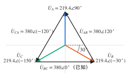
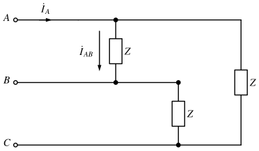
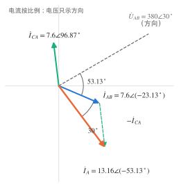
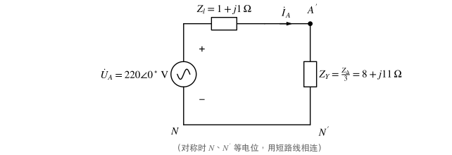
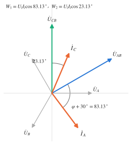
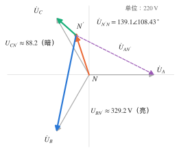
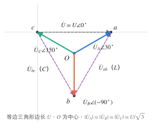

# 习题：三相电路

对应知识点：[三相电路](../notes/three-phase.md)

本页约定：电源均为**正序**对称；采用 sin 约定与有效值相量；"相电压 $220\,\mathrm V$"或"线电压 $380\,\mathrm V$"只取其一为准，另一个由 $\sqrt3$ 倍关系推出。

## 基本关系

### 1. 概念判断 :material-star::material-star-outline::material-star-outline:

判断下列说法是否正确：

1. 对称 Y 联结中，线电压是相电压的 $\sqrt3$ 倍，且（正序时）超前对应相电压 $30^\circ$。
2. Δ 联结负载中，线电流等于相电流。
3. 对称三相功率 $P=\sqrt3U_lI_l\cos\varphi$ 中，$\varphi$ 是线电压与线电流的相位差。
4. 对称 Y–Y 电路中，断开中线不影响各相负载电压。
5. 不对称 Y 形负载接三相四线制时，中线电流为零。
6. 照明用三相四线制的中线上应装熔断器，以便短路时保护线路。

??? success "答案"
    1 ✓　2 ✗　3 ✗　4 ✓　5 ✗　6 ✗

??? note "解析"
    1. $\dot U_{AB}=\dot U_A-\dot U_B=\sqrt3\,\dot U_A\angle30^\circ$。
    2. Δ 联结是**线电压**等于相电压；对称时线电流是相电流的 $\sqrt3$ 倍。
    3. $\varphi$ 是**每相负载的阻抗角**（相电压与相电流的夹角）。线电压与线电流的夹角是 $\varphi\pm30^\circ$。
    4. 对称时负载中点与电源中点等电位，中线电流为零，有无中线结果相同。
    5. 不对称时 $\dot I_N=\dot I_A+\dot I_B+\dot I_C\neq0$。
    6. 中线一旦熔断，不对称负载会出现中性点位移，有的相电压过高、有的过低（见第 8 题），所以中线上**不允许**装熔断器或开关。

### 2. 由一个线电压写出全部电压 :material-star::material-star-outline::material-star-outline:

正序对称三相电源作 Y 联结，已知线电压 $\dot U_{BC}=380\angle0^\circ\,\mathrm V$。求三个相电压 $\dot U_A$、$\dot U_B$、$\dot U_C$ 及线电压 $\dot U_{AB}$、$\dot U_{CA}$。

??? success "答案"
    $\dot U_A=219.4\angle90^\circ$，$\dot U_B=219.4\angle(-30^\circ)$，$\dot U_C=219.4\angle(-150^\circ)\ (\mathrm V)$；
    $\dot U_{AB}=380\angle120^\circ\,\mathrm V$，$\dot U_{CA}=380\angle(-120^\circ)\,\mathrm V$。

??? note "解析"
    线电压与"打头"的那一相对应：$\dot U_{BC}=\sqrt3\,\dot U_B\angle30^\circ$，所以

    $$
    \dot U_B=\frac{380}{\sqrt3}\angle(0^\circ-30^\circ)=219.4\angle(-30^\circ)\,\mathrm V .
    $$

    正序下 $A$ 超前 $B$ $120^\circ$、$C$ 滞后 $B$ $120^\circ$：$\dot U_A=219.4\angle90^\circ$，$\dot U_C=219.4\angle(-150^\circ)$。

    线电压同样依次差 $120^\circ$：$\dot U_{AB}=\dot U_{BC}\angle120^\circ=380\angle120^\circ$，$\dot U_{CA}=380\angle(-120^\circ)$。

    **校验**：$\dot U_{AB}=\sqrt3\,\dot U_A\angle30^\circ=380\angle120^\circ$ ✓

    { .circuit }

    !!! warning "易错"
        不要习惯性地写 $\dot U_A=220\angle0^\circ$——题目给定的参考相量是 $\dot U_{BC}$，所有相位都要从它推出。

## 对称三相电路

### 3. Δ 负载的相电流与线电流 :material-star::material-star::material-star-outline:

对称 Δ 形负载每相 $Z=30+j40\,\Omega$，直接接在线电压 $380\,\mathrm V$ 的电源上，取 $\dot U_{AB}=380\angle30^\circ\,\mathrm V$。

1. 求三个相电流 $\dot I_{AB}$、$\dot I_{BC}$、$\dot I_{CA}$ 和三个线电流 $\dot I_A$、$\dot I_B$、$\dot I_C$；
2. 求三相 $P$、$Q$；
3. 若把同样三只 $Z$ 改接成 Y 形，线电流和有功功率变为多少？

{ .circuit }

??? success "答案"
    1. $\dot I_{AB}=7.6\angle(-23.13^\circ)$，$\dot I_{BC}=7.6\angle(-143.13^\circ)$，$\dot I_{CA}=7.6\angle96.87^\circ\ (\mathrm A)$；
       $\dot I_A=13.16\angle(-53.13^\circ)$，$\dot I_B=13.16\angle(-173.13^\circ)$，$\dot I_C=13.16\angle66.87^\circ\ (\mathrm A)$。
    2. $P=5198.4\,\mathrm W$，$Q=6931.2\,\mathrm{var}$。
    3. Y 形：$I_l\approx4.39\,\mathrm A$，$P=1732.8\,\mathrm W$，都只有 Δ 形的 $1/3$。

??? note "解析"
    $Z=30+j40=50\angle53.13^\circ\,\Omega$。

    1. 每相负载直接承受线电压：

        $$
        \dot I_{AB}=\frac{380\angle30^\circ}{50\angle53.13^\circ}=7.6\angle(-23.13^\circ)\,\mathrm A,
        $$

        $\dot I_{BC}$、$\dot I_{CA}$ 依次滞后 $120^\circ$。线电流由节点 KCL：$\dot I_A=\dot I_{AB}-\dot I_{CA}=\sqrt3\,\dot I_{AB}\angle(-30^\circ)=13.16\angle(-53.13^\circ)\,\mathrm A$，其余依次滞后 $120^\circ$。

        { .circuit }

    2. $P=3I_p^2R=3\times7.6^2\times30=5198.4\,\mathrm W$，$Q=3I_p^2X=3\times7.6^2\times40=6931.2\,\mathrm{var}$。
       （也可用 $\sqrt3U_lI_l\cos\varphi=\sqrt3\times380\times13.16\times0.6$，结果相同。）

    3. Y 形每相电压变为 $380/\sqrt3\approx219.4\,\mathrm V$，

        $$
        I_l=I_p=\frac{219.4}{50}\approx4.39\,\mathrm A,\qquad P=3\times4.39^2\times30=1732.8\,\mathrm W .
        $$

        相电压降为 $1/\sqrt3$，功率与电压平方成正比，所以降为 $1/3$；线电流则由 $\sqrt3I_p=13.16$ 降为 $4.39$，也是 $1/3$。这就是电动机"Y–Δ 降压起动"的原理。

### 4. 经线路阻抗供电的 Δ 负载 :material-star::material-star::material-star-outline:

对称三相电源相电压 $220\,\mathrm V$（Y 联结，取 $\dot U_A=220\angle0^\circ\,\mathrm V$），每根端线阻抗 $Z_l=1+j1\,\Omega$，负载为 Δ 形，每相 $Z_\Delta=24+j33\,\Omega$。求：线电流 $\dot I_A$、负载相电流 $\dot I_{A'B'}$、负载端线电压 $U_{A'B'}$，以及负载功率、线路损耗和电源发出的有功功率。

{ .circuit }

??? success "答案"
    $\dot I_A=14.67\angle(-53.13^\circ)\,\mathrm A$，$\dot I_{A'B'}=8.47\angle(-23.13^\circ)\,\mathrm A$，$U_{A'B'}\approx345.5\,\mathrm V$；
    $P_{负载}\approx5162.7\,\mathrm W$，$P_{线路}\approx645.3\,\mathrm W$，$P_{电源}=5808\,\mathrm W$。

??? note "解析"
    1. **Δ 化 Y**：$Z_Y=Z_\Delta/3=8+j11\,\Omega$。A 相单相电路的总阻抗

        $$
        Z_l+Z_Y=9+j12=15\angle53.13^\circ\,\Omega,\qquad
        \dot I_A=\frac{220\angle0^\circ}{15\angle53.13^\circ}=14.67\angle(-53.13^\circ)\,\mathrm A .
        $$

        { .circuit }

    2. **换回 Δ 内部**：$\dot I_{A'B'}=\dfrac{\dot I_A}{\sqrt3}\angle30^\circ=8.47\angle(-23.13^\circ)\,\mathrm A$。
    3. **负载电压**：$U_{A'B'}=I_{A'B'}\lvert Z_\Delta\rvert=8.47\times\sqrt{24^2+33^2}=8.47\times40.80\approx345.5\,\mathrm V$，比电源线电压 $220\sqrt3\approx381\,\mathrm V$ 低，差值降在线路上。
    4. **功率**：

        $$
        P_{负载}=3I_{A'B'}^2\times24\approx5162.7\,\mathrm W,\qquad P_{线路}=3I_A^2\times1\approx645.3\,\mathrm W,
        $$

        $$
        P_{电源}=3U_AI_A\cos53.13^\circ=3\times220\times14.67\times0.6=5808\,\mathrm W=5162.7+645.3\ \checkmark
        $$

    !!! warning "易错"
        线路阻抗必须与 **Y 等效后**的负载相加；直接写 $Z_l+Z_\Delta$ 是把不同联结方式的阻抗混在了一起。

### 5. Y 形电容与 Δ 形电阻并接 :material-star::material-star::material-star-outline:

（作业 5-51 改编）对称三相电源 $\dot U_A=100\angle0^\circ\,\mathrm V$，$\omega=314\,\mathrm{rad/s}$。端线上同时接两组对称负载：Y 形纯电容，每相 $C=100\,\mu\mathrm F$；Δ 形纯电阻，每相 $300\,\Omega$。求电容负载的 A 相电流 $\dot I_{A1}$、电阻负载的相电流 $\dot I_{AB}$、电源 A 相线电流 $\dot I_A$，以及电源发出的复功率。

{ .circuit }

??? success "答案"
    $\dot I_{A1}=3.14\angle90^\circ\,\mathrm A$，$\dot I_{AB}=0.577\angle30^\circ\,\mathrm A$，$\dot I_A=1+j3.14=3.30\angle72.34^\circ\,\mathrm A$；
    $\bar S=300-j942\,\mathrm{VA}$。

??? note "解析"
    1. **电容组**（对称 Y，星点 $N'$ 与 $N$ 等电位）：$X_C=\dfrac{1}{314\times100\times10^{-6}}\approx31.85\,\Omega$，

        $$
        \dot I_{A1}=\frac{100\angle0^\circ}{-j31.85}=j\,314\times10^{-4}\times100=3.14\angle90^\circ\,\mathrm A .
        $$

    2. **电阻组**：$\dot U_{AB}=100\sqrt3\angle30^\circ\,\mathrm V$，$\dot I_{AB}=\dfrac{100\sqrt3\angle30^\circ}{300}=\dfrac{1}{\sqrt3}\angle30^\circ\approx0.577\angle30^\circ\,\mathrm A$；
       它对应的线电流 $\sqrt3\,\dot I_{AB}\angle(-30^\circ)=1\angle0^\circ\,\mathrm A$。
    3. **电源线电流**：$\dot I_A=1+j3.14\approx3.30\angle72.34^\circ\,\mathrm A$。

        { .circuit }

    4. **复功率**：$\bar S=3\dot U_A\dot I_A^*=3\times100\times(1-j3.14)=300-j942\,\mathrm{VA}$。
       分开算：电阻 $P=3\times\dfrac{(100\sqrt3)^2}{300}=300\,\mathrm W$；电容 $Q=-3\times100\times3.14=-942\,\mathrm{var}$ ✓

    !!! note "关于教材答案"
        书后答案把 $1\angle0^\circ\,\mathrm A$ 写在 $\dot I_{AB}$ 名下，而它其实是电阻负载的 A **线**电流；按图中 $\dot I_{AB}$ 的箭头（Δ 内部 A→B 支路），应为 $0.577\angle30^\circ\,\mathrm A$。

### 6. 由无功功率反求功率与电压 :material-star::material-star::material-star-outline:

（蜂考·三相例题改编）对称 Y 形负载每相 $Z=15+j8\,\Omega$，测得三相无功功率 $Q=1536\,\mathrm{var}$。求线电流、三相有功功率、功率因数和电源线电压。

{ .circuit }

??? success "答案"
    $I_l=8\,\mathrm A$，$P=2880\,\mathrm W$，$\lambda=15/17\approx0.882$（滞后），$U_l=136\sqrt3\approx235.6\,\mathrm V$。

??? note "解析"
    无功只由电抗吸收：$Q=3I_p^2X$，

    $$
    I_p^2=\frac{1536}{3\times8}=64\ \Rightarrow\ I_l=I_p=8\,\mathrm A,\qquad P=3I_p^2R=3\times64\times15=2880\,\mathrm W .
    $$

    $|Z|=\sqrt{15^2+8^2}=17\,\Omega$，$\lambda=\cos\varphi=\dfrac{15}{17}\approx0.882$；$U_p=8\times17=136\,\mathrm V$，$U_l=\sqrt3\times136\approx235.6\,\mathrm V$。

    也可以不求电流：$P=\dfrac{Q}{\tan\varphi}=1536\times\dfrac{15}{8}=2880\,\mathrm W$。

    !!! warning "易错"
        用 $P=Q/\tan\varphi$ 时不要丢掉题给 $Q$ 中的任何因子。某速成资料的同型例题给 $Q=500\sqrt3\,\mathrm{var}$、$Z=15+j8\,\Omega$，答案写成 $937.5\,\mathrm W$，实际应为 $500\sqrt3\times\dfrac{15}{8}\approx1623.8\,\mathrm W$（把 $\sqrt3$ 漏掉了）。

### 7. 两瓦特表的读数 :material-star::material-star::material-star-outline:

对称 Y 形负载每相 $Z=6+j8\,\Omega$，电源线电压 $380\,\mathrm V$。两只功率表按图接入（$W_1$ 测 $\dot I_A$ 与 $\dot U_{AB}$，$W_2$ 测 $\dot I_C$ 与 $\dot U_{CB}$，$*$ 为同名端）。

1. 求两表读数，并由读数求三相 $P$、$Q$；
2. 若负载换成纯电感 $Z=j10\,\Omega$，两表读数各为多少？

{ .circuit }

??? success "答案"
    1. $I_l\approx21.94\,\mathrm A$；$W_1\approx997.2\,\mathrm W$，$W_2\approx7666.8\,\mathrm W$；$P=8664\,\mathrm W$，$Q=11552\,\mathrm{var}$。
    2. $W_1\approx-4168.5\,\mathrm W$，$W_2\approx+4168.5\,\mathrm W$，合计 $P=0$。

??? note "解析"
    1. $Z=10\angle53.13^\circ\,\Omega$，$I_l=\dfrac{380/\sqrt3}{10}\approx21.94\,\mathrm A$，$\varphi=53.13^\circ$。正序、上述接法时

        $$
        W_1=U_lI_l\cos(\varphi+30^\circ)=380\times21.94\cos83.13^\circ\approx997.2\,\mathrm W,
        $$

        $$
        W_2=U_lI_l\cos(\varphi-30^\circ)=380\times21.94\cos23.13^\circ\approx7666.8\,\mathrm W .
        $$

        $P=W_1+W_2=8664\,\mathrm W$，$Q=\sqrt3(W_2-W_1)=11552\,\mathrm{var}$。
        **校验**：$3I_l^2(6+j8)=3\times481.33\times(6+j8)=8664+j11552$ ✓

        { .circuit }

    2. $\varphi=90^\circ$，$I_l$ 不变：$W_1=8336.9\cos120^\circ\approx-4168.5\,\mathrm W$，$W_2=8336.9\cos60^\circ\approx4168.5\,\mathrm W$。纯电感不消耗有功，两表之和为零，但**单表读数都不为零**。

    !!! warning "易错"
        单只表的读数没有独立物理意义，可以为负，相加时必须带符号；$\lvert\varphi\rvert>60^\circ$ 时 $W_1$ 就会变负。

## 不对称三相电路

### 8. 相序指示器 :material-star::material-star::material-star:

如图，无中线的 Y 形负载：A 相接电容 $C$，B、C 两相各接一只相同的灯泡（电阻 $R$），且 $\dfrac{1}{\omega C}=R$。电源相电压 $220\,\mathrm V$，取 $\dot U_A=220\angle0^\circ\,\mathrm V$。求中性点电压 $\dot U_{N'N}$ 和两灯电压，判断哪只灯较亮；若接上理想中线，两灯电压又是多少？

{ .circuit }

??? success "答案"
    $\dot U_{N'N}=44(-1+j3)\approx139.1\angle108.43^\circ\,\mathrm V$；B 相灯 $U_{BN'}\approx329.2\,\mathrm V$，C 相灯 $U_{CN'}\approx88.2\,\mathrm V$，**B 相灯亮**。
    接理想中线后两灯都是 $220\,\mathrm V$，亮度相同。

??? note "解析"
    以电源中点 $N$ 为参考，对 $N'$ 列节点方程（中性点位移公式），$Y_A=j\omega C=\dfrac{j}{R}$，$Y_B=Y_C=\dfrac1R$：

    $$
    \dot U_{N'N}=\frac{j\dot U_A+\dot U_B+\dot U_C}{j+2}
    =220\times\frac{j+\angle(-120^\circ)+\angle120^\circ}{2+j}
    =220\times\frac{-1+j}{2+j}=220\times\frac{-1+j3}{5}.
    $$

    （用到 $\angle(-120^\circ)+\angle120^\circ=-1$。）于是 $\dot U_{N'N}=-44+j132\approx139.1\angle108.43^\circ\,\mathrm V$。

    $$
    \dot U_{BN'}=\dot U_B-\dot U_{N'N}=220\big[(-0.5-j0.866)-(-0.2+j0.6)\big]=220(-0.3-j1.466),\quad U_{BN'}\approx1.496\times220\approx329.2\,\mathrm V,
    $$

    $$
    \dot U_{CN'}=\dot U_C-\dot U_{N'N}=220\big[(-0.5+j0.866)-(-0.2+j0.6)\big]=220(-0.3+j0.266),\quad U_{CN'}\approx0.401\times220\approx88.2\,\mathrm V .
    $$

    B 相灯电压约为 C 相的 $3.7$ 倍，B 相灯亮。结论：**电容接 A 相时，亮灯是滞后 A 相 $120^\circ$ 的 B 相**——据此可以判定实际电源的相序。

    { .circuit }

    有理想中线时 $\dot U_{N'N}=0$，每只灯都承受相电压 $220\,\mathrm V$。

    !!! warning "启示"
        无中线时，不对称负载的相电压可以远高于额定值（这里 B 相灯达 $329\,\mathrm V$）。这正是照明线路必须有中线、中线上不得装熔断器的原因。

### 9. 用单相电源获得对称三相电压 :material-star::material-star::material-star:

（作业 5-58）图示电路接单相正弦电压 $\dot U$（$f=50\,\mathrm{Hz}$），三只电阻均为 $R=10\,\Omega$，公共点为 $O$。要使三只电阻上的电压 $\dot U_A$、$\dot U_B$、$\dot U_C$（极性如图）构成一组**正序**对称三相电压，求 $L$、$C$。

{ .circuit }

??? success "答案"
    $\omega L=\dfrac{1}{\omega C}=\sqrt3R\approx17.32\,\Omega$，即 $L\approx55.13\,\mathrm{mH}$，$C\approx183.8\,\mu\mathrm F$；此时每相电压有效值为 $U/\sqrt3$。

??? note "解析"
    记输入上端为 $a$、中点为 $b$、下端为 $c$，令 $V_c=0$，$\dot U=U\angle0^\circ$，$V_a=U$。

    1. **目标电压**：三电阻另一端共接 $O$，所以 $\dot U_A-\dot U_C=V_a-V_c=U$。正序时 $\dot U_C=\dot U_A\angle120^\circ$，

        $$
        \dot U_A\big(1-1\angle120^\circ\big)=U\ \Rightarrow\ \dot U_A=\frac{U}{\sqrt3\angle(-30^\circ)}=\frac{U}{\sqrt3}\angle30^\circ,\qquad \dot U_B=\frac{U}{\sqrt3}\angle(-90^\circ).
        $$

        从而 $V_O=V_a-\dot U_A=\tfrac U2-j\tfrac{U}{2\sqrt3}$，$V_b=V_O+\dot U_B=\tfrac U2-j\tfrac{\sqrt3}{2}U=U\angle(-60^\circ)$。

        { .circuit }

    2. **节点 $b$ 的 KCL**（流出为正）：

        $$
        \frac{V_b-V_a}{jX_L}+\frac{V_b}{-jX_C}+\frac{\dot U_B}{R}=0 .
        $$

        $V_b-V_a=U\angle(-120^\circ)$，代入得

        $$
        \frac{U}{X_L}\angle150^\circ+\frac{U}{X_C}\angle30^\circ-j\frac{U}{\sqrt3R}=0 .
        $$

        实部：$-\dfrac{\sqrt3}{2X_L}+\dfrac{\sqrt3}{2X_C}=0\Rightarrow X_L=X_C=X$；虚部：$\dfrac{1}{2X}+\dfrac{1}{2X}=\dfrac{1}{\sqrt3R}\Rightarrow X=\sqrt3R$。

    3. **数值**：$\omega=100\pi\,\mathrm{rad/s}$，

        $$
        L=\frac{\sqrt3\times10}{100\pi}\approx55.13\,\mathrm{mH},\qquad C=\frac{1}{100\pi\times10\sqrt3}\approx183.8\,\mu\mathrm F .
        $$

    !!! warning "注意"
        若把 $L$、$C$ 位置对调，得到的是**负序**对称电压（$\dot U_B$ 超前 $\dot U_A$ $120^\circ$）。这一结果只对指定的频率和三只相等的负载电阻成立，负载或频率一变，对称性就被破坏。
