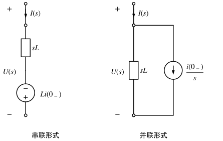
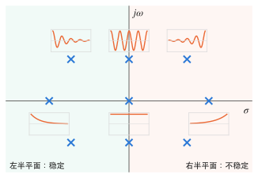

# 运算法（拉普拉斯变换）

!!! abstract "TL;DR"
    运算法 = **把微分方程变成代数方程**。四步：

    1. 求 $0_-$ 时刻的 $i_L(0_-)$、$u_C(0_-)$（只要 $0_-$，不必求 $0_+$）；
    2. 画**运算电路**：$R\to R$，$L\to sL$ 串电压源 $Li_L(0_-)$，$C\to\dfrac1{sC}$ 串电压源 $\dfrac{u_C(0_-)}{s}$，激励换成象函数；
    3. 像直流电阻电路一样求解（节点法、网孔法、戴维南……都能用）；
    4. **部分分式**展开后查表反变换回时域。

    它对任意阶电路、任意激励一视同仁，换路时 $u_C$、$i_L$ 跳变（冲激）的情形也自动处理。

## 1. 拉普拉斯变换

$$
F(s)=\mathscr L[f(t)]=\int_{0_-}^{\infty}f(t)e^{-st}\,\mathrm dt,\qquad s=\sigma+j\omega .
$$

积分下限取 $0_-$，所以 $t=0$ 处的冲激也包含在内。

### 常用变换对

| $f(t)$（$t\ge0$） | $F(s)$ | $f(t)$ | $F(s)$ |
| --- | --- | --- | --- |
| $\delta(t)$ | $1$ | $\sin\omega t$ | $\dfrac{\omega}{s^2+\omega^2}$ |
| $\varepsilon(t)$ | $\dfrac1s$ | $\cos\omega t$ | $\dfrac{s}{s^2+\omega^2}$ |
| $e^{-at}$ | $\dfrac{1}{s+a}$ | $e^{-at}\sin\omega t$ | $\dfrac{\omega}{(s+a)^2+\omega^2}$ |
| $t$ | $\dfrac1{s^2}$ | $e^{-at}\cos\omega t$ | $\dfrac{s+a}{(s+a)^2+\omega^2}$ |
| $te^{-at}$ | $\dfrac{1}{(s+a)^2}$ | $\dfrac{t^{n}}{n!}e^{-at}$ | $\dfrac{1}{(s+a)^{n+1}}$ |

### 主要性质

| 性质 | 时域 | s 域 |
| --- | --- | --- |
| 线性 | $a f_1+b f_2$ | $aF_1+bF_2$ |
| **微分** | $f'(t)$ | $sF(s)-f(0_-)$ |
| **积分** | $\int_{0_-}^t f\,\mathrm d\xi$ | $\dfrac{F(s)}{s}$ |
| 时移 | $f(t-t_0)\varepsilon(t-t_0)$ | $e^{-st_0}F(s)$ |
| 频移 | $e^{-at}f(t)$ | $F(s+a)$ |
| 卷积 | $f_1*f_2$ | $F_1F_2$ |
| 初值定理 | $f(0_+)$ | $\lim\limits_{s\to\infty}sF(s)$（$F$ 为真分式） |
| 终值定理 | $f(\infty)$ | $\lim\limits_{s\to0}sF(s)$（$sF$ 的极点都在左半平面） |

微分性质里的 $-f(0_-)$ 正是初始条件进入方程的地方——下一节的"附加电源"就从这里来。

## 2. 部分分式展开

电路响应的象函数是有理分式 $F(s)=\dfrac{N(s)}{D(s)}$。若分子次数 $\ge$ 分母次数，先做多项式除法，整式部分对应 $\delta(t)$ 及其导数。然后按 $D(s)$ 的根（**极点**）分三种情况：

=== "单实根"

    $$
    F(s)=\sum_i\frac{K_i}{s-p_i},\qquad K_i=\big[(s-p_i)F(s)\big]_{s=p_i}=\frac{N(p_i)}{D'(p_i)},\qquad f(t)=\sum_iK_ie^{p_it}.
    $$

    例：$F(s)=\dfrac{s+3}{(s+1)(s+2)}$，$K_1=\dfrac{-1+3}{-1+2}=2$，$K_2=\dfrac{-2+3}{-2+1}=-1$，

    $$
    f(t)=2e^{-t}-e^{-2t}.
    $$

=== "共轭复根"

    极点 $p=-\alpha+j\omega$ 与 $p^*$ 的系数也共轭，只需算一个：$K=\big[(s-p)F(s)\big]_{s=p}=|K|\angle\theta$，

    $$
    f(t)=2|K|e^{-\alpha t}\cos(\omega t+\theta).
    $$

    例：$F(s)=\dfrac{s+3}{s^2+2s+5}$，$p=-1+j2$，$K=\dfrac{s+3}{s+1+j2}\Big|_{s=-1+j2}=\dfrac{2+j2}{j4}=\dfrac{\sqrt2}{2}\angle-45^\circ$，

    $$
    f(t)=\sqrt2e^{-t}\cos(2t-45^\circ)=e^{-t}(\cos2t+\sin2t).
    $$

    **配方法**更快：$F=\dfrac{(s+1)+2}{(s+1)^2+2^2}$，直接查表得同一结果。

=== "重根"

    $p$ 为 $m$ 重根时，展开式含 $\dfrac{K_{11}}{(s-p)^m}+\dfrac{K_{12}}{(s-p)^{m-1}}+\cdots+\dfrac{K_{1m}}{s-p}$，

    $$
    K_{1j}=\frac{1}{(j-1)!}\frac{\mathrm d^{\,j-1}}{\mathrm ds^{\,j-1}}\big[(s-p)^mF(s)\big]_{s=p}.
    $$

    例：$F(s)=\dfrac{1}{s(s+1)^2}$。$K_0=\dfrac{1}{(s+1)^2}\Big|_{s=0}=1$；$K_{11}=\dfrac1s\Big|_{s=-1}=-1$；$K_{12}=\dfrac{\mathrm d}{\mathrm ds}\dfrac1s\Big|_{s=-1}=-\dfrac1{s^2}\Big|_{s=-1}=-1$，

    $$
    f(t)=1-te^{-t}-e^{-t}.
    $$

!!! tip "自检"
    用初值定理核对 $f(0_+)$：上面三例 $sF(s)\to$ $1$、$1$、$0$，而 $f(0_+)$ 分别为 $2-1=1$、$1$、$1-0-1=0$ ✓

## 3. 运算电路

### 元件的 s 域模型

对 $u_L=L\dfrac{\mathrm di_L}{\mathrm dt}$、$i_C=C\dfrac{\mathrm du_C}{\mathrm dt}$ 取变换（关联参考方向）：

$$
U_L(s)=sL\,I_L(s)-Li_L(0_-),\qquad U_C(s)=\frac{1}{sC}I_C(s)+\frac{u_C(0_-)}{s}.
$$

每个式子都可以画成"阻抗 + 附加电源"的串联或并联形式（图中 $U(s)$、$I(s)$ 为关联参考方向）：

=== "电感"

    { .circuit }

    - 串联：运算阻抗 $sL$ 串电压源 $Li(0_-)$，电源的 $+$ 在电流**流出**的一端（它推动电流沿 $i$ 原来的方向流动）；
    - 并联：$sL$ 并电流源 $\dfrac{i(0_-)}{s}$，方向与 $I(s)$ **相同**。

=== "电容"

    { .circuit }

    - 串联：运算阻抗 $\dfrac{1}{sC}$ 串电压源 $\dfrac{u(0_-)}{s}$，极性与 $u_C$ **相同**（$+$ 在 $u_C$ 的 $+$ 端）；
    - 并联：$\dfrac1{sC}$ 并电流源 $Cu(0_-)$，方向与 $I(s)$ **相反**。

!!! warning "最容易错的地方"
    附加电源的方向。记法：**电感的附加源要维持原电流**（$+$ 在电流出口），**电容的附加源就是原电压**（极性同 $u_C$）。零初始状态时附加源消失，运算电路就是把相量法的 $j\omega$ 换成 $s$。

电阻 $U=RI$ 不变；耦合电感还要在每个线圈上再加互感附加源 $Mi_{\text{另一线圈}}(0_-)$，此处从略。KCL、KVL 在 s 域照样成立：$\sum I(s)=0$，$\sum U(s)=0$。

### 例题

??? example "例：二阶电路的全响应（共轭复根）"
    { .circuit }

    换路前电路已稳定，$t=0$ 时 $S$ 打开。求 $t\ge0$ 时的 $i(t)$ 与 $u_C(t)$。

    **1. $0_-$ 值**（电感短路、电容开路）：$i(0_-)=\dfrac{10}{2+3}=2\,\mathrm A$，$u_C(0_-)=3\times2=6\,\mathrm V$。

    **2. 运算电路**（$S$ 打开后 $R_2$ 断开，只剩一个串联回路）：$sL=s$，附加源 $Li(0_-)=2\,\mathrm V$（$+$ 在电流流出端）；$\dfrac{1}{sC}=\dfrac5s$，附加源 $\dfrac{6}{s}$（$+$ 在上）。

    { .circuit }

    **3. 求解**：沿 $I(s)$ 方向列 KVL（电压升 = 电压降）：

    $$
    \frac{10}{s}+2=\Big(2+s+\frac5s\Big)I(s)+\frac6s
    \ \Rightarrow\ I(s)=\frac{2s+4}{s^2+2s+5}=\frac{2(s+1)+2}{(s+1)^2+2^2}.
    $$

    **4. 反变换**：

    $$
    i(t)=e^{-t}\big(2\cos2t+\sin2t\big)\ \mathrm A .
    $$

    电容电压：

    $$
    U_C(s)=\frac5sI(s)+\frac6s=\frac{10(s+2)}{s(s^2+2s+5)}+\frac6s
    =\frac{4}{s}+\frac{-4s+2}{s^2+2s+5}+\frac6s,
    $$

    $$
    U_C(s)=\frac{10}{s}-\frac{4(s+1)}{(s+1)^2+4}+\frac{3\times2}{(s+1)^2+4}
    \ \Rightarrow\ u_C(t)=10-e^{-t}\big(4\cos2t-3\sin2t\big)\ \mathrm V .
    $$

    **校核**：$i(0_+)=2=i(0_-)$ ✓；$u_C(0_+)=10-4=6$ ✓；$t\to\infty$ 时 $i\to0$、$u_C\to10\,\mathrm V$（电容开路，电源电压全加在电容上）✓；$C\dfrac{\mathrm du_C}{\mathrm dt}\Big|_{0_+}=0.2\times(4+6)=2=i(0_+)$ ✓。

    特征根 $-1\pm j2$ 来自 $s^2+2s+5=0$，即 $R=2\,\Omega<2\sqrt{L/C}=2\sqrt5\,\Omega$：**欠阻尼**，与 [二阶电路](second-order.md) 的时域结论一致。

## 4. 网络函数与零极点

零状态下，单一激励 $E(s)$ 与响应 $R(s)$ 之比

$$
H(s)=\frac{R(s)}{E(s)}
$$

称为**网络函数**。它只取决于电路结构和参数：

- **冲激响应** $h(t)=\mathscr L^{-1}[H(s)]$（因为 $\mathscr L[\delta]=1$）；
- 任意激励的零状态响应 $R(s)=H(s)E(s)$，时域上就是**卷积** $r(t)=h(t)*e(t)$（见 [二阶电路与卷积积分](second-order.md)）；
- 令 $s=j\omega$ 得**频率响应** $H(j\omega)$，与相量法求出的结果相同。

$H(s)$ 分母的根叫**极点**，分子的根叫**零点**。极点就是电路的固有频率，决定自由分量的形式：

{ .circuit }

| 极点位置 | 对应的时域分量 |
| --- | --- |
| 负实轴 $p=-\alpha$ | 衰减指数 $e^{-\alpha t}$ |
| 左半平面共轭对 $-\alpha\pm j\omega$ | 衰减振荡 $e^{-\alpha t}\cos(\omega t+\theta)$ |
| 虚轴上（单阶） | 等幅振荡或常数：临界稳定 |
| 右半平面 | 增长：**不稳定** |

**稳定**的充要条件：$H(s)$ 的全部极点位于左半开平面。零点只影响各分量的大小和相位，不影响稳定性。

??? example "例：RLC 串联的网络函数"
    上例中 $R_1=2\,\Omega$、$L=1\,\mathrm H$、$C=0.2\,\mathrm F$ 的串联回路，以电源为激励、$u_C$ 为响应：

    $$
    H(s)=\frac{U_C(s)}{U_s(s)}=\frac{1/(sC)}{R+sL+1/(sC)}=\frac{5}{s^2+2s+5}.
    $$

    - 极点 $-1\pm j2$，在左半平面，稳定；无有限零点。
    - 冲激响应 $h(t)=\dfrac52\cdot\dfrac{2}{(s+1)^2+4}\to h(t)=2.5e^{-t}\sin2t\ \mathrm V$（对 $1\,\mathrm{V\cdot s}$ 的冲激）。
    - 阶跃响应 $\mathscr L^{-1}\Big[\dfrac{H(s)}{s}\Big]=1-e^{-t}\Big(\cos2t+\dfrac12\sin2t\Big)$。

## 5. 运算法与时域经典法

| | 时域经典法（三要素、解微分方程） | 运算法 |
| --- | --- | --- |
| 需要的初始值 | $0_+$ 值（要画 $0_+$ 电路） | 只要 $u_C(0_-)$、$i_L(0_-)$ |
| 换路时 $u_C$、$i_L$ 跳变 | 另用电荷 / 磁链守恒 | 自动包含（冲激会出现在结果里） |
| 高阶电路 | 要列高阶方程、定积分常数 | 代数运算 + 部分分式 |
| 适用场合 | 直流激励一阶电路最快 | 二阶及以上、指数 / 正弦 / 冲激激励 |

直流一阶电路仍然首选 [三要素法](../notes/dynamic-circuits.md)；运算法是"通用但稍繁"的方法。

## 练习

### 1. 部分分式反变换 :material-star::material-star-outline::material-star-outline:

求下列象函数的原函数：

1. $F_1(s)=\dfrac{2s+5}{s^2+5s+6}$
2. $F_2(s)=\dfrac{s+2}{s(s+1)^2}$
3. $F_3(s)=\dfrac{s^2+3}{s^2+2s+2}$

??? success "答案"
    1. $f_1=e^{-2t}+e^{-3t}$
    2. $f_2=2-2e^{-t}-te^{-t}$
    3. $f_3=\delta(t)+e^{-t}(3\sin t-2\cos t)$

??? note "解析"
    1. 极点 $-2$、$-3$：$K_1=\dfrac{2s+5}{s+3}\Big|_{-2}=1$，$K_2=\dfrac{2s+5}{s+2}\Big|_{-3}=\dfrac{-1}{-1}=1$。
    2. $K_0=\dfrac{s+2}{(s+1)^2}\Big|_0=2$；$K_{11}=\dfrac{s+2}{s}\Big|_{-1}=-1$；$K_{12}=\dfrac{\mathrm d}{\mathrm ds}\dfrac{s+2}{s}\Big|_{-1}=-\dfrac{2}{s^2}\Big|_{-1}=-2$。所以 $F_2=\dfrac2s-\dfrac{1}{(s+1)^2}-\dfrac{2}{s+1}$。
    3. 分子分母同次，先除：$F_3=1+\dfrac{-2s+1}{s^2+2s+2}$；配方 $\dfrac{-2(s+1)+3}{(s+1)^2+1}$，查表即得。

    **自检**（初值定理）：$sF_1\to2=f_1(0_+)$ ✓；$sF_2=\dfrac{s+2}{(s+1)^2}\to0=f_2(0_+)$ ✓；$F_3$ 不是真分式，要对去掉整式后的部分用：$s\cdot\dfrac{-2s+1}{s^2+2s+2}\to-2$，正是 $f_3$ 中非冲激部分在 $0_+$ 的值 ✓。

### 2. 指数激励恰好等于固有频率 :material-star::material-star-outline::material-star-outline:

{ .circuit }

$i(0_-)=0$，$t=0$ 时 $S$ 闭合，$u_s=10e^{-2t}\ \mathrm V$。用运算法求 $i(t)$ 和电感电压 $u_L(t)$（与 $i$ 取关联方向）。

??? success "答案"
    $i(t)=10te^{-2t}\ \mathrm A$，$u_L(t)=10(1-2t)e^{-2t}\ \mathrm V$。

??? note "解析"
    零状态，运算电路就是 $\dfrac{10}{s+2}$ 接 $2+s$：

    $$
    I(s)=\frac{10}{(s+2)(s+2)}=\frac{10}{(s+2)^2}\ \Rightarrow\ i(t)=10te^{-2t}\ \mathrm A .
    $$

    $U_L(s)=sI(s)-0=\dfrac{10s}{(s+2)^2}=\dfrac{10}{s+2}-\dfrac{20}{(s+2)^2}$，$u_L=10(1-2t)e^{-2t}\ \mathrm V$。

    !!! tip "对比时域法"
        电路的固有频率是 $-R/L=-2$，恰好等于激励的指数，时域法要把特解设成 $Ate^{-2t}$（见 [动态电路](../notes/dynamic-circuits.md) 中"激励本身是指数时"）。运算法里这只是一个二重极点，不需要任何特殊处理。

### 3. RLC 放电（有两个初始值） :material-star::material-star::material-star-outline:

{ .circuit }

某时刻（记为 $t=0$）测得 $u_C=4\,\mathrm V$、$i=1\,\mathrm A$（参考方向如图）。画出运算电路，求 $t\ge0$ 时的 $i(t)$ 和 $u_L(t)$。

??? success "答案"
    $i(t)=3e^{-t}-2e^{-2t}\ \mathrm A$，$u_L(t)=-3e^{-t}+4e^{-2t}\ \mathrm V$。

??? note "解析"
    1. **运算模型**：电容 $\dfrac{1}{sC}=\dfrac2s$ 串 $\dfrac4s$（$+$ 在上）；电感 $s$ 串 $Li(0_-)=1\,\mathrm V$（$+$ 在电流流出端，即下端）；电阻 $3$。
    2. **KVL**：$i$ 从电容的 $+$ 极板流出，所以电容支路对 $I$ 是"非关联"的：$U_C(s)=\dfrac4s-\dfrac2sI(s)$；沿回路

        $$
        \frac4s-\frac2sI=3I+sI-1\ \Rightarrow\ I(s)=\frac{s+4}{s^2+3s+2}=\frac{3}{s+1}-\frac{2}{s+2}.
        $$

    3. $i(t)=3e^{-t}-2e^{-2t}\ \mathrm A$，$i(0)=1$ ✓。
    4. $U_L(s)=sI(s)-Li(0_-)=\dfrac{s^2+4s}{s^2+3s+2}-1=\dfrac{s-2}{(s+1)(s+2)}=\dfrac{-3}{s+1}+\dfrac{4}{s+2}$，故 $u_L=-3e^{-t}+4e^{-2t}\ \mathrm V$。

    **校核**：$t=0$ 时 KVL $u_C=3i+u_L\Rightarrow4=3+1$ ✓。特征根 $-1$、$-2$ 为两个负实根——$R=3>2\sqrt{L/C}=2\sqrt2\approx2.83\,\Omega$，过阻尼 ✓。

### 4. 网络函数与稳定性 :material-star::material-star::material-star-outline:

{ .circuit }

以 $u_s$ 为激励、$u_C$ 为响应。（1）$R=3\,\Omega$ 时求 $H(s)$、极点、冲激响应 $h(t)$ 和单位阶跃响应；（2）$R=0$ 时极点在哪里？电路是否稳定？

??? success "答案"
    （1）$H(s)=\dfrac{2}{s^2+3s+2}$，极点 $-1$、$-2$；$h(t)=2(e^{-t}-e^{-2t})$；阶跃响应 $1-2e^{-t}+e^{-2t}$。（2）$\pm j\sqrt2$，临界稳定（等幅振荡），不是渐近稳定。

??? note "解析"
    1. $H(s)=\dfrac{1/(sC)}{R+sL+1/(sC)}=\dfrac{1}{LCs^2+RCs+1}=\dfrac{1}{0.5s^2+1.5s+1}=\dfrac{2}{(s+1)(s+2)}$。

        $$
        h(t)=\mathscr L^{-1}\Big[\frac{2}{s+1}-\frac{2}{s+2}\Big]=2e^{-t}-2e^{-2t},\qquad
        \mathscr L^{-1}\Big[\frac{H(s)}{s}\Big]=\mathscr L^{-1}\Big[\frac1s-\frac{2}{s+1}+\frac{1}{s+2}\Big]=1-2e^{-t}+e^{-2t}.
        $$

        校核：阶跃响应的导数 $2e^{-t}-2e^{-2t}=h(t)$ ✓（$h=\mathrm ds/\mathrm dt$）。

    2. $R=0$：$H(s)=\dfrac{2}{s^2+2}$，极点 $\pm j\sqrt2$ 在虚轴上，冲激响应 $\sqrt2\sin\sqrt2t$ 不衰减。按"全部极点在左半开平面"的标准，不稳定（临界稳定）。

### 5. 电容直接并联：冲激电流 :material-star::material-star::material-star:

{ .circuit }

$u_1(0_-)=6\,\mathrm V$，$u_2(0_-)=0$，$t=0$ 时 $S$ 闭合。设 $i$ 为经开关由 $C_1$ 流向 $C_2$ 的电流。用运算法求 $i(t)$ 和 $u_2(t)$。

??? success "答案"
    $i(t)=4\delta(t)\ \mathrm A$，$u_2(t)=2\,\mathrm V$（$t>0$）。

??? note "解析"
    运算模型：$C_1$ 为 $\dfrac1s$ 串 $\dfrac6s$，$C_2$ 为 $\dfrac{1}{2s}$。$i$ 从 $C_1$ 的 $+$ 极板流出、流入 $C_2$ 的 $+$ 极板，回路 KVL（$U_1=U_2$）：

    $$
    \frac6s-\frac1sI(s)=\frac{1}{2s}I(s)\ \Rightarrow\ I(s)=4\ \Rightarrow\ i(t)=4\delta(t)\ \mathrm A .
    $$

    $U_2(s)=\dfrac{1}{2s}\times4=\dfrac2s$，即 $u_2=2\,\mathrm V$；$U_1(s)=\dfrac6s-\dfrac4s=\dfrac2s$，$u_1=2\,\mathrm V$。

    与 [电荷守恒](../notes/dynamic-circuits.md#4-换路定则失效电荷守恒与磁链守恒) 的结果一致：冲激电流在一瞬间搬运了 $4\,\mathrm C$ 电荷（$C_1$：$6\to2$，$C_2$：$0\to2$）。运算法只用了 $0_-$ 值，跳变自动出现。
