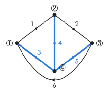
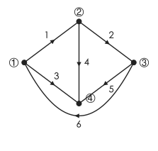

# 电路方程的矩阵形式与状态方程

!!! abstract "TL;DR"
    - 把电路抽象成**有向图**（$n$ 个节点、$b$ 条支路），用三个矩阵描述拓扑：

        | 矩阵 | 尺寸 | KCL | KVL |
        | --- | --- | --- | --- |
        | 关联矩阵 $\mathbf A$ | $(n-1)\times b$ | $\mathbf A\mathbf I=\mathbf 0$ | $\mathbf U=\mathbf A^{\mathsf T}\mathbf U_n$ |
        | 基本回路矩阵 $\mathbf B$ | $(b-n+1)\times b$ | $\mathbf I=\mathbf B^{\mathsf T}\mathbf I_l$ | $\mathbf B\mathbf U=\mathbf 0$ |
        | 基本割集矩阵 $\mathbf Q$ | $(n-1)\times b$ | $\mathbf Q\mathbf I=\mathbf 0$ | $\mathbf U=\mathbf Q^{\mathsf T}\mathbf U_t$ |

    - 再配上**标准支路**的 VCR $\mathbf I=\mathbf Y(\mathbf U+\mathbf U_s)-\mathbf I_s$，得节点方程 $\mathbf A\mathbf Y\mathbf A^{\mathsf T}\mathbf U_n=\mathbf A\mathbf I_s-\mathbf A\mathbf Y\mathbf U_s$。
    - **状态方程**：以 $u_C$、$i_L$ 为状态变量，写成 $\dot{\mathbf x}=\mathbf A\mathbf x+\mathbf B\mathbf v$；$\mathbf A$ 的特征值就是电路的固有频率。

这一页把 [一般分析方法](../notes/analysis-methods.md) 里的"独立方程数""树与连支"写成矩阵，是计算机辅助分析（SPICE 之类）的基础。

## 1. 图、树、回路与割集

- **图**：只保留节点和支路的连接关系，不管支路里是什么元件；给每条支路规定方向（就是支路电流、电压的关联参考方向），得到**有向图**。
- **树**：连通全部节点、不含回路的支路集合，有 $n-1$ 条**树支**；其余 $b-n+1$ 条为**连支**。
- **基本回路**（单连支回路）：每条连支和树支构成唯一一个回路，共 $b-n+1$ 个，方向取该连支的方向。
- **割集**：把图分成两部分、而少一条都不行的最少支路集合。**基本割集**（单树支割集）只含一条树支，共 $n-1$ 个，方向取该树支的方向。

本页统一使用下面这个图（$n=4$，$b=6$，节点 ④ 为参考节点），粗线为树 $\{3,4,5\}$：

{ .circuit }

支路方向：$1$：①→②，$2$：②→③，$3$：①→④，$4$：②→④，$5$：③→④，$6$：③→①。

## 2. 三个矩阵

=== "关联矩阵 A"

    行对应独立节点 ①②③，列对应支路 $1\sim6$：支路 $k$ **离开**节点 $j$ 记 $+1$，**指向**节点 $j$ 记 $-1$，无关记 $0$。

    $$
    \mathbf A=\begin{bmatrix}
    1&0&1&0&0&-1\\
    -1&1&0&1&0&0\\
    0&-1&0&0&1&1
    \end{bmatrix}
    $$

    - 第 $j$ 行就是节点 $j$ 的 KCL（流出为正）：$\mathbf A\mathbf I=\mathbf 0$；
    - 每条支路电压 = 起点节点电压 − 终点节点电压：$\mathbf U=\mathbf A^{\mathsf T}\mathbf U_n$（这就是 KVL）。

=== "基本回路矩阵 B"

    行对应连支 $1、2、6$ 的基本回路，回路方向与连支一致；支路在回路中且方向相同记 $+1$，相反记 $-1$。例如连支 $1$（①→②）沿树回到 ①：②→④（支路 4，同向）、④→①（支路 3，反向）。

    $$
    \mathbf B=\begin{bmatrix}
    1&0&-1&1&0&0\\
    0&1&0&-1&1&0\\
    0&0&1&0&-1&1
    \end{bmatrix}
    $$

    - KVL：$\mathbf B\mathbf U=\mathbf 0$；
    - 每条支路电流由连支电流（回路电流）叠加：$\mathbf I=\mathbf B^{\mathsf T}\mathbf I_l$，这就是回路电流法。

=== "基本割集矩阵 Q"

    行对应树支 $3、4、5$ 的基本割集，方向与树支一致。本例的树是以 ④ 为中心的"星形"，每个基本割集恰好把一个节点单独切出来，所以 $\mathbf Q=\mathbf A$（一般并非如此，见练习 2）：

    $$
    \mathbf Q=\begin{bmatrix}
    1&0&1&0&0&-1\\
    -1&1&0&1&0&0\\
    0&-1&0&0&1&1
    \end{bmatrix}
    $$

    - KCL：$\mathbf Q\mathbf I=\mathbf 0$；
    - 每条支路电压可由树支电压表示：$\mathbf U=\mathbf Q^{\mathsf T}\mathbf U_t$。

!!! tip "三个矩阵之间的关系"
    - $\mathbf A\mathbf B^{\mathsf T}=\mathbf 0$，$\mathbf Q\mathbf B^{\mathsf T}=\mathbf 0$——KCL 与 KVL "正交"，这正是 [特勒根定理](tellegen-duality.md) 的来源。
    - 按"先树支、后连支"排列各列时，$\mathbf B=[\mathbf B_t\ \ \mathbf 1_l]$，$\mathbf Q=[\mathbf 1_t\ \ \mathbf Q_l]$，并且 $\mathbf B_t=-\mathbf Q_l^{\mathsf T}$：知道一个就能写出另一个。本例取列序 $(3,4,5\,|\,1,2,6)$ 可以验证。

## 3. 矩阵形式的电路方程

### 标准支路

{ .circuit }

一条支路最多包含一个阻抗 $Z_k$（导纳 $Y_k$）、一个与之串联的电压源 $\dot U_{sk}$、一个跨接在整条支路两端的电流源 $\dot I_{sk}$。按图中方向（**电压源 $+$ 端在支路的"出口"$b$，电流源与支路方向相反**）：

$$
\dot I_k=Y_k(\dot U_k+\dot U_{sk})-\dot I_{sk},\qquad
\mathbf I=\mathbf Y(\mathbf U+\mathbf U_s)-\mathbf I_s .
$$

没有某个电源就令它为零；$\mathbf Y$ 是支路导纳矩阵（无受控源、无互感时为对角阵）。不同教材的标准支路方向约定不同，推导出的方程符号也随之变，用之前先看清约定。

### 节点、回路、割集方程

把 VCR 代入 KCL $\mathbf A\mathbf I=\mathbf 0$，再用 $\mathbf U=\mathbf A^{\mathsf T}\mathbf U_n$：

$$
\underbrace{\mathbf A\mathbf Y\mathbf A^{\mathsf T}}_{\mathbf Y_n}\mathbf U_n=\underbrace{\mathbf A\mathbf I_s-\mathbf A\mathbf Y\mathbf U_s}_{\mathbf J_n}.
$$

同理（把 VCR 写成 $\mathbf U=\mathbf Z(\mathbf I+\mathbf I_s)-\mathbf U_s$）：

$$
\text{回路方程：}\ \mathbf B\mathbf Z\mathbf B^{\mathsf T}\mathbf I_l=\mathbf B\mathbf U_s-\mathbf B\mathbf Z\mathbf I_s,\qquad
\text{割集方程：}\ \mathbf Q\mathbf Y\mathbf Q^{\mathsf T}\mathbf U_t=\mathbf Q\mathbf I_s-\mathbf Q\mathbf Y\mathbf U_s .
$$

$\mathbf Y_n$ 的对角元是自导、非对角元是负的互导，和手工列节点方程的规律完全一致——矩阵只是把它"自动化"了。

??? example "例：用 A 矩阵列节点方程"
    上图的电路各支路参数如下（直流）：

    | 支路 | 1 | 2 | 3 | 4 | 5 | 6 |
    | --- | --- | --- | --- | --- | --- | --- |
    | $G_k/\mathrm S$ | $0.5$ | $1$ | $1$ | $0.5$ | $0.5$ | $0.5$ |
    | 电源 | — | — | $U_{s3}=6\,\mathrm V$ | $I_{s4}=6\,\mathrm A$ | — | — |

    （按标准支路约定：支路 3 中电压源的 $+$ 端靠 ④；支路 4 中电流源由 ④ 指向 ②，即向节点 ② 注入 $6\,\mathrm A$。）

    $$
    \mathbf Y_n=\mathbf A\mathbf G\mathbf A^{\mathsf T}=\begin{bmatrix}2&-0.5&-0.5\\-0.5&2&-1\\-0.5&-1&2\end{bmatrix}\mathrm S,\qquad
    \mathbf J_n=\mathbf A\mathbf I_s-\mathbf A\mathbf G\mathbf U_s=\begin{bmatrix}-6\\6\\0\end{bmatrix}\mathrm A .
    $$

    以第一行为例：节点 ① 连着支路 1、3、6，自导 $0.5+1+0.5=2$；与 ② 共用支路 1，互导 $-0.5$；$J_1=-G_3U_{s3}=-6$（电压源 $+$ 端背离节点 ①，等效为从 ① 抽出 $6\,\mathrm A$）。

    解得 $\mathbf U_n=[-2,\ 3,\ 1]^{\mathsf T}\,\mathrm V$。支路电压 $\mathbf U=\mathbf A^{\mathsf T}\mathbf U_n=[-5,\,2,\,-2,\,3,\,1,\,3]^{\mathsf T}\,\mathrm V$，支路电流 $\mathbf I=\mathbf G(\mathbf U+\mathbf U_s)-\mathbf I_s=[-2.5,\,2,\,4,\,-4.5,\,0.5,\,1.5]^{\mathsf T}\,\mathrm A$。

    **校核**：节点 ① 流出 $I_1+I_3-I_6=-2.5+4-1.5=0$ ✓；$\mathbf U^{\mathsf T}\mathbf I=12.5+4-8-13.5+0.5+4.5=0$ ✓（特勒根定理）。

## 4. 状态方程

$n$ 阶动态电路可以写成 $n$ 个**一阶**方程组成的方程组，而不是一个 $n$ 阶方程：

$$
\dot{\mathbf x}=\mathbf A\mathbf x+\mathbf B\mathbf v,\qquad \mathbf y=\mathbf C\mathbf x+\mathbf D\mathbf v,
$$

$\mathbf x$ 为状态变量（通常取各电容电压 $u_C$、各电感电流 $i_L$），$\mathbf v$ 为激励，$\mathbf y$ 为所求输出。好处：初始条件就是 $u_C(0)$、$i_L(0)$，便于数值计算；也是"现代控制理论"的出发点。

**直观列写法**：

1. 每个电容：对与它相连的一个节点（或割集）列 **KCL**，得 $C\dfrac{\mathrm du_C}{\mathrm dt}=\cdots$；
2. 每个电感：对含它的一个回路列 **KVL**，得 $L\dfrac{\mathrm di_L}{\mathrm dt}=\cdots$；
3. 右边若出现电阻电流、电压等非状态量，用其余的 KCL、KVL 把它们用状态变量和激励表示，最后整理成矩阵形式。

??? example "例：RLC 电路的状态方程"
    { .circuit }

    以 $u_C$、$i_L$ 为状态变量。

    - 节点 $a$ 的 KCL：$1\cdot\dfrac{\mathrm du_C}{\mathrm dt}=\dfrac{u_s-u_C}{R_1}-i_L$；
    - 电感所在回路的 KVL：$1\cdot\dfrac{\mathrm di_L}{\mathrm dt}=u_C-R_2i_L$。

    $$
    \frac{\mathrm d}{\mathrm dt}\begin{bmatrix}u_C\\i_L\end{bmatrix}=
    \begin{bmatrix}-1&-1\\1&-1\end{bmatrix}\begin{bmatrix}u_C\\i_L\end{bmatrix}+\begin{bmatrix}1\\0\end{bmatrix}u_s .
    $$

    特征方程 $\det(s\mathbf 1-\mathbf A)=(s+1)^2+1=s^2+2s+2=0$，固有频率 $s=-1\pm j$。用运算法求网络函数 $\dfrac{U_C(s)}{U_s(s)}=\dfrac{s+1}{s^2+2s+2}$，极点相同 ✓。

!!! warning "状态变量的个数"
    状态变量个数 = 独立储能元件数。若电路中有**只由电容（和电压源）构成的回路**或**只由电感（和电流源）构成的割集**，其中的 $u_C$ 或 $i_L$ 不再独立，要少取一个——这和 [换路定则失效](../notes/dynamic-circuits.md#4-换路定则失效电荷守恒与磁链守恒) 是同一件事。

## 练习

### 1. 计数 :material-star::material-star-outline::material-star-outline:

某连通电路的图有 $5$ 个节点、$8$ 条支路。（1）树支、连支各多少？（2）$\mathbf A$、$\mathbf B$、$\mathbf Q$ 各是几行几列？（3）独立的 KCL、KVL 方程各有几个？

??? success "答案"
    （1）树支 $4$、连支 $4$；（2）$\mathbf A$、$\mathbf Q$：$4\times8$，$\mathbf B$：$4\times8$；（3）KCL $4$ 个，KVL $4$ 个。

??? note "解析"
    树支 $n-1=4$，连支 $b-n+1=4$。$\mathbf A$ 每个独立节点一行、$\mathbf Q$ 每条树支一行，都是 $(n-1)$ 行；$\mathbf B$ 每条连支一行，$(b-n+1)$ 行；列数都是支路数 $8$。独立 KCL 个数 = $n-1$，独立 KVL 个数 = $b-n+1$，加起来恰好等于支路数 $b$——与支路电流法的方程数一致。

### 2. 换一棵树 :material-star::material-star::material-star-outline:

{ .circuit }

对上面的图改选树 $\{1,2,3\}$。写出基本回路矩阵 $\mathbf B$ 和基本割集矩阵 $\mathbf Q$（列按支路 $1\sim6$ 排列），并验证 $\mathbf B_t=-\mathbf Q_l^{\mathsf T}$。

??? success "答案"
    $$
    \mathbf B=\begin{bmatrix}1&0&-1&1&0&0\\1&1&-1&0&1&0\\1&1&0&0&0&1\end{bmatrix}\ (\text{连支 }4,5,6),\qquad
    \mathbf Q=\begin{bmatrix}1&0&0&-1&-1&-1\\0&1&0&0&-1&-1\\0&0&1&1&1&0\end{bmatrix}\ (\text{树支 }1,2,3).
    $$

??? note "解析"
    1. **基本回路**（方向同连支，沿树回到起点）：
        - 连支 4（②→④）：④→① 走支路 3（反向 $-1$），①→② 走支路 1（同向 $+1$）；
        - 连支 5（③→④）：④→①（3，$-1$），①→②（1，$+1$），②→③（2，$+1$）；
        - 连支 6（③→①）：①→②（1，$+1$），②→③（2，$+1$）。
    2. **基本割集**（方向同树支）：去掉一条树支，树分成两块，所有连接两块的连支加上这条树支就是它的基本割集。
        - 树支 1（①→②）：两块为 $\{①,④\}$ 与 $\{②,③\}$，方向由 ① 侧指向 ② 侧；连支 4（②→④）、5（③→④）、6（③→①）都从 ②③ 侧指向 ①④ 侧，记 $-1$；
        - 树支 2（②→③）：$\{③\}$ 单独切出，方向指向 ③；支路 5、6 都离开 ③，记 $-1$；
        - 树支 3（①→④）：$\{④\}$ 单独切出，方向指向 ④；支路 4、5 也指向 ④，记 $+1$。
    3. **验证**：列序取 $(1,2,3\,|\,4,5,6)$，

        $$
        \mathbf B_t=\begin{bmatrix}1&0&-1\\1&1&-1\\1&1&0\end{bmatrix},\quad
        \mathbf Q_l=\begin{bmatrix}-1&-1&-1\\0&-1&-1\\1&1&0\end{bmatrix},\quad
        -\mathbf Q_l^{\mathsf T}=\begin{bmatrix}1&0&-1\\1&1&-1\\1&1&0\end{bmatrix}=\mathbf B_t\ ✓
        $$

### 3. 节点方程的矩阵形式 :material-star::material-star-outline::material-star-outline:

仍用上面的图，各支路电导都是 $1\,\mathrm S$，只有支路 3 含电流源 $I_{s3}=4\,\mathrm A$（按标准支路约定，与支路方向相反，即由 ④ 指向 ①）。求 $\mathbf Y_n$、$\mathbf J_n$ 与节点电压。

??? success "答案"
    $\mathbf Y_n=\begin{bmatrix}3&-1&-1\\-1&3&-1\\-1&-1&3\end{bmatrix}\mathrm S$，$\mathbf J_n=[4,0,0]^{\mathsf T}\,\mathrm A$，$\mathbf U_n=[2,1,1]^{\mathsf T}\,\mathrm V$。

??? note "解析"
    1. $\mathbf Y_n=\mathbf A\mathbf A^{\mathsf T}$：每个节点都连 3 条支路（自导 3），每两个节点之间恰有一条支路（互导 $-1$）。
    2. $\mathbf J_n=\mathbf A\mathbf I_s$，$\mathbf I_s=[0,0,4,0,0,0]^{\mathsf T}$，只有 $A_{13}=1$ 起作用：$\mathbf J_n=[4,0,0]^{\mathsf T}$（$4\,\mathrm A$ 注入节点 ①）。
    3. 由对称性 $U_2=U_3$。第二行：$-U_1+3U_2-U_3=0\Rightarrow U_1=2U_2$；第一行：$3U_1-2U_2=4\Rightarrow 4U_2=4$，$U_2=1$，$U_1=2\,\mathrm V$。

    **校核**：从 ① 经三个 $1\,\mathrm S$ 电导流出的电流 $(2-1)+(2-0)+(2-1)=4\,\mathrm A$ = 注入电流 ✓

### 4. 三阶电路的状态方程 :material-star::material-star::material-star:

{ .circuit }

以 $u_1$、$u_2$、$i_L$ 为状态变量，（1）列出状态方程；（2）求固有频率；（3）$u_s=U_0$（直流）时求稳态的 $u_1$、$u_2$、$i_L$。

??? success "答案"
    （1）$\dfrac{\mathrm d}{\mathrm dt}\begin{bmatrix}u_1\\u_2\\i_L\end{bmatrix}=\begin{bmatrix}-1&0&-1\\0&-1&1\\1&-1&0\end{bmatrix}\begin{bmatrix}u_1\\u_2\\i_L\end{bmatrix}+\begin{bmatrix}1\\0\\0\end{bmatrix}u_s$；（2）$s=-1$，$s=-\dfrac12\pm j\dfrac{\sqrt7}{2}$；（3）$u_1=u_2=\dfrac{U_0}{2}$，$i_L=\dfrac{U_0}{2}$（A，数值上）。

??? note "解析"
    1. 列写：
        - 节点 $a$（$C_1$）：$\dfrac{\mathrm du_1}{\mathrm dt}=\dfrac{u_s-u_1}{1}-i_L$；
        - 电感回路（$a\to b$）：$\dfrac{\mathrm di_L}{\mathrm dt}=u_1-u_2$；
        - 节点 $b$（$C_2$）：$\dfrac{\mathrm du_2}{\mathrm dt}=i_L-\dfrac{u_2}{1}$。
    2. $\det(s\mathbf 1-\mathbf A)=s^3+2s^2+3s+2=(s+1)(s^2+s+2)$，根为 $-1$ 和 $\dfrac{-1\pm j\sqrt7}{2}$，全在左半平面，电路稳定。
    3. 稳态 $\dot{\mathbf x}=\mathbf 0$：$u_1=u_2$，$i_L=u_2$，$U_0-u_1-i_L=0$，得 $u_1=u_2=U_0/2$、$i_L=U_0/2\ (\mathrm A)$。直观看：直流时电感短路、电容开路，电路就是 $U_0$ 加在两个 $1\,\Omega$ 电阻串联上 ✓
