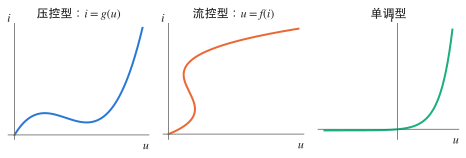
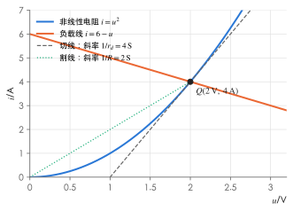
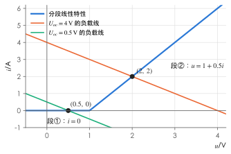

# 非线性电阻电路

!!! abstract "TL;DR"
    - 非线性电路**叠加定理、齐次性都不成立**，但 KCL、KVL 照样成立；戴维南等效仍可用于电路中的**线性部分**。
    - 只有一个非线性电阻时：先把其余线性部分化成戴维南电路 $(U_{oc},R_{eq})$，得**负载线** $u=U_{oc}-R_{eq}i$，它与元件特性的交点就是**工作点 $Q$**。
    - 求交点的三种方法：**图解**、**分段线性化**（假设所在段 → 求解 → 验证）、**迭代**。
    - 直流工作点上叠加小的变化量时，用 $Q$ 点的**动态电阻** $r_d=\dfrac{\mathrm du}{\mathrm di}\Big|_Q$ 代替非线性电阻，变化量满足线性电路——这就是**小信号分析**，也是模拟电子技术中"微变等效电路"的来源。

[分析方法](../notes/analysis-methods.md#5-理想二极管先假设再验证) 中的理想二极管，就是最简单的分段线性非线性电阻。

## 1. 非线性电阻的特性

{ .circuit }

| 类型 | 特性 | 例子 |
| --- | --- | --- |
| 电压控制型 | $i=g(u)$：每个 $u$ 只对应一个 $i$，反之不一定 | 隧道二极管（N 形曲线） |
| 电流控制型 | $u=f(i)$：每个 $i$ 只对应一个 $u$ | 辉光放电管（S 形曲线） |
| 单调型 | 既压控又流控 | PN 结二极管 $i=I_s\big(e^{u/U_T}-1\big)$ |

**静态电阻与动态电阻**（在工作点 $Q(U_0,I_0)$）：

$$
R=\frac{U_0}{I_0}\ (\text{原点到 }Q\text{ 的割线}),\qquad
r_d=\frac{\mathrm du}{\mathrm di}\Big|_Q\ (Q\text{ 点切线}).
$$

两者一般不相等，而且都随工作点改变。隧道二极管的下降段 $r_d<0$（负动态电阻）。

!!! warning "非线性的后果"
    - 齐次性失效：$i=u^2$ 时电压加倍，电流变为 4 倍；
    - 叠加失效：$(u_1+u_2)^2\ne u_1^2+u_2^2$；
    - 可能有多个解：N 形特性与负载线可能有 3 个交点；
    - 正弦激励下会产生谐波（与 [非正弦电路](../notes/nonsinusoidal.md) 联系起来）。

**串、并联**：非线性电阻串联时，在同一电流下把电压相加；并联时在同一电压下把电流相加——用曲线作图，或在特性有解析式时直接相加。

## 2. 求工作点

??? example "例：负载线（图解 + 解析）"
    { .circuit }

    $u_s=12\,\mathrm V$（直流），非线性电阻的特性为 $i=u^2$（$u\ge0$，单位 V、A）。求工作点和该点的静态、动态电阻。

    1. **线性部分化简**：从非线性电阻两端看进去，$U_{oc}=12\times\dfrac{2}{2+2}=6\,\mathrm V$，$R_{eq}=2\parallel2=1\,\Omega$。负载线 $u=6-i$。
    2. **联立**：$u^2=6-u\Rightarrow u^2+u-6=0\Rightarrow u=2\,\mathrm V$（舍去 $-3$），$i=4\,\mathrm A$。
    3. **电阻**：$R=\dfrac{2}{4}=0.5\,\Omega$；$\dfrac{\mathrm di}{\mathrm du}=2u=4\,\mathrm S$，$r_d=0.25\,\Omega$。

    { .circuit }

    图中切线（灰色虚线）斜率 $4\,\mathrm S$，割线（绿色点线）斜率 $2\,\mathrm S$，两者不同。

### 分段线性化

把特性曲线用几段直线近似，每一段等效为"线性电阻 + 电压源"（或理想二极管组合）。求解时：

1. **假设**工作点在某一段，用该段的线性模型解电路；
2. **验证**解是否落在该段的范围内；不在就换一段重来。

??? example "例：分段线性电阻"
    某非线性电阻的特性：$u<1\,\mathrm V$ 时 $i=0$（段①）；$u\ge1\,\mathrm V$ 时 $u=1+0.5i$（段②，相当于 $1\,\mathrm V$ 电压源串 $0.5\,\Omega$ 再串一个理想二极管）。它接在 $R_{eq}=1\,\Omega$ 的戴维南电路上，分别求 $U_{oc}=4\,\mathrm V$ 和 $U_{oc}=0.5\,\mathrm V$ 时的工作点。

    - **$U_{oc}=4\,\mathrm V$**：设在段②，$i=\dfrac{4-1}{1+0.5}=2\,\mathrm A$，$u=1+0.5\times2=2\,\mathrm V\ge1$ ✓。
    - **$U_{oc}=0.5\,\mathrm V$**：设在段②，$i=\dfrac{0.5-1}{1.5}<0$，对应 $u=1+0.5i<1$，与段②矛盾；改设段①：$i=0$，$u=U_{oc}=0.5\,\mathrm V<1$ ✓。

    { .circuit }

### 迭代法

特性是超越函数（如二极管指数特性）时没有解析解，可以把方程改写成 $u=\varphi(u)$ 反复代入，或用牛顿法。练习 4 给出一例。

## 3. 小信号分析

设激励 = 直流 $U_0$ + 很小的变化量 $\Delta u_s(t)$。在工作点附近把特性按泰勒展开、只保留一次项：

$$
i\approx I_Q+\frac{\mathrm di}{\mathrm du}\Big|_Q\Delta u=I_Q+\frac{\Delta u}{r_d}.
$$

所以**变化量**满足一个线性电路：

1. 只加直流，求工作点 $Q$；
2. 求 $Q$ 点的动态电阻 $r_d$；
3. 画**小信号等效电路**：直流源置零，非线性电阻换成 $r_d$，只保留 $\Delta u_s$；
4. 解出 $\Delta u$、$\Delta i$；总响应 $\approx$ 工作点值 + 变化量。

??? example "例：叠加小信号"
    上面负载线例题中，激励改为 $u_s=12+\sin t\ \mathrm V$，求 $u$、$i$。

    1. 工作点：$U_Q=2\,\mathrm V$，$I_Q=4\,\mathrm A$，$r_d=0.25\,\Omega$（已求）。
    2. 小信号激励折算到戴维南电路：$\Delta u_{oc}=\dfrac{2}{2+2}\sin t=0.5\sin t\ \mathrm V$，$R_{eq}=1\,\Omega$。

        { .circuit }

    3. 分压：$\Delta u=0.5\sin t\times\dfrac{0.25}{1+0.25}=0.1\sin t\ \mathrm V$，$\Delta i=\dfrac{\Delta u}{r_d}=0.4\sin t\ \mathrm A$。

    $$
    u\approx2+0.1\sin t\ \mathrm V,\qquad i\approx4+0.4\sin t\ \mathrm A .
    $$

    **精度检查**：$\sin t=1$ 时精确解满足 $u^2+u-6.5=0$，$u=2.098\,\mathrm V$（近似 $2.1$）；$\sin t=-1$ 时 $u^2+u-5.5=0$，$u=1.898\,\mathrm V$（近似 $1.9$）。误差约 $0.002\,\mathrm V$，而且正负半周不对称——这正是被忽略的二次项（谐波）。

!!! tip "和模电的联系"
    晶体管放大电路的分析就是这三步：先算静态工作点（直流通路），再在工作点上求 $r_{be}$ 等动态参数，最后画微变等效电路（交流通路）求放大倍数。二极管的动态电阻 $r_d=\dfrac{U_T}{I_D}$（$U_T\approx26\,\mathrm{mV}$）也是这样得到的。

## 练习

### 1. 概念判断 :material-star::material-star-outline::material-star-outline:

判断下列说法是否正确：

1. 含非线性电阻的电路中，KCL、KVL 仍然成立。
2. 含一个非线性电阻的电路，可以对其余线性部分做戴维南等效。
3. 非线性电阻的静态电阻和动态电阻总是相等。
4. 小信号分析中，小信号等效电路里的直流电源应保留。
5. 一个非线性电阻电路的工作点可能不止一个。

??? success "答案"
    1 ✓　2 ✓　3 ✗　4 ✗　5 ✓

??? note "解析"
    1. KCL、KVL 只与连接方式有关。
    2. 戴维南定理要求被等效的部分是线性的，外部负载可以是非线性的。
    3. 只有线性电阻（特性过原点的直线）两者才相等。
    4. 小信号电路只描述变化量，直流电源（不变量）应置零。
    5. 例如 N 形特性与负载线可交于三点，实际停在哪一点与稳定性和历史有关。

### 2. 静态电阻与动态电阻 :material-star::material-star-outline::material-star-outline:

某流控型非线性电阻 $u=2i+i^3$（单位 V、A）。求 $i=1\,\mathrm A$ 时的静态电阻和动态电阻。

??? success "答案"
    $R=3\,\Omega$，$r_d=5\,\Omega$。

??? note "解析"
    $u(1)=2+1=3\,\mathrm V$，$R=\dfrac{3}{1}=3\,\Omega$；$r_d=\dfrac{\mathrm du}{\mathrm di}=2+3i^2\big|_{i=1}=5\,\Omega$。

### 3. 串联与并联 :material-star::material-star-outline::material-star-outline:

非线性电阻 $N$ 的特性为 $i=u^2$（$u\ge0$）。（1）$N$ 与 $1\,\Omega$ 线性电阻**串联**，写出组合的 $u$–$i$ 关系，并求 $i=4\,\mathrm A$ 时的总电压；（2）二者**并联**，写出组合关系，并求 $u=2\,\mathrm V$ 时的总电流。

??? success "答案"
    （1）$u=i+\sqrt i$，$6\,\mathrm V$；（2）$i=u+u^2$，$6\,\mathrm A$。

??? note "解析"
    1. 串联：电流相同、电压相加。$N$ 上 $u_N=\sqrt i$，电阻上 $i$，所以 $u=i+\sqrt i$；$i=4$ 时 $u=4+2=6\,\mathrm V$。
    2. 并联：电压相同、电流相加：$i=u+u^2$；$u=2$ 时 $i=2+4=6\,\mathrm A$。

    （串联的组合是流控形式，并联的组合是压控形式——各自对哪个变量"相加"决定了用哪种形式最方便。）

### 4. 二极管电路的迭代求解 :material-star::material-star::material-star-outline:

$5\,\mathrm V$ 电压源经 $1\,\mathrm{k\Omega}$ 电阻给二极管加正向电压，二极管 $i=I_s\big(e^{u/U_T}-1\big)$，$I_s=10^{-14}\,\mathrm A$，$U_T=26\,\mathrm{mV}$。用迭代 $u_{k+1}=U_T\ln\Big(\dfrac{5-u_k}{RI_s}+1\Big)$、初值 $u_0=0.7\,\mathrm V$ 求工作点，并求该点的动态电阻。

??? success "答案"
    $u\approx0.6965\,\mathrm V$，$i\approx4.30\,\mathrm{mA}$，$r_d\approx6.04\,\Omega$。

??? note "解析"
    1. 迭代式来自"负载线电流 = 二极管电流"：$\dfrac{5-u}{R}=I_s(e^{u/U_T}-1)$，解出 $u$。
    2. 代入：$u_1=0.026\ln\Big(\dfrac{4.3}{10^{-11}}+1\Big)\approx0.69646\,\mathrm V$，$u_2\approx0.69648\,\mathrm V$，此后不再变化（对数函数使迭代收敛很快）。
    3. $i=\dfrac{5-0.6965}{1000}\approx4.30\,\mathrm{mA}$。
    4. $\dfrac{\mathrm di}{\mathrm du}=\dfrac{I_s}{U_T}e^{u/U_T}\approx\dfrac{i}{U_T}$，$r_d=\dfrac{U_T}{i}=\dfrac{0.026}{4.30\times10^{-3}}\approx6.04\,\Omega$。

    !!! tip "工程近似"
        二极管导通电压对电流很不敏感（电流变 10 倍，电压只变 $U_T\ln10\approx60\,\mathrm{mV}$），所以模电里常取 $0.7\,\mathrm V$（硅管）恒压降模型——这也是一种分段线性化。

### 5. 小信号分析 :material-star::material-star::material-star-outline:

{ .circuit }

非线性电阻 $i=2u^2$（$u>0$）。用小信号分析法求 $u$、$i$。

??? success "答案"
    $u\approx1+0.02\sin\omega t\ \mathrm V$，$i\approx2+0.08\sin\omega t\ \mathrm A$。

??? note "解析"
    1. **工作点**（只有 $3\,\mathrm V$）：$3=1\cdot i+u=2u^2+u\Rightarrow2u^2+u-3=0\Rightarrow U_Q=1\,\mathrm V$（舍去 $-1.5$），$I_Q=2\,\mathrm A$。
    2. **动态电阻**：$\dfrac{\mathrm di}{\mathrm du}=4u\big|_{Q}=4\,\mathrm S$，$r_d=0.25\,\Omega$。
    3. **小信号电路**：$0.1\sin\omega t$ 经 $1\,\Omega$ 接 $r_d$：

        $$
        \Delta u=0.1\sin\omega t\times\frac{0.25}{1.25}=0.02\sin\omega t\ \mathrm V,\qquad \Delta i=\frac{\Delta u}{0.25}=0.08\sin\omega t\ \mathrm A .
        $$

    **检查**：$\sin\omega t=1$ 时精确解 $2u^2+u-3.1=0$，$u=1.0198\,\mathrm V$，近似值 $1.02$ ✓
