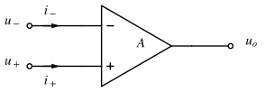
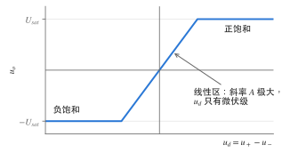
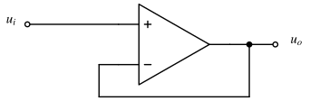
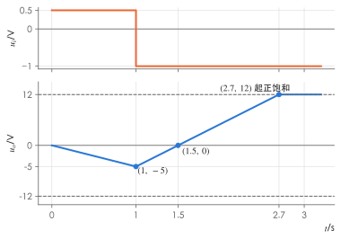

# 含理想运算放大器的电路

!!! abstract "TL;DR"
    理想运放工作在**线性区**（有负反馈）时只用两条规则：

    - **虚短**：$u_+=u_-$（两输入端电位相等，但并没有真的连在一起）；
    - **虚断**：$i_+=i_-=0$（输入端不取电流）。

    分析方法就是**节点电压法 + 虚短 + 虚断**：只对运放的**输入端**节点列 KCL，**不对输出端列 KCL**（输出电流由运放按需提供，事先未知）。

## 1. 运放的电路模型

{ .circuit }

运放有反相输入端（$-$）、同相输入端（$+$）和输出端，各端电压都以公共参考点（"地"）为基准。在线性区

$$
u_o=A\,(u_+-u_-)=A\,u_d ,
$$

开环增益 $A$ 通常在 $10^5$ 以上。输出电压不能超过电源决定的饱和值 $\pm U_{sat}$（例如 $\pm12\,\mathrm V$），所以线性区内 $|u_d|\le U_{sat}/A$ 只有微伏级：

{ .circuit }

| 参数 | 实际运放 | 理想运放 | 推出的结论 |
| --- | --- | --- | --- |
| 开环增益 $A$ | $10^5\sim10^7$ | $\infty$ | $u_d=u_o/A\to0$，即**虚短** |
| 输入电阻 $R_i$ | $10^6\sim10^{13}\,\Omega$ | $\infty$ | 输入电流为零，即**虚断** |
| 输出电阻 $R_o$ | 几十欧 | $0$ | 输出端相当于受控电压源，带负载不影响 $u_o$ |

!!! warning "虚短的前提"
    虚短只在**线性区**成立，而保证线性区的是**负反馈**（输出经元件接回反相输入端）。没有反馈（开环比较器）或只有正反馈时，$u_o$ 停在 $\pm U_{sat}$，$u_+\ne u_-$。虚断则在饱和区也成立（输入电阻仍然极大）。另外，按虚短算出的 $|u_o|$ 若超过 $U_{sat}$，说明运放已饱和，结果作废。

??? example "例：增益有限时误差有多大"
    反相放大器（电路见下一节）中 $R_1=10\,\mathrm{k\Omega}$、$R_f=100\,\mathrm{k\Omega}$，运放 $R_i=\infty$、$R_o=0$，但 $A=10^5$。

    反相输入端 KCL（虚断仍成立）与运放方程：

    $$
    \frac{u_i-u_-}{R_1}=\frac{u_--u_o}{R_f},\qquad u_o=A(0-u_-)=-Au_- .
    $$

    消去 $u_-$：

    $$
    \frac{u_o}{u_i}=\frac{-R_f/R_1}{1+\dfrac{1+R_f/R_1}{A}}=\frac{-10}{1+1.1\times10^{-4}}\approx-9.9989 .
    $$

    与理想值 $-10$ 只差 $0.011\%$。$u_i=1\,\mathrm V$ 时 $u_-=-u_o/A\approx0.1\,\mathrm{mV}$——确实"几乎为零"。这就是虚短的来历：不是 $u_d$ 严格为零，而是它和电路中其他电压相比可以忽略。

## 2. 七种基本电路

下表的结论都由"虚短 + 虚断 + 反相输入端 KCL"三步得到，第一个推导写全，其余同理。

=== "反相放大"

    { .circuit }

    $u_+=0\Rightarrow u_-=0$（**虚地**）；$R_1$ 中电流 $\dfrac{u_i}{R_1}$ 全部流过 $R_f$：$\dfrac{u_i-0}{R_1}=\dfrac{0-u_o}{R_f}$，

    $$
    u_o=-\frac{R_f}{R_1}u_i,\qquad R_{in}=R_1 .
    $$

=== "同相放大"

    { .circuit }

    $u_-=u_+=u_i$；$R_1$ 与 $R_f$ 对 $u_o$ 分压：$u_i=\dfrac{R_1}{R_1+R_f}u_o$，

    $$
    u_o=\Big(1+\frac{R_f}{R_1}\Big)u_i,\qquad R_{in}=\infty .
    $$

=== "电压跟随"

    { .circuit }

    同相放大取 $R_f=0$（或 $R_1=\infty$）：$u_o=u_i$。增益为 1，但输入电阻无穷大、输出电阻为零，用作**缓冲（隔离）级**：前级不被后级负载"拖累"。

=== "反相加法"

    { .circuit }

    虚地使各输入互不影响，电流在反相输入端相加：

    $$
    u_o=-R_f\Big(\frac{u_1}{R_1}+\frac{u_2}{R_2}+\frac{u_3}{R_3}\Big),
    $$

    $R_1=R_2=R_3=R_f$ 时 $u_o=-(u_1+u_2+u_3)$。

=== "差分（减法）"

    { .circuit }

    $u_+=\dfrac{R_3}{R_2+R_3}u_2$，反相端 KCL $\dfrac{u_1-u_+}{R_1}=\dfrac{u_+-u_o}{R_f}$：

    $$
    u_o=\Big(1+\frac{R_f}{R_1}\Big)\frac{R_3}{R_2+R_3}\,u_2-\frac{R_f}{R_1}\,u_1 ;
    $$

    取 $\dfrac{R_3}{R_2}=\dfrac{R_f}{R_1}$ 时 $u_o=\dfrac{R_f}{R_1}(u_2-u_1)$。这个结果也可以看成两个输入分别作用的叠加（$u_1$ 走反相放大、$u_2$ 经分压走同相放大）。

=== "积分 / 微分"

    { .circuit }

    虚地，$i=\dfrac{u_i}{R}$ 全部流入电容，$u_C$ 如图（左正右负），$u_o=0-u_C$：

    $$
    u_o(t)=u_o(0)-\frac{1}{RC}\int_0^t u_i(\xi)\,\mathrm d\xi,\qquad u_o(0)=-u_C(0).
    $$

    把 $R$ 与 $C$ 对调（输入串电容、反馈接电阻）得**微分器** $u_o=-RC\dfrac{\mathrm du_i}{\mathrm dt}$。

!!! tip "多级运放可以直接级联"
    理想运放输出电阻为零，后级接上去不改变前级的 $u_o$；所以多级电路可以**逐级**用上表结论，前一级的输出就是后一级的输入。（反相、加法、积分电路的输入电阻有限：若它前面接的是有内阻的信号源而不是运放输出端，仍要考虑分压。）

## 3. 用节点法分析一般含运放电路

步骤：

1. 标出各运放的 $u_+$、$u_-$ 和输出端；
2. 对**运放的输入端节点**及其他普通节点列节点方程（虚断：流入运放输入端的电流为零）；
3. 补充虚短 $u_+=u_-$；
4. 运放输出端节点**不列** KCL，其电压 $u_o$ 当作未知量；若需要输出电流，最后再由 KCL 反求。

??? example "例：两级运放"
    { .circuit }

    $u_{i1}=0.5\,\mathrm V$，$u_{i2}=1.5\,\mathrm V$，求 $u_o$。

    1. **$A_1$**（同相放大，+ 端在上）：$u_{o1}=\Big(1+\dfrac{20}{10}\Big)u_{i1}=3u_{i1}=1.5\,\mathrm V$。
    2. **$A_2$**：$u_{+}=u_{i2}$，虚短 $u_-=u_{i2}$；反相端 KCL（电阻用 $\mathrm{k\Omega}$）：

        $$
        \frac{u_{o1}-u_{i2}}{10}=\frac{u_{i2}-u_o}{30}\ \Rightarrow\ u_o=4u_{i2}-3u_{o1}=4u_{i2}-9u_{i1}.
        $$

    3. 代入：$u_o=4\times1.5-9\times0.5=1.5\,\mathrm V$。

    整体是一个"减法器"：$u_o=4u_{i2}-9u_{i1}$。$A_1$ 的输入电阻为无穷大，信号源 $u_{i1}$ 不必提供电流。

## 4. 含运放的动态电路

运放与 R、C 组成的有源电路仍是线性电路，[三要素法](../notes/dynamic-circuits.md)、[相量法](../notes/phasor-method.md) 照样适用；只要先用虚短、虚断把电容所在的支路方程写出来。

??? example "例：有损积分器的阶跃响应与正弦稳态"
    { .circuit }

    $u_C(0_-)=0$。（1）$u_i=1\,\mathrm V$（$t\ge0$ 时接入）时求 $u_o(t)$；（2）$u_i=\sin500t\ \mathrm V$ 时求稳态 $u_o$。

    **反相端 KCL**（虚地，$u_C=0-u_o=-u_o$）：

    $$
    \frac{u_i}{R_1}=\frac{u_C}{R_f}+C\frac{\mathrm du_C}{\mathrm dt}\ \Rightarrow\ R_fC\frac{\mathrm du_C}{\mathrm dt}+u_C=\frac{R_f}{R_1}u_i .
    $$

    这是标准一阶方程，$\tau=R_fC=20\times10^3\times0.1\times10^{-6}=2\,\mathrm{ms}$。

    （1）三要素：$u_o(0_+)=-u_C(0_+)=0$；$u_o(\infty)=-\dfrac{R_f}{R_1}u_i=-2\,\mathrm V$（电容开路，就是反相放大器）。

    $$
    u_o(t)=-2\big(1-e^{-500t}\big)\ \mathrm V\quad(t\ge0).
    $$

    （2）相量形式：反馈阻抗 $Z_f=R_f\parallel\dfrac{1}{j\omega C}$，

    $$
    H(j\omega)=\frac{\dot U_o}{\dot U_i}=-\frac{Z_f}{R_1}=\frac{-R_f/R_1}{1+j\omega R_fC}.
    $$

    $\omega=500\,\mathrm{rad/s}$ 时 $\omega R_fC=1$，$H=\dfrac{-2}{1+j}=-1+j=\sqrt2\angle135^\circ$，所以

    $$
    u_o=\sqrt2\sin(500t+135^\circ)\ \mathrm V\approx1.414\sin(500t+135^\circ)\ \mathrm V .
    $$

    这是一个**有源低通滤波器**：低频增益 $-2$，$\omega=1/\tau$ 处幅值降到 $1/\sqrt2$。

!!! note "与无源 RC 的区别"
    无源 RC 低通的输出接上负载后特性会变；有源电路输出电阻为零，带负载不变，还能提供增益——这正是模拟电子技术中"有源滤波器"的出发点。

## 练习

### 1. 概念判断 :material-star::material-star-outline::material-star-outline:

判断下列说法是否正确：

1. 只要是理想运放，$u_+=u_-$ 在任何电路中都成立。
2. 理想运放输出端的电流为零。
3. 反相放大器的输入电阻等于 $R_1$。
4. 电压跟随器的电压增益为 1，所以在电路中没有实际作用。
5. 用节点法分析含运放的电路时，不对运放输出端节点列 KCL 方程。

??? success "答案"
    1 ✗　2 ✗　3 ✓　4 ✗　5 ✓

??? note "解析"
    1. 虚短要求运放工作在线性区，前提是有负反馈且输出未饱和；开环或正反馈时不成立。
    2. 虚断说的是**输入端**电流为零；输出端相当于一个受控电压源，电流由外电路决定，可以很大。
    3. 反相输入端是虚地，从 $u_i$ 看进去只有 $R_1$。
    4. 跟随器输入电阻无穷大、输出电阻为零，起**隔离缓冲**作用。
    5. 输出电流事先未知，对输出端列 KCL 只会多出一个未知量；用输入端 KCL + 虚短即可求出 $u_o$。

### 2. 反相加法器 :material-star::material-star-outline::material-star-outline:

{ .circuit }

（1）$u_1=0.2\,\mathrm V$，$u_2=-0.5\,\mathrm V$，$u_3=1\,\mathrm V$，求 $u_o$；（2）若把 $R_f$ 换成 $120\,\mathrm{k\Omega}$，要保持 $u_o$ 与各输入的关系不变，三个输入电阻应各取多少？

??? success "答案"
    （1）$u_o=-0.6\,\mathrm V$；（2）$40\,\mathrm{k\Omega}$、$60\,\mathrm{k\Omega}$、$120\,\mathrm{k\Omega}$。

??? note "解析"
    1. 虚地，三路电流在反相端相加后全部流过 $R_f$：

        $$
        u_o=-60\Big(\frac{u_1}{20}+\frac{u_2}{30}+\frac{u_3}{60}\Big)=-(3u_1+2u_2+u_3)=-(0.6-1+1)=-0.6\,\mathrm V .
        $$

    2. 系数 $R_f/R_k$ 要保持 $3、2、1$，所以 $R_k=R_f/3,\ R_f/2,\ R_f/1=40、60、120\,\mathrm{k\Omega}$。

### 3. T 形反馈网络 :material-star::material-star::material-star-outline:

{ .circuit }

求电压增益 $u_o/u_i$，以及节点 $m$ 的电压 $u_m$（用 $u_i$ 表示）。

??? success "答案"
    $u_m=-10u_i$，$\dfrac{u_o}{u_i}=-120$。

??? note "解析"
    （电阻用 $\mathrm{k\Omega}$，电流用 $\mathrm{mA}$。）

    1. **反相端**：虚地 $u_-=0$，虚断，所以 $R_1$ 中的电流 $\dfrac{u_i}{10}$ 全部流过 $R_2$（方向由反相端流向 $m$）：

        $$
        \frac{u_i}{10}=\frac{0-u_m}{100}\ \Rightarrow\ u_m=-10u_i .
        $$

    2. **节点 $m$ 的 KCL**（流入 = 流出）：

        $$
        \frac{u_i}{10}=\frac{u_m}{10}+\frac{u_m-u_o}{100}
        \ \Rightarrow\ 0.1u_i=-u_i-0.1u_i-0.01u_o
        \ \Rightarrow\ u_o=-120u_i .
        $$

    **公式**：$\dfrac{u_o}{u_i}=-\dfrac{R_2+R_3+R_2R_3/R_4}{R_1}=-\dfrac{100+100+1000}{10}=-120$ ✓

    !!! tip "为什么用 T 形网络"
        普通反相放大器要得到 $-120$ 倍、同时保持 $R_{in}=10\,\mathrm{k\Omega}$，需要 $R_f=1.2\,\mathrm{M\Omega}$；T 形网络只用 $100\,\mathrm{k\Omega}$ 量级的电阻就做到了。

### 4. 用运放实现负电阻 :material-star::material-star::material-star:

{ .circuit }

运放工作在线性区。（1）求从 $a$、$a'$ 看进去的输入电阻 $R_{in}=u/i$；（2）在 $a$、$a'$ 之间再并联一个 $1\,\mathrm{k\Omega}$ 电阻，求并联后的等效电阻。

??? success "答案"
    （1）$R_{in}=-0.5\,\mathrm{k\Omega}$；（2）$-1\,\mathrm{k\Omega}$。

??? note "解析"
    1. 虚短：$u_-=u_+=u$。反相端 KCL（虚断）：

        $$
        \frac{u}{R_2}=\frac{u_o-u}{R_1}\ \Rightarrow\ u_o=\Big(1+\frac{R_1}{R_2}\Big)u=3u .
        $$

    2. 同相端 KCL：$a$ 端流入的电流全部经 $R$ 流向输出端，

        $$
        i=\frac{u-u_o}{R}=\frac{u-3u}{1}=-2u\ (\mathrm{mA})\ \Rightarrow\ R_{in}=\frac ui=-0.5\,\mathrm{k\Omega} .
        $$

        一般地 $R_{in}=-\dfrac{R\,R_2}{R_1}$。

    3. 并联：$\dfrac{1\times(-0.5)}{1+(-0.5)}=-1\,\mathrm{k\Omega}$（电导相加：$1-2=-1\,\mathrm{mS}$）。

    !!! note "负电阻的能量从哪来"
        $u>0$ 时 $i<0$，电流实际从 $a$ 端流**出**——端口向外输出功率，能量来自运放的直流电源。这种电路叫**负阻抗变换器**（见 [二端口网络](two-port.md#6-回转器与负阻抗变换器)）。实际使用时还要考虑稳定性（外接电路不当会使运放饱和），这超出了理想模型的范围。

### 5. 积分器的分段输入 :material-star::material-star::material-star-outline:

{ .circuit }

$u_C(0)=0$，运放饱和电压 $\pm12\,\mathrm V$。$0\le t<1\,\mathrm s$ 时 $u_i=0.5\,\mathrm V$，$t\ge1\,\mathrm s$ 时 $u_i=-1\,\mathrm V$。求：（1）$0\le t\le1\,\mathrm s$ 的 $u_o(t)$；（2）$u_o$ 何时回到零；（3）$u_o$ 何时进入正饱和。

??? success "答案"
    （1）$u_o=-5t\ \mathrm V$，$u_o(1)=-5\,\mathrm V$；（2）$t=1.5\,\mathrm s$；（3）$t=2.7\,\mathrm s$。

??? note "解析"
    $RC=100\times10^3\times1\times10^{-6}=0.1\,\mathrm s$，$u_o(t)=u_o(t_0)-\dfrac{1}{RC}\displaystyle\int_{t_0}^t u_i\,\mathrm d\xi$。

    1. $0\sim1\,\mathrm s$：$u_o=0-10\times0.5\,t=-5t\ \mathrm V$，在 $t=1\,\mathrm s$ 时为 $-5\,\mathrm V$（未达 $-12\,\mathrm V$，线性区有效）。
    2. $t\ge1\,\mathrm s$：$u_o=-5-10\times(-1)(t-1)=-5+10(t-1)\ \mathrm V$，令其为零得 $t=1.5\,\mathrm s$。
    3. 令 $-5+10(t-1)=12$，得 $t=2.7\,\mathrm s$；此后 $u_o$ 停在 $+12\,\mathrm V$，积分器不再是线性的。

    { .circuit }

    !!! warning "易错"
        反相积分器的斜率是 $-u_i/(RC)$：输入为正时输出**下降**。输入变号后，输出从当时的值 $-5\,\mathrm V$ 接着积分，而不是从零开始。
