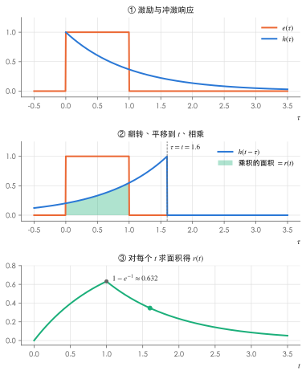
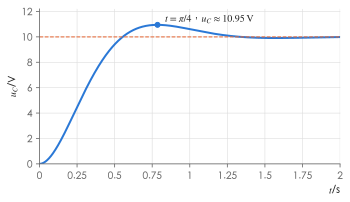

# 二阶电路与卷积积分

!!! abstract "TL;DR"
    - **二阶电路**：列出二阶微分方程，由特征根 $s_{1,2}=-\alpha\pm\sqrt{\alpha^2-\omega_0^2}$ 判断阻尼类型、写出通解，再用**两个**初始条件 $f(0_+)$、$f'(0_+)$ 定常数。RLC 串联 $\alpha=\dfrac{R}{2L}$，GCL 并联 $\alpha=\dfrac{1}{2RC}$，两者 $\omega_0=\dfrac{1}{\sqrt{LC}}$。
    - **卷积积分**：已知冲激响应 $h(t)$，任意激励 $e(t)$ 的零状态响应

        $$
        r(t)=\int_0^t e(\tau)\,h(t-\tau)\,\mathrm d\tau ,
        $$

        在 s 域就是 $R(s)=H(s)E(s)$。

本页接着 [动态电路的时域分析](../notes/dynamic-circuits.md) 第 5、6 节往下讲：那里只给了 RLC 串联的零输入响应和阶跃/冲激响应的定义。

## 1. 二阶电路的经典解法

{ .circuit }

$t\ge0$ 时 KVL：$Ri+L\dfrac{\mathrm di}{\mathrm dt}+u_C=U_s$，代入 $i=C\dfrac{\mathrm du_C}{\mathrm dt}$：

$$
LC\frac{\mathrm d^2u_C}{\mathrm dt^2}+RC\frac{\mathrm du_C}{\mathrm dt}+u_C=U_s .
$$

**解 = 特解 + 齐次通解**。直流激励时特解就是稳态值 $u_C(\infty)=U_s$；齐次通解由特征方程 $LCs^2+RCs+1=0$ 的根决定。记 $\alpha=\dfrac R{2L}$、$\omega_0=\dfrac1{\sqrt{LC}}$：

| 条件 | 特征根 | 齐次通解形式 |
| --- | --- | --- |
| $\alpha>\omega_0$（$R>2\sqrt{L/C}$），过阻尼 | 两个不等负实根 $s_1,s_2$ | $A_1e^{s_1t}+A_2e^{s_2t}$ |
| $\alpha=\omega_0$，临界阻尼 | 二重根 $-\alpha$ | $(A_1+A_2t)e^{-\alpha t}$ |
| $\alpha<\omega_0$，欠阻尼 | $-\alpha\pm j\omega_d$，$\omega_d=\sqrt{\omega_0^2-\alpha^2}$ | $e^{-\alpha t}(A_1\cos\omega_dt+A_2\sin\omega_dt)$ |

**两个常数需要两个初始条件**：

$$
u_C(0_+)=u_C(0_-),\qquad \frac{\mathrm du_C}{\mathrm dt}\Big|_{0_+}=\frac{i_C(0_+)}{C}=\frac{i_L(0_+)}{C}\ \ (\text{串联时 }i_C=i_L).
$$

!!! tip "求 $f'(0_+)$ 的套路"
    对电容电压，$u_C'(0_+)=i_C(0_+)/C$；对电感电流，$i_L'(0_+)=u_L(0_+)/L$。$i_C(0_+)$、$u_L(0_+)$ 都在 $0_+$ 等效电路中求（电容→电压源，电感→电流源），与一阶电路求初始值的方法相同。

??? example "例：临界阻尼的阶跃响应"
    图中 $U_s=10\,\mathrm V$，$R=4\,\Omega$，$L=1\,\mathrm H$，$C=0.25\,\mathrm F$，开关闭合前电路无储能。求 $u_C(t)$、$i(t)$ 及电流的最大值。

    1. $\alpha=\dfrac{4}{2}=2$，$\omega_0=\dfrac{1}{\sqrt{0.25}}=2$：**临界阻尼**，$s=-2$（二重）。
    2. $u_C=10+(A_1+A_2t)e^{-2t}$。
    3. $u_C(0_+)=0\Rightarrow A_1=-10$；$u_C'(0_+)=\dfrac{i(0_+)}{C}=0\Rightarrow -2A_1+A_2=0\Rightarrow A_2=-20$。

    $$
    u_C(t)=10-10(1+2t)e^{-2t}\ \mathrm V,\qquad i(t)=C\frac{\mathrm du_C}{\mathrm dt}=0.25\times40te^{-2t}=10te^{-2t}\ \mathrm A .
    $$

    令 $\dfrac{\mathrm di}{\mathrm dt}=10(1-2t)e^{-2t}=0$，得 $t=0.5\,\mathrm s$，$i_{max}=5e^{-1}\approx1.84\,\mathrm A$。

    用运算法验证：$U_C(s)=\dfrac{10}{s}\cdot\dfrac{4}{s^2+4s+4}=\dfrac{40}{s(s+2)^2}=\dfrac{10}{s}-\dfrac{10}{s+2}-\dfrac{20}{(s+2)^2}$ ✓

## 2. GCL 并联与对偶

{ .circuit }

以 $i_L$ 为变量（$u=L\dfrac{\mathrm di_L}{\mathrm dt}$），KCL：$\dfrac uR+C\dfrac{\mathrm du}{\mathrm dt}+i_L=I_s$，即

$$
LC\frac{\mathrm d^2i_L}{\mathrm dt^2}+\frac LR\frac{\mathrm di_L}{\mathrm dt}+i_L=I_s,\qquad
\alpha=\frac{1}{2RC},\quad \omega_0=\frac{1}{\sqrt{LC}} .
$$

它和 RLC 串联方程形式完全相同（$u_C\leftrightarrow i_L$，$R\leftrightarrow G$，$L\leftrightarrow C$，$U_s\leftrightarrow I_s$）——这就是 [对偶原理](tellegen-duality.md#3-对偶原理)。

| | RLC 串联 | GCL 并联 |
| --- | --- | --- |
| 衰减系数 $\alpha$ | $\dfrac R{2L}$ | $\dfrac{1}{2RC}=\dfrac{G}{2C}$ |
| 临界电阻 | $R=2\sqrt{L/C}$ | $R=\dfrac12\sqrt{L/C}$ |
| 振荡（欠阻尼）条件 | $R$ **小于**临界值 | $R$ **大于**临界值 |

!!! warning "方向别记反"
    串联电路电阻越**小**越容易振荡；并联电路电阻越**大**（电导越小）越容易振荡——电阻都是"损耗"，但在并联电路中大电阻意味着小损耗。

??? example "例：GCL 并联的阶跃响应（欠阻尼）"
    $I_s=1\,\mathrm A$，$R=0.5\,\Omega$，$L=0.2\,\mathrm H$，$C=1\,\mathrm F$，零初始状态。求 $i_L(t)$ 与 $u(t)$。

    1. $\alpha=\dfrac{1}{2\times0.5\times1}=1$，$\omega_0^2=\dfrac1{0.2}=5$，$\omega_d=\sqrt{5-1}=2$：欠阻尼，$s=-1\pm j2$。
    2. $i_L=1+e^{-t}(A_1\cos2t+A_2\sin2t)$。
    3. $i_L(0_+)=0\Rightarrow A_1=-1$；$i_L'(0_+)=\dfrac{u(0_+)}{L}=\dfrac{u_C(0_+)}{L}=0\Rightarrow -A_1+2A_2=0\Rightarrow A_2=-\dfrac12$。

    $$
    i_L(t)=1-e^{-t}\Big(\cos2t+\frac12\sin2t\Big)\ \mathrm A,\qquad u(t)=L\frac{\mathrm di_L}{\mathrm dt}=\frac12e^{-t}\sin2t\ \mathrm V .
    $$

    与 [运算法](laplace.md) 中 RLC 串联的阶跃响应 $1-e^{-t}(\cos2t+\tfrac12\sin2t)$ 一模一样——两电路的方程互为对偶，且参数恰好对应（$R=2\leftrightarrow G=2$，$L=1\leftrightarrow C=1$，$C=0.2\leftrightarrow L=0.2$）。

## 3. 卷积积分

### 推导

线性时不变电路，冲激响应为 $h(t)$。把激励 $e(t)$ 切成许多宽 $\Delta\tau$ 的窄脉冲：$\tau$ 时刻的那一条近似为强度 $e(\tau)\Delta\tau$ 的冲激，它引起的响应是 $e(\tau)\Delta\tau\,h(t-\tau)$（时不变 + 齐次）。所有窄脉冲的响应叠加，令 $\Delta\tau\to0$：

$$
r(t)=\int_{0_-}^{t}e(\tau)\,h(t-\tau)\,\mathrm d\tau=\int_{0_-}^{t}h(\tau)\,e(t-\tau)\,\mathrm d\tau\quad\big(=e*h\big).
$$

积分上限是 $t$：$\tau>t$ 时刻的激励还没发生（因果性）。卷积只给出**零状态**响应；有初始储能时还要加上零输入响应。

### 图解步骤

1. 把 $e$、$h$ 的自变量都换成 $\tau$；
2. 把 $h(\tau)$ **翻转**成 $h(-\tau)$，再**平移** $t$ 得 $h(t-\tau)$；
3. 求乘积 $e(\tau)h(t-\tau)$ 下的面积，就是 $r(t)$；
4. 让 $t$ 从 $0$ 增大，按两个函数重叠区间的变化**分段**积分。

{ .circuit }

??? example "例：RC 电路对矩形脉冲的响应"
    RC 电路 $R=1\,\Omega$、$C=1\,\mathrm F$（$\tau_{RC}=1\,\mathrm s$），以 $u_s$ 为激励、$u_C$ 为响应的冲激响应为 $h(t)=\dfrac{1}{RC}e^{-t/RC}=e^{-t}$。激励为 $1\,\mathrm V$、宽 $1\,\mathrm s$ 的矩形脉冲 $e(t)=\varepsilon(t)-\varepsilon(t-1)$，零初始状态。求 $u_C(t)$。

    按上图分两段：

    - $0<t<1$：重叠区间 $[0,t]$，$\displaystyle r(t)=\int_0^t1\cdot e^{-(t-\tau)}\mathrm d\tau=1-e^{-t}$；
    - $t>1$：重叠区间 $[0,1]$，$\displaystyle r(t)=\int_0^1e^{-(t-\tau)}\mathrm d\tau=(e-1)e^{-t}\approx1.718e^{-t}$。

    **校核**（三要素）：$0\sim1\,\mathrm s$ 充电，$u_C(1)=1-e^{-1}\approx0.632\,\mathrm V$；之后放电 $0.632e^{-(t-1)}=(1-e^{-1})e\cdot e^{-t}=(e-1)e^{-t}$ ✓

!!! note "与运算法的关系"
    卷积定理 $\mathscr L[e*h]=E(s)H(s)$：时域里难算的卷积，在 s 域就是乘法。所以实际计算多用 [运算法](laplace.md)；卷积的价值在于说明"冲激响应完全刻画了线性时不变电路"，并且在激励只有实验波形、没有解析式时可以数值计算。

## 练习

### 1. 概念判断 :material-star::material-star-outline::material-star-outline:

判断下列说法是否正确：

1. RLC 串联零输入电路中，$R$ 越大，过渡过程一定结束得越快。
2. GCL 并联电路中，$R$ 越大越容易出现振荡。
3. 二阶电路的完全响应需要两个初始条件才能确定。
4. 用卷积积分可以直接求出含初始储能电路的全响应。
5. 临界阻尼时响应不振荡。

??? success "答案"
    1 ✗　2 ✓　3 ✓　4 ✗　5 ✓

??? note "解析"
    1. 欠阻尼区内增大 $R$ 确实衰减更快；但进入过阻尼后，较慢的那个根 $s_1=-\alpha+\sqrt{\alpha^2-\omega_0^2}$ 随 $R$ 增大而**趋近于零**，过程反而变慢。临界阻尼是"最快的非振荡"情形。
    2. $\alpha=\dfrac{1}{2RC}$，$R$ 越大 $\alpha$ 越小，越容易 $\alpha<\omega_0$。
    3. 二阶方程的通解有两个任意常数。
    4. 卷积只给零状态响应，还要叠加零输入响应。
    5. 临界阻尼的特征根为重实根，$(A_1+A_2t)e^{-\alpha t}$ 最多过零一次，不振荡。

### 2. 欠阻尼的超调 :material-star::material-star::material-star-outline:

RLC 串联电路如 §1 图，$U_s=10\,\mathrm V$，$R=6\,\Omega$，$L=1\,\mathrm H$，$C=0.04\,\mathrm F$，零初始状态，$t=0$ 时 $S$ 闭合。求 $u_C(t)$、$i(t)$ 以及 $u_C$ 的最大值和出现时刻。

??? success "答案"
    $u_C=10-10e^{-3t}(\cos4t+0.75\sin4t)\ \mathrm V$，$i=2.5e^{-3t}\sin4t\ \mathrm A$；$t=\pi/4\approx0.785\,\mathrm s$ 时 $u_{C,max}=10+10e^{-3\pi/4}\approx10.95\,\mathrm V$。

??? note "解析"
    1. $\alpha=\dfrac{6}{2}=3$，$\omega_0^2=\dfrac{1}{0.04}=25$，$\omega_d=\sqrt{25-9}=4$：欠阻尼。
    2. $u_C=10+e^{-3t}(A_1\cos4t+A_2\sin4t)$；$u_C(0_+)=0\Rightarrow A_1=-10$；$u_C'(0_+)=i(0_+)/C=0\Rightarrow-3A_1+4A_2=0\Rightarrow A_2=-7.5$。
    3. $i=C\dfrac{\mathrm du_C}{\mathrm dt}$：$\dfrac{\mathrm du_C}{\mathrm dt}=10e^{-3t}\big[(3\cos4t+2.25\sin4t)+(4\sin4t-3\cos4t)\big]=62.5e^{-3t}\sin4t$，$i=0.04\times62.5\,e^{-3t}\sin4t=2.5e^{-3t}\sin4t\ \mathrm A$。（一般式 $i=\dfrac{U_s}{\omega_dL}e^{-\alpha t}\sin\omega_dt$。）
    4. $u_C$ 的极值在 $i=0$ 处：第一次是 $4t=\pi$，$t=\pi/4$。此时 $\cos\pi=-1$、$\sin\pi=0$：

        $$
        u_{C,max}=10+10e^{-3\pi/4}\approx10+0.948=10.95\,\mathrm V,
        $$

        超出稳态值约 $9.5\%$。

    { .circuit }

### 3. GCL 并联的阻尼判断 :material-star::material-star-outline::material-star-outline:

GCL 并联电路中 $L=1\,\mathrm H$，$C=0.25\,\mathrm F$。（1）求临界电阻；（2）$R=2\,\Omega$ 和 $R=0.4\,\Omega$ 时分别属于哪种情况？写出特征根。

??? success "答案"
    （1）$1\,\Omega$；（2）$R=2\,\Omega$：欠阻尼，$s=-1\pm j\sqrt3$；$R=0.4\,\Omega$：过阻尼，$s=-5\pm\sqrt{21}$（约 $-0.42$、$-9.58$）。

??? note "解析"
    $\omega_0=\dfrac{1}{\sqrt{LC}}=2$，$\alpha=\dfrac1{2RC}=\dfrac{2}{R}$。

    1. 临界：$\alpha=\omega_0\Rightarrow R=\dfrac12\sqrt{L/C}=\dfrac12\times2=1\,\Omega$。
    2. $R=2$：$\alpha=1<2$，欠阻尼，$s=-1\pm j\sqrt{4-1}=-1\pm j\sqrt3$。$R=0.4$：$\alpha=5>2$，过阻尼，$s=-5\pm\sqrt{25-4}=-5\pm\sqrt{21}$。

    并联时**电阻大**反而振荡，与串联相反。

### 4. 斜坡激励的卷积 :material-star::material-star::material-star-outline:

上面 RC 例题的电路（$h(t)=e^{-t}$），零初始状态，激励 $e(t)=t\,\varepsilon(t)$（单位 V，$t$ 以秒计）。用卷积积分求 $u_C(t)$，并用运算法验证。

??? success "答案"
    $u_C(t)=t-1+e^{-t}\ \mathrm V$。

??? note "解析"
    $$
    r(t)=\int_0^t\tau\,e^{-(t-\tau)}\,\mathrm d\tau=e^{-t}\Big[(\tau-1)e^{\tau}\Big]_0^t=e^{-t}\big[(t-1)e^t+1\big]=t-1+e^{-t}.
    $$

    **运算法**：$\dfrac{1}{s^2}\cdot\dfrac{1}{s+1}=\dfrac{1}{s^2}-\dfrac1s+\dfrac{1}{s+1}\ \to\ t-1+e^{-t}$ ✓

    物理意义：稳态时 $u_C$ 跟随斜坡，但**滞后**一个时间常数（$t-1$）。

### 5. 有初始储能的全响应 :material-star::material-star::material-star-outline:

某次换路后（换路过程不画出），$t\ge0$ 时的电路是 $U_s=6\,\mathrm V$ 与 $R=3\,\Omega$、$L=1\,\mathrm H$、$C=0.5\,\mathrm F$ 串联（参考方向同 §1 图），且 $u_C(0_+)=2\,\mathrm V$，$i(0_+)=1\,\mathrm A$。用经典法求 $u_C(t)$ 与 $i(t)$。

??? success "答案"
    $u_C=6-6e^{-t}+2e^{-2t}\ \mathrm V$，$i=3e^{-t}-2e^{-2t}\ \mathrm A$。

??? note "解析"
    1. 特征方程 $0.5s^2+1.5s+1=0\Rightarrow s^2+3s+2=0$，$s=-1,-2$：过阻尼。
    2. $u_C=6+A_1e^{-t}+A_2e^{-2t}$。
    3. 初始条件：$u_C(0_+)=2\Rightarrow A_1+A_2=-4$；$u_C'(0_+)=\dfrac{i(0_+)}{C}=2\Rightarrow-A_1-2A_2=2$。解得 $A_2=2$，$A_1=-6$。
    4. $i=C\dfrac{\mathrm du_C}{\mathrm dt}=0.5\,(6e^{-t}-4e^{-2t})=3e^{-t}-2e^{-2t}\ \mathrm A$，$i(0_+)=1$ ✓

    !!! warning "易错"
        第二个初始条件是 $u_C'(0_+)=i(0_+)/C$，不是 $i(0_+)$ 本身；单位换算错一步，常数就全错。
