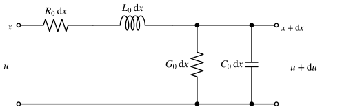
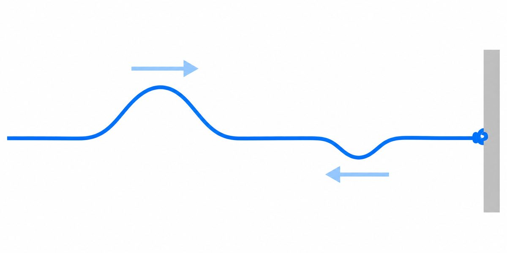
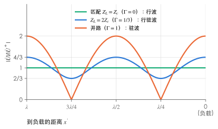

# 均匀传输线（了解）

!!! abstract "TL;DR"
    - 线长与波长**可比**时，电压、电流随位置变化，要用**分布参数**电路：单位长度的 $R_0、L_0、G_0、C_0$。
    - 正弦稳态下，线上电压 = **入射波 + 反射波**，由两个参数刻画：

        $$
        \gamma=\sqrt{(R_0+j\omega L_0)(G_0+j\omega C_0)}=\alpha+j\beta,\qquad
        Z_c=\sqrt{\frac{R_0+j\omega L_0}{G_0+j\omega C_0}} .
        $$

    - **无损线**：$Z_c=\sqrt{L_0/C_0}$（纯电阻），$v=1/\sqrt{L_0C_0}$。负载 $Z_L=Z_c$ 时**匹配**：无反射，从任何位置看进去都是 $Z_c$。

## 1. 什么时候要用分布参数

前面所有章节都用**集总参数**模型：认为电磁波瞬间传遍整个电路，同一根导线上各点电压、电流相同。这要求电路尺寸远小于波长 $\lambda=v/f$：

| 场合 | 频率 | 波长（$v\approx3\times10^8\,\mathrm{m/s}$） | 是否需要分布参数 |
| --- | --- | --- | --- |
| 实验室电路板 | $50\,\mathrm{Hz}$ | $6000\,\mathrm{km}$ | 不需要 |
| 远距离输电线（上千公里） | $50\,\mathrm{Hz}$ | $6000\,\mathrm{km}$ | 需要 |
| 电视天线馈线 | $300\,\mathrm{MHz}$ | $1\,\mathrm m$ | 需要 |

## 2. 电报方程

{ .circuit }

取长 $\mathrm dx$ 的一小段，它可以看成集总电路：串联 $R_0\mathrm dx$、$L_0\mathrm dx$，并联 $G_0\mathrm dx$、$C_0\mathrm dx$。对它列 KVL、KCL，忽略高阶小量：

$$
-\frac{\partial u}{\partial x}=R_0i+L_0\frac{\partial i}{\partial t},\qquad
-\frac{\partial i}{\partial x}=G_0u+C_0\frac{\partial u}{\partial t}.
$$

这对偏微分方程叫**电报方程**。参数沿线处处相同的叫**均匀传输线**。

## 3. 正弦稳态解

用相量（$\partial/\partial t\to j\omega$），记 $Z_0=R_0+j\omega L_0$、$Y_0=G_0+j\omega C_0$：

$$
-\frac{\mathrm d\dot U}{\mathrm dx}=Z_0\dot I,\quad -\frac{\mathrm d\dot I}{\mathrm dx}=Y_0\dot U
\ \Rightarrow\ \frac{\mathrm d^2\dot U}{\mathrm dx^2}=\gamma^2\dot U,\quad \gamma=\sqrt{Z_0Y_0}=\alpha+j\beta .
$$

通解

$$
\dot U(x)=\underbrace{\dot A_1e^{-\gamma x}}_{\text{入射波 }\dot U^+}+\underbrace{\dot A_2e^{\gamma x}}_{\text{反射波 }\dot U^-},\qquad
\dot I(x)=\frac{\dot A_1e^{-\gamma x}-\dot A_2e^{\gamma x}}{Z_c},\qquad Z_c=\sqrt{\frac{Z_0}{Y_0}} .
$$

- **衰减常数** $\alpha$（$\mathrm{Np/m}$）：波每走一米幅值衰减为 $e^{-\alpha}$ 倍；
- **相位常数** $\beta$（$\mathrm{rad/m}$）：入射波的时域形式 $\sqrt2|\dot A_1|e^{-\alpha x}\sin(\omega t-\beta x+\psi)$ 向 $+x$ 方向传播，**相速** $v=\omega/\beta$，**波长** $\lambda=2\pi/\beta$；
- **特性阻抗** $Z_c$：同一方向行波的电压与电流之比 $\dot U^+/\dot I^+$，只由线本身决定，与长度、负载无关。

### 无损线

$R_0=G_0=0$（高频时近似成立）：

$$
\alpha=0,\quad \beta=\omega\sqrt{L_0C_0},\quad Z_c=\sqrt{\frac{L_0}{C_0}},\quad v=\frac{1}{\sqrt{L_0C_0}} .
$$

以负载端为起点、向电源方向量距离 $x'$，负载电压、电流为 $\dot U_2$、$\dot I_2$（$\dot I_2$ 流入负载）：

$$
\dot U(x')=\dot U_2\cos\beta x'+jZ_c\dot I_2\sin\beta x',\qquad
\dot I(x')=j\frac{\dot U_2}{Z_c}\sin\beta x'+\dot I_2\cos\beta x' .
$$

这其实就是一个**二端口的 T 参数方程**（$A=D=\cos\beta l$，$B=jZ_c\sin\beta l$，$C=j\sin\beta l/Z_c$，$AD-BC=1$：互易且对称；这里的 $\dot I_2$ 流入负载，相当于二端口约定中的 $-\dot I_2$），见 [二端口网络](two-port.md)。

## 4. 输入阻抗、反射与匹配

长 $l$ 的无损线接负载 $Z_L$，从始端看进去：

$$
Z_{in}=Z_c\,\frac{Z_L+jZ_c\tan\beta l}{Z_c+jZ_L\tan\beta l} .
$$

负载处的**反射系数**

$$
\Gamma=\frac{\dot U^-}{\dot U^+}\Big|_{\text{负载}}=\frac{Z_L-Z_c}{Z_L+Z_c} .
$$

<figure markdown>
  { width="480" loading=lazy }
  <figcaption>直觉：绳上的脉冲跑到端点会被反射回来。图中反射脉冲倒置且较小，相当于电压反射系数 Γ 介于 −1 与 0 之间（负载阻抗小于特性阻抗）；端点完全固定对应短路，Γ = −1，反射波与入射波等大倒置；若端点"吸收"得恰到好处（匹配），脉冲就不再返回。</figcaption>
</figure>

| 负载 | $\Gamma$ | 线上的波 | $Z_{in}$ |
| --- | --- | --- | --- |
| $Z_L=Z_c$（匹配） | $0$ | 只有入射波：**行波** | 处处为 $Z_c$ |
| 短路 $Z_L=0$ | $-1$ | 全反射：**驻波** | $jZ_c\tan\beta l$（纯电抗） |
| 开路 $Z_L=\infty$ | $1$ | 全反射：驻波 | $-jZ_c\cot\beta l$（纯电抗） |
| 其他电阻 | $0<\lvert\Gamma\rvert<1$ | 行驻波 | 随 $l$ 周期变化，周期 $\lambda/2$ |

{ .circuit }

图中入射波幅值取 1：匹配时 $|\dot U|$ 处处相同；开路时在负载处为波腹（$2$），每隔 $\lambda/4$ 腹、节交替；$\Gamma=1/3$ 时在 $1\pm\frac13$ 之间起伏，最大与最小之比 $\dfrac{1+|\Gamma|}{1-|\Gamma|}=2$ 叫**驻波比**。

!!! tip "两个常用的特殊长度"
    - $l=\lambda/4$（$\beta l=\pi/2$）：$Z_{in}=\dfrac{Z_c^2}{Z_L}$——**四分之一波长阻抗变换器**。要让负载 $R_L$ 与主线 $Z_{c1}$ 匹配，中间插一段特性阻抗 $\sqrt{Z_{c1}R_L}$ 的 $\lambda/4$ 线即可。
    - $l=\lambda/2$：$Z_{in}=Z_L$，线"透明"。

??? example "例：无损线的参数与输入阻抗"
    无损线 $L_0=0.25\,\mu\mathrm H/\mathrm m$，$C_0=100\,\mathrm{pF/m}$，工作频率 $f=100\,\mathrm{MHz}$，负载 $Z_L=100\,\Omega$。（1）求 $Z_c$、$v$、$\lambda$；（2）线长 $0.5\,\mathrm m$ 时求 $Z_{in}$ 和反射系数；（3）如何使负载与 $Z_c$ 匹配？

    1. $Z_c=\sqrt{\dfrac{0.25\times10^{-6}}{100\times10^{-12}}}=\sqrt{2500}=50\,\Omega$；$v=\dfrac{1}{\sqrt{0.25\times10^{-6}\times10^{-10}}}=2\times10^8\,\mathrm{m/s}$；$\lambda=\dfrac vf=2\,\mathrm m$。
    2. $0.5\,\mathrm m=\lambda/4$：$Z_{in}=\dfrac{50^2}{100}=25\,\Omega$；$\Gamma=\dfrac{100-50}{100+50}=\dfrac13$。
    3. 在负载前插一段 $\lambda/4$、特性阻抗 $\sqrt{50\times100}\approx70.7\,\Omega$ 的线，从它的始端看进去正好是 $50\,\Omega$。

## 练习

### 1. 无损线的基本参数 :material-star::material-star-outline::material-star-outline:

无损线 $L_0=0.4\,\mu\mathrm H/\mathrm m$，$C_0=40\,\mathrm{pF/m}$。求特性阻抗、波速；$f=50\,\mathrm{MHz}$ 时的波长和相位常数。

??? success "答案"
    $Z_c=100\,\Omega$，$v=2.5\times10^8\,\mathrm{m/s}$，$\lambda=5\,\mathrm m$，$\beta=0.4\pi\approx1.257\,\mathrm{rad/m}$。

??? note "解析"
    $Z_c=\sqrt{\dfrac{0.4\times10^{-6}}{40\times10^{-12}}}=\sqrt{10^4}=100\,\Omega$；$v=\dfrac{1}{\sqrt{1.6\times10^{-17}}}=\dfrac{1}{4\times10^{-9}}=2.5\times10^8\,\mathrm{m/s}$；$\lambda=\dfrac{2.5\times10^8}{5\times10^7}=5\,\mathrm m$；$\beta=\dfrac{2\pi}{\lambda}=0.4\pi\,\mathrm{rad/m}$。

### 2. 用短线代替电感、电容 :material-star::material-star::material-star-outline:

$Z_c=50\,\Omega$ 的无损线，长 $\lambda/8$，$f=100\,\mathrm{MHz}$。分别求终端短路和终端开路时的输入阻抗，以及它们相当于多大的电感或电容。

??? success "答案"
    短路：$Z_{in}=j50\,\Omega$，相当于 $L\approx79.6\,\mathrm{nH}$；开路：$Z_{in}=-j50\,\Omega$，相当于 $C\approx31.8\,\mathrm{pF}$。

??? note "解析"
    $\beta l=\dfrac{2\pi}{\lambda}\cdot\dfrac\lambda8=\dfrac\pi4$，$\tan\dfrac\pi4=1$。

    - 短路：$Z_{in}=jZ_c\tan\beta l=j50\,\Omega$，感性；$L=\dfrac{50}{2\pi\times10^8}\approx79.6\,\mathrm{nH}$。
    - 开路：$Z_{in}=-jZ_c\cot\beta l=-j50\,\Omega$，容性；$C=\dfrac{1}{2\pi\times10^8\times50}\approx31.8\,\mathrm{pF}$。

    高频电路里常用一段短路/开路线当电感、电容用。注意它只在这一个频率下等于这个值。

### 3. 四分之一波长匹配 :material-star::material-star-outline::material-star-outline:

$200\,\Omega$ 的负载直接接在特性阻抗 $50\,\Omega$ 的无损线上。（1）求负载处的反射系数；（2）用 $\lambda/4$ 变换段实现匹配，变换段的特性阻抗应为多少？

??? success "答案"
    （1）$\Gamma=0.6$；（2）$100\,\Omega$。

??? note "解析"
    1. $\Gamma=\dfrac{200-50}{200+50}=0.6$，入射波电压有 $60\%$ 被反射回去。
    2. 要求 $\dfrac{Z_c'^2}{200}=50$，$Z_c'=\sqrt{50\times200}=100\,\Omega$。从变换段始端看进去为 $50\,\Omega$，主线上 $\Gamma=0$，不再有反射（变换段内部仍有驻波）。
