# 二端口网络

!!! abstract "TL;DR"
    二端口只关心两个端口上的四个量 $\dot U_1,\dot I_1,\dot U_2,\dot I_2$（**电流都从 + 端流入网络**），任选两个作自变量，就得到一组参数：

    | 参数 | 方程 | 求法 |
    | --- | --- | --- |
    | $\mathbf Z$（开路阻抗） | $\dot U_1=Z_{11}\dot I_1+Z_{12}\dot I_2$，$\dot U_2=Z_{21}\dot I_1+Z_{22}\dot I_2$ | 对端**开路**（$\dot I=0$） |
    | $\mathbf Y$（短路导纳） | $\dot I_1=Y_{11}\dot U_1+Y_{12}\dot U_2$，$\dot I_2=Y_{21}\dot U_1+Y_{22}\dot U_2$ | 对端**短路**（$\dot U=0$） |
    | $\mathbf H$（混合） | $\dot U_1=H_{11}\dot I_1+H_{12}\dot U_2$，$\dot I_2=H_{21}\dot I_1+H_{22}\dot U_2$ | 端口 2 短路 / 端口 1 开路 |
    | $\mathbf T$（传输） | $\dot U_1=A\dot U_2-B\dot I_2$，$\dot I_1=C\dot U_2-D\dot I_2$ | 端口 2 开路 / 短路 |

    **互易**（不含受控源的线性无源网络）：$Z_{12}=Z_{21}$，$Y_{12}=Y_{21}$，$H_{12}=-H_{21}$，$AD-BC=1$——只剩 3 个独立参数。**对称**再加一条：$Z_{11}=Z_{22}$（$A=D$）。

## 1. 端口条件与参考方向

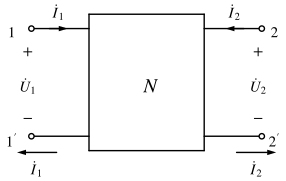{ .circuit }

四端网络的一对端子 $1$-$1'$ 称为一个**端口**，条件是：从 $1$ 流入的电流**等于**从 $1'$ 流出的电流。满足这个条件的四端网络才是二端口。本页讨论的网络内部**不含独立源**、**零初始状态**，都是线性的（可以含受控源）。

!!! note "参考方向（全页统一）"
    - $\dot U_1$、$\dot U_2$ 都是上端子为 $+$；
    - $\dot I_1$、$\dot I_2$ 都从上端子**流入**网络（两个端口都取关联参考方向）。

    T 参数方程里出现 $-\dot I_2$，就是因为传输关系关心的是"从端口 2 **流出**到负载"的电流 $-\dot I_2$。有的教材把端口 2 的电流直接取为流出方向，这时 $B$、$D$ 前的负号消失——看题目先确认方向。

## 2. 四组参数

### Z 参数

$$
\begin{bmatrix}\dot U_1\\\dot U_2\end{bmatrix}=\begin{bmatrix}Z_{11}&Z_{12}\\Z_{21}&Z_{22}\end{bmatrix}\begin{bmatrix}\dot I_1\\\dot I_2\end{bmatrix},\qquad
Z_{11}=\frac{\dot U_1}{\dot I_1}\Big|_{\dot I_2=0},\quad Z_{21}=\frac{\dot U_2}{\dot I_1}\Big|_{\dot I_2=0},\ \ldots
$$

$Z_{11}$ 是端口 2 开路时端口 1 的输入阻抗，$Z_{21}$ 是开路转移阻抗。也可以直接对电路列方程，整理成上面的形式，系数就是 Z 参数——含受控源时这样更快。

### Y 参数

$Y_{11}=\dfrac{\dot I_1}{\dot U_1}\Big|_{\dot U_2=0}$ 等，都在对端**短路**时求。$\mathbf Y=\mathbf Z^{-1}$（两者都存在时）。

### H 参数

$H_{11}=\dfrac{\dot U_1}{\dot I_1}\Big|_{\dot U_2=0}$（输入阻抗），$H_{21}=\dfrac{\dot I_2}{\dot I_1}\Big|_{\dot U_2=0}$（电流放大倍数），$H_{12}=\dfrac{\dot U_1}{\dot U_2}\Big|_{\dot I_1=0}$，$H_{22}=\dfrac{\dot I_2}{\dot U_2}\Big|_{\dot I_1=0}$。晶体管的小信号模型（$h_{ie}$、$h_{fe}$…）就是 H 参数。

### T 参数

$$
A=\frac{\dot U_1}{\dot U_2}\Big|_{\dot I_2=0},\quad B=\frac{\dot U_1}{-\dot I_2}\Big|_{\dot U_2=0},\quad
C=\frac{\dot I_1}{\dot U_2}\Big|_{\dot I_2=0},\quad D=\frac{\dot I_1}{-\dot I_2}\Big|_{\dot U_2=0}.
$$

T 参数把输出量变换成输入量，最适合**级联**。两个基本元件的 T 矩阵（直接由定义得到）：

$$
\text{串联阻抗 }Z:\ \begin{bmatrix}1&Z\\0&1\end{bmatrix},\qquad
\text{并联导纳 }Y:\ \begin{bmatrix}1&0\\Y&1\end{bmatrix}.
$$

### 换算

记 $\Delta_Z=Z_{11}Z_{22}-Z_{12}Z_{21}$。以 Z 参数为桥梁：

| 求 | 用 Z 参数表示 |
| --- | --- |
| $\mathbf Y$ | $\dfrac{1}{\Delta_Z}\begin{bmatrix}Z_{22}&-Z_{12}\\-Z_{21}&Z_{11}\end{bmatrix}$ |
| $\mathbf H$ | $\begin{bmatrix}\Delta_Z/Z_{22}&Z_{12}/Z_{22}\\-Z_{21}/Z_{22}&1/Z_{22}\end{bmatrix}$ |
| $\mathbf T$ | $\begin{bmatrix}Z_{11}/Z_{21}&\Delta_Z/Z_{21}\\1/Z_{21}&Z_{22}/Z_{21}\end{bmatrix}$ |

反过来由 T 求 Z：$Z_{11}=\dfrac AC$，$Z_{12}=\dfrac{AD-BC}{C}$，$Z_{21}=\dfrac1C$，$Z_{22}=\dfrac DC$。记不住时就把一组方程**消元**改写成另一组的形式——表里每个式子都是这么来的。某组参数可能不存在（例如理想变压器没有 Z、Y 参数）。

### 互易与对称

| | Z | Y | H | T |
| --- | --- | --- | --- | --- |
| 互易 | $Z_{12}=Z_{21}$ | $Y_{12}=Y_{21}$ | $H_{12}=-H_{21}$ | $AD-BC=1$ |
| 对称（在互易基础上） | $Z_{11}=Z_{22}$ | $Y_{11}=Y_{22}$ | $H_{11}H_{22}-H_{12}H_{21}=1$ | $A=D$ |

互易条件就是[互易定理](tellegen-duality.md#2-互易定理)的参数形式。由换算表可得一般关系 $AD-BC=Z_{12}/Z_{21}$，所以四组条件彼此等价。**对称**指两个端口互换后外部特性不变；结构对称的网络一定电气对称，反之不一定。

??? example "例：含受控源的 T 形网络"
    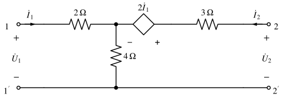{ .circuit }

    求 Z、Y、H、T 参数，判断是否互易。

    **Z 参数**（直接列 KVL；中间并臂 $4\,\Omega$ 中的电流为 $\dot I_1+\dot I_2$，受控源的 $+$ 在端口 2 一侧）：

    $$
    \dot U_1=2\dot I_1+4(\dot I_1+\dot I_2)=6\dot I_1+4\dot I_2,\qquad
    \dot U_2=3\dot I_2+2\dot I_1+4(\dot I_1+\dot I_2)=6\dot I_1+7\dot I_2,
    $$

    $$
    \mathbf Z=\begin{bmatrix}6&4\\6&7\end{bmatrix}\Omega,\qquad \Delta_Z=42-24=18 .
    $$

    **换算**：

    $$
    \mathbf Y=\frac1{18}\begin{bmatrix}7&-4\\-6&6\end{bmatrix}=\begin{bmatrix}\tfrac{7}{18}&-\tfrac29\\-\tfrac13&\tfrac13\end{bmatrix}\mathrm S,\quad
    \mathbf H=\begin{bmatrix}\tfrac{18}{7}\,\Omega&\tfrac47\\-\tfrac67&\tfrac17\,\mathrm S\end{bmatrix},\quad
    \mathbf T=\begin{bmatrix}1&3\,\Omega\\\tfrac16\,\mathrm S&\tfrac76\end{bmatrix}.
    $$

    **校核 T**（按定义）：端口 2 开路时 $\dot U_1=\dot U_2=6\dot I_1$，得 $A=1$、$C=\tfrac16$；端口 2 短路时 $0=6\dot I_1+7\dot I_2$，$\dot U_1=6\dot I_1+4\dot I_2=-3\dot I_2$，得 $B=3$、$D=\dfrac{\dot I_1}{-\dot I_2}=\tfrac76$ ✓

    $Z_{12}=4\ne Z_{21}=6$，$AD-BC=\tfrac76-\tfrac12=\tfrac23=Z_{12}/Z_{21}\ne1$：**不互易**，原因是受控源。

## 3. 等效电路

互易二端口只有 3 个独立参数，可以用 3 个阻抗等效：

=== "T 形（由 Z 参数）"

    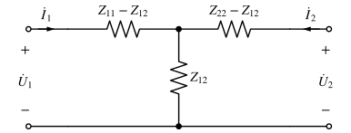{ .circuit }

    $Z_1=Z_{11}-Z_{12}$，$Z_2=Z_{12}$（并臂），$Z_3=Z_{22}-Z_{12}$。

=== "Π 形（由 Y 参数）"

    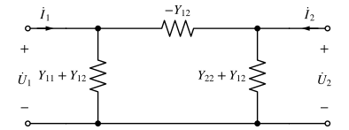{ .circuit }

    图中所标为**导纳**：$Y_a=Y_{11}+Y_{12}$，$Y_b=-Y_{12}$（串臂），$Y_c=Y_{22}+Y_{12}$。

!!! tip "不互易时"
    T 形的右臂再串一个 CCVS $(Z_{21}-Z_{12})\dot I_1$（$+$ 在端口 2 一侧）；Π 形的右并臂再并一个 VCCS $(Y_{21}-Y_{12})\dot U_1$（电流由上端子流向下端子）。上例的 $\mathbf Z$ 代入 T 形公式，得到 $2\,\Omega$、$4\,\Omega$、$3\,\Omega$ 和 $2\dot I_1$——正好还原出原电路。

## 4. 二端口的连接

=== "级联"

    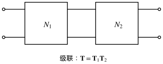{ .circuit }

    前级的输出就是后级的输入（$-\dot I_2^{(1)}=\dot I_1^{(2)}$），所以 $\mathbf T=\mathbf T_1\mathbf T_2$，**顺序不能交换**。级联总是成立。

=== "串联"

    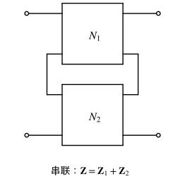{ .circuit }

    两个网络端口电流相同、电压相加：$\mathbf Z=\mathbf Z_1+\mathbf Z_2$。

=== "并联"

    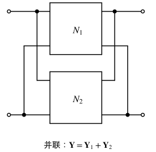{ .circuit }

    两个网络端口电压相同、电流相加：$\mathbf Y=\mathbf Y_1+\mathbf Y_2$。

!!! warning "串联、并联公式的有效性"
    串、并联后，每个子网络的端口条件可能被破坏（一部分电流经连接线"绕"过去），公式就失效。需要检验连接后各子网络仍满足端口条件。常见的保证情形：两个都是**有公共端的三端网络**（下端子直通），并联时公共端接在一起。级联不存在这个问题。

## 5. 带源、带载的二端口

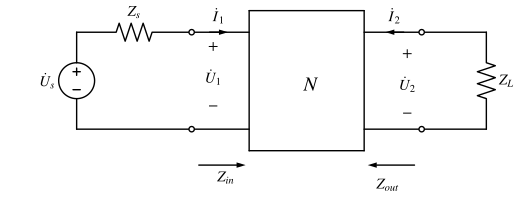{ .circuit }

端口 2 接负载 $Z_L$（$\dot U_2=-Z_L\dot I_2$），端口 1 接电源 $\dot U_s$、内阻抗 $Z_s$：

$$
Z_{in}=\frac{\dot U_1}{\dot I_1}=\frac{AZ_L+B}{CZ_L+D}=Z_{11}-\frac{Z_{12}Z_{21}}{Z_{22}+Z_L},
$$

$$
\text{端口 2 的戴维南等效：}\quad \dot U_{oc}=\frac{\dot U_s}{A+CZ_s}=\frac{Z_{21}\dot U_s}{Z_{11}+Z_s},\qquad
Z_{out}=\frac{DZ_s+B}{CZ_s+A}=Z_{22}-\frac{Z_{12}Z_{21}}{Z_{11}+Z_s}.
$$

求负载功率、最大功率传输时，先把"电源 + 二端口"化成端口 2 的戴维南电路，再用 [最大功率传输](../notes/circuit-theorems.md) 的结论。

??? example "例：已知 Z 参数求负载的最大功率"
    图中 $N$ 为线性无源电阻网络，$\mathbf Z=\begin{bmatrix}5&3\\3&4\end{bmatrix}\Omega$，$\dot U_s=16\,\mathrm V$（直流），$Z_s=R_s=1\,\Omega$，负载 $Z_L=R_L$ 可调。求 $R_L$ 为多大时获得最大功率，最大功率多少。

    **方法一：公式**。端口 2 开路（$\dot I_2=0$）：$I_1=\dfrac{16}{1+5}=\dfrac83\,\mathrm A$，$U_{oc}=Z_{21}I_1=8\,\mathrm V$；

    $$
    R_{out}=Z_{22}-\frac{Z_{12}Z_{21}}{Z_{11}+R_s}=4-\frac{9}{6}=2.5\,\Omega .
    $$

    **方法二：T 形等效**。$Z_{12}=Z_{21}$，互易：串臂 $5-3=2\,\Omega$、并臂 $3\,\Omega$、串臂 $4-3=1\,\Omega$。于是 $U_{oc}=16\times\dfrac{3}{1+2+3}=8\,\mathrm V$，$R_{out}=1+(1+2)\parallel3=2.5\,\Omega$ ✓

    所以 $R_L=2.5\,\Omega$ 时，

    $$
    P_{max}=\frac{U_{oc}^2}{4R_{out}}=\frac{64}{10}=6.4\,\mathrm W .
    $$

    **校核**：$R_L=2.5\,\Omega$ 时联立四个方程解得 $U_2=4\,\mathrm V=U_{oc}/2$，$P=4^2/2.5=6.4\,\mathrm W$ ✓

## 6. 回转器与负阻抗变换器

两种由运放实现的"非常规"二端口元件。

=== "回转器"

    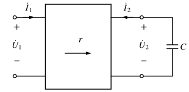{ .circuit }

    $$
    \dot U_1=-r\dot I_2,\quad \dot U_2=r\dot I_1\qquad
    \mathbf Z=\begin{bmatrix}0&-r\\r&0\end{bmatrix},\ \ \mathbf Y=\begin{bmatrix}0&g\\-g&0\end{bmatrix}\ \ (g=1/r).
    $$

    - $Z_{12}\ne Z_{21}$：**不互易**；
    - $u_1i_1+u_2i_2=-ri_2i_1+ri_1i_2=0$：**无源、无损**，既不消耗也不产生能量；
    - 端口 2 接 $Z_L$ 时 $Z_{in}=\dfrac{r^2}{Z_L}$：把电容"回转"成电感，$Z_L=\dfrac{1}{j\omega C}\Rightarrow Z_{in}=j\omega r^2C$，等效电感 $L=r^2C$。集成电路里做不出大电感，就用回转器加电容来代替。

=== "负阻抗变换器"

    $$
    \text{电流反向型：}\ \dot U_1=\dot U_2,\ \dot I_2=k\dot I_1;\qquad
    \text{电压反向型：}\ \dot U_1=-k\dot U_2,\ \dot I_2=-\dot I_1 .
    $$

    端口 2 接 $Z_L$ 时两者都给出

    $$
    Z_{in}=-kZ_L .
    $$

    接电阻得负电阻，接电容得"负电容"……可用来抵消电路中的损耗。用一个运放实现的例子见 [运放电路练习 4](opamp.md#4-用运放实现负电阻)。

## 练习

### 1. 概念判断 :material-star::material-star-outline::material-star-outline:

判断下列说法是否正确（参考方向按本页约定）：

1. 只由线性电阻、电感、电容（含耦合电感）构成的二端口一定互易。
2. 互易二端口满足 $H_{12}=H_{21}$。
3. 任何二端口都同时存在 Z、Y、H、T 四组参数。
4. 两个二端口级联，总 T 矩阵为 $\mathbf T_1\mathbf T_2$，与连接顺序无关。
5. 理想回转器不消耗功率。

??? success "答案"
    1 ✓　2 ✗　3 ✗　4 ✗　5 ✓

??? note "解析"
    1. 不含受控源（以及回转器之类非互易元件）的线性无源网络满足互易定理。
    2. 应为 $H_{12}=-H_{21}$：H 参数混合了电压、电流，互易条件带负号。
    3. 例如理想变压器没有 Z、Y 参数；单个串联阻抗没有 Z 参数，单个并联导纳没有 Y 参数。
    4. 矩阵乘法一般不可交换，$\mathbf T_1\mathbf T_2\ne\mathbf T_2\mathbf T_1$。
    5. $u_1i_1+u_2i_2\equiv0$，任何时刻吸收的总功率都为零。

### 2. Π 形网络的 Y、Z 参数 :material-star::material-star-outline::material-star-outline:

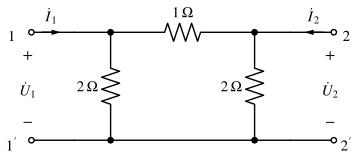{ .circuit }

求 $\mathbf Y$ 和 $\mathbf Z$，并说明网络是否互易、对称。

??? success "答案"
    $\mathbf Y=\begin{bmatrix}1.5&-1\\-1&1.5\end{bmatrix}\mathrm S$，$\mathbf Z=\begin{bmatrix}1.2&0.8\\0.8&1.2\end{bmatrix}\Omega$；互易且对称。

??? note "解析"
    1. **$Y_{11}$、$Y_{21}$**：端口 2 短路，$1\,\Omega$ 串臂与右边 $2\,\Omega$ 并臂都被短路线跨接——右并臂被短路，$\dot U_1$ 直接加在左 $2\,\Omega$ 和 $1\,\Omega$ 上：

        $$
        Y_{11}=\frac12+1=1.5\,\mathrm S;\qquad \dot I_2=-\frac{\dot U_1}{1}\Rightarrow Y_{21}=-1\,\mathrm S .
        $$

        （$1\,\Omega$ 中的电流从左向右流，经短路线回到 $2'$，即从端口 2 的上端子**流出**，所以 $\dot I_2$ 为负。）

    2. 由结构对称，$Y_{22}=1.5\,\mathrm S$，$Y_{12}=-1\,\mathrm S$。也可以直接用 Π 形公式反推：$-Y_{12}=1$（串臂导纳），$Y_{11}+Y_{12}=0.5$。
    3. $\Delta_Y=1.5^2-1=1.25$，

        $$
        \mathbf Z=\mathbf Y^{-1}=\frac1{1.25}\begin{bmatrix}1.5&1\\1&1.5\end{bmatrix}=\begin{bmatrix}1.2&0.8\\0.8&1.2\end{bmatrix}\Omega .
        $$

        **校核** $Z_{11}$：端口 2 开路时从端口 1 看入 $2\parallel(1+2)=1.2\,\Omega$ ✓

    4. $Y_{12}=Y_{21}$、$Y_{11}=Y_{22}$：互易且对称。

### 3. 晶体管的 H 参数模型 :material-star::material-star::material-star-outline:

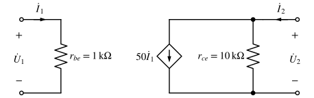{ .circuit }

受控电流源 $50\dot I_1$ 的方向由上向下。（1）求 $\mathbf H$；（2）端口 2 接负载 $R_L=2\,\mathrm{k\Omega}$，求电压增益 $\dot U_2/\dot U_1$。

??? success "答案"
    （1）$H_{11}=1\,\mathrm{k\Omega}$，$H_{12}=0$，$H_{21}=50$，$H_{22}=0.1\,\mathrm{mS}$；（2）$\dot U_2/\dot U_1=-250/3\approx-83.3$。

??? note "解析"
    1. 端口 1：$\dot U_1=r_{be}\dot I_1$，与 $\dot U_2$ 无关，所以 $H_{11}=1\,\mathrm{k\Omega}$、$H_{12}=0$。
    2. 端口 2 上端节点 KCL：流入的 $\dot I_2$ 分成受控源中向下的 $50\dot I_1$ 和 $r_{ce}$ 中的 $\dot U_2/r_{ce}$：

        $$
        \dot I_2=50\dot I_1+\frac{\dot U_2}{10\,\mathrm{k\Omega}}\ \Rightarrow\ H_{21}=50,\ H_{22}=0.1\,\mathrm{mS}.
        $$

    3. 接负载：$\dot I_2=-\dot U_2/R_L$，代入上式（$\mathrm{k\Omega}$、$\mathrm{mA}$）：

        $$
        -\frac{\dot U_2}{2}=50\dot I_1+\frac{\dot U_2}{10}\ \Rightarrow\ \dot U_2=-50\,(2\parallel10)\,\dot I_1=-\frac{250}{3}\dot I_1,
        $$

        而 $\dot U_1=1\times\dot I_1$，所以 $\dot U_2/\dot U_1=-250/3\approx-83.3$。负号表示输出与输入反相——这就是共射放大电路的电压增益 $-\beta(r_{ce}\parallel R_L)/r_{be}$。

### 4. 梯形网络的级联 :material-star::material-star::material-star-outline:

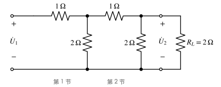{ .circuit }

每一节由串臂 $1\,\Omega$ 和并臂 $2\,\Omega$ 组成。（1）用 T 矩阵求两节级联后的 $\mathbf T$；（2）接 $R_L=2\,\Omega$ 时求输入电阻 $R_{in}$ 和电压比 $U_2/U_1$。

??? success "答案"
    （1）$\mathbf T=\begin{bmatrix}2.75&2.5\,\Omega\\1.25\,\mathrm S&1.5\end{bmatrix}$；（2）$R_{in}=2\,\Omega$，$U_2/U_1=1/4$。

??? note "解析"
    1. 一节 = 串臂 × 并臂：

        $$
        \mathbf T_1=\begin{bmatrix}1&1\\0&1\end{bmatrix}\begin{bmatrix}1&0\\0.5&1\end{bmatrix}=\begin{bmatrix}1.5&1\\0.5&1\end{bmatrix},\qquad
        \mathbf T=\mathbf T_1^2=\begin{bmatrix}2.75&2.5\\1.25&1.5\end{bmatrix}.
        $$

        校核：$AD-BC=4.125-3.125=1$ ✓（电阻网络互易）。

    2. $R_{in}=\dfrac{AR_L+B}{CR_L+D}=\dfrac{5.5+2.5}{2.5+1.5}=2\,\Omega$；

        $U_2/U_1$：$U_1=AU_2-BI_2=\Big(A+\dfrac{B}{R_L}\Big)U_2=(2.75+1.25)U_2$，所以 $U_2/U_1=1/4$。

    **直接看**：最后一节接 $2\,\Omega$ 时，$2\parallel2=1$，加上串臂 $1\,\Omega$ 又是 $2\,\Omega$——每一节都"复制"出同样的负载，每节电压减半，两节共 $1/4$ ✓。这个使输入电阻等于负载电阻的 $2\,\Omega$ 就是该节的**特性电阻**（与 [均匀传输线](transmission-line.md) 的匹配是同一个思想）。

### 5. 回转器模拟电感 :material-star::material-star-outline::material-star-outline:

{ .circuit }

回转器 $r=1\,\mathrm{k\Omega}$，端口 2 接 $C=1\,\mu\mathrm F$。（1）从端口 1 看进去相当于什么元件？$\omega=1000\,\mathrm{rad/s}$ 时 $Z_{in}$ 为多少？（2）若端口 2 改接 $500\,\Omega$ 电阻，$Z_{in}$ 为多少？

??? success "答案"
    （1）$1\,\mathrm H$ 电感，$Z_{in}=j1000\,\Omega$；（2）$2\,\mathrm{k\Omega}$。

??? note "解析"
    联立 $\dot U_1=-r\dot I_2$、$\dot U_2=r\dot I_1$、$\dot U_2=-Z_L\dot I_2$：$\dot I_2=-\dfrac{r}{Z_L}\dot I_1$，$\dot U_1=\dfrac{r^2}{Z_L}\dot I_1$，即 $Z_{in}=\dfrac{r^2}{Z_L}$。

    1. $Z_L=\dfrac{1}{j\omega C}$：$Z_{in}=j\omega r^2C$，等效电感 $L=r^2C=10^6\times10^{-6}=1\,\mathrm H$；$\omega=1000\,\mathrm{rad/s}$ 时 $Z_{in}=j1000\,\Omega$。
    2. $Z_{in}=\dfrac{10^6}{500}=2000\,\Omega$：回转器把小电阻"倒"成大电阻（阻抗求倒数再乘 $r^2$）。
