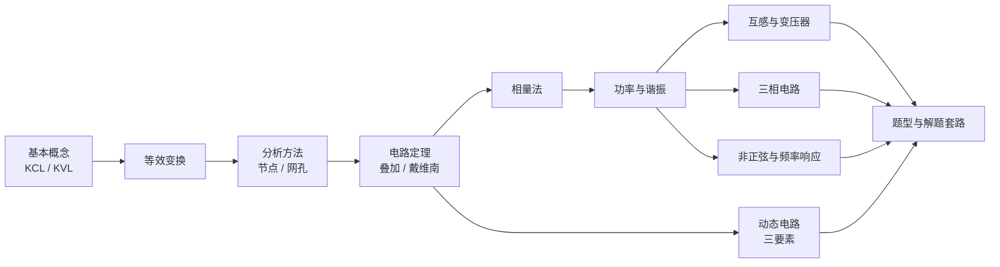

# 电路

「电路与模拟电子技术」中电路理论部分的学习笔记：从参考方向和基尔霍夫定律出发，经过电阻电路的等效与分析方法、电路定理，到正弦稳态、互感、三相、非正弦，最后是动态电路的时域分析。每篇都有带完整解答的例题（点开折叠框查看），所有数值都经过独立重算。

!!! note "约定"
    - 电压、电流默认取**关联参考方向**，功率按"吸收"计算。
    - 正弦量默认用 **sin 约定 + 有效值相量**：$u=\sqrt2U\sin(\omega t+\psi)\leftrightarrow\dot U=U\angle\psi$（邱关源教材用 cos 约定，只要全题统一，结果一致）。
    - 电路图中电压源上的 $+$/$-$ 为参考极性，电流源箭头为参考方向，线圈旁的 "$\bullet$" 为同名端。

## 学习路线

## 目录

-   :material-book-open-variant:{ .lg .middle } **知识点**

    ---

    11 篇，从 KCL/KVL 到动态电路，含例题

    [:octicons-arrow-right-24: 进入](notes/index.md)

-   :material-pencil-box-multiple-outline:{ .lg .middle } **习题**

    ---

    按章节配套的练习题，附答案与详细解析

    [:octicons-arrow-right-24: 进入](exercises/index.md)

