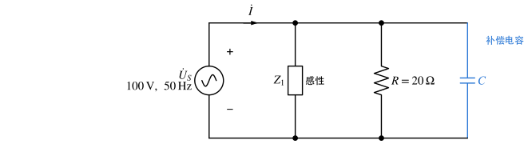
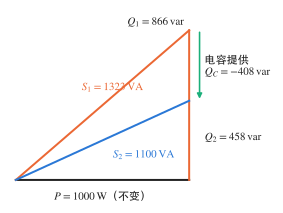
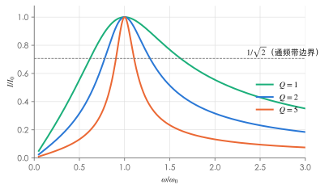

# 正弦稳态功率与谐振

!!! abstract "TL;DR"
    - 复功率 $\bar S=\dot U\dot I^*=P+jQ$：实部是有功（W），虚部是无功（var），模是视在功率（VA）。
    - **复功率守恒**：各支路 $P$、$Q$ 分别代数相加；**视在功率不守恒**，不能把 $S$ 直接相加。
    - 并联电容补偿：$C=\dfrac{P(\tan\varphi_1-\tan\varphi_2)}{\omega U^2}$，有功不变、无功减少、电源电流变小。
    - 谐振 = 端口电压电流同相（输入阻抗虚部为零）。串联谐振 $|Z|$ 最小、电流最大，$U_L=U_C=QU$。

## 1. 各种功率

设一端口 $u=\sqrt2U\sin(\omega t+\psi_u)$，$i=\sqrt2I\sin(\omega t+\psi_i)$（关联方向），$\varphi=\psi_u-\psi_i$：

$$
p(t)=ui=UI\cos\varphi-UI\cos(2\omega t+\psi_u+\psi_i)
$$

瞬时功率以 $2\omega$ 脉动，其平均值就是有功功率。

| 量 | 公式 | 单位 | 含义 |
| --- | --- | --- | --- |
| 有功功率 $P$ | $UI\cos\varphi=I^2R$ | W | 平均功率，真正被消耗 |
| 无功功率 $Q$ | $UI\sin\varphi=I^2X$ | var | 与储能元件往返交换的功率幅度 |
| 视在功率 $S$ | $UI=\sqrt{P^2+Q^2}$ | VA | 设备容量 |
| 功率因数 $\lambda$ | $\cos\varphi=P/S$ | — | 无源网络中 $\varphi=\varphi_Z$ |
| 复功率 $\bar S$ | $\dot U\dot I^*=I^2Z=U^2Y^*$ | VA | $=P+jQ$ |

| 元件 | $P$ | $Q$ |
| --- | --- | --- |
| 电阻 | $I^2R$ | $0$ |
| 电感 | $0$ | $I^2X_L>0$（吸收无功） |
| 电容 | $0$ | $-I^2X_C<0$（发出无功） |

!!! warning "共轭加在电流上"
    $\bar S=\dot U\dot I^*$，不是 $\dot U\dot I$，也不是 $\dot U^*\dot I$（后者虚部符号相反）。只有这样才有 $\arg\bar S=\psi_u-\psi_i=\varphi$，感性负载 $Q>0$。

??? example "例：RLC 串联的功率（cos 约定）"
    $R=30\,\Omega$，$L=80\,\mathrm{mH}$，$C=20\,\mu\mathrm F$，$u=10\sqrt2\cos(1000t)\,\mathrm V$。

    $$
    Z=30+j\Big(1000\times0.08-\frac{1}{1000\times20\times10^{-6}}\Big)=30+j(80-50)=30+j30=30\sqrt2\angle45^\circ\,\Omega
    $$

    $$
    \dot I=\frac{10\angle0^\circ}{30\sqrt2\angle45^\circ}=\frac{\sqrt2}{6}\angle(-45^\circ)\approx0.236\angle(-45^\circ)\,\mathrm A,
    \qquad i=\tfrac13\cos(1000t-45^\circ)\,\mathrm A
    $$

    $$
    \lambda=\cos45^\circ\approx0.707\ (\text{感性、滞后}),\quad P=I^2R=\tfrac53\approx1.67\,\mathrm W,\quad Q=I^2X=\tfrac53\,\mathrm{var},\quad S=UI\approx2.36\,\mathrm{VA}
    $$

## 2. 复功率守恒

电路中所有支路吸收的复功率之和为零（特勒根定理的推论），因此：

$$
\sum\bar S_{\text{吸收}}=\bar S_{\text{电源发出}},\qquad \sum P_k=P,\quad \sum Q_k=Q,\quad\text{但}\ \sum S_k\neq S .
$$

??? example "例：逐支路复功率"
    { .circuit }

    求各支路吸收的复功率及电源发出的复功率。

    $$
    Z_p=Z_2\parallel Z_3=\frac{(6+j8)(3-j4)}{9+j4}\approx4.639-j2.062\,\Omega
    $$

    $$
    \dot I_1=\frac{20}{-j1+Z_p}\approx3.003+j1.982=3.598\angle33.42^\circ\,\mathrm A,\qquad
    \dot U_{ab}=\dot I_1Z_p\approx18.02+j3.003\,\mathrm V
    $$

    $$
    \dot I_2=\frac{\dot U_{ab}}{6+j8}\approx1.827\angle(-43.67^\circ)\,\mathrm A,\qquad
    \dot I_3=\frac{\dot U_{ab}}{3-j4}\approx3.653\angle62.59^\circ\,\mathrm A
    $$

    用 $\bar S_k=I_k^2Z_k$：

    | 支路 | $I_k^2$ | $\bar S_k$ / VA |
    | --- | --- | --- |
    | 电容 $-j1$ | $12.946$ | $-j12.95$ |
    | $6+j8$ | $3.337$ | $20.02+j26.69$ |
    | $3-j4$ | $13.347$ | $40.04-j53.39$ |
    | **合计** | | $60.06-j39.64$ |

    电源发出 $\bar S=\dot U_S\dot I_1^*=20(3.003-j1.982)=60.06-j39.64\,\mathrm{VA}$ ✓（$Q<0$：整体呈容性，电源实际在吸收无功。）

## 3. 功率因数补偿

感性负载并联电容：电压不变，负载本身的电流与功率**不变**，电容提供负的无功，使电源侧总无功减少、总电流减小、线路损耗 $I^2R_{线}$ 降低。

$$
Q_C=-\omega CU^2,\qquad
C=\frac{P(\tan\varphi_1-\tan\varphi_2)}{\omega U^2}
$$

$\varphi_1$、$\varphi_2$ 分别为补偿前、后的功率因数角。一般补偿到略滞后（欠补偿），所需电容最小；补偿过头（过补偿）变成容性，不经济。

??? example "例：并联电容使总电流降到 11 A"
    { .circuit }

    $U_S=100\,\mathrm V$，$f=50\,\mathrm{Hz}$。感性负载 $Z_1$ 电流 $10\,\mathrm A$、功率因数 $0.5$（滞后），与 $R=20\,\Omega$ 并联。求电源的 $P$、总电流、总功率因数；再并联电容使总电流降为 $11\,\mathrm A$，求最小电容。

    **补偿前**（$\dot U_S=100\angle0^\circ$）：$\dot I_1=10\angle(-60^\circ)=5-j5\sqrt3$，$\dot I_R=5\,\mathrm A$，

    $$
    \dot I=10-j5\sqrt3\approx13.23\angle(-40.89^\circ)\,\mathrm A,\quad P=100\times10=1000\,\mathrm W,\quad \lambda=\frac{10}{\sqrt{175}}\approx0.756\ (\text{滞后}) .
    $$

    **补偿后**：电容不改变有功电流 $10\,\mathrm A$。总电流 $11\,\mathrm A$ 时剩余无功电流 $\sqrt{11^2-10^2}=\sqrt{21}\,\mathrm A$。最小电容对应仍为感性：

    $$
    I_C=5\sqrt3-\sqrt{21}\approx4.078\,\mathrm A,\qquad C=\frac{I_C}{\omega U}=\frac{4.078}{100\pi\times100}\approx129.8\,\mu\mathrm F,
    $$

    新功率因数 $\lambda'=\dfrac{1000}{100\times11}=\dfrac{10}{11}\approx0.909$（滞后）。用公式验证：$\tan\varphi_1=0.866$，$\tan\varphi_2=\sqrt{21}/10\approx0.458$，$C=\dfrac{1000\times(0.866-0.458)}{100\pi\times100^2}\approx129.8\,\mu\mathrm F$ ✓

    （若过补偿到容性，$I_C=5\sqrt3+\sqrt{21}\approx13.24\,\mathrm A$，$C\approx421.5\,\mu\mathrm F$，同样得到 $11\,\mathrm A$，但电容大得多。）

    { .circuit }

## 4. 交流最大功率传输

戴维南等效为 $\dot U_{oc}$ 串 $Z_{eq}=R_{eq}+jX_{eq}$：

| 负载可调范围 | 最佳负载 | 最大功率 |
| --- | --- | --- |
| $Z_L$ 实部、虚部都可调 | **共轭匹配** $Z_L=Z_{eq}^*$ | $P_{\max}=\dfrac{U_{oc}^2}{4R_{eq}}$ |
| 只能是纯电阻 $R_L$ | **模匹配** $R_L=\lvert Z_{eq}\rvert$ | 代入 $P=\dfrac{U_{oc}^2R_L}{(R_{eq}+R_L)^2+X_{eq}^2}$ |

例如 $U_{oc}=10\,\mathrm V$、$Z_{eq}=3+j4\,\Omega$：共轭匹配 $Z_L=3-j4$，$P_{\max}=\dfrac{100}{12}\approx8.33\,\mathrm W$；只能接电阻时 $R_L=5\,\Omega$，$P=\dfrac{100\times5}{8^2+4^2}=6.25\,\mathrm W$。

## 5. 瓦特表读数

瓦特表的电流线圈串入被测支路，电压线圈并在被测两端，两线圈各有一个"$*$"端。电流从电流线圈 $*$ 端流入、电压 $\dot U$ 以电压线圈 $*$ 端为 $+$ 时：

$$
W=\mathrm{Re}\big[\dot U\dot I^*\big]=UI\cos(\psi_u-\psi_i)
$$

读数可以为负，**不能**一律取绝对值；$\dot U$、$\dot I$ 必须是表实际所接的那一对。

## 6. 谐振

端口电压与电流同相（$\operatorname{Im}Z_{in}=0$ 或 $\operatorname{Im}Y_{in}=0$）称为谐振。

### 串联谐振（RLC 串联）

{ .circuit }

$$
Z=R+j\Big(\omega L-\frac{1}{\omega C}\Big),\qquad \omega_0=\frac{1}{\sqrt{LC}},\quad f_0=\frac{1}{2\pi\sqrt{LC}}
$$

- $|Z|=R$ 最小，电流 $I_0=U/R$ 最大，$\dot U_R=\dot U$；
- $\dot U_L=-\dot U_C$，**相互抵消**，但各自大小 $U_L=U_C=QU$，可能远大于电源电压（"电压谐振"）；
- 品质因数 $Q=\dfrac{\omega_0L}{R}=\dfrac{1}{\omega_0CR}=\dfrac1R\sqrt{\dfrac LC}$；通频带 $\Delta\omega=\dfrac{\omega_0}{Q}=\dfrac RL$；
- $\omega<\omega_0$ 容性，$\omega>\omega_0$ 感性。

{ .circuit }

??? example "例：串联谐振的频率、电流与元件电压"
    $U=5\,\mathrm{mV}$，$R=40\,\Omega$，$L=0.5\,\mathrm H$，$C=100\,\mu\mathrm F$。

    $$
    \omega_0=\frac{1}{\sqrt{0.5\times100\times10^{-6}}}\approx141.4\,\mathrm{rad/s},\qquad f_0=\frac{\omega_0}{2\pi}\approx22.51\,\mathrm{Hz}
    $$

    $$
    I_0=\frac{5\,\mathrm{mV}}{40\,\Omega}=0.125\,\mathrm{mA},\qquad \omega_0L=\frac{1}{\omega_0C}\approx70.71\,\Omega
    $$

    $$
    U_L=U_C=I_0\,\omega_0L\approx8.84\,\mathrm{mV},\qquad Q=\frac{\omega_0L}{R}\approx1.77=\frac{U_L}{U}\ \checkmark
    $$

### 并联谐振

| 电路 | 谐振条件 | 谐振时 |
| --- | --- | --- |
| $G$、$L$、$C$ 并联 | $\omega_0=\dfrac1{\sqrt{LC}}$ | $Y=G$ 最小，$\lvert Z\rvert$ 最大；$I_L=I_C=QI$，$Q=\dfrac{\omega_0C}{G}=\dfrac{R}{\omega_0L}$（"电流谐振"） |
| 理想 $L$、$C$ 并联 | $\omega_0=\dfrac1{\sqrt{LC}}$ | $Y=0$，端口**开路**，内部仍有环流 |
| 线圈 $(R+j\omega L)$ 与 $C$ 并联 | $\operatorname{Im}Y=0\Rightarrow\omega_0=\sqrt{\dfrac1{LC}-\dfrac{R^2}{L^2}}$ | 只在 $R<\sqrt{L/C}$ 时存在；此时 $\omega_0$ **不等于** $1/\sqrt{LC}$ |

!!! warning "多支路电路不要硬套 $1/\sqrt{LC}$"
    先写端口 $Z_{in}$ 或 $Y_{in}$，令其虚部为零（或令 $Z_{in}=0$ 得"串联谐振 / 端口短路"，令 $Y_{in}=0$ 得"并联谐振 / 端口开路"）。某一条子支路谐振不等于整个端口谐振。

??? example "例：同一端口的两种谐振"
    { .circuit }

    元件无损，求端口的串联谐振与并联谐振角频率。

    $$
    Z_{ab}=\frac{j\omega L_1\cdot j\big(\omega L_2-\frac1{\omega C}\big)}{j\big[\omega(L_1+L_2)-\frac1{\omega C}\big]}
    $$

    - **分子为零 → $Z_{ab}=0$（串联谐振，端口短路）**：右支路 $L_2$、$C$ 串联谐振，$\omega_s=\dfrac1{\sqrt{L_2C}}=\dfrac1{\sqrt{0.6\times10^{-6}}}\approx1291\,\mathrm{rad/s}$。
    - **分母为零 → $Y_{ab}=0$（并联谐振，端口开路）**：$\omega_p=\dfrac{1}{\sqrt{(L_1+L_2)C}}=\dfrac1{\sqrt{1\times10^{-6}}}=1000\,\mathrm{rad/s}$。
      此时右支路整体呈容性（$\omega_p<\omega_s$），与 $L_1$ 的感纳相消。

下一篇：[互感与理想变压器](coupled-inductors.md)。

!!! tip "练习"
    配套习题：[习题：正弦稳态功率与谐振](../exercises/ex-ac-power.md)
