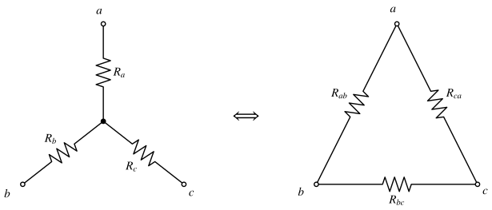
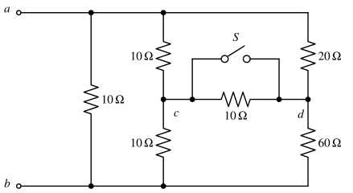
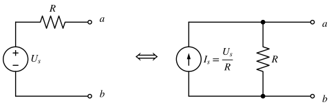
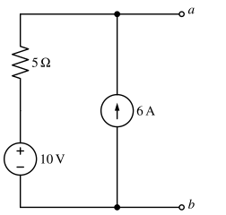

# 电阻电路的等效变换

!!! abstract "TL;DR"
    **等效 = 端口伏安关系相同**，只对外等效，对内不等效。化简电阻网络的顺序：先**标节点**（同一导线上的点是同一节点，闭合开关合并节点），再找串并联；遇到桥形用**平衡条件**或 **Y–Δ 变换**；含电源的支路用**电源等效变换**合并；含受控源时只能用**外加电源法**求输入电阻。

## 1. 等效的含义

两个二端网络 $N_1$、$N_2$ 若端口的 $u$–$i$ 关系完全相同，则对任意外电路而言它们可以互换，称为**等效**。

!!! warning "对内不等效"
    等效只保证**端口及外电路**的电压、电流不变。被替换部分**内部**的电流、功率一般不同——例如电压源与电流源互换后，内部电阻的功率并不相同。求内部量时必须回到原电路。

## 2. 串联、并联与分压、分流

| | 串联 | 并联 |
| --- | --- | --- |
| 共同量 | 同一电流 | 同一电压 |
| 等效 | $R_{eq}=R_1+R_2+\cdots$ | $\dfrac1{R_{eq}}=\dfrac1{R_1}+\dfrac1{R_2}+\cdots$，$G_{eq}=\sum G_k$ |
| 分配 | 分压 $u_k=\dfrac{R_k}{\sum R}\,u$ | 两电阻分流 $i_1=\dfrac{R_2}{R_1+R_2}\,i$ |

两电阻并联记作 $R_1\parallel R_2=\dfrac{R_1R_2}{R_1+R_2}$。

!!! tip "判断串并联的可靠方法：节点标号"
    1. 用字母给每个节点命名；**一根理想导线连起来的所有点是同一个节点**。
    2. 闭合的开关是导线（合并两端节点）；断开的开关直接删去该支路。
    3. 两个元件**接在同一对节点之间**才是并联；中间节点**没有其他支路**引出才是串联。
    4. 按节点重画电路，不要凭导线在纸上的位置猜。

## 3. 平衡电桥与对称性

桥形电路中若 $c$、$d$ 两点等电位，桥支路电流为零，桥支路可以**断开**也可以**短接**，化简立刻变成串并联。

设 $a$–$c$ 为 $R_1$、$c$–$b$ 为 $R_2$、$a$–$d$ 为 $R_3$、$d$–$b$ 为 $R_4$，则**电桥平衡条件**为

$$
\frac{R_1}{R_2}=\frac{R_3}{R_4}\quad\Longleftrightarrow\quad R_1R_4=R_2R_3 .
$$

**对称性**：若电路的结构、参数**以及激励**关于某条轴对称，则对称位置上的点等电位，可合并或断开。三者缺一不可。

## 4. Y–Δ 等效变换

当网络既不是串联也不是并联（典型是不平衡电桥）时，把三端的星形（Y）与三角形（Δ）互换。

{ .circuit }

=== "Δ → Y"

    $$
    R_a=\frac{R_{ab}R_{ca}}{R_{ab}+R_{bc}+R_{ca}},\quad
    R_b=\frac{R_{ab}R_{bc}}{R_{ab}+R_{bc}+R_{ca}},\quad
    R_c=\frac{R_{bc}R_{ca}}{R_{ab}+R_{bc}+R_{ca}}
    $$

    口诀：**Y 臂 = 相邻两边之积 / 三边之和**。

=== "Y → Δ"

    $$
    R_{ab}=\frac{R_aR_b+R_bR_c+R_cR_a}{R_c},\quad
    R_{bc}=\frac{R_aR_b+R_bR_c+R_cR_a}{R_a},\quad
    R_{ca}=\frac{R_aR_b+R_bR_c+R_cR_a}{R_b}
    $$

    口诀：**Δ 边 = Y 两两乘积之和 / 对面的臂**。

=== "对称情形"

    三个电阻相等时：$R_Y=\dfrac{R_\Delta}{3}$，$R_\Delta=3R_Y$。
    例如三个 $6\,\Omega$ 组成的 Δ 等效为每臂 $2\,\Omega$ 的 Y，任意两端之间都是 $4\,\Omega$。

??? example "例：开关通断时的等效电阻"
    { .circuit }

    求 $S$ 闭合与断开时 $R_{ab}$。四个桥臂 $10,10,20,60\,\Omega$ 不满足 $10\times60=10\times20$，**不平衡**。

    **$S$ 闭合**：$c$、$d$ 合并为同一节点 $x$，桥支路 $10\,\Omega$ 被短接。

    $$
    R_{ax}=10\parallel20=\tfrac{20}{3},\qquad R_{xb}=10\parallel60=\tfrac{60}{7},
    $$

    $$
    R_{ab}=10\parallel\left(\tfrac{20}{3}+\tfrac{60}{7}\right)=10\parallel\tfrac{320}{21}=\frac{320}{53}\approx6.04\,\Omega .
    $$

    **$S$ 断开**：把 $a$、$c$、$d$ 间的三角形（$R_{ac}=10$，$R_{ad}=20$，$R_{cd}=10$，和为 $40$）化为星形，中心记 $o$：

    $$
    R_{ao}=\frac{10\times20}{40}=5,\quad R_{co}=\frac{10\times10}{40}=2.5,\quad R_{do}=\frac{20\times10}{40}=5\ (\Omega).
    $$

    于是 $o$ 到 $b$ 为两条并联路径：

    $$
    R_{ob}=(2.5+10)\parallel(5+60)=\frac{325}{31}\,\Omega,\qquad
    R_{ab}=10\parallel\left(5+\frac{325}{31}\right)=\frac{480}{79}\approx6.08\,\Omega .
    $$

    **检验**：闭合开关只会多出一条导通路径，等效电阻不会变大，$6.04<6.08$ ✓

## 5. 含源支路的等效

| 连接 | 对外等效为 |
| --- | --- |
| 电压源串联 | 一个电压源，$u_s=\sum(\pm u_{sk})$（按极性代数相加） |
| 电流源并联 | 一个电流源，$i_s=\sum(\pm i_{sk})$ |
| 电压源与**任意元件**并联（除另一电压源） | 该电压源本身——**并联看电压** |
| 电流源与**任意元件**串联 | 该电流源本身——**串联看电流** |

### 实际电源模型互换

{ .circuit }

$$
U_s \text{ 串 } R\quad\Longleftrightarrow\quad I_s=\frac{U_s}{R}\ \text{并}\ R
$$

方向：**电流源箭头指向电压源的 $+$ 端**。两种模型的端口开路电压都是 $U_s$，短路电流都是 $U_s/R$。理想电压源（$R=0$）与理想电流源（$R=\infty$）之间**不能**互换。

??? example "例：化为最简形式"
    { .circuit }

    1. $10\,\mathrm V$ 串 $5\,\Omega$ → $2\,\mathrm A$（指向 $a$）并 $5\,\Omega$；
    2. 与 $6\,\mathrm A$（同样指向 $a$）的电流源并联：$2+6=8\,\mathrm A$ 并 $5\,\Omega$；
    3. 再换回电压源形式：$8\times5=40\,\mathrm V$（$a$ 端为 $+$）串 $5\,\Omega$。

    **检验**：开路时由节点 $a$ 的 KCL，$\dfrac{U_{ab}-10}{5}=6\Rightarrow U_{ab}=40\,\mathrm V$ ✓

## 6. 含受控源网络的输入电阻

不含独立源的二端网络对外等效为一个电阻 $R_{in}$。含受控源时不能用串并联化简，要用**外加电源法**：

$$
R_{in}=\frac{u}{i}\qquad(\text{端口外加 } u\text{，求流入的 } i\text{；}u,i\text{ 取关联方向})
$$

??? example "例：含 CCVS 的输入电阻"
    { .circuit }

    端口加电压 $u$。$6\,\Omega$ 上 $i_1=\dfrac u6$；右支路 $3\,\Omega$ 与受控源串联，向下电流

    $$
    i_2=\frac{u-2i_1}{3}=\frac{u-u/3}{3}=\frac{2u}{9}.
    $$

    $$
    i=i_1+i_2=\frac u6+\frac{2u}9=\frac{7u}{18}\quad\Longrightarrow\quad R_{in}=\frac{18}{7}\approx2.57\,\Omega .
    $$

    受控源"顶住"了右支路的一部分电压，所以 $R_{in}$ 比 $6\parallel3=2\,\Omega$ 大。

!!! note "负电阻"
    含受控源时 $R_{in}$ 可能为负，表示该网络在向外**输出**功率。见 [电路定理](circuit-theorems.md) 中的例题。

下一篇：[电路的一般分析方法](analysis-methods.md)。
