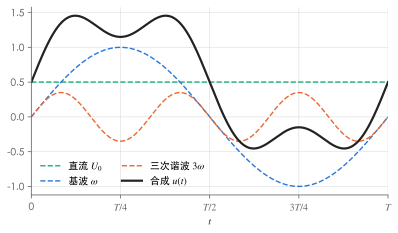
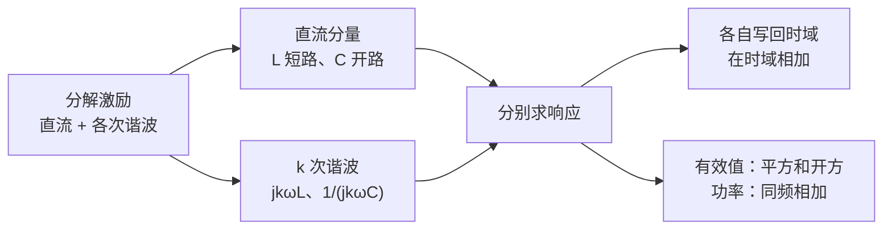

# 非正弦周期电路与频率响应

!!! abstract "TL;DR"
    把周期激励分解成**直流 + 各次谐波**，每个频率单独用相量法求解（$X_L=k\omega L$、$X_C=\dfrac{1}{k\omega C}$，直流时 L 短路、C 开路），最后**在时域相加**。有效值 $U=\sqrt{U_0^2+U_1^2+U_2^2+\cdots}$；平均功率只有**同频**电压电流才产生：$P=U_0I_0+\sum U_kI_k\cos\varphi_k$。不同频率的相量**不能**相加。

## 1. 傅里叶分解

满足狄利克雷条件的周期函数（周期 $T$，$\omega=2\pi/T$）可以展开为

$$
f(t)=A_0+\sum_{k=1}^{\infty}A_{km}\sin(k\omega t+\varphi_k)
$$

$A_0$ 为直流分量，$k=1$ 为基波，$k\ge2$ 为高次谐波。

{ .circuit }

| 波形对称性 | 含有的分量 |
| --- | --- |
| 奇函数 $f(-t)=-f(t)$ | 只有正弦项（无直流、无余弦项） |
| 偶函数 $f(-t)=f(t)$ | 只有直流和余弦项 |
| 半波对称 $f(t+T/2)=-f(t)$ | 只有奇次谐波（无直流） |

## 2. 有效值与平均功率

由三角函数的正交性（不同频率的乘积在一个周期内平均值为零）：

$$
U=\sqrt{\frac1T\int_0^Tu^2\,\mathrm dt}=\sqrt{U_0^2+U_1^2+U_2^2+\cdots}
$$

其中 $U_k$ 是第 $k$ 次谐波的**有效值**（$=U_{km}/\sqrt2$），直流分量**不除** $\sqrt2$。

$$
P=\frac1T\int_0^Tui\,\mathrm dt=U_0I_0+\sum_{k=1}^{\infty}U_kI_k\cos\varphi_k,\qquad \varphi_k=\psi_{uk}-\psi_{ik}
$$

总功率因数定义为 $\lambda=\dfrac{P}{UI}$，一般不等于任何单个谐波的 $\cos\varphi_k$。

!!! warning "三个常见错误"
    1. 把各分量的**幅值或有效值直接相加**当作总有效值——应是平方和开方。
    2. 用不同频率的电压、电流相乘算功率——跨频交叉项平均为零。
    3. 把不同频率的相量加在一起——相量只对同一频率有意义，只能在**时域**相加。

??? example "例：有效值与平均功率"
    关联方向下

    $$
    u=5+40\sqrt2\sin(\omega t+30^\circ)+30\sqrt2\sin(3\omega t-20^\circ)\ \mathrm V,
    $$

    $$
    i=1+5\sqrt2\sin(\omega t-30^\circ)+3\sqrt2\sin(3\omega t+10^\circ)\ \mathrm A .
    $$

    $$
    U=\sqrt{5^2+40^2+30^2}=\sqrt{2525}\approx50.25\,\mathrm V,\qquad I=\sqrt{1^2+5^2+3^2}=\sqrt{35}\approx5.92\,\mathrm A
    $$

    基波相位差 $30^\circ-(-30^\circ)=60^\circ$，三次谐波 $-20^\circ-10^\circ=-30^\circ$：

    $$
    P=5\times1+40\times5\cos60^\circ+30\times3\cos(-30^\circ)=105+45\sqrt3\approx182.9\,\mathrm W .
    $$

## 3. 谐波分析法

- 每个频率的分电路中，**其他频率的独立源置零**（电压源短路、电流源开路），线性受控源保留。
- 互感也随频率变化：$k$ 次谐波下 $X_M=k\omega M$。

??? example "例：RL 电路的谐波响应"
    $R=10\,\Omega$，基波下 $\omega L=10\,\Omega$，串联接在
    $u=10+100\sqrt2\sin\omega t+30\sqrt2\sin3\omega t\ \mathrm V$ 上，求 $i$、有效值与功率。

    | 分量 | 阻抗 | 电流相量 |
    | --- | --- | --- |
    | 直流 | $R=10$ | $I_0=1\,\mathrm A$ |
    | 基波 | $10+j10=14.14\angle45^\circ$ | $\dot I_1=7.07\angle(-45^\circ)\,\mathrm A$ |
    | 三次 | $10+j30=31.62\angle71.57^\circ$ | $\dot I_3=0.949\angle(-71.57^\circ)\,\mathrm A$ |

    $$
    i=1+10\sin(\omega t-45^\circ)+1.342\sin(3\omega t-71.57^\circ)\ \mathrm A
    $$

    $$
    I=\sqrt{1^2+7.07^2+0.949^2}=\sqrt{51.9}\approx7.20\,\mathrm A,\qquad U=\sqrt{10^2+100^2+30^2}\approx104.9\,\mathrm V
    $$

    $$
    P=I^2R=519\,\mathrm W\quad(=10\times1+100\times7.07\cos45^\circ+30\times0.949\cos71.57^\circ=10+500+9)\ \checkmark
    $$

    $\lambda=P/(UI)\approx0.687$。电感对高次谐波阻抗更大，所以电流波形比电压"更接近正弦"——这就是电感滤波的原理。

## 4. 频率响应与滤波

网络函数 $H(j\omega)=\dfrac{\dot U_{out}}{\dot U_{in}}=|H(j\omega)|\angle\theta(\omega)$，$|H|$ 为幅频特性，$\theta$ 为相频特性。

| RC 分压 | $H(j\omega)$ | 特性 |
| --- | --- | --- |
| 输出取自 $C$ | $\dfrac{1}{1+j\omega RC}$ | 低通，$\theta=-\arctan\omega RC$ |
| 输出取自 $R$ | $\dfrac{j\omega RC}{1+j\omega RC}$ | 高通，$\theta=90^\circ-\arctan\omega RC$ |

截止角频率 $\omega_c=\dfrac{1}{RC}$，此时 $|H|=\dfrac1{\sqrt2}$，相移 $\mp45^\circ$。

**用谐振"挑"频率**：理想 LC 串联支路在 $\omega_0=1/\sqrt{LC}$ 时阻抗为零（相当于短路，可滤除该频率）；理想 LC 并联在同一频率时导纳为零（相当于开路，可阻断该频率）。

??? example "例：由三个频率的现象反推元件"
    { .circuit }

    $C=0.25\,\mathrm F$，$u_S=10+20\sqrt2\sin2t+10\sqrt2\sin4t\ \mathrm V$。已知：$\omega=2\,\mathrm{rad/s}$ 时 $U_{CD}=U_R=U_S/2$（两个 $R$ 阻值相同，$U_R$ 指串联电阻上的电压）；$\omega=4\,\mathrm{rad/s}$ 时 $U_{CD}=0$；电源输入总功率 $40\,\mathrm W$。求 $L_1$、$L_2$、$R$。

    **$\omega=2$**：$U_R+U_{CD}=U_S$ 说明 $\dot U_R$ 与 $\dot U_{CD}$ 同相，又等大，故 CD 端等效阻抗等于 $R$。CD 由 $R$ 与储能支路并联，只有储能支路**开路**才行，而 $L_1$ 有限，所以 $L_2\parallel C$ 发生并联谐振：

    $$
    2^2L_2C=1\ \Rightarrow\ L_2=\frac{1}{4\times0.25}=1\,\mathrm H .
    $$

    **$\omega=4$**：$U_{CD}=0$ 说明储能支路**短路**（串联谐振）。此时 $L_2\parallel C$ 的阻抗

    $$
    \frac{1}{\frac{1}{j4}+j4\times0.25}=\frac{1}{j0.75}=-j\frac43\,\Omega,\qquad j4L_1-j\frac43=0\ \Rightarrow\ L_1=\frac13\,\mathrm H .
    $$

    **功率**（各频率分别算再相加）：直流时 $L_1$、$L_2$ 短路使 CD 短接，$P_0=\dfrac{10^2}{R}$；$\omega=2$ 时总阻抗 $2R$，$P_2=\dfrac{20^2}{2R}$；$\omega=4$ 时 CD 短接，$P_4=\dfrac{10^2}{R}$。

    $$
    40=\frac{100+200+100}{R}\ \Rightarrow\ R=10\,\Omega .
    $$

    !!! warning "只知道幅值相等时"
        若题目只给 $U_{CD}=U_R$ 而**没有** $U_R+U_{CD}=U_S$ 这类信息，就不能断定两者同相，也就不能直接得出"两阻抗相等"——复阻抗模相等不代表复阻抗相等。

下一篇：[动态电路的时域分析](dynamic-circuits.md)。

!!! tip "练习"
    配套习题：[习题：非正弦周期电路与频率响应](../exercises/ex-nonsinusoidal.md)
