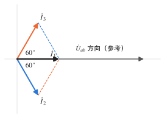
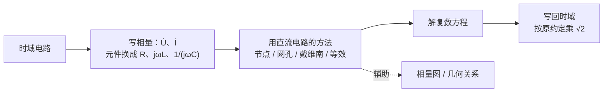

# 正弦稳态与相量法

!!! abstract "TL;DR"
    同频正弦量只差"幅值"和"初相"两个数，用一个复数（**相量**）就能表示。求导变成乘 $j\omega$，于是 L、C 的微分关系变成代数关系 $\dot U=Z\dot I$，前面学的 KCL/KVL、节点法、网孔法、戴维南**全部照搬**，只是把实数换成复数。注意：**相量满足 KCL/KVL，有效值不满足**。

## 1. 正弦量

$$
i(t)=I_m\sin(\omega t+\psi_i)=\sqrt2\,I\sin(\omega t+\psi_i)
$$

| 要素 | 符号 | 说明 |
| --- | --- | --- |
| 幅值 / 有效值 | $I_m$ / $I=I_m/\sqrt2$ | 有效值即"方均根"，与同样发热的直流相等；交流表读数都是有效值 |
| 角频率 | $\omega=2\pi f=2\pi/T$ | 我国工频 $f=50\,\mathrm{Hz}$，$\omega\approx314\,\mathrm{rad/s}$ |
| 初相 | $\psi_i$ | 通常取 $\lvert\psi\rvert\le180^\circ$ |

**相位差**：$\varphi=\psi_u-\psi_i$（同频才有意义）。$\varphi>0$ 称 $u$ **超前** $i$；$\varphi=0$ 同相；$\varphi=\pm180^\circ$ 反相；$\varphi=\pm90^\circ$ 正交。

!!! warning "先统一成同一种函数、正幅值，再比相位"
    - $\cos(\omega t+\psi)=\sin(\omega t+\psi+90^\circ)$；
    - $-\sin(\omega t+\psi)=\sin(\omega t+\psi\pm180^\circ)$。
    比较 $u=10\sin(\omega t+30^\circ)$ 与 $i=-2\cos(\omega t+60^\circ)=2\sin(\omega t-30^\circ)$：$\varphi=60^\circ$，$u$ 超前 $60^\circ$。

## 2. 相量

本笔记采用**有效值相量**与 **sin 约定**（与课程讲义一致）：

$$
u(t)=\sqrt2\,U\sin(\omega t+\psi)\quad\longleftrightarrow\quad \dot U=U\angle\psi=U e^{j\psi}
$$

!!! note "sin 约定 vs cos 约定"
    邱关源《电路》和不少速成资料用 $u=\sqrt2U\cos(\omega t+\psi)\leftrightarrow\dot U=U\angle\psi$。两种约定**只要全题统一**，算出的相量完全一样，最后按同一约定写回时域即可。混用（一个用 sin、一个用 cos 却直接比较初相）才会出错。

复数运算：加减用**直角坐标**，乘除用**极坐标**。

$$
A=a+jb=|A|\angle\theta,\quad |A|=\sqrt{a^2+b^2},\quad \theta=\arctan\frac ba\ (\text{注意象限})
$$

$$
A_1A_2=|A_1||A_2|\angle(\theta_1+\theta_2),\qquad \frac{A_1}{A_2}=\frac{|A_1|}{|A_2|}\angle(\theta_1-\theta_2)
$$

乘 $j$ 等于逆时针转 $90^\circ$，乘 $-j$（即除以 $j$）等于顺时针转 $90^\circ$。时域求导 $\dfrac{\mathrm d}{\mathrm dt}\leftrightarrow j\omega$，积分 $\leftrightarrow\dfrac{1}{j\omega}$。

??? example "例：同频正弦量相加减"
    $u_1=220\sqrt2\sin(\omega t+30^\circ)\,\mathrm V$，$u_2=100\sqrt2\sin(\omega t-60^\circ)\,\mathrm V$，求 $u_1\pm u_2$。

    $$
    \dot U_1=220\angle30^\circ=190.53+j110,\qquad \dot U_2=100\angle(-60^\circ)=50-j86.60\quad(\mathrm V)
    $$

    $$
    \dot U_1+\dot U_2=240.53+j23.40=241.66\angle5.56^\circ,\qquad
    \dot U_1-\dot U_2=140.53+j196.60=241.66\angle54.44^\circ
    $$

    $$
    u_1+u_2=241.66\sqrt2\sin(\omega t+5.56^\circ)\,\mathrm V,\qquad u_1-u_2=241.66\sqrt2\sin(\omega t+54.44^\circ)\,\mathrm V
    $$

    两相量恰好相差 $90^\circ$，所以和与差的有效值相同，都是 $\sqrt{220^2+100^2}\approx241.66\,\mathrm V$——而**不是** $220+100$ 或 $220-100$。

## 3. 三种元件的相量关系

均取关联参考方向。

| 元件 | 时域 | 相量 | 阻抗 $Z$ | 相位关系 |
| --- | --- | --- | --- | --- |
| 电阻 | $u=Ri$ | $\dot U=R\dot I$ | $R$ | $u$、$i$ 同相 |
| 电感 | $u=L\dfrac{\mathrm di}{\mathrm dt}$ | $\dot U=j\omega L\dot I$ | $jX_L$，$X_L=\omega L$ | $u$ 超前 $i$ $90^\circ$ |
| 电容 | $i=C\dfrac{\mathrm du}{\mathrm dt}$ | $\dot U=\dfrac{1}{j\omega C}\dot I$ | $-jX_C$，$X_C=\dfrac1{\omega C}$ | $i$ 超前 $u$ $90^\circ$ |

!!! tip "ELI the ICE man"
    电感（L）中电压 E 在电流 I 前；电容（C）中电流 I 在电压 E 前。频率越高，感抗越大、容抗越小：直流时电感短路、电容开路；频率趋于无穷时电感开路、电容短路。

## 4. 阻抗与导纳

$$
Z=\frac{\dot U}{\dot I}=R+jX=|Z|\angle\varphi_Z,\qquad |Z|=\frac UI,\quad \varphi_Z=\psi_u-\psi_i=\arctan\frac XR
$$

$$
Y=\frac1Z=G+jB
$$

| | $X>0$ / $\varphi_Z>0$ | $X<0$ / $\varphi_Z<0$ | $X=0$ |
| --- | --- | --- | --- |
| 性质 | 感性，电压超前电流 | 容性，电流超前电压 | 阻性（谐振） |

- 串联：$Z=\sum Z_k$，分压 $\dot U_k=\dfrac{Z_k}{\sum Z}\dot U$；并联：$Y=\sum Y_k$，两支路分流 $\dot I_1=\dfrac{Z_2}{Z_1+Z_2}\dot I$。
- 电容的电纳 $B_C=\omega C>0$，电感的电纳 $B_L=-\dfrac1{\omega L}<0$。

!!! warning "$G\neq1/R$，$|Z|\neq R$"
    由 $Z=R+jX$ 得 $Y=\dfrac{R}{R^2+X^2}-j\dfrac{X}{R^2+X^2}$，所以 $G=\dfrac{R}{R^2+X^2}$，只有 $X=0$ 时才等于 $1/R$。同理 $|Z|=\sqrt{R^2+X^2}$，比如 $Z=3-j4$ 时 $|Z|=5$ 而 $R=3$。

## 5. 相量图

相量图把各电压、电流画在同一复平面上，用几何关系代替复数运算。选参考相量的习惯：

- **串联**电路以**电流**为参考（各元件电流相同）；
- **并联**电路以**电压**为参考（各支路电压相同）；
- 混联从最内层并联部分的电压开始。

??? example "例：由相量几何反求参数"
    { .circuit }

    已知 $R_1=R_2=R_3$，三个电流有效值相等 $I_1=I_2=I_3$，电源电压 $U=3\,\mathrm V$，电源输入有功功率 $3\,\mathrm W$。求 $R_1$、$X_2$、$X_3$。

    **1. 相量几何**。以 $\dot U_{ab}$ 为参考。两并联支路电阻相等、电流有效值相等，所以阻抗模相等，$|X_2|=|X_3|$，两支路电流相对 $\dot U_{ab}$ 分别滞后、超前同一个角 $\theta$。由 KCL $\dot I_1=\dot I_2+\dot I_3$，两电流的虚部抵消、实部相加：

    $$
    2I_2\cos\theta=I_1=I_2\quad\Rightarrow\quad\theta=60^\circ .
    $$

    { .circuit }

    **2. 功率定尺度**。$\dot I_1$ 与 $\dot U_{ab}$ 同相，$R_1$ 上电压也与之同相，所以电源电压与 $\dot I_1$ 同相，$P=UI_1$：

    $$
    I_1=\frac PU=1\,\mathrm A,\qquad P=(R_1+R_2+R_3)I^2=3R_1\Rightarrow R_1=R_2=R_3=1\,\Omega .
    $$

    **3. 电抗**：$\tan60^\circ=\dfrac{X}{R}\Rightarrow X_2=X_3=\sqrt3\,\Omega$。

    **校验**：$|Z_2|=\sqrt{1+3}=2\,\Omega$，$U_{ab}=2\times1=2\,\mathrm V$，$U=U_{R_1}+U_{ab}=1+2=3\,\mathrm V$（同相直接相加）✓

??? example "例：剥离串联部分，反求并联支路"
    { .circuit }

    $f=50\,\mathrm{Hz}$，$u=100\sin\omega t\,\mathrm V$，$i=5\sqrt2\sin(\omega t+45^\circ)\,\mathrm A$（关联方向）。求 $R$ 与 $X_C$。

    1. **总阻抗**：$\dot U=\dfrac{100}{\sqrt2}\angle0^\circ$，$\dot I=5\angle45^\circ$，

        $$
        Z=\frac{\dot U}{\dot I}=\frac{100/\sqrt2}{5}\angle(-45^\circ)=10\sqrt2\angle(-45^\circ)=10-j10\,\Omega .
        $$

    2. **减去串联电容** $-j10$：并联部分 $Z_p=10\,\Omega$，$Y_p=0.1\,\mathrm S$。
    3. **减去电感支路导纳**：$\dfrac1{j10}=-j0.1$，

        $$
        \frac1{R-jX_C}=0.1-(-j0.1)=0.1+j0.1\ \Rightarrow\ R-jX_C=\frac{1}{0.1+j0.1}=5-j5 .
        $$

        所以 $R=5\,\Omega$，$X_C=5\,\Omega$。

    **校验**：$(5-j5)\parallel j10=\dfrac{(5-j5)(j10)}{5+j5}=\dfrac{50+j50}{5+j5}=10\,\Omega$，再串 $-j10$ 得 $10-j10$ ✓

## 6. 正弦稳态电路的分析步骤

下一篇：[正弦稳态功率与谐振](ac-power-resonance.md)。
