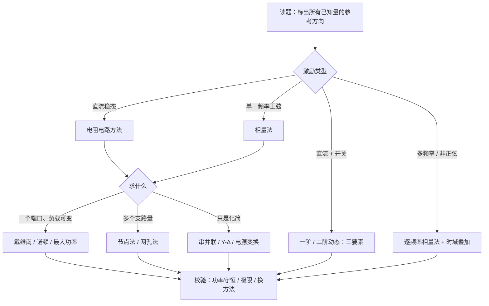

# 题型与解题套路

!!! abstract "TL;DR"
    电路题 90% 的错误来自三处：**参考方向 / 正负号**、**该置零的没置零（或不该置零的受控源被置零）**、**把有效值当相量相加**。每道题做完都用一种独立的方法校验：功率守恒、换一种方法重算、或检查 $\omega\to0$、$\omega\to\infty$、$t\to\infty$ 的极限。

## 1. 总流程

## 2. 题型速查

对应作业题号据课程讲义的归档整理，便于对照复习。

| 题型 | 套路 | 最容易错的地方 | 详见 | 作业 |
| --- | --- | --- | --- | --- |
| 电位、电压、功率 | 选参考点，沿路径逐元件加减；功率先定关联与否 | 电源不一定发出功率；负号含义 | [基本概念](basics.md) | 2-4、2-5、2-9、2-11 |
| 等效电阻（含开关） | 节点标号 → 合并闭合开关 → 串并联 / 平衡 / Y–Δ | 凭导线位置猜串并联 | [等效变换](equivalent-transformation.md) | 4-4、4-47 |
| 含受控源的输入电阻 | 外加电源法 $u/i$ | 受控源被置零；结果可以为负 | [等效变换](equivalent-transformation.md) | 4-37 |
| 节点法 / 超节点 | 自导、互导、注入电流；浮置电压源用超节点 | 电流源串联的电阻计入了电导 | [分析方法](analysis-methods.md) | 2-10、2-14、2-20、4-5 |
| 网孔 / 回路 / 指定树 | 每个电流源只属于一个回路 | 公共支路电流是两网孔电流之差 | [分析方法](analysis-methods.md) | 4-12、4-14、4-17 |
| 理想二极管 | 假设 → 求解 → 验证 | 给理想二极管加 0.7 V | [分析方法](analysis-methods.md) | 2-20、4-38 |
| 叠加、齐次、两次测量 | 线性关系 $y=aI+b$ | 功率叠加；有内部源时按比例缩放 | [电路定理](circuit-theorems.md) | 4-28、4-31、4-32 |
| 戴维南 + 最大功率 | $U_{oc}$、$R_{eq}$ → $P_{\max}=U_{oc}^2/(4R_{eq})$ | 负载没拿掉；"电流最大""电压最大"与"功率最大"混淆 | [电路定理](circuit-theorems.md) | 4-34、4-36 |
| 一阶动态电路 | 三要素：$0_+$、$\infty$、$\tau$ | $i_C$、$u_L$ 用了 $0_-$ 值；$R_{eq}$ 用了换路前的结构 | [动态电路](dynamic-circuits.md) | 第七章 |
| 正弦量运算 | 相量加减用直角式，乘除用极式 | sin/cos 混用；幅值与有效值混用 | [相量法](phasor-method.md) | 5-6、5-7、5-11 |
| 由相量图反求参数 | 选参考相量 → KCL/KVL 几何 → 功率定尺度 | $\lvert Z\rvert$ 当作 $R$；$G$ 当作 $1/R$ | [相量法](phasor-method.md) | 5-12、5-14、5-16、5-19、5-22 |
| 复功率、补偿 | $\bar S=\dot U\dot I^*$，$P$、$Q$ 分别守恒 | 视在功率直接相加；共轭加错位置 | [功率与谐振](ac-power-resonance.md) | 5-18、5-21、5-23、5-24 |
| 谐振 | 端口 $\operatorname{Im}Z=0$；$Z=0$ 短路、$Y=0$ 开路 | 多支路时硬套 $1/\sqrt{LC}$；单位（pF、μV） | [功率与谐振](ac-power-resonance.md) | 5-25 ~ 5-28 |
| 互感 | 先定同名端与方向再写互感项，或去耦 | 互感项符号；公共端接法套 $n^2Z$ | [互感与变压器](coupled-inductors.md) | 5-30 ~ 5-42 |
| 三相 | 化 Y–Y 取单相；多负载 $P$、$Q$ 分别相加 | $\varphi$ 用了线电压与线电流夹角；不对称时套 $\sqrt3$ | [三相电路](three-phase.md) | 5-51 ~ 5-58 |
| 非正弦 | 逐频求解，时域叠加；有效值平方和开方 | 不同频率相量相加；跨频算功率 | [非正弦](nonsinusoidal.md) | 6-5、6-8、6-10、6-11 |

## 3. 几个高频套路的展开

=== "戴维南"

    1. 拿掉负载，标出端口 $a$、$b$ 和 $U_{oc}$ 的极性；
    2. 求 $U_{oc}$（任何方法）；
    3. 求 $R_{eq}$：无受控源 → 置零化简；有受控源 → 外加电源 $u/i$ 或 $U_{oc}/I_{sc}$；
    4. 画等效电路接回负载。若问最大功率：$R_L=R_{eq}$（$R_{eq}>0$）。

=== "三要素"

    1. $0_-$ 电路（C 开路、L 短路）→ $u_C(0_-)$、$i_L(0_-)$；
    2. 检查有无纯电容回路 / 纯电感割集（有则用电荷 / 磁链守恒）；
    3. $0_+$ 电路（C 换电压源、L 换电流源）→ 所求量 $f(0_+)$；
    4. $\infty$ 电路 → $f(\infty)$；
    5. 换路后从储能元件看入的 $R_{eq}$ → $\tau$；
    6. $f(t)=f(\infty)+[f(0_+)-f(\infty)]e^{-t/\tau}$，注明 $t\ge0_+$。

=== "相量反求"

    1. 串联选电流、并联选电压为参考相量；
    2. 用已知的有效值关系画 KCL/KVL 的相量多边形，求出角度；
    3. 用功率 $P=\sum I_k^2R_k$ 或 $P=UI\cos\varphi$ 确定大小；
    4. 由阻抗角 $\tan\varphi=X/R$ 求电抗，再由 $\omega$ 求 $L$、$C$；
    5. 代回校验 KVL（相量和，不是有效值和）。

=== "功率补偿"

    1. 求补偿前 $P$、$Q_1$（或 $\varphi_1$）；
    2. 由目标功率因数或目标电流求 $Q_2$（欠补偿取较小的 $\lvert Q_C\rvert$）；
    3. $\lvert Q_C\rvert=Q_1-Q_2=\omega CU^2$；
    4. 校验：补偿前后 $P$ 不变，负载自身电流不变，电源电流变小。

=== "三相"

    1. Δ 负载化 Y（$Z_\Delta/3$），确定相电压（$U_l/\sqrt3$）；
    2. 有线路阻抗时每相 $Z_l+Z_Y$；
    3. 求 A 相电流，B、C 依次滞后 $120^\circ$；
    4. 多组负载：$P=\sum P_k$，$Q=\sum Q_k$，$I_l=\sqrt{P^2+Q^2}/(\sqrt3U_l)$；
    5. 有额外单相负载：先算对称部分，再按节点 KCL 叠加单相电流。

## 4. 易错清单

| 现象 | 正确做法 |
| --- | --- |
| 叠加时把受控源也置零 | 受控源始终保留 |
| 求 $R_{eq}$ 时没把独立源置零 / 把电流源短路 | 电压源短路，电流源**开路** |
| 节点法中计入了与电流源串联的电阻 | 那条支路只贡献电流源电流 |
| 有效值直接相加：$U=U_R+U_L+U_C$ | 相量相加：$U=\sqrt{U_R^2+(U_L-U_C)^2}$ |
| $\bar S=\dot U\dot I$ | $\bar S=\dot U\dot I^*$ |
| 各负载的 $S$ 相加 | $P$、$Q$ 分别相加，最后求 $S$ |
| 互感项符号凭感觉 | 先定方向，看"流入端与电压 $+$ 端是否同名" |
| 三相功率角用线电压与线电流的夹角 | 用每相负载的阻抗角 |
| 不同频率的相量相加 | 各自写回时域再相加 |
| 动态电路中 $i_C(0_+)=i_C(0_-)$ | 只有 $u_C$、$i_L$ 连续，其余在 $0_+$ 电路中重求 |
| $\tau$ 用换路前的电阻 | 用换路后、独立源置零后从储能元件看入的 $R_{eq}$ |

## 5. 自检三板斧

1. **功率守恒**：所有元件吸收功率之和为零（交流时 $P$、$Q$ 分别为零）。
2. **极限检查**：直流时 L 短路、C 开路；$\omega\to\infty$ 时 L 开路、C 短路；$t\to\infty$ 时动态电路回到稳态；负载 $R\to0$、$R\to\infty$ 时的结果是否合理。
3. **换一种方法**：节点法做完用网孔法核一个电流；戴维南的 $R_{eq}$ 用 $U_{oc}/I_{sc}$ 再核一次。

## 6. 本笔记未展开的内容

速成课资料里还有**二端口网络**（Z、Y、H、T 参数）和**运算法**（拉普拉斯变换求动态电路）两部分，不在这门课当前的作业范围内，此处从略。
