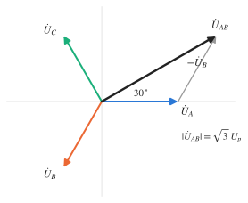

# 三相电路

!!! abstract "TL;DR"
    对称三相电路的套路只有一个：**化成 Y–Y，取出 A 相单独算，其余两相按相序转 $\mp120^\circ$**。Y 联结 $U_l=\sqrt3U_p$、$I_l=I_p$；Δ 联结 $U_l=U_p$、$I_l=\sqrt3I_p$。总功率 $P=\sqrt3U_lI_l\cos\varphi$，$\varphi$ 是**负载阻抗角**。多组负载先把 $P$、$Q$ 分别相加，再求电流；不对称时要考虑中性点位移。

## 1. 对称三相电源

三个同频、等幅、相位互差 $120^\circ$ 的电压。**正序**（A→B→C）：

$$
\dot U_A=U_p\angle0^\circ,\qquad \dot U_B=U_p\angle(-120^\circ),\qquad \dot U_C=U_p\angle120^\circ,\qquad \dot U_A+\dot U_B+\dot U_C=0 .
$$

{ .circuit }

**线电压**是两条端线之间的电压。Y 形联结时：

$$
\dot U_{AB}=\dot U_A-\dot U_B=\sqrt3\,\dot U_A\angle30^\circ
$$

即线电压是相电压的 $\sqrt3$ 倍、超前对应相电压 $30^\circ$（正序）。我国低压配电 $U_l=380\,\mathrm V$，$U_p=380/\sqrt3\approx220\,\mathrm V$。

## 2. 负载的两种联结

| | Y 形（星形） | Δ 形（三角形） |
| --- | --- | --- |
| 相电压 vs 线电压 | $U_l=\sqrt3U_p$，线电压超前对应相电压 $30^\circ$ | $U_l=U_p$ |
| 相电流 vs 线电流 | $I_l=I_p$ | $I_l=\sqrt3I_p$，$\dot I_A=\sqrt3\,\dot I_{AB}\angle(-30^\circ)$ |
| 对称时互换 | | $Z_Y=Z_\Delta/3$ |

（相位关系针对正序和常规参考方向：$\dot I_{AB}$ 由 A 流向 B、线电流由电源流向负载。$\sqrt3$ 倍关系只在**对称**时成立。）

## 3. 对称三相电路的单相计算

对称 Y–Y 电路中，负载中点 $N'$ 与电源中点 $N$ 等电位（$\dot U_{N'N}=0$），中线有无、阻抗大小都不影响结果，于是可以把 $N'$、$N$ 短接，取出一相：

{ .circuit }

$$
\dot I_A=\frac{\dot U_A}{Z_l+Z_Y},\qquad \dot I_B=\dot I_A\angle(-120^\circ),\qquad \dot I_C=\dot I_A\angle120^\circ
$$

步骤：① Δ 电源 / Δ 负载都化为 Y；② 画 A 相单相电路求解；③ 按相序写出 B、C 相；④ 需要原 Δ 负载内部的相电流时再按 $\dot I_{AB}=\dfrac{\dot I_A}{\sqrt3}\angle30^\circ$ 换回。

## 4. 三相功率

$$
P=3U_pI_p\cos\varphi=\sqrt3U_lI_l\cos\varphi,\qquad Q=\sqrt3U_lI_l\sin\varphi,\qquad S=\sqrt3U_lI_l
$$

!!! warning "$\varphi$ 是谁的角"
    $\varphi$ 是**每相负载的阻抗角**（相电压与相电流的夹角），**不是**线电压与线电流的夹角。对称三相电路的总瞬时功率恒等于 $P$，不随时间脉动——这是三相电机运行平稳的原因。

多组负载并联在同一电源上时：**$P$、$Q$ 分别相加**，再 $I_l=\dfrac{\sqrt{P^2+Q^2}}{\sqrt3U_l}$。不能把各组的线电流有效值直接相加。

??? example "例：两组对称负载的总线电流"
    正序对称电源 $U_l=380\,\mathrm V$，接两组对称负载：负载 1 总有功 $2.2\,\mathrm{kW}$、$\cos\varphi_1=0.5$（滞后）；负载 2 为 Y 联结，每相 $Z_2=30+j40\,\Omega$。求线电流 $I_A$ 与总有功功率。

    - 负载 1：$P_1=2200\,\mathrm W$，$Q_1=P_1\tan60^\circ=2200\sqrt3\approx3810.5\,\mathrm{var}$。
    - 负载 2：相电压 $380/\sqrt3\approx219.4\,\mathrm V$，$I_{p2}=\dfrac{219.4}{50}\approx4.388\,\mathrm A$，

        $$
        P_2=3I_{p2}^2\times30=1732.8\,\mathrm W,\qquad Q_2=3I_{p2}^2\times40=2310.4\,\mathrm{var}
        $$

    - 合计：$P=3932.8\,\mathrm W$，$Q\approx6120.9\,\mathrm{var}$，

        $$
        I_A=\frac{\sqrt{3932.8^2+6120.9^2}}{\sqrt3\times380}\approx11.05\,\mathrm A .
        $$

    !!! note "精度说明"
        若把相电压取成整数 $220\,\mathrm V$，会得到 $P_2=1742.4\,\mathrm W$。$380$ 与 $220$ 并不严格满足 $\sqrt3$ 倍关系，计算时只取一个为准、另一个由它推出。

## 5. 不对称三相电路

Y 形负载 $Z_A,Z_B,Z_C$ 不相等时，负载中点相对电源中点的电压（**中性点位移**）由节点法得到：

$$
\dot U_{N'N}=\frac{Y_A\dot U_A+Y_B\dot U_B+Y_C\dot U_C}{Y_A+Y_B+Y_C+Y_N}
$$

$Y_N$ 为中线导纳；无中线时 $Y_N=0$。各相负载电压 $\dot U_{AN'}=\dot U_A-\dot U_{N'N}$，等等。

- 有理想中线（$Z_N=0$）：$\dot U_{N'N}=0$，各相负载电压仍对称，各相独立计算，中线电流 $\dot I_N=\dot I_A+\dot I_B+\dot I_C\neq0$。
- 无中线：中性点位移使某些相电压升高、某些降低——所以照明等单相负载的中线上**不允许装熔断器或开关**。
- 三相三线制中无论对称与否，$\dot I_A+\dot I_B+\dot I_C=0$（KCL 对闭合面）。

??? example "例：对称负载上再挂一个单相负载"
    正序对称电源 $U_l=380\,\mathrm V$，每根端线串 $Z_1=2+j4\,\Omega$ 后接 Δ 形对称负载 $Z_2=30+j24\,\Omega$；另有 $Z_3=38\angle30^\circ\,\Omega$ **直接接在电源侧** A、B 之间（不经过 $Z_1$）。取 $\dot U_A=\tfrac{380}{\sqrt3}\angle0^\circ$，求电源端线电流。

    **对称部分**：$Z_2/3=10+j8$，每相 $Z_1+Z_2/3=12+j12\,\Omega$，

    $$
    \dot I_A'=\frac{380/\sqrt3}{12+j12}\approx12.93\angle(-45^\circ)\,\mathrm A,\quad \dot I_B'=12.93\angle(-165^\circ),\quad \dot I_C'=12.93\angle75^\circ .
    $$

    **单相支路**：它直接承受电源线电压 $\dot U_{AB}=380\angle30^\circ$，

    $$
    \dot I_{3}=\frac{380\angle30^\circ}{38\angle30^\circ}=10\angle0^\circ\,\mathrm A\quad(\text{A}\to\text{B}).
    $$

    **按 KCL 合成**：

    $$
    \dot I_A=\dot I_A'+\dot I_3\approx21.21\angle(-25.53^\circ),\quad
    \dot I_B=\dot I_B'-\dot I_3\approx22.73\angle(-171.54^\circ),\quad
    \dot I_C=\dot I_C'=12.93\angle75^\circ\ (\mathrm A).
    $$

    三者不对称，但相量和仍为零 ✓。

## 6. 两瓦特表法

三相三线制中，总瞬时功率 $p=u_Ai_A+u_Bi_B+u_Ci_C$，代入 $i_B=-i_A-i_C$：

$$
p=u_{AB}\,i_A+u_{CB}\,i_C
$$

所以用两只瓦特表：$W_1$ 测 $i_A$ 与 $u_{AB}$，$W_2$ 测 $i_C$ 与 $u_{CB}$（B 为公共端），**无论负载对称与否**，$P=W_1+W_2$。

对称负载、正序、上述接法时：

$$
W_1=U_lI_l\cos(\varphi+30^\circ),\qquad W_2=U_lI_l\cos(\varphi-30^\circ),\qquad Q=\sqrt3\,(W_2-W_1)
$$

!!! warning "注意"
    - 单个表的读数没有独立物理意义，可以为负（$\lvert\varphi\rvert>60^\circ$ 时其中一个为负），相加时要带符号。
    - $Q=\sqrt3(W_2-W_1)$ 只对**对称**负载成立；把两表换成"$W_1$ 测 A、$U_{AC}$，$W_2$ 测 B、$U_{BC}$"时两式的 $\pm30^\circ$ 互换，要按实际接线推导。
    - 三相四线制（中线有电流）不能用两表法。

??? example "例：Δ 负载断开一相前后的两表读数"
    正序 $U_l=380\,\mathrm V$，Δ 负载每相 $Z=8+j6=10\angle36.87^\circ\,\Omega$，开关 $S$ 串在 AC 相。表的接法同上。

    **$S$ 闭合（对称）**：$I_p=\dfrac{380}{10}=38\,\mathrm A$，$I_l=38\sqrt3\approx65.82\,\mathrm A$，$\varphi=36.87^\circ$。

    $$
    W_1=380\times65.82\cos66.87^\circ\approx9825\,\mathrm W,\qquad W_2=380\times65.82\cos6.87^\circ\approx24831\,\mathrm W
    $$

    $$
    P=W_1+W_2=34656\,\mathrm W,\qquad Q=\sqrt3(W_2-W_1)=25992\,\mathrm{var}
    $$

    直接计算 $3I_p^2Z=3\times38^2\times(8+j6)=34656+j25992$ ✓

    **$S$ 断开**：只剩 AB、BC 两相，各自直接接在线电压上，$I_A=I_{AB}$，$I_C=-I_{BC}$。

    $$
    W_1=\mathrm{Re}(\dot U_{AB}\dot I_{AB}^*)=38^2\times8=11552\,\mathrm W,\qquad W_2=\mathrm{Re}(\dot U_{CB}\dot I_{CB}^*)=11552\,\mathrm W
    $$

    合计 $23104\,\mathrm W=2\times38^2\times8$ ✓。负载已不对称，不能再用 $I_l=\sqrt3I_p$ 或 $Q=\sqrt3(W_2-W_1)$。

下一篇：[非正弦周期电路与频率响应](nonsinusoidal.md)。

!!! tip "练习"
    配套习题：[习题：三相电路](../exercises/ex-three-phase.md)
