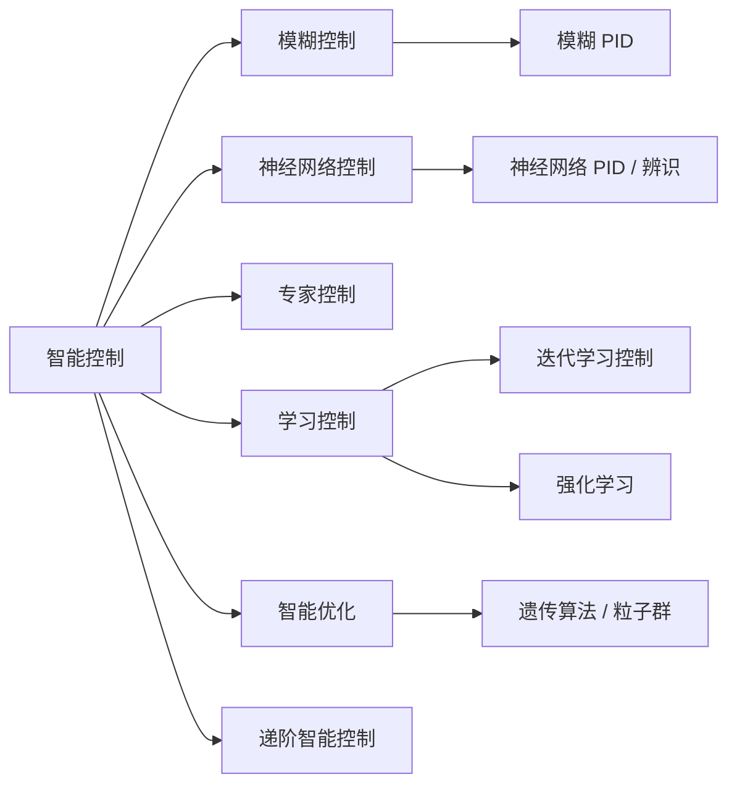
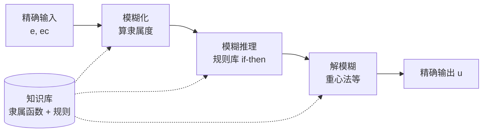
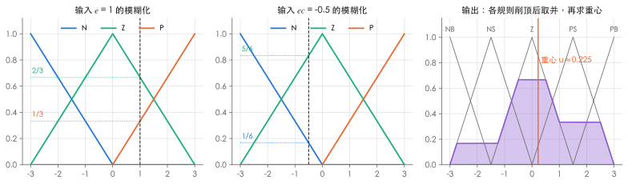
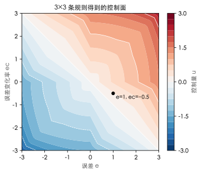
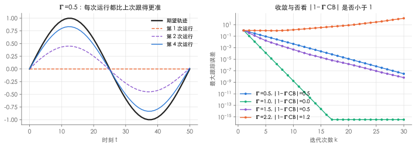

# 智能控制技术：知识框架与核心方法

!!! abstract "要点"
    经典控制和现代控制都要先有被控对象的数学模型。对象非线性强、参数时变、难以建模时，**智能控制**换一种思路：用人的经验（模糊控制、专家控制）、数据（神经网络控制）、重复试验（学习控制）或搜索（智能优化）代替精确模型。

    | 方法 | 用什么代替精确模型 | 做法 |
    | --- | --- | --- |
    | 模糊控制 | 语言规则（“误差大就猛加”） | 把操作工的经验写成 if-then 规则 |
    | 神经网络控制 | 数据训练出的非线性映射 | 用网络逼近对象或控制器 |
    | 专家控制 | 知识库 + 推理机 | 把领域专家的判断逻辑做成程序 |
    | 学习控制 | 重复运行的历史误差 | 这次的误差拿来修正下次的输入 |
    | 智能优化 | 群体搜索 | 用遗传算法、粒子群等找控制器参数 |

    下文只讲概念、结构和关键公式，不展开稳定性证明。

例题数值与插图脚本：[`scripts/control/verify_intelligent.py`](https://github.com/zsyverse/knowledge/blob/main/scripts/control/verify_intelligent.py)、[`fig_intelligent.py`](https://github.com/zsyverse/knowledge/blob/main/scripts/control/fig_intelligent.py)。

---

## 1. 为什么需要智能控制

### 1.1 传统控制的前提

PID 靠调参，可以不要模型，但对强非线性、大滞后、参数大范围变化的对象效果有限。状态空间方法、最优控制、自适应控制则都建立在比较准确的数学模型上。实际中常见三类困难：

1. **难以建模**：如水泥窑、高炉、发酵过程，机理复杂，只有操作经验；
2. **非线性与时变**：如机器人负载变化、飞行器跨速域飞行；
3. **任务复杂**：控制目标本身含决策、规划，不只是“跟踪一个设定值”。

### 1.2 智能控制的定义与特点

- **二元交集论**（傅京孙，1971）：智能控制 = 人工智能 ∩ 自动控制。
- **三元交集论**（萨里迪斯，1977）：再加上运筹学，智能控制 = 人工智能 ∩ 自动控制 ∩ 运筹学。

公认的几个特点：不依赖或少依赖精确模型；能处理定性的、不确定的信息；有学习、适应和组织能力；通常是**混合系统**，既有连续的数值控制，也有离散的符号推理。

### 1.3 递阶智能控制

萨里迪斯提出的三级结构，从上到下智能递减、精度递增，称为**精度随智能降低而提高**（IPDI）原理：

| 层级 | 做什么 | 智能 / 精度 | 典型技术 |
| --- | --- | --- | --- |
| 组织级 | 理解任务、决策、规划 | 智能最高、精度最低 | 人工智能、知识推理 |
| 协调级 | 把任务分解给各执行单元，协调时序 | 居中 | 运筹学、调度 |
| 执行级 | 驱动执行机构，跟踪给定 | 智能最低、精度最高 | 常规控制（PID、状态反馈） |

现代机器人系统就是这个结构：任务规划（组织级）→ 运动规划（协调级）→ 关节伺服（执行级）。

---

## 2. 模糊控制（重点）

### 2.1 基本概念

- **模糊集合**：普通集合里元素要么属于、要么不属于；模糊集合用**隶属函数** $\mu_A(x)\in[0,1]$ 表示属于的程度。比如温度 28 ℃ 属于“热”的程度是 0.6。
- **常用隶属函数**：三角形、梯形、高斯形。三角形计算最简单，用得最多。
- **模糊运算**（Zadeh 算子）：交 $\mu_{A\cap B}=\min(\mu_A,\mu_B)$，并 $\mu_{A\cup B}=\max(\mu_A,\mu_B)$，补 $\mu_{\bar A}=1-\mu_A$。
- **语言变量**：取值是词而不是数，如误差的取值为 {负大 NB, 负小 NS, 零 Z, 正小 PS, 正大 PB}。

### 2.2 模糊控制器的结构

1. **模糊化**：把误差 $e$ 和误差变化率 $ec$ 乘量化因子映射到论域（如 $[-3,3]$），计算对每个模糊集的隶属度；
2. **规则库**：形如“if $e$ is P and $ec$ is Z then $u$ is PS”，通常排成二维规则表；
3. **模糊推理**：最常用 **Mamdani 法**，“and”取 min 得到规则激活度，输出集按激活度削顶，各规则结果取 max 合成；
4. **解模糊**：最常用**重心法** $u=\dfrac{\int \mu(u)\,u\,\mathrm du}{\int\mu(u)\,\mathrm du}$；简化做法是对各输出集中心按激活度加权平均。

**双输入（$e$, $ec$）的模糊控制器相当于一个非线性的 PD 控制器**，因为输出同时看误差和误差的变化趋势。要消除稳态误差还要加积分，或者用下面的模糊 PID。

### 2.3 例题：手算一次模糊推理

论域都是 $[-3,3]$。输入 $e,ec$ 各有 N、Z、P 三个三角形模糊集（峰值在 $-3,0,3$），输出 $u$ 有 NB、NS、Z、PS、PB 五个（峰值在 $-3,-1.5,0,1.5,3$）。规则表（$e=r-y$）：

| $e$ \ $ec$ | N | Z | P |
| --- | --- | --- | --- |
| **N** | NB | NS | Z |
| **Z** | NS | Z | PS |
| **P** | Z | PS | PB |

求 $e=1,\ ec=-0.5$ 时的输出。

??? example "解答"
    **① 模糊化。** $\mu_Z(1)=\dfrac{3-1}{3}=\dfrac23,\ \mu_P(1)=\dfrac13$；$\mu_N(-0.5)=\dfrac{0.5}{3}=\dfrac16,\ \mu_Z(-0.5)=\dfrac56$。

    **② 规则激活（取 min）。** 只有隶属度非零的组合会被激活：

    | 规则 | 激活度 |
    | --- | --- |
    | $e$=Z, $ec$=N → NS | $\min(2/3,1/6)=1/6$ |
    | $e$=Z, $ec$=Z → Z | $\min(2/3,5/6)=2/3$ |
    | $e$=P, $ec$=N → Z | $\min(1/3,1/6)=1/6$ |
    | $e$=P, $ec$=Z → PS | $\min(1/3,5/6)=1/3$ |

    同为 Z 的两条取 max，得 Z 的激活度 $2/3$。

    **③ 解模糊。** 加权平均法：
    $$u=\frac{(-1.5)\cdot\frac16+0\cdot\frac23+1.5\cdot\frac13}{\frac16+\frac23+\frac13}=\frac{3}{14}\approx0.214$$
    重心法要对削顶后的合成面积积分，数值结果 $u\approx0.225$，两者很接近。

    误差偏正（输出还低于设定值），但误差在减小（输出正在上升），所以只需轻微加大控制量，不用猛加。

{ .diagram }

把每个 $(e,ec)$ 都这样算一遍，就得到整张**控制面**。它是非线性的（规则交界处有折线），这正是模糊控制比线性 PD 灵活的地方：

{ .diagram }

### 2.4 模糊 PID

工程里最常见的用法是**用模糊规则在线调整 PID 参数**，而不是用模糊控制器直接替代 PID：

$$K_p=K_{p0}+\Delta K_p,\quad K_i=K_{i0}+\Delta K_i,\quad K_d=K_{d0}+\Delta K_d$$

其中 $\Delta K_p,\Delta K_i,\Delta K_d$ 由 $(e,ec)$ 经三张模糊规则表推出。经验规则大致是：

- $|e|$ 大：$K_p$ 取大、$K_i$ 取小或为零（快速响应，防积分饱和）；
- $|e|$ 中等：$K_p$ 适当减小，防超调；
- $|e|$ 小：$K_p$、$K_i$ 取大，提高稳态精度，$K_d$ 适中，防振荡。

### 2.5 优缺点

- **优点**：不需要精确模型；能直接利用操作经验；对参数变化鲁棒。
- **缺点**：规则和隶属函数靠经验，缺乏系统的设计方法；简单模糊控制有稳态误差；规则多时（输入多）规则数按指数增长（规则爆炸）；稳定性分析困难。

!!! note "T-S 模糊模型"
    Takagi-Sugeno 型模糊系统的规则后件不是模糊集，而是输入的线性函数，如“if $x$ is A then $u=k_1x+k_2$”。它把非线性系统表示成若干局部线性模型的加权组合，便于用李雅普诺夫方法分析稳定性，是模糊控制理论化的主要方向。

---

## 3. 神经网络控制

### 3.1 基础

- **神经元模型**：$y=f\left(\sum_i w_ix_i-\theta\right)$，$f$ 是激活函数（Sigmoid、tanh、ReLU）。
- **BP 网络**：多层前馈网络，用误差反向传播（梯度下降）训练权值：$w\leftarrow w-\eta\,\dfrac{\partial E}{\partial w}$。
- **RBF 网络**：隐层用径向基函数（如高斯函数），只有输出层权值线性，学习快、不易陷入局部极小，控制中常用。
- **万能逼近定理**：只要隐层神经元足够多，单隐层前馈网络能以任意精度逼近闭集上的连续函数。这是神经网络能用于控制的理论依据：它可以逼近未知的非线性对象或控制律。

### 3.2 神经网络在控制中的角色

| 用法 | 网络做什么 |
| --- | --- |
| 系统辨识 | 用输入输出数据训练网络，充当对象的模型（正模型或逆模型） |
| 直接逆控制 | 网络学习对象的逆，串在对象前面，使总传递接近 1 |
| 神经网络 PID | 网络根据运行状态在线输出 $K_p,K_i,K_d$ |
| 模型参考自适应 | 网络调节控制器，使对象输出跟踪参考模型 |
| 内模控制、预测控制 | 网络充当内部模型 / 预测模型 |

**单神经元自适应 PID** 是最小的例子：把 $e(k),\ \Delta e(k),\ \Delta^2e(k)$ 作为神经元的三个输入，三个权值对应 $K_i,K_p,K_d$，按有监督的 Hebb 规则在线调整，即“权值增量 ∝ 误差 × 输入 × 输出”。

### 3.3 优缺点

- **优点**：能逼近任意非线性；可在线学习；并行、容错。
- **缺点**：需要训练数据和训练时间；结构（层数、节点数）靠经验；黑箱，不易解释；稳定性难保证。

!!! tip "模糊神经网络"
    模糊控制可解释但不会学，神经网络会学但不可解释。把二者结合（如 ANFIS）：网络结构对应模糊规则，权值对应隶属函数参数，用数据训练规则，用规则初始化网络。

---

## 4. 专家控制

把领域专家的知识和经验做成**知识库**，由**推理机**根据当前工况选择控制策略。

- **组成**：知识库（事实 + 规则）、数据库（实时测量）、推理机、控制规则集、特征识别与信息处理。
- **与专家系统的区别**：专家系统离线咨询、给人提建议；专家控制在线、实时、闭环，直接给出控制量，要求可靠性高、推理快。
- **专家 PID 的典型规则**（以 $e$ 为误差，$\Delta e$ 为误差增量）：
    1. $|e|$ 很大：开环满输出（bang-bang），尽快拉近；
    2. $e\,\Delta e>0$（误差在变大）且 $|e|$ 较大：加强控制，用较大增益；
    3. $e\,\Delta e<0$（误差在减小）：保持或减弱控制，防超调；
    4. $|e|$ 很小：加积分消除稳态误差。

---

## 5. 学习控制

### 5.1 迭代学习控制（ILC）

适用于**重复执行同一任务**的系统，如机械臂反复走同一条轨迹、注塑机每次走同一个工艺曲线。做法是用这一次的跟踪误差修正下一次的输入。

P 型学习律（$k$ 为迭代次数，$t$ 为时刻）：

$$u_{k+1}(t)=u_k(t)+\Gamma\,e_k(t+1),\qquad e_k=y_d-y_k$$

对离散系统 $x(t+1)=Ax(t)+Bu(t),\ y=Cx$，若每次初始状态相同，**收敛的充要条件是**

$$\lvert 1-\Gamma CB\rvert<1$$

即只取决于学习增益和系统的首项马尔可夫参数 $CB$，与 $A$ 无关。

下图的对象取 $A=\begin{bmatrix}0&1\\-0.06&0.5\end{bmatrix},\ B=\begin{bmatrix}0\\1\end{bmatrix},\ C=[-0.5\ \ 1]$，$CB=1$，期望轨迹是 50 步的一个正弦周期，每次从零状态开始。

{ .diagram }

!!! warning "收敛不等于单调收敛"
    $\lvert1-\Gamma CB\rvert<1$ 只保证迭代次数趋于无穷时误差趋于零。若对象响应衰减慢（$CAB$、$CA^2B$ 等后续马尔可夫参数不小），误差可能先暴涨很多数量级再回落，实际中不可接受。例如把上图的对象换成 $A=\begin{bmatrix}0&1\\-0.5&1.2\end{bmatrix},\ C=[0.5\ \ 1]$（$CB$ 仍为 1，但极点模约 0.71、衰减慢），取 $\Gamma=0.5$ 同样满足条件，跑到第 30 次时最大误差却涨到约 $4\times10^5$。工程上通常要求更强的单调收敛条件，或者给学习律加低通滤波。

### 5.2 强化学习

智能体通过与环境交互、获得奖励来学习策略，不需要对象模型，也不需要示范的“正确答案”。在控制中可以把它看作**基于数据的最优控制**：目标是最大化累积奖励，相当于最小化代价函数，Bellman 方程对应动态规划。近年在机器人运动控制、游戏中效果突出，但样本效率低，安全性难以保证，通常先在仿真中训练。

---

## 6. 智能优化算法

它们本身不是控制器，而是**为控制器找参数**的搜索工具，典型用途是整定 PID 参数或模糊控制的隶属函数和规则。目标函数常用 ITAE 等误差积分指标，如 $J=\int_0^\infty t\,\lvert e(t)\rvert\,\mathrm dt$。

- **遗传算法（GA）**：模拟自然选择。把参数编码成染色体 → 计算适应度 → **选择**（好的多保留）、**交叉**（交换片段）、**变异**（随机扰动）→ 迭代。全局搜索能力强，不需要梯度。
- **粒子群算法（PSO）**：每个粒子记住自己的历史最好位置 $p_i$，群体共享全局最好位置 $g$：
  $$v_i\leftarrow wv_i+c_1r_1(p_i-x_i)+c_2r_2(g-x_i),\qquad x_i\leftarrow x_i+v_i$$
  $w$ 是惯性权重，$c_1,c_2$ 是学习因子，$r_1,r_2\sim U(0,1)$。参数少、实现简单。
- 其他：蚁群算法（路径规划）、模拟退火（以一定概率接受变差的解，跳出局部最优）。

---

## 7. 总结对比

| | 模糊控制 | 神经网络控制 | 专家控制 | 迭代学习控制 |
| --- | --- | --- | --- | --- |
| 知识来源 | 专家经验（语言规则） | 数据 | 专家知识 | 重复运行的误差 |
| 是否要模型 | 否 | 否（可辨识） | 否 | 只需知道 $CB$ |
| 能否学习 | 一般否 | 能 | 一般否 | 能（跨次） |
| 可解释性 | 好 | 差 | 好 | 好 |
| 典型应用 | 家电、窑炉、温控 | 非线性辨识、机器人 | 工业过程监控 | 机械臂、批处理过程 |
| 主要难点 | 规则设计、稳态误差 | 训练、稳定性 | 知识获取 | 初始状态一致性 |

**怎么选**：有经验没模型 → 模糊 / 专家控制；有数据 → 神经网络；任务重复 → 迭代学习；已有控制器结构只差参数 → 智能优化整定。实际系统多是组合使用，比如模糊 PID、神经网络 + PID、GA 优化的模糊控制器。

---

## 自测题

??? question "1. 智能控制的“三元交集论”指哪三个学科？递阶智能控制的三级是什么，遵循什么原理？"
    人工智能、自动控制、运筹学。三级为组织级、协调级、执行级，遵循 IPDI 原理（精度随智能降低而提高）：越往上智能越高、精度越低。

??? question "2. 模糊控制器由哪四部分组成？为什么双输入（e, ec）模糊控制器会有稳态误差？"
    模糊化、知识库（含规则库）、模糊推理、解模糊。双输入模糊控制器相当于非线性 PD 控制，没有积分作用；当 e 很小、ec≈0 时输出接近 0，无法抵消恒值扰动，所以有稳态误差。

??? question "3. 已知 e 的模糊集 Z（峰值 0、底 [−3,3]）和 P（峰值 3、底 [0,3]），求 e = 2 时的隶属度。"
    $\mu_Z(2)=(3-2)/3=1/3$，$\mu_P(2)=2/3$，$\mu_N(2)=0$。

??? question "4. 模糊 PID 中，误差很大时 Kp、Ki 应如何取？为什么？"
    $K_p$ 取大以加快响应；$K_i$ 取小或为零，防止积分饱和导致大超调。

??? question "5. 神经网络能用于控制的理论依据是什么？列举它在控制中的三种用法。"
    万能逼近定理：足够大的前馈网络能以任意精度逼近连续非线性函数。用法：系统辨识、直接逆控制、神经网络 PID 参数整定（还有模型参考自适应、预测控制中的模型等）。

??? question "6. 专家控制与专家系统的主要区别？"
    专家系统离线、给人提供咨询建议；专家控制在线、实时、闭环，直接输出控制量，对实时性和可靠性要求更高。

??? question "7. 对象 CB = 2，P 型 ILC 学习增益 Γ 取什么范围能收敛？"
    $\lvert1-2\Gamma\rvert<1\Rightarrow 0<\Gamma<1$。取 $\Gamma=0.5$ 时 $1-\Gamma CB=0$，收敛最快。

??? question "8. 用 PSO 整定 PID 时，粒子的位置、适应度分别是什么？"
    位置是一组参数 $(K_p,K_i,K_d)$；适应度是用这组参数仿真闭环系统后得到的性能指标，如 ITAE，越小越好。
