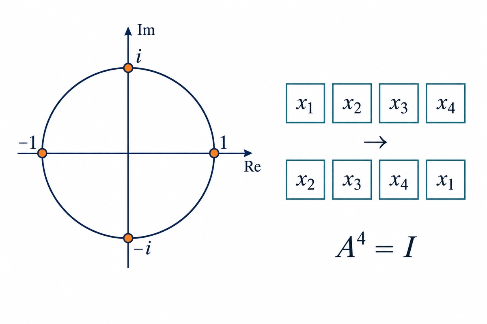
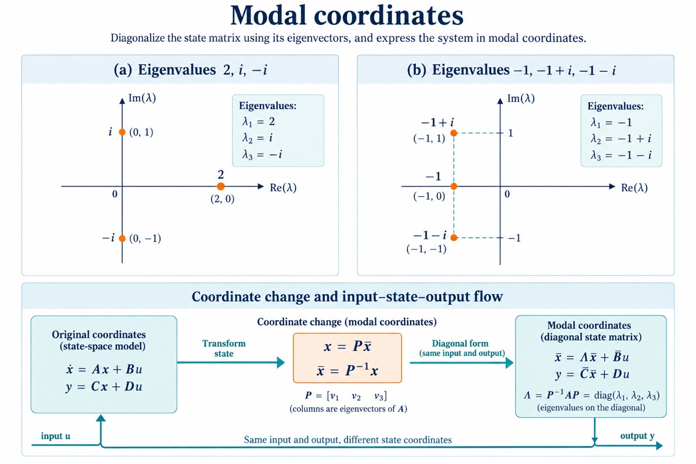
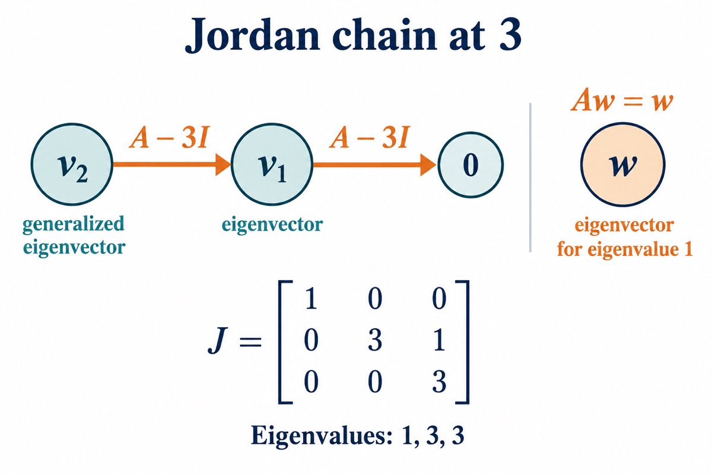
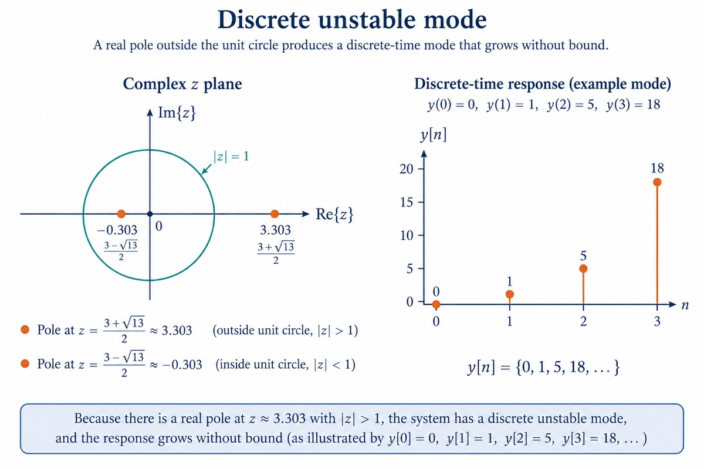

# 习题：线性变换与离散系统描述

对应知识点：[线性变换与离散系统描述](../notes/linear-transform.md)（特征值规范型、约当型、传递函数不变性、离散状态空间描述）；第 5 题由差分方程写能控规范型的方法见[状态空间表达式的建立](../notes/realization.md)。

!!! note "约定"
    状态变换统一采用

    $$
    x=P\bar x,\qquad \bar A=P^{-1}AP,\quad \bar B=P^{-1}B,\quad \bar C=CP,\quad \bar D=D.
    $$

    单输出时 $c$ 表示行向量，虚数单位记为 $j$。为区分离散状态矩阵 $G$ 与传递函数，离散系统的传递函数写成 $\mathcal G(z)$。所有传递函数均按零初始条件定义。

    复特征向量 $v=\alpha+j\beta$ 对应 $\lambda=\sigma+j\omega$ 时，取实变换列 $[\alpha,\beta]$，相应的实块为

    $$
    R=\begin{bmatrix}\sigma&\omega\\-\omega&\sigma\end{bmatrix},
    $$

    原因是 $A\alpha=\sigma\alpha-\omega\beta$、$A\beta=\omega\alpha+\sigma\beta$。

## 1. 循环移位矩阵的对角化与实数化

已知循环移位矩阵

$$
A=\begin{bmatrix}0&1&0&0\\0&0&1&0\\0&0&0&1\\1&0&0&0\end{bmatrix}.
$$

（1）求 $A$ 的特征方程与全部特征值。

（2）求每个特征值对应的特征向量。提示：设 $v=[v_1\ v_2\ v_3\ v_4]\tp$，由 $Av=\lambda v$ 的前三个等式得 $v_{i+1}=\lambda v_i$。

（3）求把 $A$ 变换为对角阵的变换矩阵 $P$，写出 $\bar A=P^{-1}AP$。

（4）$A$ 有一对共轭复特征值。对它作实数化处理，写出实的变换矩阵 $P_r$ 与实块对角阵 $\bar A_r$，并求 $\det P_r$ 以确认非奇异。

（5）说明 $A^4=I$，并由此解释这四个特征值为什么都落在单位圆上。

??? success "解答"
    **（1）特征方程与全部特征值**

    计算

    $$
    \det(\lambda I-A)=
    \begin{vmatrix}\lambda&-1&0&0\\0&\lambda&-1&0\\0&0&\lambda&-1\\-1&0&0&\lambda\end{vmatrix}
    =\lambda^4-1.
    $$

    因式分解得到

    $$
    \lambda^4-1=(\lambda-1)(\lambda+1)(\lambda^2+1)=0.
    $$

    所以全部特征值是

    $$
    \boxed{\lambda_1=1,\quad\lambda_2=-1,\quad\lambda_3=j,\quad\lambda_4=-j.}
    $$

    四个根互异，故 $A$ 在复数域一定可以对角化。

    **（2）每个特征值对应的特征向量**

    令 $v=[v_1,v_2,v_3,v_4]\tp$。方程 $Av=\lambda v$ 给出

    $$
    v_2=\lambda v_1,\quad v_3=\lambda v_2,\quad v_4=\lambda v_3,\quad v_1=\lambda v_4.
    $$

    前面三个等式给出

    $$
    v=v_1[1,\lambda,\lambda^2,\lambda^3]\tp.
    $$

    最后一个等式要求 $(1-\lambda^4)v_1=0$，恰好与特征方程一致。取 $v_1=1$：

    $$
    v(1)=\begin{bmatrix}1\\1\\1\\1\end{bmatrix},\quad
    v(-1)=\begin{bmatrix}1\\-1\\1\\-1\end{bmatrix},\quad
    v(j)=\begin{bmatrix}1\\j\\-1\\-j\end{bmatrix},\quad
    v(-j)=\begin{bmatrix}1\\-j\\-1\\j\end{bmatrix}.
    $$

    各特征空间均由对应向量的非零倍数构成。

    **（3）复对角化**

    按上述顺序排列特征向量：

    $$
    P=\begin{bmatrix}
    1&1&1&1\\1&-1&j&-j\\1&1&-1&-1\\1&-1&-j&j
    \end{bmatrix}.
    $$

    各列满足 $Av_i=\lambda_i v_i$，所以

    $$
    AP=P\diag(1,-1,j,-j),\qquad
    \boxed{\bar A=P^{-1}AP=\diag(1,-1,j,-j).}
    $$

    还可以检验 $P^*P=4I$，因此 $P^{-1}=\frac14P^*$，其中 $*$ 表示共轭转置。

    **（4）实数化及非奇异性**

    对 $\lambda=j$，将特征向量拆成实部、虚部：

    $$
    v(j)=\alpha+j\beta,\qquad
    \alpha=\begin{bmatrix}1\\0\\-1\\0\end{bmatrix},\quad
    \beta=\begin{bmatrix}0\\1\\0\\-1\end{bmatrix}.
    $$

    于是取

    $$
    P_r=[v(1),v(-1),\alpha,\beta]
    =\begin{bmatrix}1&1&1&0\\1&-1&0&1\\1&1&-1&0\\1&-1&0&-1\end{bmatrix}.
    $$

    这里 $A\alpha=-\beta$，$A\beta=\alpha$，所以

    $$
    \boxed{\bar A_r=
    \begin{bmatrix}1&0&0&0\\0&-1&0&0\\0&0&0&1\\0&0&-1&0\end{bmatrix}.}
    $$

    对 $P_r$ 作行变换 $R_3\leftarrow R_3-R_1$、$R_4\leftarrow R_4-R_2$，得到分块上三角矩阵，故

    $$
    \det P_r=
    \det\begin{bmatrix}1&1\\1&-1\end{bmatrix}
    \cdot\det\begin{bmatrix}-2&0\\0&-2\end{bmatrix}
    =(-2)\times4=\boxed{-8\ne0}.
    $$

    这里使用了分块三角矩阵的行列式等于两个对角块行列式之积。

    **（5）为什么 $A^4=I$，为什么特征值在单位圆上**

    对任意 $x$，

    $$
    Ax=(x_2,x_3,x_4,x_1)\tp.
    $$

    每乘一次 $A$ 就循环移位一次，连续四次回到原向量，因此 $A^4x=x$ 对任意 $x$ 成立，即 $A^4=I$。

    若 $Av=\lambda v$ 且 $v\ne0$，则

    $$
    v=A^4v=\lambda^4v\quad\Longrightarrow\quad\lambda^4=1.
    $$

    取模得 $|\lambda|^4=1$，于是 $|\lambda|=1$。这里说明的是离散乘法模态的单位圆性质，不能据此说连续系统 $\dot x=Ax$ 渐近稳定。

    <figure markdown>
      { width="480" loading=lazy }
      <figcaption>循环移位与四个单位根</figcaption>
    </figure>

## 2. 特征值规范型与共轭复根

试将下列系统方程变换为特征值规范型。对每一小题：求特征多项式与特征值；写出变换矩阵 $P$（能控／能观规范型请直接用范德蒙德矩阵或其转置的结论，不要逐个解齐次方程组）；写出 $(\bar A,\bar b,\bar c)$；最后用

$$
\bar c(sI-\bar A)^{-1}\bar b=c(sI-A)^{-1}b
$$

验证传递函数不变。

（1）

$$
\dot x=\begin{bmatrix}0&1&0\\0&0&1\\2&-1&2\end{bmatrix}x+
\begin{bmatrix}0\\0\\1\end{bmatrix}u,\qquad y=\begin{bmatrix}1&2&0\end{bmatrix}x.
$$

（2）

$$
\dot x=\begin{bmatrix}0&0&-2\\1&0&-4\\0&1&-3\end{bmatrix}x+
\begin{bmatrix}1\\0\\0\end{bmatrix}u,\qquad y=\begin{bmatrix}1&0&1\end{bmatrix}x.
$$

（3）对第（2）小题，再用“能观规范型的变换矩阵之逆等于范德蒙德矩阵的转置”这一对偶结论重做一遍，并说明所得实块与第（2）问的实块相差什么。

??? success "解答"
    **（1）能控伴随型系统**

    $$
    A=\begin{bmatrix}0&1&0\\0&0&1\\2&-1&2\end{bmatrix},\quad
    b=\begin{bmatrix}0\\0\\1\end{bmatrix},\quad c=\begin{bmatrix}1&2&0\end{bmatrix}.
    $$

    **第一步**：特征多项式

    $$
    p(s)=\det(sI-A)=s^3-2s^2+s-2=(s-2)(s^2+1).
    $$

    所以特征值为 $2,j,-j$，均为单根。

    **第二步**：直接用范德蒙德矩阵

    对于本题上移位的能控伴随矩阵，特征向量直接取

    $$
    v(\lambda)=[1,\lambda,\lambda^2]\tp.
    $$

    无需逐个解齐次方程组。复变换矩阵为

    $$
    V=\begin{bmatrix}1&1&1\\2&j&-j\\4&-1&-1\end{bmatrix},\qquad
    V^{-1}AV=\diag(2,j,-j).
    $$

    对应的复规范型输入、输出矩阵是

    $$
    \bar b_{\mathbb C}=
    \begin{bmatrix}\frac15\\-\frac1{10}+\frac j5\\-\frac1{10}-\frac j5\end{bmatrix},
    \qquad
    \bar c_{\mathbb C}=\begin{bmatrix}5&1+2j&1-2j\end{bmatrix}.
    $$

    例如，伴随矩阵有 $(V^{-1}b)_i=1/p'(\lambda_i)$，代入即可得到上述结果。

    **第三步**：实数化并计算三个矩阵

    由 $v(j)=(1,0,-1)\tp+j(0,1,0)\tp$，取

    $$
    P=\begin{bmatrix}1&1&0\\2&0&1\\4&-1&0\end{bmatrix},\quad
    P^{-1}=\frac15\begin{bmatrix}1&0&1\\4&0&-1\\-2&5&-2\end{bmatrix},\quad\det P=5.
    $$

    所以

    $$
    \boxed{
    \bar A=\begin{bmatrix}2&0&0\\0&0&1\\0&-1&0\end{bmatrix},\quad
    \bar b=\frac15\begin{bmatrix}1\\-1\\-2\end{bmatrix},\quad
    \bar c=\begin{bmatrix}5&1&2\end{bmatrix}.}
    $$

    系统即 $\dot{\bar x}=\bar A\bar x+\bar b u,\ y=\bar c\bar x$。

    **第四步**：从两边分别计算传递函数

    原坐标中，由 $(sI-A)w=b$ 的前两行得 $w_2=sw_1,w_3=s^2w_1$，第三行给出 $p(s)w_1=1$，故

    $$
    c(sI-A)^{-1}b=\boxed{\frac{1+2s}{(s-2)(s^2+1)}}.
    $$

    新坐标中，实块的预解矩阵为

    $$
    \left(sI-\begin{bmatrix}0&1\\-1&0\end{bmatrix}\right)^{-1}
    =\frac1{s^2+1}\begin{bmatrix}s&1\\-1&s\end{bmatrix}.
    $$

    因此

    $$
    \begin{aligned}
    \bar c(sI-\bar A)^{-1}\bar b
    &=\frac1{s-2}
    +\frac{[1\ \ 2]\begin{bmatrix}s&1\\-1&s\end{bmatrix}[-1\ \ -2]\tp}
    {5(s^2+1)}\\
    &=\frac1{s-2}-\frac{s}{s^2+1}\\
    &=\frac{1+2s}{(s-2)(s^2+1)}.
    \end{aligned}
    $$

    两边完全一致。

    **（2）能观伴随型系统**

    $$
    A=\begin{bmatrix}0&0&-2\\1&0&-4\\0&1&-3\end{bmatrix},\quad
    b=\begin{bmatrix}1\\0\\0\end{bmatrix},\quad c=\begin{bmatrix}1&0&1\end{bmatrix}.
    $$

    这里称“能观伴随型”是指 $A$ 的结构，本题给定的 $c$ 不必是标准能观型的末位单位行向量。

    **第一步**：特征多项式及特征值

    $$
    p(s)=s^3+3s^2+4s+2=(s+1)(s^2+2s+2).
    $$

    所以

    $$
    \lambda_1=-1,\qquad \lambda_{2,3}=-1\pm j.
    $$

    **第二步**：用范德蒙德对偶结论构造变换

    记

    $$
    V=\begin{bmatrix}
    1&1&1\\-1&-1+j&-1-j\\1&-2j&2j
    \end{bmatrix}.
    $$

    因为 $A\tp$ 是上一小题同方向的能控伴随矩阵，

    $$
    A\tp V=V\Lambda\quad\Longrightarrow\quad
    V\tp A=\Lambda V\tp.
    $$

    故 $Q=V^{-\mathsf T}$ 是 $A$ 的特征向量矩阵。直接求逆得

    $$
    Q=\begin{bmatrix}
    2&-\frac12-\frac j2&-\frac12+\frac j2\\
    2&-1-\frac j2&-1+\frac j2\\
    1&-\frac12&-\frac12
    \end{bmatrix}.
    $$

    将第二、三列同乘 $-2$，不影响其特征向量性质，得到较整齐的

    $$
    P_{\mathbb C}=\begin{bmatrix}
    2&1+j&1-j\\2&2+j&2-j\\1&1&1
    \end{bmatrix}.
    $$

    对应

    $$
    \bar A_{\mathbb C}=\diag(-1,-1+j,-1-j),\quad
    \bar b_{\mathbb C}=\begin{bmatrix}1\\-\frac12\\-\frac12\end{bmatrix},\quad
    \bar c_{\mathbb C}=\begin{bmatrix}3&2+j&2-j\end{bmatrix}.
    $$

    整个过程使用伴随矩阵与范德蒙德矩阵的对偶关系，没有逐个解特征向量方程。

    **第三步**：按页首约定实数化

    取复根 $-1+j$ 对应向量的实部和虚部，得到

    $$
    P=\begin{bmatrix}2&1&1\\2&2&1\\1&1&0\end{bmatrix},\quad
    P^{-1}=\begin{bmatrix}1&-1&1\\-1&1&0\\0&1&-2\end{bmatrix},\quad \det P=-1.
    $$

    从而

    $$
    \boxed{
    \bar A=\begin{bmatrix}-1&0&0\\0&-1&1\\0&-1&-1\end{bmatrix},\quad
    \bar b=\begin{bmatrix}1\\-1\\0\end{bmatrix},\quad
    \bar c=\begin{bmatrix}3&2&1\end{bmatrix}.}
    $$

    **第四步**：传递函数验证

    原坐标中，设 $(sI-A)w=b$。后两行关系给出

    $$
    w_2=(s+3)w_3,\qquad w_1=(s^2+3s+4)w_3.
    $$

    第一行是 $sw_1+2w_3=1$，因此

    $$
    w_3=\frac1{p(s)},\qquad
    cw=w_1+w_3=\boxed{\frac{s^2+3s+5}{(s+1)(s^2+2s+2)}}.
    $$

    新坐标中，

    $$
    \begin{aligned}
    \bar c(sI-\bar A)^{-1}\bar b
    &=\frac3{s+1}
    +\frac{[2\ \ 1]\begin{bmatrix}s+1&1\\-1&s+1\end{bmatrix}[-1\ \ 0]\tp}
    {(s+1)^2+1}\\
    &=\frac3{s+1}-\frac{2s+1}{s^2+2s+2}\\
    &=\frac{s^2+3s+5}{(s+1)(s^2+2s+2)}.
    \end{aligned}
    $$

    验证成立。

    **（3）先实数化范德蒙德矩阵，再使用转置对偶**

    这一做法要特别留意实块符号。令

    $$
    V_r=\begin{bmatrix}1&1&0\\-1&-1&1\\1&0&-2\end{bmatrix}.
    $$

    它是 $A\tp$ 的实范德蒙德变换，满足

    $$
    V_r^{-1}A\tp V_r=
    J_r=\begin{bmatrix}-1&0&0\\0&-1&1\\0&-1&-1\end{bmatrix}.
    $$

    转置以后，

    $$
    V_r\tp AV_r^{-\mathsf T}=J_r\tp.
    $$

    所以直接选

    $$
    P_d=V_r^{-\mathsf T}
    =\begin{bmatrix}2&-1&1\\2&-2&1\\1&-1&0\end{bmatrix}
    $$

    便得到

    $$
    \boxed{
    \bar A_d=\begin{bmatrix}-1&0&0\\0&-1&-1\\0&1&-1\end{bmatrix},\quad
    \bar b_d=\begin{bmatrix}1\\1\\0\end{bmatrix},\quad
    \bar c_d=\begin{bmatrix}3&-2&1\end{bmatrix}.}
    $$

    此时复根对应实块为前一小题实块的转置，非对角项符号相反。两者描述的是同一系统，差别只在实坐标基的选取。

    具体地，$P_d=PS$，其中 $S=\diag(1,-1,1)$，因此

    $$
    \bar A_d=S^{-1}\bar AS,\quad\bar b_d=S^{-1}\bar b,\quad\bar c_d=\bar cS.
    $$

    若坚持使用页首约定的实块形式（右上元为 $+\omega$），再将相应实基向量变号即可回到第（2）问。

    直接验算传递函数：

    $$
    \begin{aligned}
    \bar c_d(sI-\bar A_d)^{-1}\bar b_d
    &=\frac3{s+1}
    +\frac{[-2\ \ 1]\begin{bmatrix}s+1&-1\\1&s+1\end{bmatrix}[1\ \ 0]\tp}
    {s^2+2s+2}\\
    &=\frac3{s+1}-\frac{2s+1}{s^2+2s+2}.
    \end{aligned}
    $$

    因此仍为原来的传递函数。注意：“复对角化后再实数化”与“先实数化再转置对偶”所得实基可以不同；复对角阵转置不变，而实二阶块转置会改变非对角项符号。

    <figure markdown>
      { width="480" loading=lazy }
      <figcaption>两组特征值与状态坐标变换</figcaption>
    </figure>

## 3. 多输入系统与重特征值

试将下列系统的状态方程变换为特征值规范型：

$$
\dot x(t)=\begin{bmatrix}4&1&-2\\1&0&2\\1&-1&3\end{bmatrix}x(t)
+\begin{bmatrix}3&1\\2&7\\5&3\end{bmatrix}
\begin{bmatrix}u_1(t)\\u_2(t)\end{bmatrix}.
$$

（1）求特征多项式与特征值（含代数重数）。

（2）对重特征值求 $\rank(\lambda I-A)$，判断几何重数，说明本题为什么不能对角化。

（3）求特征向量与广义特征向量，构造 $P$，写出约当型 $\bar A$ 与 $\bar B=P^{-1}B$。

（4）取 $C=I_3$，验证

$$
C(sI-A)^{-1}B=P\bar C(sI-\bar A)^{-1}\bar B,
$$

即传递函数矩阵在变换下不变。

第（4）问的等式保留原题写法，它在输出矩阵 $\bar C$ 的含义上有歧义，解答中给出说明。

??? success "解答"
    记

    $$
    A=\begin{bmatrix}4&1&-2\\1&0&2\\1&-1&3\end{bmatrix},\quad
    B=\begin{bmatrix}3&1\\2&7\\5&3\end{bmatrix}.
    $$

    **（1）特征多项式**

    沿第一行展开：

    $$
    \begin{aligned}
    p(\lambda)
    &=(\lambda-4)(\lambda^2-3\lambda+2)-(\lambda-1)+2(\lambda-1)\\
    &=(\lambda-1)\bigl[(\lambda-4)(\lambda-2)+1\bigr]\\
    &=\boxed{(\lambda-1)(\lambda-3)^2}.
    \end{aligned}
    $$

    因此 $\lambda=1$ 的代数重数为 1，$\lambda=3$ 的代数重数为 2。

    **（2）重根的秩、几何重数及不可对角化性**

    $$
    3I-A=\begin{bmatrix}-1&-1&2\\-1&3&-2\\-1&1&0\end{bmatrix}.
    $$

    前两行、前两列构成的二阶子式为 $-4\ne0$，而整个行列式为 0，所以

    $$
    \rank(3I-A)=2.
    $$

    由秩－零度定理，

    $$
    \dim\ker(3I-A)=3-2=1<2.
    $$

    重根 $3$ 只有一个独立特征向量，不能提供两个独立特征向量。因此整个三阶矩阵只有两个独立特征向量，不能对角化。

    **（3）特征向量、广义特征向量和约当型**

    对 $\lambda=1$，解 $(A-I)w=0$ 得 $w_1=0,w_2=2w_3$。取

    $$
    w=\begin{bmatrix}0\\2\\1\end{bmatrix}.
    $$

    对 $\lambda=3$，解 $(A-3I)v_1=0$ 得三个分量相等，取

    $$
    v_1=\begin{bmatrix}1\\1\\1\end{bmatrix}.
    $$

    为了构造上约当块，需要

    $$
    (A-3I)v_2=v_1.
    $$

    由于

    $$
    A-3I=\begin{bmatrix}1&1&-2\\1&-3&2\\1&-1&0\end{bmatrix},
    $$

    取 $v_2=(1,0,0)\tp$ 恰好满足要求。于是

    $$
    P=[w,v_1,v_2]=\begin{bmatrix}0&1&1\\2&1&0\\1&1&0\end{bmatrix},\quad
    P^{-1}=\begin{bmatrix}0&1&-1\\0&-1&2\\1&1&-2\end{bmatrix},\quad\det P=1.
    $$

    利用 $Aw=w$、$Av_1=3v_1$、$Av_2=v_1+3v_2$，

    $$
    \boxed{
    \bar A=\begin{bmatrix}1&0&0\\0&3&1\\0&0&3\end{bmatrix},\qquad
    \bar B=P^{-1}B=\begin{bmatrix}-3&4\\8&-1\\-5&2\end{bmatrix}.}
    $$

    例如 $\bar B$ 第一行是 $B$ 第二行减第三行，即 $[-3,4]$；其余各行同理由矩阵乘法获得。

    **（4）传递函数矩阵验证及原题记号说明**

    原题写的是 $C(sI-A)^{-1}B=P\bar C(sI-\bar A)^{-1}\bar B$。在标准约定 $\bar C=CP$ 下，这个等式右端多了一个 $P$。正确的不变性公式是

    $$
    \boxed{C(sI-A)^{-1}B=\bar C(sI-\bar A)^{-1}\bar B.}
    $$

    本题取 $C=I$，所以 $\bar C=P$，正确等式具体为

    $$
    \boxed{(sI-A)^{-1}B=P(sI-\bar A)^{-1}\bar B.}
    $$

    如果原题右端的 $\bar C$ 特指“以新状态 $\bar x$ 本身为输出”时的单位矩阵 $I$，则原题写法也成立；但这时 $\bar C$ 不再是保持原输出 $y=x$ 的标准变换矩阵。下面按保持原输出来验证。

    首先

    $$
    R_J(s)=(sI-\bar A)^{-1}
    =\begin{bmatrix}
    \frac1{s-1}&0&0\\
    0&\frac1{s-3}&\frac1{(s-3)^2}\\
    0&0&\frac1{s-3}
    \end{bmatrix}.
    $$

    乘 $\bar B$ 得

    $$
    R_J\bar B=
    \begin{bmatrix}
    -\frac3{s-1}&\frac4{s-1}\\
    \frac8{s-3}-\frac5{(s-3)^2}&-\frac1{s-3}+\frac2{(s-3)^2}\\
    -\frac5{s-3}&\frac2{s-3}
    \end{bmatrix}.
    $$

    再左乘 $P$ 并通分得到

    $$
    \boxed{
    P R_J\bar B=
    \begin{bmatrix}
    \frac{3s-14}{(s-3)^2}&\frac{s-1}{(s-3)^2}\\
    \frac{2s^2-s-25}{(s-1)(s-3)^2}&\frac{7s^2-42s+67}{(s-1)(s-3)^2}\\
    \frac{5s^2-19s+2}{(s-1)(s-3)^2}&\frac{3s^2-18s+31}{(s-1)(s-3)^2}
    \end{bmatrix}.}
    $$

    直接计算 $(sI-A)^{-1}B$ 得到相同矩阵。也可用

    $$
    sI-A=P(sI-\bar A)P^{-1}
    $$

    推出 $(sI-A)^{-1}B=P(sI-\bar A)^{-1}P^{-1}B$，从结构上证明恒等式。

    <figure markdown>
      { width="480" loading=lazy }
      <figcaption>重根 3 的约当链与单根 1</figcaption>
    </figure>

## 4. 离散系统的脉冲传递函数

已知离散系统状态空间表达式为

$$
\begin{aligned}
\begin{bmatrix}x_1(k+1)\\x_2(k+1)\end{bmatrix}
&=\begin{bmatrix}0&1\\1&3\end{bmatrix}
\begin{bmatrix}x_1(k)\\x_2(k)\end{bmatrix}
+\begin{bmatrix}0\\1\end{bmatrix}u(k),\\
y(k)&=\begin{bmatrix}1&1\end{bmatrix}
\begin{bmatrix}x_1(k)\\x_2(k)\end{bmatrix}.
\end{aligned}
$$

（1）求该系统的脉冲传递函数 $\mathcal G(z)=C(zI-G)^{-1}H$。

（2）由 $\mathcal G(z)$ 反写出输入—输出之间的二阶差分方程。

（3）求 $G$ 的特征值，判断该系统是否收敛（特征值是否全部落在单位圆内），并说明结论的含义。

（4）取 $x(0)=0$、$u(k)\equiv1$，用状态方程递推求 $y(0),y(1),y(2),y(3)$。

??? success "解答"
    记

    $$
    G=\begin{bmatrix}0&1\\1&3\end{bmatrix},\quad
    H=\begin{bmatrix}0\\1\end{bmatrix},\quad C=\begin{bmatrix}1&1\end{bmatrix},\quad D=0.
    $$

    **（1）求脉冲传递函数**

    $$
    zI-G=\begin{bmatrix}z&-1\\-1&z-3\end{bmatrix},\qquad
    \det(zI-G)=z^2-3z-1.
    $$

    根据二阶矩阵求逆公式，

    $$
    (zI-G)^{-1}=\frac1{z^2-3z-1}\begin{bmatrix}z-3&1\\1&z\end{bmatrix}.
    $$

    于是

    $$
    \boxed{\mathcal G(z)=C(zI-G)^{-1}H=\frac{z+1}{z^2-3z-1}.}
    $$

    **（2）输入输出差分方程**

    零初始条件下，

    $$
    (z^2-3z-1)Y(z)=(z+1)U(z).
    $$

    对应的前向移位形式为

    $$
    \boxed{y(k+2)-3y(k+1)-y(k)=u(k+1)+u(k).}
    $$

    也可以写为 $y(k)=3y(k-1)+y(k-2)+u(k-1)+u(k-2)$，并另行给定初始条件。传递函数推导使用零初始条件；差分关系本身也可直接从状态方程消去状态得到。

    **（3）特征值与收敛性**

    $$
    \lambda^2-3\lambda-1=0\quad\Longrightarrow\quad
    \boxed{\lambda_\pm=\frac{3\pm\sqrt{13}}2.}
    $$

    数值上 $\lambda_+\approx3.3028$、$\lambda_-\approx-0.3028$。由于 $\lambda_+>1$，

    $$
    \rho(G)>1,
    $$

    故系统不渐近稳定：零输入状态并非对任意初值都收敛到零。一般初值中只要包含不稳定特征方向的分量，就会按 $\lambda_+^k$ 增长。并非每个初值都会发散：若初值恰好只在稳定特征空间内，仍可衰减。这里“系统不收敛”是指不具备对全部初值的零输入渐近收敛性。

    **（4）阶跃输入递推**

    由

    $$
    x_1(k+1)=x_2(k),\qquad x_2(k+1)=x_1(k)+3x_2(k)+1
    $$

    及 $x(0)=(0,0)\tp$，逐步求得：

    | $k$ | $x_1(k)$ | $x_2(k)$ | $y(k)=x_1(k)+x_2(k)$ |
    |:---:|:---:|:---:|:---:|
    | 0 | 0 | 0 | 0 |
    | 1 | 0 | 1 | 1 |
    | 2 | 1 | 4 | 5 |
    | 3 | 4 | 14 | 18 |

    因此 $\boxed{y(0)=0,\ y(1)=1,\ y(2)=5,\ y(3)=18}$。差分方程复核：$5-3\times1-0=2$、$18-3\times5-1=2$，均等于 $u(k+1)+u(k)$。

    <figure markdown>
      { width="480" loading=lazy }
      <figcaption>单位圆外极点与阶跃递推结果</figcaption>
    </figure>

## 5. 梯度下降与离散能控规范型

在极小点附近把损失作二次近似，梯度下降的迭代式为

$$
x(k+1)=(I-\eta H)x(k)+H_u u(k),
$$

其中 $H$ 是该点的 Hessian，$\eta>0$ 是学习率。取

$$
H=\begin{bmatrix}3&1\\1&3\end{bmatrix},\qquad
H_u=\begin{bmatrix}1\\0\end{bmatrix},\qquad C=\begin{bmatrix}1&0\end{bmatrix}.
$$

（1）求 $H$ 的特征值与特征向量，写出把 $H$ 对角化的 $T$。

（2）说明 $G=I-\eta H$ 与 $H$ 有相同的特征向量，写出 $T^{-1}GT$；由 $|1-\eta\lambda_i|<1$ 求出使迭代收敛的 $\eta$ 的取值范围。

（3）取 $\eta=1/5$，写出 $G$ 的数值与特征值，求脉冲传递函数 $\mathcal G(z)=C(zI-G)^{-1}H_u$。

（4）另有一个二阶差分方程描述的离散环节

$$
y(k+2)-\frac34y(k+1)+\frac18y(k)=u(k+1)+2u(k).
$$

写出它的能控规范型 $(G,H,c,d)$，求脉冲传递函数并判断收敛性。

（5）若把第（4）问右端改为 $2u(k+2)+u(k+1)+u(k)$（分子分母同阶），用 $\beta_i=b_i-b_n a_i$ 求出新的 $c$ 与直接传输项 $d$，并回代验证脉冲传递函数。

??? success "解答"
    记

    $$
    H=\begin{bmatrix}3&1\\1&3\end{bmatrix},\quad
    H_u=\begin{bmatrix}1\\0\end{bmatrix},\quad C=\begin{bmatrix}1&0\end{bmatrix},\quad G=I-\eta H.
    $$

    **（1）Hessian 的特征值和对角化**

    $$
    \det(\lambda I-H)=(\lambda-3)^2-1=(\lambda-4)(\lambda-2).
    $$

    对应特征向量可取

    $$
    v_4=\begin{bmatrix}1\\1\end{bmatrix},\qquad
    v_2=\begin{bmatrix}1\\-1\end{bmatrix}.
    $$

    取

    $$
    T=\begin{bmatrix}1&1\\1&-1\end{bmatrix},\qquad
    T^{-1}=\frac12\begin{bmatrix}1&1\\1&-1\end{bmatrix},
    $$

    则 $\boxed{T^{-1}HT=\diag(4,2)}$。

    **（2）迭代矩阵的模态和学习率范围**

    若 $Hv_i=\lambda_i v_i$，则

    $$
    Gv_i=(I-\eta H)v_i=(1-\eta\lambda_i)v_i.
    $$

    所以 $G$ 与 $H$ 有相同特征向量，且

    $$
    \boxed{T^{-1}GT=\diag(1-4\eta,1-2\eta).}
    $$

    为使无外部输入时的误差从任意初值收敛到零，需要两个乘子模都小于 1：

    $$
    \begin{cases}
    -1<1-4\eta<1&\Longleftrightarrow 0<\eta<\frac12,\\
    -1<1-2\eta<1&\Longleftrightarrow 0<\eta<1.
    \end{cases}
    $$

    两者取交集得到

    $$
    \boxed{0<\eta<\frac12.}
    $$

    $\eta=0$ 时状态不衰减；$\eta=\frac12$ 时有乘子 $-1$，相应分量持续正负交替，因此两个端点都不能包含。这个结论针对零输入误差；持续外部输入可能令状态收敛到非零平衡点。

    **（3）$\eta=1/5$ 时的数值系统与传递函数**

    $$
    G=\begin{bmatrix}\frac25&-\frac15\\-\frac15&\frac25\end{bmatrix},\qquad
    \operatorname{eig}(G)=\left\{\frac15,\frac35\right\}.
    $$

    于是

    $$
    (zI-G)^{-1}
    =\frac1{(z-\frac25)^2-\frac1{25}}
    \begin{bmatrix}z-\frac25&-\frac15\\-\frac15&z-\frac25\end{bmatrix}.
    $$

    所以

    $$
    \boxed{\mathcal G(z)=\frac{z-\frac25}{z^2-\frac45z+\frac3{25}}
    =\frac{z-\frac25}{(z-\frac15)(z-\frac35)}.}
    $$

    模态分解还给出

    $$
    \mathcal G(z)=\frac12\frac1{z-\frac15}+\frac12\frac1{z-\frac35},
    $$

    与两个特征方向的衰减乘子相对应。

    **（4）由二阶差分方程构造能控规范型**

    原题为

    $$
    y(k+2)-\frac34y(k+1)+\frac18y(k)=u(k+1)+2u(k).
    $$

    因此

    $$
    \mathcal G(z)=\frac{z+2}{z^2-\frac34z+\frac18}.
    $$

    对一般严格真分式

    $$
    \frac{b_1z+b_0}{z^2+a_1z+a_0},
    $$

    可以取

    $$
    G_c=\begin{bmatrix}0&1\\-a_0&-a_1\end{bmatrix},\quad
    H_c=\begin{bmatrix}0\\1\end{bmatrix},\quad
    c_c=\begin{bmatrix}b_0&b_1\end{bmatrix},\quad d=0.
    $$

    注意输出系数排列是“常数项在前，一次项在后”。代入本题：

    $$
    \boxed{
    G_c=\begin{bmatrix}0&1\\-\frac18&\frac34\end{bmatrix},\quad
    H_c=\begin{bmatrix}0\\1\end{bmatrix},\quad
    c_c=\begin{bmatrix}2&1\end{bmatrix},\quad d=0.}
    $$

    验证：

    $$
    (zI-G_c)^{-1}H_c=
    \frac1{z^2-\frac34z+\frac18}\begin{bmatrix}1\\z\end{bmatrix}.
    $$

    左乘 $c_c$ 即得上述分子 $2+z$。

    分母因式分解：

    $$
    z^2-\frac34z+\frac18=(z-\tfrac12)(z-\tfrac14).
    $$

    两个特征值都在单位圆内部，所以零输入状态从任意初值收敛到零，系统渐近稳定。常值输入下一般收敛到相应非零稳态，而不是必然收敛到零。

    **（5）同阶分子的直接传输项**

    将右端换为 $2u(k+2)+u(k+1)+u(k)$，得到

    $$
    \mathcal G_{\rm new}(z)=\frac{2z^2+z+1}{z^2-\frac34z+\frac18}.
    $$

    分子分母同阶，首先取最高次项之比

    $$
    d=b_2=2.
    $$

    令 $a_1=-\frac34,a_0=\frac18,b_1=1,b_0=1$。按题给公式，

    $$
    \beta_0=b_0-b_2a_0=1-2\times\frac18=\frac34,
    \qquad
    \beta_1=b_1-b_2a_1=1-2\times(-\frac34)=\frac52.
    $$

    所以状态方程矩阵 $G_c,H_c$ 不变，只修改输出方程：

    $$
    \boxed{c_{\rm new}=\begin{bmatrix}\frac34&\frac52\end{bmatrix},\quad d_{\rm new}=2.}
    $$

    回代得

    $$
    \begin{aligned}
    c_{\rm new}(zI-G_c)^{-1}H_c+d_{\rm new}
    &=\frac{\frac34+\frac52z}{z^2-\frac34z+\frac18}+2\\
    &=\frac{\frac34+\frac52z+2z^2-\frac32z+\frac14}
    {z^2-\frac34z+\frac18}\\
    &=\boxed{\frac{2z^2+z+1}{z^2-\frac34z+\frac18}}.
    \end{aligned}
    $$

    因此新的直接传输项代表 $y(k)$ 对当时输入 $u(k)$ 的即时响应；状态内部极点仍是 $\frac12,\frac14$，不因输出方程的修改而改变。
