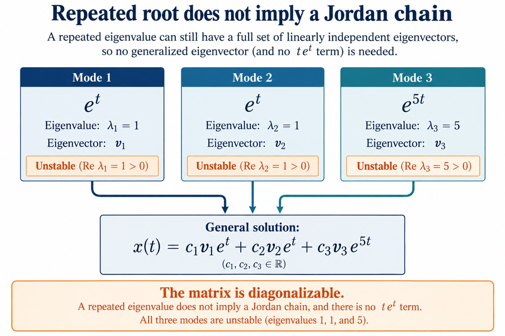
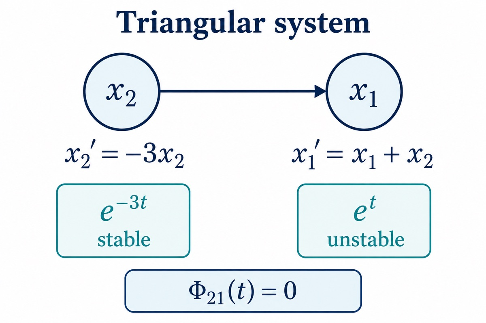
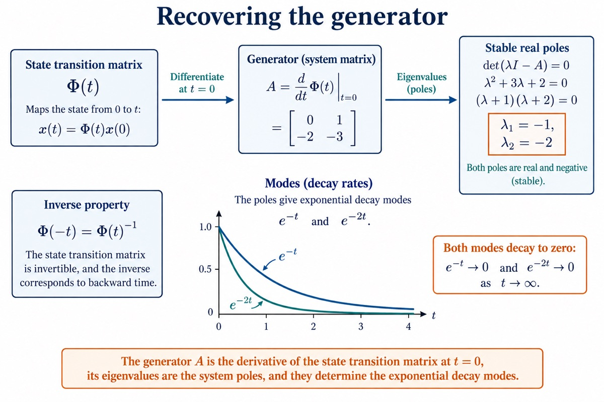
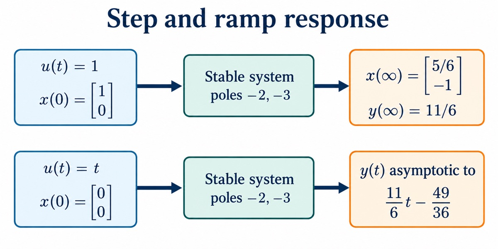
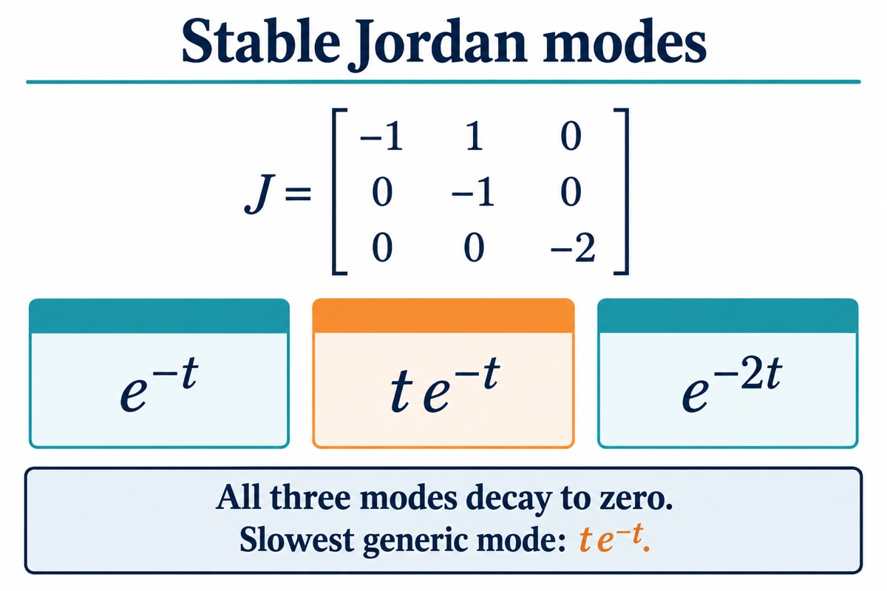

# 习题：线性定常系统的运动分析

对应知识点：[线性定常系统的运动分析](../notes/lti-response.md)（状态转移矩阵的求法与性质、零输入与零状态响应、典型输入下的响应）。

!!! note "约定与常用公式"
    连续线性定常系统 $\dot x=Ax+Bu,\ y=Cx$ 的状态转移矩阵为 $\Phi(t)=\e^{At}$，响应为

    $$
    x(t)=\Phi(t)x(0)+\int_0^t\Phi(t-\tau)Bu(\tau)\dd\tau ,
    $$

    右端第一项是零输入响应，第二项是零状态响应。

    算出 $\Phi(t)$ 后应检查 $\Phi(0)=I$ 和 $\dot\Phi=A\Phi$。由矩阵初值问题解的唯一性，两项同时成立就足以确认 $\Phi=\e^{At}$。

    当 $A$ 可逆时，单位阶跃和单位斜坡的零状态响应分别为

    $$
    x_{\rm step}(t)=A^{-1}(\Phi(t)-I)B,\qquad x_{\rm ramp}(t)=A^{-2}(\Phi(t)-I-At)B.
    $$

    $A$ 不可逆并不表示响应不存在，只是这两个含逆矩阵的公式不能直接用，应回到卷积积分。

## 1. 用频域法求三阶状态转移矩阵

线性定常系统齐次状态方程为 $\dot x=Ax$，其中

$$
A=\begin{bmatrix}2&2&1\\1&3&1\\1&2&2\end{bmatrix}.
$$

（1）求特征多项式并因式分解，写出全部特征值及其代数重数。

（2）求 $\lambda=1$ 的几何重数，据此判断 $A$ 是否可对角化。

（3）用频域法求预解矩阵 $(sI-A)^{-1}$ 并作拉氏反变换，求出状态转移矩阵 $\Phi(t)$。

（4）观察预解矩阵各元素的公分母，说明为什么 $\Phi(t)$ 中没有 $te^t$ 这样的项（提示：$\Phi(t)$ 中 $t^k\e^{\lambda t}$ 型项的最高次数由约当块大小决定，与第（2）问对照）。

（5）用 $\Phi(0)=I$、$\dot\Phi(t)=A\Phi(t)$ 以及 $\Phi(1)\Phi(2)=\Phi(3)$ 三处自检。

（6）该系统稳定吗？说出主导模态。

??? success "解答"
    记

    $$
    A=\begin{bmatrix}2&2&1\\1&3&1\\1&2&2\end{bmatrix}.
    $$

    **（1）特征多项式与代数重数**

    先观察

    $$
    A=I+N,\qquad
    N=\begin{bmatrix}1&2&1\\1&2&1\\1&2&1\end{bmatrix}=uv\tp,\quad
    u=\begin{bmatrix}1\\1\\1\end{bmatrix},\quad v=\begin{bmatrix}1\\2\\1\end{bmatrix}.
    $$

    由于 $v\tp u=4$，

    $$
    N^2=u(v\tp u)v\tp=4N.
    $$

    矩阵 $N$ 秩为 1，在 $u$ 方向上特征值为 4，在 $\ker v\tp$ 上特征值为 0。因此 $A=I+N$ 的特征值为 $5,1,1$。直接展开行列式亦得到

    $$
    \begin{aligned}
    p(\lambda)&=\det(\lambda I-A)\\
    &=\lambda^3-7\lambda^2+11\lambda-5\\
    &=\boxed{(\lambda-1)^2(\lambda-5)}.
    \end{aligned}
    $$

    $\lambda=1$ 的代数重数为 2，$\lambda=5$ 的代数重数为 1。

    **（2）$\lambda=1$ 的几何重数和可对角化性**

    $$
    A-I=N,\qquad\rank(A-I)=1.
    $$

    所以

    $$
    \dim\ker(A-I)=3-1=2.
    $$

    例如取两个独立特征向量

    $$
    v_1=\begin{bmatrix}-2\\1\\0\end{bmatrix},\qquad
    v_2=\begin{bmatrix}-1\\0\\1\end{bmatrix}.
    $$

    它们都满足 $v\tp v_i=0$，故 $Av_i=v_i$。对于 $\lambda=5$，可取 $u=(1,1,1)\tp$。三个向量线性独立，因此 $A$ 可以对角化。

    **（3）频域法：求预解矩阵并作反变换**

    写成

    $$
    sI-A=(s-1)I-N.
    $$

    利用 $N^2=4N$，设逆矩阵为 $aI+bN$。乘开：

    $$
    [(s-1)I-N](aI+bN)
    =(s-1)aI+\bigl[(s-5)b-a\bigr]N.
    $$

    令其等于 $I$，得

    $$
    a=\frac1{s-1},\qquad b=\frac1{(s-1)(s-5)}.
    $$

    因此

    $$
    \boxed{
    (sI-A)^{-1}=
    \frac1{(s-1)(s-5)}
    \begin{bmatrix}s-4&2&1\\1&s-3&1\\1&2&s-4\end{bmatrix}.}
    $$

    为了方便拉氏反变换，定义谱投影矩阵

    $$
    E_5=\frac N4,\qquad E_1=I-\frac N4.
    $$

    则预解矩阵可以分解成

    $$
    (sI-A)^{-1}=\frac{E_1}{s-1}+\frac{E_5}{s-5}.
    $$

    使用 $\mathcal L^{-1}\{1/(s-a)\}=e^{at}$，

    $$
    \Phi(t)=e^tE_1+e^{5t}E_5
    =e^tI+\frac{e^{5t}-e^t}{4}N.
    $$

    全部九个元素为

    $$
    \boxed{
    \Phi(t)=\frac14
    \begin{bmatrix}
    3e^t+e^{5t}&2e^{5t}-2e^t&e^{5t}-e^t\\
    e^{5t}-e^t&2e^t+2e^{5t}&e^{5t}-e^t\\
    e^{5t}-e^t&2e^{5t}-2e^t&3e^t+e^{5t}
    \end{bmatrix}.}
    $$

    **（4）为什么没有 $te^t$ 项**

    虽然特征多项式中有 $(s-1)^2$，但每个预解矩阵元素约分后只需公分母 $(s-1)(s-5)$，没有二阶极点 $1/(s-1)^2$。而

    $$
    \mathcal L^{-1}\left\{\frac1{(s-1)^2}\right\}=te^t,
    $$

    所以本题没有这样的项。

    在线性代数上，这是因为 $\lambda=1$ 的几何重数等于代数重数，对应两个一阶约当块，并非一个二阶约当块。最小多项式是 $(\lambda-1)(\lambda-5)$。决定多项式乘指数项最高次数的是约当块大小，不是单看代数重数。

    **（5）三处自检**

    首先由 $E_1+E_5=I$，

    $$
    \Phi(0)=E_1+E_5=I.
    $$

    其次，因为 $N^2=4N$，

    $$
    E_1^2=E_1,\quad E_5^2=E_5,\quad E_1E_5=E_5E_1=0.
    $$

    又有 $AE_1=E_1$、$AE_5=5E_5$，所以

    $$
    \dot\Phi(t)=e^tE_1+5e^{5t}E_5=A\Phi(t).
    $$

    最后，

    $$
    \begin{aligned}
    \Phi(1)\Phi(2)
    &=(eE_1+e^5E_5)(e^2E_1+e^{10}E_5)\\
    &=e^3E_1^2+e^{15}E_5^2\\
    &=e^3E_1+e^{15}E_5=\Phi(3).
    \end{aligned}
    $$

    交叉项消失的原因是两个谱投影的乘积为零。三项检验均成立。

    **（6）稳定性与主导模态**

    全部特征值实部为正，故系统不稳定。一般初值下增长最快的主导模态为

    $$
    \boxed{e^{5t},\quad\text{对应方向 }(1,1,1)\tp.}
    $$

    若 $E_5x(0)=0$，即 $x_1(0)+2x_2(0)+x_3(0)=0$，则该特定初值不激发 $e^{5t}$，只剩 $e^t$ 模态；但非零的 $e^t$ 分量仍增长。

    <figure markdown>
      { width="480" loading=lazy }
      <figcaption>两个独立的重根模态与一个快速增长模态</figcaption>
    </figure>

## 2. 凯莱－哈密顿定理计算二阶矩阵指数

用凯莱－哈密顿定理研究系统

$$
\dot x=\begin{bmatrix}1&1\\0&-3\end{bmatrix}x.
$$

（1）写出特征多项式 $\varphi(s)$，并直接验证 $\varphi(A)=0$。

（2）设 $e^{At}=\alpha_0(t)I+\alpha_1(t)A$，把两个特征值代入定系数方程组，解出 $\alpha_0,\alpha_1$。

（3）写出 $\Phi(t)$，并用 $\Phi(0)=I$、$\dot\Phi=A\Phi$ 自检。

（4）该系统不稳定，指出是哪个模态造成的，并说明 $\Phi(t)$ 的哪一个元素恒为零及其物理含义。

??? success "解答"
    记

    $$
    A=\begin{bmatrix}1&1\\0&-3\end{bmatrix}.
    $$

    **（1）特征多项式及 $\varphi(A)=0$**

    矩阵为上三角矩阵，因此

    $$
    \varphi(s)=(s-1)(s+3)=s^2+2s-3.
    $$

    先算

    $$
    A^2=\begin{bmatrix}1&-2\\0&9\end{bmatrix}.
    $$

    于是

    $$
    A^2+2A-3I=
    \begin{bmatrix}1&-2\\0&9\end{bmatrix}
    +\begin{bmatrix}2&2\\0&-6\end{bmatrix}
    -\begin{bmatrix}3&0\\0&3\end{bmatrix}=0.
    $$

    这就是本题的凯莱－哈密顿关系。由此所有高次幂都可约化为 $I$ 和 $A$ 的线性组合。

    **（2）解出 $\alpha_0(t),\alpha_1(t)$**

    设

    $$
    e^{At}=\alpha_0(t)I+\alpha_1(t)A.
    $$

    在特征值 $1,-3$ 处插值得

    $$
    \begin{cases}
    \alpha_0+\alpha_1=e^t,\\
    \alpha_0-3\alpha_1=e^{-3t}.
    \end{cases}
    $$

    两式相减，$4\alpha_1=e^t-e^{-3t}$，因此

    $$
    \boxed{
    \alpha_1=\frac{e^t-e^{-3t}}4,\qquad
    \alpha_0=\frac{3e^t+e^{-3t}}4.}
    $$

    **（3）状态转移矩阵及自检**

    代入 $\alpha_0I+\alpha_1A$：

    $$
    \boxed{
    \Phi(t)=\begin{bmatrix}
    e^t&\frac{e^t-e^{-3t}}4\\
    0&e^{-3t}
    \end{bmatrix}.}
    $$

    显然 $\Phi(0)=I$。求导得到

    $$
    \dot\Phi(t)=
    \begin{bmatrix}e^t&\frac{e^t+3e^{-3t}}4\\0&-3e^{-3t}\end{bmatrix}.
    $$

    另一方面，

    $$
    A\Phi(t)=
    \begin{bmatrix}
    e^t&\frac{e^t-e^{-3t}}4+e^{-3t}\\
    0&-3e^{-3t}
    \end{bmatrix}=\dot\Phi(t).
    $$

    两项自检通过。

    **（4）不稳定模态及恒零元素的含义**

    由于 $\lambda=1>0$，系统含有增长模态 $e^t$，故不稳定；$\lambda=-3$ 对应的 $e^{-3t}$ 是衰减模态。状态分量明确为

    $$
    \begin{aligned}
    x_1(t)&=e^t x_1(0)+\frac{e^t-e^{-3t}}4x_2(0),\\
    x_2(t)&=e^{-3t}x_2(0).
    \end{aligned}
    $$

    $\boxed{\Phi_{21}(t)\equiv0}$ 表示初始状态 $x_1(0)$ 不会影响 $x_2(t)$。从状态方程也可看出 $\dot x_2=-3x_2$ 不包含 $x_1$，而 $\dot x_1=x_1+x_2$ 包含 $x_2$，耦合方向是从 $x_2$ 到 $x_1$。

    若初值满足 $x_1(0)=-x_2(0)/4$，增长项恰好消失，但这只是一条特殊稳定特征方向，不能改变系统整体不稳定的结论。

    <figure markdown>
      { width="480" loading=lazy }
      <figcaption>上三角系统的单向耦合与两个模态</figcaption>
    </figure>

## 3. 由状态转移矩阵反求系统矩阵

已知线性定常系统的状态转移矩阵为

$$
e^{At}=\begin{bmatrix}
2e^{-t}-e^{-2t}&e^{-t}-e^{-2t}\\
-2e^{-t}+2e^{-2t}&-e^{-t}+2e^{-2t}
\end{bmatrix}.
$$

（1）先验证 $\Phi(0)=I$（这是它能作为状态转移矩阵的必要条件）。

（2）用性质 $A=\left.\dot\Phi(t)\right|_{t=0}$ 求出系统矩阵 $A$。

（3）把求得的 $A$ 回代（频域法）重新算一遍 $e^{At}$，验证与题给相同。

（4）求 $\Phi^{-1}(1)$，并验证它等于 $\Phi(-1)$。

（5）写出 $A$ 的特征值，并指出题给矩阵中两个指数因子与特征值的对应关系。

??? success "解答"
    题给

    $$
    \Phi(t)=
    \begin{bmatrix}
    2e^{-t}-e^{-2t}&e^{-t}-e^{-2t}\\
    -2e^{-t}+2e^{-2t}&-e^{-t}+2e^{-2t}
    \end{bmatrix}.
    $$

    **（1）验证初始条件**

    代入 $t=0$，

    $$
    \Phi(0)=\begin{bmatrix}2-1&1-1\\-2+2&-1+2\end{bmatrix}
    =\begin{bmatrix}1&0\\0&1\end{bmatrix}=I.
    $$

    这满足状态转移矩阵的必要条件；仅满足这一条还不足以确认它来自某个常矩阵指数，后面还要回代检验。

    **（2）求 $A=\dot\Phi(0)$**

    逐项求导：

    $$
    \dot\Phi(t)=
    \begin{bmatrix}
    -2e^{-t}+2e^{-2t}&-e^{-t}+2e^{-2t}\\
    2e^{-t}-4e^{-2t}&e^{-t}-4e^{-2t}
    \end{bmatrix}.
    $$

    代入 $t=0$：

    $$
    \boxed{
    A=\dot\Phi(0)=\begin{bmatrix}0&1\\-2&-3\end{bmatrix}.}
    $$

    **（3）频域法重新求 $e^{At}$**

    $$
    sI-A=\begin{bmatrix}s&-1\\2&s+3\end{bmatrix},\quad
    \det(sI-A)=s^2+3s+2=(s+1)(s+2).
    $$

    所以

    $$
    (sI-A)^{-1}
    =\frac1{(s+1)(s+2)}
    \begin{bmatrix}s+3&1\\-2&s\end{bmatrix}.
    $$

    逐项部分分式分解：

    $$
    \begin{aligned}
    \frac{s+3}{(s+1)(s+2)}&=\frac2{s+1}-\frac1{s+2},\\
    \frac1{(s+1)(s+2)}&=\frac1{s+1}-\frac1{s+2},\\
    \frac{-2}{(s+1)(s+2)}&=-\frac2{s+1}+\frac2{s+2},\\
    \frac{s}{(s+1)(s+2)}&=-\frac1{s+1}+\frac2{s+2}.
    \end{aligned}
    $$

    拉氏反变换便得到题给的四个元素，证明回代结果一致。

    再作微分自检：$A\Phi$ 的第一行等于 $\Phi$ 的第二行，即 $\dot\Phi$ 的第一行；第二行为 $-2$ 倍第一行再减 $3$ 倍第二行：

    $$
    [-2(2e^{-t}-e^{-2t})-3(-2e^{-t}+2e^{-2t}),\
    -2(e^{-t}-e^{-2t})-3(-e^{-t}+2e^{-2t})],
    $$

    化简为 $[2e^{-t}-4e^{-2t},\ e^{-t}-4e^{-2t}]$，正是 $\dot\Phi$ 的第二行。

    **（4）求 $\Phi^{-1}(1)$ 并验证**

    记 $a=e^{-t},b=e^{-2t}$，直接计算行列式：

    $$
    \begin{aligned}
    \det\Phi(t)&=(2a-b)(-a+2b)-(a-b)(-2a+2b)\\
    &=ab=e^{-3t}.
    \end{aligned}
    $$

    所以 $\det\Phi(1)=e^{-3}\ne0$。使用二阶求逆公式，

    $$
    \begin{aligned}
    \Phi^{-1}(1)
    &=e^3\begin{bmatrix}
    -e^{-1}+2e^{-2}&-e^{-1}+e^{-2}\\
    2e^{-1}-2e^{-2}&2e^{-1}-e^{-2}
    \end{bmatrix}\\
    &=\boxed{\begin{bmatrix}
    2e-e^2&e-e^2\\
    -2e+2e^2&-e+2e^2
    \end{bmatrix}}.
    \end{aligned}
    $$

    将 $t=-1$ 直接代入题给 $\Phi(t)$ 得到完全相同的矩阵，因此

    $$
    \boxed{\Phi^{-1}(1)=\Phi(-1).}
    $$

    在任意 $t$ 下也有 $\Phi(t)\Phi(-t)=I$，对应先向前演化再向后演化回到原状态。

    **（5）特征值与两个指数因子的对应**

    由 $(\lambda+1)(\lambda+2)=0$，

    $$
    \lambda_1=-1,\qquad\lambda_2=-2.
    $$

    因此 $e^{-t}$ 对应特征值 $-1$，$e^{-2t}$ 对应特征值 $-2$。两者均衰减到零，故系统渐近稳定；一般初值下 $e^{-t}$ 比 $e^{-2t}$ 衰减慢，是长期主要的瞬态模态。

    <figure markdown>
      { width="480" loading=lazy }
      <figcaption>在零时刻求导恢复系统矩阵</figcaption>
    </figure>

## 4. 阶跃与斜坡的状态、输出响应

已知线性定常系统

$$
\dot x=\begin{bmatrix}0&1\\-6&-5\end{bmatrix}x+
\begin{bmatrix}1\\0\end{bmatrix}u,\qquad
y=\begin{bmatrix}1&-1\end{bmatrix}x.
$$

（1）求 $\Phi(t)$（任选一种方法），并自检。

（2）验证 $\det A\ne0$，从而阶跃、斜坡两个现成公式可用。

（3）$u(t)=1(t)$，$x(0)=[1\ 0]\tp$：求状态响应与输出响应；再用卷积积分独立复核状态响应。

（4）求第（3）问的稳态值，并与公式 $x(\infty)=-A^{-1}Bu_r$ 核对。

（5）$u(t)=t\cdot1(t)$，$x(0)=[0\ 0]\tp$：求状态响应与输出响应，并说明输出中“随 $t$ 线性增长的项”从何而来。

??? success "解答"
    记

    $$
    A=\begin{bmatrix}0&1\\-6&-5\end{bmatrix},\quad
    B=\begin{bmatrix}1\\0\end{bmatrix},\quad
    C=\begin{bmatrix}1&-1\end{bmatrix}.
    $$

    **（1）求 $\Phi(t)$ 并自检**

    特征多项式为

    $$
    s^2+5s+6=(s+2)(s+3).
    $$

    使用频域法，

    $$
    (sI-A)^{-1}
    =\frac1{(s+2)(s+3)}
    \begin{bmatrix}s+5&1\\-6&s\end{bmatrix}.
    $$

    其中

    $$
    \begin{aligned}
    \frac{s+5}{(s+2)(s+3)}&=\frac3{s+2}-\frac2{s+3},\\
    \frac1{(s+2)(s+3)}&=\frac1{s+2}-\frac1{s+3},\\
    \frac{-6}{(s+2)(s+3)}&=-\frac6{s+2}+\frac6{s+3},\\
    \frac{s}{(s+2)(s+3)}&=-\frac2{s+2}+\frac3{s+3}.
    \end{aligned}
    $$

    令 $a=e^{-2t},b=e^{-3t}$，反变换得

    $$
    \boxed{
    \Phi(t)=\begin{bmatrix}
    3a-2b&a-b\\
    -6a+6b&-2a+3b
    \end{bmatrix}.}
    $$

    初值检验：

    $$
    \Phi(0)=\begin{bmatrix}3-2&1-1\\-6+6&-2+3\end{bmatrix}=I.
    $$

    微分检验：

    $$
    \dot\Phi(t)=
    \begin{bmatrix}-6a+6b&-2a+3b\\12a-18b&4a-9b\end{bmatrix}.
    $$

    而 $A\Phi$ 的第一行为 $\Phi$ 第二行，第二行为 $-6$ 倍第一行减 $5$ 倍第二行，恰好得到上式。因此 $\dot\Phi=A\Phi$。

    **（2）验证逆矩阵存在**

    $$
    \det A=0\times(-5)-1\times(-6)=6\ne0,
    $$

    因此

    $$
    \boxed{
    A^{-1}=\frac16\begin{bmatrix}-5&-1\\6&0\end{bmatrix}
    =\begin{bmatrix}-\frac56&-\frac16\\1&0\end{bmatrix}.}
    $$

    阶跃和斜坡快捷公式都可以使用。

    **（3）单位阶跃，$x(0)=(1,0)\tp$**

    **方法一**：状态转移公式

    零输入部分为

    $$
    x_{\rm zi}(t)=\Phi(t)x(0)=\begin{bmatrix}3a-2b\\-6a+6b\end{bmatrix}.
    $$

    零状态部分为

    $$
    \begin{aligned}
    x_{\rm zs}(t)
    &=A^{-1}(\Phi(t)-I)B\\
    &=\begin{bmatrix}-\frac56&-\frac16\\1&0\end{bmatrix}
    \begin{bmatrix}3a-2b-1\\-6a+6b\end{bmatrix}\\
    &=\begin{bmatrix}
    \frac56-\frac32a+\frac23b\\
    -1+3a-2b
    \end{bmatrix}.
    \end{aligned}
    $$

    相加得到完整状态响应：

    $$
    \boxed{
    x(t)=\begin{bmatrix}
    \frac56+\frac32e^{-2t}-\frac43e^{-3t}\\
    -1-3e^{-2t}+4e^{-3t}
    \end{bmatrix}.}
    $$

    输出为 $y=x_1-x_2$：

    $$
    \boxed{
    y(t)=\frac{11}6+\frac92e^{-2t}-\frac{16}3e^{-3t},\qquad t\ge0.}
    $$

    初值检查：$x_1(0)=\frac56+\frac32-\frac43=1$，$x_2(0)=-1-3+4=0$，$y(0)=1$。

    **方法二**：卷积积分独立复核

    对单位阶跃，令 $\sigma=t-\tau$：

    $$
    \begin{aligned}
    \int_0^t\Phi(t-\tau)B\,d\tau
    &=\int_0^t
    \begin{bmatrix}3e^{-2\sigma}-2e^{-3\sigma}\\-6e^{-2\sigma}+6e^{-3\sigma}\end{bmatrix}d\sigma\\
    &=\begin{bmatrix}
    \frac32(1-e^{-2t})-\frac23(1-e^{-3t})\\
    -3(1-e^{-2t})+2(1-e^{-3t})
    \end{bmatrix}\\
    &=\begin{bmatrix}
    \frac56-\frac32a+\frac23b\\-1+3a-2b
    \end{bmatrix}.
    \end{aligned}
    $$

    再加 $\Phi(t)x(0)$，与方法一完全一致。

    还可以代回状态方程作快速检查：

    $$
    \dot x_1=-3a+4b=x_2+1,\qquad
    \dot x_2=6a-12b=-6x_1-5x_2.
    $$

    **（4）稳态值及平衡方程核对**

    当 $t\to\infty$，$a,b\to0$，因此

    $$
    \boxed{x(\infty)=\begin{bmatrix}\frac56\\-1\end{bmatrix},\qquad
    y(\infty)=\frac{11}6.}
    $$

    由于 $A$ 的特征值为 $-2,-3$，所有瞬态衰减，允许使用

    $$
    x(\infty)=-A^{-1}B\,u_r.
    $$

    代入 $u_r=1$ 得

    $$
    -A^{-1}B=-\begin{bmatrix}-\frac56\\1\end{bmatrix}
    =\begin{bmatrix}\frac56\\-1\end{bmatrix},
    $$

    与极限一致。平衡方程也给出 $x_{2,\rm ss}+1=0$、$-6x_{1,\rm ss}-5x_{2,\rm ss}=0$，解得相同结果。

    **（5）单位斜坡，$x(0)=0$**

    输入 $u(t)=t\,1(t)$，使用

    $$
    x(t)=A^{-2}(\Phi(t)-I-At)B.
    $$

    先求

    $$
    A^{-2}=\begin{bmatrix}\frac{19}{36}&\frac5{36}\\-\frac56&-\frac16\end{bmatrix},\quad
    AB=\begin{bmatrix}0\\-6\end{bmatrix}.
    $$

    因此

    $$
    (\Phi-I-At)B=
    \begin{bmatrix}3a-2b-1\\-6a+6b+6t\end{bmatrix}.
    $$

    相乘并合并同类项：

    $$
    \boxed{
    x(t)=
    \begin{bmatrix}
    \frac56t-\frac{19}{36}+\frac34e^{-2t}-\frac29e^{-3t}\\
    -t+\frac56-\frac32e^{-2t}+\frac23e^{-3t}
    \end{bmatrix}.}
    $$

    输出响应为

    $$
    \boxed{
    y(t)=\frac{11}6t-\frac{49}{36}
    +\frac94e^{-2t}-\frac89e^{-3t}.}
    $$

    初值检查：$x_1(0)=-19/36+3/4-2/9=0$，$x_2(0)=5/6-3/2+2/3=0$。代回第一行：

    $$
    \dot x_1=\frac56-\frac32a+\frac23b=x_2+t;
    $$

    第二行：

    $$
    \dot x_2=-1+3a-2b=-6x_1-5x_2.
    $$

    均满足状态方程。

    线性增长项来自外部斜坡输入，而不是不稳定自然模态。将公式展开可见

    $$
    x(t)=A^{-2}(\Phi-I)B-tA^{-1}B.
    $$

    最后一项在输出中的系数为

    $$
    -CA^{-1}B=\frac{11}6,
    $$

    所以 $y(t)$ 中出现 $\frac{11}6t$。指数瞬态消失后，

    $$
    y(t)-\left(\frac{11}6t-\frac{49}{36}\right)\to0.
    $$

    系统本身稳定，但斜坡输入无界，输出随之线性增长，两者不矛盾。

    <figure markdown>
      { width="480" loading=lazy }
      <figcaption>阶跃稳态与斜坡渐近响应的结构</figcaption>
    </figure>

## 5. 重根的凯莱－哈密顿法与阶跃响应

设

$$
\dot x=\begin{bmatrix}0&1&0\\0&0&1\\-2&-5&-4\end{bmatrix}x+
\begin{bmatrix}0\\0\\1\end{bmatrix}u.
$$

（1）求特征多项式并因式分解；指出重特征值的代数重数与几何重数。

（2）设 $e^{At}=c_0I+c_1A+c_2A^2$。写出定系数方程组（二重根需对 $\lambda$ 求一次导补一个方程），解出 $c_0,c_1,c_2$。

（3）求 $A^2$，写出 $e^{At}$ 的全部九个元素，并用 $\Phi(0)=I$、$\dot\Phi=A\Phi$ 自检。

（4）验证 $\det A\ne0$，用阶跃公式求 $u=1(t)$、$x(0)=0$ 时的状态响应 $x(t)$，并求稳态值 $x(\infty)$。

（5）把所求 $x(t)$ 代回状态方程 $\dot x=Ax+Bu$ 验证。

（6）说明 $e^{At}$ 中的 $te^{-t}$ 项来自哪一个特征值，并指出哪个模态衰减最慢。

??? success "解答"
    记

    $$
    A=\begin{bmatrix}0&1&0\\0&0&1\\-2&-5&-4\end{bmatrix},\qquad
    B=\begin{bmatrix}0\\0\\1\end{bmatrix}.
    $$

    **（1）特征多项式、代数重数与几何重数**

    伴随矩阵的特征多项式为

    $$
    p(\lambda)=\lambda^3+4\lambda^2+5\lambda+2
    =\boxed{(\lambda+1)^2(\lambda+2)}.
    $$

    $\lambda=-1$ 的代数重数是 2，$\lambda=-2$ 的代数重数是 1。对重根，

    $$
    A+I=\begin{bmatrix}1&1&0\\0&1&1\\-2&-5&-3\end{bmatrix}.
    $$

    第三行等于 $-2$ 倍第一行再减 $3$ 倍第二行；前两行独立，所以

    $$
    \rank(A+I)=2,\qquad\dim\ker(A+I)=1.
    $$

    因此 $-1$ 的几何重数为 1，必有一个二阶约当块。特征向量可取

    $$
    v_1=\begin{bmatrix}1\\-1\\1\end{bmatrix},
    $$

    广义特征向量可取

    $$
    v_2=\begin{bmatrix}0\\1\\-2\end{bmatrix},\qquad (A+I)v_2=v_1.
    $$

    对于 $\lambda=-2$，特征向量可取 $(1,-2,4)\tp$。这些向量也为后面的 $te^{-t}$ 项提供了约当结构解释。

    **（2）插值方程与三个系数**

    由凯莱－哈密顿定理，

    $$
    A^3+4A^2+5A+2I=0.
    $$

    因此可将矩阵指数写成二次多项式

    $$
    e^{At}=c_0(t)I+c_1(t)A+c_2(t)A^2.
    $$

    令 $q(\lambda)=c_0+c_1\lambda+c_2\lambda^2$。本题在 $-1$ 处存在二阶约当块，不仅要满足 $q(-1)=e^{-t}$，还必须匹配导数

    $$
    q'(-1)=\left.\frac{\partial e^{\lambda t}}{\partial\lambda}\right|_{\lambda=-1}=te^{-t}.
    $$

    加上单根 $-2$ 的函数值条件，得到

    $$
    \begin{cases}
    c_0-c_1+c_2=e^{-t},\\
    c_1-2c_2=te^{-t},\\
    c_0-2c_1+4c_2=e^{-2t}.
    \end{cases}
    $$

    记 $a=e^{-t},b=e^{-2t}$。由第二式

    $$
    c_1=ta+2c_2,
    $$

    再由第一式

    $$
    c_0=(1+t)a+c_2.
    $$

    代入第三式：

    $$
    (1+t)a+c_2-2(ta+2c_2)+4c_2=b
    \quad\Longrightarrow\quad
    c_2=(t-1)a+b.
    $$

    回代得到

    $$
    \boxed{
    \begin{aligned}
    c_0&=2ta+b,\\
    c_1&=(3t-2)a+2b,\\
    c_2&=(t-1)a+b.
    \end{aligned}}
    $$

    导数条件不是“任何重根都必须产生 $te^{-t}$”的意思；本题确有二阶约当块，因此最小多项式中含 $(\lambda+1)^2$。这与第 1 题可对角化的重根情形不同。

    **（3）求 $A^2$、全部九个元素并自检**

    矩阵相乘可得

    $$
    \boxed{
    A^2=\begin{bmatrix}0&0&1\\-2&-5&-4\\8&18&11\end{bmatrix}.}
    $$

    例如第三行来自

    $$
    [-2,-5,-4]A=[8,18,11].
    $$

    先保留系数形式：

    $$
    \Phi(t)=c_0I+c_1A+c_2A^2
    =\begin{bmatrix}
    c_0&c_1&c_2\\
    -2c_2&c_0-5c_2&c_1-4c_2\\
    -2c_1+8c_2&-5c_1+18c_2&c_0-4c_1+11c_2
    \end{bmatrix}.
    $$

    将 $c_0,c_1,c_2$ 代入，全部九个元素为

    $$
    \boxed{
    \Phi(t)=
    \begin{bmatrix}
    2ta+b&(3t-2)a+2b&(t-1)a+b\\
    (2-2t)a-2b&(5-3t)a-4b&(2-t)a-2b\\
    (2t-4)a+4b&(3t-8)a+8b&(t-3)a+4b
    \end{bmatrix},\quad
    a=e^{-t},\ b=e^{-2t}.}
    $$

    **初值自检。** $t=0$ 时 $c_0=1,c_1=0,c_2=0$，因此 $\Phi(0)=I$。将 $t=0,a=b=1$ 代入九个元素，也直接得到单位矩阵。

    **微分自检。** 由 $A^3=-4A^2-5A-2I$，

    $$
    A\Phi=-2c_2I+(c_0-5c_2)A+(c_1-4c_2)A^2.
    $$

    因此只需检验三个标量关系：

    $$
    c_0'=-2c_2,\qquad c_1'=c_0-5c_2,\qquad c_2'=c_1-4c_2.
    $$

    逐个计算：

    $$
    \begin{aligned}
    c_0'&=(2-2t)a-2b=-2[(t-1)a+b],\\
    c_1'&=(5-3t)a-4b=(2ta+b)-5[(t-1)a+b],\\
    c_2'&=(2-t)a-2b=[(3t-2)a+2b]-4[(t-1)a+b].
    \end{aligned}
    $$

    三式成立，所以 $\dot\Phi=A\Phi$。这比把九个元素全部重复相乘更简洁，同时是完整的矩阵等式验证。

    **（4）单位阶跃响应与稳态值**

    沿第一行展开 $\det A$ 得

    $$
    \det A=-2\ne0.
    $$

    逆矩阵为

    $$
    A^{-1}=\begin{bmatrix}-\frac52&-2&-\frac12\\1&0&0\\0&1&0\end{bmatrix}.
    $$

    因为 $x(0)=0$，单位阶跃响应为

    $$
    x(t)=A^{-1}(\Phi(t)-I)B.
    $$

    $B$ 为第三列单位向量，所以先取 $\Phi-I$ 第三列：

    $$
    (\Phi-I)B=
    \begin{bmatrix}
    (t-1)a+b\\
    (2-t)a-2b\\
    (t-3)a+4b-1
    \end{bmatrix}.
    $$

    再乘 $A^{-1}$：

    $$
    \boxed{
    x(t)=
    \begin{bmatrix}
    \frac12-te^{-t}-\frac12e^{-2t}\\
    (t-1)e^{-t}+e^{-2t}\\
    (2-t)e^{-t}-2e^{-2t}
    \end{bmatrix}.}
    $$

    例如第一分量等于

    $$
    -\frac52[(t-1)a+b]-2[(2-t)a-2b]
    -\frac12[(t-3)a+4b-1]=\frac12-ta-\frac12b.
    $$

    其余两分量直接由上一步第一、第二分量给出。

    由于 $e^{-t}\to0$、$te^{-t}\to0$、$e^{-2t}\to0$，

    $$
    \boxed{x(\infty)=\begin{bmatrix}\frac12\\0\\0\end{bmatrix}.}
    $$

    公式复核：

    $$
    -A^{-1}B=-\begin{bmatrix}-\frac12\\0\\0\end{bmatrix}
    =\begin{bmatrix}\frac12\\0\\0\end{bmatrix}.
    $$

    **（5）代回状态方程逐项验证**

    先检查初值：

    $$
    x_1(0)=\frac12-\frac12=0,\quad
    x_2(0)=-1+1=0,\quad
    x_3(0)=2-2=0.
    $$

    求导：

    $$
    \begin{aligned}
    \dot x_1&=(t-1)a+b=x_2,\\
    \dot x_2&=(2-t)a-2b=x_3,\\
    \dot x_3&=(t-3)a+4b.
    \end{aligned}
    $$

    状态方程第三行要求

    $$
    \dot x_3=-2x_1-5x_2-4x_3+1.
    $$

    把上述响应代入右边：

    $$
    \begin{aligned}
    &-2\left(\frac12-ta-\frac12b\right)
    -5[(t-1)a+b]-4[(2-t)a-2b]+1\\
    &=(-1+1)+(2t-5t+5-8+4t)a+(1-5+8)b\\
    &=(t-3)a+4b=\dot x_3.
    \end{aligned}
    $$

    三行状态方程和初值全部满足，验证结束。

    **（6）$te^{-t}$ 的来源与最慢衰减模态**

    重根 $-1$ 对应二阶约当块

    $$
    J_{-1}=\begin{bmatrix}-1&1\\0&-1\end{bmatrix}=-I+N,\qquad N^2=0.
    $$

    因此

    $$
    e^{J_{-1}t}=e^{-t}(I+tN)
    =\begin{bmatrix}e^{-t}&te^{-t}\\0&e^{-t}\end{bmatrix}.
    $$

    这直接说明 $te^{-t}$ 来自特征值 $-1$ 的长度为 2 的约当链。

    系统的模态函数为 $e^{-t},te^{-t},e^{-2t}$，全部趋于零。其中

    $$
    \frac{te^{-t}}{e^{-t}}=t\to\infty,\qquad
    \frac{te^{-t}}{e^{-2t}}=te^t\to\infty.
    $$

    所以通常被激发时，$\boxed{te^{-t}}$ 是最慢衰减的模态。它在 $t=1$ 处达到峰值，随后衰减，出现短时上升不等于系统不稳定。

    <figure markdown>
      { width="480" loading=lazy }
      <figcaption>稳定约当块与三种衰减模态</figcaption>
    </figure>
