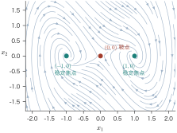

# 习题：稳定性与李雅普诺夫方法

对应知识点：[稳定性与李雅普诺夫方法](../notes/stability.md)（平衡状态、稳定性定义、第一法与第二法、二次型与 Sylvester 准则）。讨论平衡点时先说明它是否唯一；下“大范围”结论时必须验证径向无界性。

## 1. 平衡状态与临界情形

设系统

$$
\begin{cases}
\dot x_1=-x_1+x_2,\\
\dot x_2=-2x_1+x_2.
\end{cases}
$$

以下依次用第一法与第二法分析其平衡状态。

（1）确定系统的平衡状态 $x_e$，并说明它是唯一的还是有无穷多个（要求从 $\rank A$ 与 $\dim\Ker A$ 说明）。

（2）用第一法求 $A$ 的特征值，指出本题属于线性化之后三种结论（渐近稳定、不稳定、临界情形）中的哪一种。

（3）设 $V(x)=ax_1^2+bx_1x_2+cx_2^2$。沿轨线求 $\dot V$，令 $x_1^2,x_1x_2,x_2^2$ 三项系数同时为零，定出 $b,c$ 与 $a$ 的关系；取 $a=2$ 写出具体的 $V$。

（4）用 Sylvester 准则判断该 $V$ 的定号性，再由 $\dot V$ 的定号性应用第二法的稳定性判据，给出零平衡状态的稳定性结论（稳定、渐近稳定还是不稳定）。

（5）说明本题为什么不是渐近稳定的：从 $V$ 的等值线（椭圆）与轨线的关系给出几何解释。

??? success "解答"
    记

    $$
    \dot x=Ax,\qquad A=\begin{bmatrix}-1&1\\-2&1\end{bmatrix}.
    $$

    **（1）平衡状态的唯一性**

    平衡状态满足 $Ax_e=0$，即

    $$
    -x_{1e}+x_{2e}=0,\qquad -2x_{1e}+x_{2e}=0.
    $$

    两式相减得 $x_{1e}=0$，进而 $x_{2e}=0$。又

    $$
    \det A=1\ne0,\quad \rank A=2,\quad
    \dim\ker A=2-2=0.
    $$

    所以

    $$
    \boxed{x_e=(0,0)\tp\text{ 是唯一平衡状态。}}
    $$

    **（2）第一法的临界情形**

    $$
    \det(\lambda I-A)=
    \begin{vmatrix}\lambda+1&-1\\2&\lambda-1\end{vmatrix}
    =\lambda^2+1.
    $$

    所以 $\boxed{\lambda_{1,2}=\pm j}$，实部均为零。

    在一般非线性系统的雅可比线性化判据中，这是“存在零实部特征值且没有正实部特征值”的临界情形，第一法不能据此判定原非线性系统。

    本题系统本身就是线性的：两个纯虚根互异，没有非平凡约当块，因此可进一步判定稳定但不渐近稳定。下面用第二法独立证明这一结论。

    **（3）构造 $\dot V\equiv0$ 的二次型**

    设 $V=ax_1^2+bx_1x_2+cx_2^2$，则

    $$
    \begin{aligned}
    \dot V={}&(2ax_1+bx_2)(-x_1+x_2)\\
    &+(bx_1+2cx_2)(-2x_1+x_2)\\
    ={}&(-2a-2b)x_1^2+(2a-4c)x_1x_2\\
    &+(b+2c)x_2^2.
    \end{aligned}
    $$

    令三个系数均为零，得

    $$
    b=-a,\qquad c=a/2,
    $$

    第三个等式 $b+2c=0$ 自动成立。取 $a=2$，得到

    $$
    \boxed{V=2x_1^2-2x_1x_2+x_2^2,\qquad \dot V\equiv0.}
    $$

    **（4）Sylvester 判别与稳定性**

    $$
    V=x\tp Px,\qquad
    P=\begin{bmatrix}2&-1\\-1&1\end{bmatrix}.
    $$

    其顺序主子式为 $\Delta_1=2>0$、$\Delta_2=\det P=1>0$，故 $P$ 正定，$V$ 正定。

    由于 $\dot V=0\le0$，根据“$V$ 正定、$\dot V$ 负半定”的稳定性判据，原点稳定。这里零函数满足非正条件，但不满足负定条件，不能由此推出渐近稳定。

    更具体地，$P$ 的特征值为

    $$
    m=\frac{3-\sqrt5}{2}>0,\qquad M=\frac{3+\sqrt5}{2}.
    $$

    有 $m\|x\|^2\le V(x)\le M\|x\|^2$，且 $V(x(t))=V(x(0))$。给定 $\varepsilon>0$，取

    $$
    \delta=\varepsilon\sqrt{m/M},
    $$

    则 $\|x(0)\|<\delta$ 保证所有 $t\ge0$ 都有 $\|x(t)\|<\varepsilon$。

    **（5）为什么不渐近稳定**

    $$
    V=x_1^2+(x_1-x_2)^2.
    $$

    对任意非零初值，$V(x(0))>0$，且沿轨迹保持这个正常数。如果 $x(t)\to0$，则连续性会使 $V(x(t))\to0$，产生矛盾，所以非零轨迹不趋于原点。

    几何上，$V=c>0$ 是以原点为中心的椭圆，运动始终留在该椭圆上。由 $A^2=-I$ 得

    $$
    e^{At}=I\cos t+A\sin t,
    $$

    非零轨迹为周期 $2\pi$ 的闭合椭圆。因此结论是

    $$
    \boxed{\text{原点稳定，但不渐近稳定。}}
    $$

## 2. 函数定号性判别

判定下列函数是否为正定函数，并说明依据。

（1）$f(x)=8.2x_1^2+6.8x_2^2+3x_3^2+4.8x_1x_2$（写出权矩阵 $P$，用 Sylvester 准则逐阶判断）。

（2）$f(x)=x_1^2+\dfrac{x_2^2}{1+x_2^2}$（它不是二次型，Sylvester 准则不适用；请直接按定号性的定义讨论，并判断它是否径向无界，说明这一点为什么重要）。

（3）判定 $g(x)=-2x_1^2-2x_2^2-3x_3^2+2x_1x_2+2x_2x_3$ 的定号性。

（4）求使 $h(x)=x_1^2+4x_1x_2+\alpha x_2^2$ 正定的参数 $\alpha$ 的取值范围，并说明 $\alpha$ 恰好取到边界值时 $h$ 属于哪一类定号性。

??? success "解答"
    **（1）三元二次型 $f$**

    $$
    f=8.2x_1^2+6.8x_2^2+3x_3^2+4.8x_1x_2.
    $$

    交叉项系数是 $2p_{12}$，故权矩阵为

    $$
    P=\begin{bmatrix}8.2&2.4&0\\2.4&6.8&0\\0&0&3\end{bmatrix}.
    $$

    按 Sylvester 准则计算顺序主子式：

    $$
    \begin{aligned}
    \Delta_1&=8.2>0,\\
    \Delta_2&=8.2\times6.8-2.4^2\\
    &=55.76-5.76=50>0,\\
    \Delta_3&=3\Delta_2=150>0.
    \end{aligned}
    $$

    所以 $P$ 正定，$\boxed{f\text{ 是正定函数。}}$

    **（2）非二次型与径向无界性**

    $$
    f(x)=x_1^2+\frac{x_2^2}{1+x_2^2}.
    $$

    因为 $1+x_2^2>0$，两项都非负。且

    $$
    f(x)=0\Longleftrightarrow x_1=0,\ x_2=0.
    $$

    因此 $f(0)=0$，且对所有 $x\ne0$ 有 $f(x)>0$，按定义

    $$
    \boxed{f\text{ 正定。}}
    $$

    它不是常系数二次型，不能使用 Sylvester 准则。

    但是沿 $x_1=0,x_2=s$，

    $$
    \|x\|=|s|\to\infty,\qquad f(0,s)=\frac{s^2}{1+s^2}\to1.
    $$

    因此

    $$
    \boxed{f\text{ 不径向无界。}}
    $$

    例如子水平集 $\{x:f(x)\le1\}$ 包含整条 $x_1=0$ 直线，是无界的。这说明即使 $f$ 沿轨迹不增加，也未必能用它控制所有状态的大小。因此它不能直接满足要求径向无界的“大范围稳定性／渐近稳定性”充分判据；实际系统是否大范围稳定，还需要其他证明。

    **（3）三元二次型 $g$**

    $$
    g=-2x_1^2-2x_2^2-3x_3^2+2x_1x_2+2x_2x_3.
    $$

    写为 $g=x\tp Qx$，

    $$
    Q=\begin{bmatrix}-2&1&0\\1&-2&1\\0&1&-3\end{bmatrix}.
    $$

    其顺序主子式为

    $$
    \Delta_1=-2<0,\qquad
    \Delta_2=4-1=3>0,
    $$

    $$
    \Delta_3=-2(6-1)-1(-3)=-10+3=-7<0.
    $$

    满足负定二次型的交替符号条件 $(-1)^i\Delta_i>0$，故

    $$
    \boxed{g\text{ 负定，因而不是正定函数。}}
    $$

    也可对 $-Q$ 使用正定的 Sylvester 准则，其主子式为 $2,3,7$，均为正。

    **（4）含参数的二次型 $h$**

    $$
    h=x_1^2+4x_1x_2+\alpha x_2^2
    =x\tp\begin{bmatrix}1&2\\2&\alpha\end{bmatrix}x.
    $$

    顺序主子式为

    $$
    \Delta_1=1>0,\qquad \Delta_2=\alpha-4.
    $$

    所以

    $$
    \boxed{h\text{ 正定}\Longleftrightarrow\alpha>4.}
    $$

    边界 $\alpha=4$ 时，

    $$
    h=(x_1+2x_2)^2\ge0,
    $$

    但在非零向量 $(-2,1)\tp$ 处也为零，因此

    $$
    \boxed{\alpha=4\text{ 时 }h\text{ 为正半定，非正定。}}
    $$

    若 $\alpha<4$，在 $(1,0)$ 处 $h=1>0$，在 $(-2,1)$ 处 $h=\alpha-4<0$，所以为不定。

## 3. 第二法与非指数型收敛

试用 $V(x)=x_1^2+x_2^2$ 研究系统

$$
\begin{cases}
\dot x_1=x_2-x_1\left(x_1^2+x_2^2\right),\\
\dot x_2=-x_1-x_2\left(x_1^2+x_2^2\right)
\end{cases}
$$

在原点的稳定性。

（1）说明原点是系统的唯一平衡状态。

（2）求 $\dot V$ 并判断其定号性，据此给出稳定性结论（是否为大范围？径向无界性如何验证？）。

（3）求原点处的雅可比矩阵及其特征值，说明第一法在本题为什么失效，从而说明第二法的必要性。

（4）令 $x_1=r\cos\theta$、$x_2=r\sin\theta$，证明 $\dot r=-r^3$、$\dot\theta=-1$，并解出 $r(t)=\dfrac{r_0}{\sqrt{1+2r_0^2t}}$；由此说明轨线的几何形状，以及收敛速度为什么不是指数型的。

??? success "解答"
    记 $\rho=x_1^2+x_2^2$，系统为

    $$
    \dot x_1=x_2-x_1\rho,\qquad
    \dot x_2=-x_1-x_2\rho.
    $$

    选取 $V(x)=x_1^2+x_2^2$。

    **（1）唯一平衡状态**

    平衡方程可写成

    $$
    \begin{bmatrix}-\rho&1\\-1&-\rho\end{bmatrix}
    \begin{bmatrix}x_1\\x_2\end{bmatrix}=0.
    $$

    该矩阵行列式为 $\rho^2+1>0$，对任意实状态都非奇异，故只能有

    $$
    \boxed{x_e=(0,0)\tp\text{，且唯一。}}
    $$

    **（2）$\dot V$ 与大范围渐近稳定**

    $$
    \begin{aligned}
    \dot V&=2x_1(x_2-x_1\rho)+2x_2(-x_1-x_2\rho)\\
    &=-2(x_1^2+x_2^2)\rho\\
    &=\boxed{-2(x_1^2+x_2^2)^2}.
    \end{aligned}
    $$

    $V(0)=0$，且 $x\ne0$ 时 $V>0$、$\dot V<0$，所以 $V$ 正定、$\dot V$ 负定。

    又

    $$
    V(x)=\|x\|^2\to\infty\qquad(\|x\|\to\infty),
    $$

    即 $V$ 径向无界。系统在全空间光滑，$V$ 的子水平集有界且沿轨迹不增加，因此解不可能有限时刻逃逸。由第二法的大范围渐近稳定判据，

    $$
    \boxed{\text{原点大范围（全局）渐近稳定。}}
    $$

    **（3）第一法为何不能给出结论**

    雅可比矩阵为

    $$
    J(x)=\begin{bmatrix}
    -3x_1^2-x_2^2&1-2x_1x_2\\
    -1-2x_1x_2&-x_1^2-3x_2^2
    \end{bmatrix}.
    $$

    在原点，

    $$
    J(0)=\begin{bmatrix}0&1\\-1&0\end{bmatrix},\qquad
    \lambda_{1,2}=\pm j.
    $$

    特征值实部均为零，落在第一法的临界情形，无法判断原非线性系统。线性化系统只有旋转、没有衰减；原系统的三次项才提供耗散，第二法保留了这一关键效应。

    **（4）极坐标、轨线与收敛速度**

    对非零轨迹令 $x_1=r\cos\theta$、$x_2=r\sin\theta$，$r>0$。由

    $$
    r\dot r=x_1\dot x_1+x_2\dot x_2=-r^4
    $$

    得

    $$
    \boxed{\dot r=-r^3.}
    $$

    角速度为

    $$
    \dot\theta=\frac{x_1\dot x_2-x_2\dot x_1}{r^2}
    =\frac{-x_1^2-x_2^2}{r^2}=\boxed{-1}.
    $$

    所以 $\theta(t)=\theta_0-t$，沿顺时针方向旋转。

    分离变量：$r^{-3}dr=-dt$，积分得

    $$
    -\frac1{2r^2}+\frac1{2r_0^2}=-t,
    $$

    故

    $$
    \boxed{r(t)=\frac{r_0}{\sqrt{1+2r_0^2t}}.}
    $$

    完整状态解为

    $$
    \boxed{\begin{aligned}
    x_1(t)&=\frac{r_0\cos(\theta_0-t)}{\sqrt{1+2r_0^2t}},\\
    x_2(t)&=\frac{r_0\sin(\theta_0-t)}{\sqrt{1+2r_0^2t}}.
    \end{aligned}}
    $$

    $r_0=0$ 时直接得到平衡解 $x(t)=0$，角度不必定义。

    消去 $t$ 可写出轨线

    $$
    \frac1{r^2}=\frac1{r_0^2}+2(\theta_0-\theta).
    $$

    它是顺时针向原点卷入的螺旋，而不是保持半径的圆，也不是指数缩小的对数螺旋。对 $r_0>0$，

    $$
    r(t)\sim\frac1{\sqrt{2t}}\qquad(t\to\infty).
    $$

    这是 $t^{-1/2}$ 量级的代数衰减。若存在指数稳定估计 $r(t)\le Kr_0e^{-\gamma t}$（$\gamma>0$），则应有

    $$
    \frac{e^{\gamma t}}{\sqrt{1+2r_0^2t}}\le K,
    $$

    但左侧趋于无穷，矛盾。因此原点渐近稳定而非指数稳定。

## 4. 双稳弹性关节与多平衡点

某带双稳弹性元件的机械臂关节，归一化后的模型为

$$
\begin{cases}
\dot x_1=x_2,\\
\dot x_2=x_1-x_1^3-x_2,
\end{cases}
$$

其中 $x_1$ 为关节偏角，$x_2$ 为角速度。

（1）求出系统全部平衡状态，说明它们都是孤立平衡点。

（2）写出雅可比矩阵 $J(x)=\dfrac{\partial f}{\partial x\tp}$。

（3）对平衡点 $(1,0)$ 作坐标平移 $z=x-x_e$，写出关于 $z$ 的完整（含非线性项）状态方程 $\dot z=g(z)$，并验证 $g(0)=0$、其线性部分即 $J(1,0)$。

（4）用第一法逐个判断三个平衡点的稳定性，各写出特征方程与特征值。

（5）说明 $(\pm1,0)$ 的渐近稳定为什么只能是局部的（提示：大范围渐近稳定的必要条件是全空间只有一个平衡状态），并据此指出 $(0,0)$ 在相平面上扮演什么角色。

（6）判断说法“该系统的三个平衡点里既有稳定的又有不稳定的，所以这个系统是不稳定的”是否正确，并说明理由。

??? success "解答"
    记

    $$
    \dot x_1=x_2,\qquad \dot x_2=x_1-x_1^3-x_2.
    $$

    **（1）全部平衡状态与孤立性**

    平衡方程为

    $$
    x_{2e}=0,\qquad x_{1e}(1-x_{1e}^2)=0.
    $$

    故全部平衡状态是

    $$
    \boxed{x_e^{(0)}=(0,0),\quad x_e^{(+)}=(1,0),\quad x_e^{(-)}=(-1,0).}
    $$

    平衡点不唯一，但只有这三个点，每个点都能选取不含其他平衡点的充分小邻域，因此它们均为孤立平衡点。

    **（2）雅可比矩阵**

    $$
    \boxed{J(x)=\frac{\partial f}{\partial x\tp}
    =\begin{bmatrix}0&1\\1-3x_1^2&-1\end{bmatrix}.}
    $$

    **（3）在 $(1,0)$ 处作坐标平移**

    令 $z_1=x_1-1$、$z_2=x_2$，即 $x_1=1+z_1$。展开

    $$
    \begin{aligned}
    x_1-x_1^3-x_2
    &=1+z_1-(1+3z_1+3z_1^2+z_1^3)-z_2\\
    &=-2z_1-z_2-3z_1^2-z_1^3.
    \end{aligned}
    $$

    所以完整平移后方程为

    $$
    \boxed{\dot z_1=z_2,\qquad
    \dot z_2=-2z_1-z_2-3z_1^2-z_1^3.}
    $$

    可见 $g(0)=0$，其线性部分为

    $$
    \dot z=\begin{bmatrix}0&1\\-2&-1\end{bmatrix}z,\qquad
    J(1,0)=\begin{bmatrix}0&1\\-2&-1\end{bmatrix},
    $$

    两者完全一致。非线性项为 $[0,-3z_1^2-z_1^3]\tp$，在 $z=0$ 的导数为零。

    **（4）逐个判断稳定性**

    在 $(0,0)$ 处，

    $$
    J_0=\begin{bmatrix}0&1\\1&-1\end{bmatrix},\qquad
    \det(\lambda I-J_0)=\lambda^2+\lambda-1.
    $$

    特征值为

    $$
    \boxed{\lambda_\pm=\frac{-1\pm\sqrt5}{2}.}
    $$

    其中一个为正、一个为负，所以原点是不稳定的鞍点。

    在 $(1,0)$ 和 $(-1,0)$ 处，$x_{1e}^2=1$，故

    $$
    J_+=J_-=\begin{bmatrix}0&1\\-2&-1\end{bmatrix},
    $$

    $$
    \det(\lambda I-J_\pm)=\lambda^2+\lambda+2.
    $$

    因此

    $$
    \boxed{\lambda_{1,2}=\frac{-1\pm j\sqrt7}{2}.}
    $$

    实部均为 $-1/2<0$，由第一法，$(\pm1,0)$ 都是局部渐近稳定的焦点（实际上局部指数稳定）。

    | 平衡点 | 稳定性 |
    |:---:|:---:|
    | $(0,0)$ | 不稳定鞍点 |
    | $(1,0)$ | 局部渐近稳定焦点 |
    | $(-1,0)$ | 局部渐近稳定焦点 |

    **（5）局部结论与原点的相平面角色**

    若 $(1,0)$ 是大范围渐近稳定，那么所有初值都必须趋于 $(1,0)$。但从 $(-1,0)$ 出发，状态始终为 $(-1,0)$；从 $(0,0)$ 出发，也始终为 $(0,0)$。二者都不趋于 $(1,0)$。对 $(-1,0)$ 的结论同理。

    所以两个稳定平衡点都不能成为全空间的渐近稳定点。

    原点是鞍点，其一维稳定流形构成两个稳定焦点吸引域之间的分界；在这条分界上的轨迹趋向鞍点，而邻近分界两侧的轨迹可分别趋向两个焦点。稳定、非稳定特征方向分别可取 $[1,\lambda_-]\tp$、$[1,\lambda_+]\tp$。真正的分界是非线性稳定流形，不应直接当作一条全局直线。

    为补充说明相平面结构，可取机械能

    $$
    E=\frac12x_2^2+\frac14x_1^4-\frac12x_1^2.
    $$

    它的导数为 $\dot E=-x_2^2\le0$。$E+1/4=\frac12x_2^2+\frac14(x_1^2-1)^2$ 径向无界，故所有正向轨迹有界。$\dot E=0$ 集合中最大的不变集恰为三个平衡点。$E+\frac14$ 在 $(1,0)$ 和 $(-1,0)$ 两处都取零（$E$ 有两个极小点），它不是关于某一个焦点的正定函数，不能用来证明该焦点全局渐近稳定。

    { .diagram }

    **（6）对“系统是不稳定的”的判断**

    该说法作为对整个系统的无条件概括是不准确的。这里讨论的是某个平衡状态在小扰动下的稳定性，必须先指定平衡点。

    正确表述是：

    $$
    \boxed{\text{原点不稳定；两个非零平衡点局部渐近稳定。}}
    $$

    若特指“原点对应的零状态系统”，说它不稳定是正确的；但不能因此否定 $(\pm1,0)$ 的局部稳定性，也不能把某个平衡点不稳定理解为所有初值都发散。
