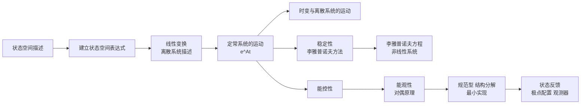

# 现代控制理论

以状态空间方法为主线的现代控制理论笔记，覆盖从建模、运动分析、稳定性，到能控能观性、结构分解，再到状态反馈与观测器设计。每章附带完整解答的例题。

!!! note "记号约定"
    - 连续定常系统 $\dot x=Ax+Bu,\ y=Cx+Du$，状态 $n$ 维、输入 $p$ 维、输出 $q$ 维；单输入单输出时写 $b,\,c,\,d$。
    - 离散定常系统 $x(k+1)=Gx(k)+Hu(k),\ y(k)=Cx(k)+Du(k)$。
    - 传递函数矩阵 $G(s)=C(sI-A)^{-1}B+D$；特征多项式 $\varphi(s)=\lvert sI-A\rvert=s^n+a_{n-1}s^{n-1}+\cdots+a_0$。
    - 线性变换 $x=P\bar x$：$\bar A=P^{-1}AP,\ \bar B=P^{-1}B,\ \bar C=CP,\ \bar D=D$。
    - 状态转移矩阵 $\Phi(t)=\e^{At}$，时变系统 $\Phi(t,t_0)$，离散系统 $\Phi(k)=G^k$。
    - 能控性矩阵 $Q_c=[B\ AB\ \cdots\ A^{n-1}B]$，能观性矩阵 $Q_o=[C;\ CA;\ \cdots;\ CA^{n-1}]$。
    - 李雅普诺夫方程：连续 $A\tp P+PA=-Q$，离散 $G\tp PG-P=-Q$。

## 学习路线

可以分成三部分来看：**建模**（怎样用状态空间描述系统，第 1–3 章）、**分析**（系统的运动、稳定性、能控能观性，第 4–10 章）、**综合**（怎样设计控制器和观测器，第 11 章）。

## 目录

-   :material-book-open-variant:{ .lg .middle } **知识点**

    ---

    11 章，从状态空间描述到状态反馈与观测器，含例题

    [:octicons-arrow-right-24: 进入](notes/index.md)

-   :material-pencil-box-multiple-outline:{ .lg .middle } **习题详解**

    ---

    线性变换、运动分析、离散化等专题习题，附完整推导

    [:octicons-arrow-right-24: 进入](exercises/index.md)

-   :material-flask-outline:{ .lg .middle } **实验**

    ---

    状态空间建模与仿真；一级倒立摆的极点配置

    [:octicons-arrow-right-24: 进入](labs/index.md)

