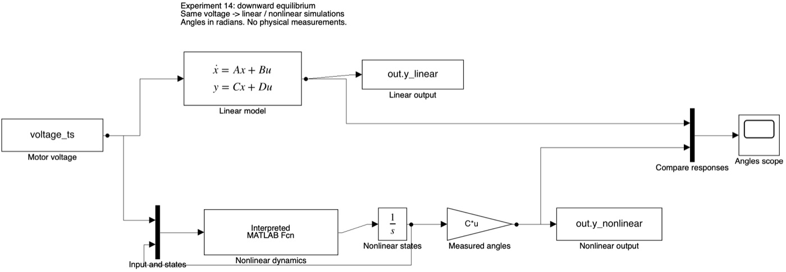
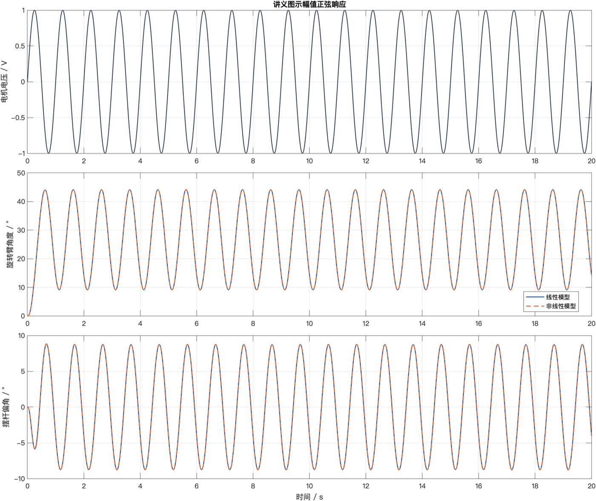
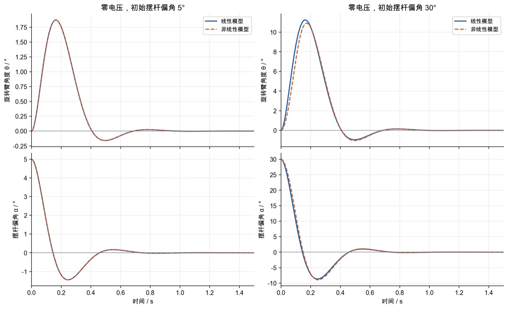
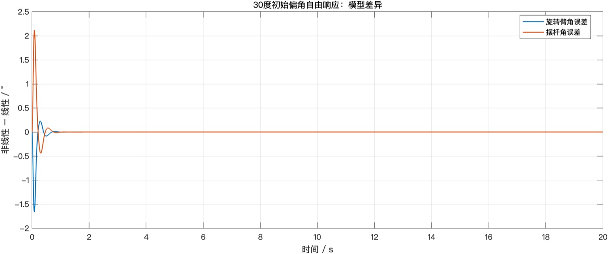
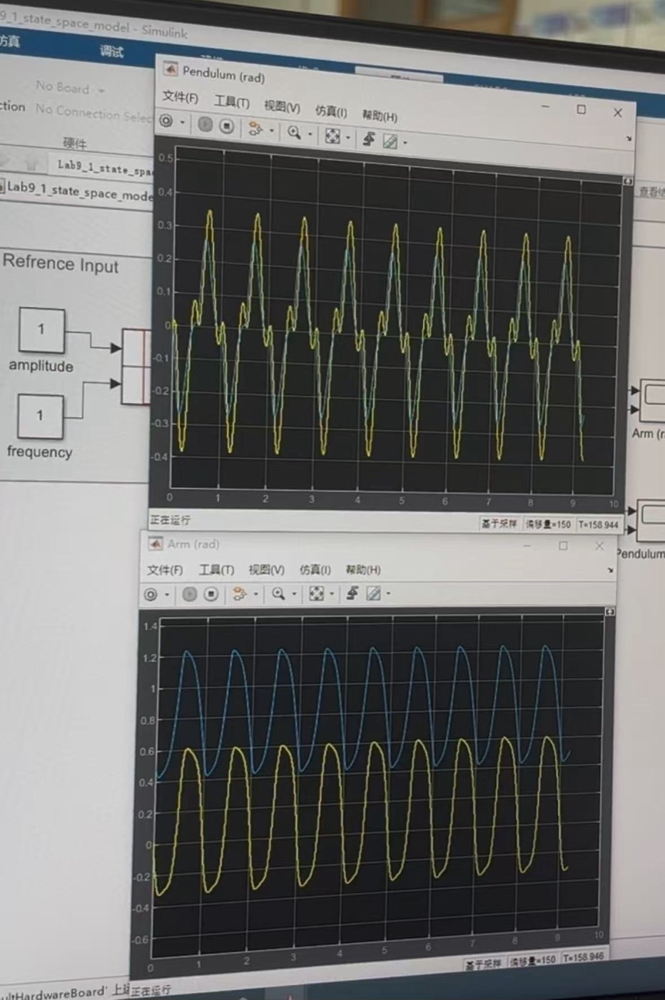
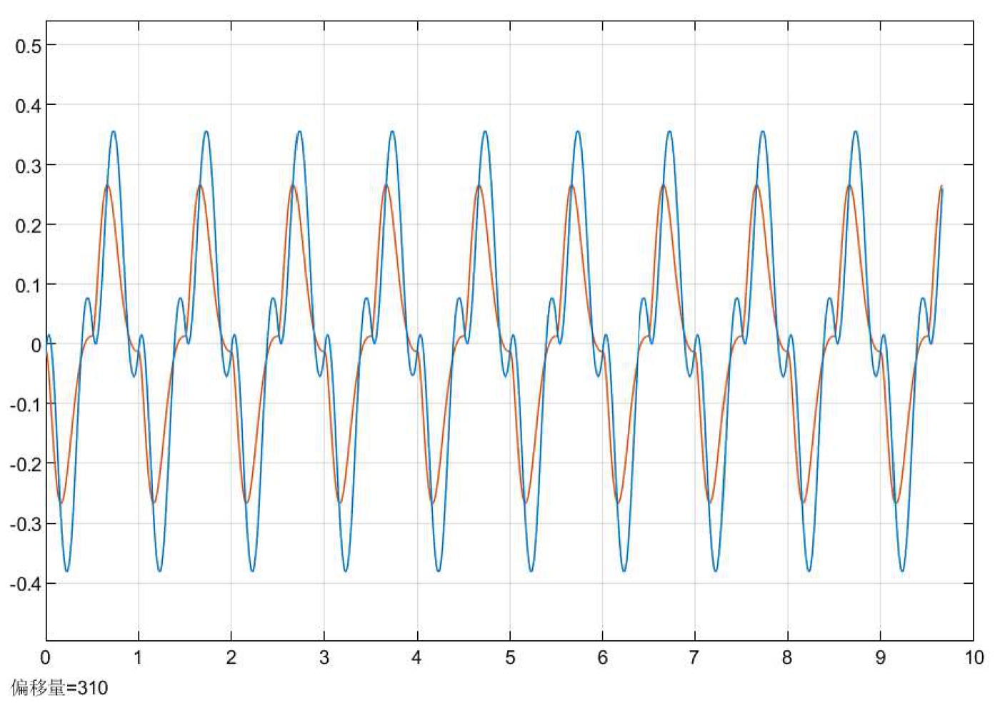
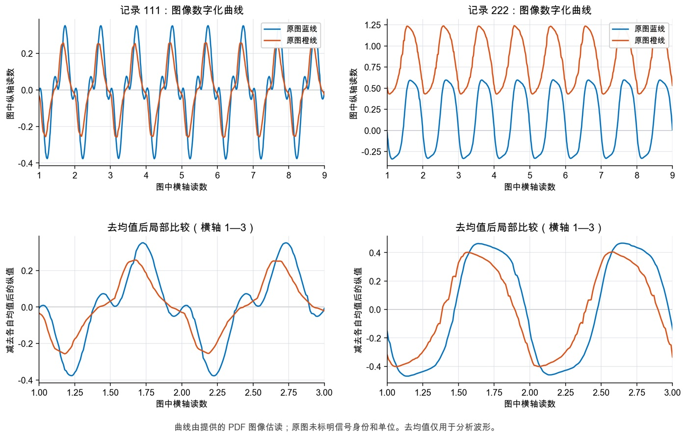

# 实验十四：状态空间建模与仿真

本实验以旋转倒立摆（Furuta 摆）为对象，完成从物理建模到状态空间模型、再到仿真验证的完整流程：

1. 用 Euler–Lagrange 方程建立两自由度非线性动力学；
2. 在自然下垂平衡点附近线性化，得到 $\dot x=Ax+Bu$，$y=Cx+Du$；
3. 在 Simulink 中搭建线性、非线性两条支路，在四组工况下比较响应，考察线性化的适用范围；
4. 与实验台的示波器记录做定性对照。

这里的输入电压是预先给定的时间函数，不涉及反馈控制；控制器设计见[实验十五](lab15.md)和第 11 章[状态反馈与极点配置](../notes/state-feedback.md)。状态空间描述的基本概念见第 1 章[状态空间描述](../notes/state-space.md)。

## 1. 被控对象与参数

装置由电机驱动的水平旋转臂和铰接在臂端的摆杆组成。约定：

- $\theta$：旋转臂转角，俯视逆时针为正；$V_m>0$ 时电机产生正向力矩；
- $\alpha$：摆杆相对竖直向下方向的偏角，自然下垂时 $\alpha=0$；
- 摆杆质心到铰点的距离 $l_p=L_p/2$。

| 参数 | 含义 | 数值 | 单位 |
|---|---|---|---|
| $m_r$ | 旋转臂质量 | $0.095$ | kg |
| $L_r$ | 旋转臂长度 | $0.085$ | m |
| $m_p$ | 摆杆质量 | $0.024$ | kg |
| $L_p$ | 摆杆长度 | $0.129$ | m |
| $J_r$ | 旋转臂转动惯量 | $5.72\times10^{-5}$ | kg·m² |
| $J_p$ | 摆杆绕质心转动惯量 | $3.33\times10^{-5}$ | kg·m² |
| $D_r$ | 旋转臂阻尼系数 | $0.0015$ | N·m·s/rad |
| $D_p$ | 摆杆阻尼系数 | $0.0005$ | N·m·s/rad |
| $R_m$ | 电机电阻 | $8.4$ | Ω |
| $K_e$ | 反电动势常数 | $0.042$ | V/(rad/s) |
| $K_t$ | 转矩常数 | $0.042$ | N·m/A |
| $g$ | 重力加速度 | $9.81$ | m/s² |

状态、输入、输出取为

$$
x=\bmat{\theta&\alpha&\dot\theta&\dot\alpha}\tp,\qquad u=V_m,\qquad y=\bmat{\theta&\alpha}\tp.
$$

两个机械自由度各满足一个二阶方程，需要 4 个独立初始条件，所以状态是 4 维。只用两个角度不够：两个系统同处 $\theta=\alpha=0$，一个静止，一个摆杆有初速度，此后零输入下的运动完全不同，必须加上角速度才能区分。加速度可由状态和输入求出，不需要作为独立状态。$J_r$ 已是旋转臂的转动惯量，$m_r$ 不再重复计入。

## 2. 物理建模

### 2.1 速度与能量

取随旋转臂转动的正交基 $\mathbf e_r$（沿臂向外）、$\mathbf e_t$（水平切向）、$\mathbf e_z$（竖直向上），$\dot{\mathbf e}_r=\dot\theta\,\mathbf e_t$，$\dot{\mathbf e}_t=-\dot\theta\,\mathbf e_r$。摆杆质心位置

$$
\mathbf r_p=L_r\mathbf e_r+l_p\sin\alpha\,\mathbf e_t-l_p\cos\alpha\,\mathbf e_z,
$$

求导（同时考虑 $\alpha$ 变化和基底转动）得

$$
\mathbf v_p=-l_p\sin\alpha\,\dot\theta\,\mathbf e_r+(L_r\dot\theta+l_p\cos\alpha\,\dot\alpha)\mathbf e_t+l_p\sin\alpha\,\dot\alpha\,\mathbf e_z,
$$

$$
\lvert\mathbf v_p\rvert^2=(L_r^2+l_p^2\sin^2\alpha)\dot\theta^2+l_p^2\dot\alpha^2+2L_rl_p\cos\alpha\,\dot\theta\dot\alpha.
$$

交叉项 $2L_rl_p\cos\alpha\,\dot\theta\dot\alpha$ 是两个自由度惯性耦合的来源。引入记号

| 符号 | 定义 | 数值 |
|---|---|---|
| $a$ | $J_r+m_pL_r^2$ | $2.306\times10^{-4}$ |
| $b$ | $m_pL_rl_p$ | $1.3158\times10^{-4}$ |
| $c$ | $J_p+m_pl_p^2$ | $1.33146\times10^{-4}$ |
| $\eta$ | $m_pl_p^2$ | $9.9846\times10^{-5}$ |
| $h$ | $m_pgl_p$ | $0.01518588$ |
| $d$ | $D_r+K_tK_e/R_m$ | $0.00171$ |
| $k_u$ | $K_t/R_m$ | $0.005$ |
| $\Delta$ | $ac-b^2$ | $1.33901712\times10^{-8}$ |

动能为旋转臂转动、摆杆质心平动与摆杆绕质心转动之和；以下垂位置为零势能点：

$$
\begin{aligned}
T&=\tfrac12J_r\dot\theta^2+\tfrac12m_p\lvert\mathbf v_p\rvert^2+\tfrac12J_p\dot\alpha^2
=\tfrac12(a+\eta\sin^2\alpha)\dot\theta^2+\tfrac12c\dot\alpha^2+b\cos\alpha\,\dot\theta\dot\alpha,\\
V&=h(1-\cos\alpha),\qquad L=T-V.
\end{aligned}
$$

### 2.2 电机与广义力

忽略电枢电感，$V_m=R_mi_m+K_e\dot\theta$，电机转矩 $\tau=K_ti_m$。计入阻尼后

$$
Q_\theta=\frac{K_t}{R_m}V_m-\frac{K_tK_e}{R_m}\dot\theta-D_r\dot\theta=k_uV_m-d\dot\theta,\qquad Q_\alpha=-D_p\dot\alpha.
$$

$d$ 中的 $K_tK_e/R_m$ 是反电动势造成的等效阻尼：转速越高，电流和力矩越小。电感忽略后电流由电压和转速代数确定，不需要额外的电流状态。

### 2.3 Euler–Lagrange 方程

对 $q\in\{\theta,\alpha\}$ 应用 $\dfrac{\dd}{\dd t}\dfrac{\partial L}{\partial\dot q}-\dfrac{\partial L}{\partial q}=Q_q$。$L$ 不显含 $\theta$，得

$$
\begin{aligned}
(a+\eta\sin^2\alpha)\ddot\theta+b\cos\alpha\,\ddot\alpha+2\eta\sin\alpha\cos\alpha\,\dot\theta\dot\alpha-b\sin\alpha\,\dot\alpha^2&=k_uV_m-d\dot\theta,\\
b\cos\alpha\,\ddot\theta+c\ddot\alpha-\eta\sin\alpha\cos\alpha\,\dot\theta^2+h\sin\alpha&=-D_p\dot\alpha.
\end{aligned}
$$

（$\alpha$ 方程中 $\dfrac{\dd}{\dd t}\dfrac{\partial L}{\partial\dot\alpha}$ 与 $\dfrac{\partial L}{\partial\alpha}$ 里的两个 $-b\sin\alpha\,\dot\theta\dot\alpha$ 项相互抵消。）

### 2.4 非线性状态方程

两式都含 $\ddot\theta,\ddot\alpha$，写成质量矩阵形式联立求解：

$$
M(\alpha)\bmat{\ddot\theta\\ \ddot\alpha}=\bmat{r_1\\ r_2},\qquad
M(\alpha)=\bmat{a+\eta\sin^2\alpha & b\cos\alpha\\ b\cos\alpha & c},
$$

$$
\begin{aligned}
r_1&=k_uV_m-d\dot\theta-2\eta\sin\alpha\cos\alpha\,\dot\theta\dot\alpha+b\sin\alpha\,\dot\alpha^2,\\
r_2&=-D_p\dot\alpha+\eta\sin\alpha\cos\alpha\,\dot\theta^2-h\sin\alpha.
\end{aligned}
$$

$\det M(\alpha)=\Delta+(\eta c+b^2)\sin^2\alpha>0$，任何姿态下都可逆。非线性状态方程为 $\dot x=f(x,u)=[\dot\theta\ \ \dot\alpha\ \ \ddot\theta\ \ \ddot\alpha]\tp$。

方程满足能量功率关系

$$
\frac{\dd(T+V)}{\dd t}=k_uV_m\dot\theta-d\dot\theta^2-D_p\dot\alpha^2,
$$

即输入功率减去两项阻尼耗散。这是检查耦合项、力矩和阻尼符号的好办法（数值残差约 $10^{-18}$ W）。

### 2.5 平衡点

令 $\dot x=0$：$\dot\theta=\dot\alpha=0$，再由加速度为零得 $V_m=0$、$\sin\alpha=0$。平衡点为

$$
\alpha=k\pi\ (k\in\mathbb Z),\qquad \theta=\theta_0\ \text{（任意常值）},\qquad \dot\theta=\dot\alpha=0.
$$

$k$ 为偶数是下垂（势能极小，重力起恢复作用），$k$ 为奇数是倒立（势能极大）。$\theta$ 不出现在动力学中，所以每个摆杆方向对应一族平衡点。

## 3. 下垂平衡点的线性化

取 $x_e=[\theta_0\ \ 0\ \ 0\ \ 0]\tp$，$V_{m,e}=0$。在平衡点处 $\sin\alpha\approx\alpha$，$\cos\alpha\approx1$，含两个以上小量乘积的项（$\sin^2\alpha\,\ddot\theta$、$\sin\alpha\cos\alpha\,\dot\theta\dot\alpha$、$\sin\alpha\,\dot\alpha^2$ 等）全部舍去：

$$
\bmat{a&b\\b&c}\bmat{\ddot\theta\\ \ddot\alpha}=\bmat{k_uV_m-d\dot\theta\\ -h\alpha-D_p\dot\alpha}.
$$

左乘 $M_0^{-1}=\dfrac1\Delta\smat{c&-b\\-b&a}$：

$$
\begin{aligned}
\ddot\theta&=\frac{bh}{\Delta}\alpha-\frac{cd}{\Delta}\dot\theta+\frac{bD_p}{\Delta}\dot\alpha+\frac{ck_u}{\Delta}V_m,\\
\ddot\alpha&=-\frac{ah}{\Delta}\alpha+\frac{bd}{\Delta}\dot\theta-\frac{aD_p}{\Delta}\dot\alpha-\frac{bk_u}{\Delta}V_m.
\end{aligned}
$$

代入参数：

$$
A=\bmat{0&0&1&0\\0&0&0&1\\0&149.2257&-17.0035&4.9133\\0&-261.5250&16.8035&-8.6108},\qquad
B=\bmat{0\\0\\49.7178\\-49.1331},
$$

$$
C=\bmat{1&0&0&0\\0&1&0&0},\qquad D=\bmat{0\\0}.
$$

各元素的含义：

- 第 3 行是旋转臂角加速度：电压直接驱动旋转臂（$B_3>0$），摆杆运动经惯性耦合反作用于它；
- 第 4 行是摆杆角加速度：$A_{42}<0$ 是下垂时的重力恢复，电压经旋转臂间接带动摆杆（$B_4<0$，臂向正方向加速时摆杆因惯性向反方向偏）；
- $A$ 第 1 列全零：绝对角 $\theta$ 不影响动力学，对应一个零特征值；
- $D=0$：电压不能让角度瞬时跳变。

开环极点

$$
0,\qquad -6.8238\pm j10.7469,\qquad -11.9666.
$$

非零极点全在左半平面，下垂点附近的摆动会衰减；零极点意味着旋转臂停在哪里都可以，不会自动回到 $\theta=0$。作为对照，同一非线性方程在倒立点 $\alpha=\pi$ 线性化，极点为 $0,\ -30.0451,\ +10.5494,\ -6.1186$，出现正实极点，与"倒立点开环不稳定"一致，这正是[实验十五](lab15.md)要用状态反馈解决的问题。

用数值差分求非线性模型的 Jacobian，与解析 $A$ 的最大差为 $5.3\times10^{-10}$。

## 4. 仿真方法

### 4.1 模型实现

MATLAB 中线性模型的计算：

```matlab
function [A,B,C,D] = pendulum_linear_model()
p  = pendulum_parameters();            % 表中参数，SI 单位
q  = p.mp*p.Lp^2/4;                    % eta
h  = p.mp*p.Lr*p.Lp/2;                 % b
kG = p.mp*p.g*p.Lp/2;                  % h (重力项)
d  = p.Dr + p.Kt*p.Ke/p.Rm;
ku = p.Kt/p.Rm;
M0 = [p.Jr+p.mp*p.Lr^2, h; h, p.Jp+q];
A  = [0 0 1 0; 0 0 0 1; M0\[0,0,-d,0; 0,-kG,0,-p.Dp]];
B  = [0; 0; M0\[ku; 0]];
C  = [1 0 0 0; 0 1 0 0];  D = zeros(2,1);
end
```

非线性导数函数每步先构造 $M(\alpha)$，再用左除求加速度：

```matlab
function dx = rotary_pendulum_rhs(z)     % z = [Vm; theta; alpha; theta_dot; alpha_dot]
p = pendulum_parameters();
q = p.mp*p.Lp^2/4;  h = p.mp*p.Lr*p.Lp/2;  kG = p.mp*p.g*p.Lp/2;
d = p.Dr + p.Kt*p.Ke/p.Rm;  ku = p.Kt/p.Rm;
u = z(1); a = z(3); w = z(4); v = z(5); s = sin(a); c = cos(a);
M = [p.Jr+p.mp*p.Lr^2+q*s^2, h*c; h*c, p.Jp+q];
r = [ku*u - d*w - 2*q*s*c*w*v + h*s*v^2;
     -p.Dp*v + q*s*c*w^2 - kG*s];
dx = [w; v; M\r];
end
```

Simulink 模型分两条支路，接收同一个电压时间序列：线性支路用 State-Space 模块，非线性支路把 $[V_m;\ x]$ 送入上面的函数、经积分器得到状态，再乘 $C$ 取出两角。这里把状态回接到导数函数只是为了计算 $f(x,u)$，不是状态反馈控制器。

<figure markdown>
  { loading=lazy }
  <figcaption>Simulink 模型：同一电压序列同时驱动线性模型（上）和非线性模型（下），两路输出送入同一示波器比较。</figcaption>
</figure>

### 4.2 Python 等价实现

不用 Simulink 时，用 `scipy.integrate.solve_ivp` 也能得到同样的结果（与 MATLAB 结果一致到 $10^{-7}$ rad 量级）：

```python
import numpy as np
from scipy.integrate import solve_ivp

P = dict(Lr=.085, mp=.024, Lp=.129, Jr=5.72e-5, Jp=3.33e-5,
         Dr=1.5e-3, Dp=5e-4, Rm=8.4, Ke=.042, Kt=.042, g=9.81)
q  = P["mp"]*P["Lp"]**2/4
h  = P["mp"]*P["Lr"]*P["Lp"]/2
kg = P["mp"]*P["g"]*P["Lp"]/2
d  = P["Dr"] + P["Kt"]*P["Ke"]/P["Rm"]
ku = P["Kt"]/P["Rm"]
M0 = np.array([[P["Jr"]+P["mp"]*P["Lr"]**2, h], [h, P["Jp"]+q]])

A = np.zeros((4, 4)); A[0, 2] = A[1, 3] = 1
A[2:, :] = np.linalg.solve(M0, [[0, 0, -d, 0], [0, -kg, 0, -P["Dp"]]])
B = np.r_[0, 0, np.linalg.solve(M0, [ku, 0])]

def f(x, u):                                   # 非线性模型
    a, w, v = x[1:]; s, c = np.sin(a), np.cos(a)
    M = np.array([[M0[0, 0] + q*s*s, h*c], [h*c, M0[1, 1]]])
    r = [ku*u - d*w - 2*q*s*c*w*v + h*s*v*v, -P["Dp"]*v + q*s*c*w*w - kg*s]
    return np.r_[w, v, np.linalg.solve(M, r)]

V  = lambda t: 1.0*np.sin(2*np.pi*1.0*t)      # 1 V、1 Hz 正弦电压
t  = np.arange(0, 20.001, 0.002)
x0 = np.zeros(4)
opt = dict(t_eval=t, rtol=1e-8, atol=1e-10, max_step=0.005)
lin = solve_ivp(lambda tt, x: A@x + B*V(tt), (0, 20), x0, **opt)
non = solve_ivp(lambda tt, x: f(x, V(tt)),   (0, 20), x0, **opt)
err_deg = np.rad2deg(non.y[:2] - lin.y[:2])    # 非线性减线性
```

### 4.3 仿真设置与工况

求解器 ode45（Python 中为 RK45），相对容差 $10^{-8}$，绝对容差 $10^{-10}$，最大步长 $0.005$ s，输入与记录间隔 $0.002$ s，每组 20 s。四组工况：

| 工况 | 输入 $V_m$ | 初态 $x_0$ | 目的 |
|---|---|---|---|
| 小电压正弦 | $0.2\sin 2\pi t$ V | $0$ | 小扰动下的一致性 |
| 1 V 正弦 | $\sin 2\pi t$ V | $0$ | 输入增大后的误差 |
| 5° 自由响应 | $0$ | $\alpha_0=5^\circ$ | 小偏角恢复与衰减 |
| 30° 自由响应 | $0$ | $\alpha_0=30^\circ$ | 较大偏角下的非线性影响 |

误差定义为非线性输出减线性输出（单位：度），峰值取全过程 $\max\lvert y\rvert$，RMSE 在 0～20 s 的共同网格上计算。

## 5. 结果与分析

| 工况 | 线性峰值 $[\theta,\alpha]$/° | 非线性峰值 $[\theta,\alpha]$/° | 最大差 $[\theta,\alpha]$/° | RMSE $[\theta,\alpha]$/° |
|---|---|---|---|---|
| 0.2 V 正弦 | $[8.840,\ 1.764]$ | $[8.840,\ 1.764]$ | $[0.0006,\ 0.0014]$ | $[0.0003,\ 0.0006]$ |
| 1 V 正弦 | $[44.20,\ 8.818]$ | $[44.16,\ 8.839]$ | $[0.075,\ 0.180]$ | $[0.033,\ 0.074]$ |
| 5° 自由 | $[1.872,\ 5]$ | $[1.871,\ 5]$ | $[0.0087,\ 0.011]$ | $[0.0005,\ 0.0007]$ |
| 30° 自由 | $[11.23,\ 30]$ | $[10.90,\ 30]$ | $[1.663,\ 2.116]$ | $[0.103,\ 0.138]$ |

### 5.1 正弦输入

<figure markdown>
  { loading=lazy }
  <figcaption>1 V、1 Hz 正弦电压下的响应：上为输入电压，中、下分别为旋转臂角和摆杆偏角，线性与非线性模型曲线几乎重合。</figcaption>
</figure>

0.2 V 时两模型最大差只有千分之一度量级，线性模型几乎精确。电压增大到 1 V，响应幅值放大约 5 倍，摆角最大差增大到 $0.18^\circ$，增长比幅值更快，体现了被舍去的高阶项随幅值上升。

图中 $\theta$ 围绕一个非零均值振荡（1 V 时 15～20 s 窗口内均值约 $26.7^\circ$，基波幅值约 $17.5^\circ$；摆角基波幅值约 $8.75^\circ$）。这个均值不代表输入有直流分量，而是零极点的体现：启动瞬态让旋转臂整体转过一个角度，由于 $\theta$ 没有恢复力，它就停留在新的位置附近振荡。也因为方程不含 $\theta$，旋转臂约 $44^\circ$ 的绝对峰值本身不说明线性化失效，误差主要取决于摆角 $\alpha$ 和速度乘积项。

### 5.2 自由响应

<figure markdown>
  { loading=lazy }
  <figcaption>零电压、初始摆角 5°（左）和 30°（右）时前 1.5 s 的响应。5° 时两模型重合；30° 时旋转臂峰值相差约 0.33°，峰值时刻由 0.164 s 推迟到 0.172 s。</figcaption>
</figure>

<figure markdown>
  { loading=lazy }
  <figcaption>30° 自由响应中非线性减线性的角度差。误差集中在前约 0.5 s 的瞬态，最大 2.1°，之后随运动衰减而消失。</figcaption>
</figure>

摆杆从初始偏角、零初速度释放，在重力和阻尼作用下约 1 s 内衰减到零，同时通过耦合带动旋转臂摆动后回到原位。5° 时最大摆角差 $0.011^\circ$；30° 时增大到 $2.12^\circ$，约为初值的 7%。$\sin 30^\circ=0.5$，而 $30^\circ=0.524$ rad，$\sin\alpha\approx\alpha$ 本身就有约 5% 的偏差，再加上 $\cos\alpha\approx1$ 和速度乘积项的舍入，误差主要出现在瞬态。

用"进入并保持在 $\pm2\%$ 初值带内"衡量，两种偏角下线性、非线性模型的时间都在 0.64 s 左右（30° 时非线性为 0.646 s）。收敛时间接近并不说明瞬态一致，需要同时看误差曲线。

### 5.3 适用范围

四组结果说明，下垂点线性模型在小电压、小偏角下与非线性模型几乎一致；偏角达到 30° 量级时瞬态误差明显，但仍能描述主要动态。这里没有得到一个对所有输入频率、幅值和精度要求都适用的"角度界限"：是否够用取决于允许误差。另外，线性和非线性模型用的是同一组参数和同样的简化（忽略电感、库仑摩擦、饱和等），两者接近只说明线性化本身的误差小，不能说明模型与真实装置一致。

## 6. 与实验台记录的对照

实验台上运行课程配套的 Simulink 模型，参考输入为幅值 1、频率 1 Hz 的正弦，Pendulum 和 Arm 两个示波器窗口各显示两条曲线。

<figure markdown>
  { width="480" loading=lazy }
  <figcaption>实验台运行时的示波器画面：上为 Pendulum（摆角，rad），下为 Arm（旋转臂角，rad），参考输入幅值 1、频率 1。</figcaption>
</figure>

另有两份导出的示波器曲线（下图为其中一份，形状与 Pendulum 窗口一致）。曲线图本身没有图例、坐标名称和单位，两条线分别对应实测还是模型无法从图上确定，所以只做定性比较。

<figure markdown>
  { loading=lazy }
  <figcaption>实验台导出的一份示波器曲线（横轴为显示窗口内的相对时间，左下角"偏移量"是时间窗口偏移，不是纵向零点）。</figcaption>
</figure>

把两份曲线数字化（在显示横轴 1～9 区间按网格标定读数）后：

| 记录 | 曲线 | 均值 | 基波幅值 | 周期 |
|---|---|---|---|---|
| 一 | 蓝 | 约 0 | 0.256 | 约 1.00 |
| 一 | 橙 | 约 0 | 0.206 | 约 1.00 |
| 二 | 蓝 | 0.131 | 0.51 | 约 1.00 |
| 二 | 橙 | 0.833 | 0.408 | 约 1.01 |

<figure markdown>
  { loading=lazy }
  <figcaption>两份记录的数字化曲线及去均值后的波形比较。记录二两条曲线均值相差约 0.7，去均值后差值 RMS 由 0.725 降到 0.179。</figcaption>
</figure>

可以得到的结论：

- 两份记录的周期都约为 1，与 1 Hz 输入一致，响应是受迫的周期运动；
- 记录一（形状与 Pendulum 窗口一致，应为摆角）两条线均值都接近零，差别在幅值和局部形状：一条线的峰值更尖、谷底附近有明显的小起伏，含有较强的高次谐波；
- 记录二（形状与 Arm 窗口一致，应为旋转臂角）两条线均值相差约 0.7，去均值后仍有约 0.18 的差别。均值差与第 5.1 节的分析一致：$\theta$ 没有恢复力，起始瞬态和零位不同会让曲线整体平移，不能把它全部归为模型误差；
- 示波器上的幅值（摆角约 0.2～0.35 rad、旋转臂约 0.4～0.5）比本实验离线仿真 1 V 工况的基波幅值（摆角约 0.15 rad、旋转臂约 0.31 rad）大。可能的原因包括：实验台模型的参数或阻尼取值与这里所用的不同、实际电压与名义值不同、摩擦等未建模因素。要定量判断，需要明确每条曲线的身份、单位、零点和原始采样数据。

定量比较实物与模型时，应把同一个最终电压信号同时送入实物和模型，统一时间起点、单位和零点，再比较周期、幅值、相位、均值和误差 RMS；出现差异时依次检查零点与单位、初态、实际输入、采样与延迟、参数、线性化范围和未建模效应。

## 7. 思考题

### 7.1 状态改排为 $[\theta\ \ \dot\theta\ \ \alpha\ \ \dot\alpha]\tp$

令 $z=Px$，$P$ 为交换第 2、3 个分量的置换矩阵，$P^{-1}=P\tp$。代入原方程：

$$
\dot z=PAP\tp z+PBu,\qquad y=CP\tp z+Du,
$$

$$
A'=\bmat{0&1&0&0\\0&-17.0035&149.2257&4.9133\\0&0&0&1\\0&16.8035&-261.5250&-8.6108},\quad
B'=\bmat{0\\49.7178\\0\\-49.1331},\quad
C'=\bmat{1&0&0&0\\0&0&1&0}.
$$

$A'$ 与 $A$ 相似，特征值相同；初态也要同步变换 $z_0=Px_0$，输出才完全一致（实测两者差为 0）。这是第 3 章[线性变换](../notes/linear-transform.md)中"状态空间描述不唯一"的一个简单例子。

### 7.2 为什么 $\theta_0$ 可以任意取

$L$ 与广义力都不显含 $\theta$：把整个装置绕竖直轴转一个常角度，相对几何、势能和力矩都不变。任意 $\theta_0$ 都是平衡点，令 $\delta x=x-x_e$，因 $Ax_e=0$ 有 $\delta\dot x=A\delta x+BV_m$，$A,B,C,D$ 都不随 $\theta_0$ 改变；绝对角输出只多一个常数偏置 $[\theta_0\ \ 0]\tp$。这与 $A$ 第一列全零、存在零极点是同一件事。

### 7.3 增加两个角速度输出

输出选择不影响动力学，$A,B$ 不变。若 $y=[\theta\ \ \alpha\ \ \dot\theta\ \ \dot\alpha]\tp$，则 $C_{\text{new}}=I_4$，$D_{\text{new}}=0_{4\times1}$。仿真中速度可直接从积分器取得；实物上若由角度差分得到速度，要注意差分会放大量化噪声，需要配合低通滤波，[实验十五](lab15.md)用的就是 $\dfrac{50s}{s+50}$ 滤波微分。

## 8. 结论

- 由质心速度求能量，经 Euler–Lagrange 方程和电机广义力得到非线性模型；在下垂点舍去高阶项并联立质量矩阵，得到 4 维线性状态空间模型。Jacobian、能量功率关系和两套独立积分器的交叉检查都通过。
- 小电压和 5° 释放时线性模型与非线性模型几乎一致；30° 释放时摆角最大差约 $2.1^\circ$，误差集中在瞬态。线性模型是否够用要结合输入幅值、初态和允许误差判断。
- 下垂点有重力恢复，倒立点开环不稳定；旋转臂绝对角没有恢复力，模型有零极点和一族平衡点。
- 状态改排要同步变换 $A,B,C$ 和初态；增加输出只改变 $C,D$。
- 实验台记录显示周期与输入一致，但幅值与均值和离线仿真存在差别，定量结论需要有明确身份和单位的原始数据。
