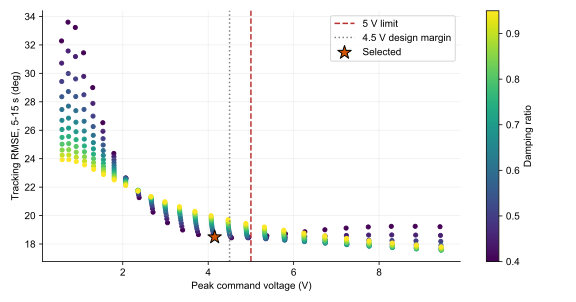
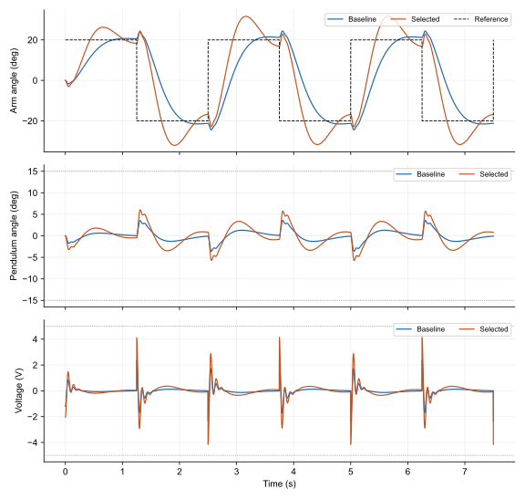
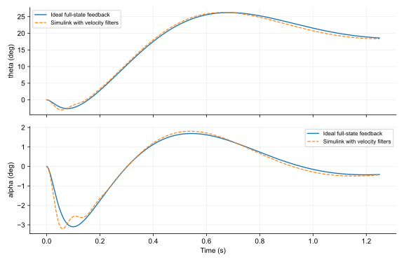

# 实验十五：极点配置与状态反馈（一级倒立摆）

[实验十四](lab14.md)建立了旋转倒立摆的模型，并指出倒立平衡点开环不稳定。本实验用状态反馈 $u=-Kx+v$ 把摆杆稳定在倒立位置，同时让旋转臂跟随方波参考。理论依据是第 11 章[状态反馈与极点配置](../notes/state-feedback.md)：系统完全能控时，闭环极点可以任意配置。

实验内容：

1. 检查倒立点线性模型的开环极点和能控性；
2. 化为能控规范型，按"期望系数减开环系数"求增益，再变换回原坐标，并用 `place` 核对；
3. 扫描主导极点的 $(\zeta,\omega_n)$，在摆角与电压约束下选择方案；
4. 在含速度滤波和电压限幅的 Simulink 模型中仿真，分析结果。

## 1. 倒立点模型

状态、输入、输出：

$$
x=\bmat{\theta&\alpha&\dot\theta&\dot\alpha}\tp,\qquad u=V_m,\qquad y=\bmat{\theta&\alpha}\tp,
$$

$\theta$ 为旋转臂角，$\alpha$ 为摆杆相对竖直向上位置的偏角（与实验十四的下垂角相差 $\pi$）。计算一律用 rad、rad/s、V，绘图时角度换成度。课程给定的线性化模型为

$$
A=\bmat{0&0&1&0\\0&0&0&1\\0&149.23&-0.0104&0\\0&261.53&-0.0103&0},\qquad
B=\bmat{0\\0\\49.72\\49.13},\qquad
C=\bmat{1&0&0&0\\0&1&0&0},\qquad D=0.
$$

与实验十四的关系：把实验十四的非线性方程在 $\alpha=\pi$ 处线性化（令 $\alpha=\pi+\tilde\alpha$，$\cos\alpha\approx-1$，$\sin\alpha\approx-\tilde\alpha$），得到的重力项和输入项为 $A_{32}=149.226$、$A_{42}=261.525$、$B_3=49.718$、$B_4=49.133$，与上面的矩阵一致；与下垂点相比，$A_{42}$ 由负变正（重力从恢复变为推倒），$B_4$ 也变号。速度项则不同：按实验十四的参数（含反电动势阻尼）倒立点模型的 $A_{33}\approx-17.0$，而课程给定的是 $-0.0104$。本实验按课程给定的矩阵设计；阻尼取值不同会影响实物上的表现，这是仿真结论不能直接搬到实物的原因之一。

不能直接用实验十四的下垂点模型来设计：平衡点不同，$A$ 的符号结构不同。

## 2. 开环特性与能控性

开环特征多项式

$$
\varphi(s)=\det(sI-A)=s^4+0.0104s^3-261.53s^2-1.182843s,
$$

开环极点

$$
0,\qquad -0.00452,\qquad -16.1748,\qquad +16.1690.
$$

正实极点 $+16.17$ 对应摆杆倒下，时间常数约 $0.06$ s，说明必须用较快的反馈才能稳住。零极点来自旋转臂角没有恢复力（与实验十四相同）。

能控性矩阵

$$
Q_c=\bmat{B&AB&A^2B&A^3B}=\bmat{0&49.72&-0.517&7331.68\\0&49.13&-0.512&12848.97\\49.72&-0.517&7331.68&-152.67\\49.13&-0.512&12848.97&-209.45},
$$

$\rank Q_c=4$，完全能控，四个极点都可以任意配置。注意能控只是数学上"能配置"，并不保证所需电压在 $\pm5$ V 以内。

从 $u$ 到 $\theta$ 的传递函数分子为 $49.72s^2-5671.60$，有右半平面零点 $s\approx+10.68$：旋转臂通道是非最小相位的，参考正向跳变时旋转臂会先反向运动（仿真曲线中可以看到），也限制了跟踪方波的速度。

## 3. 由能控规范型求 $K$

开环系数 $[a_0,a_1,a_2,a_3]=[0,\,-1.182843,\,-261.53,\,0.0104]$，能控规范型

$$
A_c=\bmat{0&1&0&0\\0&0&1&0\\0&0&0&1\\0&1.182843&261.53&-0.0104},\qquad B_c=\bmat{0\\0\\0\\1}.
$$

令 $x=Wz$，$W=Q_c\,Q_{c,c}^{-1}$（$Q_{c,c}$ 为规范型的能控性矩阵），则 $A_c=W^{-1}AW$，$B_c=W^{-1}B$。这里的 $W$ 就是第 10 章中的 $P=Q_cT$，数值为

$$
W=\bmat{-5671.60&0&49.72&0\\0&-0.0012&49.13&0\\0&-5671.60&0&49.72\\0&0&-0.0012&49.13}.
$$

规范型坐标下 $K_c=[\alpha_0-a_0\ \ \alpha_1-a_1\ \ \alpha_2-a_2\ \ \alpha_3-a_3]$，变回原坐标 $K=K_cW^{-1}$。

!!! warning "易错点"

    变换约定决定公式：$x=Wz$ 时 $K=K_cW^{-1}$；若写成 $z=Wx$ 则 $K=K_cW$。规范型坐标下的 $K_c$ 不能直接接到原系统上。验证方法：检查 $AW=WA_c$、$B=WB_c$，以及 $A-BK$ 的特征值。

### 初始方案

主导极点取 $\zeta=0.7$、$\omega_n=4$ rad/s，另两个极点固定为 $-30,-40$：

$$
p_{1,2}=-2.8\pm j2.8566,\qquad p_3=-30,\qquad p_4=-40,
$$

$$
\varphi^*(s)=(s^2+5.6s+16)(s+30)(s+40)=s^4+75.6s^3+1608s^2+7840s+19200.
$$

$$
K_c=\bmat{19200 & 7841.182843 & 1869.53 & 75.5896},
$$

$$
\boxed{K_0=\bmat{-3.3853 & 41.4787 & -1.3825 & 2.9377}}.
$$

$A-BK_0$ 的特征值恰为 $-2.8\pm j2.8566,\ -30,\ -40$。`place` 给出的增益与之相差 $4.6\times10^{-14}$（无穷范数）。按 Ackermann 公式 $K=e_4\tp Q_c^{-1}\varphi^*(A)$ 计算，结果与上式一致到小数点后 7 位。

增益的物理解读：$k_2\approx41.5$ 最大，摆角每偏 $1^\circ$（0.0175 rad）就产生约 0.72 V 的纠正电压；$K_c$ 中 $\alpha_2-a_2=1608+261.53$ 的 $261.53$ 正是要抵消的"重力负刚度"。$k_1<0$ 意味着旋转臂角大于参考时，控制器反而先给正电压，把旋转臂往外推，使摆杆向目标方向倾倒，再靠维持平衡的动作把旋转臂带向目标。这种"先反向"的动作与非最小相位零点一致。

MATLAB 实现（`Balance_Control_Design.m` 的核心部分）：

```matlab
A = [0 0 1 0; 0 0 0 1; 0 149.23 -.0104 0; 0 261.53 -.0103 0];
B = [0; 0; 49.72; 49.13];
T  = ctrb(A,B);            a = real(poly(A));          % 开环系数 [1 a3 a2 a1 a0]
Ac = [zeros(3,1) eye(3); -fliplr(a(2:end))];  Bc = [0;0;0;1];
W  = T/ctrb(Ac,Bc);                                     % x = W z
P  = [-zeta*wn+1i*wn*sqrt(1-zeta^2), -zeta*wn-1i*wn*sqrt(1-zeta^2), -30, -40];
ad = real(poly(P));
Kc = fliplr(ad(2:end) - a(2:end));                      % 期望系数减开环系数
K  = Kc/W;                                              % 变回原坐标
assert(norm(K - place(A,B,P), inf) < 1e-7)
```

右除 `T/Tc`、`Kc/W` 避免显式求逆。Python 中可用 Ackermann 公式独立核对：

```python
import numpy as np
A = np.array([[0,0,1,0],[0,0,0,1],[0,149.23,-.0104,0],[0,261.53,-.0103,0]])
B = np.array([[0],[0],[49.72],[49.13]])
z, wn = 0.7, 4.0
p = [complex(-z*wn,  wn*np.sqrt(1-z*z)), complex(-z*wn, -wn*np.sqrt(1-z*z)), -30, -40]
alpha = np.real(np.poly(p))                                   # [1, α3, α2, α1, α0]
Qc  = np.hstack([np.linalg.matrix_power(A, i) @ B for i in range(4)])
phi = sum(alpha[4-i]*np.linalg.matrix_power(A, i) for i in range(5))
K = np.array([[0, 0, 0, 1]]) @ np.linalg.solve(Qc, phi)
print(K, np.linalg.eigvals(A - B @ K))
```

## 4. 参考输入与约束

旋转臂要跟随参考角 $r$，取参考状态 $x_d=[r\ \ 0\ \ 0\ \ 0]\tp$（$A$ 第一列为零，$x_d$ 对任意 $r$ 都是平衡点），控制律

$$
u=-K(x-x_d)=-Kx+k_1r,\qquad \dot x=(A-BK)x+Bk_1r.
$$

这相当于第 11 章中前馈增益 $N=k_1$ 的情形，与 $u=-Kx+v$ 的记号一致（$v=k_1r$）。

参考 $r$ 为幅值 $20^\circ$、频率 0.4 Hz、占空比 50% 的方波，$t=0$ 从 $+20^\circ$ 开始，每 1.25 s 翻转一次；初态 $x(0)=0$。要求全过程

$$
\lvert\alpha(t)\rvert<15^\circ,\qquad \lvert u(t)\rvert<5\ \mathrm V.
$$

## 5. 期望极点的选择：参数扫描

固定 $p_3=-30$、$p_4=-40$，扫描 $\zeta=0.40:0.05:0.95$、$\omega_n=2.00:0.25:8.00$ rad/s，共 300 组。每组用 `place` 求 $K$，以相同方波和零初态仿真 15 s（`lsim` 用零阶保持，保持方波的跳变沿）。评价指标：

- 全过程摆角峰值 $\max\lvert\alpha\rvert$ 与控制电压峰值 $\max\lvert u\rvert$；
- $5\le t<15$ s 四个完整周期内的跟踪均方根误差 $E_{\mathrm{RMS}}=\sqrt{\frac1N\sum[\theta(t_k)-r(t_k)]^2}$。它包含每次翻转后的瞬态误差，不是常值参考下的稳态误差。

为给模型误差留余量，额外要求理想状态反馈模型和含速度滤波的模型电压峰值都不超过 4.5 V。满足条件的有 176 组，从中取 $E_{\mathrm{RMS}}$ 最小者：

$$
\boxed{\zeta=0.40,\quad\omega_n=5.25\ \mathrm{rad/s},\quad p_{1,2}=-2.1\pm j4.8117,\quad p_3=-30,\quad p_4=-40}
$$

$$
\boxed{K_*=\bmat{-5.8317 & 42.1951 & -1.2290 & 2.7539}}.
$$

<figure markdown>
  { .diagram }
  <figcaption>300 组 $(\zeta,\omega_n)$ 的电压峰值与跟踪 RMSE，颜色表示阻尼比。红色虚线为 5 V 限制，灰色点线为 4.5 V 设计余量，星号为所选方案。</figcaption>
</figure>

由图可见，$\omega_n$ 增大，跟踪误差下降，电压峰值上升；电压超过约 5 V 以后，误差几乎不再下降。三个代表方案（理想状态反馈）：

| 方案 | $\zeta$ | $\omega_n$ | $\max\lvert\alpha\rvert$/° | $\max\lvert u\rvert$/V | $E_{\mathrm{RMS}}$/° |
|---|---|---|---|---|---|
| 初始方案 | 0.70 | 4.00 | 3.478 | 2.357 | 21.754 |
| 所选方案 | 0.40 | 5.25 | 5.876 | 4.152 | 18.474 |
| 快速对照 | 0.70 | 7.00 | 8.385 | 7.243 | 17.953 |

快速对照方案（$K=[-10.37\ \ 55.20\ \ {-2.68}\ \ 4.33]$）跟踪误差最小，但电压峰值超过 5 V，不合格。"闭环稳定、误差小"不等于满足约束。

电压峰值几乎全部来自方波翻转瞬间：状态连续，而 $r$ 跳变 $\Delta r=-40^\circ$，控制量瞬间跳变 $\Delta u=k_1\Delta r$。按三个方案的 $k_1$ 计算，跳变分别为 $2.36$、$4.07$、$7.24$ V，与表中的电压峰值几乎相等。所以电压峰值主要由 $k_1$ 决定，而 $k_1$ 随 $\omega_n$ 增大而增大。

## 6. Simulink 仿真

Simulink 模型包括：方波参考、角度转弧度、参考状态构造、状态误差、反馈增益、电压限幅、状态空间对象和反馈状态重构。对象只输出两个角度，两个角速度用滤波微分 $\dfrac{50s}{s+50}$ 从角度得到，反馈向量为 $\hat x=[\theta,\ \alpha,\ \hat{\dot\theta},\ \hat{\dot\alpha}]\tp$。模型同时记录限幅前的指令电压和限幅后的电压，约束检查用限幅前的指令值（用限幅块把超标指令裁到 5 V 不算满足约束）。求解器 ode45，最大步长 0.001 s，相对容差 $10^{-8}$，绝对容差 $10^{-10}$。

<figure markdown>
  { .diagram }
  <figcaption>含速度滤波的 Simulink 仿真，前三个周期。上：旋转臂角与方波参考；中：摆杆偏角（虚线为 ±15° 约束）；下：控制电压（虚线为 ±5 V）。蓝色为初始方案，橙色为所选方案。</figcaption>
</figure>

含滤波和限幅的模型中：

| 方案 | $\max\lvert\alpha\rvert$/° | 指令电压峰值/V |
|---|---|---|
| 初始方案 | 3.596 | 2.360 |
| 所选方案 | 6.047 | 4.154 |

两方案限幅都未触发，所选方案满足两个约束。

从响应曲线可以读出：

- 摆杆偏角峰值约 $6^\circ$，远小于 $15^\circ$ 约束，倒立平衡被稳住；每次参考翻转时摆角出现尖峰，这是电压突变经机械耦合扰动摆杆的结果；
- 旋转臂跟随方波但有明显滞后。翻转后旋转臂先向反方向小幅运动，再转向目标，这是右半平面零点的典型表现；
- 所选方案阻尼比只有 0.4，旋转臂超调到约 $30^\circ$ 并有周期振荡，比初始方案明显。它只优化了定义的 RMSE，不是所有动态指标都更好。

<figure markdown>
  { .diagram }
  <figcaption>所选方案第一次参考跳变后的局部响应：实线为理想全状态反馈，虚线为含速度滤波的 Simulink 模型。滤波改变了摆角的早期瞬态。</figcaption>
</figure>

### 速度滤波对闭环极点的影响

记两角的一阶低通状态为 $q_f$，则 $\dot q_f=50Cx-50q_f$，速度估计 $\hat v=50(Cx-q_f)$。把它代入控制律，得到六维闭环（未限幅时）

$$
\frac{\dd}{\dd t}\bmat{x\\q_f}=\left(\bmat{A&0\\50C&-50I_2}-\bmat{B\\0}H\right)\bmat{x\\q_f}+\bmat{B\\0}k_1r,\qquad
H=\bmat{K_{1:2}C+50K_{3:4}C & -50K_{3:4}}.
$$

Simulink 结果与该增广模型的角度最大差为 $2.4\times10^{-5}$ rad，说明模型接线正确。对所选方案，这个六维系统的极点为

$$
-2.12\pm j5.14,\qquad -11.59,\qquad -17.09\pm j65.71,\qquad -50,
$$

与设计值 $-2.1\pm j4.81,\ -30,\ -40$ 相比，主导极点变化不大，但两个快极点被"拉"成了一对高频振荡极点。滤波微分不利用模型，不满足分离原理，所以理想状态反馈的曲线不能直接当作含滤波系统的结果。

若改用[降维观测器](../notes/state-feedback.md#8-降维观测器)估计两个角速度（$A_{12}=I_2$，取 $L=A_{22}+50I$ 使观测器极点为 $-50,-50$），由分离原理，闭环极点精确为设计的四个极点加上 $-50,-50$。这是在实验条件允许时可以改进的方向。

## 7. 思考题

### 7.1 极点左移的影响

主导极点为 $-\zeta\omega_n\pm j\omega_n\sqrt{1-\zeta^2}$。$\zeta$ 固定时增大 $\omega_n$，主导模态衰减加快，跟踪误差减小，但期望多项式系数增大，增益和电压随之增大（第 5 节中快速对照方案已超限）。只增大 $\zeta$ 通常减弱振荡，但对四阶系统跟踪误差的影响还取决于零点和其他极点，不能直接套用二阶系统的结论。

把 $p_3,p_4$ 继续左移，能加快非主导模态的衰减，与主导模态分得更开；代价同样是更高的增益，放大测量噪声，并使高频模态更靠近滤波器带宽和未建模动态。极点不是越靠左越好。

### 7.2 左半平面极点能否保证任意初态都能恢复

不能。对理想线性模型，$A-BK$ 为 Hurwitz 矩阵保证任意初态在零参考下渐近收敛。但这个模型只在倒立点附近成立：大摆角时重力项和耦合项的非线性不可忽略；电压饱和后闭环也不再是 $A-BK$ 描述的线性系统。再加上速度估计误差、采样延迟、摩擦和参数偏差，稳定域是有限的。这个平衡控制器也不能把摆杆从下垂位置甩起来；实验时要先手动把摆杆扶到倒立附近，再切入平衡控制。

### 7.3 参考翻转时为什么出现尖峰

参考由 $+20^\circ$ 跳到 $-20^\circ$ 时状态连续，状态误差 $x-x_d$ 却瞬间改变，控制指令跳变 $\Delta u=k_1\Delta r$。所选方案 $k_1=-5.8317$，$\Delta r=-2\pi/9$ rad，跳变约 $4.07$ V。旋转臂加速度突变，经耦合扰动摆杆，形成摆角尖峰和角度曲线的急转。有限电压下角度和角速度都不会跳变，真正不连续的只有参考和控制指令。加上旋转臂通道的右半平面零点，方波沿不可能被任意快地跟随。

## 8. 结论

- 倒立点模型有正实极点 $+16.17$，开环不稳定；$\rank Q_c=4$，完全能控，可以任意配置极点。
- 能控规范型系数比较、`place` 和 Ackermann 公式三种方法得到相同的 $K$，闭环极点检验通过。
- 300 组参数扫描显示了响应速度与电压峰值的折中。在摆角、电压约束和 0.5 V 余量下选取 $\zeta=0.40$、$\omega_n=5.25$，$K_*=[-5.8317\ \ 42.1951\ \ {-1.2290}\ \ 2.7539]$；理想模型和含滤波、限幅的 Simulink 模型都满足约束。
- 电压峰值主要由参考跳变引起，约为 $k_1\Delta r$；速度滤波改变了闭环极点，用降维观测器可以保住设计极点。
- 以上结论基于给定的线性模型和这一组参考、初态，还没有实物平台的测量数据，实物效果需要另行验证。
