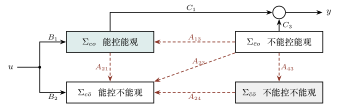

# 规范型、结构分解与最小实现

前两章（[能控性](controllability.md)、[能观性与对偶原理](observability.md)）给出了判据。本章讨论能控、能观性对系统结构的影响：完全能控的单输入系统可以化成能控规范型，完全能观的单输出系统可以化成能观规范型；不完全能控或不完全能观的系统可以按能控性、能观性分解，进而分解成四类子系统；传递函数只反映其中能控且能观的部分，由此引出最小实现。

**记号**：$x=P\bar x$，$\bar A=P^{-1}AP$，$\bar b=P^{-1}b$，$\bar c=cP$；特征多项式 $\varphi(s)=\lvert sI-A\rvert=s^n+a_{n-1}s^{n-1}+\cdots+a_1s+a_0$（系数下标等于 $s$ 的幂次）；$e_k$ 为第 $k$ 个单位列向量。系数阵记作 $T$，它与采样周期 $T$ 无关。“规范型”也常称“标准型”。下文“两种构造”指求**同一个**规范型变换阵的两种方法，不是某些教材中的“I 型 / II 型”。

## 1. 能控规范型（单输入）

**前提**：单输入、完全能控（$\det Q_c\ne0$）。不满足时不能化为能控规范型，改做按能控性分解（第 3 节）。

$$
\bar A=\bmat{0&1&\cdots&0\\\vdots&&\ddots&\vdots\\0&0&\cdots&1\\-a_0&-a_1&\cdots&-a_{n-1}},\quad
\bar b=e_n=\bmat{0\\\vdots\\0\\1},\quad \bar c=\bmat{\beta_0&\beta_1&\cdots&\beta_{n-1}},\quad \bar d=d
$$

$$
g(s)=\frac{\beta_{n-1}s^{n-1}+\cdots+\beta_1s+\beta_0}{\varphi(s)}+d,\qquad
n=2:\ T=\bmat{a_1&1\\1&0},\qquad
n=3:\ T=\bmat{a_1&a_2&1\\a_2&1&0\\1&0&0}
$$

变换阵为 $P=Q_cT$。几点说明：

- $(sI-\bar A)^{-1}e_n=[1\ \ s\ \cdots\ s^{n-1}]\tp/\varphi(s)$，所以 $\bar c$ 就是传递函数分子的系数（按升幂排列）。
- 一般地 $T_{ij}=a_{i+j-1}$（约定 $a_n=1$，下标大于 $n$ 的取 0）：$T$ 对称，副对角线全为 1，副对角线右下方全为 0，$\det T=\pm1$。$n=2$ 时 $P=Q_cT=[Ab{+}a_1b\ \ b]$。
- **两种构造的结果必然相同**，因为变换是唯一的：由 $P^{-1}A^kb=\bar A^k\bar b$ 得 $P^{-1}Q_c=\bar Q_c$，即 $P=Q_c\bar Q_c^{-1}$，而 $\bar Q_c^{-1}=T$。
- 由 $\bar Q_c=P^{-1}Q_c$ 也可以看出，能控性（同理能观性）在非奇异变换下不变；$\varphi(s)$、$g(s)$ 也不变（见下面例题第 (5) 问）。

!!! tip "方法：化能控规范型（两种构造）"
    1. **资格检查**：$Q_c=[b\ \ Ab\ \cdots\ A^{n-1}b]$（用 $A^2b=A(Ab)$，不必先求 $A^2$），$\det Q_c\ne0$ 才能化。
    2. **求系数**：$\varphi(s)$ 的各系数 $a_i$，缺项记 0。$n=3$ 时可自检：$a_2=-\tr A$，$a_1=$ 三个二阶主子式之和，$a_0=-\det A$。只需要系数，不必求特征值。
    3. **构造一**：写出 $T$，$P=Q_cT$。手算可用列递推：$p_n=b$，$p_k=Ap_{k+1}+a_kb$（$k=n-1,\dots,1$），最后自检 $Ap_1+a_0b=0$。需要 $P^{-1}$ 时用伴随阵求逆（$n=2,3$ 时 $\det P=-\det Q_c$），或者改用构造二。
    4. **构造二**：$q_1=e_n\tp Q_c^{-1}$，即 $Q_c^{-1}$ 的**末行**，等于 $[C_{1n}\ C_{2n}\ \cdots\ C_{nn}]/\det Q_c$（$C_{in}$ 为 $Q_c$ 第 $n$ 列各元素的代数余子式）；也可以理解为解方程 $q_1A^kb=0$（$k\le n-2$）、$q_1A^{n-1}b=1$。然后 $P^{-1}=\mathrm{col}\{q_1,\,q_1A,\,\dots,\,q_1A^{n-1}\}$（按行堆叠，逐行**右乘** $A$）。
    5. **写结果**：$\bar A$（末行为 $-a_i$）与 $\bar b=e_n$ 直接写出，只需计算 $\bar c=cP=(cQ_c)T$，其中 $cQ_c=[cb\ \ cAb\ \cdots\ cA^{n-1}b]$。
    6. **自检**：$\bar c$ 应等于 $g(s)$ 分子的系数（升幂）；或者验证 $P\bar A=AP$、$P^{-1}b=e_n$。

??? example "例：化能控规范型（两种构造）并验证传递函数不变"
    $A=\smat{2&0&0\\0&4&1\\0&0&4}$，$b=\smat{1\\0\\1}$，$c=[1\ \ 1\ \ 0]$。(1) 求 $Q_c$，判断能控性；(2) 求 $\varphi(s)$ 及 $a_i$，用构造一求 $P$、$P^{-1}$；(3) 求 $\bar A,\bar b,\bar c$；(4) 用构造二验证 $P^{-1}$；(5) 验证变换前后传递函数相等。

    **解** (1) $Ab=[2\ 1\ 4]\tp$，$A^2b=A(Ab)=[4\ 8\ 16]\tp$，

    $$
    Q_c=\bmat{1&2&4\\0&1&8\\1&4&16},\qquad \det Q_c=-4\ne0,
    $$

    **完全能控**。复核：$A$ 已是约当型，且每个特征值只有一个块，用约当判据一：$\lambda=2$ 块的末行 $b_1=1$，$\lambda=4$ 块的末行 $b_3=1$，均非零。

    (2) $\varphi(s)=(s-2)(s-4)^2=s^3-10s^2+32s-32$，$a_2=-10$，$a_1=32$，$a_0=-32$（自检：$-\tr A=-10$，$-\det A=-32$，二阶主子式之和 $8+8+16=32$）。

    $T=\smat{32&-10&1\\-10&1&0\\1&0&0}$，$P=Q_cT$，$\det P=-\det Q_c=4$，$P^{-1}=\frac14\adj P$，结果见下。列递推复核：$p_3=b$，$p_2=Ab-10b=[-8\ 1\ {-6}]\tp$，$p_1=Ap_2+32b=[16\ {-2}\ 8]\tp$，且 $Ap_1-32b=0$。

    (3) $\bar A$ 末行为 $[-a_0\ \ {-a_1}\ \ {-a_2}]$，$\bar b=e_3$，$\bar c=cP=\boxed{[14\ \ {-7}\ \ 1]}$。捷径：$cQ_c=[1\ 3\ 12]$，$(cQ_c)T=[14\ {-7}\ 1]$。

    $$
    P=\bmat{16&-8&1\\-2&1&0\\8&-6&1},\qquad P^{-1}=\bmat{\frac14&\frac12&-\frac14\\[1pt]\frac12&2&-\frac12\\[1pt]1&8&0},\qquad \bar A=\bmat{0&1&0\\0&0&1\\32&-32&10}
    $$

    (4) $q_1=[C_{13}\ C_{23}\ C_{33}]/\det Q_c=[-1\ {-2}\ 1]/(-4)=[\frac14\ \ \frac12\ \ {-\frac14}]$，$q_1A=[\frac12\ \ 2\ \ {-\frac12}]$，$q_1A^2=[1\ \ 8\ \ 0]$。$\mathrm{col}\{q_1,q_1A,q_1A^2\}$ 与上面的 $P^{-1}$ 完全相同。

    (5) $(sI-A)^{-1}b=\bigl[\frac1{s-2}\ \ \frac1{(s-4)^2}\ \ \frac1{s-4}\bigr]\tp$，

    $$
    g(s)=\frac1{s-2}+\frac1{(s-4)^2}=\boxed{\dfrac{s^2-7s+14}{s^3-10s^2+32s-32}};
    $$

    由规范型直接读出 $\bar g(s)=\frac{14-7s+s^2}{\varphi(s)}=g(s)$。一般地，

    $$
    \bar c(sI-\bar A)^{-1}\bar b=cP\,[P^{-1}(sI-A)P]^{-1}P^{-1}b=c(sI-A)^{-1}b .
    $$

    **注** 分子的零点 $(7\pm j\sqrt7)/2$ 不是极点，且 $\det Q_o=4\ne0$，原系统本身已是最小实现。完整作答依次包括：$Q_c$ 与行列式、能控结论、$a_i$、$T,P,P^{-1}$、$\bar A,\bar b,\bar c$、两个传递函数及相等的理由。

??? example "例：求能控规范型（三阶，含零特征值）"
    $A=\smat{0&1&1\\0&-1&1\\0&0&-1}$，$b=[1\ 0\ 1]\tp$，$c=[1\ 0\ 0]$，求能控规范型。

    **解** $\varphi(s)=s^3+2s^2+s$，即 $a_2=2$，$a_1=1$，$a_0=0$；$\det Q_c=-3\ne0$，可以化。$P=Q_cT=\smat{3&3&1\\0&1&0\\0&1&1}$，$\bar A$ 末行为 $[0\ \ {-1}\ \ {-2}]$，$\bar b=e_3$，$\bar c=[3\ 3\ 1]$。

## 2. 能观规范型（单输出）与对偶关系

两种规范型互为转置，对照如下：

| | 能控规范型（单输入、完全能控） | 能观规范型（单输出、完全能观） |
|---|---|---|
| $\bar A$ | 友矩阵：对角线**上方**一排 1，**末行** $[-a_0\ \cdots\ {-a_{n-1}}]$ | 转置：对角线**下方**一排 1，**末列** $[-a_0\ \cdots\ {-a_{n-1}}]\tp$ |
| $\bar b$，$\bar c$ | $\bar b=e_n$，$\bar c=[\beta_0\ \cdots\ \beta_{n-1}]$ | $\bar b=[\beta_0\ \cdots\ \beta_{n-1}]\tp$，$\bar c=e_n\tp$ |
| 构造一 | $P=Q_cT$（$T$ 右乘，先得 $P$） | $P^{-1}=TQ_o$（$T$ 左乘，先得 $P^{-1}$） |
| 递推 | 列：$p_n=b$，$p_k=Ap_{k+1}+a_kb$ | 行：$r_n=c$，$r_k=r_{k+1}A+a_kc$ |
| 构造二 | $q_1=Q_c^{-1}$ 末行，$P^{-1}=\mathrm{col}\{q_1,q_1A,\dots\}$ | $p_1=Q_o^{-1}$ 末列，$P=[p_1\ \ Ap_1\ \cdots]$ |
| 只需算 | $\bar c=cP=(cQ_c)T$ | $\bar b=P^{-1}b=T(Q_ob)$ |

- **对偶（转置）关系**：$\bar A_o=\bar A_c\tp$，$\bar b_o=\bar c_c\tp$，$\bar c_o=\bar b_c\tp$。能观型的变换，就是对转置系统 $(A\tp,c\tp,b\tp)$ 求能控型变换 $P'$，再取 $P^{-1}=(P')\tp$（$T$ 对称）。
- $Q_ob=(cQ_c)\tp=[cb\ \ cAb\ \cdots\ cA^{n-1}b]\tp$（马尔可夫参数），两种规范型的分子系数都由它乘 $T$ 得到。

!!! tip "方法：化能观规范型（两种构造）"
    1. **资格检查**：$Q_o=[c;\ cA;\ \cdots;\ cA^{n-1}]$（用 $cA^2=(cA)A$），$\det Q_o\ne0$ 才能化，否则改做按能观性分解。**求系数** $a_i$，自检方法同上。
    2. **构造一**：$P^{-1}=TQ_o$。手算可用行递推，最后自检 $r_1A+a_0c=0$。题目需要 $P$ 时再求逆。
    3. **构造二**：$p_1=Q_o^{-1}e_n$，即 $Q_o^{-1}$ 的**末列**，等于 $[C_{n1}\ C_{n2}\ \cdots\ C_{nn}]\tp/\det Q_o$（$Q_o$ 第 $n$ 行各元素的代数余子式）；也可以理解为解方程 $cA^kp_1=0$（$k\le n-2$）、$cA^{n-1}p_1=1$。然后 $P=[p_1\ \ Ap_1\ \cdots\ A^{n-1}p_1]$（逐列**左乘** $A$）。
    4. **写结果**：$\bar A$（末列为 $-a_i$）与 $\bar c=e_n\tp$ 直接写出，只需计算 $\bar b=P^{-1}b$。**自检**：$\bar b$ 应等于分子系数（升幂）。

??? example "例：化能观规范型，并判断是否为最小实现"
    $A=\smat{1&2&0\\3&-1&1\\0&2&0}$，$b=\smat{2\\1\\2}$，$c=[0\ \ 0\ \ 1]$。(1) 求 $Q_o$，判断能观性；(2) 用构造一求 $P^{-1}$、$P$；(3) 求 $\bar A,\bar b,\bar c$；(4) 用构造二验证 $P$；(5) 求 $g(s)=c(sI-A)^{-1}b$，判断是否完全能控，据此说明 $(A,b,c)$ 是否为最小实现。

    **解** (1) $c=e_3\tp$，所以 $cA$ 就是 $A$ 的第 3 行 $[0\ 2\ 0]$，$cA^2=(cA)A=[6\ {-2}\ 2]$。

    $$
    Q_o=\bmat{0&0&1\\0&2&0\\6&-2&2},\qquad \det Q_o=-12\ne0,
    $$

    **完全能观**。

    (2) $\varphi(s)=s^3-9s+2$：$a_2=0$（缺项，别漏），$a_1=-9$，$a_0=2$（自检：$\tr A=0$，$\det A=-2$，二阶主子式之和 $-7+0-2=-9$）。

    $T=\smat{-9&0&1\\0&1&0\\1&0&0}$，$P^{-1}=TQ_o$ 为上三角阵，回代求逆得 $P$，结果见下。行递推复核：$r_3=c$，$r_2=cA+0\cdot c=[0\ 2\ 0]$，$r_1=r_2A-9c=[6\ {-2}\ {-7}]$。

    (3) $\bar A$ 末列为 $[-a_0\ \ {-a_1}\ \ {-a_2}]\tp$，$\bar c=e_3\tp$，$\bar b=P^{-1}b=\boxed{[-4\ \ 2\ \ 2]\tp}$。捷径：$Q_ob=[2\ 2\ 14]\tp$，$T(Q_ob)=[-4\ 2\ 2]\tp$。

    $$
    P^{-1}=\bmat{6&-2&-7\\0&2&0\\0&0&1},\qquad P=\bmat{\frac16&\frac16&\frac76\\[1pt]0&\frac12&0\\[1pt]0&0&1},\qquad \bar A=\bmat{0&0&-2\\1&0&9\\0&1&0}
    $$

    (4) $p_1=[C_{31}\ C_{32}\ C_{33}]\tp/\det Q_o=[-2\ 0\ 0]\tp/(-12)=[\frac16\ \ 0\ \ 0]\tp$，$Ap_1=[\frac16\ \ \frac12\ \ 0]\tp$，$A^2p_1=[\frac76\ \ 0\ \ 1]\tp$，拼成的 $P$ 与上面相同。

    (5) $\adj(sI-A)$ 的第 3 行为 $[6\ \ 2s-2\ \ s^2-7]$，乘以 $b$ 得

    $$
    g(s)=\boxed{\dfrac{2s^2+2s-4}{s^3-9s+2}=\dfrac{2(s-1)(s+2)}{s^3-9s+2}},
    $$

    分子系数（升幂）$-4,2,2$ 正是 $\bar b$。$\varphi(1)=-6\ne0$，$\varphi(-2)=12\ne0$，没有零极点对消。

    又 $Ab=[4\ 7\ 2]\tp$，$A^2b=[18\ 7\ 14]\tp$，$\det Q_c=\det\smat{2&4&18\\1&7&7\\2&2&14}=-48\ne0$，**完全能控**。

    **结论**：系统既完全能控又完全能观，$(A,b,c)$ 是 $g(s)$ 的**最小实现**，阶数 3 等于既约 $g(s)$ 的分母次数。

    **注** 判断最小实现必须**能控、能观都证明**（或者证明分子分母互质且分母次数等于 $n$），只证能观是不够的。本例特征值是无理数（约 $-3.11,\,0.22,\,2.88$，开环不稳定），不影响结论，也不必求出。

## 3. 按能控性分解与按能观性分解

结构分解对多输入多输出系统同样适用（$x=P\bar x$）。

| | 按能控性分解（$\rank Q_c=n_1<n$） | 按能观性分解（$\rank Q_o=n_2<n$） |
|---|---|---|
| 变换阵 | $P$ 的前 $n_1$ 列取 $Q_c$ 中 $n_1$ 个线性无关列，其余列任意补充（使 $\det P\ne0$） | $P^{-1}$ 的前 $n_2$ 行取 $Q_o$ 中 $n_2$ 个线性无关行，其余行任意补充 |
| 结果 | $\bar A=\smat{\bar A_c&\bar A_{12}\\0&\bar A_{\bar c}}$，$\bar B=\smat{\bar B_c\\0}$，$\bar C=[\bar C_c\ \ \bar C_{\bar c}]$ | $\bar A=\smat{\bar A_o&0\\\bar A_{21}&\bar A_{\bar o}}$，$\bar B=\smat{\bar B_o\\\bar B_{\bar o}}$，$\bar C=[\bar C_o\ \ 0]$ |
| 子系统 | $(\bar A_c,\bar B_c)$ 完全能控（$n_1$ 维）；$\dot{\bar x}_{\bar c}=\bar A_{\bar c}\bar x_{\bar c}$ 不受 $u$ 和能控部分影响，$\lambda(\bar A_{\bar c})$ 为不能控模态 | $(\bar A_o,\bar C_o)$ 完全能观（$n_2$ 维）；不能观部分不进入 $y$、也不影响能观部分，$\lambda(\bar A_{\bar o})$ 为不能观模态 |
| 传递函数 | $G(s)=\bar C_c(sI-\bar A_c)^{-1}\bar B_c+D$ | $G(s)=\bar C_o(sI-\bar A_o)^{-1}\bar B_o+D$ |

分解**不唯一**：补充的列（行）不同，耦合块 $\bar A_{12}$（$\bar A_{21}$）等随之改变；不变的是两部分的特征值（能控与不能控模态）以及 $G(s)$。

!!! tip "方法：按能控性 / 能观性分解"
    1. 算 $Q_c$（$Q_o$），求秩 $n_1$（$n_2$）。单输入单输出时，可以先用 PBH 或约当判据找出不能控（不能观）的模态。
    2. 按能控性分解：$P=[\,b\ \ Ab\ \cdots\ A^{n_1-1}b\ \ \text{补充的}\ e_i\,]$；按能观性分解：$P^{-1}=[\,c;\ cA;\ \cdots;\ cA^{n_2-1};\ \text{补充的}\ e_i\tp\,]$。补充的单位向量要使矩阵非奇异。
    3. 求逆，算出 $\bar A,\bar b,\bar c$，分块读出子系统和不能控（不能观）模态。自检：零块的位置对；由子系统算出的 $g(s)$ 与原系统一致（被分出去的模态恰好被对消）。

    速写规律：前 $n_1$ 列取 $b,Ab,\dots,A^{n_1-1}b$ 时，$\bar b_c=e_1$，$\bar A_c$ 是“末列为 $-\alpha_i$”的能观型样式（$\alpha_i$ 为能控部分特征多项式的系数）；前 $n_2$ 行取 $c,cA,\dots$ 时，$\bar c_o=e_1\tp$，$\bar A_o$ 是友矩阵样式。

??? example "例：按能控性分解与按能观性分解"
    沿用第 1 节第一个例子的 $A=\smat{2&0&0\\0&4&1\\0&0&4}$、$c=[1\ 1\ 0]$，但把 $b$ 改为 $b'=[0\ 1\ 1]\tp$，作按能控性分解；再保持原来的 $b=[1\ 0\ 1]\tp$，把 $c$ 改为 $c'=[0\ 1\ 0]$，作按能观性分解。

    **解** 按能控性分解：

    $$
    Q_c=\bmat{0&0&0\\1&5&24\\1&4&16},
    $$

    秩为 2（约当判据：$\lambda=2$ 块对应 $b'_1=0$，不能控）。取 $P=[b'\ \ Ab'\ \ e_1]=\smat{0&0&1\\1&5&0\\1&4&0}$，$P^{-1}=\smat{0&-4&5\\0&1&-1\\1&0&0}$，得

    $$
    \bar A=\bmat{0&-16&0\\1&8&0\\0&0&2},\qquad \bar b=\bmat{1\\0\\0},\qquad \bar c=[1\ \ 5\ \ 1].
    $$

    其中 $\bar A_c=\smat{0&-16\\1&8}$（能控模态 $4,4$），$\bar A_{12}=0$，$\bar A_{\bar c}=2$（不能控模态）。传递函数 $g(s)=\bar c_c(sI-\bar A_c)^{-1}\bar b_c=\frac{s-3}{(s-4)^2}$，由 3 阶降为 2 阶。若补充列改取 $[1\ 1\ 0]\tp$，则 $\bar A_{12}=[-8\ 2]\tp$、$\bar c=[1\ 5\ 2]$，但模态和 $g(s)$ 都不变。

    按能观性分解（$b$ 不变，$c'=[0\ 1\ 0]$）：$\rank Q_o=2$，取 $P^{-1}=[c';\ c'A;\ e_1\tp]=\smat{0&1&0\\0&4&1\\1&0&0}$，得

    $$
    \bar A=\bmat{0&1&0\\-16&8&0\\0&0&2},\qquad \bar b=\bmat{0\\1\\1},\qquad \bar c=[1\ \ 0\ \ 0],
    $$

    $\lambda=2$ 不能观，$g(s)=\frac1{(s-4)^2}$。

## 4. 规范分解（卡尔曼分解）

把状态按 $\bar x=[x_{co};\ x_{c\bar o};\ x_{\bar co};\ x_{\bar c\bar o}]$ 排列，其中 $co$ 表示能控能观，$c\bar o$ 表示能控不能观，$\bar co$ 表示不能控能观，$\bar c\bar o$ 表示不能控不能观，则系统可以化为

$$
\bar A=\bmat{A_{11}&0&A_{13}&0\\A_{21}&A_{22}&A_{23}&A_{24}\\0&0&A_{33}&0\\0&0&A_{43}&A_{44}},\quad
\bar B=\bmat{B_1\\B_2\\0\\0},\quad \bar C=\bmat{C_1&0&C_3&0},\quad
G(s)=C_1(sI-A_{11})^{-1}B_1+D
$$

{ .diagram }

上图中 $u$ 只作用于能控部分，$y$ 只取自能观部分，只有 $\Sigma_{co}$ 同时连通二者，虚线表示子系统之间的耦合。

- **零块的记法**：能控的 1、2 部分不影响不能控的 3、4 部分（$\bar A$ 第 3、4 块行的第 1、2 块列以及 $\bar B$ 的第 3、4 块为 0）；不能观的 2、4 部分不影响能观的 1、3 部分（$\bar A$ 第 1、3 块行的第 2、4 块列以及 $\bar C$ 的第 2、4 块为 0）。
- **只有 $\Sigma_{co}$ 同时连通 $u$ 与 $y$**：传递函数只反映能控且能观的部分，其余三类模态在 $G(s)$ 中被零极点对消，从外部看不见。所以外部（BIBO）稳定只看 $A_{11}$ 的特征值，内部稳定要看 $\bar A$ 的全部特征值（见[稳定性](stability.md)）。
- **做法**：特征值互异时，对角化后逐个模态归类（最常用）：$\bar b_i\ne0$ 则能控，$\bar c_i\ne0$ 则能观。一般情形（稳妥的方法）：$x_{c\bar o}$ 取 $\Ima Q_c\cap\Ker Q_o$ 的基，$x_{co}$ 补足 $\Ima Q_c$，$x_{\bar c\bar o}$ 补足 $\Ker Q_o$，其余为 $x_{\bar co}$，依次排成 $P$（见下例 ③）。教材中的逐步法（先按能控性分解，再对两部分分别按能观性分解，然后重排）必须以整体的 $\Ker Q_o$ 为准：重排后应有 $A_{14}=0$，且 $c\bar o$、$\bar c\bar o$ 两部分共 $n-\rank Q_o$ 维。

??? example "例：规范分解的三种情形"
    ① 对角型：$A=\diag(-1,-2,-3,-4)$，$b=[1\ 1\ 0\ 0]\tp$，$c=[1\ 0\ 1\ 0]$。

    ② 可对角化：$A=\smat{0&1\\1&0}$，$b=[1\ 1]\tp$，$c=[1\ 1]$。

    ③ 一般情形：$A=\smat{0&0&-1\\1&0&-3\\0&1&-3}$，$b=[1\ 1\ 0]\tp$，$c=[0\ 1\ {-2}]$。

    **解** ① $\bar b_i$、$\bar c_i$ 直接读出：$-1,-2,-3,-4$ 依次属于 $co,\,c\bar o,\,\bar co,\,\bar c\bar o$，$g(s)=\frac1{s+1}$。

    ② $Q_c=Q_o\tp=\smat{1&1\\1&1}$，秩为 1。取 $P=\smat{1&1\\1&-1}$ 对角化，得 $\bar b=[1\ 0]\tp$，$\bar c=[2\ 0]$：$\lambda=1$ 属于 $co$，$\lambda=-1$ 属于 $\bar c\bar o$，$g(s)=\frac2{s-1}$。

    ③ $\varphi=(s+1)^3$，$A$ 不能对角化。$\rank Q_c=\rank Q_o=2$，$\Ker Q_o=\mathrm{span}\{[1\ 2\ 1]\tp\}$，而 $[1\ 2\ 1]\tp=b+Ab\in\Ima Q_c$，取它作为 $x_{c\bar o}$ 的基；$x_{co}$ 补 $b$，$x_{\bar co}$ 补 $e_3$，$\bar c\bar o$ 部分为空。取 $P=[b\ \ b{+}Ab\ \ e_3]$，得

    $$
    \bar A=\bmat{-1&0&1\\1&-1&-2\\0&0&-1},\qquad \bar b=e_1,\qquad \bar c=[1\ \ 0\ \ {-2}],\qquad g=\frac1{s+1}.
    $$

    自检：零块位置正确；$B_2=0$，但 $x_{c\bar o}$ 经 $A_{21}=1$ 被 $x_{co}$ 带动，仍然能控。

!!! warning "易错点：约当块不能整块归类，不能控部分不能孤立地判能观"
    约当型（每个特征值一个块）中：块末行对应的 $b$ 非零 $\Rightarrow$ 整块能控；块首列对应的 $c$ 非零 $\Rightarrow$ 整块能观。为零只说明该特征值是不能控（不能观）模态，块内仍可能有能控（能观）的状态，必须按 $Q_c,Q_o$ 拆块。

    反例：$A=\smat{0&1\\0&0}$，$b=e_1$，$c=[1\ 0]$，$g=\frac1s$。

    - $b_2=0$，但 $\Ima Q_c=\mathrm{span}\{e_1\}$，$x_1$ 能控（若整块判为不能控，会误得 $g=0$）。
    - 它已经是按能控性分解的形式，且 $\bar c_{\bar c}=0$，孤立地看 $x_2$ 似乎不能观；但 $Q_o=I$，$x_2$ 经 $A_{13}=1$ 进入 $y$，属于 $\bar co$（若误归为 $\bar c\bar o$，则 $A_{14}=1\ne0$，与标准形矛盾）。

## 5. 实现与最小实现

- **实现**：给定真有理传递函数 $G(s)$，若 $(A,B,C,D)$ 满足 $C(sI-A)^{-1}B+D=G(s)$，称之为 $G(s)$ 的一个实现。$D=\lim_{s\to\infty}G(s)$，严格真时 $D=0$；分子分母同阶时先分出 $d$（见[状态空间表达式的建立](realization.md)）。
- **最小实现**：维数最低的实现。

!!! note "最小实现的判据"
    $(A,B,C)$ 是最小实现 $\iff$ $(A,B)$ 完全能控且 $(A,C)$ 完全能观，即规范分解中只剩 $\Sigma_{co}$。

- **单输入单输出**：$n$ 阶的 $(A,b,c)$ 能控且能观 $\iff$ $g(s)=c\adj(sI-A)b/\varphi(s)$ 的分子与 $\varphi(s)$ 没有公因子（无零极点对消）。最小实现的阶数等于约去公因子后的分母次数。
- **求法（单输入单输出）**：先约分（并分出 $d$），再直接写出能控或能观规范型，得到的就是最小实现。
- **降阶**：已给一个非最小的 $(A,B,C)$（多输入多输出同样适用）时，先取能控子系统，再取它的能观子系统，即得 $(A_{11},B_1,C_1)$；自检 $\rank Q_c=\rank Q_o=$ 阶数。多输入多输出时最小阶数不一定等于公分母的次数，如 $\frac1{s+1}I_2$ 的最小实现是 2 阶的（见[能控性](controllability.md)）。
- **不唯一**：最小实现不唯一，但阶数唯一；任意两个最小实现之间只差一个非奇异变换（单输入单输出时 $x_1=Px_2$，$P=Q_{c1}Q_{c2}^{-1}$）。

!!! warning "易错点：有公因子时不约分，得到的不是最小实现"
    $$
    g(s)=\frac{s+1}{s^3+4s^2+5s+2}=\frac{s+1}{(s+1)^2(s+2)}=\frac1{s^2+3s+2}\qquad(\text{公因子 }s+1)
    $$

    不约分直接写 3 阶能控规范型 $A=\smat{0&1&0\\0&0&1\\-2&-5&-4}$，$b=e_3$，$c=[1\ 1\ 0]$：能控，但 $\rank Q_o=2$，不能观；写 3 阶能观规范型（转置）则能观但不能控。二者都不是最小实现。约分后取 $A=\smat{0&1\\-2&-3}$，$b=[0\ 1]\tp$，$c=[1\ 0]$，2 阶，能控且能观，这才是最小实现。规范型实现的前提是分子分母无公因子。

    同类：$g=\frac{s+3}{(s+1)(s+2)(s+3)}$，不约分写出的 3 阶能控型 $c=[3\ 1\ 0]$ 能控，但 $\rank Q_o=2$；对角型实现 $c=[1\ {-1}\ 0]$ 中 $\lambda=-3$ 不能观（见[状态空间表达式的建立](realization.md)、[能观性与对偶原理](observability.md)）。

!!! tip "方法：由模态的能控能观条件反求参数"
    $$
    \dot x=\bmat{0&2\\-3&-5}x+\bmat{b\\1}u,\qquad y=[1\ \ c]\,x,\qquad \text{要求 }\lambda=-3\text{ 的模态既不能控也不能观}
    $$

    （若题目给的是 $A=\smat{0&a_1\\-3&a_2}$ 和某个自由运动，可由 $A[1\ {-1}]\tp=-2[1\ {-1}]\tp$ 先定出 $a_1=2,\ a_2=-5$，见[线性定常系统的运动分析](lti-response.md)。）

    “某模态能控 / 能观”按**对角化后**理解：特征值为 $-2,-3$，取特征向量为列 $P=\smat{1&2\\-1&-3}$，$P^{-1}=\smat{3&2\\-1&-1}$，

    $$
    \bar b=P^{-1}\bmat{b\\1}=\bmat{3b+2\\-b-1},\qquad \bar c=[1\ \ c]\,P=\bmat{1-c&2-3c}.
    $$

    令 $\lambda=-3$ 对应的 $\bar b_2=0$、$\bar c_2=0$，得 $\boxed{b=-1,\ c=\tfrac23}$。此时 $g(s)=\frac{\bar c_1\bar b_1}{s+2}=-\frac{1}{3(s+2)}$，最小实现只有 1 阶。

    自检：$\bar b_1=-1\ne0$，$\bar c_1=\frac13\ne0$，$\lambda=-2$ 能控且能观。

    速算（PBH，不必求 $P^{-1}$）：$\lambda=-3$ 的左特征向量 $w\tp=[1\ 1]$，$w\tp\smat{b\\1}=b+1=0$；右特征向量 $v=[2\ {-3}]\tp$，$[1\ \ c]\,v=2-3c=0$。

## 6. 常见错误与概念辨析

??? question "任何单输入系统都能化为能控规范型吗？"
    不能。必须完全能控（$\det Q_c\ne0$），否则只能按能控性分解。能观规范型同样要求单输出、完全能观。

??? question "能控型是 $P=TQ_c$、能观型是 $P^{-1}=Q_oT$ 吗？"
    都写反了。能控型 $P=Q_cT$（$T$ 右乘，得到 $P$）；能观型 $P^{-1}=TQ_o$（$T$ 左乘，得到 $P^{-1}$）。

??? question "$q_1$ 取 $Q_c^{-1}$ 的末列、$P^{-1}$ 的各行是 $Aq_1$ 吗？"
    不是。$q_1$ 是 $Q_c^{-1}$ 的末**行**，$P^{-1}$ 的各行为 $q_1A^k$。能观型的 $p_1$ 才是 $Q_o^{-1}$ 的末**列**，$P$ 的各列为 $A^kp_1$。

??? question "$T$ 的首行、$\bar A$ 的末行怎么写？缺项要写吗？"
    $T$ 的首行是 $[a_1\ a_2\ \cdots\ 1]$，不是 $[a_2\ a_1\ 1]$；$\bar A$ 的末行是 $[-a_0\ \cdots\ {-a_{n-1}}]$，要反号、按升幂排列。缺项的系数（如第 2 节例中 $a_2=0$）也要写进 $T$。

??? question "两种构造可能得到不同的 $P$ 吗？"
    不会。化能控规范型的变换是唯一的，$P=Q_c\bar Q_c^{-1}$，$T=\bar Q_c^{-1}$。

??? question "按能控性分解的结果唯一吗？"
    不唯一。补充列不同，$\bar A_{12}$、$\bar c$ 都会变；不变的是能控与不能控模态以及 $g(s)$。

??? question "$\bar B$ 中某块为 0，该部分就不能控吗？"
    不是。能控性要看整体的 $(\bar A,\bar B)$。规范分解中 $B_2$ 可以为 0，而 $x_{c\bar o}$ 仍经 $A_{21}$ 被 $x_{co}$ 带动，仍然能控（第 4 节例 ③）；同理 $C_3$ 可以为 0，而 $x_{\bar co}$ 仍经 $A_{13}$ 能观（第 4 节易错点）。

??? question "开环不稳定的系统不能控，也化不成规范型？"
    不对。稳定性与能控性、能观性互不蕴含（第 2 节例中有两个正特征值约 $0.22$、$2.88$，系统仍能控且能观）。二者的联系是：能控且能观时，外部稳定 $\iff$ 内部稳定（见[稳定性](stability.md)），因为此时 $g(s)$ 没有零极点对消，极点就是 $A$ 的全部特征值。

??? question "单输入单输出系统 $g(s)$ 出现零极点对消，等价于系统不完全能控或不完全能观吗？"
    对。但只看 $g(s)$ 分不清是哪一种；第 4 节例 ② 中被对消的 $\lambda=-1$ 两者兼有。

??? question "由 $g(s)$ 不约分直接写出的能控规范型一定是最小实现吗？"
    不一定。有公因子时它能控但不能观；能观型则能观但不能控。

??? question "最小实现唯一吗？"
    不唯一，但阶数唯一，彼此之间相差一个非奇异变换。

??? question "传递函数相同的两个系统一定能用非奇异变换互化吗？"
    不一定。维数可以不同；即使维数相同也不一定，例如第 5 节易错点中不约分写出的 3 阶能控型与 3 阶能观型实现，一个能控、一个不能控，不可能相似。只有两者都是最小实现时，才一定能互化。

??? question "能观规范型就是对偶系统 $\Sigma_2:\ \dot z=-A\tp z+C\tp v$ 的能控规范型吗？"
    不是。“互为转置”是在 $(A\tp,c\tp,b\tp)$ 意义下的对偶；$-A\tp$ 的特征多项式已经变了（第 2 节例中变为 $s^3-9s-2$）。
