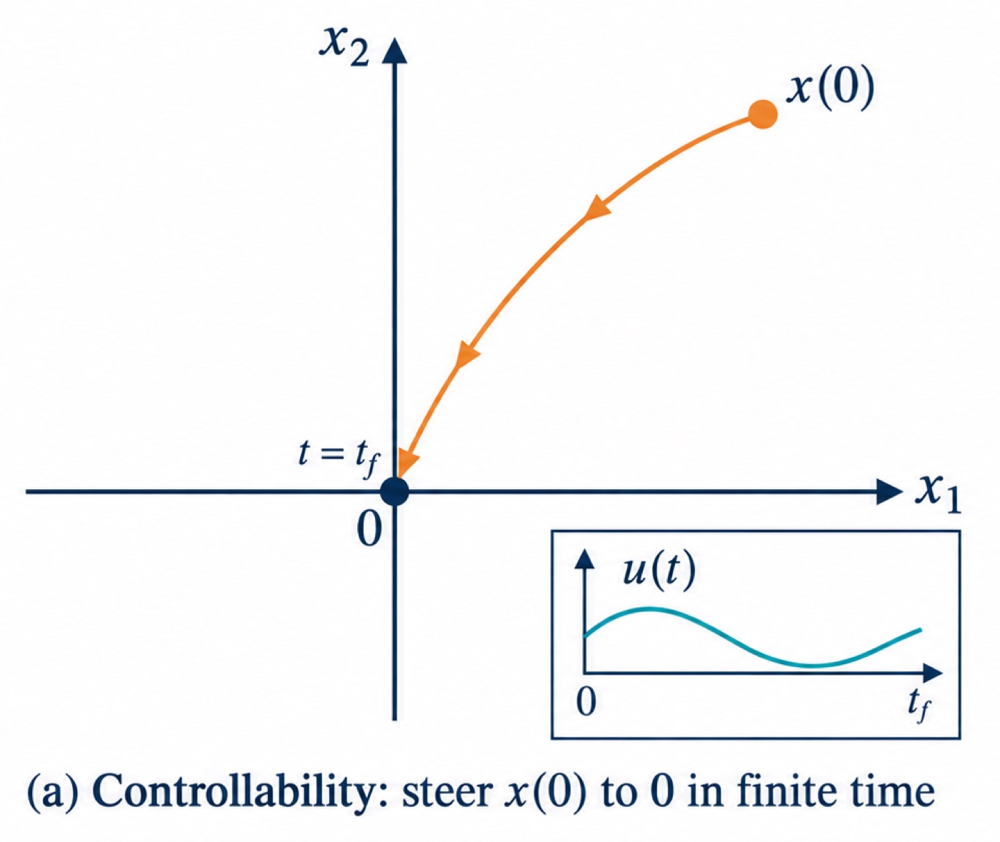

# 能控性

能控性回答的问题是：输入 $u$ 能不能把状态从任意初值推到原点。对 $\dot x=Ax+Bu$，这只与 $(A,B)$ 有关。

## 1. 能控性的定义与能控子空间

### 定义

- **状态能控**：对初始状态 $x(t_0)$，存在有限时刻 $t_f>t_0$ 和无约束的分段连续输入 $u(t)$，使 $x(t_f)=0$，则称 $x(t_0)$ 能控。
- **状态完全能控**（简称能控）：状态空间中**所有**状态都能控；否则称**不完全能控**。
- **能达**：若存在 $u$ 把 $x(t_0)=0$ 转移到 $x(t_f)=x_f$，称 $x_f$ 能达；所有状态都能达称**完全能达**。对连续定常系统，完全能控 $\Leftrightarrow$ 完全能达（离散系统不一定，见[能观性与对偶原理](observability.md)）。
- 定常系统的能控性与 $t_0$ 无关，也与 $t_f$ 的长短无关；$t_f$ 只影响所需的能量（见第 2 节）。

<figure markdown>
  { width="480" loading=lazy }
  <figcaption>能控性：在有限时间内用输入把任意初始状态 $x(0)$ 送到原点。</figcaption>
</figure>

### 能控子空间与线性变换不变性

- **能控子空间** $X_c=\Ima Q_c$（能控性矩阵 $Q_c$ 的列空间，$Q_c$ 见第 3 节），$\dim X_c=\rank Q_c$。完全能控 $\Leftrightarrow$ $X_c=\R^n$；不完全能控时，**只有** $X_c$ 内的状态能控。例如第 4 节的例子中 $X_c=\mathrm{span}\{e_1,e_3\}=\{x\mid x_2=0\}$。
- **不变性**：作非奇异变换 $x=P\bar x$ 后，$\bar Q_c=[\bar B\ \ \bar A\bar B\ \cdots\ \bar A^{n-1}\bar B]=P^{-1}Q_c$，秩不变。能控性是系统的固有属性，所以可以先化成对角型或约当型再判（规范型判据）。

!!! tip "方法：证明“能控状态的线性组合仍能控”"
    设 $x_a,x_b$ 能控，要证 $x_c=\alpha x_a+\beta x_b$ 能控。

    1. 由定义，存在有限时刻 $t_a,t_b$ 及输入 $u_a,u_b$，分别把 $x_a,x_b$ 送到原点。
    2. 取 $t_f=\max(t_a,t_b)$，先到原点的那一个此后令 $u=0$（停在原点），于是二者都在 $[t_0,t_f]$ 上完成转移。
    3. 令 $u_c=\alpha u_a+\beta u_b$，由解的线性，

        $$
        x(t_f)=\Phi(t_f,t_0)x_c+\int_{t_0}^{t_f}\Phi(t_f,\tau)Bu_c\dd\tau=\alpha\cdot0+\beta\cdot0=0 .
        $$

    另一种证法：能控状态的全体就是子空间 $\Ima Q_c$，而子空间对线性组合封闭。

## 2. Gram 矩阵判据与最小能量控制

Gram 矩阵判据是理论判据，时变系统也适用。一般形式（区间 $[t_0,t_f]$）为

$$
G_c(t_0,t_f)=\int_{t_0}^{t_f}\Phi(t_0,t)B(t)B\tp(t)\Phi\tp(t_0,t)\dd t,\qquad u(t)=-B\tp(t)\Phi\tp(t_0,t)\,G_c^{-1}(t_0,t_f)\,x(t_0).
$$

定常时 $\Phi(0,t)=\Phi^{-1}(t,0)=\e^{-At}$（见[时变与离散系统的运动分析](tv-discrete-response.md)中状态转移矩阵的性质），取 $t_0=0$：

$$
G_c(0,t_f)=\int_0^{t_f}\e^{-At}BB\tp\e^{-A\tp t}\dd t,\qquad u(t)=-B\tp\e^{A\tp(0-t)}G_c^{-1}(0,t_f)\,x(0)
$$

!!! note "Gram 矩阵判据"
    系统在 $[t_0,t_f]$ 上完全能控 $\iff$ $G_c(t_0,t_f)$ 非奇异。

    $G_c$ 总是对称半正定的，非奇异即正定；它的特征值刻画了各个方向的“能控程度”。

为什么上面的 $u(t)$ 能把状态送到原点？代入非齐次方程的解：

$$
x(t_f)=\Phi(t_f,t_0)\Big[x(t_0)+\int_{t_0}^{t_f}\Phi(t_0,\tau)Bu\dd\tau\Big]=\Phi(t_f,t_0)\big[x(t_0)-G_cG_c^{-1}x(t_0)\big]=0 .
$$

这个控制的能量为 $\int_{t_0}^{t_f}u\tp u\dd t=x\tp(t_0)G_c^{-1}x(t_0)$，在所有能把 $x(t_0)$ 送到原点的输入中最小：另一可行控制写成 $u+v$ 时，必有 $\int u\tp v\dd t=0$，因此其能量只会更大。

!!! tip "方法：Gram 矩阵与最小能量控制的计算步骤"
    1. 求 $\Phi(0,t)=\e^{-At}$：$A^2=0$ 时直接 $\e^{-At}=I-At$；一般情形先求 $\e^{At}$（见[线性定常系统的运动分析](lti-response.md)），再把 $t$ 换成 $-t$。
    2. 算 $\Phi(0,t)B$，积分 $G_c(0,t_f)=\int_0^{t_f}[\Phi(0,t)B][\Phi(0,t)B]\tp\dd t$（对称阵），$\det G_c\ne0$ $\Rightarrow$ 完全能控。控制量 $u(t)=-[\Phi(0,t)B]\tp G_c^{-1}(0,t_f)\,x(0)$，先算常向量 $G_c^{-1}x(0)$。
    3. 自检：代回状态方程（逐个积分器积分，别漏初值），验证 $x(t_f)=0$；能量 $\int_0^{t_f}u\tp u\dd t$ 应等于 $x\tp(0)G_c^{-1}x(0)$。

??? example "例：双积分器的 Gram 矩阵与最小能量控制"
    飞行器高度通道近似为双积分器 $\dot x=\smat{0&1\\0&0}x+\smat{0\\1}u$（$x_1$ 为高度偏差，$x_2$ 为垂直速度），$x(0)=(2,\ 0)\tp$，要求 $t_f=2$ s 末回到悬停点。

    (1) 写出 $\Phi(0,t)=\e^{-At}$，求 $G_c(0,2)$ 及其行列式，判断能控性；(2) 按 $u(t)=-b\tp\e^{A\tp(0-t)}G_c^{-1}(0,2)x(0)$ 求控制量；(3) 代回验证 $x(2)=0$，求 $\int_0^2u^2\dd t$；(4) 区间改为 $[0,t_f]$，证明 $\det G_c(0,t_f)=t_f^4/12$，解释 $t_f\to0$ 时 $G_c$ 趋于奇异的含义。

    **解** (1) $A^2=0$，所以

    $$
    \Phi(0,t)=\e^{-At}=I-At=\bmat{1&-t\\0&1},\qquad \Phi(0,t)b=\bmat{-t\\1},
    $$

    $$
    G_c(0,2)=\int_0^2\bmat{t^2&-t\\-t&1}\dd t=\bmat{8/3&-2\\-2&2},\qquad \det G_c(0,2)=\frac{16}{3}-4=\frac43\ne0,
    $$

    **完全能控**。复核：$\rank[b\ \ Ab]=\rank\smat{0&1\\1&0}=2$。

    (2) $2\times2$ 矩阵求逆“主对角对调、副对角变号、除以行列式”：

    $$
    G_c^{-1}(0,2)=\frac34\bmat{2&2\\2&8/3}=\bmat{3/2&3/2\\3/2&2},\qquad G_c^{-1}(0,2)\,x(0)=\bmat{3\\3}.
    $$

    $b\tp\e^{A\tp(0-t)}=(\e^{-At}b)\tp=[-t\ \ 1]$，所以

    $$
    \boxed{u(t)=-[-t\ \ 1]\bmat{3\\3}=3t-3,\qquad 0\le t\le2}
    $$

    (3) $\dot x_2=u$，$x_2(0)=0$，得 $x_2=\frac32t^2-3t$；$\dot x_1=x_2$，$x_1(0)=2$，得 $x_1=2-\frac32t^2+\frac12t^3$。$x_1(2)=2-6+4=0$，$x_2(2)=6-6=0$，$x(2)=0$ 成立。能量

    $$
    \int_0^2(3t-3)^2\dd t=9\cdot\frac23=\boxed{6},
    $$

    复核：$x\tp(0)G_c^{-1}x(0)=[2\ \ 0]\smat{3\\3}=6$。

    (4) 同 (1) 积分到 $t_f$：

    $$
    G_c(0,t_f)=\bmat{t_f^3/3&-t_f^2/2\\-t_f^2/2&t_f},\qquad \det G_c=\frac{t_f^4}{3}-\frac{t_f^4}{4}=\boxed{\frac{t_f^4}{12}}>0,\qquad G_c^{-1}(0,t_f)=\bmat{12/t_f^3&6/t_f^2\\6/t_f^2&4/t_f}.
    $$

    任意 $t_f>0$ 都能控。但最小能量控制 $u^*=\frac{24t}{t_f^3}-\frac{12}{t_f^2}$，能量 $E_{\min}=x\tp(0)G_c^{-1}x(0)=48/t_f^3$，推力峰值 $12/t_f^2$。$t_f\to0$ 时 $G_c\to0$ 趋于奇异，所需能量和推力都趋于无穷（时间减半，能量变为 8 倍），实际受推力饱和限制而做不到。**能控不等于容易控**。又 $t_f$ 很小时 $G_c\approx t_fbb\tp$（秩 1）：推力只能直接改变速度，高度方向最难控。

!!! warning "易错点：Gram 矩阵中的符号"
    Gram 矩阵用的是 $\Phi(0,t)=\e^{-At}$，上例中 $\Phi(0,t)b=[-t\ \ 1]\tp$，$G_c$ 的**非对角元为负**；$u$ 公式里的 $\e^{A\tp(0-t)}=(\e^{-At})\tp$ 与之配套。

    - 误用 $\int\e^{At}bb\tp\e^{A\tp t}\dd t=\smat{8/3&2\\2&2}$ 再套公式，得 $u=3t+3$，此时 $x_2(2)=12\ne0$；
    - 指数漏了负号、写成 $\e^{A\tp t}$，得 $u=-3t-3$，此时 $x_2(2)=-12$。

    两种都错，回代即可发现。

## 3. 代数判据、PBH 判据与规范型判据

### 五种判据对照

下表结论一栏均为“完全能控 $\iff$ …”。

| 判据 | 适用前提 | 看什么 | 结论 |
|---|---|---|---|
| Gram 判据 | 一切线性系统（含时变）；手算一般只做到 $A^2=0$ 型 | $G_c(0,t_f)=\int_0^{t_f}\e^{-At}BB\tp\e^{-A\tp t}\dd t$（时变时 $\e^{-At}\to\Phi(t_0,t)$） | 存在 $t_f>t_0$ 使 $\det G_c\ne0$（定常时任一 $t_f>0$ 均可） |
| 代数（秩）判据 | 定常；$A$ 为任意形式，首选 | $Q_c=[B\ AB\ \cdots\ A^{n-1}B]$（$n\times np$） | $\rank Q_c=n$；单输入时 $\det Q_c\ne0$ |
| PBH 秩判据 | 定常；特征值已知或好求 | 每个特征值处的 $[\lambda_iI-A,\ B]$（$n\times(n+p)$） | 每个 $\lambda_i$ 处秩都为 $n$；秩亏的 $\lambda_i$ 就是不能控模态 |
| 对角线规范型判据 | $\bar A$ 对角且特征值**互异** | $\bar B=P^{-1}B$ 的各行 | 无全零行；第 $i$ 行全零 $\Rightarrow$ $\lambda_i$ 不能控 |
| 约当规范型判据 | $\bar A$ 为约当型；先数清每个特征值有几块 | 各约当块**末行**对应的 $\bar B$ 的行 | 判据一（每个特征值只有一块）：这些行均不全为零；判据二（同一特征值多块）：这些行线性无关 |

### 判据的选择与计算要点

!!! tip "方法：判据怎么选"
    - **流程**：$A$ 已是对角型或约当型且前提成立，直接读 $\bar B$ 的行；否则用秩判据（单输入算 $\det Q_c$）；需要指出不能控模态时补用 PBH。一般的 $A$ 不必先化规范型（求 $P$ 费时）。
    - **作答三步**：① 前提（规范型判据能否用：特征值是否互异，每个特征值有几块 $\gamma_i$，用判据一还是判据二）；② 复核（写出 $Q_c$ 及非零子式与秩，或 PBH 矩阵及其秩）；③ 结论（是否完全能控，指出不能控模态）。

**秩判据的手算。** 用 $A^kB=A(A^{k-1}B)$ 逐块计算，不必先求 $A^k$。可以截断：

- 凑够 $n$ 个线性无关列即可停止；
- $\rank B=r$ 时最多算到 $A^{n-r}B$；
- 某一块加入后秩不增加，以后各块也不会再增加，可以停止（如第 4 节的例子 $\rank B=\rank[B\ \ AB]=2$ 已可定秩；题目要求写全 $Q_c$ 时照写）。

多输入时 $Q_c$ 是长方阵，不能写 $\det Q_c$。定秩分两步：由零行或行相关说明 $\rank\le r$，再找一个 $r$ 阶非零子式说明 $\rank\ge r$；只需判“不完全能控”时，第一步即可。

**PBH 判据。** 只需检查 $A$ 的特征值（在其余的 $s$ 处 $sI-A$ 已满秩）。它的特征向量形式是：不存在左特征向量 $w\ne0$（$w\tp A=\lambda w\tp$）使 $w\tp B=0$。对角化后 $\bar B$ 的第 $i$ 行等于 $q_iB$，其中 $q_i$ 是 $P^{-1}$ 的第 $i$ 行，也就是 $\lambda_i$ 的左特征向量，所以对角线判据就是 PBH 的这一形式，只需算用得到的那几行。

两个速判：

- 某个 $\dot x_i$ 只含 $x_i$、不含 $u$ $\Rightarrow$ $x_i$ 不能控（取 $w=e_i$）；
- 单输入且 $b$ 是 $A$ 的特征向量（$n\ge2$）$\Rightarrow$ $Q_c=[b\ \ \lambda b\ \cdots]$ 秩为 1，不能控。例如 $A=\smat{0&1\\1&0}$，$b=\smat{1\\1}$ 是 $\lambda=1$ 的特征向量，不能控的是**另一个**模态 $\lambda=-1$：$w=[1\ \ {-1}]\tp$，$w\tp b=0$。

**约当型为什么看末行。** 上约当块中 $\dot x_j=\lambda x_j+x_{j+1}+\bar b_ju$（$\bar b_j$ 为 $\bar B$ 的第 $j$ 行；块的末行没有 $x_{j+1}$ 项），末行状态逐级驱动上面各行，推得动末行就推得动整条链。

- 对角元重复，等于同一特征值有多个一阶块，要用判据二。单输入时这些行都是标量，必然线性相关，所以必不能控。
- 一般地，同一特征值的块数多于 $B$ 的秩（$\gamma_i>\rank B$）$\Rightarrow$ 必不能控。
- 多输入例：$A=\diag\{J_2(-1),-1\}$，$B=\smat{0&0\\1&0\\0&1}$，$\lambda=-1$ 有两块，块末行（第 2、3 行）$[1\ \ 0]$、$[0\ \ 1]$ 线性无关，能控；若第 3 行改为 $[2\ \ 0]$，则二者相关，不能控（$\rank Q_c=2$）。

**恒能控的形式。** 能控规范型（友矩阵、$b=e_n$）；由传递函数写出的特征值规范型（$b$ 全为 1，约当块内末位为 1），见[状态空间表达式的建立](realization.md)。

**含参数的情形。** 单输入时令 $\det Q_c\ne0$。例：$A=\diag(-1,a)$，$b=\smat{1\\1}$，$\det Q_c=\det\smat{1&-1\\1&a}=a+1$，能控 $\iff$ $a\ne-1$（$a=-1$ 时 $A=\diag(-1,-1)$，对角元重复，单输入必不能控）。多输入时，不能控 $\iff$ **所有** $n$ 阶子式同时为零，只令其中一个子式为零是不够的。若要求“$\lambda_i$ 不能控”，可令 $\rank[\lambda_iI-A,\ B]<n$ 反求参数（见[规范型、结构分解与最小实现](canonical-decomposition.md)）。

??? example "例：由状态转移矩阵求出 $A$ 后判能控性"
    已知系统的状态转移矩阵 $\Phi(t)$，由 $A=\dot\Phi(0)$ 求得 $A=\smat{0&-2\\1&-3}$（求法见[线性定常系统的运动分析](lti-response.md)），$b=\smat{0\\1}$，判断能控性。

    **解** $Q_c=[b\ \ Ab]=\smat{0&-2\\1&-3}$，$\det Q_c=2\ne0$，完全能控。

## 4. 不能控模态与传递函数

- 不能控模态的运动只由初值决定（$\e^{\lambda t}$ 自由衰减或发散），输入改变不了它；零初始状态下它不被激发，所以在 $G(s)=C(sI-A)^{-1}B+D$ 中被零极点对消，分母次数小于 $n$。对角型中 $\bar b_i=0$ 就是“输入推不动第 $i$ 个模态”（见[线性变换与离散系统描述](linear-transform.md)）。
- $G(s)$ 只反映能控且能观的部分（结构分解与最小实现见[规范型、结构分解与最小实现](canonical-decomposition.md)）。单输入单输出时：$c\adj(sI-A)b$ 与 $\det(sI-A)$ 有公因子 $\iff$ 系统不完全能控或不完全能观。单凭对消分不清是哪一种。

??? example "例：三阶双输入系统——秩判据、约当判据、PBH 与传递函数"
    $$
    \dot x=\bmat{-3&1&0\\0&-3&0\\0&0&-1}x+\bmat{1&-1\\0&0\\2&0}u,\qquad y=\bmat{1&0&1\\-1&1&0}x\qquad(n=3,\ p=q=2,\ D=0).
    $$

    (1) 用代数判据判状态能控性，写出 $Q_c$ 及其秩；(2) $A=\diag\{J_2(-3),\,-1\}$ 已是约当型，用约当判据复核，指出哪个模态不能控；(3) 求 $G(s)=C(sI-A)^{-1}B$，说明各元分母次数为何不超过 2，与 (2) 有何联系。

    **解** (1) 逐块计算（$A^2B=A(AB)$）：

    $$
    AB=\bmat{-3&3\\0&0\\-2&0},\quad A^2B=\bmat{9&-9\\0&0\\2&0},\quad Q_c=[B\ \ AB\ \ A^2B]=\bmat{1&-1&-3&3&9&-9\\0&0&0&0&0&0\\2&0&-2&0&2&0}\ (3\times6).
    $$

    第 2 行全零，所以秩 $\le2$；第 1、3 行与第 1、2 列构成的子式 $\left|\begin{smallmatrix}1&-1\\2&0\end{smallmatrix}\right|=2\ne0$，所以 $\boxed{\rank Q_c=2<3}$，状态**不完全能控**，$X_c=\Ima Q_c=\{x\mid x_2=0\}$。

    (2) $\lambda=-3$ 二重，但只有一块 $J_2(-3)$（$\gamma=3-\rank(-3I-A)=1$），$\lambda=-1$ 一块，用**约当判据一**：$J_2(-3)$ 的末行（第 2 行）对应 $B$ 的行为 $[0\ \ 0]$，不完全能控，与 (1) 一致；$-1$ 块（第 3 行）对应 $[2\ \ 0]\ne0$，能控。

    **不能控模态**是 $\lambda=-3$，具体是块末状态 $x_2$：$\dot x_2=-3x_2$ 与 $u$ 无关；$\e^{At}B$ 只含 $\e^{-3t}$、$\e^{-t}$，激发不出 $t\e^{-3t}$。同一块中的 $x_1$ 仍然能控（$e_1\in X_c$）。

    PBH 复核：

    $$
    \rank[-3I-A,\ B]=\rank\bmat{0&-1&0&1&-1\\0&0&0&0&0\\0&0&-2&2&0}=2<3,
    $$

    对应左特征向量 $w=e_2$：$w\tp A=-3w\tp$，$w\tp B=0$。而 $\rank[-I-A,\ B]=3$，只有 $-3$ 处秩亏。

    (3) $(sI-A)^{-1}$ 中唯一含 $(s+3)^2$ 的是 $(1,2)$ 元 $\frac{1}{(s+3)^2}$，而它乘的恰好是 $B$ 的第 2 行 $[0\ \ 0]$。算得

    $$
    \boxed{G(s)=\bmat{\dfrac{3s+7}{(s+1)(s+3)}&-\dfrac1{s+3}\\[1.5mm]-\dfrac1{s+3}&\dfrac1{s+3}}}\qquad\Big(g_{11}=\frac1{s+3}+\frac2{s+1}\Big).
    $$

    $\det(sI-A)=(s+3)^2(s+1)$ 是三次的，但 $(s+3)^2$ 中有一个 $(s+3)$ 被消掉，各元分母次数不超过 2。等价地说，零初始状态下 $x_2\equiv0$，从 $u$ 到 $y$ 只经过能控子系统 $(x_1,x_3)$。

    **联系**：被对消的那个 $(s+3)$ 正是 (2) 中的不能控模态；$G(s)$ 的极点只剩 $\{-3,-1\}$，$-3$ 仍出现一次（$x_1$ 那一份是能控的）。

    **注** 本系统完全能观（$\rank Q_o=3$），对消只来自不能控部分。

## 5. 输出能控性

- **定义**：若存在分段连续的 $u(t)$，能在有限时间内把任意初始输出 $y(t_0)$ 转移到任意指定的 $y(t_f)$，称系统**输出完全能控**。
- **判据**：输出完全能控 $\iff$ $\rank Q_s=q$（$q$ 是输出维数，**不是** $n$），其中

    $$
    Q_s=[CB\ \ CAB\ \ \cdots\ \ CA^{n-1}B\ \ D]\qquad(q\times(n+1)p),
    $$

    $D$ 放在最后，为零也要写出。
- **与状态能控性的关系**：**没有必然联系**，互不蕴含。由 $Q_s=[CQ_c\ \ D]$，状态完全能控时 $\rank(CQ_c)=\rank C$，所以“状态完全能控且 $\rank C=q$ $\Rightarrow$ 输出完全能控”（对任意 $D$ 成立）。单输入单输出时：输出能控 $\iff$ $Q_s\ne0$ $\iff$ $g(s)\not\equiv0$。

??? example "例：输出能控性，以及它与状态能控性的关系"
    系统同第 4 节的例子（$D=0$）。(1) 判断输出能控性，写出 $Q_s$ 及其秩；(2) 状态完全能控与输出完全能控之间有没有必然联系？

    **解** (1) $CB=\smat{3&-1\\-1&1}$，$CAB=\smat{-5&3\\3&-3}$，$CA^2B=\smat{11&-9\\-9&9}$，

    $$
    Q_s=[CB\ \ CAB\ \ CA^2B\ \ D]=\bmat{3&-1&-5&3&11&-9&0&0\\-1&1&3&-3&-9&9&0&0}\quad(2\times8),
    $$

    前两列 $\det CB=3-1=2\ne0$，所以 $\boxed{\rank Q_s=2=q}$，**输出完全能控**。

    (2) **没有必然联系**。

    - 输出能控 $\not\Rightarrow$ 状态能控：本例 $\rank Q_c=2<3$，而 $\rank Q_s=2=q$。
    - 状态能控 $\not\Rightarrow$ 输出能控：双积分器 $A=\smat{0&1\\0&0}$，$b=\smat{0\\1}$，$\rank[b\ \ Ab]=2$，状态完全能控；若用两只增益不同的传感器测同一个高度，$C=\smat{1&0\\2&0}$，$D=0$，则 $Q_s=[Cb\ \ CAb\ \ D]=\smat{0&1&0\\0&2&0}$，秩 $1<2$，输出不完全能控。
    - 充分条件：状态完全能控且 $\rank C=q$ $\Rightarrow$ 输出完全能控。

## 6. 常见错误与概念辨析

??? question "能控性与 $t_f$ 的长短有关吗？能控就是容易控吗？"
    都不是。定常系统对任一 $t_f>0$ 结论相同，变化的只是所需能量（双积分器例中 $E_{\min}=48/t_f^3$）。

??? question "$A$ 对角、$B$ 无全零行就能控吗？约当型看块首行吗？"
    $A$ 对角时还要求特征值互异；特征值重复时用约当判据二，单输入必不能控。约当型看 $\bar B$ 中各块**末行**对应的行，不是首行，也不是变换前的 $B$。（能观性看 $\bar C$ 中各块的**首列**。）

??? question "线性变换可能改变能控性吗？"
    不会。$\bar Q_c=P^{-1}Q_c$，秩不变；特征值和传递函数也不变。

??? question "开环不稳定的系统不能控？"
    二者无关。例如 $A=\diag\{1,\,J_2(2)\}$，$b=[1\ \ 0\ \ 1]\tp$，特征值 $1,2,2$ 都在右半平面，但 $\det Q_c=-1$，完全能控；反过来，不能控模态也可以是稳定的。

??? question "不能控的特征值会从 $G(s)$ 中完全消失吗？"
    不一定，只消去不能控的那一份。第 4 节例中 $G(s)$ 仍有一重极点 $-3$。

??? question "多输入多输出时 $G(s)$ 各元分母次数都小于 $n$，系统必不完全能控或不完全能观吗？"
    不是。反例：$A=-I_2$，$B=C=I_2$，$G(s)=\frac{1}{s+1}I_2$，各元分母一次，但系统能控且能观。“有对消 $\iff$ 不完全能控或不完全能观”只对单输入单输出成立。

??? question "状态完全能控与输出完全能控可以互推吗？$\rank Q_s$ 与谁比较？"
    互不蕴含（“状态完全能控且 $\rank C=q$”只是输出能控的充分条件）。$\rank Q_s$ 与输出维数 $q$ 比较，不是与 $n$ 比较。

??? question "PBH 能控判据的矩阵怎么拼？要在所有 $s$ 处验算吗？"
    能控是左右拼接 $[\lambda_iI-A,\ B]$（上下堆叠是能观性）；只需在 $A$ 的特征值处验算。

??? question "连续定常系统完全能控与完全能达等价吗？"
    等价，因为 $\Phi$ 恒可逆。离散系统 $G$ 奇异时不然，见[能观性与对偶原理](observability.md)。
