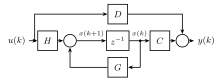

# 状态空间的线性变换与离散系统描述

几个记号先说明：

- "友矩阵"指能控规范型的系统矩阵，不叫"伴随矩阵"；伴随矩阵专指 $\adj(sI-A)$。
- 本章统一用 $x=P\bar x$ 表示变换；讨论能观规范型时用 $Q$ 表示变换矩阵本身（$x=Q\bar x$）。
- 同一字母在本章有不同含义：离散系统矩阵 $G$ 与脉冲传递函数 $G(z)$；直接传输矩阵 $D$ 与分母多项式 $D(z)$；$\beta$ 在第 3 节表示特征向量的虚部 $\mathrm{Im}\,v$，在第 4 节表示 $N(z)$ 的系数 $\beta_i$。

## 1. 非奇异线性变换与不变量

### 变换后的四个矩阵

状态变量的选法有无穷多种，彼此只差一个非奇异变换：

$$
\bar x=Qx,\qquad x=P\bar x,\qquad Q=P^{-1}
$$

本课程统一用 $x=P\bar x$ 的写法。$P$ 必须**非奇异**（$\det P\ne0$），否则不同的状态会被映到同一点，系统的"记忆"就丢了。

推导：把 $x=P\bar x$ 代入 $\dot x=Ax+Bu$，得 $P\dot{\bar x}=AP\bar x+Bu$，再**左乘 $P^{-1}$**：

$$
\dot{\bar x}=P^{-1}AP\,\bar x+P^{-1}Bu,\qquad y=CP\,\bar x+Du
$$

即

$$
\bar A=P^{-1}AP,\qquad \bar B=P^{-1}B,\qquad \bar C=CP,\qquad \bar D=D\qquad(\text{反向：}A=P\bar AP^{-1})
$$

相似变换就是线性代数中的**换基**：$P$ 的各列是新基向量在原基下的坐标。

### 不变量

变换改变的是内部表示，不改变外部特性：两组坐标下的状态曲线不同，但输出逐点重合。

- **特征多项式**（每个系数）与**特征值**不变：

    $$
    |sI-\bar A|=|P^{-1}(sI-A)P|=|P^{-1}|\,|sI-A|\,|P|=|sI-A|
    $$

- **传递函数（矩阵）**不变。利用 $(P^{-1}MP)^{-1}=P^{-1}M^{-1}P$：

    $$
    \bar C(sI-\bar A)^{-1}\bar B+\bar D=CP\cdot P^{-1}(sI-A)^{-1}P\cdot P^{-1}B+D=G(s)
    $$

- 能控性、能观性同样不变（见[能控性](controllability.md)、[能观性](observability.md)）。

!!! warning "易错点"
    - $P$ 和 $P^{-1}$ 的位置常被放反。维数检查只能查出 $BP^{-1}$、$PC$ 这类错误，查不出 $PAP^{-1}$，只能靠"代入 $x=P\bar x$ 再左乘 $P^{-1}$"这个推导记牢。
    - 在新坐标下算完就结束，是**最常见的错误**。控制器测到的是原坐标下的状态，$\bar K\bar x=\bar KP^{-1}x$，所以原坐标下的增益是 $K=\bar KP^{-1}$（右乘变换矩阵的逆）。同理，初值要变换为 $\bar x(0)=P^{-1}x(0)$。

## 2. 对角化与约当化：特征值规范型

### 特征值与两种重数

- $Av_i=\lambda_iv_i$（$v_i\ne0$）。互异特征值对应的特征向量线性无关。若 $Av=\lambda v$，则 $f(A)v=f(\lambda)v$，例如 $A^kv=\lambda^kv$。凯莱–哈密顿定理：$\varphi(A)=0$。
- 代数重数 $\mu_i\ge$ 几何重数 $\gamma_i\ge1$。$\gamma_i$ 等于线性无关特征向量的个数，也就是特征矩阵的**降秩数**：

$$
\gamma_i=n-\rank(\lambda_iI-A)
$$

$$
A\ \text{可对角化}\iff\sum_{\text{互异}\,\lambda_i}\gamma_i=n\iff\text{每个特征值都有}\ \gamma_i=\mu_i
$$

二阶对照：$A=I_2$ 时 $\rank(I-A)=0$，$\gamma=2$，可对角化；$A=\smat{1&1\\0&1}$ 时 $\rank(I-A)=1$，$\gamma=1$，不可对角化，它本身就是最小的约当块。

### 对角化

$n$ 个特征值互异，或者有重根但每个都满足 $\gamma_i=\mu_i$ 时，可以对角化。把 $P^{-1}AP=\diag(\lambda_i)$ 写成

$$
AP=P\diag(\lambda_i)
$$

（**左乘 $P$ 避开求逆**），逐列比较就是 $Av_i=\lambda_iv_i$，所以 $P=[v_1\ \cdots\ v_n]$。

### 约当化（只讨论 $\gamma=1$）

把 $AP=PJ$ 逐列展开，得 $Av_1=\lambda v_1$，$Av_k=\lambda v_k+v_{k-1}$，移项写成

$$
(\lambda I-A)v_1=0,\qquad (\lambda I-A)v_k=-v_{k-1}\ \ (k=2,\dots,m),\qquad P=[v_1\ \cdots\ v_m],\qquad J=\bmat{\lambda&1&0\\0&\lambda&1\\0&0&\lambda}
$$

右端是**负的前一列**。$v_1$ 是唯一的独立特征向量，其余为广义特征向量。$J$ 为上约当块，对角线上方一排 1 表示模态之间的单向耦合。

有多个重特征值时：

- 情形一：各重根都有 $\gamma=1$，$\bar A=\diag(J_1,J_2,\dots)$，块的阶数等于重数；
- 情形二：$\gamma>1$，只作了解；
- 情形三：重根加单根，得到约当块加 $1\times1$ 对角块。

下文只讨论情形一和情形三。

### 对角化的意义

对角化后 $\dot{\bar x}_i=\lambda_i\bar x_i+\bar b_iu$，各分量互不耦合（模态解耦）。时间常数为 $1/|\lambda_i|$（$\lambda=-0.8$ 对应 1.25 s，$\lambda=-3$ 对应 0.33 s），**慢模态决定调节时间**（主导极点）。若 $\bar b_i=0$，输入推不动该模态；若 $\bar c_i=0$，输出看不到该模态（见[能控性](controllability.md)、[能观性](observability.md)）。

!!! tip "方法：化特征值规范型"
    1. 求 $\lambda$：解 $|\lambda I-A|=0$。三阶按行展开，尽量提公因式。
    2. 判断：对重根计算 $\rank(\lambda I-A)$ 得到 $\gamma$，明确写出"$\gamma=\mu$，可对角化"或"$\gamma<\mu$，只能化为约当型"。
    3. 求 $v$：解 $(\lambda_iI-A)v=0$，**任取一个非零分量**。约当链按 $(\lambda I-A)v_k=-v_{k-1}$ 依次求解；若误写成 $+v_{k-1}$，得到的是 $-v_k$，$\bar A$ 的 $(1,2)$ 元会变成 $-1$。
    4. 拼 $P$、求 $P^{-1}$：**列的顺序决定 $\bar A$ 对角元的顺序**；约当链的各列要相邻，特征向量在前。
    5. 计算 $\bar A=P^{-1}AP$、$\bar B=P^{-1}B$（多输入时为 $n\times p$）、$\bar C=CP$。自检：约当块的 $(1,2)$ 元为 1，必要时验证传递函数不变。

    例如 $H=\smat{3&1\\1&3}$：$\lambda=2,4$，$T=\smat{1&1\\-1&1}$。更多例子见第 3 节末的速查表。

??? example "例：多输入系统化为特征值规范型（重根加单根）"
    将 $\dot x=\bmat{4&1&-2\\1&0&2\\1&-1&3}x+\bmat{3&1\\2&7\\5&3}u$ 化为特征值规范型；取 $C=I_3$，验证传递函数矩阵不变。

    **解** (1) 按第一行展开：$|\lambda I-A|=(\lambda-1)(\lambda-3)^2$，故 $\lambda_{1,2}=3$（$\mu=2$），$\lambda_3=1$。

    (2) $3I-A=\smat{-1&-1&2\\-1&3&-2\\-1&1&0}$。左上二阶子式为 $-4\ne0$，且 $\det(3I-A)=0$，故 $\rank(3I-A)=2$，$\gamma=1<\mu=2$，**不能对角化**（重根加单根的情形）。

    (3) 由 $(3I-A)v_1=0$ 得 $v_1=[1\ \ 1\ \ 1]\tp$；由 $(3I-A)v_2=-v_1$ 得 $v_2=[1\ \ 0\ \ 0]\tp$（通解 $v_2+tv_1$ 都可以；自检 $Av_2=[4\ \ 1\ \ 1]\tp=3v_2+v_1$）；$\lambda=1$ 对应 $v_3=[0\ \ 2\ \ 1]\tp$。于是

    $$
    P=[v_1\ \ v_2\ \ v_3]=\bmat{1&1&0\\1&0&2\\1&0&1},\qquad P^{-1}=\bmat{0&-1&2\\1&1&-2\\0&1&-1}
    $$

    $$
    \boxed{\bar A=P^{-1}AP=\bmat{3&1&0\\0&3&0\\0&0&1},\qquad \bar B=P^{-1}B=\bmat{8&-1\\-5&2\\-3&4}}
    $$

    (4) 由 $sI-A=P(sI-\bar A)P^{-1}$ 得 $(sI-A)^{-1}B=P(sI-\bar A)^{-1}\bar B$。注意 $C=I_3$ 时 $\bar C=P\ne I_3$，所以 $\bar C(sI-\bar A)^{-1}\bar B=G(s)$，即得证。其中

    $$
    (sI-\bar A)^{-1}=\diag\left(\bmat{(s-3)^{-1}&(s-3)^{-2}\\0&(s-3)^{-1}},\ (s-1)^{-1}\right)
    $$

    $3\times2$ 的 $G(s)$ 第 1 行为 $\Bigl[\frac{3s-14}{(s-3)^2}\ \ \ \frac{s-1}{(s-3)^2}\Bigr]$，其余两行的分母为 $(s-1)(s-3)^2$。

    **注** 若列序取 $[v_3\ \ v_1\ \ v_2]$，则 $\bar A=\diag\bigl(1,\smat{3&1\\0&3}\bigr)$，$\bar B$ 的行随之重排，同样正确，但要注明。第 1 行不含 $\frac1{s-1}$：$v_3$ 的首分量为 0，$x_1$ 看不到 $\lambda=1$ 的模态，这是能观性的伏笔。

## 3. 规范型直接写变换矩阵；共轭复根实数化

### 友矩阵的特征向量：范德蒙德矩阵

友矩阵 $A_c$ 即能控规范型的系统矩阵：主对角线上方一排 1，末行为 $[{-a_0}\ \ {-a_1}\ \ \cdots\ \ {-a_{n-1}}]$。**末行反号**就是特征多项式 $\varphi(s)$ 的系数（[极点配置](state-feedback.md)就是在改这一行）。

写出 $A_cv=\lambda v$：前 $n-1$ 行给出 $v_{k+1}=\lambda v_k$；末行等价于 $\varphi(\lambda)=0$，不产生新的约束。首分量取 1，得

$$
w(\lambda_i)=[1\ \ \lambda_i\ \ \cdots\ \ \lambda_i^{n-1}]\tp,\qquad P=[w(\lambda_1)\ \cdots\ w(\lambda_n)],\qquad \det P=\prod_{i<j}(\lambda_j-\lambda_i)
$$

- 特征值互异 $\iff\det P\ne0$，所以一定能对角化。这与多项式插值的唯一性是同一个行列式。例：$\varphi=(s+1)(s+2)(s+3)$，三列为 $[1\ \ {-1}\ \ 1]\tp$、$[1\ \ {-2}\ \ 4]\tp$、$[1\ \ {-3}\ \ 9]\tp$，$\det P=-2$。
- **重根**时两列重合，$P$ 奇异。令 $\lambda_2=\lambda+\varepsilon$，做初等列变换 $[w(\lambda+\varepsilon)-w(\lambda)]/\varepsilon\to w'(\lambda)$，得到**导数列**。$m$ 重根取

    $$
    w_k=\frac1{(k-1)!}w^{(k-1)}(\lambda),\qquad k=1,\dots,m
    $$

    阶乘因子保证 $(\lambda I-A_c)w_k=-w_{k-1}$，从而得到标准的上约当块。三重根时 $P=\smat{1&0&0\\\lambda&1&0\\\lambda^2&2\lambda&1}$，是单位下三角阵。友矩阵的 $\gamma$ 恒为 1，一个重根只对应一个约当块。
- **能观规范型** $A=A_c\tp$（**末列反号**读系数）。把 $P^{-1}A_cP=\Lambda$ 两边转置，得 $P\tp A(P\tp)^{-1}=\Lambda$，即 $Q^{-1}=P\tp$。这是对偶关系（见[能观性与对偶原理](observability.md)）。重根时还要倒置行序（见下表）。

变换矩阵的几种构造方法对照如下（$w(\lambda)=[1\ \ \lambda\ \cdots\ \lambda^{n-1}]\tp$）：

| 情形 | 变换矩阵怎么写 | 变换后 $\bar A$ |
|---|---|---|
| 一般 $A$，$\gamma_i=\mu_i$ | 特征向量竖排 $P=[v_1\ \cdots\ v_n]$，$(\lambda_iI-A)v_i=0$ | $\diag(\lambda_i)$ |
| 一般 $A$，重根 $\gamma=1$ | 约当链 $(\lambda I-A)v_k=-v_{k-1}$，链内各列相邻、特征向量在前 | 约当块 $\oplus$ 对角块 |
| 友矩阵，特征值互异 | 范德蒙德矩阵 $P=[w(\lambda_1)\ \cdots\ w(\lambda_n)]$ | $\diag(\lambda_i)$ |
| 友矩阵，重根 | 广义范德蒙德矩阵：重根列为 $w,\ w',\ \frac1{2!}w'',\dots$（先求导再代入），单根列为 $w(\lambda_j)$ | 约当块 $\oplus$ 对角块 |
| 能观型 $A_c\tp$，特征值互异 | $Q^{-1}=P\tp$（第 $i$ 行为 $[1\ \ \lambda_i\ \cdots\ \lambda_i^{n-1}]$），$\bar A=Q^{-1}AQ$；不能把 $P$ 直接当能观型的变换矩阵 | $\diag(\lambda_i)$ |
| 能观型，重根 | $Q^{-1}$ 取广义范德蒙德矩阵的转置再**倒置行序**：最高阶导数行连同阶乘因子放在最上面，三重根时为 $\frac1{2!}{w''}\tp$ | 上约当块（不倒置则得下约当块） |
| 共轭复根 $\sigma\pm \mathrm j\omega$ | 取 $\sigma+\mathrm j\omega$（$\omega>0$）的特征向量 $v=\alpha+\mathrm j\beta$，两列为 $[\alpha\ \ \beta]$ | $\smat{\sigma&\omega\\-\omega&\sigma}$ |
| 实根 + 复根 | 先写复范德蒙德矩阵，再把复列换成实部、虚部：$[w(\lambda_1)\ \ \alpha\ \ \beta]$ | $\lambda_1\oplus$ 实块 |

### 共轭复根实数化

照对角化的做法，复特征值会让 $P$ 和新状态都成为复数。"复数的俯仰角"没有物理意义，控制器里也没法存储。所以改把一对共轭根的两列合成一个 $2\times2$ 的实块，分析和综合的效果与对角阵相同。

推导：$A(\alpha+\mathrm j\beta)=(\sigma+\mathrm j\omega)(\alpha+\mathrm j\beta)$，两边实部、虚部分别相等：

$$
A\alpha=\sigma\alpha-\omega\beta,\quad A\beta=\omega\alpha+\sigma\beta\ \Longrightarrow\ A[\alpha\ \ \beta]=[\alpha\ \ \beta]\bmat{\sigma&\omega\\-\omega&\sigma},\qquad P=[\,\mathrm{Re}\,v\ \ \mathrm{Im}\,v\,]
$$

- 实块对应阻尼振荡：$\sigma$ 管衰减（包络 $\e^{\sigma t}$），$\omega$ 是振荡角频率（周期 $2\pi/\omega$）。$\sigma<0$ 时相轨迹是收敛的螺旋线。要减少振荡，就把特征值往实轴挪（见[极点配置](state-feedback.md)）。
- 验证传递函数时常用：

    $$
    \left(sI-\bmat{\sigma&\omega\\-\omega&\sigma}\right)^{-1}=\frac{1}{(s-\sigma)^2+\omega^2}\bmat{s-\sigma&\omega\\-\omega&s-\sigma}
    $$

    能控规范型的 $g(s)$ 可以直接读出（见[状态空间表达式的建立](realization.md)）。

??? example "例：二阶振荡系统的实数化"
    $A=\bmat{0&1\\-4&-2}$（状态为 $\theta,\dot\theta$），化为实块形式，并读出衰减与振荡的参数。

    **解** $\varphi(s)=s^2+2s+4$，$\lambda=-1\pm\mathrm j\sqrt3$。友矩阵取 $w(\lambda)=[1\ \ \lambda]\tp$，$\lambda=-1+\mathrm j\sqrt3$ 时 $\alpha=[1\ \ {-1}]\tp$，$\beta=[0\ \ \sqrt3]\tp$：

    $$
    P=\bmat{1&0\\-1&\sqrt3},\qquad \bar A=\bmat{-1&\sqrt3\\-\sqrt3&-1}
    $$

    振荡周期 $2\pi/\sqrt3\approx3.63$ s，包络 $\e^{-t}$，约 3 s 衰减到 5%。新状态 $\bar x=P^{-1}x$ 中 $\bar x_2=(\theta+\dot\theta)/\sqrt3$，它不是角速度：新状态未必是物理量。

!!! tip "方法：规范型与复根直接构造 $P$"
    1. 由末行（能控型）或末列（能观型）**反号**读出 $\varphi(s)$ 的系数，求特征值。
    2. 写特征向量。友矩阵首分量取 1，自上而下得 $w(\lambda)$。能观型末分量取 1，自下而上，三阶时为

        $$
        \tilde w(\lambda)=[\lambda^2+a_2\lambda+a_1,\ \ \lambda+a_2,\ \ 1]\tp
        $$

        它是能观型 $A$ 的特征向量，与 $Q$ 的列成比例，用它可以免去复矩阵求逆。二阶一般矩阵（$a_{12}\ne0$）首分量取 1，由第一行 $a_{11}+a_{12}v_2=\lambda$ 读出 $v_2$；三阶及以上的一般矩阵仍要解 $(\lambda I-A)v=0$。
    3. 复根只取 $\omega>0$ 的那一个，拆成 $\alpha+\mathrm j\beta$（$\beta$ 不带 $\mathrm j$；注意 $(-1+\mathrm j)^2=-2\mathrm j$），按 $[\alpha\ \ \beta]$ 排列。求 $P^{-1}$（二阶：主对角互换、副对角变号、除以行列式）。
    4. 计算 $\bar A,\bar b,\bar c$，核对结构：约当块的 $(1,2)$ 元为 1，实块的 $(1,2)$ 元为 $+\omega$。

??? example "例：循环移位矩阵的对角化与实数化"
    $A=\bmat{0&1&0&0\\0&0&1&0\\0&0&0&1\\1&0&0&0}$，$Ax=[x_2\ \ x_3\ \ x_4\ \ x_1]\tp$。将其对角化，再化为实数形式；并说明 $A$ 的特征值都在单位圆上。

    **解** $A$ 是友矩阵，末行 $[1\ \ 0\ \ 0\ \ 0]$，$\varphi(\lambda)=\lambda^4-1$，$\lambda=\pm1,\ \pm\mathrm j$。

    $$
    P=[w(1)\ \ w(-1)\ \ w(\mathrm j)\ \ w(-\mathrm j)],\qquad \bar A=\diag(1,-1,\mathrm j,-\mathrm j)
    $$

    实数化：$w(\mathrm j)=[1\ \ \mathrm j\ \ {-1}\ \ {-\mathrm j}]\tp=\alpha+\mathrm j\beta$，$\alpha=[1\ \ 0\ \ {-1}\ \ 0]\tp$，$\beta=[0\ \ 1\ \ 0\ \ {-1}]\tp$，

    $$
    P_{\mathrm r}=[w(1)\ \ w(-1)\ \ \alpha\ \ \beta],\qquad \det P_{\mathrm r}=-8\ne0,\qquad \bar A_{\mathrm r}=\diag\left(1,\ -1,\ \bmat{0&1\\-1&0}\right)
    $$

    单位圆：先说明 $A^4=I$。$A$ 把分量循环移位一次，移位 4 次复原；或由凯莱–哈密顿定理 $\varphi(A)=A^4-I=0$。于是对任一特征向量，$v=A^4v=\lambda^4v$，$\lambda^4=1$，$|\lambda|=1$。

    **注** 关键是这两步论证，而不是罗列四个根。作离散系统看，$x(k+4)=x(k)$，不衰减也不发散。作连续系统则要看具体特征值：本例有 $\lambda=1>0$，不稳定；但这不能推广到一切满足 $A^4=I$ 的矩阵，例如 $A=-I$ 作连续系统是渐近稳定的。

??? example "例：能控型与能观型系统的实数化（共轭复根）"
    (1) 将 $\dot x=\bmat{0&1&0\\0&0&1\\2&-1&2}x+\bmat{0\\0\\1}u$，$y=[1\ \ 2\ \ 0]x$ 化为特征值规范型（复根实数化），并验证传递函数不变。

    (2) 将能观型系统 $A=\bmat{0&0&-2\\1&0&-4\\0&1&-3}$，$b=[1\ \ 0\ \ 0]\tp$，$c=[1\ \ 0\ \ 1]$ 化为实数化的特征值规范型，并比较直接构造与对偶路线两种做法。

    **解** (1) 末行 $[2\ \ {-1}\ \ 2]=[{-a_0}\ \ {-a_1}\ \ {-a_2}]$，所以

    $$
    \varphi(s)=s^3-2s^2+s-2=(s-2)(s^2+1),\qquad \lambda_1=2,\ \ \lambda_{2,3}=\pm\mathrm j\ (\sigma=0,\ \omega=1)
    $$

    取 $\lambda=\mathrm j$：$w(\mathrm j)=[1\ \ \mathrm j\ \ {-1}]\tp=\alpha+\mathrm j\beta$，$\alpha=[1\ \ 0\ \ {-1}]\tp$，$\beta=[0\ \ 1\ \ 0]\tp$。于是

    $$
    P=[w(2)\ \ \alpha\ \ \beta]=\bmat{1&1&0\\2&0&1\\4&-1&0},\qquad \det P=5,\qquad P^{-1}=\frac15\bmat{1&0&1\\4&0&-1\\-2&5&-2}
    $$

    $$
    \boxed{\bar A=\bmat{2&0&0\\0&0&1\\0&-1&0},\quad \bar b=P^{-1}b=\frac15\bmat{1\\-1\\-2},\quad \bar c=cP=[5\ \ 1\ \ 2]}
    $$

    验证：原系统是能控规范型，直接读出 $g(s)=\frac{2s+1}{(s-2)(s^2+1)}$；新坐标下

    $$
    \bar c(sI-\bar A)^{-1}\bar b=\frac{1}{s-2}-\frac{s}{s^2+1}=\frac{2s+1}{(s-2)(s^2+1)}
    $$

    两者一致。

    (2) 末列反号得 $\varphi(s)=s^3+3s^2+4s+2=(s+1)(s^2+2s+2)$，$\lambda=-1,\ -1\pm\mathrm j$（$a_2=3,\ a_1=4$）。用能观型的特征向量公式：

    $$
    \tilde w(-1)=[2\ \ 2\ \ 1]\tp,\qquad \tilde w(-1+\mathrm j)=[1+\mathrm j,\ \ 2+\mathrm j,\ \ 1]\tp\ \Rightarrow\ \alpha=[1\ \ 2\ \ 1]\tp,\ \ \beta=[1\ \ 1\ \ 0]\tp
    $$

    按约定 $P=[\tilde w(-1)\ \ \alpha\ \ \beta]=\smat{2&1&1\\2&2&1\\1&1&0}$，得

    $$
    \bar A=\bmat{-1&0&0\\0&-1&1\\0&-1&-1},\qquad \bar b=[1\ \ {-1}\ \ 0]\tp,\qquad \bar c=[3\ \ 2\ \ 1]
    $$

    对偶路线：本例的 $A$ 是友矩阵 $A_c=\smat{0&1&0\\0&0&1\\-2&-4&-3}$ 的转置。先对 $A_c$ 实数化得 $P_{\mathrm r}=[w(-1)\ \ \alpha'\ \ \beta']=\smat{1&1&0\\-1&-1&1\\1&0&-2}$，再取 $Q^{-1}=P_{\mathrm r}\tp$，得 $\bar A=(P_{\mathrm r}^{-1}A_cP_{\mathrm r})\tp$。这时实块变为**转置**（$\omega$ 变号），$\bar b=[1\ \ 1\ \ 0]\tp$，$\bar c=[3\ \ {-2}\ \ 1]$。

    两种结果是同一系统的两组实基，传递函数都是 $\frac{s^2+3s+5}{(s+1)(s^2+2s+2)}$；把 $Q$ 的第 2 列反号，就回到约定的形式。

!!! warning "易错点"
    - 改用 $\sigma-\mathrm j\omega$ 的特征向量、交换 $\alpha$ 与 $\beta$ 的次序，或者走对偶路线，实块都会变成转置形式 $\smat{\sigma&-\omega\\\omega&\sigma}$，作答时必须说明。特征向量先乘任意非零复数再拆，实块不变。
    - 能控型 $P=V$（各列为幂次列）；能观型 $Q^{-1}=V\tp$（各行为幂次行）。不能把 $V$ 直接当作能观型的变换矩阵。

### 例题速查

下表汇总了几道典型题目，可以遮住后两列自测。

| 已知 | 判断与变换矩阵 | 结果 |
|---|---|---|
| $A=\smat{2&-1&-1\\0&-1&0\\0&2&1}$，$b=\smat{7\\2\\3}$，$c=[1\ 0\ 0]$ | $\lambda=2,1,-1$ 互异；$P=\smat{1&1&0\\0&0&1\\0&1&-1}$ | $\bar A=\diag(2,1,-1)$，$\bar b=[2\ 5\ 2]\tp$，$\bar c=[1\ 1\ 0]$ |
| $A=\smat{1&0&-1\\0&1&0\\0&0&2}$，$b=\smat{0\\0\\1}$，$c=[1\ 0\ 0]$ | $\lambda=1$（二重）：$\rank(I-A)=1$，$\gamma=2$；$P=\smat{1&0&-1\\0&1&0\\0&0&1}$ | $\bar A=\diag(1,1,2)$，$\bar b=[1\ 0\ 1]\tp$，$\bar c=[1\ 0\ {-1}]$ |
| $A=\smat{0&1&0\\0&0&1\\8&-12&6}$，$b=\smat{5\\1\\5}$ | $(\lambda-2)^3$，$\gamma=1$；$v_1=[1\ 2\ 4]\tp$，$v_2=[0\ 1\ 4]\tp$，$v_3=[0\ 0\ 1]\tp$ | $\bar A=\smat{2&1&0\\0&2&1\\0&0&2}$，$\bar b=[5\ {-9}\ 21]\tp$ |
| $A=\smat{0&1&0\\0&0&1\\2&3&0}$，$b=\smat{0\\0\\1}$ | $(s+1)^2(s-2)$；$P=[w(-1)\ w'(-1)\ w(2)]=\smat{1&0&1\\-1&1&2\\1&-2&4}$ | $\bar A=\smat{-1&1&0\\0&-1&0\\0&0&2}$，$\bar b=[{-\frac19}\ {-\frac13}\ \frac19]\tp$ |
| 能观型 $A=\smat{0&0&8\\1&0&-12\\0&1&6}$，$b=\smat{1\\0\\1}$，$c=[0\ 0\ 1]$ | $(s-2)^3$；$Q^{-1}=\smat{0&0&1\\0&1&4\\1&2&4}$，$Q=\smat{4&-2&1\\-4&1&0\\1&0&0}$ | $\bar A=\smat{2&1&0\\0&2&1\\0&0&2}$，$\bar b=[1\ 4\ 5]\tp$，$\bar c=[1\ 0\ 0]$ |
| $A=\smat{-2&1\\-17&-4}$ | $-3\pm \mathrm j4$；$v=[1\ \ {-1}\pm \mathrm j4]\tp$；$P=\smat{1&0\\-1&4}$ | $\bar A=\smat{-3&4\\-4&-3}$ |
| $A=\smat{0&1&0\\0&0&1\\-2&-4&-3}$，$b=\smat{1\\0\\1}$ | $-1,\ -1\pm \mathrm j$；$P=\smat{1&1&0\\-1&-1&1\\1&0&-2}$ | $\bar A=\smat{-1&0&0\\0&-1&1\\0&-1&-1}$，$\bar b=[3\ {-2}\ 1]\tp$ |
| $A=\smat{0&1\\-2&-3}$，$b=\smat{0\\1}$ | $-1,-2$；$P=\smat{1&1\\-1&-2}$，$\det P=\lambda_2-\lambda_1=-1$ | $\bar A=\diag(-1,-2)$，$\bar b=[1\ {-1}]\tp$ |
| $A=\smat{0&1\\-4&-2}$ | $-1\pm \mathrm j\sqrt3$；$P=\smat{1&0\\-1&\sqrt3}$ | $\bar A=\smat{-1&\sqrt3\\-\sqrt3&-1}$ |

## 4. 离散系统的状态空间描述

### 离散状态空间表达式

数字控制器只在采样时刻 $t=kT$ 工作（如 $T=10$ ms），时间变为整数 $k$。处理方法与连续系统完全类似，只是换了记号：状态方程是向量差分方程，输出方程是向量代数方程；$z^{-1}$ 是单位延迟，相当于连续系统中的积分器 $1/s$。

$$
x(k+1)=Gx(k)+Hu(k),\qquad y(k)=Cx(k)+Du(k)
$$

{ .diagram }

注意 $G\ne A$，$H\ne B$。由连续系统得到 $G,H$ 的精确离散化见[时变系统与离散系统的运动分析](tv-discrete-response.md)。

### 差分方程转化为离散能控规范型

差分方程的标准形为

$$
\sum_{i=0}^{n}a_iy(k+i)=\sum_{i=0}^{n}b_iu(k+i),\qquad a_n=1
$$

零初值下做 $z$ 变换后，**先除出 $b_n$**：

$$
y(z)=\Bigl[b_n+\frac{N(z)}{D(z)}\Bigr]u(z),\qquad D(z)=z^n+a_{n-1}z^{n-1}+\cdots+a_0,\qquad N(z)=\sum_{i=0}^{n-1}\beta_iz^i,\quad \beta_i=b_i-b_na_i
$$

一般 $\beta_i\ne b_i$。令 $u(z)=D(z)\nu(z)$，则 $y(z)-b_nu(z)=N(z)\nu(z)$。取 $x_i(z)=z^{i-1}\nu(z)$（中间量 $\nu$ 的各阶超前），前 $n-1$ 行 $x_i(k+1)=x_{i+1}(k)$ 自动成立，末行由分母读出，与连续系统的能控规范型同形：

$$
G=\bmat{0&I_{n-1}\\-a_0&[{-a_1}\ \cdots\ {-a_{n-1}}]},\qquad H=[0\ \cdots\ 0\ \ 1]\tp,\qquad c=[\beta_0\ \ \beta_1\ \cdots\ \beta_{n-1}],\qquad d=b_n
$$

### 脉冲传递函数矩阵

零初值下对状态方程做 $z$ 变换：$zx(z)=Gx(z)+Hu(z)$，故 $x(z)=(zI-G)^{-1}Hu(z)$。代入输出方程得**脉冲传递函数矩阵**

$$
G(z)=C(zI-G)^{-1}H+D
$$

它是 $q\times p$ 矩阵，与 $G(s)$ 同形，只需把 $s\to z$，$A\to G$，$B\to H$。

- **反写差分方程**：$G(z)=\bigl(\sum_{i=0}^{n}b_iz^i\bigr)/D(z)$，则 $D(z)y(z)=\bigl(\sum_{i=0}^{n}b_iz^i\bigr)u(z)$，再按 $z^iy(z)\leftrightarrow y(k+i)$ 换回（零初值）。这里用的是 $G(z)$ 的**完整分子**；分子分母同阶时它等于 $b_nD(z)+N(z)$，不是上面的 $N(z)$。
- **收敛判据**：离散迭代收敛 $\iff G$ 的**全部特征值**都在单位圆内，$|\lambda_i(G)|<1$。看的是模，不是实部。$G(z)$ 的极点只是其中没有被零点对消的那部分，所以题目给出状态空间时，要用 $\det(zI-G)=0$ 的全部根来判断（外部稳定与内部稳定的区别见[稳定性](stability.md)）。

### 梯度下降看作离散系统

一维梯度下降可以写成 $x(k+1)=(1-\eta\lambda)x(k)+u(k)$，这里 $\lambda$ 是损失函数的曲率，$\eta$ 是学习率。

- $\eta=0.1,\ \lambda=4$ 时 $G=0.6$，$G(z)=\frac1{z-0.6}$，收敛；
- $\eta=0.6$ 时 $G=-1.4$，发散。

"学习率太大会发散"与"极点跑出单位圆"是同一件事。多维时，收敛快慢由最慢的方向 $\max_i|1-\eta\lambda_i|$ 决定。例如曲率 $\lambda\in[0.5,4]$，取 $\eta=0.4$ 时两个方向的收缩因子分别为 0.8 和 0.6；条件数 $4/0.5=8$ 越大，两方向差距越大，收敛越慢。这就是"病态方向拖慢训练"的由来。对二次模型，这一分析是严格的，用的正是离散系统的特征值判据。动量法、S4、线性 RNN 等也都可以放在这个框架下理解。

!!! tip "方法：求脉冲传递函数并判断收敛"
    1. 写出 $G,H,C,D$，求 $\det(zI-G)$ 与 $(zI-G)^{-1}$（二阶：主对角互换、副对角变号、除以行列式）。先算向量 $(zI-G)^{-1}H$，再左乘 $C$、加上 $D$。
    2. 自检：$D=0$ 时 $z\to\infty$ 有 $zG(z)\to CH$，即分子 $z^{n-1}$ 项的系数等于 $CH$（分母取首一的 $\det(zI-G)$）；$x(0)=0$ 时 $y(1)=CHu(0)$。
    3. 判断收敛：$\det(zI-G)=0$ 的根是否全部满足 $|z|<1$。

    例如 $y(k)=1.3y(k-1)-0.4y(k-2)+2u(k)$，即 $y(k+2)-1.3y(k+1)+0.4y(k)=2u(k+2)$，

    $$
    G(z)=\frac{2z^2}{(z-0.5)(z-0.8)}
    $$

    极点在单位圆内，收敛（阶跃稳态值 $G(1)=20$，见[离散系统的运动分析](tv-discrete-response.md)）。分子分母同阶，$d=2$，$c=[{-0.8}\ \ 2.6]$。

??? example "例：二阶离散系统的脉冲传递函数、差分方程与收敛性"
    $G=\bmat{0&1\\1&3}$，$H=\bmat{0\\1}$，$C=[1\ \ 1]$，$D=0$。求 $G(z)$、差分方程和收敛性（说明含义），以及 $x(0)=0$、$u\equiv1$ 时的 $y(0)\sim y(3)$。

    **解** $\det(zI-G)=z^2-3z-1$，

    $$
    (zI-G)^{-1}H=\frac{1}{z^2-3z-1}\bmat{z-3&1\\1&z}\bmat{0\\1}=\frac{1}{z^2-3z-1}\bmat{1\\z}
    \ \Rightarrow\ \boxed{G(z)=\frac{z+1}{z^2-3z-1}}
    $$

    自检：$CH=1$，等于分子 $z$ 项的系数。差分方程为

    $$
    y(k+2)-3y(k+1)-y(k)=u(k+1)+u(k)
    $$

    特征值 $\lambda=\frac{3\pm\sqrt{13}}2\approx3.30,\ -0.30$，$|\lambda_1|>1$，**不收敛**：$\lambda_1^k$ 模态每拍放大约 3.3 倍；零点 $-1$ 不与极点对消，阶跃输入下输出也无界。

    递推 $x_1(k+1)=x_2(k)$，$x_2(k+1)=x_1(k)+3x_2(k)+1$，得 $y(0),\dots,y(3)=0,\ 1,\ 5,\ 18$，且 $y(k+1)/y(k)\to3.30$。

    **注** $y(0)=Cx(0)=0$，不是 $CH$。系统不收敛，不能用终值定理：$G(1)=-\frac23$ 不是稳态值。

??? example "例：梯度下降的收敛条件与离散能控规范型"
    梯度下降 $x(k+1)=(I-\eta H)x(k)+H_{\mathrm u}u(k)$，其中 $H=\smat{3&1\\1&3}$ 是 Hessian 矩阵，$H_{\mathrm u}$ 是输入矩阵。

    (1) 求使迭代收敛的 $\eta$ 的范围；(2) 取 $\eta=\frac15$，$C=[1\ \ 0]$，$H_{\mathrm u}=[1\ \ 0]\tp$，求特征值与 $G(z)$；(3) 写出 $y(k+2)-\frac34y(k+1)+\frac18y(k)=u(k+1)+2u(k)$ 的能控规范型 $(G,H,c,d)$，求 $G(z)$ 并判断收敛；(4) 右端改为 $2u(k+2)+u(k+1)+u(k)$，求新的 $c,d$ 并回代验证。

    **解** (1) $\lambda(H)=2,4$，$T=\smat{1&1\\-1&1}$。由 $Ht_i=\lambda_it_i$ 得 $Gt_i=(1-\eta\lambda_i)t_i$，即 $T^{-1}GT=\diag(1-2\eta,\,1-4\eta)$。由 $|1-2\eta|<1$ 且 $|1-4\eta|<1$ 得

    $$
    \boxed{0<\eta<\tfrac12}
    $$

    上界 $\frac12=2/\lambda_{\max}$，由最大特征值 4 决定。

    (2) $G=I-\frac15H=\smat{2/5&-1/5\\-1/5&2/5}$，特征值 $\frac35,\ \frac15$，

    $$
    G(z)=\frac{z-2/5}{(z-1/5)(z-3/5)}
    $$

    (3) 这里的 $H$ 是输入矩阵。$a_1=-\frac34$，$a_0=\frac18$；$b_2=0$，$b_1=1$，$b_0=2$。因 $b_2=0$，$\beta_i=b_i$：

    $$
    G=\bmat{0&1\\-1/8&3/4},\quad H=\bmat{0\\1},\quad c=[2\ \ 1],\quad d=0,\qquad \boxed{G(z)=\frac{z+2}{z^2-\frac34z+\frac18}}
    $$

    极点 $z=\frac12,\ \frac14$，都在单位圆内，**收敛**（阶跃稳态值 $y(\infty)=G(1)=8$）。

    (4) $G,H$ 不变；$d=b_2=2$，$\beta_0=1-2\times\frac18=\frac34$，$\beta_1=1-2\times(-\frac34)=\frac52$，故

    $$
    \boxed{c=\Bigl[\tfrac34\ \ \tfrac52\Bigr],\quad d=2}
    $$

    回代：

    $$
    \frac{\frac52z+\frac34}{z^2-\frac34z+\frac18}+2=\frac{2z^2+z+1}{z^2-\frac34z+\frac18}
    $$

    与差分方程直接做 $z$ 变换的结果一致。

!!! warning "易错点"
    - 上例中前两问的 $H$ 是 Hessian（输入矩阵另记为 $H_{\mathrm u}$），后两问的 $H$ 又是输入矩阵，不要混淆。
    - 收敛条件是双边的：$-1<1-\eta\lambda_i<1$。只写右半边会得出"$\eta>0$ 即可"的错误结论。端点 $\eta=\frac12$ 时有特征值 $-1$，等幅振荡，不收敛。这一分析的前提是在极小点邻域做二次近似、$H$ 正定；在鞍点处 $\lambda<0$，任何 $\eta>0$ 都发散。
    - 末行要取反号（$-a_0=-\frac18$，$-a_1=+\frac34$）；$c=[\beta_0\ \ \beta_1]$，常数项在前；$\beta_i$ 的公式要求分母首一。

## 5. 常见错误与概念辨析

1. "相似变换会改变系统的传递函数"——错。相邻的 $P$、$P^{-1}$ 逐层抵消，$\bar G(s)=G(s)$；特征多项式的每个系数也不变。
2. "非奇异变换会改变系统的能控性、能观性"——错。它们与特征值、传递函数一样是不变量。
3. "状态变量不唯一，但状态空间描述 $(A,B,C,D)$ 唯一"——错。描述随 $P$ 改变；不变的是特征值和传递函数。
4. "在新坐标下设计出 $\bar K$，就可以直接写进控制器"——错。控制器测量的是原坐标下的状态，$K=\bar KP^{-1}$。
5. "$P$ 不唯一，$\bar A$ 也就不唯一，答案对不上就是算错了"——不一定。特征向量可以缩放（重根时可以取任意一组无关向量），列也可以交换，$\bar B,\bar C$ 随之改变；列序一致时，对角型或约当型的 $\bar A$ 是唯一的。答案对不上先查列序（改列序后 $\det P$ 还可能变号）。但无论如何必须 $\det P\ne0$。
6. "有重特征值就一定不能对角化"——错。要看 $\gamma_i=n-\rank(\lambda_iI-A)$ 是否等于 $\mu_i$；速查表第二行的例子就是 $\gamma=2=\mu$，可以对角化。
7. "有一对共轭复特征值，响应一定是不收敛的振荡"——错。$\omega\ne0$ 只说明有振荡，$\sigma<0$ 时就是衰减振荡。
8. "友矩阵的一个重特征值可能对应几个约当块"——错。$\rank(\lambda I-A_c)=n-1$，$\gamma$ 恒为 1。特征值互异时范德蒙德矩阵 $P$ 必可逆（$\det P=\prod_{i<j}(\lambda_j-\lambda_i)\ne0$）。
9. "实块写成 $\smat{\sigma&-\omega\\\omega&\sigma}$ 也符合约定"——不符合。约定取 $\omega>0$ 的特征向量、按 $[\alpha\ \ \beta]$ 排列，得到 $\smat{\sigma&\omega\\-\omega&\sigma}$；转置形式对应另一组实基，作答时要说明。
10. "若 $A^4=I$，则 $A$ 的特征值都在单位圆上"——对。$Av=\lambda v\Rightarrow v=A^4v=\lambda^4v\Rightarrow|\lambda|=1$。
11. "离散系统的 $G$ 就是连续系统的 $A$；判断收敛看特征值实部是否为负"——错。$G\ne A$；离散系统看模，$|\lambda_i(G)|<1$。
12. "$G(z)$ 的极点全在单位圆内，则 $x(k+1)=Gx(k)$ 一定收敛"——错。有零极点对消时，被消去的特征值不出现在 $G(z)$ 中。例如 $G=\diag(0.5,2)$，$H=[1\ \ 0]\tp$，$C=[1\ \ 1]$，$G(z)=\frac1{z-0.5}$，但 $\lambda=2$ 的模态发散。
13. "差分方程分子分母同阶时 $c=[b_0\ \cdots\ b_{n-1}]$"——错。要先除出 $b_n$：$d=b_n$，$\beta_i=b_i-b_na_i$；反写差分方程时则用完整分子。
