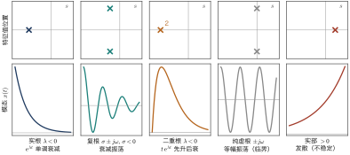

# 线性定常系统的运动分析

本章公式对多输入系统成立，因此统一用 $B$、$C$ 表示输入矩阵和输出矩阵（单输入例题也这样写）。凯莱-哈密顿法中的系数记作 $\alpha_k(t)$。

## 1. 齐次解：矩阵指数与状态转移矩阵

考虑齐次方程 $\dot x=Ax$，$x(t_0)$ 已知。此时 $u\equiv0$，解描述的是系统在初值作用下的**自由运动**。

用幂级数法求解：设 $x(t)=\sum_k b_k(t-t_0)^k$，代入方程比较同次幂系数，得 $b_1=Ab_0$，$b_2=\frac12A^2b_0$，…，一般地 $b_k=\frac1{k!}A^kb_0$；再由初值得 $b_0=x(t_0)$。于是解可以写成一个矩阵级数作用在初值上，定义

$$
\e^{A(t-t_0)}\triangleq\sum_{k=0}^{\infty}\frac{1}{k!}A^k(t-t_0)^k\quad (A^0=I),\qquad
\Phi(t-t_0)\triangleq\e^{A(t-t_0)},\qquad x(t)=\Phi(t-t_0)\,x(t_0)
$$

$\Phi$ 称为状态转移矩阵。几点说明：

- $t_0=0$ 时 $x(t)=\e^{At}x(0)$。该级数对任意 $A$、$t$ 绝对收敛（第 $k$ 项的范数不超过 $(\|A\|\,|t|)^k/k!$），因此可以逐项求导。
- $\Phi$ 只依赖 $A$ 与**时间差** $t-t_0$，与初值无关。这是定常系统特有的性质；时变系统的转移矩阵要写成 $\Phi(t,t_0)$，见[时变系统与离散系统的运动分析](tv-discrete-response.md)。
- 矩阵指数**不是**对 $A$ 逐元素取指数。例如 $A=\smat{0&1\\0&0}$ 时 $A^2=0$，级数只剩两项，$\e^{At}=I+At=\smat{1&t\\0&1}$，而不是 $\smat{1&\e^t\\1&1}$。

## 2. 状态转移矩阵的性质与自检

设 $\Phi(t)=\e^{At}$。下表中标 $^\ast$ 的四条最常用。

| | 性质 | 要点 / 用途 |
|---|---|---|
| 1 | $\dot\Phi(t)=A\Phi(t)=\Phi(t)A$ | 满足齐次方程；与 $A$ 可交换 |
| 2$^\ast$ | $\Phi(0)=I$，$\dot\Phi(0)=A$ | 反求 $A$；$\Phi(0)\ne I$ 的矩阵必不是转移矩阵 |
| 3 | $\Phi(t_1)\Phi(t_2)=\Phi(t_1+t_2)=\Phi(t_2)\Phi(t_1)$，$[\Phi(t)]^k=\Phi(kt)$ | 母性质，可推出 4、5 |
| 4$^\ast$ | $\Phi^{-1}(t)=\Phi(-t)$，可倒推 $x(0)=\Phi(-t)x(t)$ | 恒可逆，**与 $A$ 是否奇异无关** |
| 5$^\ast$ | $\Phi(t_2-t_0)=\Phi(t_2-t_1)\Phi(t_1-t_0)$ | 分段转移 |
| 6 | $\e^{(A+B)t}=\e^{At}\e^{Bt}\ (\forall t)\iff AB=BA$（这里 $B$ 是任意方阵，不是输入矩阵） | 不可交换就不能拆 |
| 7$^\ast$ | $\Lap[\Phi(t)]=(sI-A)^{-1}$，即 $\Phi(t)=\Lap^{-1}\big[(sI-A)^{-1}\big]$ | 频域法的依据；分母是特征多项式 |
| 8 | $\bar A=P^{-1}AP\Rightarrow\e^{\bar At}=P^{-1}\e^{At}P$，即 $\e^{At}=P\e^{\bar At}P^{-1}$ | 与 9、10 一起构成规范型法的依据 |
| 9 | $\e^{\Lambda t}=\diag(\e^{\lambda_1t},\dots,\e^{\lambda_nt})$ | 对角阵逐个取标量指数 |
| 10 | $m$ 阶约当块：$[\e^{Jt}]_{ij}=\frac{t^{j-i}}{(j-i)!}\e^{\lambda t}\ (j\ge i)$，其余为 0；如 $\e^{\lambda t}\smat{1&t&t^2/2\\0&1&t\\0&0&1}$ | 上三角；块越大，$t$ 的幂次越高 |

!!! tip "方法：自检与由 $\Phi$ 反求 $A$"
    - **凡是求出了 $\Phi(t)$，都要自检**：(1) $\Phi(0)=I$；(2) $\dot\Phi=A\Phi$（至少验 $\dot\Phi(0)=A$）。任一条不满足，结果必错。还可以补充：(3) 用计算器验 $\Phi(1)\Phi(2)=\Phi(3)$ 的某个元素；(4) $\det\Phi(t)=\e^{(\tr A)t}$（刘维尔公式，见[时变系统](tv-discrete-response.md)）。$A$ 为友矩阵时，$A\Phi$ 的第 1 行就是 $\Phi$ 的第 2 行，验起来很快。
    - **反求 $A$**：$A=\dot\Phi(t)|_{t=0}$，先对 $t$ 求导，再令 $t=0$。$\Phi(0)=I$ 只是必要条件，还需要 $\dot\Phi=A\Phi$ 对一切 $t$ 成立（或者用求得的 $A$ 回代重算 $\e^{At}$）。
    - **元素的含义**：$\Phi_{ij}(t)$ 是只有 $x_j(0)=1$、其余初值为 0 时 $x_i(t)$ 的响应。行看被影响的状态，列看初值来源。

??? example "例：由状态转移矩阵反求 A"
    已知下列状态转移矩阵，求 $A$ 与 $\Phi^{-1}(1)$，并指出指数因子与特征值的对应：

    $$
    \e^{At}=\bmat{2\e^{-t}-\e^{-2t}&\e^{-t}-\e^{-2t}\\-2\e^{-t}+2\e^{-2t}&-\e^{-t}+2\e^{-2t}}
    $$

    **解** 先验 $\Phi(0)=I$（必要条件）。求导

    $$
    \dot\Phi(t)=\bmat{-2\e^{-t}+2\e^{-2t}&-\e^{-t}+2\e^{-2t}\\2\e^{-t}-4\e^{-2t}&\e^{-t}-4\e^{-2t}}
    $$

    令 $t=0$ 得 $\boxed{A=\smat{0&1\\-2&-3}}$。用频域法回代：$(sI-A)^{-1}=\frac{1}{(s+1)(s+2)}\smat{s+3&1\\-2&s}$，逐元素部分分式（如 $\frac{s+3}{(s+1)(s+2)}=\frac2{s+1}-\frac1{s+2}$），结果与题给相同。

    由性质 4，

    $$
    \Phi^{-1}(1)=\Phi(-1)=\bmat{2\e-\e^2&\e-\e^2\\-2\e+2\e^2&-\e+2\e^2}\approx\bmat{-1.9525&-4.6708\\9.3415&12.0598}
    $$

    注意不是逐元素取倒数。

    特征值与指数因子一一对应：$\lambda_1=-1\leftrightarrow\e^{-t}$，$\lambda_2=-2\leftrightarrow\e^{-2t}$。按指数因子整理，

    $$
    \Phi=\bmat{2&1\\-2&-1}\e^{-t}+\bmat{-1&-1\\2&2}\e^{-2t}=v_1q_1\e^{-t}+v_2q_2\e^{-2t}
    $$

    两个模态都衰减，$\e^{-t}$ 衰减较慢，起主导作用。

    **注** 如果把 $\Phi_{21}$ 错写成 $2\e^{-t}-2\e^{-2t}$，$\Phi(0)=I$ 照样成立，但 $\dot\Phi=A\Phi$ 不成立。所以只验 $\Phi(0)=I$ 不够，必须再验 $\dot\Phi=A\Phi$ 或回代。

## 3. 运动模态

### 模态展开

一切响应形态都能从特征值读出。设 $A$ 有 $n$ 个线性无关的特征向量（$n$ 个互异特征值是充分条件），取 $P=[v_1\ \cdots\ v_n]$，$Q=P^{-1}$，记 $Q$ 的第 $i$ 行为 $q_i$。作坐标变换 $x=P\bar x$，方程解耦成 $\dot{\bar x}_i=\lambda_i\bar x_i$，各自得 $\bar x_i(t)=\e^{\lambda_it}\bar x_i(0)$；再变换回原坐标：

$$
\Phi(t)=P\e^{\Lambda t}P^{-1}=\sum_{i=1}^{n}v_iq_i\,\e^{\lambda_it},\qquad x(t)=\sum_{i=1}^{n}v_i\,\big[q_ix(0)\big]\,\e^{\lambda_it}
$$

每个 $\e^{\lambda_it}$ 称为一个**运动模态**，它决定稳定性、快慢与方向：该分量沿方向 $v_i$，大小按 $\e^{\lambda_it}$ 变化，权重为 $q_ix(0)$。

特殊初值：

- 若 $q_ix(0)=0$，模态 $\e^{\lambda_it}$ 不被激发；
- 若 $x(0)=v_i$，则 $x(t)=\e^{\lambda_it}v_i$，轨迹是沿 $v_i$ 的直线。

反过来，已知某初值下的自由运动为 $\e^{\lambda t}x(0)$，就说明 $Ax(0)=\lambda x(0)$，可以据此反求参数。例如 $A=\smat{0&a_1\\-3&a_2}$，已知 $x(0)=[1\ {-1}]\tp$ 时 $x(t)=\e^{-2t}x(0)$，由 $A[1\ {-1}]\tp=-2[1\ {-1}]\tp$ 得 $a_1=2$，$a_2=-5$。

{ .diagram }

上图概括了特征值位置与模态形态的关系：实部决定衰减或发散以及快慢，虚部决定振荡；几何重数不足的重根带来 $t\e^{\lambda t}$。具体地：

- $\mathrm{Re}\,\lambda<0$ 衰减（$|\mathrm{Re}\,\lambda|$ 越大衰减越快），$\mathrm{Re}\,\lambda>0$ 发散，$\mathrm{Re}\,\lambda=0$ 不衰减；$\mathrm{Im}\,\lambda\ne0$ 时带振荡。有正实部特征值 $\Rightarrow$ 不稳定，这指的是**存在**发散模态，并非每个状态分量都发散（严格定义见[稳定性与李雅普诺夫方法](stability.md)）。
- **实部最大的模态主导长期行为**。系统稳定时，主导的是衰减最慢的模态（如上例中的 $\e^{-t}$；快模态 $\e^{-2t}$ 约 2 s 就衰减完了）；不稳定时，主导的是增长最快的模态（如后面 $3\times3$ 例子中的 $\e^{5t}$）。
    - 拓展：小学习率下，梯度下降在极小点附近近似为梯度流 $\Delta\dot\theta=-\eta H\Delta\theta$，各方向的快慢由 $\eta\mu_i$ 决定，$\mu_i$ 为 Hessian 的特征值；离散迭代则按 $(I-\eta H)^k$ 演化，见[线性变换与离散系统描述](linear-transform.md)和[离散系统的运动分析](tv-discrete-response.md)。
- **零特征值**：模态 $\e^{0t}\equiv1$ 不衰减。单关节机械臂 $A=\smat{0&1\\0&-0.2}$，$\Phi=\smat{1&5(1-\e^{-0.2t})\\0&\e^{-0.2t}}$，$x(0)=[0\ 2]\tp$：角速度 $2\e^{-0.2t}\to0$，角度 $10(1-\e^{-0.2t})\to10$ rad，不回零。
- **重根**：只有几何重数 $\gamma=n-\rank(\lambda I-A)$ 小于代数重数（即存在 $m\ge2$ 阶约当块）时，才出现 $t\e^{\lambda t},\dots,\frac{t^{m-1}}{(m-1)!}\e^{\lambda t}$（性质 10）。在频域上，看预解矩阵约分后的公分母里有没有 $(s-\lambda)^2$。对照第 4 节的两个例子：$A=\smat{2&2&1\\1&3&1\\1&2&2}$ 的 $\lambda=1$ 二重、$\gamma=2$，不出现 $t\e^t$；友矩阵 $A=\smat{0&1&0\\0&0&1\\-2&-5&-4}$ 的 $\lambda=-1$ 二重、$\gamma=1$，出现 $t\e^{-t}$。

### 共轭复特征值：实块的矩阵指数

按[线性变换](linear-transform.md)中的实数化方法：$\lambda=\sigma+j\omega$ 对应特征向量 $v=\alpha+j\beta$，取 $P=[\alpha\ \ \beta]$（实部作第一列；两列对调则 $\omega$ 变号），得

$$
\bar A=\bmat{\sigma&\omega\\-\omega&\sigma}=\sigma I+\omega\bmat{0&1\\-1&0}
$$

$\sigma I$ 与 $\smat{0&1\\-1&0}$ 可交换，这是能用性质 6 把指数拆开的唯一依据；又 $\smat{0&1\\-1&0}^2=-I$，级数按奇偶项分别收拢成 $\cos$、$\sin$：

$$
\e^{\bar At}=\e^{\sigma t}\bmat{\cos\omega t&\sin\omega t\\-\sin\omega t&\cos\omega t},\qquad \e^{At}=P\e^{\bar At}P^{-1}\quad (\text{全程实数运算})
$$

$\e^{\sigma t}$ 是包络，$\omega$ 是转速（转一圈约 $2\pi/\omega$）。$\sigma<0$ 时相平面上是向原点收缩的螺旋线，$\sigma>0$ 时向外发散，$\sigma=0$ 时为闭合轨线。例如 $A=\smat{0&1\\-4&-2}$，$\lambda=-1\pm j\sqrt3$，转一圈约 3.6 s。

??? example "例：共轭复根的矩阵指数"
    求 $A=\smat{-2&1\\-17&-4}$ 的 $\e^{At}$。

    **解** $\varphi(s)=s^2+6s+25$，$\lambda=-3\pm j4$。取 $P=\smat{1&0\\-1&4}$，$P^{-1}=\smat{1&0\\1/4&1/4}$，得 $\bar A=P^{-1}AP=\smat{-3&4\\-4&-3}$。代入上式并整理：

    $$
    \e^{At}=\e^{-3t}\Big[\cos4t\,I+\tfrac14\sin4t\,(A+3I)\Big]
    $$

    即 $\Phi_{11}=\e^{-3t}(\cos4t+\frac14\sin4t)$，$\Phi_{12}=\frac14\e^{-3t}\sin4t$，$\Phi_{21}=-\frac{17}4\e^{-3t}\sin4t$，$\Phi_{22}=\e^{-3t}(\cos4t-\frac14\sin4t)$。用复数特征向量计算，或套第 4 节的 $2\times2$ 模板，结果相同。

## 4. 计算 $\e^{At}$ 的四种方法

| 方法 | 公式 | 适用场景（优点） | 局限 / 注意 |
|---|---|---|---|
| 定义法 | $\sum_{k}\frac{t^k}{k!}A^k$ 截断 | 计算机数值计算、$T$ 很小时的 $\Phi(T)$；三角阵、幂零阵（不必求特征值） | 一般得不到闭式 |
| 频域法 | $\Lap^{-1}\big[(sI-A)^{-1}\big]$ | 2、3 阶手算（得闭式，不必求特征向量） | 高阶求逆繁琐；伴随矩阵要转置 |
| 规范型法 | $P\e^{\Lambda t}P^{-1}$，$P\e^{Jt}P^{-1}$ | 特征向量容易求（友矩阵），或 $A$ 已是对角/约当型（模态意义最清楚） | 要求 $P$、$P^{-1}$；$\gamma$ 不足时用约当型 |
| 凯莱-哈密顿法 | $\sum_{k=0}^{n-1}\alpha_k(t)A^k$ | 任意阶，重根也能处理，3 阶重根首选（只解一个线性方程组） | 需要全部特征值；重根要补求导方程 |

!!! tip "方法：定义法与频域法"
    **定义法**：$\e^{At}=I+At+\frac12A^2t^2+\cdots$ 截断，按实际精度定项数。例如飞控每拍 $T=2$ ms，取 $\Phi(T)\approx I+AT+\frac12A^2T^2$，只做两次矩阵乘加。这里被近似的 $\Phi(T)=\e^{AT}$ 正是[精确离散化](tv-discrete-response.md)中的 $G$；而"近似离散化"只取一阶项 $I+TA$。三角阵、幂零阵的 $A^k$ 有规律，可以求和得到闭式，例如 $A=\smat{1&1\\0&-3}$ 时 $A^k=\smat{1&(1-(-3)^k)/4\\0&(-3)^k}$。

    **频域法**：对 $\dot x=Ax$ 取拉氏变换得 $sX(s)-x(0)=AX(s)$，故 $X(s)=(sI-A)^{-1}x(0)$。步骤：

    1. 写出 $sI-A$，求 $\varphi(s)=|sI-A|$ 并因式分解。$n=3$ 时 $\varphi=s^3-(\tr A)s^2+(\text{三个二阶主子式之和})s-\det A$。
    2. $(sI-A)^{-1}=\adj(sI-A)/\varphi(s)$。伴随矩阵是**代数**余子式矩阵的**转置**：$[\adj(sI-A)]_{ij}=(-1)^{i+j}\times$（划去第 $j$ 行、第 $i$ 列所得的余子式）。能约分先约分。
    3. 逐元素部分分式（单极点用留数"捂住法"；二重极点一个系数用捂住法、另一个求导），查表 $\Lap^{-1}\big[\frac1{s-\lambda}\big]=\e^{\lambda t}$，$\Lap^{-1}\big[\frac1{(s-\lambda)^2}\big]=t\e^{\lambda t}$。复极点先配方：$\Lap^{-1}\big[\frac{s-\sigma}{(s-\sigma)^2+\omega^2}\big]=\e^{\sigma t}\cos\omega t$，$\Lap^{-1}\big[\frac{\omega}{(s-\sigma)^2+\omega^2}\big]=\e^{\sigma t}\sin\omega t$。
    4. 自检。漏了转置，得到的是 $\e^{A\tp t}$：$\Phi(0)=I$ 照样成立，但 $\dot\Phi(0)=A\tp\ne A$，一验便知。

??? example "例：3×3 频域法（重根但可对角化）"
    用频域法求 $A=\smat{2&2&1\\1&3&1\\1&2&2}$ 的 $\e^{At}$，并判断主导模态。

    **解** $\varphi(s)=s^3-7s^2+11s-5=(s-1)^2(s-5)$。$\rank(I-A)=1$，所以 $\lambda=1$ 的几何重数 $\gamma=2$，等于代数重数。

    伴随矩阵各元素都含公因子 $s-1$，且不对称（$(1,2)$ 元为 $2(s-1)$，$(2,1)$ 元为 $s-1$，漏转置即错）：

    $$
    \adj(sI-A)=(s-1)\bmat{s-4&2&1\\1&s-3&1\\1&2&s-4}
    $$

    约分后 $(sI-A)^{-1}=\frac{1}{(s-1)(s-5)}\smat{s-4&2&1\\1&s-3&1\\1&2&s-4}$，公分母中没有 $(s-1)^2$，故不出现 $t\e^t$。逐元素部分分式后反变换：

    $$
    \Phi(t)=\frac{\e^{t}}4\bmat{3&-2&-1\\-1&2&-1\\-1&-2&3}+\frac{\e^{5t}}4\bmat{1&2&1\\1&2&1\\1&2&1}
    $$

    自检：$t=0$ 时两矩阵之和为 $4I$，故 $\Phi(0)=I$；$\dot\Phi(0)=\frac14\big[\smat{3&-2&-1\\-1&2&-1\\-1&-2&3}+5\smat{1&2&1\\1&2&1\\1&2&1}\big]=A$。系统不稳定，主导模态为 $\e^{5t}$。

    **注** 完整解答应包括：因式分解、秩与几何重数、预解矩阵、部分分式、$\Phi(t)$、自检、主导模态。

!!! tip "方法：特征值规范型法（性质 8 + 性质 9/10）"
    求 $\lambda_i$ → 求特征向量并排成 $P$ → $\bar A=P^{-1}AP$（对角、约当或实块）→ 用性质 9/10 写出 $\e^{\bar At}$ → $\e^{At}=P\e^{\bar At}P^{-1}$。

    - **$\lambda_i$ 的顺序必须与 $P$ 的列序一致**。
    - 只有几何重数 $\gamma_i$ 小于代数重数时才需要补广义特征向量（见[线性变换](linear-transform.md)）。重根但 $\gamma_i$ 等于代数重数时（如上面的 $3\times3$ 例子），照样取 $\gamma_i$ 个线性无关的特征向量，对角化为 $\diag(1,1,5)$。
    - 友矩阵的特征向量为 $[1\ \lambda_i\ \cdots\ \lambda_i^{n-1}]\tp$。特征值互异时 $P$ 是范德蒙德矩阵（二阶时 $\det P=\lambda_2-\lambda_1$）；友矩阵有重根时必有 $\gamma=1$，必须补广义特征向量。

    例如 $A=\smat{0&1\\-2&-3}$，取 $\lambda_1=-2$、$\lambda_2=-1$，$P=\smat{1&1\\-2&-1}$，$P^{-1}=\smat{-1&-1\\2&1}$，$\e^{At}=P\diag(\e^{-2t},\e^{-t})P^{-1}$，结果与第 2 节例题相同。$A$ 本身已是（块）对角约当型时，直接用性质 9、10 写出（见第 5 节脉冲响应的例子）。

!!! tip "方法：凯莱-哈密顿法"
    依据是凯莱-哈密顿定理：$\varphi(A)=0$。

    1. 求 $\varphi(s)$ 与全部特征值。
    2. 设 $\e^{At}=\alpha_0(t)I+\alpha_1(t)A+\cdots+\alpha_{n-1}(t)A^{n-1}$。理由：由 $A^n=-a_{n-1}A^{n-1}-\cdots-a_1A-a_0I$，任何 $A^k\,(k\ge n)$ 都能降到 $n-1$ 次以内（如二阶时 $A^3=(a_1^2-a_0)A+a_1a_0I$），于是无穷级数压缩成 $n$ 项。
    3. 列方程：两边右乘特征向量 $v_i$，由 $A^kv_i=\lambda_i^kv_i$，矩阵等式变成标量等式。记 $r(\lambda)=\alpha_0+\alpha_1\lambda+\cdots+\alpha_{n-1}\lambda^{n-1}$：
        - 单根：$r(\lambda_i)=\e^{\lambda_it}$。全为单根时 $V\alpha=[\e^{\lambda_1t}\ \cdots\ \e^{\lambda_nt}]\tp$，$V$ 的第 $i$ 行为 $[1\ \lambda_i\ \cdots\ \lambda_i^{n-1}]$（范德蒙德矩阵，可逆）。
        - $m$ 重根：再补 $r'(\lambda)=t\e^{\lambda t},\dots,r^{(m-1)}(\lambda)=t^{m-1}\e^{\lambda t}$。这里是**对 $\lambda$ 求导，$t$ 当常数**：$\frac{\mathrm d}{\mathrm d\lambda}\e^{\lambda t}=t\e^{\lambda t}$，不是 $\lambda\e^{\lambda t}$；左边 $\alpha_0$ 求导后消失；不除以 $k!$。这相当于让两个单根靠拢，对差商取极限。不论几何重数是多少都要补（上面可对角化的 $3\times3$ 例子用此法也要补），方程总数恰为 $n$，方程组总有唯一解。
    4. 解出 $\alpha_k(t)$（都是 $t$ 的函数），代回合成，并自检。

    常用结果：

    - 二阶互异根：$\alpha_1=\dfrac{\e^{\lambda_1t}-\e^{\lambda_2t}}{\lambda_1-\lambda_2}$，$\alpha_0=\dfrac{\lambda_1\e^{\lambda_2t}-\lambda_2\e^{\lambda_1t}}{\lambda_1-\lambda_2}$；
    - 三重根：方程组 $\smat{1&\lambda&\lambda^2\\0&1&2\lambda\\0&0&2}\alpha=\smat{\e^{\lambda t}\\t\e^{\lambda t}\\t^2\e^{\lambda t}}$，解得 $\alpha_2=\frac{t^2}2\e^{\lambda t}$，$\alpha_1=(t-\lambda t^2)\e^{\lambda t}$，$\alpha_0=\big(1-\lambda t+\frac{\lambda^2t^2}2\big)\e^{\lambda t}$。

??? example "例：二阶凯莱-哈密顿法（上三角阵）"
    用凯莱-哈密顿法求 $A=\smat{1&1\\0&-3}$ 的 $\e^{At}$。

    **解** $\varphi(s)=(s-1)(s+3)=s^2+2s-3$，故 $\varphi(A)=A^2+2A-3I=0$（常数项要写成 $-3I$）。$\lambda_1=1$，$\lambda_2=-3$，由二阶公式

    $$
    \alpha_1=\frac{\e^t-\e^{-3t}}4,\qquad \alpha_0=\frac{3\e^t+\e^{-3t}}4,\qquad
    \Phi=\alpha_0I+\alpha_1A=\bmat{\e^t&(\e^t-\e^{-3t})/4\\0&\e^{-3t}}
    $$

    $\Phi_{21}\equiv0$ 表示 $x_1(0)$ 影响不到 $x_2$：不稳定模态 $\e^t$ 只出现在 $x_1$ 中，$x_2=\e^{-3t}x_2(0)$ 始终衰减。若取 $x(0)=[1\ -4]\tp$，则 $x_1=\e^t-(\e^t-\e^{-3t})=\e^{-3t}$，$x(t)\to0$，但这只是发散模态没有被激发，系统仍不稳定。

??? example "例：3×3 凯莱-哈密顿法（单根加二重根）"
    求 $A=\smat{-1&1&0\\-4&3&0\\1&0&2}$ 的 $\e^{At}$。

    **解** $|sI-A|=(s-2)(s-1)^2$。设 $\e^{At}=\alpha_0I+\alpha_1A+\alpha_2A^2$，方程为 $r(2)=\e^{2t}$，$r(1)=\e^{t}$，$r'(1)=\alpha_1+2\alpha_2=t\e^{t}$，解得

    $$
    \alpha_0=\e^{2t}-2t\e^{t},\qquad \alpha_1=-2\e^{2t}+(3t+2)\e^{t},\qquad \alpha_2=\e^{2t}-(t+1)\e^{t}
    $$

    再算 $A^2=\smat{-3&2&0\\-8&5&0\\1&1&4}$，代入 $\alpha_0I+\alpha_1A+\alpha_2A^2$ 即得 $\e^{At}$。

!!! tip "方法：2×2 速算模板"
    $A=\smat{a&b\\c&d}$：$\varphi(s)=s^2-(\tr A)\,s+\det A$。频域法用

    $$
    (sI-A)^{-1}=\frac{1}{\varphi(s)}\bmat{s-d&b\\c&s-a}
    $$

    （主对角互换、副对角变号）。把凯莱-哈密顿法的二阶结果整理成可直接套用的形式：

    $$
    \begin{aligned}
    &\text{互异实根：}&&\e^{At}=\frac{(A-\lambda_2I)\,\e^{\lambda_1t}-(A-\lambda_1I)\,\e^{\lambda_2t}}{\lambda_1-\lambda_2}\\
    &\text{二重根：}&&\e^{At}=\e^{\lambda t}\big[I+t(A-\lambda I)\big]\\
    &\text{共轭复根 }\sigma\pm j\omega\text{：}&&\e^{At}=\e^{\sigma t}\Big[\cos\omega t\;I+\frac{\sin\omega t}{\omega}\,(A-\sigma I)\Big]
    \end{aligned}
    $$

    互异根的例子见第 2 节例题（$v_iq_i$ 分解）和第 5 节阶跃响应例题。二重根例：$A=\smat{0&1\\-1&-2}$，$\lambda=-1$，$\e^{At}=\e^{-t}\smat{1+t&t\\-t&1-t}$。

??? example "例：友矩阵的凯莱-哈密顿法与阶跃响应"
    $\dot x=Ax+Bu$，$A=\smat{0&1&0\\0&0&1\\-2&-5&-4}$，$B=[0\ 0\ 1]\tp$。(1) 求特征值及重根的代数、几何重数；(2) 用凯莱-哈密顿法求 $\e^{At}$ 并自检；(3) 求 $u=1(t)$、$x(0)=0$ 时的 $x(t)$ 与 $x(\infty)$；(4) $t\e^{-t}$ 来自哪个特征值？哪个模态衰减最慢？

    **解** (1) 友矩阵末行为 $[-a_0\ -a_1\ -a_2]$，故 $|\lambda I-A|=\lambda^3+4\lambda^2+5\lambda+2=(\lambda+1)^2(\lambda+2)$。$\lambda=-1$ 的代数重数为 2；$-I-A=\smat{-1&-1&0\\0&-1&-1\\2&5&3}$ 的秩为 2，$\gamma=1<2$，不可对角化（有一个 2 阶约当块）。

    (2) 设 $\e^{At}=\alpha_0I+\alpha_1A+\alpha_2A^2$。三个方程依次为：单根 $r(-2)=\e^{-2t}$；求导行 $r'(-1)=\alpha_1-2\alpha_2=t\e^{-t}$；重根 $r(-1)=\e^{-t}$。系数矩阵的逆是整数阵 $\smat{1&2&0\\2&3&-2\\1&1&-1}$。$A^2$ 的第 3 行等于 $[-2\ -5\ -4]A$，最容易算错：

    $$
    \bmat{1&-2&4\\0&1&-2\\1&-1&1}\bmat{\alpha_0\\\alpha_1\\\alpha_2}=\bmat{\e^{-2t}\\t\e^{-t}\\\e^{-t}}\ \Rightarrow\ \bmat{\alpha_0\\\alpha_1\\\alpha_2}=\bmat{2t\e^{-t}+\e^{-2t}\\(3t-2)\e^{-t}+2\e^{-2t}\\(t-1)\e^{-t}+\e^{-2t}},\qquad A^2=\bmat{0&0&1\\-2&-5&-4\\8&18&11}
    $$

    代入 $\alpha_0I+\alpha_1A+\alpha_2A^2$ 逐元素合并（如 $(2,1)$ 元 $=-2\alpha_2$，$(3,1)$ 元 $=-2\alpha_1+8\alpha_2$）：

    $$
    \boxed{\e^{At}=\bmat{2t\e^{-t}+\e^{-2t}&(3t-2)\e^{-t}+2\e^{-2t}&(t-1)\e^{-t}+\e^{-2t}\\(2-2t)\e^{-t}-2\e^{-2t}&(5-3t)\e^{-t}-4\e^{-2t}&(2-t)\e^{-t}-2\e^{-2t}\\(2t-4)\e^{-t}+4\e^{-2t}&(3t-8)\e^{-t}+8\e^{-2t}&(t-3)\e^{-t}+4\e^{-2t}}}
    $$

    自检：$t=0$ 时为 $I$。形如 $(at+b)\e^{-t}+c\e^{-2t}$ 的函数在 0 处的导数为 $a-b-2c$，九个元素依次得 $0,1,0;\ 0,0,1;\ -2,-5,-4$，正是 $A$。全时域验证：由 $A^3=-4A^2-5A-2I$，$\dot\Phi=A\Phi$ 等价于 $\dot\alpha_0=-2\alpha_2$、$\dot\alpha_1=\alpha_0-5\alpha_2$、$\dot\alpha_2=\alpha_1-4\alpha_2$，逐一验证均成立。

    (3) $\det A=-2\ne0$，$A^{-1}=\smat{-5/2&-2&-1/2\\1&0&0\\0&1&0}$。$x=A^{-1}(\Phi-I)B$，其中 $(\Phi-I)B$ 就是 $\Phi-I$ 的第 3 列（$-1$ 只出现在第 3 个分量）：

    $$
    \boxed{x(t)=\Big[\tfrac12-t\e^{-t}-\tfrac12\e^{-2t}\quad(t-1)\e^{-t}+\e^{-2t}\quad(2-t)\e^{-t}-2\e^{-2t}\Big]\tp},\qquad x(\infty)=-A^{-1}B=\Big[\tfrac12\ \ 0\ \ 0\Big]\tp
    $$

    稳态存在是因为特征值实部全为负。复核：$x(0)=0$，代回 $\dot x=Ax+Bu$ 三式均成立。

    (4) $t\e^{-t}$ 来自二重根 $\lambda=-1$（$\gamma=1$，2 阶约当块，性质 10）。$\lambda=-1$ 对应的模态衰减最慢，其中又以 $t\e^{-t}$ 最慢（$t\e^{-t}/\e^{-t}=t\to\infty$），$\e^{-2t}$ 最快。$t\e^{-t}$ 先升后降（$t=1$ 时达到峰值 $1/\e$），并不说明不稳定。

    **注** 完整解答应包括：两种重数、含求导行的方程组、$\alpha_k$、$A^2$、九个元素、自检、$A^{-1}$、$x(t)$、$x(\infty)$、回代复核、$t\e^{-t}$ 的来源。

## 5. 非齐次方程的解与典型输入响应

### 零输入分量与零状态分量

用常数变易（积分因子）法：把 $\dot x=Ax+Bu$ 移项后左乘 $\e^{-At}$（性质 4 保证它存在），由乘积求导法则和性质 1，**左边恰好是一个全微分**：

$$
\e^{-At}\big[\dot x-Ax\big]=\e^{-At}Bu\ \Rightarrow\ \frac{\mathrm d}{\mathrm dt}\big[\e^{-At}x\big]=\e^{-At}Bu\ \Rightarrow\ \e^{-At}x(t)-\e^{-At_0}x(t_0)=\int_{t_0}^{t}\e^{-A\tau}Bu(\tau)\dd\tau
$$

两边左乘 $\e^{At}$，用性质 3、4 合并：

$$
x(t)=\underbrace{\Phi(t-t_0)\,x(t_0)}_{\text{零输入分量（自由运动）}}+\underbrace{\int_{t_0}^{t}\Phi(t-\tau)Bu(\tau)\dd\tau}_{\text{零状态分量（强迫运动）}},\qquad y(t)=Cx(t)+Du(t)
$$

第一项只与初值有关（"记忆"），第二项只与输入有关（"累积"）。第二项是卷积，$\Phi(t)B$ 相当于从输入到状态的冲激响应 $h(t)$。在频域上对应 $X(s)=(sI-A)^{-1}x(0)+(sI-A)^{-1}BU(s)$（性质 7）。教材中也称为零输入响应和零状态响应。

### 三种典型输入的现成公式

设 $u_r$ 为常值幅值：

| 输入 | 条件 | 状态响应 $x(t)$ |
|---|---|---|
| 脉冲 $u=u_r\delta(t)$ | **对 $A$ 无要求** | $\e^{At}\big[x(0)+Bu_r\big]$ |
| 阶跃 $u=u_r\cdot1(t)$ | $\det A\ne0$ | $\e^{At}x(0)+A^{-1}\big(\e^{At}-I\big)Bu_r$ |
| 斜坡 $u=u_r\,t$ | $\det A\ne0$ | $\e^{At}x(0)+\big[A^{-2}\big(\e^{At}-I\big)-A^{-1}t\big]Bu_r$ |

**稳态值（阶跃输入）**：当**全部** $\mathrm{Re}\,\lambda_i(A)<0$ 时，

$$
x(\infty)=-A^{-1}Bu_r,\qquad y(\infty)=(D-CA^{-1}B)u_r=G(0)u_r
$$

不用解微分方程就能直接读出，它就是平衡方程 $Ax_\infty+Bu_r=0$ 的解。阶跃响应还可以改写为

$$
x(t)=x(\infty)+\Phi(t)\big[x(0)-x(\infty)\big]
$$

即初始偏差按自由运动衰减。偏差恰为特征向量时，轨迹是直线：例如偏差为 $[1\ 1]\tp$、对应 $\lambda=-2$ 的特征向量时，轨迹沿直线 $x_1=x_2-1$ 趋于稳态。

**$A^{-1}$ 从哪里来**：$u_r$ 是常数，可以提到积分号外，作代换 $\sigma=t-\tau$ 后逐项积分：

$$
\int_0^t\e^{A\sigma}\dd\sigma=\sum_{k\ge0}\frac{A^kt^{k+1}}{(k+1)!}=A^{-1}(\e^{At}-I)
$$

斜坡输入同理得 $\int_0^t\e^{A\sigma}(t-\sigma)\dd\sigma=A^{-2}(\e^{At}-I)-A^{-1}t$。$A$ 奇异时积分照样存在，只是没有这个闭式，只能回到卷积计算。

**脉冲输入**等价于把初值瞬间抬高 $Bu_r$：$x(0^+)=x(0)+Bu_r$。

??? example "例：约当型系统的脉冲响应"
    $A=\smat{-1&1&0\\0&-1&0\\0&0&-2}$，$B=[0\ 1\ 1]\tp$，$C=[1\ 1\ 1]$，$x(0)=[1\ 1\ 1]\tp$，$u=\delta(t)$，求 $x(t)$、$y(t)$。

    **解** $A$ 已是块对角约当型，由性质 9、10 直接写出 $\Phi(t)=\smat{\e^{-t}&t\e^{-t}&0\\0&\e^{-t}&0\\0&0&\e^{-2t}}$。$x(0)+B=[1\ 2\ 2]\tp$，

    $$
    x(t)=\Phi(t)\bmat{1\\2\\2}=\bmat{(1+2t)\e^{-t}\\2\e^{-t}\\2\e^{-2t}},\qquad y=(3+2t)\e^{-t}+2\e^{-2t},\qquad y(0^+)=5
    $$

!!! tip "方法：求非齐次响应的步骤"
    1. 求 $\Phi$ 并自检；
    2. 验 $\det A\ne0$，求 $A^{-1}$；
    3. 零输入分量 $\Phi x(0)$（不要漏）加零状态分量（**$B$ 放在最右**；$B=e_j$ 时 $(\Phi-I)B$ 就是 $\Phi-I$ 的第 $j$ 列）；
    4. $y=Cx+Du$（本章例题中 $D=0$）；
    5. 复核：$t=0$ 的值、稳态值、用卷积或代回方程。

    另一种做法：$X(s)=(sI-A)^{-1}\big[x(0)+Bu_r/s\big]$，部分分式后反变换。这是卷积的 $s$ 域形式，$A$ 奇异时也能用。

    例如 $A=\smat{0&1\\-2&-3}$，$B=\smat{0\\1}$，$A^{-1}=\smat{-3/2&-1/2\\1&0}$，$x(0)=[1\ 0]\tp$，$u=1(t)$：$x=\big[\tfrac12+\e^{-t}-\tfrac12\e^{-2t}\ \ \ -\e^{-t}+\e^{-2t}\big]\tp\to[\tfrac12\ \ 0]\tp$。

??? example "例：阶跃、斜坡响应与输出"
    $\dot x=\smat{0&1\\-6&-5}x+\smat{1\\0}u$，$y=[1\ \ -1]\,x$。(1) 求 $\Phi(t)$；(2) $u=1(t)$、$x(0)=[1\ 0]\tp$：求 $x(t)$、$y(t)$ 及稳态值；(3) $u=t\cdot1(t)$、$x(0)=0$：求 $y(t)$，并说明其中随 $t$ 线性增长的项从何而来。

    **解** (1) $\varphi=s^2+5s+6$，$\lambda=-2,-3$，套互异实根模板：

    $$
    \Phi(t)=(A+3I)\e^{-2t}-(A+2I)\e^{-3t}=\bmat{3\e^{-2t}-2\e^{-3t}&\e^{-2t}-\e^{-3t}\\-6\e^{-2t}+6\e^{-3t}&-2\e^{-2t}+3\e^{-3t}}
    $$

    自检：$\Phi(0)=I$，$\dot\Phi(0)=\smat{-6+6&-2+3\\12-18&4-9}=A$。

    (2) $\det A=6\ne0$，$A^{-1}=\frac16\smat{-5&-1\\6&0}$。注意 $B=[1\ 0]\tp$（不是 $[0\ 1]\tp$），$(\Phi-I)B$ 取第 1 列。零输入分量 $\Phi x(0)$ 就是 $\Phi$ 的第 1 列；零状态分量 $A^{-1}(\Phi-I)B=\big[\tfrac56-\tfrac32\e^{-2t}+\tfrac23\e^{-3t}\ \ \ -1+3\e^{-2t}-2\e^{-3t}\big]\tp$。相加：

    $$
    \boxed{x(t)=\bmat{\frac56+\frac32\e^{-2t}-\frac43\e^{-3t}\\[2pt]-1-3\e^{-2t}+4\e^{-3t}},\quad y(t)=x_1-x_2=\frac{11}6+\frac92\e^{-2t}-\frac{16}3\e^{-3t}}
    $$

    $x(\infty)=-A^{-1}B=[\tfrac56\ \ -1]\tp$，$y(\infty)=-CA^{-1}B=g(0)=\tfrac{11}6$。复核：$x(0)=[1\ 0]\tp$；用卷积 $\int_0^t\Phi(\sigma)B\dd\sigma$（$\sigma=t-\tau$）计算，得到同一零状态分量。稳态值可以从三方面核对：公式、$t\to\infty$ 的极限、平衡方程。

    (3) $A^{-2}=\frac1{36}\smat{19&5\\-30&-6}$，

    $$
    y=C\big[A^{-2}(\Phi-I)-A^{-1}t\big]B=\boxed{\tfrac{11}6\,t-\tfrac{49}{36}+\tfrac94\e^{-2t}-\tfrac89\e^{-3t}}
    $$

    线性项 $\frac{11}6t=-CA^{-1}B\cdot t$ 来自斜坡输入本身（经静态增益 $g(0)$ 放大），**不是**系统的模态：$\e^{-2t}$、$\e^{-3t}$ 全部衰减，系统稳定。

    **注** $A^{-1}$ 与 $\e^{At}$ 可交换，但 $B$ 必须放在最右；$x(0)\ne0$ 时不要漏掉零输入分量；$C=[1\ -1]$ 中有减号。

!!! warning "易错点：A 奇异时阶跃公式失效"
    单关节机械臂 $A=\smat{0&1\\0&-0.2}$，$B=\smat{0\\2}$。$\det A=0$，$A^{-1}$ 不存在，只能算卷积（$\Phi$ 照样可逆：$\det\Phi=\e^{-0.2t}$）。零初态、$u=1$ 时，$\Phi(\sigma)B=\big[10(1-\e^{-0.2\sigma})\ \ 2\e^{-0.2\sigma}\big]\tp$，

    $$
    x(t)=\int_0^t\Phi(\sigma)B\dd\sigma=\Big[10t-50(1-\e^{-0.2t})\quad 10(1-\e^{-0.2t})\Big]\tp
    $$

    用频域法更快：$X_1(s)=\frac{2}{s^2(s+0.2)}=\frac{10}{s^2}-\frac{50}{s}+\frac{50}{s+0.2}$。角速度 $\to10$ rad/s，角度 $\approx10t-50$ 无界漂移：关节角是纯积分量，没有回复力矩，因而没有稳态角度。**零特征值意味着不衰减的模态，表现为位置漂移**，系统不是渐近稳定的。

### 与离散化的联系

在非齐次解中取 $t_0=kT$、$t=(k+1)T$，得

$$
x((k+1)T)=\Phi(T)x(kT)+\int_{kT}^{(k+1)T}\Phi((k+1)T-\tau)Bu(\tau)\dd\tau
$$

$G=\Phi(T)$ 可以离线算好；由 $[\Phi(T)]^k=\Phi(kT)$，$k$ 步转移就是一步转移的 $k$ 次幂。零阶保持下第二项等于 $Hu(kT)$，见[连续系统的离散化](tv-discrete-response.md)。

## 6. 常见错误与概念辨析

1. **$\e^{At}$ 就是对 $A$ 逐元素取指数。** 错。$\e^{At}$ 由幂级数定义；$A=\smat{0&1\\0&0}$ 时 $\e^{At}=\smat{1&t\\0&1}$。
2. **$A$ 奇异则 $\Phi(t)$ 不可逆。** 错。$\Phi^{-1}(t)=\Phi(-t)$ 恒存在（不是逐元素取倒数），$\det\Phi(t)=\e^{(\tr A)t}\ne0$（单关节机械臂为 $\e^{-0.2t}$）。
3. **满足 $\Phi(0)=I$ 的矩阵函数就是状态转移矩阵。** 错。这只是必要条件，还要 $\dot\Phi=A\Phi$（或 $\Phi(t_1)\Phi(t_2)=\Phi(t_1+t_2)$）。
4. **$\e^{(A+B)t}=\e^{At}\e^{Bt}$（$B$ 为任意方阵）总成立。** 错。当且仅当 $AB=BA$；不可交换时展开到 $t^2$ 项，交叉项就对不上。
5. **有重根则必含 $t\e^{\lambda t}$；或者反过来，元素必是各 $\e^{\lambda_it}$ 的线性组合。** 都不对，要看几何重数：$A=\smat{2&2&1\\1&3&1\\1&2&2}$ 的 $\gamma=2$，不含 $t\e^t$；友矩阵 $\smat{0&1&0\\0&0&1\\-2&-5&-4}$ 的 $\gamma=1$，含 $t\e^{-t}$。
6. **重根可对角化时，凯莱-哈密顿法不用补求导方程。** 错。用特征多项式时重根一律要补，$t\e^{\lambda t}$ 项会在合成时抵消。
7. **不同方法算出的 $\e^{At}$ 形式不同，必有一个错了。** 不一定。$\Phi$ 由 $A$ 唯一确定，化简后必相同；可以用两三种方法互相验算。
8. **阶跃、斜坡公式可直接套；$\det A\ne0$ 就有稳态值 $-A^{-1}Bu_r$。** 错。先验 $\det A\ne0$（$A$ 奇异只能用卷积；脉冲公式对 $A$ 无要求）；稳态存在还要求全部特征值实部为负。
9. **斜坡输入下输出线性增长，说明系统不稳定。** 错。线性项 $-CA^{-1}Bu_rt$ 来自输入本身。
10. **系统不稳定，则每个状态分量都发散。** 错。只是存在发散模态；$A=\smat{1&1\\0&-3}$ 时 $x_2=\e^{-3t}x_2(0)$ 始终衰减。
11. **某个初值下 $x(t)\to0$，说明系统稳定。** 错。可能只是发散模态没有被激发，如 $A=\smat{1&1\\0&-3}$、$x(0)=[1\ -4]\tp$。
