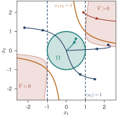

# 李雅普诺夫方程与非线性系统分析

上一章（[稳定性与李雅普诺夫方法](stability.md)）给出了李雅普诺夫第二法的一般判据。本章解决两个具体问题：线性系统的李雅普诺夫函数怎样系统地求出来（李雅普诺夫方程），以及非线性系统怎样构造李雅普诺夫函数（克拉索夫斯基法、变量梯度法）并估计吸引区。

用第二法下结论时，有三处必须写清楚：

1. 先写出平衡点，并说明它是唯一的；
2. 用 Sylvester 准则判 $P$（或 $S(x)$、$G\tp G-I$）的定号性；
3. 要得出“大范围”渐近稳定的结论，必须补验 $V$ 的径向无界性。

## 1. 线性定常连续系统的李雅普诺夫方程

### 方程的来历与判据

对 $\dot x=Ax$，取二次型 $V=x\tp Px$（$P$ 实对称）。沿轨线求导：

$$
\dot V=\dot x\tp Px+x\tp P\dot x=x\tp(A\tp P+PA)x .
$$

希望 $\dot V$ 负定，就令 $\dot V=-x\tp Qx$，得到李雅普诺夫方程

$$
A\tp P+PA=-Q\qquad(A\tp\text{ 在左；常取 }Q=I)
$$

!!! note "定理（充要条件）"
    原点渐近稳定（等价于 $A$ 的特征值全在左半平面；对线性定常系统即大范围渐近稳定）$\iff$ 任给正定对称阵 $Q$，李雅普诺夫方程有**唯一正定对称解** $P$，且

    $$
    P=\int_0^\infty\e^{A\tp t}Q\,\e^{At}\dd t .
    $$

使用时要注意以下几点：

- **先给 $Q>0$，再求 $P$**：解出 $P>0$ $\Rightarrow$ 渐近稳定；解出的 $P$ 不正定 $\Rightarrow$ 非渐近稳定（这是定理的逆否命题，详见第 2 节）。
- $Q$ 也可以取正半定阵（如 $\diag(0,\dots,0,1)$），只要 $\dot V=-x\tp Qx$ 沿非零轨线不恒为零。
- 方程有唯一解 $\iff$ 对一切 $i,j$（**包括 $i=j$**）$\lambda_i+\lambda_j\ne0$。所以 $A$ 有零特征值或纯虚特征值时，方程没有唯一解。
- 自检：$A$ 对称、$Q=I$ 时，$P=-\frac12A^{-1}$。

!!! tip "方法：给 $Q$ 求 $P$ 的标准流程"
    1. **平衡点**：解 $Ax_e=0$，$\det A\ne0$ $\Rightarrow$ $x_e=0$ 唯一。
    2. **设 $P$**：取 $Q=I$，设对称阵 $P=\smat{p_{11}&p_{12}\\p_{12}&p_{22}}$，共 $n(n+1)/2$ 个未知数（二阶 3 个，三阶 6 个）。
    3. **列方程**：算出 $A\tp P$，则 $PA=(A\tp P)\tp$；比较 $A\tp P+PA=-I$ 两边的上三角元素，得 $n(n+1)/2$ 个独立线性方程，解出 $P$。
    4. **判 $P$**：用 Sylvester 准则写出各阶顺序主子式 $\Delta_i$；含参数时保留参数的符号，由 $\Delta_i>0$ 定出范围。
    5. **下结论**：写出 $V=x\tp Px$、$\dot V=-x\tp Qx$；由 $V\ge\lambda_{\min}(P)\|x\|^2$ 知 $V$ 径向无界 $\Rightarrow$ 大范围渐近稳定。
    6. **自检**：把 $P$ 回代 $A\tp P+PA=-Q$；再用特征值（第一法）或劳斯判据交叉验证，参数范围应一致。

    例如 $A=\smat{-3&1\\1&-1}$：解得 $P=\frac14\smat{1&1\\1&3}$，$\Delta_1=\frac14$，$\Delta_2=\frac18$，正定；$A$ 对称，与 $-\frac12A^{-1}$ 一致；特征值 $\lambda=-2\pm\sqrt2$，确实稳定。

??? example "例：含参数 $k$ 的李雅普诺夫方程，三种方法互验"
    系统 $\dot x=\smat{-4k&4k\\2k&-6k}x$，$k\ne0$。(1) 证明平衡状态唯一；(2) 取 $Q=I$，写出三个独立方程并解出 $P(k)$；(3) 用 Sylvester 准则确定 $k$ 的范围，写出 $V$ 并验证径向无界；(4) 用第一法验证；(5) 用 $A\tp+A$ 的定号性（克拉索夫斯基判据的线性特例，见第 3 节）再判一次并比较；(6) 回代验证。

    **解** (1) $\det A=24k^2-8k^2=16k^2\ne0$，$Ax_e=0$ 只有零解，$x_e=0$ 唯一。

    (2) 计算

    $$
    A\tp P=\bmat{-4kp_{11}+2kp_{12} & -4kp_{12}+2kp_{22}\\ 4kp_{11}-6kp_{12} & 4kp_{12}-6kp_{22}},\qquad PA=(A\tp P)\tp .
    $$

    逐元素比较 $A\tp P+PA=-I$ 的上三角元：

    $$
    \begin{cases}(1,1):\ -8kp_{11}+4kp_{12}=-1\\ (1,2):\ 4kp_{11}-10kp_{12}+2kp_{22}=0\\ (2,2):\ 8kp_{12}-12kp_{22}=-1\end{cases}
    $$

    消元：由 (1,1) 得 $p_{11}=\frac{1+4kp_{12}}{8k}$，由 (2,2) 得 $p_{22}=\frac{1+8kp_{12}}{12k}$，代入 (1,2) 并乘 6 得 $4-40kp_{12}=0$，即 $p_{12}=\frac{1}{10k}$。于是

    $$
    \boxed{P(k)=\frac{1}{40k}\bmat{7&4\\4&6}}
    $$

    (3) $P(k)$ 含 $1/k$，判定时要保留 $k$ 的符号：$\Delta_1=\frac{7}{40k}>0\iff k>0$；$\Delta_2=\frac{13}{800k^2}>0$ 恒成立。故 $P>0\iff\boxed{k>0}$。

    此时 $V=\dfrac{7x_1^2+8x_1x_2+6x_2^2}{40k}$，$\dot V=-(x_1^2+x_2^2)$ 负定；$\lambda_{\min}(P)=\frac{13-\sqrt{65}}{80k}>0$，$V\ge\lambda_{\min}\|x\|^2$，径向无界。结论：$k>0$ 时原点**大范围渐近稳定**。

    (4) $\lvert sI-A\rvert=s^2+10ks+16k^2=(s+2k)(s+8k)$，$\lambda=-2k,\ -8k$，全为负 $\iff k>0$，与 (3) 一致。

    (5) $A\tp+A=\smat{-8k&6k\\6k&-12k}$，$\Delta_1=-8k<0$，$\Delta_2=60k^2>0$，负定 $\iff k>0$。三种判据给出的范围相同。原因是 $A=kA_0$，其中 $A_0=\smat{-4&4\\2&-6}$ 稳定且 $A_0\tp+A_0<0$，三种判据都只看 $k$ 的符号，$A\tp+A$ 判据的保守性没有显现出来（反例见第 3 节）。

    (6) $A\tp P=\frac1{40}\smat{-20&-4\\4&-20}$，$PA=\frac1{40}\smat{-20&4\\-4&-20}$，相加得 $-I$（与 $k$ 无关）。另一个自检：$P(k)=P(1)/k$。

## 2. 离散系统与时变系统的李雅普诺夫方程

### 离散李雅普诺夫方程

对 $x(k+1)=Gx(k)$，取 $V=x\tp(k)Px(k)$，其差分为

$$
\Delta V=V[x(k+1)]-V[x(k)]=x\tp(k)\big(G\tp PG-P\big)x(k) .
$$

令 $\Delta V=-x\tp Qx$，得离散李雅普诺夫方程

$$
G\tp PG-P=-Q\qquad(\text{是“减 }P\text{”；}G\tp\text{ 在左、}G\text{ 在右})
$$

!!! note "定理"
    原点渐近稳定（等价于全部 $\lvert\lambda_i(G)\rvert<1$）$\iff$ 任给 $Q>0$，方程有唯一正定对称解 $P$，且 $P=\sum_{k=0}^{\infty}(G\tp)^kQ\,G^k$。

    方程有唯一解 $\iff$ 对一切 $i,j$（含 $i=j$）$\lambda_i\lambda_j\ne1$；所以 $G$ 有 $\lvert z\rvert=1$ 的特征值时没有唯一解。

解法与第 1 节的流程相同，只有三处不同：平衡点由 $(G-I)x_e=0$ 求；列方程时先算 $PG$ 再左乘 $G\tp$；自检时看 $\lvert\lambda_i(G)\rvert<1$。

### 时变情形

对时变系统取 $V=x\tp P(t)x$，则 $\dot V=x\tp(\dot P+A\tp P+PA)x$。令其等于 $-x\tp Q(t)x$，得到连续和离散两种形式（离散时 $G(k)$ 也写作 $G(k+1,k)$）：

$$
\text{连续：}\ \dot P(t)=-A\tp(t)P(t)-P(t)A(t)-Q(t);\qquad\text{离散：}\ G\tp(k)P(k+1)G(k)-P(k)=-Q(k)
$$

??? example "例：带动量的梯度下降的收敛性（离散李雅普诺夫方程）"
    带动量的梯度下降在一个曲率为 $\lambda$ 的方向上，参数误差满足

    $$
    e(k+1)=(1+\beta-\eta\lambda)e(k)-\beta e(k-1),
    $$

    其中 $\eta$ 为学习率，$\beta$ 为动量系数。取 $x(k)=[e(k)\ \ e(k-1)]\tp$，得 $x(k+1)=Gx(k)$，$G=\smat{1+\beta-\eta\lambda&-\beta\\1&0}$。设 $\lambda=1,\ \beta=\frac16$。

    (1)–(4) $\eta=\frac13$：证明 $x_e$ 唯一；取 $Q=I$ 解 $P$，判定其正定性，写出 $V$；用特征值验证。(5) $\eta=3$ 时重解。(6) 求 $\eta$ 的上界；说明“$P$ 不正定”能断言什么。

    **解** (1) $G=\smat{5/6&-1/6\\1&0}$，$\det(G-I)=\frac13\ne0$（一般地 $\det(G-I)=\eta\lambda>0$），故 $x_e=0$ 唯一。

    (2) 展开 $G\tp PG-P=-I$（先算 $PG$ 再左乘 $G\tp$），比较 (1,1)、(1,2)、(2,2) 元：

    $$
    \begin{cases}(1,1):\ -\frac{11}{36}p_{11}+\frac53p_{12}+p_{22}=-1\\ (1,2):\ -\frac{5}{36}p_{11}-\frac76p_{12}=0\\ (2,2):\ \frac1{36}p_{11}-p_{22}=-1\end{cases}
    $$

    由 (1,2) 得 $p_{12}=-\frac{5}{42}p_{11}$，由 (2,2) 得 $p_{22}=1+\frac{p_{11}}{36}$，代入 (1,1) 得 $-\frac{10}{21}p_{11}=-2$。于是

    $$
    \boxed{P=\bmat{21/5&-1/2\\-1/2&67/60}}
    $$

    (3) $\Delta_1=\frac{21}5>0$，$\Delta_2=\frac{111}{25}>0$，$P>0$。$V=\frac{21}5x_1^2-x_1x_2+\frac{67}{60}x_2^2$，$\Delta V=-(x_1^2+x_2^2)$ 负定；正定二次型径向无界，故原点大范围渐近稳定，训练（沿该方向）收敛。

    (4) $\lvert zI-G\rvert=z^2-\frac56z+\frac16=(z-\frac12)(z-\frac13)$，两根模都小于 1，与 (3) 一致。两根都是正实数，所以误差单调收敛、不振荡。

    (5) $\eta=3$：$G=\smat{-11/6&-1/6\\1&0}$，同法解得 $P=\smat{-7/5&-11/30\\-11/30&173/180}$，$\Delta_1=-\frac75<0$，$\Delta_2=-\frac{37}{25}<0$，所以 $P$ **不定**（不是负定），系统非渐近稳定。特征值 $z=\frac{-11\pm\sqrt{97}}{12}\approx-0.096,\ -1.737$，$\lvert z_2\rvert>1$，振荡发散。

    (6) 稳定要求 $\eta<\frac{2+2\beta}{\lambda}=\boxed{7/3}$：$\eta=\frac13$ 在稳定一侧，$\eta=3$ 在不稳定一侧。用 Jury 判据可得完整稳定域：$\lvert\beta\rvert<1$ 且 $0<\eta\lambda<2+2\beta$。动量把学习率上界从 $2/\lambda$ 放宽到 $(2+2\beta)/\lambda$。在边界 $\eta=\frac73$ 处 $z=-1$，方程组奇异，解不出唯一的 $P$。“$P$ 不正定”能断言什么，见下面的易错点。

!!! warning "易错点：“解出的 $P$ 不正定”只能断言什么（$Q>0$）"
    **只能断言**：该参数下系统**非渐近稳定**（这是“渐近稳定 $\iff$ $P$ 唯一正定”的逆否命题），训练不能保证收敛。

    **不能断言**：

    1. 是发散还是临界——要看特征值（上例 $\lvert z_2\rvert\approx1.74>1$ 才确定发散）；
    2. 发散的方式与快慢；
    3. 所有初值都发散——初值落在稳定模态 $z_1\approx-0.096$ 的特征向量 $[z_1\ \ 1]\tp$ 上时仍收敛；
    4. 其他曲率 $\lambda$ 的方向是否收敛。

    严格地说，$Q>0$ 时 $P$ 不正定已经意味着不稳定，不必再看特征值：取任意小的 $x(0)\ne0$ 使 $V[x(0)]\le0$，由于 $\Delta V=-x\tp Qx<0$，$V[x(k)]$ 单调减小趋于 $-\infty$，故 $\|x(k)\|\to\infty$。课程的答法以上面“只能断言非渐近稳定”为准。

!!! tip "方法：离散系统用第二法判稳"
    1. **平衡点**：解 $(G-I)x_e=0$（不是 $Gx_e=0$），$\det(G-I)\ne0$ $\Rightarrow$ $x_e=0$ 唯一。
    2. **取 $P=I$**：$\Delta V=x\tp(G\tp G-I)x$（不是 $GG\tp-I$），用 Sylvester 准则判定号：负定 $\Rightarrow$ 渐近稳定；正定 $\Rightarrow$ 不稳定；不定 $\Rightarrow$ 无结论，改解 $G\tp PG-P=-I$（未知数与方程各 $n(n+1)/2$ 个，三阶为 6 个）。
    3. **$\Delta V$ 正定时为什么不稳定**（上一章的不稳定定理是对连续系统陈述的，离散情形可以直接论证）：设 $\mu>0$ 为 $G\tp G-I$ 的最小特征值，则 $\|x(k+1)\|^2=\|x(k)\|^2+\Delta V\ge(1+\mu)\|x(k)\|^2$，于是 $\|x(k)\|^2\ge(1+\mu)^k\|x(0)\|^2\to\infty$。
    4. **第一法互验**：看 $\lvert\lambda_i(G)\rvert<1$，看的是**模**，不是实部。

??? example "例：用 $P=I$ 判三阶离散系统的稳定性"
    $G=\smat{1&4&0\\-3&-2&-3\\2&0&0}$，判断原点的稳定性。

    **解** $\det(G-I)=-36\ne0$，平衡点 $x_e=0$ 唯一。

    $$
    G\tp G-I=\bmat{13&10&9\\10&19&6\\9&6&8},
    $$

    $\Delta_1=13$，$\Delta_2=147$，$\Delta_3=249$，全为正，$G\tp G-I$ 正定（最小特征值 $\mu\approx1.01$），故原点**不稳定**。

    互验：$\lvert zI-G\rvert=z^3+z^2+10z+24=(z+2)(z^2-z+12)$，特征值的模为 $2,\ 2\sqrt3,\ 2\sqrt3$，全都大于 1（$z=-2$ 实部为负照样不稳定）。从 $x(0)=[1\ 0\ 0]\tp$ 递推，$V[x(k)]=\|x(k)\|^2$ 依次为 $1,\ 14,\ 134,\ 2102$，“广义能量”不断增大。

## 3. 非线性系统与克拉索夫斯基法

### 非线性系统分析的困难

通常归纳为三点：

1. 可能有多个平衡点，稳定性是某个平衡点的**局部**性质，而且与初始条件有关；
2. 不满足叠加原理，一般求不出解析解，只能“不解方程”判稳定；线性化（第一法）只能给出局部结论；
3. 李雅普诺夫函数**没有通用的构造方法**，克拉索夫斯基法、变量梯度法等特定构造法给出的都只是充分条件。

### 克拉索夫斯基法

考虑 $\dot x=f(x)$，$f(0)=0$，$f$ 可微。记雅可比矩阵 $J(x)=\dfrac{\partial f}{\partial x\tp}$，判别矩阵 $S(x)=J\tp(x)+J(x)$。取 $V(x)=f\tp(x)f(x)$，由于 $\dot f=J\dot x=Jf$，

$$
\dot V=\dot f\tp f+f\tp\dot f=f\tp\big(J\tp+J\big)f=f\tp S(x)\,f
$$

!!! note "克拉索夫斯基判据"
    $S(x)$ 对一切 $x\ne0$ 负定 $\Rightarrow$ 原点渐近稳定；若再有 $\|x\|\to\infty$ 时 $V=f\tp f\to\infty$，则原点大范围渐近稳定。

- 它只是**充分条件**：$S(x)$ 不负定（判据失效）不等于系统不稳定。
- **线性定常系统**：$J\equiv A$，判别矩阵就是 $A\tp+A$。$A\tp+A<0$ 相当于“取 $P=I$ 已经使 $\dot V<0$”，是李雅普诺夫方程的特例，因而更**保守**。反例：$A=\smat{-1&a\\0&-1}$ 对任意 $a$ 都稳定，但 $A\tp+A<0$ 要求 $\lvert a\rvert<2$；$a=10$ 时判据失效，而李雅普诺夫方程仍解得 $P=\smat{1/2&5/2\\5/2&51/2}>0$。

!!! tip "方法：克拉索夫斯基法的四个步骤"
    1. **平衡点**：解 $f(x)=0$，说明 $x_e=0$ 唯一（$V=f\tp f$ 之所以正定，正是靠 $f=0\Leftrightarrow x=0$）。
    2. **资格检查**：每个 $f_i$ 都含 $x_i$，且 $\partial f_i/\partial x_i<0$ 对**一切** $x$ 成立。$S$ 的对角元等于 $2\,\partial f_i/\partial x_i$，这一条不通过，$S(x)$ 就不可能处处负定，方法不适用。
    3. **判别矩阵**：求 $J(x)$ 与 $S(x)=J\tp+J$，用 Sylvester 准则判负定（奇数阶主子式为负、偶数阶为正），要对一切 $x$ 成立。
    4. **结论**：写出 $V=f\tp f$，$\dot V=f\tp Sf<0$；$V$ 不是二次型，径向无界性要专门论证，论证通过才能下“大范围渐近稳定”的结论。

??? example "例：用克拉索夫斯基法证明大范围渐近稳定"
    $\dot x_1=-3x_1+x_2$，$\dot x_2=x_1-x_2-x_2^3$，判断原点的稳定性。

    **解** ① 平衡点：由第一式 $x_2=3x_1$，代入第二式得 $-x_1(2+27x_1^2)=0$，所以 $x_e=0$ 唯一。

    ② 资格检查：$\partial f_1/\partial x_1=-3$，$\partial f_2/\partial x_2=-1-3x_2^2$，对一切 $x$ 都小于 0，通过。

    ③ 判别矩阵：

    $$
    S(x)=\bmat{-6&2\\2&-2-6x_2^2},\qquad \Delta_1=-6<0,\quad \Delta_2=8+36x_2^2>0,
    $$

    处处负定。

    ④ $V=(-3x_1+x_2)^2+(x_1-x_2-x_2^3)^2$。径向无界的论证：

    $$
    x\tp f=-3x_1^2+2x_1x_2-x_2^2-x_2^4\le-(2-\sqrt2)\|x\|^2,
    $$

    因为二次部分的矩阵 $\smat{-3&1\\1&-1}$ 的最大特征值为 $-2+\sqrt2$。由柯西不等式 $\|x\|\|f\|\ge-x\tp f$，得 $\|f\|\ge(2-\sqrt2)\|x\|$，从而 $V\ge(6-4\sqrt2)\|x\|^2$，径向无界。结论：原点**大范围渐近稳定**。若只用线性部分的 $P$（第 1 节方法框中的 $A=\smat{-3&1\\1&-1}$），只能得到局部结论。

    **另法**（题目只要求“用直接法证明”时最快）：取 $V=\frac12\|x\|^2$，$\dot V=x\tp f\le-(2-\sqrt2)\|x\|^2<0$（$x\ne0$），$V$ 径向无界，同样得到大范围渐近稳定。

??? example "例：用克拉索夫斯基法确定参数范围"
    $\dot x_1=ax_1+x_2$，$\dot x_2=x_1-x_2+bx_2^5$，确定 $a,b$ 使原点大范围渐近稳定。

    **解** 判别矩阵

    $$
    S=\bmat{2a&2\\2&-2+10bx_2^4} .
    $$

    要求 $\Delta_1=2a<0$；$\Delta_2=-4(a+1)+20abx_2^4>0$ 对一切 $x_2$ 成立，当且仅当常数项 $-4(a+1)>0$ 且 $x_2^4$ 的系数 $20ab\ge0$。于是

    $$
    \boxed{a<-1,\ b\le0}
    $$

    资格检查 $\partial f_2/\partial x_2=-1+5bx_2^4<0$ 同样要求 $b\le0$。此时 $x\tp f\le x\tp\smat{a&1\\1&-1}x$，后者负定，同上例可证 $V=f\tp f$ 径向无界。

## 4. 变量梯度法与吸引区估计

变量梯度法不直接猜 $V$，而是先假设 $V$ 的梯度 $\nabla V$ 的形式，由 $\dot V=(\nabla V)\tp f$ 的定号要求和“梯度场旋度为零”定出系数，再积分得到 $V$。

!!! tip "方法：变量梯度法（六步）"
    ① 设 $\nabla V=[a_{11}x_1+\cdots+a_{1n}x_n,\ \dots,\ a_{n1}x_1+\cdots+a_{nn}x_n]\tp$（$a_{ij}$ 可以是常数，也可以是状态的函数），写出 $\dot V=(\nabla V)\tp f(x)$ 并按项归并。

    ② 按 $\dot V$ 负定（至少负半定）的要求定出部分系数，常令不定号的交叉项系数为零。

    ③ 旋度为零（$\nabla V$ 的雅可比矩阵对称）：$\partial\nabla V_i/\partial x_j=\partial\nabla V_j/\partial x_i$，共 $n(n-1)/2$ 个等式，定出其余系数。

    ④ **复验** $\dot V$ 的定号性及其成立的区域。这一步不可省：前两步只照顾了部分项。交叉项常用 $2ab\le a^2+b^2$ 放缩。

    ⑤ 沿坐标轴分段积分求 $V$（旋度为零保证积分与路径无关），并验证 $V$ 正定：

    $$
    V=\int_0^{x_1}\!\nabla V_1(x_1,0,\dots,0)\dd x_1+\int_0^{x_2}\!\nabla V_2(x_1,x_2,0,\dots,0)\dd x_2+\cdots+\int_0^{x_n}\!\nabla V_n(x_1,\dots,x_n)\dd x_n
    $$

    ⑥ 确定渐近稳定的范围：$\dot V$ 在全空间负定且 $V$ 径向无界 $\Rightarrow$ 大范围渐近稳定。否则，先由 ④ 得到一个含原点、其中 $\dot V<0\ (x\ne0)$ 的简单区域 $D$（如下例的条带 $\lvert x_1\rvert<1$），再取 $V$ 的等值集 $\Omega_c=\{V<c\}$（含原点的有界连通部分），$c$ 取使 $\Omega_c\subset D$ 的最大值，$\Omega_c$ 就是吸引区的估计。之所以要用等值集，是因为等值集是正不变集，而 $D$ 一般不是。$D$ 取整个 $\{\dot V<0\}\cup\{0\}$ 时，$c^*=\min_{\dot V=0,\,x\ne0}V$，得到的估计最大。

??? example "例：变量梯度法——局部渐近稳定与吸引区估计"
    研究 $\dot x_1=-x_1+2x_1^2x_2$，$\dot x_2=-x_2$ 在原点的稳定性：按六步法作答，再用第一法、克拉索夫斯基法对照。

    **解** 平衡点：$\dot x_2=0\Rightarrow x_2=0$，再由 $-x_1=0\Rightarrow x_1=0$，$x_e=0$ 唯一。

    ① 设 $\nabla V=[a_{11}x_1+a_{12}x_2\ \ \ a_{21}x_1+a_{22}x_2]\tp$，

    $$
    \dot V=(a_{11}x_1+a_{12}x_2)(-x_1+2x_1^2x_2)+(a_{21}x_1+a_{22}x_2)(-x_2),
    $$

    按项归并：

    $$
    \dot V=-a_{11}x_1^2+2a_{11}x_1^3x_2+2a_{12}x_1^2x_2^2-(a_{12}+a_{21})x_1x_2-a_{22}x_2^2 .
    $$

    ②③ 旋度条件：$\frac{\partial\nabla V_1}{\partial x_2}=a_{12}$，$\frac{\partial\nabla V_2}{\partial x_1}=a_{21}$，故 $a_{12}=a_{21}$（二阶只有 $n(n-1)/2=1$ 个等式）。为消去不定号的交叉项 $-(a_{12}+a_{21})x_1x_2$，最简单的取法是 $a_{12}=a_{21}=0$（$2a_{12}x_1^2x_2^2$ 也随之消失）；平方项为负需要 $a_{11},a_{22}>0$，取 $a_{11}=a_{22}=1$。于是 $\nabla V=[x_1\ \ x_2]\tp$，

    $$
    \dot V=-x_1^2+2x_1^3x_2-x_2^2 .
    $$

    ④ 由 $(x_1^3-x_2)^2\ge0$ 得 $2x_1^3x_2\le x_1^6+x_2^2$，所以 $\dot V\le-x_1^2(1-x_1^4)$：$0<\lvert x_1\rvert<1$ 时 $\dot V<0$；$x_1=0$ 时 $\dot V=-x_2^2<0$（$x_2\ne0$）。故在条带 $\lvert x_1\rvert<1$ 内 $\dot V<0$（$x\ne0$）。$\dot V$ 在全空间并不负定，如 $\dot V(2,2)=24>0$。

    ⑤ $V=\int_0^{x_1}x_1\dd x_1+\int_0^{x_2}x_2\dd x_2=\boxed{\tfrac12(x_1^2+x_2^2)}$，正定。

    ⑥ 取条带内最大的等值集 $\Omega=\{V<\frac12\}=\{x_1^2+x_2^2<1\}$：

    - (a) $\Omega\subset\{\lvert x_1\rvert<1\}$，在 $\Omega\setminus\{0\}$ 上 $\dot V<0$；
    - (b) $V$ 沿轨线下降，从 $\Omega$ 内出发的轨线到不了边界 $V=\frac12$，所以 $\Omega$ 是正不变集；
    - (c) $V$ 严格下降且有下界 0，故 $x(t)\to0$。

    { .diagram }

    图中圆盘为吸引区估计 $\Omega$，橙线是真实吸引区的边界 $x_1x_2=1$，红线是一条冲出条带的轨线。

    结论：原点**渐近稳定**，吸引区估计为 $\boxed{x_1^2+x_2^2<1}$，**不是大范围**的（真实吸引区为 $x_1x_2<1$）。

    条带 $\lvert x_1\rvert<1$ 不是不变集：红线从 $(0.9,2)$ 出发，$\dot x_1=2.34>0$，冲出条带，在 $t=\frac12\ln2.25\approx0.41$ 时发散。若对整个 $\{\dot V<0\}$ 取最大的等值集，$c^*=\frac{4}{3\sqrt3}\approx0.77$，即 $x_1^2+x_2^2<\frac{8}{3\sqrt3}\approx1.54$，这个更大的估计也是正确的。

    **对照** 第一法：$J(0)=-I$，$\lambda=-1,-1$，局部渐近稳定，一致。克拉索夫斯基法：$S(x)=\smat{-2+8x_1x_2&2x_1^2\\2x_1^2&-2}$，一阶顺序主子式 $\Delta_1=-2+8x_1x_2$ 在 $x_1x_2>\frac14$ 时为正（资格检查 $\partial f_1/\partial x_1=-1+4x_1x_2<0$ 也不是处处成立），判据在全空间**失效**。但“判据失效”不等于“系统不稳定”。

## 5. 常见错误与概念辨析

??? question "李雅普诺夫方程判据也只是充分条件吗？"
    不是。对线性定常系统它是**充要**的：$A$ 的特征值全具负实部 $\iff$ $A\tp P+PA=-I$ 有唯一正定解。

??? question "李雅普诺夫方程写成 $AP+PA\tp=-Q$ 行不行？"
    不行。$A\tp$ 在左，来自 $\dot V=x\tp(A\tp P+PA)x$。第 1 节的含参数例若误写成 $AP+PA\tp=-I$，会解得 $\frac{1}{80k}\smat{17&7\\7&9}$：$k$ 的范围碰巧不变（$A$ 与 $A\tp$ 特征值相同），但 $P$ 和 $V$ 都错了，回代即可发现。

??? question "先取 $P>0$，算出 $Q=-(A\tp P+PA)$ 不正定，能判不稳定吗？"
    不能。必须先给定 $Q>0$ 再解 $P$，用 $P$ 的定号性下结论。

??? question "离散方程可以写成 $G\tp PG+P=-Q$ 吗？取 $P=I$ 时看 $GG\tp-I$ 吗？"
    都不对。离散方程是“减 $P$”：$G\tp PG-P=-Q$；取 $P=I$ 时看 $G\tp G-I$。第 2 节动量梯度下降的例子如果误用“加 $P$”，会解得 $P=\diag(0,-1)$，从而误判“训练不收敛”。

??? question "离散系统特征值实部为负就稳定吗？"
    不是，看模。$z=-2$、$z\approx-1.74$ 实部为负，都不稳定。复根 $\frac{1\pm j\sqrt{47}}2$ 的模是 $\sqrt{12}=2\sqrt3$，别忘了开方。

??? question "二阶 $P$ 的 $\Delta_1<0$、$\Delta_2<0$，是负定吗？"
    不是。二阶时 $\Delta_2<0$ 就是**不定**；负定要求 $\Delta_1<0$、$\Delta_2>0$（奇负偶正）。

??? question "$A\tp+A$ 不负定（克拉索夫斯基判据失效），系统就不稳定吗？"
    不是。它只是充分条件，而且比李雅普诺夫方程更保守。

??? question "线性部分的 $P$ 正定，非线性系统就大范围渐近稳定吗？"
    不是，只能得到局部结论。第 3 节第一个例子若用线性部分的 $V=x\tp Px$ 去分析原系统，有 $\dot V(-54,6)=936>0$。大范围的结论要靠 $V=f\tp f$ 这类全局的 $V$。

??? question "克拉索夫斯基法的资格检查只需在原点附近 $\partial f_i/\partial x_i<0$ 吗？"
    不是，要对**一切** $x$ 成立，否则 $S(x)$ 不可能处处负定。

??? question "变量梯度法定完系数就可以积分了吗？"
    不行。第 ④ 步复验不可省。另外交叉项的系数是 $-(a_{12}+a_{21})$，别漏了 $a_{21}$。

??? question "$\dot V<0$ 的区域就是吸引区吗？"
    不是。必须取 $V$ 的等值集 $\{V<c\}$（正不变集）。第 4 节例子中的条带 $\lvert x_1\rvert<1$ 就不是不变集。

??? question "李雅普诺夫方程中的 $Q$ 必须正定吗？"
    不必。可以取正半定，只要 $\dot V=-x\tp Qx$ 沿非零轨线不恒为零。
