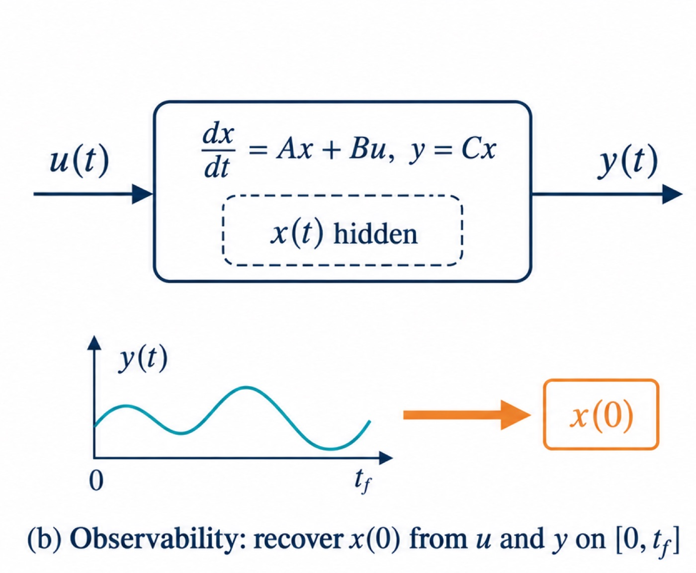

# 能观性与对偶原理

能观性回答的问题是：能否由输入和测得的输出唯一确定系统的初始状态。它与[能控性](controllability.md)在数学上完全对偶。本章介绍能观性的各种判据，并与能控性逐条对照；然后讲对偶原理，最后讨论离散系统的能控、能达、能观性，以及采样周期对它们的影响。

## 1. 能观性的定义与 Gram 判据

### 定义

- 若在有限区间 $[t_0,t_f]$ 上，由已知的 $u(t)$ 和测得的 $y(t)$ 能**唯一**确定 $x(t_0)$，称 $x(t_0)$ **能观**；全部状态都能观，称系统**完全能观**。
- 能观性**只与 $(A,C)$ 有关**：$u$ 已知，它产生的响应可以算出来，从 $y$ 中减去 $C\!\int_0^t\e^{A(t-\tau)}Bu\dd\tau+Du$ 即可。所以分析时令 $u=0$，只研究 $y(t)=C\e^{At}x(0)$。
- 意义：能由输出反推出全部状态，是设计状态观测器的前提。“能否设计全维状态观测器”就是问系统是否完全能观（见[状态反馈与状态观测器](state-feedback.md)）。

<figure markdown>
  { width="480" loading=lazy }
  <figcaption>能观性：由已知的输入 $u$ 和测得的输出 $y$ 唯一确定初始状态 $x(0)$。</figcaption>
</figure>

### Gram 矩阵判据与基本判据

能观性 Gram 矩阵与初始状态的还原公式（$u\equiv0$）：

$$
G_o(0,t_f)=\int_0^{t_f}\e^{A\tp t}C\tp C\,\e^{At}\dd t,\qquad
x(0)=G_o^{-1}(0,t_f)\int_0^{t_f}\e^{A\tp t}C\tp y(t)\dd t
$$

!!! note "Gram 判据与基本判据（理论判据）"
    - **Gram 判据**：完全能观 $\iff$ $G_o(0,t_f)$ 非奇异。定常系统的结论与 $t_f>0$ 的长短无关；时变系统把 $\e^{At}$ 换成 $\Phi(t,t_0)$ 照样适用，与能控性的 $G_c$ 相同。
    - **基本判据**：完全能观 $\iff$ $C\e^{At}$ 的 $n$ 个列函数在 $[0,t_f]$ 上线性无关。

    二者等价：$G_o$ 正是这 $n$ 个列函数的 Gram 矩阵。

还原公式的来历：在 $y=C\e^{At}x(0)$ 两边左乘 $\e^{A\tp t}C\tp$，再在 $[0,t_f]$ 上积分即得。反之，若有 $x_0\ne0$ 使 $G_ox_0=0$，则 $\int_0^{t_f}\|C\e^{At}x_0\|^2\dd t=x_0\tp G_ox_0=0$，即从 $x_0$ 出发的输出 $y\equiv0$，与从 $x(0)=0$ 出发的输出分不开。

例（双积分器 $A=\smat{0&1\\0&0}$）：

- 测位置，$c=[1\ \ 0]$：$G_o=\smat{t_f&t_f^2/2\\t_f^2/2&t_f^3/3}$，$\det G_o=t_f^4/12>0$，能观；
- 只测速度，$c=[0\ \ 1]$：$G_o=\smat{0&0\\0&t_f}$ 奇异，$y\equiv x_2(0)$，看不到初始位置，不能观。

## 2. 能观性的代数判据（与能控性对照）

$$
\text{完全能观}\iff\rank Q_o=n,\ \ Q_o=\bmat{C\\CA\\\vdots\\CA^{n-1}}\ (nq\times n)
\iff\rank\bmat{\lambda_iI-A\\C}=n\ \ (\text{对 }A\text{ 的每个特征值 }\lambda_i)
$$

下表把能控性（详见[能控性](controllability.md)）与能观性的判据逐条对照。能控性看 $(A,B)$、看 $B$ 的**行**；能观性看 $(A,C)$、看 $C$ 的**列**。

| | 能控性 | 能观性 |
|---|---|---|
| 秩判据 | $Q_c=[B\ AB\ \cdots\ A^{n-1}B]$（$n\times np$）秩为 $n$ | $Q_o=[C;\,CA;\,\cdots;\,CA^{n-1}]$（$nq\times n$）秩为 $n$ |
| PBH | $\rank[\lambda_iI-A,\ B]=n$（左右拼接） | $\rank\smat{\lambda_iI-A\\C}=n$（上下堆叠） |
| 特征向量形式 | 不存在左特征向量 $w\tp A=\lambda w\tp$ 使 $w\tp B=0$ | 不存在右特征向量 $Av=\lambda v$ 使 $Cv=0$ |
| 对角型（特征值互异） | $B$ 无全零行 | $C$ 无全零列 |
| 约当判据一 | 各块**末行**对应的 $B$ 的行不全为零 | 各块**首列**对应的 $C$ 的列不全为零 |
| 约当判据二 | 同一特征值各块末行对应的 $B$ 的行线性无关 | 同一特征值各块首列对应的 $C$ 的列线性无关 |
| 速判（$n\ge2$） | $\rank B<\max_i\gamma_i$，或单输入 $Ab=\lambda b$ $\Rightarrow$ 不能控 | $\rank C<\max_i\gamma_i$，或单输出 $cA=\lambda c$ $\Rightarrow$ 不能观 |

为什么“控看末行、观看首列”：约当块内信号由末位流向首位，输入从末位进、输出从首位取，才能管住整个块。以 $J_2$ 为例，$\det Q_c=-b_2^2$，$\det Q_o=c_1^2$。

### 使用要点

- **秩判据**：不能观子空间为 $\Ker Q_o$。秩判据的来历（同时也是由 $y$ 反求 $x(0)$ 的快速方法）：$u=0$ 时 $[y;\,\dot y;\,\cdots;\,y^{(n-1)}]_{t=0}=Q_o\,x(0)$，$Q_o$ 列满秩 $\iff$ $x(0)$ 唯一。例如双积分器取 $c=[1\ \ 0]$，测得 $y=2-t$，则 $y(0)=2$、$\dot y(0)=-1$，$x(0)=[2\ \ {-1}]\tp$。
- **PBH**：只在特征值处验算，秩亏的 $\lambda_i$ 就是**不能观模态**。对角型中第 $i$ 列全零，就是“$\bar c_i=0$：输出看不到第 $i$ 个模态”。例如 $g(s)=\frac{s+3}{(s+1)(s+2)(s+3)}$ 的对角型实现 $c=[1\ \ {-1}\ \ 0]$，$\lambda=-3$ 被对消、不能观（见[规范型、结构分解与最小实现](canonical-decomposition.md)）。一般的 $A$ 先化规范型再看 $\bar C=CP$（$\bar Q_o=Q_oP$，能观性不变）。
- **速判（续）**：$A$ 的第 $i$ 列只有对角元非零，且 $C$ 的第 $i$ 列为零 $\Rightarrow$ $x_i$ 不能观（取 $v=e_i$；与能控性中“$\dot x_i$ 只含 $x_i$、不含 $u$”对偶）。例如 $A=\smat{0&1\\1&0}$，$c=[1\ \ 1]$：$cA=c$，$Q_o=\smat{1&1\\1&1}$ 秩为 1，不能观模态是 $\lambda=-1$（$v=[1\ \ {-1}]\tp$）。
- 例（能否设计全维观测器）：$A=\diag\{J_1(1),J_2(2)\}$，$c=[1\ \ 1\ \ 0]$。用判据一：两块首列对应的 $c_1$、$c_2$ 都非零，系统能观，可以设计全维观测器。

!!! tip "方法：选判据的顺序与作答三步"
    1. **先看 $A$ 的结构、核对前提**：对角且特征值互异，用对角线判据；约当型（包括对角元重复）先用 $\gamma_i=n-\rank(\lambda_iI-A)$ 数块，一块用判据一、多块用判据二；先试速判。这种方法最快，还能指出不能观模态。
    2. **一般的 $A$ 用秩判据**：单输出算 $\det Q_o$；多输出时 $Q_o$ 是长方阵，只能求秩，按下面的规则截断。
    3. **特征值好求、又要指出哪个模态不能观时用 PBH**；特征多项式难以分解时不用。Gram 判据、基本判据是理论判据，手算一般不用。

    **长方阵 $Q_o$ 的截断**（$Q_o$ 只有 $n$ 列，秩不超过 $n$）：

    1. 凑够 $n$ 个线性无关行（找到一个 $n$ 阶非零子式）即可停止，判能观；
    2. $\rank C=r$ 时，最多算到 $CA^{n-r}$；
    3. 某一**整块** $CA^k$（$q$ 行全部算完）加入后秩不增加，以后各块也不会再增加，即可停止，判不能观。只算了块中的一行、这一行不增秩，不能下此结论。例：$A=\smat{0&1&0\\0&0&1\\0&0&0}$，$C=\smat{0&0&1\\1&0&0}$，$CA$ 的第 1 行为零，但第 2 行 $[0\ \ 1\ \ 0]$ 使 $\rank Q_o=3$，系统能观。

    **作答三步**：

    - **前提**：特征值是否互异；每个特征值有几块 $\gamma_i$；用判据一还是判据二，各块首列对应 $C$ 的第几列。
    - **复核**：写出 $Q_o$（或所取的 $n$ 行）的非零子式与秩，或 PBH 矩阵的秩；多输出**不能**写 $\det Q_o$。
    - **结论**：系统（不）完全能观，并指出不能观模态。

??? example "例：规范型判据的前提——对角元重复与同一特征值的多个约当块"
    判断能观性：先判断能否使用规范型判据（前提是否成立），再用秩判据或 PBH 复核，最后写结论。

    (1) $A=\diag(-4,-4,1)$，$c=[1\ \ 1\ \ 4]$；

    (2) $A=\smat{-3&1&0\\0&-3&0\\0&0&-3}$，$C=\smat{1&0&4\\2&0&8}$（先划分约当块，指出用判据一还是判据二、各块首列对应 $C$ 的第几列）。

    **解** (1) **前提**：对角元 $-4$ 重复，特征值不互异，对角线判据的**前提不成立**，不能因为 $c$ 没有零列就判能观。把 $A$ 看成三个一阶约当块，$\lambda=-4$ 有两块（$\gamma=3-\rank(-4I-A)=2$），用**约当判据二**：两块首列对应 $c$ 的第 1、2 列，即标量 $1$、$1$，线性相关，所以不完全能观。速判也能得出：单输出，$\rank c=1<\gamma=2$。

    **复核**：$cA=[-4\ \ {-4}\ \ 4]$，$cA^2=[16\ \ 16\ \ 4]$，

    $$
    Q_o=\bmat{1&1&4\\-4&-4&4\\16&16&4},
    $$

    第 1、2 列相同，$\det Q_o=0$；二阶子式 $\left|\begin{smallmatrix}1&4\\-4&4\end{smallmatrix}\right|=20\ne0$，所以 $\rank Q_o=2<3$。

    **结论**：(1) **不完全能观**，$\rank Q_o=2$；不能观的是 $\lambda=-4$ 的模态，$\Ker Q_o=\mathrm{span}\{[1\ \ {-1}\ \ 0]\tp\}$。

    (2) **划块**：$A=\diag\{J_2(-3),J_1(-3)\}$（前两行两列为一块，第 3 行第 3 列为一块）；$\gamma=3-\rank(-3I-A)=2$，同一特征值有两个块，判据一的前提不成立，用**约当判据二**。

    **首列**：$J_2$ 的首列（第 1 列）对应 $C$ 的**第 1 列** $[1\ \ 2]\tp$；$J_1$ 的首列（第 3 列）对应 $C$ 的**第 3 列** $[4\ \ 8]\tp=4\,[1\ \ 2]\tp$。二者线性相关，所以不完全能观。$C$ 的第 2 列全零，对应的是 $J_2$ 的末列，与判据无关。

    **复核**：$CA=\smat{-3&1&-12\\-6&2&-24}$，$CA^2=\smat{9&-6&36\\18&-12&72}$。按截断法：$\rank C=1$，$\rank[C;\,CA]=2$，加入整块 $CA^2$ 后仍为 2，所以 $\rank Q_o=2<3$。PBH：$\lambda=-3$ 时 $\smat{\lambda I-A\\C}$ 的非零行为 $[0\ \ {-1}\ \ 0]$、$[1\ \ 0\ \ 4]$、$[2\ \ 0\ \ 8]$，秩为 $2<3$。

    **结论**：(2) 用**判据二**，首列对应 $C$ 的**第 1、3 列**，线性相关，**不完全能观**，$\rank Q_o=2$，不能观方向为 $[4\ \ 0\ \ {-1}]\tp$。

    **注** 误用判据一会错判为能观。“第 2 列全零所以不能观”是结论碰巧对、理由错：变式 $C=\smat{1&0&4\\2&0&9}$ 的第 2 列仍全零，但首列组 $\smat{1&4\\2&9}$ 满秩，系统能观（$\rank Q_o=3$）。

??? example "例：长方阵 $Q_o$ 只算到足够的行"
    $A=\smat{1&3&2\\1&4&6\\2&1&7}$，$C=\smat{1&0&0\\2&1&0}$。$Q_o$ 是 $6\times3$ 的长方阵，说明手算时如何只算到足够多的行就停止。

    **解** **前提**：$A$ 不是对角型或约当型，特征多项式 $\varphi(s)=s^3-12s^2+26s-23$ 无有理根，化规范型、用 PBH 都做不下去，所以用**秩判据**。

    **逐行算**：记 $C$ 的两行为 $c_1=[1\ \ 0\ \ 0]$、$c_2=[2\ \ 1\ \ 0]$，二者线性无关，$\rank C=2$，还差 1 行，且最多只需算到 $CA^{n-r}=CA$。先算 $c_1A=[1\ \ 3\ \ 2]$，

    $$
    \det\bmat{c_1\\c_2\\c_1A}=\left|\begin{matrix}1&0&0\\2&1&0\\1&3&2\end{matrix}\right|=2\ne0,
    $$

    所以 $\rank Q_o=3=n$，停止，不必再算 $c_2A$ 和 $CA^2$。

    **结论**：系统**完全能观**，只用到 $C$ 的两行加 $c_1A$ 一行（依据是截断规则 1、2）。

    **注** 巧解（PBH 的特征向量形式，不必求特征值）：$Cv=0\Rightarrow v=ke_3$，而 $Ae_3=[2\ \ 6\ \ 7]\tp$ 与 $e_3$ 不共线，$\Ker C$ 中没有 $A$ 的特征向量，所以能观。

## 3. 对偶原理

原系统 $\Sigma_1$：$\dot x=Ax+Bu,\ y=Cx$（$p$ 个输入、$q$ 个输出）；对偶系统 $\Sigma_2$ 有 $q$ 个输入、$p$ 个输出（状态 $z$、输入 $v$、输出 $w$）。能观问题可以化为对偶系统的能控问题，第 2 节对照表的两列正是由此互推的。

!!! note "对偶原理"
    $\Sigma_1$ 完全能控 $\iff$ $\Sigma_2$ 完全能观；$\Sigma_1$ 完全能观 $\iff$ $\Sigma_2$ 完全能控（**交叉**对应）。

对偶系统有两种写法。二者的 $Q$ 阵各块只差因子 $(-1)^k$，秩相同，所以判能控、能观的**结论相同**：

| | 课程写法 | 常见教材写法 |
|---|---|---|
| 对偶系统 $\Sigma_2$ | $\dot z=-A\tp z+C\tp v,\ \ w=B\tp z$ | $(A\tp,C\tp,B\tp)$：$\dot z=A\tp z+C\tp v,\ \ w=B\tp z$ |
| $\Sigma_2$ 的 $Q_c$、$Q_o$ | 第 $k$ 块（$k\ge0$）：$(-1)^k(CA^k)\tp$、$(-1)^k(A^kB)\tp$ | $Q_{c2}=Q_{o1}\tp$，$Q_{o2}=Q_{c1}\tp$ |
| 传递函数、特征值 | $G_2(s)=-G_1\tp(-s)$，特征值反号 | $G_2(s)=G_1\tp(s)$，特征值相同 |
| 与规范型的关系 | 特征多项式为 $(-1)^n\varphi(-s)$，**不是**能观型 | 能控规范型**转置**即能观规范型 |

课程写成 $-A\tp$ 的原因：这样 $\Phi_2(t,t_0)=\Phi_1\tp(t_0,t)$，$\Sigma_1$ 的 $G_c$ 与 $\Sigma_2$ 的 $G_o$ 完全相同（时变系统也成立）。

!!! tip "方法：对偶系统的能控能观性"
    1. 交叉对应：对偶系统能控 $\iff$ 原系统能观，对偶系统能观 $\iff$ 原系统能控；
    2. 直接对原系统算 $\det Q_o$、$\det Q_c$，含参数时令其不为零；
    3. 取交集写出条件，可以按对偶系统再算一遍自检。

??? example "例：使对偶系统既能控又能观的参数条件"
    $A=\smat{0&-a\\1&-b}$，$B=\smat{10\\0}$，$C=[0\ \ d]$，要求对偶系统能控且能观，求参数条件。

    **解** $Q_c=[B\ \ AB]=\smat{10&0\\0&10}$，$\det Q_c=100\ne0$，原系统恒能控，即对偶系统恒能观；$Q_o=\smat{C\\CA}=\smat{0&d\\d&-bd}$，$\det Q_o=-d^2$，原系统能观（即对偶系统能控）$\iff d\ne0$。

    **结论**：$a,b$ 任意，$d\ne0$。自检：按 $(-A\tp,C\tp,B\tp)$ 算得 $\det Q_{c2}=d^2$，$\det Q_{o2}=-100$，结论相同。

## 4. 离散系统的能控性、能达性与能观性

考虑 $x(k+1)=Gx(k)+Hu(k),\ y(k)=Cx(k)$。

- **能控**：存在有限步的控制序列，把任意 $x(0)$ 转移到原点。**能达**：从 $x(0)=0$ 出发，有限步到达任意 $x_f$。**能观**：由有限个输出 $y(0),y(1),\dots$（及已知的 $u$）唯一确定 $x(0)$。
- 递推得

    $$
    x(n)=G^nx(0)+[G^{n-1}H\ \cdots\ GH\ \ H]\bmat{u(0)\\\vdots\\u(n-1)},
    $$

    其中矩阵就是 $Q_c$ 的列倒排，秩相同；$u=0$ 时 $[y(0);\,\cdots;\,y(n-1)]=[C;\,CG;\,\cdots;\,CG^{n-1}]\,x(0)$。

由此得到

$$
\text{能达}\iff\rank Q_c=\rank[H\ \ GH\ \cdots\ G^{n-1}H]=n,\qquad
\text{能观}\iff\rank[C;\,CG;\,\cdots;\,CG^{n-1}]=n
$$

- **步数**：能达时最多 $n$ 步就能到达任意 $x_f$；能观时最多用 $n$ 个采样 $y(0),\dots,y(n-1)$。
- **能控与能达**：$G$ 非奇异时二者等价；$G$ 奇异时能达 $\Rightarrow$ 能控，反之不成立。反例：$G=\smat{0&1\\0&0}$，$H=\smat{1\\0}$，$\rank[H\ \ GH]=1$，不能达；但 $G^2=0$，取 $u\equiv0$ 两步就回到原点，所以能控。
- 零阶保持离散化 $G=\e^{AT}$（见[时变与离散系统的运动分析](tv-discrete-response.md)）：$\det\e^{AT}=\e^{\tr(A)T}\ne0$，$G$ 恒非奇异，所以能控 $\iff$ 能达。
- PBH 判据、规范型判据对 $(G,H)$、$(G,C)$ 照样适用（判的是能达性、能观性），只需把 $A$ 换成 $G$。

## 5. 采样周期对能控能观性的影响

连续系统 $(A,B,C)$ 按周期 $T$ 采样并经零阶保持，得到离散系统 $(G,H,C)$（示意图见[时变与离散系统的运动分析](tv-discrete-response.md)）。

1. 连续系统**不能控（不能观）**$\Rightarrow$ 离散化后对任意 $T$ 都不能控（不能观）。
2. 连续系统能控（能观）时，离散化后**保持**能控（能观）的**充分条件**是：对 $A$ 的任意两个实部相等的特征值 $\lambda_i,\lambda_j$，二者**虚部之差** $\ne2k\pi/T$（$k=\pm1,\pm2,\dots$）。单输入（单输出）时它也是必要条件。

违反这一条件时 $\e^{\lambda_iT}=\e^{\lambda_jT}$，两个模态离散化后“重合”：单输入（单输出）时能控性（能观性）必然丢失，多输入（多输出）时可能丢失。特征值全为实数时，任何 $T$ 都安全；取 $T<\pi/\omega_{\max}$（$\omega_{\max}$ 为特征值虚部绝对值的最大值）也一定安全。

这里的 $T$ 是采样周期，与[规范型、结构分解与最小实现](canonical-decomposition.md)中能控规范型的系数阵 $T$（$P=Q_cT$）同名，不要混淆。

!!! tip "方法：求“病态”采样周期"
    1. 先判连续系统：不能控（不能观）则任意 $T$ 都不能控（不能观）；
    2. 对实部相等的特征值对，令虚部之差 $=2k\pi/T$，解出病态的 $T$（单输入、单输出时必然丢失）；
    3. 自检：代入 $\det[H\ \ GH]$、$\det\smat{c\\cG}$。

??? example "例：谐振子的病态采样周期"
    谐振子 $A=\smat{0&1\\-\omega^2&0}$，$b=\smat{0\\1}$，$c=[1\ \ 0]$，求使零阶保持离散化后失去能控性或能观性的采样周期 $T$。

    **解** 连续时 $\det[b\ \ Ab]=-1$，$\det\smat{c\\cA}=1$，能控且能观。特征值 $\lambda=\pm j\omega$，虚部之差 $2\omega=2k\pi/T$，得病态周期 $T=k\pi/\omega$。

    自检（零阶保持离散化）：

    $$
    G=\bmat{\cos\omega T&\sin\omega T/\omega\\-\omega\sin\omega T&\cos\omega T},\qquad H=\bmat{(1-\cos\omega T)/\omega^2\\\sin\omega T/\omega},
    $$

    $$
    \det[H\ \ GH]=-\frac{2\sin\omega T\,(1-\cos\omega T)}{\omega^3},\qquad \det\bmat{c\\cG}=\frac{\sin\omega T}{\omega}.
    $$

    **结论**：$T=k\pi/\omega$（$k=1,2,\dots$）时两个行列式同时为零（此时 $G=\pm I$），离散系统**既不能控也不能观**；其余 $T$ 能控且能观。

## 6. 常见错误与概念辨析

??? question "$A$ 是对角阵、$C$ 没有全零列，就能观吗？"
    还要求特征值互异（第 2 节例 (1) 就不能观）。特征值不互异时改用约当判据二，而不是说“规范型判据不能用”。

??? question "约当型看各块末列对应的 $C$ 的列吗？"
    不是。能观看各块**首列**，能控看各块**末行**。别与“能观规范型的系数在**末列**”混淆，那是规范型自身的排布。

??? question "$C$ 有全零列就不能观吗？同一特征值有两个约当块、首列对应的 $C$ 的列都非零就能观吗？"
    都不对。一般的 $A$ 下零列说明不了问题（第 2 节长方阵例中 $C$ 的第 3 列全零，系统却完全能观）；约当型中也只有块**首列**位置的零列才说明问题（例 (2) 中第 2 列是 $J_2$ 的末列）；同一特征值有多块时要用判据二，看线性无关性。

??? question "能观性与输入无关吗？非奇异变换会改变能观性吗？开环不稳定的系统能完全能观吗？"
    能观性与输入无关，可以令 $u=0$。非奇异变换不改变能观性（$\bar Q_o=Q_oP$）。开环不稳定的系统也可以完全能观，例如第 2 节的 $\diag\{J_1(1),J_2(2)\}$；稳定性与能观性是两回事。

??? question "$(A,B,C)$ 的能控性等价于对偶系统 $(A\tp,C\tp,B\tp)$ 的能控性吗？"
    不对，是交叉对应：$(A,B,C)$ 的能控性、能观性分别等价于对偶系统的能观性、能控性。

??? question "课程写法 $\dot z=-A\tp z+C\tp v$ 与 $(A\tp,C\tp,B\tp)$ 判出的结论会不同吗？"
    结论相同。只是“传递函数互为转置、特征值相同”“能观规范型是能控规范型的对偶”这些性质仅在 $(A\tp,C\tp,B\tp)$ 的意义下成立。

??? question "离散系统 $\rank[H\ \ GH\ \cdots\ G^{n-1}H]=n$ 是能控的充要条件吗？"
    它是**能达**的充要条件。$G$ 奇异时能控不一定能达；零阶保持离散化的 $G=\e^{AT}$ 非奇异，二者等价。

??? question "连续系统能控能观，离散化后一定能控能观吗？"
    不一定。$T$ 取病态值时会丢失（谐振子 $T=k\pi/\omega$）。反过来，连续系统不能控（不能观），离散化后对任意 $T$ 都不能控（不能观）。
