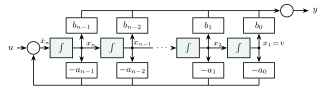
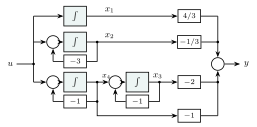
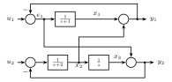

# 状态空间表达式的建立

## 1. 实现问题与机理分析法

### 正问题与逆问题

给定系统的输入输出特性（微分方程或传递函数），寻找 $(A,b,c,d)$，使其输入输出关系与之完全一致，这叫**实现**。机理分析、微分方程、传递函数、结构图四条途径，最后都通向

$$
\dot x=Ax+bu,\qquad y=cx+du .
$$

状态的选法不唯一（见[绪论与状态空间描述](state-space.md)），所以实现也不唯一：从传递函数到状态空间是**多对一**的，答案有无穷多个。反过来，由 $(A,b,c,d)$ 求

$$
g(s)=c(sI-A)^{-1}b+d
$$

则是**一对一**的，结果唯一（见第 5 节）。

### 机理分析法

三个步骤：

1. 对每个储能元件写出物理定律（牛顿定律、KCL/KVL、电感的伏安关系等）。
2. 每个"含导数的独立量"选作一个状态。
3. 消去中间量，整理成 $\dot x=Ax+bu$ 的形式。

工程上常用的判断：**状态个数 = 独立储能元件个数**。储能量包括电容电压、电感电流、位移与速度、惯性环节的输出；电阻不储能。

??? example "例：四旋翼高度环（含电机惯性）的状态空间表达式"
    沿用[绪论](state-space.md)中的三阶高度模型 Q-alt3，这里把升力偏差直接记作 $f$，$u$ 为油门偏差：$T_m\dot f+f=ku$，$m\ddot h=f$。取 $x=[h\ \ \dot h\ \ f]\tp$，$y=h$，代入 $m=1.2,\ T_m=0.1,\ k=1$，写出状态空间表达式并求传递函数。

    **解** 由 $\dot x_1=x_2$，$\dot x_2=\frac1mx_3$，$\dot x_3=-\frac1{T_m}x_3+\frac k{T_m}u$：

    $$
    \boxed{A=\bmat{0&1&0\\0&0&5/6\\0&0&-10},\quad b=\bmat{0\\0\\10}},\qquad c=[1\ \ 0\ \ 0]
    $$

    - $f$ 是状态，不是输入。$A$ 的第一列全为 0：高度不反过来影响任何量，这是"双积分"的特征。把 $f$ 放进状态，控制器才能"看见"执行机构的滞后：阶跃油门下，$f$ 大约经过 $3T_m$ 跟上，$\dot h$ 随后线性上升，$h$ 呈抛物线。
    - 任务不同，状态就不同。若只关心定速爬升，可以删去 $x_1$，得到二阶模型 $A=\smat{0&5/6\\0&-10}$，$b=\smat{0\\10}$，$c=[1\ \ 0]$，此时 $y=\dot h$。

    求传递函数：$A$ 是上三角阵，$\det(sI-A)=s^2(s+10)$；$b$ 只有第 3 个元素非零，所以只需要 $\adj(sI-A)$ 的第 3 列。结果为

    $$
    g(s)=\frac{k/(mT_m)}{s^2(s+1/T_m)}=\frac{25/3}{s^2(s+10)}
    $$

    **注** 直接对物理方程做拉氏变换，$\frac{H}{F}=\frac1{ms^2}$，$\frac FU=\frac{k}{T_ms+1}$，两者相乘结果一致。

??? example "例：RLC 网络的状态空间表达式与传递函数"
    { .diagram }

    网络如图，输入 $u_{\rm i}$，输出 $u_{\rm o}$（$R_2$ 上的电压）。选取状态变量，写出 $(A,b,c,d)$，求 $g(s)$ 与 $g(0)$。

    **解** 独立储能元件只有 $C$ 和 $L$，系统是二阶的，取 $x=[u_C\ \ i_L]\tp$（状态完全、独立的理由见[绪论](state-space.md)）。列方程：

    - 节点 $A$ 的 KCL：$C\dot u_C=\dfrac{u_{\rm i}-u_C}{R_1}-i_L$；
    - $L$–$R_2$ 回路的 KVL：$L\dot i_L=u_C-R_2i_L$；
    - 输出：$u_{\rm o}=R_2i_L$。

    $$
    \boxed{A=\bmat{-\frac{1}{R_1C}&-\frac1C\\[2pt]\frac1L&-\frac{R_2}{L}},\quad b=\bmat{\frac1{R_1C}\\[2pt]0},\quad c=[0\ \ R_2],\quad d=0}
    $$

    传递函数与静态增益：

    $$
    g(s)=\frac{R_2}{R_1LCs^2+(L+R_1R_2C)s+R_1+R_2},\qquad g(0)=d-cA^{-1}b=\frac{R_2}{R_1+R_2}
    $$

    取 $R_1=R_2=1\,\Omega$、$L=1$ H、$C=1$ F，得 $A=\smat{-1&-1\\1&-1}$，$\lambda=-1\pm \mathrm j$，响应为衰减振荡：包络 $\e^{-t}$，角频率 1 rad/s（见[线性定常系统的运动分析](lti-response.md)）。

    **注** 容易出错的地方：$c=[0\ \ R_2]$，输出是 $R_2$ 上的电压而不是 $u_C$；$b$ 只有第 1 行非零；电容电流 $i_C=i_{R_1}-i_L$，不要写反。可以用阻抗分压法自检 $g(s)$。

## 2. 能控规范型、能观规范型与同阶 β 法

### 由微分方程或传递函数写规范型（$m<n$）

设系统的微分方程与传递函数为

$$
y^{(n)}+a_{n-1}y^{(n-1)}+\cdots+a_0y=b_nu^{(n)}+\cdots+b_1\dot u+b_0u
\iff g(s)=\frac{N(s)}{D(s)}
$$

其中 $D(s)=s^n+a_{n-1}s^{n-1}+\cdots+a_0$ 是**首一**多项式，系数下标等于对应的幂次。

- $m<n$ 时 $d=0$。
- $m=n$ 时 $d=b_n$（分子最高次系数）。可以先做长除 $g=b_n+\frac{\bar N(s)}{D(s)}$，$\bar N(s)=\sum_{i=0}^{n-1}(b_i-b_na_i)s^i$，再对余式套用下面的公式；也可以用后面的 β 法。注意余式的系数与 β 法中的 $\beta_k$ 不是同一组数。
- **前提**：分子分母没有公因子，否则得到的实现阶数偏高（见后面的易错点）。
- 若右端只有 $b_0u$，也可以直接取 $x_i=y^{(i-1)}$，得 $A=A_c$，$b=[0\ \cdots\ 0\ \ b_0]\tp$，$c=[1\ \ 0\ \cdots\ 0]$。它与下面的能控规范型只差一个状态缩放因子 $b_0$，两种写法都对。

**能控规范型**：

$$
A_c=\bmat{0&1&\cdots&0\\\vdots&\vdots&\ddots&\vdots\\0&0&\cdots&1\\-a_0&-a_1&\cdots&-a_{n-1}},\qquad b_c=\bmat{0\\\vdots\\0\\1},\qquad c_c=\bmat{b_0&b_1&\cdots&b_{n-1}}
$$

**能观规范型**：

$$
A_o=A_c\tp,\qquad b_o=c_c\tp,\qquad c_o=b_c\tp=[0\ \cdots\ 0\ \ 1]
$$

$A_o$ 的末列为 $-a_i$，1 在对角线下方。

### 能控规范型的来历

引入中间变量 $v$，把系统拆成两段：$u\xrightarrow{1/D(s)}v\xrightarrow{N(s)}y$，即

$$
u=v^{(n)}+a_{n-1}v^{(n-1)}+\cdots+a_0v,\qquad y=b_{n-1}v^{(n-1)}+\cdots+b_0v .
$$

取 $x_i=v^{(i-1)}$（$v$ 是人为引入的辅助信号，就是 $x_1$）。于是 $\dot x_i=x_{i+1}\ (i<n)$，构成一串积分器；最后一个方程为

$$
\dot x_n=v^{(n)}=-a_0x_1-\cdots-a_{n-1}x_n+u ,
$$

末行的**负号来自移项**。由此 $\det(sI-A_c)=D(s)$，特征值就是极点。在[能控性](controllability.md)一章会看到，这种形式的能控性矩阵恒满秩，这就是"能控规范型"名称的由来。

{ .diagram }

上图中积分器链 $x_1=v$，$x_{i+1}=\dot x_i$；相加点的入口均为"$+$"，负号并入增益。

### 能观规范型的来历

把 $D(s)y=N(s)u$ 交叉相乘、两边同除以 $s^n$，再由内向外套括号：

$$
x_1=\frac1s\bigl[b_0u-a_0y\bigr],\qquad x_i=\frac1s\bigl[b_{i-1}u-a_{i-1}y+x_{i-1}\bigr],
$$

最外层就是 $y=x_n$，于是 $\dot x_i=x_{i-1}-a_{i-1}x_n+b_{i-1}u$。它与能控型最大的差别是：输出 $y$ 就是状态 $x_n$。

**对偶关系**：能观型是能控型的转置，$b$ 与 $c$ 互换并转置。这是[能观性与对偶原理](observability.md)的伏笔：系统能控等价于其对偶系统能观，判据只需记一套。

### 分子分母同阶：β 待定系数法

当方程右端含 $u^{(n)}$ 时，设

$$
x_1=y-\beta_0u,\qquad x_{i+1}=\dot x_i-\beta_iu
$$

例如 $x_2=\dot y-\beta_0\dot u-\beta_1u$。代入原方程，令 $u$ 各阶导数的系数为零，得到 $x_{n+1}+a_{n-1}x_n+\cdots+a_0x_1=0$，以及

$$
\beta_0=b_n,\quad \beta_1=b_{n-1}-a_{n-1}\beta_0,\quad \beta_2=b_{n-2}-a_{n-1}\beta_1-a_{n-2}\beta_0,\quad\cdots,\quad \beta_k=b_{n-k}-\sum_{j=1}^{k}a_{n-j}\beta_{k-j}
$$

状态空间表达式为

$$
\dot x=A_c\,x+[\beta_1\ \cdots\ \beta_n]\tp u,\qquad y=[1\ \ 0\ \cdots\ 0]\,x+\beta_0u
$$

$A$ 仍为友矩阵，$d=\beta_0=b_n$。

上述递推等价于一个 $(n+1)$ 阶单位下三角方程组，用前代法自上而下求解，$\beta$ 唯一：系数阵第一列为 $1,a_{n-1},\dots,a_0$，往右每列下移一格；右端为分子系数按**降幂**排列的 $b_n,\dots,b_0$。$m<n$ 时也能用（$\beta_0=0$），但得到的是另一种实现，不是能控规范型。

??? example "例：由三阶微分方程写能控、能观规范型，并用 β 法处理同阶情形"
    已知 $\overset{\dots}{y}+9\ddot y+5\dot y+3y=\ddot u+4\dot u+u$。

    (1) 写出能控规范型，指出中间变量 $v$ 与状态的关系；(2) 写出能观规范型，验证 $A_o=A_c\tp$；(3) 回代验证两者传递函数相同；(4) 右端改为 $\overset{\dots}{u}+9\ddot u+6\dot u+5u$，用 β 法求 $(A,b,c,d)$ 并回代验证。

    **解** $a_2=9,\ a_1=5,\ a_0=3$；$b_2=1,\ b_1=4,\ b_0=1$。$m<n$，故 $d=0$，

    $$
    g(s)=\frac{s^2+4s+1}{s^3+9s^2+5s+3}
    $$

    (1) 中间变量满足 $\overset{\dots}{v}+9\ddot v+5\dot v+3v=u$，$y=\ddot v+4\dot v+v$。取 $x=[v\ \ \dot v\ \ \ddot v]\tp$（$x_i=v^{(i-1)}$）：

    $$
    A_c=\bmat{0&1&0\\0&0&1\\-3&-5&-9},\quad b_c=\bmat{0\\0\\1},\quad c_c=[1\ \ 4\ \ 1],\quad d=0
    $$

    (2)

    $$
    A_o=\bmat{0&0&-3\\1&0&-5\\0&1&-9}=A_c\tp,\quad b_o=[1\ \ 4\ \ 1]\tp=c_c\tp,\quad c_o=[0\ \ 0\ \ 1]=b_c\tp
    $$

    (3) $\adj(sI-A_c)$ 的第 3 列为 $[1\ \ s\ \ s^2]\tp$，$c_c[1\ \ s\ \ s^2]\tp=s^2+4s+1$；能观型取 $\adj(sI-A_o)$ 的第 3 行 $[1\ \ s\ \ s^2]$ 乘 $b_o$，得到同样的 $g(s)$。

    (4) $b_3=1,\ b_2=9,\ b_1=6,\ b_0=5$。递推：

    $$
    \beta_0=1,\quad \beta_1=9-9\cdot1=0,\quad \beta_2=6-9\cdot0-5\cdot1=1,\quad \beta_3=5-9\cdot1-5\cdot0-3\cdot1=-7
    $$

    等价地，前代求解

    $$
    \bmat{1&&&\\9&1&&\\5&9&1&\\3&5&9&1}\bmat{\beta_0\\\beta_1\\\beta_2\\\beta_3}=\bmat{1\\9\\6\\5}
    $$

    对应的状态为 $x_1=y-u$，$x_2=\dot y-\dot u$，$x_3=\ddot y-\ddot u-u$。结果：

    $$
    \boxed{A=A_c\ (\text{不变}),\quad b=[0\ \ 1\ \ {-7}]\tp,\quad c=[1\ \ 0\ \ 0],\quad d=1}
    $$

    回代：$\adj(sI-A)$ 的第 1 行为 $[s^2+9s+5,\ s+9,\ 1]$，乘 $b$ 得 $s+2$，

    $$
    g=1+\frac{s+2}{s^3+9s^2+5s+3}=\frac{s^3+9s^2+6s+5}{s^3+9s^2+5s+3}
    $$

    与原方程一致。也可以用长除自检：余式为 $(9-9)s^2+(6-5)s+(5-3)=s+2$，吻合。对余式写能控型得 $c=[2\ \ 1\ \ 0]$、$d=1$，这是另一个合法的实现。

    **注** 本例 $c_c=[1\ \ 4\ \ 1]$ 恰好是回文，升幂、降幂排反了也看不出来。一律按 $[b_0\ \ b_1\ \ b_2]$ 的顺序写。

## 3. 特征值规范型（对角型、约当型）

### 由部分分式写特征值规范型（$m<n$）

**互异单极点**。把传递函数展开为

$$
g(s)=\sum_{i=1}^n\frac{c_i}{s-\lambda_i},\qquad c_i=\lim_{s\to\lambda_i}(s-\lambda_i)g(s)
$$

留数 $c_i$ 用"捂住法"求。取 $x_i=\frac{u(s)}{s-\lambda_i}$，即 $\dot x_i=\lambda_ix_i+u$，得

$$
A=\diag(\lambda_1,\dots,\lambda_n),\qquad b=[1\ \ 1\ \cdots\ 1]\tp,\qquad c=[c_1\ \cdots\ c_n]
$$

$b$ 的元素全为 1，留数就是 $c$ 的元素。

对角型的意义：每一项是一条独立的一阶通道（$\frac1{s-\lambda}$ 对应 $\e^{\lambda t}$），状态之间解耦，各个模态各走各的。实部越负衰减越快：$\lambda=-3$ 的模态约 1 s 衰减完，$\lambda=-1$ 的则要 3 s 以上。对一般矩阵 $A$ 的对角化见[线性变换](linear-transform.md)。

**$n$ 重极点 $\lambda$**。展开为

$$
g(s)=\frac{c_{11}}{(s-\lambda)^n}+\frac{c_{12}}{(s-\lambda)^{n-1}}+\cdots+\frac{c_{1n}}{s-\lambda},\qquad
c_{1i}=\frac1{(i-1)!}\left.\frac{\mathrm d^{\,i-1}}{\mathrm ds^{\,i-1}}\Bigl[(s-\lambda)^ng(s)\Bigr]\right|_{s=\lambda}
$$

取 $x_n=\frac{u}{s-\lambda}$，$x_i=\frac{x_{i+1}}{s-\lambda}$，即 $\dot x_i=\lambda x_i+x_{i+1}\ (i<n)$，$\dot x_n=\lambda x_n+u$。于是 $A$ 为**约当块**（对角线全为 $\lambda$，对角线上方一条全为 1，如 $n=2$ 时为 $\smat{\lambda&1\\0&\lambda}$），

$$
b=[0\ \cdots\ 0\ \ 1]\tp,\qquad c=[c_{11}\ \ c_{12}\ \cdots\ c_{1n}]
$$

状态之间是单向耦合：$x_n\to x_{n-1}\to\cdots\to x_1$。

**混合情形**。$k$ 个单极点加上重数为 $l_1,\dots,l_m$ 的重极点，$k+l_1+\cdots+l_m=n$：

- $A$ 为块对角阵，先排对角段，再排各约当块；
- $b$ 在单极点处填 1，每个约当块只有末位填 1；
- $c$ 先填 $k$ 个单极点的留数，再填各块的留数，块内先排最高次项的系数。

!!! tip "方法：由 $g(s)$ 写三种规范型"
    1. 化分母为首一，比较 $m$ 与 $n$（$m=n$ 时先得 $d=b_n$，再处理余式或用 β 法）；读出 $a_i,b_i$，缺项补 0。能控型填末行与 $c$，能观型取转置。
    2. 特征值型：分解分母，求留数。单极点用捂住法；二重极点"一个直接代入、一个求导"；$l$ 重极点要求到 $l-1$ 阶导数，第 $i$ 个除以 $(i-1)!$。先排单极点、后排约当块，$b$、$c$ 与 $A$ 配套。
    3. 自检：$\det(sI-A)=D(s)$；回代 $c(sI-A)^{-1}b$（能控型 $\adj(sI-A)$ 的末列为 $[1\ \ s\ \cdots\ s^{n-1}]\tp$）；部分分式通分，或任取一个 $s$ 值代入比较；相对阶 $\ge2$ 时，一阶项留数之和为 0。

??? example "例：同一传递函数的三种规范型"
    写出 $g(s)=\dfrac{5s+1}{s^3+5s^2+8s+4}=\dfrac{5s+1}{(s+1)(s+2)^2}$ 的能控、能观和特征值规范型。

    **解** 能控型：末行为 $[-4\ \ {-8}\ \ {-5}]$（分母系数是 $+4,+8,+5$），$b=[0\ \ 0\ \ 1]\tp$，$c=[1\ \ 5\ \ 0]$。

    能观型：$A=A_c\tp$，$b=[1\ \ 5\ \ 0]\tp$，$c=[0\ \ 0\ \ 1]$。

    特征值型：$c_1=\left.\frac{5s+1}{(s+2)^2}\right|_{s=-1}=-4$，$c_{11}=\left.\frac{5s+1}{s+1}\right|_{s=-2}=9$，$c_{12}=\left.\frac{\mathrm d}{\mathrm ds}\frac{5s+1}{s+1}\right|_{s=-2}=4$，

    $$
    A=\bmat{-1&0&0\\0&-2&1\\0&0&-2},\quad b=\bmat{1\\0\\1},\quad c=[-4\ \ 9\ \ 4]
    $$

    **注** 通分自检：$-4(s+2)^2+9(s+1)+4(s+1)(s+2)=5s+1$。

??? example "例：四阶传递函数的三种规范型与状态变量图"
    $g(s)=\dfrac{4}{s(s+1)^2(s+3)}$。(1)(2) 写出能控、能观规范型；(3) 写出特征值规范型并画状态变量图；(4) 回代验证，并说明三种实现传递函数相同而状态不同的原因。

    **解** (1) 分母为 $s^4+5s^3+7s^2+3s$：$a_3=5,\ a_2=7,\ a_1=3,\ a_0=0$，$b_0=4$。能控型末行为 $[0\ \ {-3}\ \ {-7}\ \ {-5}]$，$b=[0\ \ 0\ \ 0\ \ 1]\tp$，$c=[4\ \ 0\ \ 0\ \ 0]$。

    (2) 能观型 $A=A_c\tp$，$b=[4\ \ 0\ \ 0\ \ 0]\tp$，$c=[0\ \ 0\ \ 0\ \ 1]$。

    (3) 极点 $0$、$-3$ 为单极点，$-1$ 为二重极点。留数：

    $$
    c_1=\left.\frac{4}{(s+1)^2(s+3)}\right|_{s=0}=\frac43,\qquad
    c_2=\left.\frac{4}{s(s+1)^2}\right|_{s=-3}=-\frac13,
    $$

    $$
    c_{11}=\left.\frac{4}{s(s+3)}\right|_{s=-1}=-2,\qquad
    c_{12}=\left.\frac{\mathrm d}{\mathrm ds}\frac{4}{s(s+3)}\right|_{s=-1}=\left.\frac{-4(2s+3)}{s^2(s+3)^2}\right|_{s=-1}=-1
    $$

    取 $x_1=\frac us,\ x_2=\frac{u}{s+3},\ x_4=\frac{u}{s+1},\ x_3=\frac{x_4}{s+1}$：

    $$
    \boxed{A=\bmat{0&0&0&0\\0&-3&0&0\\0&0&-1&1\\0&0&0&-1},\quad b=\bmat{1\\1\\0\\1},\quad c=\bmat{\frac43&-\frac13&-2&-1},\quad d=0}
    $$

    { .diagram }

    图中共 4 个积分器；$\lambda=0$ 的通道没有自反馈；约当链 $u\to x_4\to x_3$ 是单向的；相加点入口均为"$+$"。

    (4) $(sI-A)^{-1}b=\Bigl[\frac1s,\ \frac1{s+3},\ \frac1{(s+1)^2},\ \frac1{s+1}\Bigr]\tp$，于是

    $$
    c(sI-A)^{-1}b=\frac{4/3}{s}-\frac{1/3}{s+3}-\frac{2}{(s+1)^2}-\frac{1}{s+1}
    $$

    通分后分子为 4，即 $g(s)$。自检：一阶项留数之和 $\frac43-\frac13-1=0$。

    原因：传递函数只描述零初始条件下的输入—输出关系，状态是内部坐标，选法不唯一。三种实现都是 4 阶且没有零极点相消（都是最小实现），彼此只差一个非奇异变换 $x=P\bar x$，在这种变换下传递函数 $\bar c(sI-\bar A)^{-1}\bar b=c(sI-A)^{-1}b$ 和特征值 $\{0,-1,-1,-3\}$ 都不变（见[线性变换](linear-transform.md)）。阶数不同的实现之间没有这种关系（见[最小实现](canonical-decomposition.md)）。

!!! warning "易错点"
    - 对角型的 $b$ **全为 1**；只有约当块内才是"只有末位为 1"。$c_{11}$ 对应最高次项（直接代入求得），$c_{12}$ 对应一次项（求一次导数）；$c$ 中先 $c_{11}$ 后 $c_{12}$，$b$ 在块内为 $[0\ \ 1]\tp$，三者必须配套。排列次序可以换，但同一个实现内 $A,b,c$ 要一致。
    - 违反"无公因子"前提的例子：$g=\frac{s+3}{s^3+6s^2+11s+6}$。能控型 $c=[3\ \ 1\ \ 0]$，末行 $[-6\ \ {-11}\ \ {-6}]$（降幂读、升幂填）。部分分式的留数为 $c_1=1,\ c_2=-1,\ c_3=0$：$\lambda=-3$ 的模态在输出中看不见，因为零点与该极点对消，实际上 $g=\frac1{(s+1)(s+2)}$（见[能观性](observability.md)）。

## 4. 由结构图建立状态空间表达式

基本原则：**有几个积分器就有几个状态**，状态个数等于阶数。

!!! tip "方法：由结构图写 $(A,B,C,D)$"
    1. 拆环节、数积分器，确定阶数。反馈通道里的积分器也要算；分子带 $s$ 的环节先变形（见下表）。
    2. 在每个积分器的输出端设一个状态。题图已标号就按题图；约定比例器放在积分器之前，并写明约定。
    3. 用状态和输入写出每个比较点的信号（**误差 = 输入 − 反馈**），每个积分器的输入就是 $\dot x_i$。输出用状态和输入表示，有直通支路则 $D\neq0$。
    4. 自检：没有相消时，$\det(sI-A)$ 与结构图化简所得闭环分母只差一个常数倍；次数差几，就有几个模态被消去。用 $G(\infty)=D$ 核对直通支路。

    这类题常见的形式是三阶、带前馈支路（$b$ 有多个非零元）、输出为状态的组合，状态按题图编号。例如 $u\to\frac1{s+1}\to x_3\to\frac1{s+2}\to x_2\to\frac1s\to x_1$，$y=x_1+2x_2$，得

    $$
    A=\bmat{0&1&0\\0&-2&1\\0&0&-1},\quad b=\bmat{0\\0\\1},\quad c=[1\ \ 2\ \ 0]
    $$

    自检：$g=\frac{2s+1}{s(s+1)(s+2)}$。

### 常见环节的处理

先变形，再数积分器。负号并入比例器，相加点入口均为"$+$"。

| 环节 | 变形与状态方程（$x$ 取积分器输出） | 积分器个数 |
|---|---|---|
| 积分 $\frac Ks$ | $\dot x=Ku,\ y=x$ | 1 |
| 双积分 $\frac{K}{Js^2}$ | 两个积分器串联：$\dot x_1=x_2,\ \dot x_2=\frac KJu,\ y=x_1$ | 2 |
| 惯性 $\frac K{s+a}$ | 多一条 $-a$ 的自反馈：$\dot x=-ax+Ku,\ y=x$ | 1 |
| 一阶微分惯性 $K\frac{s+d}{s+a}$ | 先变形为 $K\bigl[1+\frac{d-a}{s+a}\bigr]$（直通 + 惯性）：$\dot x=-ax+K(d-a)u,\ y=x+Ku$ | 1 |
| PI 环节 $\frac{K_1s+K_2}{s}$ | 变形为 $K_1+\frac{K_2}s$（直通 + 积分）：输入 $e$，$\dot x=K_2e$，输出 $x+K_1e$ | 1 |
| 二阶 $\frac{K}{s^2+a_1s+a_0}$ | 提出 $\frac K{a_0}$，余下为 $\frac{a_0}{s(s+a_1)}$ 的单位负反馈：$\dot x_1=-a_1x_1+x_2,\ \dot x_2=-a_0x_1+Ku,\ y=x_1$ | 2 |

??? example "例：带测速反馈的速度回路"
    前向通道为 $g_1=\frac1{s+b}$ 与 $g_2=\frac K{s^2+a_1s+a_0}$ 串联，反馈通道为 $g_s=\frac{s+d}{s+c}$（这里 $b,c,d$ 是环节参数），输入 $u$，输出 $y$。写出状态空间表达式。

    **解** 先数积分器：$1+2+1=4$，系统为 4 阶。设 $x_1=y$，$x_2$ 为 $g_2$ 第一个积分器的输出，$x_3$ 为 $g_1$ 的输出，$x_4$ 为 $g_s=1+\frac{d-c}{s+c}$ 中惯性支路的输出。

    反馈通道输出为 $x_1+x_4$，误差 $e=u-x_1-x_4$，于是 $\dot x_3=-bx_3+e$，$\dot x_4=-cx_4+(d-c)x_1$。$g_2$ 按上表二阶环节处理。整理得

    $$
    A=\bmat{-a_1&1&0&0\\-a_0&0&K&0\\-1&0&-b&-1\\d-c&0&0&-c},\qquad B=\bmat{0\\0\\1\\0},\qquad C=[1\ \ 0\ \ 0\ \ 0]
    $$

    **注** 第 3 行的两个 $-1$ 都来自负反馈比较点：$(3,1)$ 元是 $g_s$ 的直通"1"，$(3,4)$ 元是它的惯性支路。

??? example "例：含 PI 控制器与内环反馈的六阶系统"
    结构图：$R\to\otimes_1\to\frac{K}{T_1s+1}\to\otimes_2\to\frac{K_1s+K_2}{s}\to\otimes_3\to\frac{1}{J_1s}\to\frac{K_3}{J_2s^2}\to\theta$。$\theta$ 负反馈到 $\otimes_1$；$\frac1{J_1s}$ 的输出负反馈到 $\otimes_2$，同时经 $\frac{K_n}{s}$ 负反馈到 $\otimes_3$。写出状态空间表达式，比较阶数与闭环传递函数分母的次数并解释。

    **解** 数积分器：惯性环节 1 个，PI（$K_1+\frac{K_2}s$）1 个，$\frac1{J_1s}$ 1 个，反馈中的 $\frac{K_n}s$ 1 个，$\frac{K_3}{J_2s^2}$ 2 个，共 **6 个，系统为 6 阶**。

    设 $x_1=\theta$，$x_2=\dot\theta$（比例器 $\frac{K_3}{J_2}$ 放在前面），$x_3,x_4,x_5,x_6$ 依次为 $\frac1{J_1s}$、$\frac{K_n}s$、PI 积分支路、惯性环节的输出。比较点信号为 $e_1=r-x_1$，$e_2=x_6-x_3$，$e_3=K_1e_2+x_5-x_4$。于是

    $$
    \begin{aligned}
    &\dot x_1=x_2,\quad \dot x_2=\tfrac{K_3}{J_2}x_3,\quad \dot x_4=K_nx_3,\\
    &\dot x_3=\tfrac1{J_1}\bigl[K_1(x_6-x_3)+x_5-x_4\bigr],\quad \dot x_5=K_2(x_6-x_3),\\
    &\dot x_6=-\tfrac{K}{T_1}x_1-\tfrac1{T_1}x_6+\tfrac{K}{T_1}r,\quad y=x_1
    \end{aligned}
    $$

    $$
    \boxed{A=\bmat{0&1&0&0&0&0\\0&0&\frac{K_3}{J_2}&0&0&0\\0&0&-\frac{K_1}{J_1}&-\frac1{J_1}&\frac1{J_1}&\frac{K_1}{J_1}\\0&0&K_n&0&0&0\\0&0&-K_2&0&0&K_2\\-\frac K{T_1}&0&0&0&0&-\frac1{T_1}},\quad b=\frac K{T_1}e_6,\quad c=e_1\tp}
    $$

    第 3 行的 $-\frac{K_1}{J_1}$、$\frac{K_1}{J_1}$ 来自 PI 的直通 $K_1$，漏拆就会丢掉。

    结构图化简：内环 $\frac{1/(J_1s)}{1+K_n/(J_1s^2)}=\frac{s}{J_1s^2+K_n}$ 有一个**零点 $s=0$**，与 PI 环节的**极点 $s=0$** 相消，

    $$
    \boxed{\frac{\theta(s)}{R(s)}=\frac{KK_3(K_1s+K_2)}{J_2s^2(T_1s+1)(J_1s^2+K_1s+K_2+K_n)+KK_3(K_1s+K_2)}}
    $$

    分母（记为 $D_5(s)$）只有 **5 次**，小于阶数 6。被消去的模态在传递函数中看不见，但仍是 $A$ 的特征值：$\det(sI-A)=s\,D_5(s)/(T_1J_1J_2)$，多出一个 $\lambda=0$。这个模态既不能控也不能观（见[能控性](controllability.md)、[能观性](observability.md)和[结构分解](canonical-decomposition.md)）。

??? example "例：两输入两输出结构图的 $(A,B,C,D)$ 与传递函数矩阵"
    { .diagram }

    结构图如上（未标号的入口为"$+$"，$e_1$ 直通 $y_2$）：$e_1=u_1-y_1,\ x_1=\frac{e_1}{s+1},\ e_2=u_2-y_2,\ x_2=\frac{e_2}{s+2},\ x_3=\frac{x_2}s,\ y_1=x_1+x_2,\ y_2=x_3+e_1$。求 $(A,B,C,D)$、$G(s)$ 与 $A$ 的特征值。

    **解** 共 3 个积分器：$\dot x_1=-x_1+e_1$，$\dot x_2=-2x_2+e_2$，$\dot x_3=x_2$。代入

    $$
    e_1=u_1-x_1-x_2,\qquad y_2=-x_1-x_2+x_3+u_1\ (e_1\ \text{直通}),\qquad e_2=u_2-y_2
    $$

    得

    $$
    \boxed{A=\bmat{-2&-1&0\\1&-1&-1\\0&1&0},\quad B=\bmat{1&0\\-1&1\\0&0},\quad C=\bmat{1&1&0\\-1&-1&1},\quad D=\bmat{0&0\\1&0}}
    $$

    伴随矩阵（余子式阵再转置）与中间结果：

    $$
    \adj(sI-A)=\bmat{s^2+s+1&-s&1\\s&s^2+2s&-(s+2)\\1&s+2&s^2+3s+3},\qquad
    C\,\adj(sI-A)\,B=\bmat{s+1&s(s+1)\\-2(s+1)&2-s^2}
    $$

    再逐元素除以 $\det(sI-A)$、约分，并加上 $D$：

    $$
    \det(sI-A)=(s+1)(s^2+2s+2),\qquad \lambda=-1,\ -1\pm \mathrm j
    $$

    $$
    \boxed{G(s)=\bmat{\dfrac{1}{s^2+2s+2}&\dfrac{s}{s^2+2s+2}\\[8pt]\dfrac{s(s+2)}{s^2+2s+2}&\dfrac{2-s^2}{(s+1)(s^2+2s+2)}}}
    $$

    自检：$G(\infty)=D$（$g_{21}=\frac{-2}{s^2+2s+2}+1$）。$g_{11},g_{12},g_{21}$ 中 $(s+1)$ 被约去，只有 $g_{22}$ 含全部特征值。

    **注** 状态编号、比例器位置可以另取，$A$ 随之置换或缩放，都算对。漏拆 PI 的直通 $K_1$、漏掉 $e_1$ 到 $y_2$ 的直通（$D_{21}=1$）是常见错误。

## 5. 由状态空间求传递函数矩阵

零初始条件下对状态方程取拉氏变换：$(sI-A)x(s)=bu(s)$，故 $x(s)=(sI-A)^{-1}bu(s)$，代入 $y(s)=cx(s)+du(s)$ 得

$$
g(s)=c(sI-A)^{-1}b+d=\frac{c\,\adj(sI-A)\,b}{\det(sI-A)}+d,\qquad G(s)=C(sI-A)^{-1}B+D\ \ (q\times p)
$$

这个逆问题的答案是唯一的。

- 名词：$sI-A$ 称为特征矩阵，$(sI-A)^{-1}$ 称为预解矩阵，$\det(sI-A)$ 是特征多项式，$\adj(sI-A)$ 是伴随矩阵。$M^{-1}=\adj M/\det M$，$\adj M$ 的 $(i,j)$ 元是 $M$ 的 $(j,i)$ 元的**代数余子式**（有转置）。
- 分母只由 $A$ 决定，所以 $A$ 体现系统的动态特性。无零极点相消时，$A$ 的特征值就是极点；一般情况下"极点 $\subseteq$ 特征值"。$\adj(sI-A)$ 的元素至多 $n-1$ 次，因此 $d=0$ 时 $g(s)$ 严格真（$m<n$）。
- 多输入多输出时，$G(s)$ 与 $D$ 同型，为 $q\times p$。$g_{ij}$ 是第 $j$ 个输入到第 $i$ 个输出的传递函数（**行看输出，列看输入**）。$y(s)=G(s)u(s)$，$G$ 写在左边，$y_i=\sum_{j=1}^pg_{ij}u_j$。若元素全不为零，说明各通道完全耦合，单回路 PID 难以单独整定；对策是解耦，或者用状态反馈配置全部特征值。

!!! tip "方法：手算 $G(s)$ 与自检"
    1. 求 $\det(sI-A)$：三角阵为对角元之积；友矩阵直接读出；$3\times3$ 按 0 多的行或列展开，尽量因式分解。
    2. 求 $\adj(sI-A)$：$2\times2$ 时"主对角互换、副对角变号"；$3\times3$ 逐个求代数余子式再**转置**，不必用高斯消元（例见上节两输入两输出的例题）。$b=e_n$ 时只需末列，$c=e_1\tp$ 时只需首行。
    3. 左乘 $C$、右乘 $B$，加上 $D$；**每个元素都要约分**，指明相消的因子和所在元素。
    4. 自检：$G(\infty)=D$；静态增益 $G(0)=D-CA^{-1}B$（$A$ 非奇异时）。注意"算得出"不等于"达得到"：系统渐近稳定，才能保证常值输入下 $y(\infty)=G(0)u_\infty$（见[绪论](state-space.md)）。

同一个 $g=\frac{5s+1}{s^3+5s^2+8s+4}$ 的能控型和约当型（第 3 节例题）：能控型取 $\adj(sI-A)$ 的末列 $[1\ \ s\ \ s^2]\tp$，得分子 $5s+1$；约当型的 $\adj(sI-A)$ 是上三角阵。两者都得到 $\frac{5s+1}{s^3+5s^2+8s+4}$。仿真时，阶跃输入下两种实现的 $y(t)$ 逐点重合，但 $x_1$ 分别趋于 0.25 和 1：外部一样，内部是两套不同的坐标。

??? example "例：两关节机械臂的传递函数矩阵"
    两个关节力矩为输入 $u_1,u_2$，两个关节角与末端高度为输出 $y_1,y_2,y_3$（$n=2,\ p=2,\ q=3$）：

    $$
    \dot x=\bmat{0&1\\-2&-3}x+\bmat{1&0\\1&1}u,\qquad y=\bmat{1&0\\1&1\\0&2}x+\bmat{0&0\\1&0\\0&1}u
    $$

    求传递函数矩阵。

    **解** $n=2$，用伴随矩阵除以行列式最快：

    $$
    (sI-A)^{-1}=\frac{1}{(s+1)(s+2)}\bmat{s+3&1\\-2&s}
    $$

    做矩阵乘法再加 $D$，逐元素约分：

    $$
    G(s)=\bmat{\dfrac{s+4}{(s+1)(s+2)}&\dfrac{1}{(s+1)(s+2)}\\[8pt]\dfrac{s+4}{s+2}&\dfrac{1}{s+2}\\[8pt]\dfrac{2(s-2)}{(s+1)(s+2)}&\dfrac{s^2+5s+2}{(s+1)(s+2)}}
    $$

    第二行两个元素都约去了 $(s+1)$，得 $g_{21}=\frac{s+4}{s+2}$、$g_{22}=\frac1{s+2}$。六个元素没有一个为零：动一下关节 1 的力矩，三个输出全都会动，通道之间完全耦合。

    **注** 有教材把 $g_{21}$ 印作 $\frac{s+2}{s+1}$，是印刷错误。

??? example "例：不稳定系统的传递函数矩阵与静态增益"
    已知

    $$
    \dot x=\bmat{3&0&0\\1&5&2\\0&2&1}x+\bmat{1&0\\2&0\\0&5}u,\qquad y=\bmat{2&0&1\\6&2&0}x
    $$

    (1) 求 $\det(sI-A)$ 并因式分解；(2) 求 $2\times2$ 传递函数矩阵 $G(s)$；(3) 指出哪些元素发生了零极点相消；(4) 求静态增益矩阵 $G(0)$，并说明系统能否稳定地达到该增益。

    **解** (1) 按第一行展开：

    $$
    \det(sI-A)=(s-3)(s^2-6s+1),\qquad \lambda=3,\ 3\pm2\sqrt2
    $$

    (2)

    $$
    G(s)=\frac{1}{(s-3)(s^2-6s+1)}\bmat{2(s^2-4s-4)&5(s-3)(s-5)\\2(5s^2-25s+8)&20(s-3)}
    $$

    (3) 第 2 列（$g_{12},g_{22}$）约去 $(s-3)$，化为 $g_{12}=\frac{5(s-5)}{s^2-6s+1}$，$g_{22}=\frac{20}{s^2-6s+1}$。原因是：$u_2$ 只作用于 $x_3$，而 $\dot x_1=3x_1+u_1$ 不受 $x_2,x_3$ 影响，$\lambda=3$ 的左特征向量 $[1\ \ 0\ \ 0]$ 与 $B$ 的第 2 列正交，所以 $u_2$ 激励不到 $\lambda=3$ 的模态。

    (4) 静态增益

    $$
    G(0)=-CA^{-1}B=\bmat{8/3&-25\\-16/3&20}
    $$

    算得出，但特征值 $3,\ 3\pm2\sqrt2$ 全在右半平面，输出发散，实际达不到。

## 6. 组合系统

以下三种连接的前提是：没有负载效应，维数满足运算要求。组合后的状态取 $x=\smat{x_1\\x_2}$（两个子系统的状态叠起来），阶数等于两者之和。

| 连接方式 | $A$ | $B$ | $C$ | $D$ | $G(s)$ |
|---|---|---|---|---|---|
| 并联：$u_1=u_2=u$，$y=y_1+y_2$ | $\bmat{A_1&0\\0&A_2}$ | $\bmat{B_1\\B_2}$ | $[C_1\ \ C_2]$ | $D_1+D_2$ | $G_1+G_2$ |
| 串联：$u\to\Sigma_1\to\Sigma_2$，$u_2=y_1$，$y=y_2$ | $\bmat{A_1&0\\B_2C_1&A_2}$ | $\bmat{B_1\\B_2D_1}$ | $[D_2C_1\ \ C_2]$ | $D_2D_1$ | $G_2G_1$（后级在左） |
| 负反馈：$u_1=u-y_2$，$u_2=y_1$，$y=y_1$（$D_1=D_2=0$） | $\bmat{A_1&-B_1C_2\\B_2C_1&A_2}$ | $\bmat{B_1\\0}$ | $[C_1\ \ 0]$ | $0$ | $[I+G_1G_2]^{-1}G_1$ |

- **并联**：两路互不相干，$A$ 为块对角阵；两路的输入同维、输出同维，才能加在一起。
- **串联**：后级的输入换成前级的输出，$A$ 的左下块出现 $B_2C_1$。$x_2$ 不进入 $\dot x_1$（信号单向，无负载效应）；$A$ 为块下三角阵，所以特征值是两个子系统特征值的并。有负载效应时这些公式不成立。
- **负反馈**：误差代入前向通道，反馈状态**带负号**进入（右上块 $-B_1C_2$）；前向输出代入反馈通道（左下块 $B_2C_1$）。双向耦合是闭环的特征。传递函数矩阵

    $$
    G=[I+G_1G_2]^{-1}G_1=G_1[I+G_2G_1]^{-1}
    $$

    SISO 时退化为 $g=\frac{g_1}{1+g_1g_2}$。闭环特征多项式为

    $$
    \det(sI-A)=\varphi_1\varphi_2+N_1N_2\neq\varphi_1\varphi_2,
    $$

    其中 $\varphi_i=\det(sI-A_i)$，$N_i=c_i\adj(sI-A_i)\,b_i$，即 $g_i=N_i/\varphi_i$（不约分）。

!!! note "劳斯判据"
    实系数多项式（$a_n>0$）的全部根都在开左半平面，当且仅当劳斯表第一列全为正。必要条件是全部系数同号且不为零。

    劳斯表前两行隔项放系数，以下各行按

    $$
    r_{i,j}=\frac{r_{i-1,1}\,r_{i-2,j+1}-r_{i-2,1}\,r_{i-1,j+1}}{r_{i-1,1}}
    $$

    计算。常用结论：

    - 三阶 $s^3+a_2s^2+a_1s+a_0$：$a_2,a_1,a_0>0$ 且 $a_2a_1>a_0$；
    - 四阶 $s^4+a_3s^3+a_2s^2+a_1s+a_0$：各 $a_i>0$，$a_3a_2>a_1$，且 $a_3a_2a_1>a_1^2+a_3^2a_0$。

??? example "例：两个二阶系统的并联、串联与反馈连接"
    $\Sigma_1:\ A_1=\smat{0&1\\-2&-3},\ b_1=\smat{0\\1},\ c_1=[1\ \ 0]$；$\Sigma_2:\ A_2=\smat{0&1\\-4&-4},\ b_2=\smat{0\\1},\ c_2=[1\ \ 2]$。求 $g_1,g_2$；求并联、串联（$\Sigma_1$ 在前）、负反馈（$\Sigma_1$ 在前向通道、$\Sigma_2$ 在反馈通道）的 $(A,b,c)$ 与传递函数；求闭环特征多项式并用劳斯判据判断稳定性。

    **解** 两者都是能控规范型，$\adj(sI-A_i)b_i=[1\ \ s]\tp$，故

    $$
    g_1=\frac{1}{(s+1)(s+2)},\qquad g_2=\frac{2s+1}{(s+2)^2}
    $$

    **并联**：$A=\diag(A_1,A_2)$，$b=[0\ \ 1\ \ 0\ \ 1]\tp$，$c=[1\ \ 0\ \ 1\ \ 2]$，

    $$
    g=g_1+g_2=\frac{2s^2+4s+3}{(s+1)(s+2)^2}
    $$

    而 $\det(sI-A)=(s+1)(s+2)^3$ 是 4 次：公共极点 $-2$ 被消去一次，不是算错。

    **串联**：$b_2c_1=\smat{0&0\\1&0}$，

    $$
    A=\bmat{0&1&0&0\\-2&-3&0&0\\0&0&0&1\\1&0&-4&-4},\quad b=\bmat{0\\1\\0\\0},\quad c=[d_2c_1\ \ c_2]=[0\ \ 0\ \ 1\ \ 2],\quad g=g_2g_1=\frac{2s+1}{(s+1)(s+2)^3}
    $$

    **负反馈**：$-b_1c_2=\smat{0&0\\-1&-2}$，

    $$
    \boxed{A=\bmat{0&1&0&0\\-2&-3&-1&-2\\0&0&0&1\\1&0&-4&-4}},\quad b=e_2,\quad c=e_1\tp,\qquad
    \boxed{\varphi(s)=s^4+7s^3+18s^2+22s+9}
    $$

    核对：$\varphi(s)=\varphi_1\varphi_2+N_1N_2=(s^2+3s+2)(s^2+4s+4)+(2s+1)$，且

    $$
    c(sI-A)^{-1}b=\frac{(s+2)^2}{\varphi(s)}=\frac{g_1}{1+g_1g_2} .
    $$

    劳斯表：

    | 行 | 第 1 列 | 第 2 列 | 第 3 列 |
    |---|---|---|---|
    | $s^4$ | $1$ | $18$ | $9$ |
    | $s^3$ | $7$ | $22$ | |
    | $s^2$ | $\frac{7\cdot18-22}{7}=\frac{104}{7}$ | $9$ | |
    | $s^1$ | $\frac{\frac{104}{7}\cdot22-7\cdot9}{104/7}=\frac{1847}{104}$ | | |
    | $s^0$ | $9$ | | |

    第一列全为正，**闭环稳定**。用四阶简式互验：$7\cdot18>22$，$7\cdot18\cdot22=2772>22^2+7^2\cdot9=925$。

## 7. 常见错误与概念辨析

1. "两个系统传递函数相同，则 $(A,b,c)$ 也相同"——错。同一个 $g(s)$ 有无穷多个实现（多对一）；由 $(A,b,c,d)$ 求传递函数才是唯一的。
2. "多种实现都对，随便挑一个"——不妥。它们外部特性相同、内部性质不同：对角型便于看模态，能控、能观型便于设计。
3. "能控规范型的末行照抄分母系数"——错。要整体反号并按升幂排列（方程中 $+9,+5,+3$，末行是 $-3,-5,-9$；解出最高阶导数时移项变号），$\det(sI-A)$ 才等于原分母。缺项要补 0：$a_0=0$ 时末行首元写 0，不能约掉 $s$ 降阶。
4. "任何系统都能化成对角型"——错。由 SISO 传递函数（无零极点相消）写实现时，需要 $n$ 个极点互异；有重极点时最多化到约当型，块内的 1 消不掉。一般矩阵 $A$ 有重特征值时，只要每个特征值都有 $\gamma_i=\mu_i$，仍可对角化（见[线性变换](linear-transform.md)）。
5. "同阶 β 法只改 $b$、$d$"——不完全对。$A$ 确实不变（仍为友矩阵），但 $c$ 也变成 $[1\ \ 0\cdots0]$；$b=[\beta_1\cdots\beta_n]\tp$ 不含 $\beta_0$；$d=\beta_0=b_n$ 是分子**最高次**系数，不是 $b_0$。
6. "串联系统 $G=G_1G_2$"——错。$G=G_2G_1$，后级在左；SISO 时相同，MIMO 时不可交换。耦合块 $B_2C_1$ 放在左下；输出矩阵是 $[D_2C_1\ \ C_2]$，不是 $[C_1\ \ C_2]$。
7. "负反馈系统矩阵的右上块是 $B_1C_2$"——错。应为 $-B_1C_2$（误差 $u_1=u-y_2$ 代入时带负号），左下块为 $+B_2C_1$。$[I+G_1G_2]^{-1}$ 是 $q\times q$ 的，逆在左；$[I+G_2G_1]^{-1}$ 是 $p\times p$ 的，逆在右。
8. "反馈通道里的 $\frac{K_n}{s}$ 不算状态"——错。有几个积分器就有几个状态，前面六阶系统的例题共 6 个。
9. "$K\frac{s+d}{s+a}$ 的输出可以直接设为状态"——错。先变形为 $K+\frac{K(d-a)}{s+a}$，状态取惯性支路积分器的输出，输出 $=x+Ku$，含直通。同理，$\frac{K}{s+a}$ 的输入是比较点信号 $e$ 时，$\dot x=-ax+Ke$，$K$ 乘的是整个 $e$。
10. "$G(s)$ 是 $p\times q$ 矩阵"——错。是 $q\times p$，与 $D$ 同型；$g_{ij}$ 是第 $j$ 个输入到第 $i$ 个输出。
11. "状态个数一定等于传递函数分母的次数"——错。零极点相消时分母次数更低，如前面六阶系统的例题是 6 对 5，并联例题是 4 对 3。
12. "$A$ 的特征值都是传递函数的极点"——错。仅当没有零极点相消时成立；被消去的模态仍在内部运动。
13. "$d=0$ 时 $g(s)$ 一定严格真"——对。$\adj(sI-A)$ 的元素至多 $n-1$ 次。

系统辨识（由数据估计 $(A,B,C,D)$）本质上仍是实现问题；S4、Mamba 等序列模型的主干也是离散化的状态空间模型。
