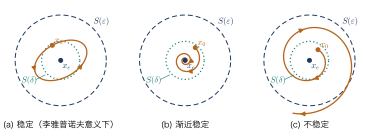
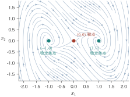
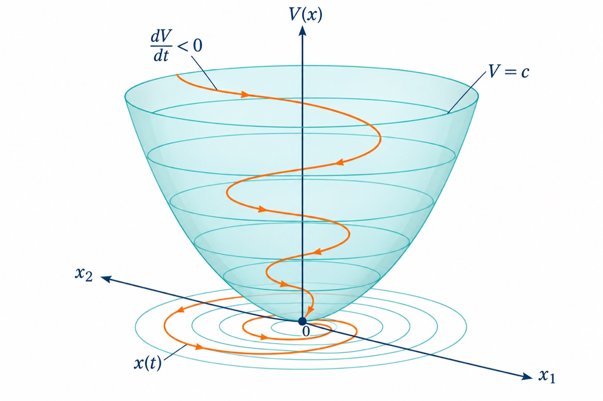

# 稳定性与李雅普诺夫方法

## 1. 外部稳定与内部稳定

- **外部稳定（BIBO 稳定）**：零初始条件下，任意有界输入产生的输出都有界。LTI 系统的判据：传递函数 $G(s)$ 的全部极点在开左半平面（等价于脉冲响应矩阵的各元素绝对可积）；离散系统：$G(z)$ 的极点全在单位圆内。
- **内部稳定**：零输入响应 $\e^{At}x_0\to0$（$\forall x_0$）$\Leftrightarrow$ $A$ 的全部特征值满足 $\mathrm{Re}\,\lambda_i<0$，即零平衡状态渐近稳定。
- **两者的关系**：内部稳定 $\Rightarrow$ 外部稳定，因为 $G(s)$ 的极点都是 $A$ 的特征值。反之不一定成立：不稳定模态可能被零极点对消掉。系统**能控且能观**时二者等价（见[能控性](controllability.md)、[能观性](observability.md)和[结构分解](canonical-decomposition.md)）。离散系统同理：$G(z)$ 的极点是 $G$ 的特征值的子集，有对消时，"$G(z)$ 极点在单位圆内"推不出"全部 $|\lambda_i(G)|<1$"，两种稳定性要分开说。

例：$A=\diag(1,-2)$，$b=[1\ \ 1]\tp$，$c=[0\ \ 1]$。$g(s)=c(sI-A)^{-1}b=1/(s+2)$，BIBO 稳定；但 $\lambda=1>0$，内部不稳定：模态 $\e^{t}$ 不能观，在传递函数中被对消了。

## 2. 平衡状态

满足 $f(x_e,t)\equiv0$（对一切 $t$）的状态 $x_e$ 称为平衡状态：在该处 $\dot x=0$，系统停在原处不动。

- **线性定常系统** $\dot x=Ax$：平衡状态满足 $Ax_e=0$。若 $\rank A=n$（$\det A\ne0$，$\dim\Ker A=0$），只有 $x_e=0$，唯一；若 $\rank A<n$，整个零空间 $\Ker A$ 都是平衡状态（$\dim\Ker A=n-\rank A\ge1$），有无穷多个且不孤立。
- **非线性系统**：平衡状态可以唯一；可以有多个**孤立**平衡点（某邻域内没有别的平衡点）；也可以不存在（如 $\dot x_1=1$）。
- **证明唯一性**：组合出定号的式子，如 $x_1f_1+x_2f_2=-(x_1^2+x_2^2)^2=0\Rightarrow x=0$；或逐式消元。
- **坐标平移**：任一平衡点都可以平移到原点。令 $z=x-x_e$，则 $\dot z=g(z)=f(z+x_e)$，$g(0)=0$，$g$ 的线性部分就是雅可比矩阵 $J(x_e)$。
- 稳定性是**平衡状态**的属性：非线性系统必须指明是哪一个平衡点。LTI 系统各平衡点的偏差方程都是 $\dot z=Az$，稳定性相同。只有 LTI 系统或平衡点唯一时，才可以笼统地说"系统稳定 / 不稳定"。

## 3. 李雅普诺夫意义下的稳定性

记 $S(\varepsilon)$ 为以 $x_e$ 为球心、$\varepsilon$ 为半径的球域，$\|x\|=\sqrt{x_1^2+\cdots+x_n^2}$。下文"李氏意义下"即"李雅普诺夫意义下"。

| 概念 | 定义 |
|---|---|
| 李氏意义下稳定 | $\forall\varepsilon>0$，$\exists\delta(\varepsilon,t_0)>0$，使 $\lVert x_0-x_e\rVert\le\delta\Rightarrow\lVert x(t)-x_e\rVert\le\varepsilon,\ \forall t\ge t_0$。即从 $S(\delta)$ 出发的轨线永不越出 $S(\varepsilon)$。$\delta$ 与 $t_0$ 无关时称**一致稳定** |
| 渐近稳定 | 稳定，且吸引：$\lim_{t\to\infty}x(t)=x_e$ |
| 大范围渐近稳定 | 稳定，且全空间吸引：**任意**初值都有 $x(t)\to x_e$（渐近稳定且吸引区为全空间）。必要条件：全状态空间只有一个平衡状态 |
| 不稳定 | $\exists\varepsilon>0$，无论 $\delta$ 取多小，$S(\delta)$ 内总有初值使轨线越出 $S(\varepsilon)$ |

- 经典控制理论中的"稳定"就是这里的渐近稳定。临界稳定（其余特征值实部 $<0$，零实部特征值的约当块都是一阶，对应模态等幅振荡或为常值）在李氏意义下属于"稳定"。
- 只在 $x_e$ 附近成立的渐近稳定称为**局部**渐近稳定；收敛到 $x_e$ 的全部初值构成的集合称为它的吸引区。

{ .diagram }

上图三种情形：(a) 轨线不越出 $S(\varepsilon)$，但不趋于 $x_e$（稳定）；(b) 不越出且趋于 $x_e$（渐近稳定）；(c) 越出 $S(\varepsilon)$（不稳定）。

## 4. 李雅普诺夫第一法（间接法）

第一法通过特征值判断稳定性。

**线性定常系统** $\dot x=Ax$（判断零平衡状态，也就是判断"系统"）：

1. 全部 $\mathrm{Re}\,\lambda_i<0$ $\Leftrightarrow$ 渐近稳定。LTI 系统渐近稳定必为大范围渐近稳定。
2. 全部 $\mathrm{Re}\,\lambda_i\le0$、至少一个 $=0$，且零实部特征值的约当块都是一阶 $\Rightarrow$ 稳定但非渐近（临界稳定）。
3. 有 $\mathrm{Re}\,\lambda_i>0$，或零实部特征值有高阶约当块 $\Rightarrow$ 不稳定。例：$A=\smat{0&1\\0&0}$，$\e^{At}=\smat{1&t\\0&1}$ 无界。

离散系统 $x(k+1)=Gx(k)$：把"$\mathrm{Re}\,\lambda_i$ 与 0 比较"换成"$|\lambda_i(G)|$ 与 1 比较"，如渐近稳定 $\Leftrightarrow$ 全部 $|\lambda_i(G)|<1$。

**非线性系统** $\dot x=f(x)$：在 $x_e$ 处线性化，$\dot z=J(x_e)z+{}$高阶项，其中雅可比矩阵 $J(x)=\partial f/\partial x\tp$（第 $i$ 行为 $\partial f_i/\partial x_1,\dots,\partial f_i/\partial x_n$）。线性化之后有三种结论：

1. $J(x_e)$ 的特征值实部全部 $<0$ $\Rightarrow$ 原系统在 $x_e$ 处（局部）渐近稳定；
2. 至少一个特征值实部 $>0$ $\Rightarrow$ 不稳定；
3. 没有正实部、但有零实部特征值（临界情形）$\Rightarrow$ 第一法失效，稳定性由高阶项决定，改用第二法。

**二阶平衡点速判**：$\lambda_1+\lambda_2=\tr J$，$\lambda_1\lambda_2=\det J$（兼作自检）。

- $\det J<0$：鞍点，不稳定；
- $\tr J<0<\det J$：渐近稳定，$(\tr J)^2<4\det J$ 时为稳定焦点，否则为稳定结点；
- $\tr J=0<\det J$：纯虚根，线性系统为中心，非线性系统属于临界情形（结论 3）；
- $\tr J>0$：不稳定。

!!! tip "方法：多平衡点非线性系统"
    1. 令 $f(x)=0$ 求出**全部**平衡点，说明个数以及是否孤立；
    2. 逐点求 $J(x_e)$（或平移 $z=x-x_e$ 后取 $g(z)$ 的线性部分），写出特征方程 $|\lambda I-J(x_e)|=0$ 与特征值；
    3. 按三种结论判断，并注明是**局部**结论；临界情形改用第二法。有多个平衡点时，哪一个都不可能大范围渐近稳定。

    例：单摆 $\dot x_1=x_2,\ \dot x_2=-\sin x_1-x_2$。$J=\smat{0&1\\-\cos x_1&-1}$。在 $(2k\pi,0)$ 处特征方程为 $\lambda^2+\lambda+1=0$，稳定焦点；在 $((2k+1)\pi,0)$ 处为 $\lambda^2+\lambda-1=0$，鞍点。

??? example "例：双稳弹性关节（多平衡点与坐标平移）"
    $\dot x_1=x_2$，$\dot x_2=x_1-x_1^3-x_2$（$x_1$ 为关节偏角，$x_2$ 为角速度）。(1) 求全部平衡状态，说明都是孤立的；(2) 写出 $J(x)$；(3) 对 $(1,0)$ 作平移 $z=x-x_e$，写出完整的 $\dot z=g(z)$；(4) 用第一法逐点判断；(5) 为什么 $(\pm1,0)$ 只能是局部渐近稳定，$(0,0)$ 起什么作用；(6) 判断说法"既有稳定又有不稳定的平衡点，所以系统不稳定"。

    **解** (1) 由 $\dot x_1=0$ 得 $x_2=0$；再由 $x_1-x_1^3=x_1(1-x_1)(1+x_1)=0$ 得 $x_e$ 为 $(0,0)$、$(1,0)$、$(-1,0)$，平衡点不唯一。三点两两相距 $\ge1$，各自半径 $\frac12$ 的邻域内没有别的平衡点，所以都是孤立的。

    (2) $J(x)=\smat{0&1\\1-3x_1^2&-1}$。

    (3) $z_1=x_1-1$，$z_2=x_2$，代入 $x_1=1+z_1$：$\dot z_1=z_2$，

    $$
    \dot z_2=(1+z_1)-(1+z_1)^3-z_2=\boxed{-2z_1-z_2-3z_1^2-z_1^3}
    $$

    其中 $(1+z_1)^3=1+3z_1+3z_1^2+z_1^3$，别丢项。$g(0)=0$；线性部分 $\smat{0&1\\-2&-1}=J(1,0)$，余项 $[0\ \ {-3z_1^2-z_1^3}]\tp$ 是高阶项。

    (4) $(0,0)$：$J=\smat{0&1\\1&-1}$，$\lambda^2+\lambda-1=0$，$\lambda=\frac{-1\pm\sqrt5}{2}\approx0.618,\ -1.618$，一正一负，是鞍点，**不稳定**。$(\pm1,0)$：$J=\smat{0&1\\-2&-1}$，$\lambda^2+\lambda+2=0$，$\lambda=\frac{-1\pm j\sqrt7}{2}$，是稳定焦点，**局部渐近稳定**。

    { .diagram }

    (5) 大范围渐近稳定要求全空间只有一个平衡状态，本系统有三个：从 $(-1,0)$ 或 $(0,0)$ 出发的运动停在原地，不会趋于 $(1,0)$。所以 $(\pm1,0)$ 的渐近稳定只能是局部的，各有自己的吸引区。$(0,0)$ 是鞍点，进入它的两条轨线（稳定流形）就是两个吸引区的**分界线**（见上图）。

    (6) **不正确**。稳定性是针对某一平衡状态而言的，应逐点说明：$(0,0)$ 不稳定，$(\pm1,0)$ 局部渐近稳定。

## 5. 定号性与 Sylvester 准则

设标量函数 $V(x)$ 满足 $V(0)=0$：

| 定号性 | 条件 | 例 |
|---|---|---|
| 正定 | $x\ne0$ 时 $V(x)>0$ | $x_1^2+x_2^2$ |
| 正半定 | $V(x)\ge0$，且存在 $x\ne0$ 使 $V(x)=0$ | $(x_1+x_2)^2$ |
| 负定 / 负半定 | $-V$ 正定 / 正半定 | $-x_1^2-x_2^2$ / $-x_2^2$ |
| 不定 | 既可取正值也可取负值 | $x_1x_2$ |

- **二次型** $V=x\tp Px$，$P$ 为实对称权矩阵：$p_{ii}$ 是 $x_i^2$ 的系数，$p_{ij}=p_{ji}$ 是 $x_ix_j$ 系数的**一半**。
- **Sylvester 准则**：记顺序主子式 $\Delta_1=p_{11}$，$\Delta_2=p_{11}p_{22}-p_{12}^2$，…，$\Delta_n=\det P$。$P$ 正定 $\Leftrightarrow$ 全部 $\Delta_i>0$；$P$ 负定 $\Leftrightarrow$ $(-1)^i\Delta_i>0$（奇数阶 $<0$、偶数阶 $>0$）$\Leftrightarrow$ $-P$ 正定。
- **半定**要求**全部**主子式 $\ge0$（负半定则对 $-P$ 判断），只看顺序主子式不够。例如 $\smat{0&0\\0&-1}$ 的 $\Delta_1=\Delta_2=0$，实际是负半定。自检：$P$ 的特征值全 $>0$ $\Leftrightarrow$ 正定。
- **非二次型**：Sylvester 准则不适用，按定义判断：$V(0)=0$，且 $x\ne0$ 时 $V(x)>0$。
- **径向无界**：$\|x\|\to\infty$ 时 $V(x)\to\infty$。正定二次型必然径向无界，因为 $V\ge\lambda_{\min}(P)\|x\|^2$。反例：$x_1^2+x_2^2/(1+x_2^2)$ 正定，但沿 $x_2$ 轴 $V\to1$，集合 $\{V\le1\}$ 无界，不能用它下"大范围"的结论。

!!! tip "方法：判定号性"
    二次型：写出 $P$（交叉项系数减半）→ 逐阶写出 $\Delta_i$ → 下结论。含参数时解 $\Delta_i>0$，参数取边界值时多为半定，要单独验证。

    - $8.2x_1^2+6.8x_2^2+3x_3^2+4.8x_1x_2$：$p_{12}=2.4$，$\Delta=8.2,\ 50,\ 150$，正定（特征值为 $3,5,10$）。
    - $x_1^2+x_2^2/(1+x_2^2)$：按定义正定；但不径向无界（$x_1=0,\ x_2\to\infty$ 时 $V\to1$）。
    - $-2x_1^2-2x_2^2-3x_3^2+2x_1x_2+2x_2x_3$：$\Delta=-2,\ 3,\ -7$（奇负偶正），负定，不是正定。
    - $h=x_1^2+4x_1x_2+\alpha x_2^2$：$\Delta_1=1$，$\Delta_2=\alpha-4>0\Rightarrow\alpha>4$ 时正定。$\alpha=4$ 时 $h=(x_1+2x_2)^2$，$h(-2,1)=0$，为**正半定**。

## 6. 李雅普诺夫第二法（直接法）

第二法不解方程，而是通过"广义能量"$V(x)$ 沿轨线的变化来判断稳定性；满足判据条件的 $V$ 称为李雅普诺夫函数。$V$ 沿轨线的导数为

$$
\dot V=\frac{\partial V}{\partial x\tp}\,\dot x=\sum_{i=1}^{n}\frac{\partial V}{\partial x_i}\,f_i(x),\qquad
\text{线性系统 } V=x\tp Px:\ \ \dot V=x\tp\big(A\tp P+PA\big)x
$$

### 判据

前提：$V(x)$ 正定、有连续一阶偏导数，平衡点 $x_e=0$。

| $\dot V$（沿轨线） | 附加条件 | 结论 | 再加 $V$ 径向无界 |
|---|---|---|---|
| 负定 | — | 渐近稳定 | 大范围渐近稳定 |
| 负半定 | （原点附近的）非零轨线上 $\dot V$ 不恒为零 | 渐近稳定 | 大范围渐近稳定 |
| 负半定 | 原点任意近处都有非零轨线使 $\dot V\equiv0$ | 稳定（非渐近） | 仍只是稳定 |
| 正定 | — | 不稳定 | — |
| 正半定（推论） | （原点附近的）非零轨线上 $\dot V$ 不恒为零 | 不稳定 | — |

- 下"大范围"结论要求：条件在**全空间**成立，且 $V$ 径向无界（这时平衡点必然唯一）。
- 判断 $\dot V$ "是否恒为零"：令 $\dot V\equiv0$，代回状态方程，只看**原点附近**：若那里只剩下 $x\equiv0$，就是"不恒为零"。远处的解不算：单摆在 $(\pm\pi,0)$ 处也有 $\dot V\equiv0$，但原点照样渐近稳定。要下"大范围"结论，则需全空间只剩 $x\equiv0$。
- 第二法只是**充分条件**：找不到合适的 $V$，不能断定系统不稳定。对 LTI 系统，李雅普诺夫方程判据是充要的，见[李雅普诺夫方程与非线性系统分析](lyapunov-nonlinear.md)。

### 几何意义：$V$ 是"广义能量"

<figure markdown>
  { width="480" loading=lazy }
  <figcaption>第二法的几何意义：$V(x)$ 像一只碗，$\dot V<0$ 时状态沿碗壁一路下滑，直到碗底的平衡点。</figcaption>
</figure>

- $V(x)=C$ 是一族包围原点、随 $C$ 减小向内收缩的闭曲线（二次型时为同心椭圆）。
- $\dot V<0$：轨线由外向内逐层穿越等值线，收缩到原点（渐近稳定）；$\dot V>0$ 则由内向外穿越（不稳定）。
- $\dot V\equiv0$：轨线沿等值线运动，是闭轨（稳定、非渐近）。
- $V$ 不径向无界时，$C$ 较大的等值线不闭合，轨线可以一面让 $V$ 下降，一面跑向无穷远。

!!! warning "易错点：答题规范三点"
    1. **平衡点唯一性**：先求平衡点并说明是否唯一（线性系统看 $\rank A$；非线性系统解 $f(x)=0$，或组合出定号式）。
    2. **用 Sylvester 准则判 $P$**：写出权矩阵 $P$（交叉项减半）与各阶 $\Delta_i$，不要只写"显然正定"。
    3. **下"大范围"结论前必须验证径向无界**：写明 $\|x\|\to\infty\Rightarrow V\to\infty$。缺这一步只能写"渐近稳定"，不能写"大范围渐近稳定"。

!!! tip "方法：第二法解题步骤"
    1. 求平衡点并说明是否唯一（必要时平移到原点）；
    2. 选 $V$：题目给定的；常用的 $x_1^2+x_2^2$；能量函数（非二次型时按定义判正定）；或待定二次型 $ax_1^2+bx_1x_2+cx_2^2$，令 $\dot V$ 中不定号项的系数为零，临界情形下令三项系数全为零得 $\dot V\equiv0$（见后面的例题）。然后用 Sylvester 准则判正定；
    3. 求 $\dot V=\sum_i\frac{\partial V}{\partial x_i}f_i$ 并判定号。含二次项与高次项时：二次部分写成 $-x\tp Qx$，用 Sylvester 准则判 $Q$ 正定；若高次项 $\le0$，则 $\dot V$ 负定（高次项不定号时，仅在原点附近负定）。负半定时，检查原点附近的非零轨线上 $\dot V$ 是否恒为零；
    4. 套判据表下结论；验证径向无界后才能写"大范围"。含参数时按 $\dot V$ 的符号分类讨论。

    含 $x_1^2+x_2^2$ 的二阶系统可以改用极坐标：$r\dot r=x_1\dot x_1+x_2\dot x_2$，$\dot\theta=(x_1\dot x_2-x_2\dot x_1)/r^2$。

    **负半定的典型例子（单摆）**：$\dot x_1=x_2,\ \dot x_2=-\sin x_1-x_2$。取能量函数 $V=(1-\cos x_1)+\frac12x_2^2$（在 $|x_1|<2\pi$ 内正定），$\dot V=x_2\sin x_1+x_2(-\sin x_1-x_2)=-x_2^2$，负半定。令 $\dot V\equiv0\Rightarrow x_2\equiv0\Rightarrow\dot x_2\equiv0\Rightarrow\sin x_1\equiv0$，原点附近只剩原点，故原点渐近稳定。系统有多个平衡点，不是大范围渐近稳定。

    **二次部分用 Sylvester 准则的典型例子**：$\dot x_1=-3x_1+x_2,\ \dot x_2=x_1-x_2-x_2^3$。由第一式得 $x_2=3x_1$，代入第二式得 $-x_1(2+27x_1^2)=0$，故 $x_e=0$ 唯一。取 $V=x_1^2+x_2^2$，

    $$
    \dot V=-6x_1^2+4x_1x_2-2x_2^2-2x_2^4=-2x\tp\bmat{3&-1\\-1&1}x-2x_2^4
    $$

    $\Delta=3,\ 2>0$，二次部分负定，高次项 $-2x_2^4\le0$，所以 $\dot V$ 负定；$V$ 径向无界，故原点**大范围渐近稳定**。克拉索夫斯基方法见[李雅普诺夫方程与非线性系统分析](lyapunov-nonlinear.md)。

??? example "例：第二法判稳（$\dot V$ 负定，线性化失效）"
    用 $V=x_1^2+x_2^2$ 研究 $\dot x_1=x_2-x_1(x_1^2+x_2^2)$，$\dot x_2=-x_1-x_2(x_1^2+x_2^2)$ 在原点的稳定性：(1) 说明原点是唯一平衡状态；(2) 求 $\dot V$、判定号并下结论（是否大范围？）；(3) 求 $J(0)$ 及其特征值，说明第一法为何失效；(4) 用极坐标证明 $\dot r=-r^3$、$\dot\theta=-1$，解出 $r(t)$，说明收敛为什么不是指数型的。

    **解** 记 $\rho=x_1^2+x_2^2$。

    (1) $x_1f_1+x_2f_2=x_1x_2-x_1^2\rho-x_1x_2-x_2^2\rho=-\rho^2$。平衡点处 $f=0$，故 $\rho=0$，原点是**唯一**平衡状态。

    (2) $\dot V=2x_1\dot x_1+2x_2\dot x_2=2x_1x_2-2x_1^2\rho-2x_1x_2-2x_2^2\rho=\boxed{-2(x_1^2+x_2^2)^2}<0$（$x\ne0$），**负定**。$V=x\tp Ix$ 正定（$\Delta_1=\Delta_2=1$），故渐近稳定；又 $V=\|x\|^2\to\infty$（$\|x\|\to\infty$），径向无界，且平衡点唯一，所以原点**大范围渐近稳定**。用到的三点是平衡点唯一、$\dot V$ 负定、$V$ 径向无界。

    (3) $J(0)=\smat{0&1\\-1&0}$，$\lambda=\pm j$，属临界情形，第一法**失效**：稳定性由线性化时略去的三次项决定，必须用第二法。

    (4) $r\dot r=x_1\dot x_1+x_2\dot x_2=-r^4\Rightarrow\dot r=-r^3$；$\dot\theta=\frac{x_1\dot x_2-x_2\dot x_1}{r^2}=\frac{-(x_1^2+x_2^2)}{r^2}=-1$。分离变量得 $1/r^2=1/r_0^2+2t$，即

    $$
    \boxed{r(t)=\frac{r_0}{\sqrt{1+2r_0^2t}}},\qquad \theta=\theta_0-t
    $$

    轨线是顺时针卷入原点的螺旋线。$r\sim1/\sqrt{2t}$ 是代数衰减，比任何 $\e^{-\gamma t}$ 都慢，所以原点渐近稳定但**不是指数稳定**。原因是线性化特征值落在虚轴上，没有线性阻尼。

    **注** 含参数的同型问题：$\dot x_1=x_2+cx_1\rho$，$\dot x_2=-x_1+cx_2\rho$。先写出要点：$x_1f_2-x_2f_1=-\rho$，故对一切 $c$，$x_e=0$ 唯一；$V=\|x\|^2$ 正定且径向无界。同样取 $V$ 得 $\dot V=2c\rho^2$，分类讨论：$c<0$ 时大范围渐近稳定；$c=0$ 时稳定但非渐近（轨线为圆）；$c>0$ 时 $\dot V$ 正定，不稳定。三种情形的 $J(0)$ 相同，第一法无法区分。

??? example "例：待定系数构造 V（临界情形）"
    $\dot x_1=-x_1+x_2$，$\dot x_2=-2x_1+x_2$。(1) 求 $x_e$，从 $\rank A$、$\dim\Ker A$ 说明唯一性；(2) 用第一法判断；(3) 设 $V=ax_1^2+bx_1x_2+cx_2^2$，令 $\dot V$ 三项系数全为零定出 $b,c$，取 $a=2$；(4) 用 Sylvester 准则判 $V$，下稳定性结论；(5) 从等值线与轨线的关系说明为什么不是渐近稳定。

    **解** (1) $A=\smat{-1&1\\-2&1}$，$\det A=1\ne0$，故 $\rank A=2$，$\dim\Ker A=0$，$x_e=0$ **唯一**。

    (2) $|\lambda I-A|=\lambda^2+1$，$\lambda=\pm j$，属临界情形；但本题是线性系统，$\pm j$ 为单根（约当块一阶），所以稳定但非渐近。

    (3)

    $$
    \dot V=(2ax_1+bx_2)(-x_1+x_2)+(bx_1+2cx_2)(-2x_1+x_2)=(-2a-2b)x_1^2+(2a-4c)x_1x_2+(b+2c)x_2^2
    $$

    令系数为零：$b=-a$，$c=a/2$（第三式自动成立）。取 $a=2$：$\boxed{V=2x_1^2-2x_1x_2+x_2^2,\ \ \dot V\equiv0}$。

    (4) $P=\smat{2&-1\\-1&1}$（$p_{12}=b/2=-1$），$\Delta_1=2>0$，$\Delta_2=1>0$，$V$ 正定。$\dot V\equiv0$：负半定，且在一切非零轨线上恒为零，所以原点**李氏意义下稳定，不是渐近稳定**。$\dot V\equiv0$ 也可以算正半定，但不稳定的推论要求"不恒为零"，因此不能据此判为不稳定。验算：$A\tp P+PA=0$。

    (5) $V=x_1^2+(x_1-x_2)^2=C$ 是一族同心椭圆。$\dot V\equiv0$ 意味着 $V(x(t))\equiv V(x_0)$，轨线就是初值所在的那条椭圆（顺时针的闭轨，周期 $2\pi$）：不向外穿越，所以有界、稳定；不向内穿越，所以 $x(t)\not\to0$，非渐近。

## 7. 常见错误与概念辨析

1. **平衡状态一定是坐标原点。** 错。平衡状态可以不在原点（可平移过去）、可以有多个，也可以不存在。
2. **第二法是稳定性的充要条件。** 错。它只是充分条件，找不到 $V$ 不能断定不稳定。
3. **BIBO 稳定 $\Rightarrow$ 渐近稳定。** 错，反过来才成立。零极点对消可能藏住不稳定模态；能控且能观时二者等价。
4. **$V$ 正定、$\dot V$ 负定 $\Rightarrow$ 大范围渐近稳定。** 错。还要求 $V$ 径向无界，且条件在全空间成立。
5. **$\dot V\equiv0$ $\Rightarrow$ 渐近稳定；或者"$\dot V\equiv0$ 也算正半定，所以不稳定"。** 都错。只能得到李氏意义下稳定、非渐近。
6. **线性化特征值为 $\pm j$，所以原系统稳定。** 错。稳定性由高阶项决定：$\dot x_1=x_2-x_1\rho$，$\dot x_2=-x_1-x_2\rho$ 渐近稳定，三次项变号就不稳定。
7. **有多个平衡点的系统也可能大范围渐近稳定。** 错。大范围渐近稳定的必要条件是平衡状态唯一。
8. **既有稳定又有不稳定的平衡点，所以系统不稳定。** 错。稳定性属于平衡状态，应逐点说明（如双稳弹性关节）。
9. **负定 $\Leftrightarrow$ 顺序主子式全为负；顺序主子式全 $\ge0$ $\Rightarrow$ 正半定。** 都错。负定是奇数阶 $<0$、偶数阶 $>0$；半定要看全部主子式（反例 $\smat{0&0\\0&-1}$，是负半定）。
10. **$x_ix_j$ 的系数直接作为 $p_{ij}$。** 错，应取一半。例如 $V=2x_1^2-2x_1x_2+x_2^2$ 误写 $p_{12}=-2$，得 $\Delta_2=-2$，会错判为不定。
11. **$A$ 有零（或纯虚）特征值就不稳定。** 错。其余特征值实部都 $<0$、零实部特征值的约当块都是一阶时，$\e^{At}$ 有界，为临界稳定（李氏意义下稳定、非渐近）；有正实部特征值，或零实部特征值有高阶约当块（如 $\smat{0&1\\0&0}$），才不稳定。
12. **渐近稳定就是指数收敛。** 错。上面 $\dot r=-r^3$ 的例子中 $r\sim t^{-1/2}$，渐近稳定但不是指数稳定。
13. **正定函数一定径向无界。** 错。正定二次型必然径向无界，一般的正定函数不一定，如 $x_1^2+x_2^2/(1+x_2^2)$。
14. **第二法只适用于线性定常系统。** 错。线性/非线性、定常/时变系统都适用；而第一法对非线性系统只能给出局部结论。
