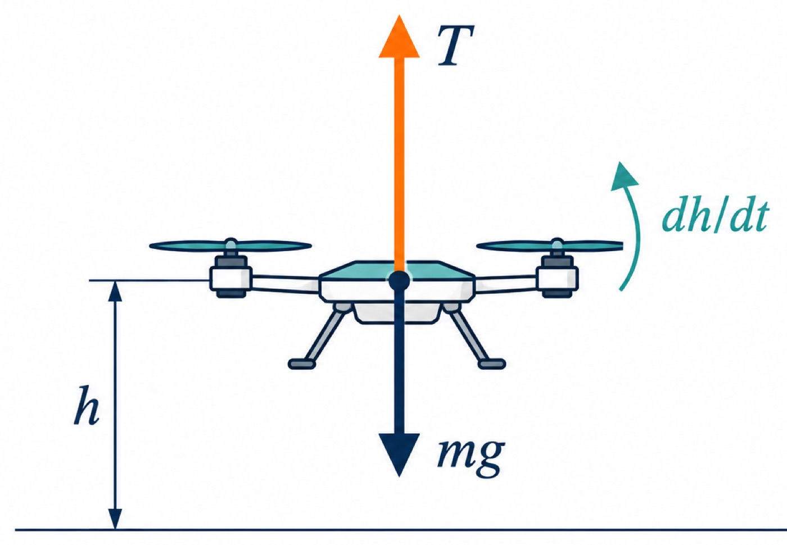
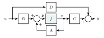
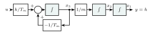

# 绪论与状态空间描述

## 1. 从经典控制到现代控制

| | 经典控制理论（1930–50 年代） | 现代控制理论（1960 年代起） |
|---|---|---|
| 对象与方法 | 单输入单输出、线性、定常；频域方法（根轨迹、频率特性） | 多输入多输出（$u\in\R^p,\ y\in\R^q,\ p,q>1$），也能描述时变、非线性系统；时域方法（状态空间） |
| 模型 | 微分方程经拉氏变换得到传递函数 $G(s)$，属于外部描述 | 状态空间表达式，属于内部描述 |
| 分析与设计 | 全部在传递函数这个分式上完成：劳斯判据、根轨迹、奈氏判据，终值定理，截止频率、谐振峰值；用根轨迹法或频率法试探着做校正 | 四大内容：线性多变量系统理论（状态空间描述，即本模块的主体）、最优控制、最优估计（以卡尔曼滤波为主）、系统辨识 |

1970 年代以后，控制理论向广度（大系统理论）和深度（智能控制：模糊控制、神经网络控制、专家控制）发展，自适应控制、学习控制、鲁棒控制、故障诊断与容错控制等方向也相继形成，它们都以现代控制理论为基础。

### 研究一个系统要做的三件事

1. **建模**：把对象抽象为变量之间的数学关系。
2. **分析**：定量或定性地研究系统的稳定性、静态特性和动态特性。
3. **综合（设计）**：设计控制作用，使系统性能满足要求。这一步是控制理论区别于力学建模的地方。

三者有先后：先有模型才能分析，先能分析才能设计。分析研究的是已有系统的性能，综合是去设计控制作用。

### 经典控制的三点局限

这三点局限恰好对应现代控制理论的三条主线：

1. 只适用于单变量、线性、定常系统，对应「多变量」。
2. 只用输入—输出描述，不关心内部变量，忽略了系统结构的内在特性，对应「内部状态」。
3. 设计靠工程试探，依赖经验，得到的不是最优解，对应「最优」。

但经典方法对线性定常单变量系统简单实用，不能因此否定它。

### 传递函数为什么"看不见"初始状态

传递函数的定义是

$$
G(s)=\left.\frac{Y(s)}{U(s)}\right|_{\text{零初始条件}}
$$

做拉氏变换时必须令全部初值为零，求导才能换成乘 $s$。这正是上面第 2 条局限的根源：传递函数里不含初值信息。状态空间描述则保留了 $x(t_0)\neq0$，代价只是多写几个变量。初值非零时，要么在拉氏变换中保留初始条件项，要么改用状态空间描述。

### 现代控制理论为什么在 1960 年前后出现

三股力量缺一不可：

- **需求**：冷战与太空竞赛。制导和姿态控制问题是多变量的，要求最优，还有随机干扰；仅"多变量"这一条，传递函数方法就难以应付。
- **工具**：电子计算机。
- **数学**：线性代数、泛函分析、微分几何。

1960 年卡尔曼一年内提出了能控性与能观性、线性二次型（LQ）最优控制和卡尔曼滤波三项成果，现代控制理论由此形成。

### 现代控制理论的三个特点

1. 有精确的数学描述，使控制从一类工程设计方法提高为一门科学。
2. 从系统结构的内在特性出发，注重对本质的理论刻画。
3. 推动了非线性系统、最优控制、自适应控制、辨识与估计、卡尔曼滤波、鲁棒控制等发展为独立的学科分支。

## 2. 引例：四旋翼高度环的两种写法

<figure markdown>
{ width="480" loading=lazy }
<figcaption>四旋翼竖直方向受力，图中 T 即升力 f</figcaption>
</figure>

最简单的高度模型（下文记作 Q-alt）只考虑牛顿定律：$m\ddot h=f-mg$。取 $x=[h\ \ \dot h]\tp$，输入取升力偏差 $u=\Delta f=f-mg$，得 $m\ddot h=u$。

再计入电机—桨的升力惯性，就得到三阶模型（下文记作 Q-alt3）。取 $m=1.2$ kg，$T_m=0.1$ s，$k=1$，$g=9.8\ \mathrm{m/s^2}$，竖直向上为正：

$$
m\ddot h=f-mg,\qquad T_m\dot f+f=ku_{\rm pwm}
$$

令 $\Delta f=f-mg$，$u=u_{\rm pwm}-mg/k$（此时 $u$ 指油门偏差，$\Delta f$ 将作为状态 $x_3$），第二式化为

$$
T_m\Delta\dot f+\Delta f=ku .
$$

### 写法一：消去中间变量

由牛顿定律得 $\Delta f=m\ddot h$，这是关键一步。代入第二式，得到一个高阶、线性、常系数微分方程

$$
mT_m\overset{\dots}{h}+m\ddot h=ku\qquad(\text{数值：}0.12\,\overset{\dots}{h}+1.2\,\ddot h=u)
$$

零初始条件下取拉氏变换（每求一次导乘一个 $s$）：$(mT_ms^3+ms^2)H(s)=kU(s)$，即

$$
\frac{H(s)}{U(s)}=\frac{k}{ms^2(T_ms+1)} .
$$

极点为 $s=-1/T_m$ 和原点处的二重极点。原点二重极点来自双积分，所以开环不稳定。

### 写法二：不消中间变量

选 $x_1=h,\ x_2=\dot h,\ x_3=\Delta f$，分别写出各自的一阶导数：

$$
\dot x_1=x_2,\qquad \dot x_2=\frac1m x_3,\qquad \dot x_3=-\frac{1}{T_m}x_3+\frac{k}{T_m}u
$$

输出取高度 $y=x_1$，写成矩阵形式：

$$
\dot x=\bmat{0&1&0\\0&0&1/m\\0&0&-1/T_m}x+\bmat{0\\0\\k/T_m}u,\qquad y=[1\ \ 0\ \ 0]\,x
$$

代入 $1/m=0.833$、$1/T_m=10$：

$$
A=\bmat{0&1&0\\0&0&0.833\\0&0&-10},\qquad b=\bmat{0\\0\\10}
$$

这一写法有几点要看清：

- 一个 $n$ 阶方程等价于 $n$ 个一阶方程，两者信息量相同。选哪几个量作状态，矩阵就长成什么样。
- $A$ 是上三角阵，特征值就是对角元：$\lambda(A)=\{0,\,0,\,-1/T_m=-10\}$。二重的 0 来自双积分，$-10$ 来自电机惯性。
- 矩阵的每个元素都有物理意义，可以理解为"这一格把谁送给谁"：
    - $a_{12}=1$：速度是高度的变化率；
    - $a_{23}=1/m$：升力偏差除以质量就是加速度；
    - $a_{33}=-1/T_m$：升力自身按时间常数 $T_m$ 衰减；
    - $b_3=k/T_m$：油门只能直接推动升力，推不动高度；
    - $c=[1\ \ 0\ \ 0]$：输出就是高度（由气压计测量）；
    - $d=0$：油门不会瞬间改变高度。
- 换用更快的电机，$T_m$ 由 0.1 s 变为 0.02 s：只有 $a_{33}$ 和 $b_3$ 改变。$a_{33}$ 由 $-10$ 变为 $-50$（更负，升力响应更快），$b_3$ 由 10 变为 50（油门作用更强），绝对值都放大 5 倍；$a_{12}$（运动学关系）和 $a_{23}$（只与 $m$ 有关）不变。

## 3. 状态、状态变量与状态空间

### 五个概念

- **状态**：系统运动信息的集合，也就是系统的"记忆"。知道此刻的状态和此后的输入，系统未来的运动就唯一确定。
- **状态变量**：一组能**完全**表征系统运动信息的**独立**变量。Q-alt3 中是 $h,\ \dot h,\ \Delta f$。
- **状态向量**：以状态变量为分量的列向量 $x=[x_1\ \cdots\ x_n]\tp$（写成一行加转置只是为了排版），分量个数即维数。
- **状态空间**：以状态变量为坐标轴的欧氏空间，维数等于状态变量个数。某一时刻的状态是其中的一个点 $x(t_1)\in\R^n$。
- **状态轨迹**：状态点随时间在状态空间中描出的曲线，表示系统的运动过程。一个时刻对应一个点，一段时间对应一条曲线。例如给 Q-alt 加上反馈 $u=-2h-2\dot h$，从 $x(0)=[1\ \ 0]\tp$ 出发，轨迹先向下俯冲（速度最低约 $-0.62$ m/s），再折回、略过原点后收敛。可见状态轨迹并不一定直奔原点。

### 状态变量的两个条件

- **完全性（不能少）**：初始时刻的状态值和此后的全部输入确定后，系统此后的运动就唯一确定。减少任何一个状态变量都会破坏完全性。例如 Q-alt3 若只知道 $h,\dot h$ 而不知道 $\Delta f$，就算不出下一时刻的运动。
- **独立性（不能多）**：状态变量数目最少、彼此线性无关，再增加任何一个都是多余的。例如再加一个 $2h$ 毫无用处。

两个条件合起来，确定的是"最小完备"的一组量，即"最小的一组记忆"。

### 选取不唯一，维数唯一

- **选取不唯一**：可以按初始条件选，也可以按可测量的量选。Q-alt3 选 $[h\ \ \dot h\ \ \Delta f]$ 或 $[h\ \ \dot h\ \ \ddot h]$，得到的系统矩阵 $A_1\neq A_2$（后者 $a_{23}=1$），但两者特征值相同、个数都是 3。这一现象在[线性变换](linear-transform.md)一章用相似变换解释。
- **维数唯一**：系统维数 = 状态变量个数 = 一阶微分方程个数，是系统本身的性质。对物理系统，它**通常**等于独立储能元件的个数，但这不是恒等式，像 Q-alt3 这类模型就不宜硬套。

??? example "例：RLC 网络为何是二阶系统，所选状态为何完全、独立"
    网络由 $R_1$、$C$、$L$、$R_2$ 组成，输入 $u_{\rm i}$，输出 $u_{\rm o}$（电路图与状态方程见[状态空间表达式的建立](realization.md)）。

    **解** 二阶：独立储能元件只有电容和电感，电阻只耗能、不储能，所以取 $x=[u_C\ \ i_L]\tp$。

    完全：由 $u_C(t_0)$、$i_L(t_0)$ 以及 $t\ge t_0$ 的输入 $u_{\rm i}$，可以定出全部支路电压和电流。

    独立：$u_C$ 与 $i_L$ 分属两个储能元件，初值可以独立给定；网络中没有纯电容回路，也没有纯电感割集，因此两者之间不存在代数约束。

## 4. 状态空间表达式与系统分类

**状态方程**描述 $\dot x$ 与 $x,u$ 的关系，是一阶向量微分方程；**输出方程**描述 $y$ 与 $x,u$ 的关系，是向量代数方程。两者合起来描述系统的动态特性。设 $x\in\R^n$，$u\in\R^p$，$y\in\R^q$，$f$ 为 $n$ 维、$g$ 为 $q$ 维向量函数：

$$
\text{一般形式：}\begin{cases}\dot x=f(x,u,t)\\ y=g(x,u,t)\end{cases}\qquad
\text{线性时变：}\begin{cases}\dot x=A(t)x+B(t)u\\ y=C(t)x+D(t)u\end{cases}\qquad
\text{线性定常：}\begin{cases}\dot x=Ax+Bu\\ y=Cx+Du\end{cases}
$$

### 分类

- $f,g$ 中**至少一个**元素是 $x,u$ 的非线性函数，系统为非线性；**全部**是线性函数时为线性系统，可以用四个矩阵写出。
- $f,g$ 不显含 $t$ 为定常系统，否则为时变系统。

例如 $\dot x=-x+u\sin t$ 是线性时变系统，$\dot x=-x^2+u$ 是非线性定常系统。

### 记号

线性定常系统记作 $\Sigma(A,B,C,D)$，$D=0$ 时输出方程为 $y=Cx$。单输入单输出（SISO，$p=q=1$）系统记作 $(A,b,c,d)$，$d=0$ 时记作 $(A,b,c)$：$b$ 是 $n$ 维**列**向量，$c$ 是 $n$ 维**行**向量（写 $y=cx+du$，不写 $c\tp x$），$d$ 是标量。

四个矩阵的维数由 $n,p,q$ 完全决定：

| 矩阵 | 名称 | 维数 | 含义 |
|---|---|---|---|
| $A$ | 系统矩阵 | $n\times n$ | 内部状态变量之间的联系，由内部结构和作用机理决定；其特征值决定系统的模态（见[线性定常系统的运动分析](lti-response.md)） |
| $B$ | 输入矩阵 | $n\times p$ | 输入对状态的作用；与 $A$ 一起决定系统能否被控制（见[能控性](controllability.md)） |
| $C$ | 输出矩阵 | $q\times n$ | 状态到输出的映射关系 |
| $D$ | 直接传输矩阵 | $q\times p$ | 输入不经过内部作用、直接传到输出；大多数物理系统 $D=0$（输入不会瞬间改变输出） |

!!! tip "方法：写状态空间表达式 $(A,b,c,d)$（方程中不含输入导数）"
    1. **选状态**：取积分链上的量。$n$ 阶方程取 $y,\dot y,\dots,y^{(n-1)}$，只取到 $n-1$ 阶，$y^{(n)}$ 由方程本身给出，不是状态。物理系统也可以保留中间变量（如 $\Delta f$）。状态个数等于阶数。
    2. **写一阶式**：先解出最高阶导数（两边除以首项系数，如 $J$、$m$、$T_m$），符号随系数走（如 $-b/J$、$-1/T_m$），再逐个写出 $\dot x_i=\cdots$，右边只允许出现 $x$ 和 $u$。
    3. **填矩阵**：$\dot x_i$ 式中 $x_j$ 的系数填入 $a_{ij}$，$u$ 的系数填入 $b_i$；$y$ 中 $x_j$ 的系数填入 $c_j$；只有 $u$ 直接出现在 $y$ 中时才有 $d\neq0$。
    4. **自检**：核对维数；逐个元素回查它来自哪个一阶式（最容易抄错）；三角阵的特征值直接读对角线；最后代回原方程。

??? example "例：横向偏移模型（ROVER）"
    小车以速度 $v=1$ 行驶，横向位置 $y$ 与航向角 $\psi$ 满足 $\dot y=v\psi$，$\dot\psi=\omega$，输入为转向角速度 $\omega$，输出为 $y$。取 $x=[y\ \ \psi]\tp$，写出 $(A,b,c,d)$。

    **解** 直接按定义填矩阵：

    $$
    A=\bmat{0&1\\0&0},\qquad b=\bmat{0\\1},\qquad c=[1\ \ 0],\qquad d=0
    $$

    $a_{12}=v$ 表示航向一偏，横向位置就以 $v\psi$ 的速率漂移；$b_2=1$ 表示转向只改变航向，推不动横向位置。$\lambda=\{0,0\}$，同属一个二阶约当块，是双积分结构，开环不稳定：$\omega=0$ 时 $y=y_0+v\psi_0t$。它与 Q-alt 的结构相同。

??? example "例：单关节机械臂的状态空间表达式"
    单关节机械臂满足 $J\ddot\theta+b\dot\theta=\tau$，$J=0.5\ \mathrm{kg\cdot m^2}$，粘性摩擦系数 $b=0.1\ \mathrm{N\cdot m\cdot s}$（这里的 $b$ 与答案中的输入列向量 $b$ 无关，只是记号撞车）。输入为关节力矩 $\tau$，输出为转角 $\theta$。取 $x=[\theta\ \ \dot\theta]\tp$，写出 $(A,b,c,d)$ 的数值并求 $A$ 的特征值。

    **解** $\dot x_1=x_2$ 是定义；两边除以 $J$ 解出角加速度，得 $\dot x_2=-\frac bJx_2+\frac1J\tau$。代入 $-b/J=-0.2$、$1/J=2$：

    $$
    \boxed{A=\bmat{0&1\\0&-0.2},\quad b=\bmat{0\\2},\quad c=[1\ \ 0],\quad d=0}
    $$

    $d=0$ 是因为力矩不会瞬间改变转角。$A$ 为上三角阵，所以

    $$
    \boxed{\lambda(A)=\{0,\ -0.2\}}
    $$

    $0$ 来自"转角是角速度的积分"；$-0.2=-b/J$ 来自粘性摩擦，$J/b=5$ s 是角速度衰减的时间常数。

    **注** 自检：代回 $\dot x_2=-0.2x_2+2\tau$，即 $0.5\ddot\theta+0.1\dot\theta=\tau$，与原方程一致。

含输入导数的方程、规范型、机理建模、由状态空间求传递函数以及组合系统，见[状态空间表达式的建立](realization.md)。

## 5. 方框图与状态变量图

线性定常系统的方框图如下：$A$ 构成积分器的反馈，$D$ 是从输入到输出的直接前馈。

{ .diagram }

方框图中，输出信号 =（方框所示的传递关系）×（输入信号）。它既表示系统的外部特性，也反映内部关系。

**状态变量图**由积分器、加法器、比例器三种元件组成，源于模拟计算机。Q-alt3 的状态变量图如下，$x_3=\Delta f$，$x_2=\dot h$，$x_1=h$：

{ .diagram }

画图和读图的要点：

- **积分器个数 = 阶数**，**每个积分器的输出是一个状态变量**。上图有 3 个积分器，所以有 3 个状态，系统是 3 阶。
- 加法器各输入端统一标"$+$"，负号并入比例器，如 $[-1/T_m]$。
- $A$ 是 $\R^n\to\R^n$ 的线性映射：$Ax=\sum_j x_ja_j$，$a_j$ 为 $A$ 的第 $j$ 列。图中每条带增益的支路对应 $A$ 或 $b$ 的一个非零元：$[1/m]$ 对应 $a_{23}$，$[-1/T_m]$ 对应 $a_{33}$，$[k/T_m]$ 对应 $b_3$。矩阵就是这张图的账本。

## 6. 稳态方程与偏差量方程

把各量写成稳态值加偏差量：

$$
x=x_\infty+\Delta x,\qquad u=u_\infty+\Delta u,\qquad y=y_\infty+\Delta y
$$

稳态时 $\dot x_\infty=0$，得到**稳态方程**

$$
\dot x_\infty=Ax_\infty+Bu_\infty=0 .
$$

$A$ 非奇异时可以解出

$$
x_\infty=-A^{-1}Bu_\infty,\qquad y_\infty=(D-CA^{-1}B)\,u_\infty .
$$

把原方程与稳态方程相减，稳态部分整体抵消，得到**偏差量方程**

$$
\Delta\dot x=A\Delta x+B\Delta u,\qquad \Delta y=C\Delta x+D\Delta u .
$$

- 相减这一步**不要求 $A$ 非奇异**，只要求 $(x_\infty,u_\infty)$ 满足稳态方程。
- 偏差量方程与原方程同形，同一组 $(A,B,C,D)$ 两种读法都成立。所以以后写状态方程时，不必特别声明是绝对量还是偏差量。
- 四旋翼的悬停点就是稳态运行点：$f_\infty=mg=11.76$ N，$u_{\rm pwm,\infty}=mg/k=11.76$，偏差量输入 $u_\infty=0$（飞控计算的是增量）。Q-alt3 的 $A$ 奇异（有零特征值）：$u_\infty=0$ 时 $x_\infty=[h_\infty\ \ 0\ \ 0]\tp$，$h_\infty$ 任意（悬停在 5 m 或 50 m 都是稳态），偏差量方程照样成立。

!!! tip "方法：求稳态值与静态增益（算得出不等于达得到）"
    1. **先说明 $A$ 非奇异**，再写 $x_\infty=-A^{-1}Bu_\infty$，$y_\infty=G(0)u_\infty$，其中

        $$
        G(0)=D-CA^{-1}B .
        $$

        $A$ 奇异时，稳态不唯一或不存在。

    2. **判断稳定性**：$y_\infty$ 只是平衡点的代数解。系统渐近稳定（$A$ 的特征值实部全负）是充分条件：此时对任意初值和常值输入，都有 $y(\infty)=G(0)u_\infty$。系统不稳定时响应一般发散，$G(0)$ 只是"算得出"，实际达不到。
    3. **自检**：$G(0)=G(s)|_{s=0}$。

??? example "例：RLC 网络的静态增益"
    求上节 RLC 网络（$R_1$ 串联输入，$C$ 并联，$L$ 与 $R_2$ 串联，输出取 $R_2$ 上电压）的 $g(0)=d-cA^{-1}b$，说明其意义，并判断阶跃输入下输出能否达到该值。

    **解** $g(0)=d-cA^{-1}b$ 就是稳态方程的解。稳态时电容开路、电感短路，$R_1$ 与 $R_2$ 串联分压：

    $$
    \boxed{g(0)=\frac{R_2}{R_1+R_2}}
    $$

    它就是直流（静态）增益，也是单位阶跃响应的终值。网络的特征多项式系数全为正（二阶系统由此即知渐近稳定），所以输出确实能达到这个值。

    **注** 只算出 $g(0)$ 而不说明稳定性是不完整的。反例：若某系统特征值为 $3,\ 3\pm2\sqrt2$，全为正，$G(0)=-CA^{-1}B$ 照样算得出，但响应发散，达不到（数值见[状态空间表达式的建立](realization.md)中「不稳定系统的传递函数矩阵与静态增益」一例）。

## 7. 常见错误与概念辨析

1. "传递函数能描述任何系统""只要输入输出对得上，内部无所谓""试凑出来的校正就是最好的"——三句都错，分别对应经典控制的三点局限。注意，只适合单变量线性定常系统的是**标量**传递函数；传递函数矩阵可以描述线性定常多变量系统（见[状态空间表达式的建立](realization.md)），但它仍只是零初值下的外部描述。
2. "经典控制已经过时"——错。对线性定常单变量系统它仍然简单实用，现代控制并不取代它。"现代控制只是数学游戏"——错，卡尔曼 1960 年的论文到 1969 年阿波罗登月只隔了 9 年。"有了 AI 就不需要控制理论"——错，AI 越强，越需要回答"闭环会不会发散""动作是否安全"，而成体系的答案来自控制理论。
3. "现代控制能解决一切""AI 热点与现代控制在数学上等价"——错。现代控制依赖精确的数学模型，面对结构、任务、运行环境三方面的复杂性（3C）时有局限；它与 AI 的对应关系，有的是严格的（模型已知、线性、二次代价时，强化学习退化为 LQR），有的只是结构上的类比，并非数学等价。
4. "分析与综合是一回事"——错。分析研究已有系统的性能，综合是设计控制作用；顺序是建模、分析、综合。
5. "传递函数能描述初始状态非零时的响应"——错。传递函数在零初始条件下定义，不含初值信息。回答时要明确写出"零初始条件"。
6. "状态变量必须是可测量的物理量"——错。只要求完全性和独立性，可以按初始条件选；测不到的状态可以用观测器估计（见[状态反馈与状态观测器](state-feedback.md)）。
7. "同一个系统的状态方程是唯一的"——错。状态变量的选取不唯一，状态空间描述也不唯一（$A_1\neq A_2$），但维数唯一、特征值唯一。
8. "装了几个传感器就有几个状态变量"——错。状态个数由系统内部结构决定；Q-alt3 只装一个气压计，仍是 3 阶。
9. "状态变量个数恒等于独立储能元件个数"——错。对物理系统"通常"如此，这是一种工程判断方法；恒成立的是：阶数 = 状态变量个数 = 一阶方程个数 = 积分器个数。
10. "系数含 $t$ 就是非线性"——错。要看 $f,g$ 对 $x,u$ 是否线性：$\dot x=tx+u$ 是线性时变；$\dot x=xu$、$y=x^2$ 是非线性；不显含 $t$ 才是定常。
11. "$A$ 奇异时偏差量方程不成立"——错。偏差量方程不要求 $A$ 非奇异，只要 $(x_\infty,u_\infty)$ 满足稳态方程。$A$ 奇异时稳态值不唯一或不存在：Q-alt3 在 $u_\infty=0$ 时悬停高度任意，$u_\infty\neq0$ 时没有稳态（一直加速）。
12. "大多数物理系统 $D=0$"——对，输入不会瞬间改变输出。"SISO 系统的输出方程应写成 $y=c\tp x+du$"——错，$c$ 本身就是 $n$ 维行向量，应写 $y=cx+du$。
