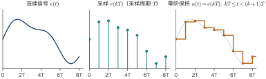
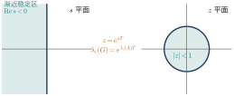

# 时变系统与离散系统的运动分析

记号：离散系统用 $G,H$；$z$ 变换的像函数用小写 $x(z),u(z)$；单输入例题也沿用大写 $B,C$。

## 1. 线性时变系统的运动分析

### 时变状态转移矩阵 $\Phi(t,t_0)$

时变系统的例子：变质量四旋翼 $m(t)=m_0-\alpha t$；变构型机械臂 $A(t)=\smat{0&1\\0&-b/J(t)}$，$B(t)=\smat{0\\1/J(t)}$（$b$ 为阻尼系数）。这些系统线性化之后，系数中含有 $t$。**时变不等于非线性**：方程对 $x$ 仍是线性的，叠加原理照样成立。

**定义**：$\dot x=A(t)x$ 的解写成 $x(t)=\Phi(t,t_0)x(t_0)$。第一个自变量是终点（到哪），第二个是起点（从哪）。$\Phi$ 依赖**起止两个时刻**，一般 $\Phi(t,t_0)\neq\Phi(t-t_0)$，只有定常系统才退化为 $\e^{A(t-t_0)}$。

$\Phi$ 满足矩阵微分方程

$$
\dot\Phi(t,t_0)=A(t)\,\Phi(t,t_0),\qquad \Phi(t_0,t_0)=I
$$

推导：把 $x=\Phi(t,t_0)x(t_0)$ 代入 $\dot x=A(t)x$，得 $\dot\Phi(t,t_0)x(t_0)=A(t)\Phi(t,t_0)x(t_0)$。由于 $x(t_0)$ 任意（依次取 $e_1,\dots,e_n$ 逐列比较），两边矩阵相等；再令 $t=t_0$ 得初值为 $I$。

### 两种求法：第一步永远是交换性检验

记 $M(t)=\int_{t_0}^{t}A(\tau)\dd\tau$，则 $\dot M=A(t)$，$M(t_0)=0$。有两个判别式：

- 判别式一：$\int_{t_0}^{t}\big[A(t)A(\tau)-A(\tau)A(t)\big]\dd\tau=0 \iff A(t)M(t)=M(t)A(t)$；
- 判别式二：$A(t_1)A(t_2)\equiv A(t_2)A(t_1)\Rightarrow$ 判别式一。它手算最方便，但只是**充分条件**（$t_0$ 也任意时才等价）。

| | 情况一：可交换 | 情况二：不可交换（一般时变系统） |
|---|---|---|
| 结论 | $\Phi(t,t_0)=\exp\big(\int_{t_0}^{t}A(\tau)\dd\tau\big)=\e^{M(t)}$ | Peano-Baker（PB）级数，见下式 |
| 依据 | $\frac{\mathrm d}{\mathrm dt}M^2=AM+MA$，一般 $\neq2AM$；只有可交换时才有 $\frac{\mathrm d}{\mathrm dt}M^k=kAM^{k-1}$，逐项求导得 $\dot\Phi=A\e^{M}$ | 把方程积分成 $\Phi(t,t_0)=I+\int_{t_0}^{t}A(\tau)\Phi(\tau,t_0)\dd\tau$，"自己代自己"无限重复 |
| 特例 | 标量、对角阵、常数阵永远可交换；$A$ 为常阵时 $M=A(t-t_0)$，退回 $\e^{A(t-t_0)}$ | $A$ 连续时级数一致收敛，但一般**没有闭式**（截断或数值求解）；可交换时第三项 $=M^2/2$，退回 $\e^M$ |

$$
\Phi(t,t_0)=I+\int_{t_0}^{t}A(\tau)\dd\tau+\int_{t_0}^{t}A(\tau)\int_{t_0}^{\tau}A(\tau_1)\dd\tau_1\dd\tau+\cdots
$$

标量方程 $\dot x=a(t)x$ 总能写成指数形式 $x=\e^{\int a\,\dd\tau}x(t_0)$，因为标量之间可交换。时变系统求解的所有麻烦都来自矩阵乘法不可交换。

!!! tip "方法：求时变 $\Phi(t,t_0)$"
    1. **交换性检验**：写出 $A(t_1)A(t_2)$ 与 $A(t_2)A(t_1)$ 比较，注意乘法次序。例如 $A=\smat{0&1\\0&t}$：前者右上角是 $t_2$，后者是 $t_1$，不可交换。论证"不可交换"最好直接算 $A(t)M(t)-M(t)A(t)\neq0$（因为判别式二只是充分条件）。
    2. **可交换**：算出 $M(t)$ 再取指数。对角阵：对角元各自取指数；$M=\alpha I+\beta N$（$N^2=0$）：$\e^{M}=\e^{\alpha}(I+\beta N)$（拆指数同样要求可交换，$I$ 与 $N$ 可交换）；$M^2=0$：$\e^{M}=I+M$。
    3. **不可交换**：若 $A(t)$ 是上三角阵且每行都积得出来，自下而上逐行积分可得精确 $\Phi$（见下面的易错点）。若积不出来（如 $A=\smat{0&1\\0&t}$ 虽是上三角，但 $\Phi_{12}=\int_0^t\e^{\tau^2/2}\dd\tau$ 不是初等函数），或不是上三角，就写 PB 级数的前几项：$A(\tau)$ 在左，**先算内层积分再算外层**。
    4. **自检**：$\Phi(t_0,t_0)=I$，并**逐元素**代回 $\dot\Phi=A(t)\Phi$。**换起点**：$\Phi(t,t_1)=\Phi(t,0)\Phi^{-1}(t_1,0)$（分段转移性质与求逆性质）。

    算例：$A=tI+N$（$N=\smat{0&1\\0&0}$）可交换，$M=\frac{t^2-t_0^2}2I+(t-t_0)N$，故 $\Phi=\e^{(t^2-t_0^2)/2}\smat{1&t-t_0\\0&1}$。

    $A=\smat{0&1\\0&t}$ 的 PB 级数（$t_0=0$）：$M(\tau)=\smat{0&\tau\\0&\tau^2/2}$，$A(\tau)M(\tau)=\smat{0&\tau^2/2\\0&\tau^3/2}$，积分得第三项 $\smat{0&t^3/6\\0&t^4/8}$。三项相加：

    $$
    \Phi(t,0)=\bmat{1&t+t^3/6+\cdots\\0&1+t^2/2+t^4/8+\cdots}
    $$

    手算取到 $t^4$ 项即可。$A$ 的第一列为零，所以 $x_2$ 只由 $x_2(0)$ 驱动。

### 时变 $\Phi$ 的四条性质

1. $\Phi(t_0,t_0)=I$。
2. 分段转移：$\Phi(t_2,t_0)=\Phi(t_2,t_1)\Phi(t_1,t_0)$，**后走的一段乘在左边**，像接力一样。证明：两边都看作 $t_2$ 的函数，它们满足同一个矩阵微分方程 $\dot X=A(t_2)X$，且 $t_2=t_1$ 时相等，由解的唯一性知恒等。
3. 恒可逆：$\Phi^{-1}(t,t_0)=\Phi(t_0,t)$。在性质 2 中取 $t_2=t_0$、$t_1=t$，再用性质 1 即得。另有 $\det\Phi(t,t_0)=\exp\int_{t_0}^{t}\tr A(\tau)\dd\tau>0$（刘维尔公式）。补充：$\partial\Phi(t,t_0)/\partial t_0=-\Phi(t,t_0)A(t_0)$。
4. $\dot\Phi(t,t_0)=A(t)\Phi(t,t_0)$：$A(t)$ **只能左乘**（定常时才有 $A\Phi=\Phi A$）。

定常系统转移矩阵的十条性质（见[线性定常系统的运动分析](lti-response.md)），到时变系统只剩这四条：$\Phi(t_1)\Phi(t_2)=\Phi(t_1+t_2)$、$[\Phi(t)]^k=\Phi(kt)$、$\Phi^{-1}(t)=\Phi(-t)$ 等全部失效。

### 时变系统的非齐次解

$$
x(t)=\Phi(t,t_0)x(t_0)+\int_{t_0}^{t}\Phi(t,\tau)B(\tau)u(\tau)\dd\tau\qquad\big(\text{零输入分量}+\text{零状态分量}\big)
$$

常数变易推导：设 $x=\Phi(t,t_0)[x(t_0)+\xi(t)]$，$\xi(t_0)=0$。求导时用性质 4，

$$
\dot x=A(t)\Phi(t,t_0)[x(t_0)+\xi]+\Phi(t,t_0)\dot\xi=A(t)x+\Phi(t,t_0)\dot\xi
$$

与 $\dot x=A(t)x+B(t)u$ 比较，**$A(t)x$ 两边抵消**，得 $\Phi(t,t_0)\dot\xi=B(t)u$，即 $\dot\xi=\Phi(t_0,t)B(t)u$（性质 3）。积分后左乘 $\Phi(t,t_0)$，用性质 2 合并 $\Phi(t,t_0)\Phi(t_0,\tau)=\Phi(t,\tau)$，即得上式。与定常情形对照：$\e^{A(t-\tau)}\to\Phi(t,\tau)$，$B\to B(\tau)$。验算时可分别令 $u=0$、$x(t_0)=0$。$\Phi(t,\tau)$ 一般没有解析式，常交给计算机。

??? example "例：可交换时变系统的强迫响应"
    $\dot x=\smat{0&(t+1)^{-2}\\0&0}x+\smat{1\\1}u$，$x(1)=[1\ \ 2]\tp$，$u=1(t-1)$，$y=x_1+x_2$，求 $x(t)$、$y(t)$。

    **解** (1) $A(t_1)A(t_2)=0=A(t_2)A(t_1)$，**先验证可交换**；再由 $(\int A)^2=0$ 得 $\Phi(t,t_0)=I+\int_{t_0}^{t}A\dd\tau$，只有 $(1,2)$ 元非平凡：

    $$
    \Phi(t,t_0)=\bmat{1&\dfrac{t-t_0}{(t+1)(t_0+1)}\\0&1}
    $$

    注意：如果不可交换，仅有 $(\int A)^2=0$ 是不够的。

    (2) 零输入分量：$\Phi(t,1)x(1)=\big[\,\frac{2t}{t+1}\ \ \ 2\,\big]\tp$。

    (3) 零状态分量：$\Phi(t,\tau)B$ 的第一行为 $1+\frac{t-\tau}{(t+1)(\tau+1)}=\frac{t}{t+1}+\frac{1}{\tau+1}$（拆项），第二行为 1。从 1 积到 $t$：$\big[\,\frac{t(t-1)}{t+1}+\ln\frac{t+1}{2}\ \ \ t-1\,\big]\tp$。

    (4) 相加（通分时 $2t+t(t-1)=t(t+1)$）：

    $$
    \boxed{x(t)=\Big[\,t+\ln\tfrac{t+1}{2}\quad t+1\,\Big]\tp},\qquad \boxed{y=2t+1+\ln\tfrac{t+1}{2}}\quad(t\ge1)
    $$

    自检：$x(1)=[1\ \ 2]\tp$。也可以用 RK4 数值积分互相验证。

??? example "例：可交换情形的转移矩阵与性质验证"
    $\dot x=\smat{1&0\\0&2t}x$。(1) 交换性检验；(2) 求 $\Phi(t,0)$ 并验证；(3) 求 $\Phi(t,t_0)$、$\Phi(t,1)$，说明 $\Phi(t,t_0)\neq\Phi(t-t_0)$；(4) 验证分段转移与求逆性质；(5) 求 $x(0)=[1\ \ 1]\tp$ 时的运动。

    **解** (1) $A(t_1)A(t_2)=\smat{1&0\\0&4t_1t_2}=A(t_2)A(t_1)$，可交换，用指数式。

    (2) $M=\int_0^tA\dd\tau=\diag(t,t^2)$，逐元素取指数得 $\boxed{\Phi(t,0)=\diag(\e^{t},\e^{t^2})}$。验证：$\dot\Phi=\diag(\e^{t},2t\e^{t^2})=A(t)\Phi$，$\Phi(0,0)=I$。

    (3) $\boxed{\Phi(t,t_0)=\diag\big(\e^{t-t_0},\e^{t^2-t_0^2}\big)}$，$\Phi(t,1)=\diag(\e^{t-1},\e^{t^2-1})$。时间间隔同为 1 的 $\Phi(1,0)=\diag(\e,\e)$ 与 $\Phi(2,1)=\diag(\e,\e^3)$ 不同，所以 $\Phi$ 不是 $t-t_0$ 的函数。

    (4) $\Phi(2,1)\Phi(1,0)=\diag(\e^2,\e^4)=\Phi(2,0)$；$\Phi^{-1}(t,0)=\diag(\e^{-t},\e^{-t^2})=\Phi(0,t)$。

    (5) $\boxed{x(t)=[\e^{t}\ \ \e^{t^2}]\tp}$。$x_2$ 增长更快：它的增长系数 $2t$ 无界，$x_2/x_1=\e^{t^2-t}\to\infty$（$t>1$ 之后 $x_2>x_1$）。

    **注** 交换性检验要写出两个乘积再下结论。常见错误：把 $\e^{t^2-t_0^2}$ 写成 $\e^{(t-t_0)^2}$；把 $\Phi^{-1}(t,0)$ 写成 $\Phi(-t,0)=\diag(\e^{-t},\e^{t^2})$。

!!! warning "易错点：指数公式不是万能公式"
    $A(t)=\smat{0&1\\0&-1/(1+t)}$。交换子

    $$
    A(t_1)A(t_2)-A(t_2)A(t_1)=\bmat{0&\dfrac{t_2-t_1}{(1+t_1)(1+t_2)}\\0&0}
    $$

    取 $t_1=0$、$t_2=1$ 得 $\smat{0&1/2\\0&0}\neq0$。直接算 $A(t)M(t)-M(t)A(t)=\smat{0&t/(1+t)-\ln(1+t)\\0&0}\neq0$（$t>0$），确实不可交换。下面比较三种结果：

    - **精确解**（上三角逐行积分）：第二行 $\dot x_2=-x_2/(1+t)$ 得 $x_2=\frac{x_2(0)}{1+t}$；代入第一行 $\dot x_1=x_2$ 得 $x_1=x_1(0)+x_2(0)\ln(1+t)$。所以 $\Phi(t,0)=\smat{1&\ln(1+t)\\0&1/(1+t)}$。换起点：$\Phi(t,1)=\Phi(t,0)\Phi^{-1}(1,0)=\smat{1&2\ln[(1+t)/2]\\0&2/(1+t)}\neq\Phi(t-1,0)$。
    - **错误地套用指数公式**：$\e^{M}=\smat{1&t^2/[(1+t)\ln(1+t)]\\0&1/(1+t)}$。它**满足初值，对角元也对，错只在耦合元**：$(1,2)$ 元代回方程的残差为 $\frac{t^2}{4}+O(t^3)\neq0$。
    - **PB 前三项**：第三项为 $\int_0^tA(\tau)M(\tau)\dd\tau$，其中 $A(\tau)M(\tau)=\smat{0&-\ln(1+\tau)\\0&\ln(1+\tau)/(1+\tau)}$，合计 $\smat{1&2t-(1+t)\ln(1+t)\\0&1-\ln(1+t)+\ln^2(1+t)/2}$。
    - 三者的 $(1,2)$ 元都是 $t-\frac{t^2}{2}+c\,t^3+\cdots$，其中 $c=\frac13$（精确）、$\frac{5}{12}$（$\e^M$）、$\frac16$（PB 截断），**从 $t^3$ 项起才不同**。低阶吻合是结构上的必然（三者都含 $I+M$），判断对错必须逐元素代回 $\dot\Phi=A(t)\Phi$。

## 2. 线性离散系统的运动分析

### 递推解与 $\Phi(k)=G^k$

离散系统 $x(k+1)=Gx(k)+Hu(k)$ 逐步代入：

$$
\begin{aligned}
x(1)&=Gx(0)+Hu(0)\\
x(2)&=G^2x(0)+GHu(0)+Hu(1)\\
x(3)&=G^3x(0)+G^2Hu(0)+GHu(1)+Hu(2)
\end{aligned}
$$

归纳得（连续系统中的积分对应这里的求和，$\e^{At}$ 对应 $G^k$）：

$$
x(k)=G^kx(0)+\sum_{i=0}^{k-1}G^{k-1-i}Hu(i)=\Phi(k)x(0)+\sum_{i=0}^{k-1}\Phi(k-i-1)Hu(i)
$$

- 起点为 $k_0$ 时：$x(k)=G^{k-k_0}x(k_0)+\sum_{i=k_0}^{k-1}G^{k-1-i}Hu(i)$。解只在整数步上有意义；同样分为零输入响应与零状态响应。递推最适合计算机，缺点是有累积误差。
- **一拍滞后**（最容易忽略）：$x(k)$ 只用到 $u(0),\dots,u(k-1)$。从 $u$ 到 $x$ 的脉冲响应为 $G^{k-1}H$（$k\ge1$），$h(0)=0$，所以求和上限是 $k-1$。数字控制器因此天然带一拍延迟。第二项是离散卷积和（两个下标之和为常数 $k-1$）。
- **时变离散系统**：$\Phi(k,k_0)=G(k-1)G(k-2)\cdots G(k_0)$（**越晚越左**，$\Phi(k_0,k_0)=I$），

    $$
    x(k)=\Phi(k,k_0)x(k_0)+\sum_{i=k_0}^{k-1}\Phi(k,i+1)H(i)u(i)
    $$

    分段转移性质恒成立；可逆则需要每个 $G(i)$ 都非奇异。
- 拓展：梯度下降在 Hessian 的特征方向上满足 $\tilde x(k+1)=(1-\eta\lambda)\tilde x(k)$，学习率 $\eta$ 相当于增益。收敛 $\iff|1-\eta\lambda|<1\iff\eta<2/\lambda_{\max}$。$\lambda=2$ 时，$\eta=0.3$、$1$、$1.2$ 分别对应单调收敛、等幅振荡（临界 $\eta=2/\lambda=1$）、振荡发散（见[线性变换与离散系统描述](linear-transform.md)）。

三类系统对照：

| | 定常连续 | 时变连续 | 定常离散 |
|---|---|---|---|
| 方程 | $\dot x=Ax+Bu$ | $\dot x=A(t)x+B(t)u$ | $x(k+1)=Gx(k)+Hu(k)$ |
| 转移矩阵 | $\Phi(t-t_0)=\e^{A(t-t_0)}$ | $\Phi(t,t_0)$（两个时刻） | $\Phi(k-k_0)=G^{k-k_0}$ |
| 满足 | $\dot\Phi=A\Phi=\Phi A$，$\Phi(0)=I$ | $\dot\Phi=A(t)\Phi$，$\Phi(t_0,t_0)=I$ | $\Phi(k+1)=G\Phi(k)$，$\Phi(0)=I$ |
| 合成 | $\Phi(t_1)\Phi(t_2)=\Phi(t_1+t_2)$ | $\Phi(t_2,t_0)=\Phi(t_2,t_1)\Phi(t_1,t_0)$ | $\Phi(k_2-k_0)=\Phi(k_2-k_1)\Phi(k_1-k_0)$ |
| 可逆 | 恒可逆，$\Phi^{-1}(t)=\Phi(-t)$ | 恒可逆，$\Phi^{-1}(t,t_0)=\Phi(t_0,t)$ | $\Phi^{-1}(k)=\Phi(-k)$ **需 $G$ 非奇异** |
| 零状态部分 | $\int_{t_0}^{t}\e^{A(t-\tau)}Bu(\tau)\dd\tau$ | $\int_{t_0}^{t}\Phi(t,\tau)B(\tau)u(\tau)\dd\tau$ | $\sum_{i=0}^{k-1}G^{k-1-i}Hu(i)$（一拍滞后） |

### $z$ 变换法

$z$ 变换法只适用于定常系统且 $k_0=0$。由移位性质 $\Zt[x(k+1)]=zx(z)-zx(0)$，两边取 $z$ 变换：

$$
zx(z)-zx(0)=Gx(z)+Hu(z)\ \Rightarrow\ (zI-G)x(z)=zx(0)+Hu(z)
$$

两边**左乘** $(zI-G)^{-1}$（矩阵不能"除过去"），再反变换并与递推解逐项对照：

$$
\begin{aligned}
&x(z)=(zI-G)^{-1}z\,x(0)+(zI-G)^{-1}H\,u(z),\qquad G^k=\Zt^{-1}\big[(zI-G)^{-1}z\big]\\
&\sum_{i=0}^{k-1}G^{k-1-i}Hu(i)=\Zt^{-1}\big[(zI-G)^{-1}H\,u(z)\big]
\end{aligned}
$$

"多出来的 $z$"来自初值项：$\Zt[G^k]=\sum_{k\ge0}G^kz^{-k}=(I-z^{-1}G)^{-1}=z(zI-G)^{-1}$，与标量情形 $\Zt[a^k]=\frac{z}{z-a}$ 一致。常用变换对：$\Zt[1(k)]=\frac{z}{z-1}$，$\Zt^{-1}\big[\frac{z}{z-p}\big]=p^k$。$(zI-G)^{-1}$ 的极点就是 $G$ 的特征值（对照 $(sI-A)^{-1}$ 的极点是 $A$ 的特征值）。

!!! tip "方法：求 $\Phi(k)=G^k$ 的四种方法"
    与求 $\e^{At}$ 的四种方法一一对应（见[线性定常系统的运动分析](lti-response.md)）。

    1. **按定义**：直接连乘 $G^2,G^3,\dots$，得不到闭式；阶数低、步数少时用。
    2. **$z$ 变换**：求 $(zI-G)^{-1}$ → 逐元素部分分式 → 乘 $z$ 后查表；需要闭式或带输入时用。特征值互异时 $(zI-G)^{-1}=\sum_i\frac{K_i}{z-\lambda_i}$，$G^k=\sum_iK_i\lambda_i^k$；二重根 $\lambda$ 还有 $\frac{K'}{(z-\lambda)^2}$ 项，查表 $\Zt^{-1}\big[\frac{z}{(z-\lambda)^2}\big]=k\lambda^{k-1}$。
    3. **特征值规范型**：$P^{-1}GP=\Lambda\Rightarrow G^k=P\Lambda^kP^{-1}$。$G$ 为友矩阵（能控规范型）时，特征向量取 $[1\ \ \lambda_i\ \ \cdots\ \ \lambda_i^{n-1}]\tp$（二阶即 $[1\ \ \lambda_i]\tp$），$P$ 为范德蒙德矩阵（见[线性变换](linear-transform.md)）；特征值互异时用。
    4. **有限项多项式**（凯莱-哈密顿）：二阶时 $G^k=\alpha_0I+\alpha_1G$，由 $\lambda_i^k=\alpha_0+\alpha_1\lambda_i$ 解出 $\alpha_0,\alpha_1$；重根补 $k\lambda^{k-1}=\alpha_1$；重根或阶数高时用。

    - **自检**：$\Phi(0)=I$、$\Phi(1)=G$ 是两项最简单的检查；全解再验 $k=0$ 时回到 $x(0)$。部分分式要**先对 $x(z)/z$ 展开，再乘回 $z$**；负特征值写成 $(-0.2)^k$，不能写成 $0.2^k$。
    - **等比求和**：$\sum_{i=0}^{k-1}c\,p^{k-1-i}=c\,\frac{1-p^k}{1-p}$（令 $j=k-1-i$，公比为 $p$；若按 $i$ 看，公比是 $1/p$）。
    - **稳态**：$|\lambda(G)|$ 全小于 1 时，单位阶跃输入下 $x(\infty)=(I-G)^{-1}H$，与 $x(0)$ 无关。它就是 $x(z)$ 展开式中 $\frac{z}{z-1}$ 项的系数，也可以用终值定理 $\lim_{z\to1}(z-1)x(z)$ 求。输出稳态值 $y(\infty)=C(I-G)^{-1}H+D=G(z)|_{z=1}$，即脉冲传递函数在 $z=1$ 的值 $G(1)$。

    例：$G=\smat{0&1\\-0.2&-0.9}$，$H=\smat{1\\1}$，$\lambda=-0.4,-0.5$，单位阶跃下 $x(\infty)=[\frac{29}{21}\ \frac{8}{21}]\tp$。用 $z$ 变换法和对角化法求 $G^k$，结果相同。

??? example "例：两种方法求 $G^k$ 与阶跃响应"
    $x(k+1)=\smat{0&1\\-0.1&-0.7}x(k)+\smat{0\\1}u(k)$。(1) 用 $z$ 变换法求 $\Phi(k)$；(2) 用对角化法再求一次；(3) 用 $\Phi(0),\Phi(1),\Phi(2)$ 回代检验；(4) $x(0)=[1\ \ 0]\tp$、$u(k)=1(k)$，求 $x(k)$ 并用递推校核；(5) 求 $x(\infty)$。

    **解** (1) $\det(zI-G)=z^2+0.7z+0.1=(z+0.2)(z+0.5)$，

    $$
    (zI-G)^{-1}=\frac{1}{(z+0.2)(z+0.5)}\bmat{z+0.7&1\\-0.1&z}
    $$

    逐元素展开后乘 $z$（记 $a=(-0.2)^k$，$b=(-0.5)^k$）：

    $$
    (zI-G)^{-1}z=\frac{z}{z+0.2}\cdot\frac13\bmat{5&10\\-1&-2}+\frac{z}{z+0.5}\cdot\frac13\bmat{-2&-10\\1&5}\ \Rightarrow\ \boxed{\Phi(k)=\frac13\bmat{5a-2b&10a-10b\\-a+b&-2a+5b}}
    $$

    (2) $\lambda=-0.2,-0.5$；$P=\smat{1&1\\-0.2&-0.5}$（$\det P=-0.3$），$P^{-1}=\frac13\smat{5&10\\-2&-10}$，$P\diag(a,b)P^{-1}$ 与 (1) 相同。

    (3) $k=0$ 得 $I$，$k=1$ 得 $G$，$k=2$ 得 $G^2=\smat{-0.1&-0.7\\0.07&0.39}$，均与直接计算一致。

    (4) $zx(0)+Hu(z)=\frac{1}{z-1}\smat{z^2-z\\z}$，

    $$
    x(z)=\frac{1}{(z+0.2)(z+0.5)(z-1)}\bmat{z^3-0.3z^2+0.3z\\0.9z^2+0.1z}
    $$

    按 $x(z)/z$ 展开、查表：

    $$
    \boxed{x_1(k)=-\tfrac{10}{9}(-0.2)^k+\tfrac{14}{9}(-0.5)^k+\tfrac59,\quad x_2(k)=\tfrac29(-0.2)^k-\tfrac79(-0.5)^k+\tfrac59}
    $$

    递推校核：$x(1)=[0\ \ 0.9]\tp$，$x(2)=[0.9\ \ 0.37]\tp$，$x(3)=[0.37\ \ 0.651]\tp$，与闭式一致。

    (5) $|\lambda|=0.2,0.5<1$，稳态存在：

    $$
    x(\infty)=(I-G)^{-1}H=\frac{1}{1.8}\bmat{1.7&1\\-0.1&1}\bmat{0\\1}=\bmat{5/9\\5/9}
    $$

    正是 $\frac{z}{z-1}$ 项的系数。

    **注** 用有限项多项式法：$\alpha_1=\frac{a-b}{0.3}$，$\alpha_0=\frac{5a-2b}{3}$，$\alpha_0I+\alpha_1G$ 结果同上。漏掉 $(zI-G)^{-1}z$ 与 $zx(0)$ 中的因子 $z$ 是最常见的错误。

## 3. 线性连续系统的离散化

### 近似离散化与精确（零阶保持）离散化

零阶保持器（ZOH）$\frac{1-\e^{-Ts}}{s}$ 把 $u(kT)$ 保持一个周期 $T$。离散化的目标是求 $G,H$，使离散模型在采样点上的值与连续系统精确相符。

{ .diagram }

数字控制器每 $T$ 秒算一次（如飞控姿态环 10 ms、高度环 20 ms、导航环 100 ms）。采样（只在 $kT$ 时刻取值）与零阶保持（周期内 $u(t)\equiv u(kT)$）是两件事；"保持器 + 连续对象 + 采样器"合起来，对控制器而言就是离散系统 $x(k+1)=Gx(k)+Hu(k)$。

- **近似离散化（前向差分，即欧拉法）**：$\dot x\approx\frac{x[(k+1)T]-x(kT)}{T}$，代入 $\dot x=A(t)x+B(t)u$ 得 $G(k)=I+TA(kT)$，$H(k)=TB(kT)$；定常时 $G_{\rm app}=I+TA$，$H_{\rm app}=TB$。时变系统也适用，代价是只有一阶精度。
- **精确离散化（时变）**：在非齐次解中取 $t_0=kT$、$t=(k+1)T$。**ZOH 使 $u(\tau)\equiv u(kT)$，可以提到积分号外**，于是 $G(k)=\Phi[(k+1)T,kT]$，$H(k)=\int_{kT}^{(k+1)T}\Phi[(k+1)T,\tau]B(\tau)\dd\tau$，每一步都不同。前提是满足采样定理且输入经过 ZOH。
- **精确离散化（定常）**：$\Phi[(k+1)T,\tau]=\e^{A[(k+1)T-\tau]}$，作代换 $t=(k+1)T-\tau$（$\dd\tau=-\dd t$；$\tau$ 从 $kT$ 到 $(k+1)T$ 对应 $t$ 从 $T$ 到 $0$），$k$ 被消掉，得到定常离散系统：

$$
G=\e^{AT}=\Phi(T),\qquad H=\Big(\int_0^T\e^{At}\dd t\Big)B\qquad\big(A\text{ 可逆时}\ H=A^{-1}(\e^{AT}-I)B\big)
$$

输出方程只需把连续时间换成采样时刻：$y(k)=Cx(k)+Du(k)$（时变时取 $C(kT),D(kT)$）。

拓展：S4、Mamba 等状态空间模型以步长 $\Delta$ 代替 $T$，用的正是上式（$A$ 可逆的形式）；当参数随输入变化时，整体是非线性的，不能套叠加原理。

!!! tip "方法：ZOH 精确离散化"
    1. 求 $\e^{At}$（拉氏反变换、对角化或有限项法，见[线性定常系统的运动分析](lti-response.md)），令 $t=T$ 得 $G$。
    2. $H=\int_0^T\e^{At}B\dd t$：先算列向量 $\e^{At}B$（$B=[0\ \ 1]\tp$ 时就是 $\e^{At}$ 的第 2 列），再逐元素积分，别丢常数项。$A$ 可逆时可用 $A^{-1}(\e^{AT}-I)B$；**$A$ 奇异（含积分环节）时只能直接积分**。
    3. 写出完整的离散表达式：$x(k+1)=Gx(k)+Hu(k)$，$y(k)=Cx(k)+Du(k)$。自检：$T\to0$ 时 $G\to I$、$H\approx TB+\frac{T^2}{2}AB$；$\lambda_i(G)=\e^{\lambda_i(A)T}$。
    4. 后续：脉冲传递函数 $G(z)=C(zI-G)^{-1}H+D$（见[线性变换与离散系统描述](linear-transform.md)）、用 $|\lambda(G)|<1$ 判稳、递推 $y(k)$。数字闭环 $u(k)=r(k)-y(k)$（设 $D=0$）$\Rightarrow x(k+1)=G_cx(k)+Hr(k)$，$G_c=G-HC$；$D\neq0$ 时 $G_c=G-H(I+D)^{-1}C$，输入矩阵为 $H(I+D)^{-1}$。**速算**：开环阶跃输入下，$x(k)$、$y(k)$ 就是连续解在 $t=kT$ 的值。

    例：$A=\smat{0&1\\-2&-3}$，$B=\smat{0\\1}$。流程是先求出 $\Phi(t)$，令 $t=T$ 得 $G$，积分得 $H$，再递推：

    $$
    H(T)=\Big[\tfrac12(1-\e^{-T})^2\quad \e^{-T}-\e^{-2T}\Big]\tp
    $$

    可以与 $A^{-1}(\e^{AT}-I)B$ 互相验证。$T=0.02$ s 时 $G\approx\smat{0.9996&0.0194\\-0.0388&0.9414}$，非常接近 $I$，计算时要留足有效位数。

### 近似与精确：差别在哪、有多大

| | 近似（前向差分） | 精确（ZOH） |
|---|---|---|
| $G$，$H$ | $I+TA$，$TB$ | $\e^{AT}=I+TA+\frac{T^2}{2}A^2+\cdots$，$TB+\frac{T^2}{2}AB+\cdots$ |
| 误差 | 每步 $O(T^2)$，累积到固定时刻为 $O(T)$：一阶方法（$T$ 减半误差约减半；$T\to0$ 时两者趋于一致） | 采样点上无误差（输入确为 ZOH 时） |

四旋翼高度环：$A=\smat{0&1\\0&0}$，$B=\smat{0\\1/m}$。$A^2=0$，所以 $G=G_{\rm app}=\smat{1&T\\0&1}$，**差别全在 $H$**：$H=\smat{T^2/2m\\T/m}$，$H_{\rm app}=\smat{0\\T/m}$。取 $T=0.1$ s、$m=1.2$ kg、$u\equiv1$ N，递推 5 步：精确离散化得高度 $h=0.104167$ m（等于连续解 $\frac{ut^2}{2m}$ 在 0.5 s 的值），近似离散化得 $0.083333$ m，偏低 20%。偏差为 $kT^2/2m=tT/2m$，随步数线性增大且正比于 $T$（$T=0.5$ s 时，3 s 处相差 0.625 m）；它并不是简单的"平移一拍"。近似法第一步高度停在 0，因为 $H_{\rm app}$ 第一分量为 0。

??? example "例：ZOH 离散化与数字闭环"
    误差 $e=r-y$ 经周期 $T$ 采样、零阶保持 $\frac{1-\e^{-Ts}}{s}$ 后驱动对象 $\frac{1}{s(s+2)}$。取 $x_1=y$、$x_2=\dot y$，$u(k)=r(k)-y(k)$。求：(1) $(A,B,C)$ 与 $\e^{At}$；(2) $G(T),H(T)$ 及离散状态空间表达式；(3) $T=0.1$ s 时的数值；(4) 闭环矩阵 $G_c$；(5) $x(0)=0$、$r=1(k)$ 时的 $y(kT)$，$k\le5$；(6) 收敛性与 $y(\infty)$；(7) 与近似离散化比较。

    **解** (1) $\ddot y+2\dot y=u$：$A=\smat{0&1\\0&-2}$，$B=\smat{0\\1}$，$C=[1\ \ 0]$。

    $$
    (sI-A)^{-1}=\bmat{1/s&1/[s(s+2)]\\0&1/(s+2)}\ \Rightarrow\ \e^{At}=\bmat{1&(1-\e^{-2t})/2\\0&\e^{-2t}}
    $$

    (2) $\det A=0$，只能直接积分：

    $$
    \boxed{G(T)=\bmat{1&\frac{1-\e^{-2T}}{2}\\0&\e^{-2T}},\qquad H(T)=\int_0^T\bmat{\frac{1-\e^{-2t}}{2}\\\e^{-2t}}\dd t=\bmat{\frac{2T-1+\e^{-2T}}{4}\\\frac{1-\e^{-2T}}{2}}}
    $$

    离散化后 $x(k+1)=G(T)x(k)+H(T)u(k)$，$y(k)=[1\ \ 0]\,x(k)$。自检：$\lambda(G)=1,\ \e^{-2T}$，正是 $\e^{\lambda(A)T}$。

    (3) $G=\smat{1&0.0906346\\0&0.818731}$，$H=\smat{0.00468269\\0.0906346}$（6 位有效数字）。

    (4) $D=0$，$HC$ 是列乘行，只改动第一列：$G_c=G-HC=\smat{0.995317&0.0906346\\-0.0906346&0.818731}$。

    (5) $x(k+1)=G_cx(k)+H$，$y=x_1$：$y(kT)=0,\ 0.00468269,\ 0.0175581,\ 0.0370603,\ 0.0618404,\ 0.0907401$。

    (6) 特征方程 $\lambda^2-1.81405\lambda+0.823112=0$，$\lambda=0.907024\pm0.0204678j$，$|\lambda|=\sqrt{\det G_c}=0.907255<1$，闭环收敛。由 $(I-G_c)\smat{1\\0}=H$ 得 $x(\infty)=\smat{1\\0}$，$\boxed{y(\infty)=C(I-G_c)^{-1}H=1}$，与 (5) 中的缓慢上升一致（对象含积分环节，稳态误差为 0）。

    (7) $G_{\rm app}=\smat{1&T\\0&1-2T}$，$H_{\rm app}=\smat{0\\T}$。$G_{11},G_{21}$ 两法相同，差别在 $G_{12},G_{22},H_1,H_2$，均为 $O(T^2)$，$T$ 减半时差别约缩为 $\frac14$（如 $H_1$ 之差 $=\frac{T^2}{2}-\frac{T^3}{3}+\cdots$）。

    **注** $H_1$ 是两个相近数相减：用 6 位的 $\e^{-0.2}=0.818731$ 代入只得 $0.00468275$，第 5 位已错，应全精度计算或用级数 $\frac{T^2}{2}-\frac{T^3}{3}+\frac{T^4}{6}-\cdots$。要先说明闭环稳定，再用 $y(\infty)$ 公式；$2\times2$ 实矩阵的共轭复根的模等于 $\sqrt{\det G_c}$。

!!! warning "易错点：离散化的三个误区"
    - **误区：近似离散化与精确离散化差不多。** 近似只保留了 $\e^{AT}$ 的一阶项；上面的四旋翼高度环递推 5 步，位置就差两成。
    - **误区：精确离散化与连续系统完全等价。** 它只保证采样时刻精确（采样点之间不复现），而且前提是输入确实按 ZOH 变化。
    - **误区：连续系统稳定，离散化后一定稳定，$T$ 可以随便取。** 判据换成了 $|\lambda(G)|<1$（见下图）。开环 ZOH 离散化时 $\lambda_i(G)=\e^{\lambda_i(A)T}$，$|\e^{\lambda T}|=\e^{T\,\mathrm{Re}\lambda}$，稳定性不随 $T$ 改变；但欧拉近似（$\lambda_i=1+\lambda_i(A)T$）或数字闭环的稳定性会随 $T$ 改变。例如 $A=\smat{0&1\\-2&-3}$、$T=2$ 时，$|\lambda(\e^{AT})|=0.135,\ 0.018$，而 $|\lambda(I+TA)|=1,\ 3$；上例的数字闭环在 $T\gtrsim5$ s 时失稳。

    { .diagram }

    映射 $z=\e^{sT}$ 把 $s$ 左半平面映到 $z$ 平面单位圆内。

## 4. 常见错误与概念辨析

1. **时变系统的 $\Phi$ 可以只写成 $t-t_0$ 的函数。** 错。$\Phi(t,t_0)\neq\Phi(t-t_0)$，如 $A=\diag(1,2t)$ 时 $\Phi(1,0)\neq\Phi(2,1)$。
2. **用 $G^k$ 定义 $\Phi(k)$ 要求 $G$ 可逆。** 错。求幂只用到乘法；只有 $\Phi^{-1}(k)=\Phi(-k)$ 才需要 $G$ 非奇异。
3. **$T\to0$ 时近似离散化与精确离散化趋于一致。** 对。$\e^{AT}=I+AT+\frac12A^2T^2+\cdots$，两者之差为 $O(T^2)$。
4. **时变系统的解一律为 $\exp\big(\int_{t_0}^{t}A\dd\tau\big)x(t_0)$。** 错，这是最高频的错误。仅当 $A(t)$ 与 $\int A$ 可交换时才成立。
5. **时变系统就是非线性系统。** 错。时变系统对 $x$ 仍是线性的，叠加原理成立。
6. **判别式二不成立，则 $A(t)$ 与 $\int_{t_0}^{t}A\dd\tau$ 必不可交换。** 不严谨。判别式二只是充分条件，应直接算 $AM-MA$。
7. **$\e^{M}$ 满足初值，且前两项与 PB 级数相同，所以它就是 $\Phi$。** 错。必须逐元素代回 $\dot\Phi=A(t)\Phi$；$A(t)=\smat{0&1\\0&-1/(1+t)}$ 时 $\e^M$ 的 $(1,2)$ 元残差为 $\frac{t^2}{4}+O(t^3)\neq0$。
8. **$\dot\Phi(t,t_0)=\Phi(t,t_0)A(t)$；$\Phi(t_2,t_0)=\Phi(t_1,t_0)\Phi(t_2,t_1)$；时变时 $\Phi^{-1}(t,0)=\Phi(-t,0)$。** 都错。$A(t)$ 只能左乘；后走的一段在左；$\Phi^{-1}(t,0)=\Phi(0,t)$，$\Phi^{-1}(t)=\Phi(-t)$ 只对定常系统成立。
9. **时变离散系统 $\Phi(k,k_0)=G(k_0)G(k_0+1)\cdots G(k-1)$。** 错。越晚越左：$G(k-1)\cdots G(k_0)$。
10. **$G^k=\Zt^{-1}[(zI-G)^{-1}]$，初值项为 $(zI-G)^{-1}x(0)$。** 错。两处都少了因子 $z$；而且 $z$ 变换法只适用于定常系统、$k_0=0$。
11. **数字闭环（$D=0$）的 $G_c=G-CH$。** 错。$G_c=G-HC$：$HC$ 是 $n\times n$ 矩阵（单输入单输出时是列乘行），$CH$ 只是一个标量。
