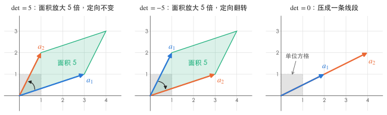
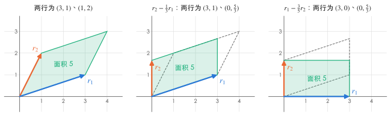
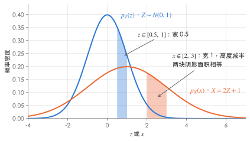

# 行列式

行列式把一个方阵变成一个数。这个数的含义是：线性变换 $x\mapsto Ax$ 把面积（体积）放大了多少倍，正负号表示方向有没有翻转。由此可以直接读出两件事：$\det A=0$ 时空间被压扁，$A$ 不可逆；概率密度经过一个可逆变换后，要除以体积放大的倍数。后一件事是归一化流和高斯分布对数似然里 $\log\lvert\det\rvert$ 一项的来源。

本章的列向量在行内写成 $(1,2)$ 的形式。

## 1. 意义：面积和体积的伸缩比

### 二维

矩阵 $A=[a_1\ \ a_2]$ 把标准基 $e_1,e_2$ 映成它的两列 $a_1,a_2$，于是把单位正方形映成以 $a_1,a_2$ 为边的平行四边形。**行列式就是这个平行四边形的带符号面积**：

$$
\det\bmat{a&b\\c&d}=ad-bc
$$

- 绝对值 $\lvert\det A\rvert$ 是面积放大的倍数。线性变换把每个小方格都变成同样形状的小平行四边形，所以任何图形的面积都乘以同一个倍数，不只是单位正方形。
- 符号表示定向。从 $e_1$ 转到 $e_2$ 是逆时针；如果从 $a_1$ 转到 $a_2$ 仍是逆时针，$\det A>0$；变成顺时针，$\det A<0$，图形被翻了面。
- $\det A=0$ 表示两列共线，正方形被压成一条线段，面积为零。压扁之后无法还原，所以 $A$ 不可逆。

{ .diagram }

图中三个矩阵是 $\smat{3&1\\1&2}$（$\det=6-1=5$）、交换两列得到的 $\smat{1&3\\2&1}$（$\det=1-6=-5$）、两列共线的 $\smat{2&4\\1&2}$（$\det=4-4=0$）。

### 高维

三阶行列式是三列张成的平行六面体的带符号体积，$n$ 阶行列式是 $n$ 维平行多面体的带符号体积。结论相同：

$$
\det A\ne0\iff A\ \text{可逆}\iff\text{各列线性无关}\iff\rank A=n
$$

行列式只对方阵有定义。$m\times n$（$m\ne n$）的矩阵把空间映到另一个维数的空间，谈不上"同一种体积的倍数"。

## 2. 性质

### 三条基本性质

行列式可以由三条性质完全确定，其余性质都能从它们推出：

1. **单位阵的行列式为 1**：$\det I=1$。
2. **交换两行，行列式变号**。
3. **对每一行分别线性**（其余行固定）：某一行乘以 $t$，行列式乘以 $t$；某一行写成两个向量之和，行列式等于两个行列式之和。

    $$
    \det\bmat{ta&tb\\c&d}=t\det\bmat{a&b\\c&d},\qquad \det\bmat{a+a'&b+b'\\c&d}=\det\bmat{a&b\\c&d}+\det\bmat{a'&b'\\c&d}
    $$

几何上，第 3 条说的是：平行四边形的一条边拉长 $t$ 倍，面积变为 $t$ 倍。

### 推论

| 性质 | 理由或说明 |
| --- | --- |
| 两行相同，$\det=0$ | 交换这两行，矩阵不变而行列式变号 |
| **把一行的倍数加到另一行，行列式不变** | 按性质 3 拆成两项，多出的一项有两行成比例，为零 |
| 有零行，$\det=0$ | 性质 3 取 $t=0$ |
| 三角阵的行列式等于对角元之积 | 用倍加消去非对角元，再逐行提出对角元 |
| $\det A=0\iff A$ 奇异 | 消元后出现零行，当且仅当 $A$ 奇异 |
| $\det(AB)=\det A\cdot\det B$ | 先后做两次变换，面积倍数相乘 |
| $\det A\tp=\det A$ | 因此上面关于行的性质对列同样成立 |
| $\det A^{-1}=1/\det A$ | $\det A\cdot\det A^{-1}=\det I=1$ |
| $\det(cA)=c^n\det A$ | $n$ 行每行各提出一个 $c$ |

"倍加不变"在几何上是**剪切不改变面积**：把平行四边形的一条边沿另一条边的方向滑动，底和高都不变。消元就是一连串倍加，所以消元不改变行列式，最后化成三角阵，行列式等于主元之积。下图是以 $\smat{3&1\\1&2}$ 的两行为边的平行四边形（由 $\det A\tp=\det A$，它的面积也是 5）经两次倍加变成长方形的过程：

{ .diagram }

!!! warning "易错点"
    - $\det(A+B)\ne\det A+\det B$。线性是对**单独一行**而言的，不是对整个矩阵。例如 $\det(I_2+I_2)=4$，而 $\det I_2+\det I_2=2$。
    - $\det(cA)=c^n\det A$，不是 $c\det A$。把边长都乘以 2，$n$ 维体积乘以 $2^n$。
    - 交换两行要变号，手算消元时容易漏记。

??? example "例：用性质计算"
    $A,\,B$ 是三阶方阵，$\det A=5$，$\det B=-2$。求 $\det(2A)$、$\det(A^{-1})$、$\det(A\tp B)$、$\det(A^2B^{-1})$；把 $A$ 的第 1、2 行交换，再把第 3 行乘以 4，所得矩阵的行列式是多少？

    **解** $\det(2A)=2^3\cdot5=40$；$\det(A^{-1})=\frac15$；$\det(A\tp B)=\det A\cdot\det B=-10$；$\det(A^2B^{-1})=5^2\cdot\bigl(-\frac12\bigr)=-\frac{25}{2}$。

    交换两行变号，一行乘以 4 则行列式乘以 4：$5\times(-1)\times4=-20$。

## 3. 计算

### 二阶与三阶

二阶直接用 $ad-bc$。三阶可以用对角线法则：三条主对角线方向的乘积之和，减去三条副对角线方向的乘积之和，

$$
\det\bmat{a_{11}&a_{12}&a_{13}\\a_{21}&a_{22}&a_{23}\\a_{31}&a_{32}&a_{33}}=a_{11}a_{22}a_{33}+a_{12}a_{23}a_{31}+a_{13}a_{21}a_{32}-a_{13}a_{22}a_{31}-a_{11}a_{23}a_{32}-a_{12}a_{21}a_{33}
$$

对角线法则只适用于二阶和三阶，四阶以上不成立。

### 按行（列）展开

去掉第 $i$ 行、第 $j$ 列后剩下的 $n-1$ 阶行列式叫**余子式** $M_{ij}$，$C_{ij}=(-1)^{i+j}M_{ij}$ 叫**代数余子式**。行列式可以按任意一行或一列展开：

$$
\det A=\sum_{j=1}^na_{ij}C_{ij}\quad(\text{按第}\ i\ \text{行}),\qquad \det A=\sum_{i=1}^na_{ij}C_{ij}\quad(\text{按第}\ j\ \text{列})
$$

符号 $(-1)^{i+j}$ 按棋盘格排列，左上角为正。展开的计算量随 $n$ 按 $n!$ 增长，只适合三阶、四阶，或者某一行（列）有很多零的矩阵。

### 消元：主元之积

实际使用的算法是消元。倍加不改变行列式，交换两行变号，化到上三角阵 $U$ 之后

$$
\det A=(-1)^{k}\,u_{11}u_{22}\cdots u_{nn},\qquad k\ \text{为行交换的次数}
$$

计算量是 $O(n^3)$，与解一次方程组相同。`np.linalg.det` 就是先做 LU 分解（见[线性方程组、消元与逆矩阵](linear-systems.md)）再把对角元乘起来。

!!! tip "方法：手算行列式"
    1. 先看有没有零很多的行或列，有就按它展开。
    2. 没有就用倍加变换制造零，化成上三角或者化出一行（列）只剩一个非零元。
    3. 全程记录：交换两行（列）一次，结果变号一次；某一行（列）提出公因子 $c$，结果要乘以 $c$；倍加不用记。
    4. 三角阵的行列式是对角元之积。

??? example "例：三阶行列式的两种算法"
    计算 $\det A$，$A=\bmat{0&2&1\\1&1&2\\2&1&1}$。

    **解一（按第 1 行展开）** 第 1 行有一个零，只需算两个余子式：

    $$
    \det A=0\cdot C_{11}+2\cdot(-1)^{1+2}\det\bmat{1&2\\2&1}+1\cdot(-1)^{1+3}\det\bmat{1&1\\2&1}=-2\cdot(1-4)+(1-2)=6-1=5
    $$

    **解二（消元）** 左上角是 0，先交换第 1、2 行（记一次变号），再消元：

    $$
    \bmat{1&1&2\\0&2&1\\2&1&1}\ \xrightarrow{r_3-2r_1}\ \bmat{1&1&2\\0&2&1\\0&-1&-3}\ \xrightarrow{r_3+\frac12r_2}\ \bmat{1&1&2\\0&2&1\\0&0&-\frac52}
    $$

    主元之积为 $1\cdot2\cdot\bigl(-\frac52\bigr)=-5$，交换过一次行，所以 $\det A=-(-5)=5$。

    ```python
    import numpy as np

    A = np.array([[0., 2., 1.],
                  [1., 1., 2.],
                  [2., 1., 1.]])
    print(np.linalg.det(A).round(6))     # 5.0
    ```

??? example "例：含参数的行列式"
    $t$ 取何值时 $A=\bmat{1&1&1\\1&2&t\\1&4&t^2}$ 不可逆？

    **解** 用第 2、3 行分别减去第 1 行，再按第 1 列展开：

    $$
    \det A=\det\bmat{1&1&1\\0&1&t-1\\0&3&t^2-1}=(t^2-1)-3(t-1)=(t-1)(t+1-3)=(t-1)(t-2)
    $$

    $t=1$ 或 $t=2$ 时 $\det A=0$，$A$ 不可逆。直接看原矩阵也能验证：$t=1$ 时第 3 列与第 1 列相同，$t=2$ 时第 3 列与第 2 列相同。

    这是范德蒙德行列式：各列是 $(1,x,x^2)$ 在 $x=1,2,t$ 处的取值，结果为 $(2-1)(t-1)(t-2)$，节点两两不同时非零。

### 分块三角阵

对角块都是方阵的分块三角阵，行列式等于对角块行列式之积：

$$
\det\bmat{A&B\\0&D}=\det A\cdot\det D
$$

例如 $\det\smat{2&1&5&7\\1&1&3&4\\0&0&3&1\\0&0&2&4}=\det\smat{2&1\\1&1}\cdot\det\smat{3&1\\2&4}=1\times10=10$，右上角的块不影响结果。左下角的块不为零时没有这样的公式，$\det\smat{A&B\\C&D}$ 一般不等于 $\det A\det D-\det B\det C$。第 7 节的耦合层用的就是分块三角的结构。

## 4. 应用：可逆判据、伴随矩阵、Cramer 法则

### 伴随矩阵求逆

把代数余子式排成矩阵再转置，得到**伴随矩阵** $\adj A$，它的 $(i,j)$ 元是 $C_{ji}$。有

$$
A\cdot\adj A=\det A\cdot I,\qquad A^{-1}=\frac{\adj A}{\det A}\quad(\det A\ne0)
$$

二阶时就是熟悉的公式 $\smat{a&b\\c&d}^{-1}=\frac{1}{ad-bc}\smat{d&-b\\-c&a}$，例如 $\smat{2&1\\5&3}^{-1}=\smat{3&-1\\-5&2}$。这个公式说明：$\det A$ 出现在分母上，$\det A=0$ 时逆不存在；逆矩阵的每个元素是原矩阵元素的有理函数。

### Cramer 法则

$\det A\ne0$ 时，$Ax=b$ 的解可以写成行列式之比：

$$
x_i=\frac{\det A_i}{\det A},\qquad A_i\ \text{是把}\ A\ \text{的第}\ i\ \text{列换成}\ b\ \text{得到的矩阵}
$$

??? example "例：伴随矩阵求逆与 Cramer 法则"
    对 $A=\bmat{0&2&1\\1&1&2\\2&1&1}$（上面已算出 $\det A=5$），求 $A^{-1}$，并解 $Ax=b$，$b=(3,4,4)$。

    **解** 九个代数余子式：

    $$
    \begin{aligned}
    C_{11}&=1-2=-1,&C_{12}&=-(1-4)=3,&C_{13}&=1-2=-1\\
    C_{21}&=-(2-1)=-1,&C_{22}&=0-2=-2,&C_{23}&=-(0-4)=4\\
    C_{31}&=4-1=3,&C_{32}&=-(0-1)=1,&C_{33}&=0-2=-2
    \end{aligned}
    $$

    转置后除以行列式：

    $$
    \adj A=\bmat{-1&-1&3\\3&-2&1\\-1&4&-2},\qquad A^{-1}=\frac15\bmat{-1&-1&3\\3&-2&1\\-1&4&-2}
    $$

    于是 $x=A^{-1}b=\frac15(-3-4+12,\ 9-8+4,\ -3+16-8)=(1,1,1)$。

    用 Cramer 法则核对 $x_1$：把第 1 列换成 $b$，

    $$
    \det A_1=\det\bmat{3&2&1\\4&1&2\\4&1&1}=3(1-2)-2(4-8)+1\cdot(4-4)=-3+8+0=5,\qquad x_1=\frac55=1
    $$

    同样可得 $\det A_2=\det A_3=5$，$x_2=x_3=1$。

!!! warning "易错点"
    伴随矩阵和 Cramer 法则只有理论上的用途。Cramer 法则要算 $n+1$ 个行列式，伴随矩阵要算 $n^2$ 个余子式，都比一次消元贵得多，数值上也不稳定。实际求解一律用消元（`np.linalg.solve`）。

### 用行列式算面积

以 $P,Q,S$ 为顶点的三角形，面积是以 $Q-P$、$S-P$ 为边的平行四边形的一半。

??? example "例：三角形的面积"
    求顶点为 $(1,1)$、$(4,2)$、$(2,5)$ 的三角形的面积。

    **解** 两条边向量为 $(4,2)-(1,1)=(3,1)$ 和 $(2,5)-(1,1)=(1,4)$，排成列：

    $$
    \text{面积}=\frac12\left\lvert\det\bmat{3&1\\1&4}\right\rvert=\frac12\lvert12-1\rvert=\frac{11}{2}
    $$

### 与特征值的关系

行列式等于全部特征值之积，$\det A=\prod_i\lambda_i$；特征值本身由方程 $\det(A-\lambda I)=0$ 定义。见[特征值与特征向量](eigen.md)。

## 5. 数值计算：用 slogdet

行列式是 $n$ 个主元的乘积，维数高时很容易超出浮点数的范围。$n=400$ 时，$0.1I$ 的行列式是 $10^{-400}$，$10I$ 的行列式是 $10^{400}$，而双精度浮点数只能表示到 $10^{\pm308}$ 左右：

```python
n = 400
print(np.linalg.det(0.1 * np.eye(n)))          # 0.0，下溢
print(np.linalg.det(10 * np.eye(n)))           # inf，上溢（NumPy 可能同时给出 RuntimeWarning）

sign, logabsdet = np.linalg.slogdet(0.1 * np.eye(n))
print(sign, logabsdet.round(2))                # 1.0 -921.03
sign, logabsdet = np.linalg.slogdet(10 * np.eye(n))
print(sign, logabsdet.round(2))                # 1.0 921.03，即 400 ln 10
```

`np.linalg.slogdet` 返回符号和 $\log\lvert\det A\rvert$，内部把主元的对数相加，不会溢出。机器学习里需要的几乎总是 $\log\lvert\det\rvert$，所以应当直接用它，不要先算 `det` 再取对数。PyTorch 中对应的是 `torch.linalg.slogdet` 和 `torch.logdet`。

!!! warning "易错点"
    行列式接近零不代表矩阵接近奇异。$0.1I_{400}$ 的行列式是 $10^{-400}$，但它只是把每个方向缩小到十分之一，求逆没有任何困难。行列式的大小受整体缩放和维数的影响很大。判断矩阵是否接近奇异要用条件数，见[奇异值分解](svd.md)。

## 6. 概率密度的变量替换与归一化流

### 一维

设随机变量 $Z$ 的密度是 $p_Z$，$X=g(Z)$，$g$ 可逆，逆映射记作 $f=g^{-1}$。$Z$ 落在小区间 $\dd z$ 里的概率等于 $X$ 落在对应小区间 $\dd x$ 里的概率，$p_X(x)\,\lvert\dd x\rvert=p_Z(z)\,\lvert\dd z\rvert$，所以

$$
p_X(x)=p_Z\bigl(f(x)\bigr)\,\lvert f'(x)\rvert
$$

意义很直接：$g$ 把区间拉长几倍，概率密度就降为几分之一，这样面积（概率）才守恒。

{ .diagram }

??? example "例：一维线性变换的密度"
    $Z\sim\mathcal N(0,1)$，$X=2Z+1$。求 $\log p_X(3)$。

    **解** $f(x)=\frac{x-1}{2}$，$f'(x)=\frac12$。$x=3$ 对应 $z=1$。

    $$
    \log p_Z(1)=-\tfrac12\cdot1^2-\tfrac12\ln(2\pi)=-1.4189,\qquad \log p_X(3)=\log p_Z(1)+\ln\tfrac12=-1.4189-0.6931=-2.1121
    $$

    即 $p_X(3)=0.2420\times\frac12=0.1210$。$X$ 服从 $\mathcal N(1,2^2)$，直接代入正态密度得到同一个数。

### 高维：导数换成 Jacobian 行列式

$x\in\R^n$ 时，$f$ 的导数是 Jacobian 矩阵 $J_f(x)$，它的 $(i,j)$ 元是 $\partial f_i/\partial x_j$。在 $x$ 附近 $f$ 近似为线性变换 $J_f(x)$，按第 1 节，小体积被放大 $\lvert\det J_f(x)\rvert$ 倍，于是

$$
p_X(x)=p_Z\bigl(f(x)\bigr)\,\lvert\det J_f(x)\rvert,\qquad \log p_X(x)=\log p_Z\bigl(f(x)\bigr)+\log\lvert\det J_f(x)\rvert
$$

??? example "例：二维线性变换的密度"
    $Z\sim\mathcal N(0,I_2)$，$X=AZ$，$A=\smat{2&0\\1&1}$。求 $\log p_X(x)$ 在 $x=(2,2)$ 处的值。

    **解** $f(x)=A^{-1}x$，$J_f=A^{-1}$，$\det A=2$，所以 $\log\lvert\det J_f\rvert=-\ln\lvert\det A\rvert=-\ln2$。

    $A^{-1}=\smat{1/2&0\\-1/2&1}$，$z=A^{-1}x=(1,1)$。二维标准正态的对数密度为 $-\frac12\lVert z\rVert^2-\ln(2\pi)$：

    $$
    \log p_Z(z)=-\tfrac12\cdot2-\ln(2\pi)=-2.8379,\qquad \log p_X(x)=-2.8379-0.6931=-3.5310
    $$

    $A$ 把面积放大 2 倍，密度整体降为一半。

### 归一化流

**归一化流**（normalizing flow）用一串带参数的可逆变换 $f=f_K\circ\cdots\circ f_1$ 把数据 $x$ 映到一个简单分布（通常是标准正态）的样本 $z$。由链式法则，复合映射的 Jacobian 是各层 Jacobian 的乘积，再由 $\det(AB)=\det A\det B$，对数行列式逐层相加：

$$
\log p_X(x)=\log p_Z\bigl(f(x)\bigr)+\sum_{k=1}^K\log\lvert\det J_{f_k}\rvert
$$

训练时直接最大化这个对数似然；采样时取 $z\sim p_Z$，算 $x=f^{-1}(z)$。这对每一层提出两个要求：容易求逆，$\log\lvert\det J\rvert$ 容易算。一般的 $d\times d$ 矩阵求行列式是 $O(d^3)$，图像的 $d$ 是几千到几十万，无法承受。所以流模型的每一层都设计成 Jacobian 是三角阵的形式，行列式就是对角元之积，计算量降到 $O(d)$。

## 7. 仿射耦合层：三角形的 Jacobian

RealNVP 的**仿射耦合层**（affine coupling layer）把输入分成两半 $x=(x_a,x_b)$，一半原样通过，另一半做逐元素的仿射变换，变换的系数由前一半算出：

$$
y_a=x_a,\qquad y_b=x_b\odot\exp\bigl(s(x_a)\bigr)+t(x_a)
$$

$s,\,t$ 是任意的神经网络，$\odot$ 是逐元素乘。它的 Jacobian 是分块下三角阵：

$$
J=\bmat{\dfrac{\partial y_a}{\partial x_a}&\dfrac{\partial y_a}{\partial x_b}\\[2mm]\dfrac{\partial y_b}{\partial x_a}&\dfrac{\partial y_b}{\partial x_b}}=\bmat{I&0\\ *&\diag\bigl(\exp(s(x_a))\bigr)},\qquad \log\lvert\det J\rvert=\sum_i s_i(x_a)
$$

左下角的块（记作 $*$）包含 $s,\,t$ 对 $x_a$ 的导数，形式很复杂，但按第 3 节的分块三角公式，它不影响行列式。所以 $s,\,t$ 可以取任意复杂的网络，对数行列式始终只是 $s$ 的输出之和。求逆也不需要对 $s,\,t$ 求逆：

$$
x_a=y_a,\qquad x_b=\bigl(y_b-t(y_a)\bigr)\odot\exp\bigl(-s(y_a)\bigr)
$$

一层只变换一半的维度，所以实际模型把多层叠起来，相邻两层交换两半的角色。

??? example "例：二维耦合层的 Jacobian"
    取 $s(x_1)=\frac12x_1$，$t(x_1)=x_1^2$（用两个简单函数代替神经网络），$y_1=x_1$，$y_2=x_2\,\e^{s(x_1)}+t(x_1)$。求 $x=(2,3)$ 处的输出、Jacobian 和 $\log\lvert\det J\rvert$，并验证逆变换。

    **解** $s(2)=1$，$t(2)=4$，$y=(2,\ 3\e+4)=(2,\ 12.1548)$。

    $$
    J=\bmat{1&0\\[1mm]\dfrac{\partial y_2}{\partial x_1}&\e^{s(x_1)}},\qquad \frac{\partial y_2}{\partial x_1}=\tfrac12x_2\,\e^{x_1/2}+2x_1=\tfrac32\e+4=8.0774
    $$

    $$
    J=\bmat{1&0\\8.0774&2.7183},\qquad \det J=\e,\qquad \log\lvert\det J\rvert=1=s(2)
    $$

    $8.0774$ 这个数不影响行列式。逆变换：$x_1=y_1=2$，$x_2=(y_2-t(2))\,\e^{-s(2)}=(3\e+4-4)\,\e^{-1}=3$。

四维的例子，$s,\,t$ 用一个随机初始化的小网络，并用数值 Jacobian 验证：

```python
rng = np.random.default_rng(0)
W1, W2 = rng.standard_normal((8, 2)), rng.standard_normal((4, 8)) * 0.5   # 小网络：2 → 8 → 4

def st(xa):                                  # 由 x_a 算出缩放 s 和平移 t，各 2 维
    out = W2 @ np.tanh(W1 @ xa)
    return out[:2], out[2:]

def forward(x):
    xa, xb = x[:2], x[2:]
    s, t = st(xa)
    return np.concatenate([xa, xb * np.exp(s) + t]), s.sum()   # 第二项是 log|det J|

def inverse(y):
    ya, yb = y[:2], y[2:]
    s, t = st(ya)
    return np.concatenate([ya, (yb - t) * np.exp(-s)])

x = np.array([0.5, -1.0, 2.0, 0.3])
y, logdet = forward(x)

eps = 1e-6                                   # 数值 Jacobian：第 j 列是 ∂y/∂x_j（中心差分）
J = np.stack([(forward(x + eps * e)[0] - forward(x - eps * e)[0]) / (2 * eps)
              for e in np.eye(4)], axis=1)
print(J.round(3))
# [[ 1.     0.     0.     0.   ]
#  [ 0.     1.     0.     0.   ]
#  [-0.584  0.519  0.695  0.   ]
#  [-1.143 -0.355  0.     1.812]]
print(logdet.round(6), np.linalg.slogdet(J)[1].round(6))     # 0.23026 0.23026
print(np.allclose(inverse(y), x))                            # True
```

Jacobian 的左上块是单位阵，右上块是零，右下块是对角阵 $\diag(\e^{s_1},\e^{s_2})=\diag(0.695,\ 1.812)$，左下块非零但不影响行列式。

## 8. 多元高斯分布的对数密度

$d$ 维高斯分布 $\mathcal N(\mu,\Sigma)$ 的对数密度是

$$
\log p(x)=-\frac12(x-\mu)\tp\Sigma^{-1}(x-\mu)-\frac12\log\det\Sigma-\frac d2\log(2\pi)
$$

中间一项就是变量替换公式里的行列式项。把 $\Sigma$ 分解成 $\Sigma=AA\tp$，则 $x=Az+\mu$（$z\sim\mathcal N(0,I)$）服从 $\mathcal N(\mu,\Sigma)$，而

$$
\det\Sigma=\det A\cdot\det A\tp=(\det A)^2,\qquad -\tfrac12\log\det\Sigma=-\log\lvert\det A\rvert
$$

第 6 节的二维例子正是这种情形：$\Sigma=AA\tp=\smat{4&2\\2&2}$，$\det\Sigma=4=(\det A)^2$。$\sqrt{\det\Sigma}$ 是 $A$ 的体积放大倍数：协方差越"大"，概率质量铺得越开，密度的峰值越低。

**算法。** 不直接求 $\Sigma^{-1}$ 和 $\det\Sigma$，而是做 Cholesky 分解 $\Sigma=LL\tp$（$L$ 是下三角阵，见[对称矩阵、二次型与正定性](quadratic-forms.md)）：

$$
\log\det\Sigma=2\sum_i\log L_{ii},\qquad (x-\mu)\tp\Sigma^{-1}(x-\mu)=\lVert u\rVert^2,\quad Lu=x-\mu
$$

??? example "例：二维高斯的对数密度"
    $\mu=0$，$\Sigma=\smat{2&1\\1&2}$，求 $x=(1,-1)$ 处的对数密度。

    **解** $\det\Sigma=4-1=3$，$\Sigma^{-1}=\frac13\smat{2&-1\\-1&2}$。二次型：

    $$
    x\tp\Sigma^{-1}x=\tfrac13\bmat{1&-1}\bmat{2&-1\\-1&2}\bmat{1\\-1}=\tfrac13\bmat{1&-1}\bmat{3\\-3}=2
    $$

    $$
    \log p(x)=-\tfrac12\cdot2-\tfrac12\ln3-\ln(2\pi)=-1-0.5493-1.8379=-3.3872
    $$

    用 Cholesky 分解核对行列式项：$L=\smat{\sqrt2&0\\1/\sqrt2&\sqrt{3/2}}=\smat{1.4142&0\\0.7071&1.2247}$，$2(\ln1.4142+\ln1.2247)=2(0.3466+0.2027)=1.0986=\ln3$。

```python
def gaussian_logpdf(x, mu, Sigma):
    d = len(mu)
    L = np.linalg.cholesky(Sigma)                    # Sigma = L L^T
    u = np.linalg.solve(L, x - mu)                   # ||u||^2 就是二次型
    logdet = 2 * np.log(np.diag(L)).sum()
    return -0.5 * (u @ u) - 0.5 * logdet - 0.5 * d * np.log(2 * np.pi)

print(gaussian_logpdf(np.array([1., -1.]), np.zeros(2), np.array([[2., 1.], [1., 2.]])).round(4))   # -3.3872

rng = np.random.default_rng(0)
d = 1000
G = rng.standard_normal((d, d)) / np.sqrt(d)
Sigma = 0.2 * (G @ G.T + 0.1 * np.eye(d))            # 一个 1000 维的协方差矩阵
x = rng.standard_normal(d)
print(np.linalg.det(Sigma))                          # 0.0，下溢，取对数得 -inf
print(gaussian_logpdf(x, np.zeros(d), Sigma).round(1))   # -6747.5
```

协方差是对角阵 $\diag(\sigma_1^2,\dots,\sigma_d^2)$ 时，$\log\det\Sigma=2\sum_i\log\sigma_i$，这是强化学习里连续动作的高斯策略、VAE 的编码器使用的形式，对数概率里的 $-\sum_i\log\sigma_i$ 一项就来自这里。

## 小结

| 内容 | 结论 |
| --- | --- |
| 意义 | $\lvert\det A\rvert$ 是体积放大的倍数，符号表示定向是否翻转 |
| 可逆判据 | $\det A\ne0\iff A$ 可逆 |
| 行变换 | 交换两行变号；一行乘 $t$，行列式乘 $t$；倍加不变 |
| 乘积、转置、逆 | $\det(AB)=\det A\det B$，$\det A\tp=\det A$，$\det A^{-1}=1/\det A$ |
| 数乘 | $\det(cA)=c^n\det A$ |
| 三角阵、分块三角阵 | 对角元（对角块行列式）之积 |
| 手算 | 二、三阶用公式；零多时按行（列）展开；一般用消元，主元之积再乘 $(-1)^k$ |
| 数值计算 | 用 `np.linalg.slogdet`，不用 `det` |
| 变量替换 | $\log p_X(x)=\log p_Z(f(x))+\log\lvert\det J_f(x)\rvert$ |
| 仿射耦合层 | Jacobian 是三角阵，$\log\lvert\det J\rvert=\sum_is_i(x_a)$ |
| 高斯对数密度 | 含 $-\frac12\log\det\Sigma$，用 Cholesky 分解计算 |

- 伴随矩阵求逆和 Cramer 法则只用于理论推导，计算一律用消元。
- 行列式的大小不能说明矩阵是否接近奇异。
