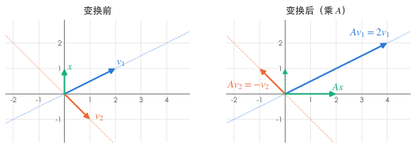
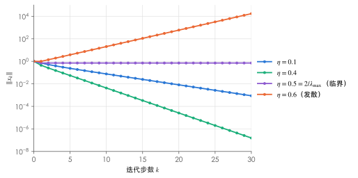
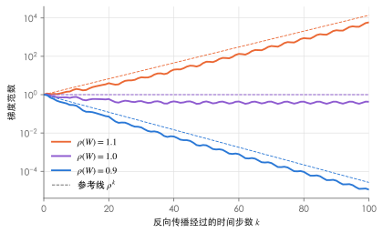

# 特征值与特征向量

矩阵乘一个向量，一般既改变它的长度，也改变它的方向。特征向量是方向不被改变的那些向量，特征值是它被拉伸的倍数。知道了一个矩阵的全部特征值和特征向量，把这个矩阵连乘很多次的结果 $A^k$ 就可以直接写出来。凡是"同一个线性变换反复作用"的问题，例如迭代算法是否收敛、梯度经过很多个时间步后变大还是变小、马尔可夫链最终停在什么分布上，最后都归结为特征值。本章只讨论方阵。

## 1. 意义：方向不变的向量

对 $n$ 阶方阵 $A$，如果非零向量 $v$ 和数 $\lambda$ 满足

$$
Av=\lambda v
$$

就称 $\lambda$ 是 $A$ 的**特征值**（eigenvalue），$v$ 是属于 $\lambda$ 的**特征向量**（eigenvector）。等式的含义是：$A$ 作用在 $v$ 上，结果仍在 $v$ 所在的直线上，只是长度变为原来的 $\lambda$ 倍。

- $\lambda>1$ 拉长，$0<\lambda<1$ 缩短，$\lambda<0$ 还要反向。
- $\lambda=0$ 表示 $Av=0$，即 $v$ 在零空间 $N(A)$ 里，此时 $A$ 不可逆。
- 特征向量不唯一：$v$ 是特征向量，则 $cv$（$c\ne0$）也是。属于同一个 $\lambda$ 的全部特征向量加上零向量，构成子空间 $N(\lambda I-A)$，称为特征子空间。

{ .diagram }

图中 $A=\smat{1&2\\1&0}$。一般的向量 $x=[0\ \ 1]\tp$ 被映到 $Ax=[2\ \ 0]\tp$，方向变了；$v_1=[2\ \ 1]\tp$ 被映到 $[4\ \ 2]\tp=2v_1$，$v_2=[1\ \ -1]\tp$ 被映到 $[-1\ \ 1]\tp=-v_2$，都还在原来的直线（虚线）上。所以 $A$ 的特征值是 $2$ 和 $-1$。

特征向量的用处在于**拿它们当基**。上例中 $x=\frac13v_1-\frac23v_2$，于是

$$
Ax=\tfrac13\cdot2v_1-\tfrac23\cdot(-1)v_2,\qquad A^kx=\tfrac13\cdot2^k\,v_1-\tfrac23\cdot(-1)^k\,v_2
$$

在特征向量这组基下，乘 $A$ 就是把每个坐标各自乘上对应的特征值，乘 $k$ 次就是乘特征值的 $k$ 次方。$k$ 很大时 $2^k$ 那一项占绝对优势，$A^kx$ 的方向趋于 $v_1$。本章后面的内容都是这个想法的展开。

## 2. 计算：特征方程

$Av=\lambda v$ 可以写成 $(\lambda I-A)v=0$。这个齐次方程组有非零解，当且仅当系数矩阵不可逆，即

$$
\varphi(\lambda)=\lvert\lambda I-A\rvert=0
$$

$\varphi(\lambda)$ 是 $\lambda$ 的 $n$ 次多项式，称为特征多项式；上式称为特征方程。在复数范围内它恰有 $n$ 个根（重根按重数计）。

!!! tip "方法：求特征值和特征向量"
    1. 写出 $\lvert\lambda I-A\rvert$ 并展开。二阶矩阵直接用 $\lambda^2-\tr A\cdot\lambda+\det A=0$；三阶先用行、列变换提出公因式，再展开。
    2. 解出全部特征值。
    3. 对每个 $\lambda_i$，用消元法解齐次方程组 $(\lambda_iI-A)v=0$（见[线性方程组、消元与逆矩阵](linear-systems.md)），基础解系就是该特征子空间的一组基。
    4. 检验：$\sum\lambda_i=\tr A$，$\prod\lambda_i=\det A$，并把 $v$ 代回 $Av=\lambda v$。

几条常用性质：

- **迹与行列式**：$\tr A=\sum_i\lambda_i$，$\det A=\prod_i\lambda_i$。所以 $A$ 可逆当且仅当没有零特征值（行列式见[行列式](determinant.md)）。
- **三角阵**（包括对角阵）的特征值就是对角元，因为 $\lvert\lambda I-A\rvert=\prod_i(\lambda-a_{ii})$。
- $A$ 与 $A\tp$ 的特征值相同（特征向量一般不同）；相似矩阵 $P^{-1}AP$ 与 $A$ 的特征值相同。
- 若 $Av=\lambda v$，则 $A^kv=\lambda^kv$，$(A+cI)v=(\lambda+c)v$，$A$ 可逆时 $A^{-1}v=\lambda^{-1}v$。特征向量不变，特征值做相应的运算。

??? example "例：二阶矩阵的特征值与特征向量"
    求 $A=\bmat{1&2\\1&0}$ 的特征值和特征向量。

    **解** $\tr A=1$，$\det A=-2$，特征方程为 $\lambda^2-\lambda-2=(\lambda-2)(\lambda+1)=0$，故 $\lambda_1=2$，$\lambda_2=-1$。

    $\lambda_1=2$：$2I-A=\smat{1&-2\\-1&2}$，方程 $v_1-2v_2=0$，取 $v_1=[2\ \ 1]\tp$。

    $\lambda_2=-1$：$-I-A=\smat{-2&-2\\-1&-1}$，方程 $v_1+v_2=0$，取 $v_2=[1\ \ -1]\tp$。

    检验：$\lambda_1+\lambda_2=1=\tr A$，$\lambda_1\lambda_2=-2=\det A$；$Av_1=[4\ \ 2]\tp=2v_1$，$Av_2=[-1\ \ 1]\tp=-v_2$。

??? example "例：三阶矩阵，特征值有重根"
    求 $A=\bmat{4&1&-1\\2&5&-2\\1&1&2}$ 的特征值和特征向量。

    **解** (1) 对 $\lambda I-A$ 做变换提公因式。第 1 行减第 3 行后，第 1 行变为 $(\lambda-3)[1\ \ 0\ \ -1]$；提出 $\lambda-3$ 后，再把第 1 列加到第 3 列：

    $$
    \lvert\lambda I-A\rvert=\begin{vmatrix}\lambda-4&-1&1\\-2&\lambda-5&2\\-1&-1&\lambda-2\end{vmatrix}
    =(\lambda-3)\begin{vmatrix}1&0&0\\-2&\lambda-5&0\\-1&-1&\lambda-3\end{vmatrix}=(\lambda-3)^2(\lambda-5)
    $$

    故 $\lambda_{1,2}=3$（二重），$\lambda_3=5$。

    (2) $\lambda=3$：$3I-A=\smat{-1&-1&1\\-2&-2&2\\-1&-1&1}$，三行成比例，只剩一个方程 $x_1+x_2-x_3=0$，有两个自由变量，取 $v_1=[-1\ \ 1\ \ 0]\tp$，$v_2=[1\ \ 0\ \ 1]\tp$。

    (3) $\lambda=5$：$5I-A=\smat{1&-1&1\\-2&0&2\\-1&-1&3}$。第 2 行给出 $x_1=x_3$，第 1 行给出 $x_2=2x_1$，取 $v_3=[1\ \ 2\ \ 1]\tp$。

    检验：$3+3+5=11=\tr A$，$3\cdot3\cdot5=45=\det A$；$Av_3=[5\ \ 10\ \ 5]\tp=5v_3$。

## 3. 对角化与矩阵的幂

### 对角化

如果 $A$ 有 $n$ 个线性无关的特征向量 $v_1,\dots,v_n$，把它们按列排成 $P=[v_1\ \cdots\ v_n]$，把特征值排成对角阵 $\Lambda=\diag(\lambda_1,\dots,\lambda_n)$，则 $n$ 个等式 $Av_i=\lambda_iv_i$ 合起来就是 $AP=P\Lambda$，即

$$
A=P\Lambda P^{-1},\qquad P^{-1}AP=\Lambda
$$

这称为**对角化**，也叫特征分解。它把乘 $A$ 拆成三步：$P^{-1}$ 把向量换成特征向量基下的坐标，$\Lambda$ 把各个坐标分别乘上 $\lambda_i$，$P$ 再换回原来的坐标。换基的一般理论和它在控制里的用法见[状态空间的线性变换](../../control/modern/notes/linear-transform.md)。

连乘时中间的 $P^{-1}P$ 相消：

$$
A^k=P\Lambda^kP^{-1},\qquad \Lambda^k=\diag(\lambda_1^k,\dots,\lambda_n^k)
$$

### 什么时候能对角化

对每个特征值 $\lambda_i$ 定义两个重数：

- **代数重数** $\mu_i$：$\lambda_i$ 作为特征方程的根的重数；
- **几何重数** $\gamma_i$：特征子空间的维数，$\gamma_i=n-\rank(\lambda_iI-A)$，也就是属于 $\lambda_i$ 的线性无关特征向量的个数。

总有 $1\le\gamma_i\le\mu_i$。结论是：

$$
A\ \text{可对角化}\iff A\ \text{有}\ n\ \text{个线性无关的特征向量}\iff \text{每个特征值都有}\ \gamma_i=\mu_i
$$

两个常用的充分条件：$n$ 个特征值互不相同（属于不同特征值的特征向量线性无关）；$A$ 是实对称矩阵（第 5 节）。

最简单的不可对角化的例子是剪切 $\smat{1&1\\0&1}$：$\lambda=1$ 是二重根，但 $\rank(I-A)=1$，$\gamma=1<\mu=2$，只有一个特征方向 $[1\ \ 0]\tp$。这类矩阵只能化为约当型，见[状态空间的线性变换](../../control/modern/notes/linear-transform.md)。

!!! warning "易错点"
    - 特征向量必须非零；特征值可以是 0。
    - 有重根不等于不能对角化，要算几何重数。单位阵 $I$ 的特征值全是 1，它本身就是对角阵。
    - 可逆和可对角化是两回事：$\smat{1&1\\0&1}$ 可逆但不可对角化，$\smat{1&0\\0&0}$ 可对角化但不可逆。
    - $P$ 的列序和 $\Lambda$ 对角元的顺序必须对应。

??? example "例：对角化并求 $A^k$，顺便得到递推数列的通项"
    设 $A=\bmat{1&2\\1&0}$。(1) 求 $A^k$；(2) 数列满足 $a_0=0,\ a_1=1,\ a_{k+1}=a_k+2a_{k-1}$，求通项。

    **解** (1) 由上一节的例题，$P=\bmat{2&1\\1&-1}$，$\Lambda=\diag(2,-1)$，$P^{-1}=\dfrac13\bmat{1&1\\1&-2}$。

    $$
    A^k=P\Lambda^kP^{-1}=\frac13\bmat{2&1\\1&-1}\bmat{2^k&0\\0&(-1)^k}\bmat{1&1\\1&-2}
    =\frac13\bmat{2^{k+1}+(-1)^k&2^{k+1}-2(-1)^k\\2^k-(-1)^k&2^k+2(-1)^k}
    $$

    取 $k=1$ 检验：$\frac13\smat{3&6\\3&0}=A$。

    (2) 递推式可以写成 $\bmat{a_{k+1}\\a_k}=A\bmat{a_k\\a_{k-1}}$，所以 $\bmat{a_{k+1}\\a_k}=A^k\bmat{1\\0}$，$a_k$ 是 $A^k$ 的 $(2,1)$ 元：

    $$
    a_k=\frac{2^k-(-1)^k}{3}
    $$

    前几项为 $0,1,1,3,5,11,21,\dots$，与递推式一致。$k$ 大时 $a_k\approx2^k/3$，增长速度由绝对值最大的特征值决定。

??? example "例：特征多项式相同，一个能对角化，一个不能"
    $A=\bmat{4&1&-1\\2&5&-2\\1&1&2}$ 与 $B=\bmat{3&1&0\\0&3&0\\0&0&5}$ 的特征多项式都是 $(\lambda-3)^2(\lambda-5)$。判断它们能否对角化。

    **解** 只需要检查二重特征值 $\lambda=3$ 的几何重数。

    $A$：上一节已得 $\rank(3I-A)=1$，$\gamma=3-1=2=\mu$，可以对角化。取 $P=[v_1\ \ v_2\ \ v_3]=\bmat{-1&1&1\\1&0&2\\0&1&1}$，则 $P^{-1}AP=\diag(3,3,5)$。

    $B$：$3I-B=\smat{0&-1&0\\0&0&0\\0&0&-2}$，秩为 2，$\gamma=1<\mu=2$，不能对角化。$B$ 本身已经是约当型。

## 4. 复特征值：旋转

平面上逆时针旋转 $\theta$ 角的矩阵是

$$
R(\theta)=\bmat{\cos\theta&-\sin\theta\\\sin\theta&\cos\theta},\qquad \lambda^2-2\cos\theta\cdot\lambda+1=0,\qquad \lambda=\cos\theta\pm\mathrm i\sin\theta=\e^{\pm\mathrm i\theta}
$$

$\theta\ne0,\pi$ 时没有实特征值。这和几何一致：旋转之后没有哪个方向保持不变。

实矩阵的复特征值总是成共轭对出现。一对共轭特征值 $r\e^{\pm\mathrm i\theta}$ 表示：在某个二维平面内，选合适的基之后，变换是"旋转 $\theta$ 角再缩放 $r$ 倍"。反复作用时，模 $r=\lvert\lambda\rvert$ 决定增长还是衰减，辐角 $\theta$ 决定转动（振荡）的快慢。

??? example "例：旋转加缩放"
    求 $A=\bmat{1&-1\\1&1}$ 的特征值，说明它的几何作用，并求 $A^8$。

    **解** $\tr A=2$，$\det A=2$，$\lambda^2-2\lambda+2=0$，$\lambda=1\pm\mathrm i=\sqrt2\,\e^{\pm\mathrm i\pi/4}$。

    $A=\sqrt2\,R(45^\circ)$：逆时针转 $45^\circ$，再放大 $\sqrt2$ 倍。于是 $A^8=(\sqrt2)^8R(360^\circ)=16I$。直接验算：$A^2=\smat{0&-2\\2&0}$，$A^4=-4I$，$A^8=16I$。

!!! info "AI 联系"
    旋转位置编码（RoPE）把向量的分量两两分组，每组乘一个 $2\times2$ 旋转矩阵，转角正比于 token 的位置。旋转矩阵是正交矩阵，不改变向量的长度，它的特征值 $\e^{\pm\mathrm i\theta}$ 的模为 1，见[用线性代数读 Transformer](transformer-linalg.md)。

## 5. 对称矩阵的谱定理

对称矩阵（$A\tp=A$）的特征结构最好。**谱定理**：设 $A$ 是实对称矩阵，则

1. 特征值全是实数；
2. 属于不同特征值的特征向量互相正交；
3. 即使有重特征值，也能选出 $n$ 个两两正交的单位特征向量 $q_1,\dots,q_n$。令 $Q=[q_1\ \cdots\ q_n]$，则 $Q$ 是正交矩阵（$Q\tp Q=I$，见[正交、投影与最小二乘](orthogonality.md)），并且

$$
A=Q\Lambda Q\tp=\sum_{i=1}^n\lambda_i\,q_iq_i\tp
$$

对称矩阵的作用是沿 $n$ 个互相垂直的方向分别伸缩 $\lambda_i$ 倍，没有旋转和剪切的成分。计算上，$Q^{-1}=Q\tp$，不需要求逆。

**证明思路** 结论 1 对二阶矩阵 $\smat{a&b\\b&d}$ 可以直接看判别式：$(a+d)^2-4(ad-b^2)=(a-d)^2+4b^2\ge0$。结论 2：设 $Av_1=\lambda_1v_1$，$Av_2=\lambda_2v_2$，$\lambda_1\ne\lambda_2$，利用 $A\tp=A$，

$$
\lambda_1v_1\tp v_2=(Av_1)\tp v_2=v_1\tp Av_2=\lambda_2v_1\tp v_2\ \Longrightarrow\ (\lambda_1-\lambda_2)\,v_1\tp v_2=0\ \Longrightarrow\ v_1\tp v_2=0
$$

机器学习里最常见的几类矩阵都是对称的：协方差矩阵、Hessian 矩阵、形如 $X\tp X$ 的矩阵。它们的进一步性质（正定性、二次型）见[对称矩阵、二次型与正定性](quadratic-forms.md)；任意形状的矩阵通过 $A\tp A$ 也能用上谱定理，这就是[奇异值分解](svd.md)。

??? example "例：对称矩阵的正交对角化（有重特征值）"
    求正交矩阵 $Q$ 使 $Q\tp SQ$ 为对角阵，其中 $S=\bmat{2&1&1\\1&2&1\\1&1&2}$。

    **解** (1) 特征值。$S=I+\mathbf 1\mathbf 1\tp$。秩一矩阵 $\mathbf 1\mathbf 1\tp$ 把 $\mathbf 1$ 映为 $3\cdot\mathbf 1$，把与 $\mathbf 1$ 正交的向量映为 0，所以它的特征值是 $3,0,0$；加上 $I$ 后特征值各加 1，得 $\lambda_1=4$，$\lambda_{2,3}=1$。检验：$4+1+1=6=\tr S$。

    (2) $\lambda=4$：特征向量 $[1\ \ 1\ \ 1]\tp$，单位化得 $q_1=\frac1{\sqrt3}[1\ \ 1\ \ 1]\tp$。

    (3) $\lambda=1$：特征子空间是平面 $x_1+x_2+x_3=0$，它自动与 $q_1$ 正交（结论 2）。但平面内随手取的两个向量不一定互相正交，需要挑一组正交的：先取 $[1\ \ -1\ \ 0]\tp$，再在平面内找与它垂直的 $[1\ \ 1\ \ -2]\tp$。单位化得

    $$
    q_2=\tfrac1{\sqrt2}[1\ \ -1\ \ 0]\tp,\qquad q_3=\tfrac1{\sqrt6}[1\ \ 1\ \ -2]\tp
    $$

    (4) 结果：

    $$
    Q=\bmat{\frac1{\sqrt3}&\frac1{\sqrt2}&\frac1{\sqrt6}\\\frac1{\sqrt3}&-\frac1{\sqrt2}&\frac1{\sqrt6}\\\frac1{\sqrt3}&0&-\frac2{\sqrt6}},\qquad Q\tp SQ=\diag(4,1,1)
    $$

    **注** 若在第 (3) 步取的是 $[1\ \ -1\ \ 0]\tp$ 和 $[1\ \ 0\ \ -1]\tp$，它们都是特征向量但不正交，要先做 Gram–Schmidt 正交化（见[正交、投影与最小二乘](orthogonality.md)）。

## 6. 数值计算：eig、eigh 与幂迭代

手算只适用于二、三阶矩阵。数值库不解特征方程，而是用迭代的矩阵分解算法。NumPy 里有两个函数：

```python
import numpy as np

A = np.array([[1., 2.], [1., 0.]])
lam, P = np.linalg.eig(A)        # 一般方阵
print(lam.real)                  # [ 2. -1.]
print(P.real.round(4))           # 每一列是一个单位长度的特征向量
# [[ 0.8944 -0.7071]
#  [ 0.4472  0.7071]]
print(np.allclose(A @ P, P * lam))             # True，即 AP = PΛ

S = np.array([[2., 1., 1.], [1., 2., 1.], [1., 1., 2.]])
w, Q = np.linalg.eigh(S)         # 对称矩阵专用
print(w)                         # [1. 1. 4.]，实数，从小到大
print(np.allclose(Q.T @ Q, np.eye(3)), np.allclose(Q @ np.diag(w) @ Q.T, S))   # True True

R = np.array([[0., -1.], [1., 0.]])            # 旋转 90 度
print(np.linalg.eigvals(R))      # [0.+1.j 0.-1.j]
```

| | `np.linalg.eig` | `np.linalg.eigh` |
| --- | --- | --- |
| 适用 | 任意方阵 | 实对称（或复厄米）矩阵 |
| 特征值 | 可能是复数，不保证顺序 | 实数，从小到大排列 |
| 特征向量 | 各列长度为 1，彼此不一定正交 | 各列构成标准正交基 |
| 速度与精度 | 较慢 | 更快、更准 |

对称矩阵一律用 `eigh`。`eig` 的返回值在不同版本的 NumPy 里可能是实数数组，也可能是虚部为 0 的复数数组，上面的代码用 `.real` 统一处理。只要特征值时用 `eigvals` / `eigvalsh`。PyTorch 中对应的是 `torch.linalg.eig` 和 `torch.linalg.eigh`。

### 幂迭代与谱半径

只需要**绝对值最大的特征值**（主特征值）时，有一个只用矩阵乘向量的算法：任取 $x_0$，反复乘 $A$ 并归一化。把 $x_0$ 按特征向量展开为 $x_0=\sum_ic_iv_i$，设 $\lvert\lambda_1\rvert>\lvert\lambda_2\rvert\ge\cdots$，则

$$
A^kx_0=\lambda_1^k\Bigl(c_1v_1+\sum_{i\ge2}c_i\bigl(\tfrac{\lambda_i}{\lambda_1}\bigr)^kv_i\Bigr)
$$

括号里除第一项外都按 $\lvert\lambda_2/\lambda_1\rvert^k$ 衰减，所以方向收敛到 $v_1$。这就是**幂迭代**（power iteration）。

```python
def power_iteration(A, iters=50, seed=0):
    rng = np.random.default_rng(seed)
    v = rng.standard_normal(A.shape[0])
    for _ in range(iters):
        v = A @ v
        v /= np.linalg.norm(v)      # 每步归一化，防止数值溢出
    return v @ A @ v, v             # v 是单位向量，v^T A v 是特征值的估计

for iters in (10, 20, 40):
    print(iters, power_iteration(A, iters)[0])
# 10 2.032285261462978
# 20 2.0000349987644572
# 40 2.000000000033381
```

这里 $\lvert\lambda_2/\lambda_1\rvert=1/2$，每多迭代 10 步，误差缩小到约 $2^{-10}\approx10^{-3}$，与输出一致。幂迭代不需要把矩阵写出来，只要能算"矩阵乘向量"就行，所以适用于很大的矩阵或隐式给出的矩阵。

!!! info "AI 联系"
    神经网络损失函数的 Hessian 矩阵的元素个数是参数量的平方，存不下来，但"Hessian 乘向量"可以用自动求导算出。估计 Hessian 最大特征值的常用办法就是对它做幂迭代。

**谱半径**（spectral radius）定义为特征值的最大模：

$$
\rho(A)=\max_i\lvert\lambda_i\rvert
$$

由 $A^k=P\Lambda^kP^{-1}$ 可以看出：$k\to\infty$ 时 $A^k\to0$，当且仅当 $\rho(A)<1$（这个结论对不可对角化的矩阵也成立）。后面三节都是它的应用。

## 7. 线性迭代与梯度下降的稳定学习率

迭代 $x_{k+1}=Ax_k$ 的解是 $x_k=A^kx_0$。对任意初值都收敛到 0 的充要条件是 $\rho(A)<1$；只要有一个特征值的模大于 1，初值在对应特征方向上的分量就会指数增长。

把这个结论用到梯度下降上。取二次函数 $f(x)=\frac12x\tp Hx$，$H$ 对称正定（定义见[对称矩阵、二次型与正定性](quadratic-forms.md)），最小点在 $x=0$，梯度为 $\nabla f=Hx$（求导规则见[矩阵求导与反向传播](matrix-calculus.md)）。学习率为 $\eta$ 的梯度下降是

$$
x_{k+1}=x_k-\eta Hx_k=(I-\eta H)\,x_k
$$

这是一个线性迭代，迭代矩阵 $I-\eta H$ 的特征值是 $1-\eta\lambda_i$，特征向量与 $H$ 相同。用谱定理 $H=Q\Lambda Q\tp$，令 $c=Q\tp x$ 为 $x$ 在特征向量基下的坐标，则各个坐标互不影响：

$$
c_i^{(k)}=(1-\eta\lambda_i)^k\,c_i^{(0)},\qquad i=1,\dots,n
$$

每个特征方向上，误差每步乘一个固定的因子 $1-\eta\lambda_i$。收敛要求所有因子的绝对值小于 1，即 $0<\eta\lambda_i<2$ 对所有 $i$ 成立：

$$
\boxed{0<\eta<\frac{2}{\lambda_{\max}(H)}}
$$

- 学习率的上限由**曲率最大的方向**（$\lambda_{\max}$）决定，超过上限后这个方向上的分量每步反号并且放大。
- 因子在 $(0,1)$ 内时该方向单调收敛；在 $(-1,0)$ 内时每步越过最小点、来回振荡着收敛。
- 曲率小的方向因子 $1-\eta\lambda_{\min}$ 接近 1，收敛慢。收敛速度与条件数的关系见[对称矩阵、二次型与正定性](quadratic-forms.md)。

??? example "例：梯度下降的稳定学习率"
    $f(x)=\frac12x\tp Hx$，$H=\bmat{3&1\\1&3}$，初值 $x_0=[1\ \ 0]\tp$。(1) 学习率在什么范围内梯度下降收敛？(2) 取 $\eta=0.4$，写出 $x_k$。(3) 取 $\eta=0.6$ 会怎样？

    **解** (1) $\tr H=6$，$\det H=8$，$\lambda_1=4$，$\lambda_2=2$，对应 $q_1=\frac1{\sqrt2}[1\ \ 1]\tp$，$q_2=\frac1{\sqrt2}[1\ \ -1]\tp$。收敛条件 $0<\eta<2/4=0.5$。

    (2) 把初值按特征向量分解：$x_0=\frac12\smat{1\\1}+\frac12\smat{1\\-1}$。$\eta=0.4$ 时两个方向的因子分别是 $1-0.4\times4=-0.6$ 和 $1-0.4\times2=0.2$，所以

    $$
    x_k=\tfrac12(-0.6)^k\bmat{1\\1}+\tfrac12(0.2)^k\bmat{1\\-1}
    $$

    例如 $x_1=[-0.2\ \ -0.4]\tp$，$x_2=[0.2\ \ 0.16]\tp$。$\lambda=4$ 的方向每步反号，振荡着收敛。

    (3) $\eta=0.6$ 时因子为 $-1.4$ 和 $-0.2$。第一个方向上的分量每步放大 1.4 倍，$\lVert x_k\rVert\approx\frac{\sqrt2}2\cdot1.4^k$，50 步后约为 $1.4\times10^7$，发散。

用 NumPy 验证，四个学习率各迭代 50 步后的 $\lVert x_{50}\rVert$：

```python
H = np.array([[3., 1.], [1., 3.]])
for eta in (0.1, 0.4, 0.5, 0.6):
    x = np.array([1., 0.])
    for _ in range(50):
        x = x - eta * (H @ x)
    print(eta, np.linalg.norm(x))
# 0.1 1.0092165219453994e-05
# 0.4 5.7154117240146445e-12
# 0.5 0.7071067811865476
# 0.6 14318145.984815756
```

$\eta=0.5$ 恰在边界上：$\lambda=4$ 方向的因子是 $-1$，分量大小不变、每步反号，既不收敛也不发散。

{ .diagram }

实际网络的损失不是二次函数，但在任一点附近做二阶近似之后，同样的分析成立：能用多大的学习率，取决于该处 Hessian 的最大特征值。

## 8. RNN 的梯度消失与爆炸

循环神经网络（RNN）在每个时间步用同一个权重矩阵 $W$。先看最简单的线性情形 $h_t=Wh_{t-1}$，损失 $L$ 由最后的状态 $h_T$ 算出。按链式法则，梯度每往前传一个时间步就左乘一次 $W\tp$：

$$
\frac{\partial L}{\partial h_{t-1}}=W\tp\frac{\partial L}{\partial h_t}\quad\Longrightarrow\quad\frac{\partial L}{\partial h_{T-k}}=(W\tp)^k\,\frac{\partial L}{\partial h_T}
$$

这又是一个线性迭代，$W\tp$ 与 $W$ 的特征值相同，所以长期行为由谱半径 $\rho(W)$ 决定：

- $\rho(W)<1$：梯度范数大致按 $\rho^k$ 衰减。$0.9^{100}\approx2.7\times10^{-5}$，100 步以前的状态几乎收不到梯度，网络学不到长距离的依赖关系。这是**梯度消失**。
- $\rho(W)>1$：梯度范数大致按 $\rho^k$ 增长。$1.1^{100}\approx1.4\times10^4$，参数更新量过大，训练发散。这是**梯度爆炸**。

带激活函数时 $h_t=\tanh(Wh_{t-1}+Ux_t)$，每一步的 Jacobian 是 $\diag(1-h_t^2)\,W$，多出来的对角因子的元素都在 $(0,1]$ 内，梯度更容易消失。

数值实验：随机生成 $64\times64$ 的 $W$，把谱半径缩放到指定值，观察范数为 1 的梯度往前传 $k$ 步后的范数。

```python
rng = np.random.default_rng(0)
n = 64
W0 = rng.standard_normal((n, n)) / np.sqrt(n)
rho0 = np.abs(np.linalg.eigvals(W0)).max()        # 谱半径
g = rng.standard_normal(n)
g /= np.linalg.norm(g)                            # 最后一个时间步的梯度，范数为 1
for rho in (0.9, 1.0, 1.1):
    W = W0 * (rho / rho0)                         # 把谱半径缩放到指定值
    v, out = g.copy(), []
    for k in range(1, 101):
        v = W.T @ v                               # 往前传一个时间步
        if k in (10, 50, 100):
            out.append(f"{np.linalg.norm(v):.3g}")
    print(rho, out)
# 0.9 ['0.267', '0.00228', '1.13e-05']
# 1.0 ['0.764', '0.443', '0.426']
# 1.1 ['1.98', '52', '5.87e+03']
```

{ .diagram }

实验结果与 $\rho^k$ 同一量级但不完全相等：随机矩阵不对称，特征向量不正交，而且初始梯度并不恰好落在主特征方向上。谱半径给出的是长期的指数增长率；单独一步最多能把范数放大多少，由最大奇异值决定，见[奇异值分解](svd.md)。

常见的处理办法都可以从"让反复相乘的矩阵的特征值接近 1"来理解：梯度爆炸用梯度裁剪（见[向量、内积与范数](vectors.md)）；LSTM、GRU 的门控结构和深层网络里的残差连接 $h_{l+1}=h_l+F(h_l)$ 提供了一条 Jacobian 接近单位阵的通路；正交初始化让 $W$ 的特征值的模都等于 1（见[正交、投影与最小二乘](orthogonality.md)）。

??? example "例：线性 RNN 的梯度回传"
    线性 RNN 的权重 $W=\bmat{0.9&0\\0.3&0.5}$，最后一步的梯度 $g=\partial L/\partial h_T=[1\ \ 1]\tp$。(1) 写出回传 $k$ 步后的梯度 $(W\tp)^kg$；(2) 回传多少步后梯度范数降到 $\lVert g\rVert$ 的 1% 以下？

    **解** (1) $W\tp=\smat{0.9&0.3\\0&0.5}$ 是三角阵，特征值为 $0.9$ 和 $0.5$。$\lambda=0.9$ 的特征向量是 $[1\ \ 0]\tp$；$\lambda=0.5$ 时解 $0.4v_1+0.3v_2=0$，取 $[3\ \ -4]\tp$。把 $g$ 分解为 $g=\frac74\smat{1\\0}-\frac14\smat{3\\-4}$，于是

    $$
    (W\tp)^kg=\tfrac74\cdot0.9^k\bmat{1\\0}-\tfrac14\cdot0.5^k\bmat{3\\-4}
    $$

    $k=10$ 时为 $[0.6095\ \ 0.0010]\tp$，第二项已经可以忽略，梯度几乎完全落在主特征方向上。

    (2) $k$ 较大时 $\lVert(W\tp)^kg\rVert\approx1.75\times0.9^k$。要求它小于 $0.01\lVert g\rVert=0.01\sqrt2$，即 $0.9^k<0.00808$，$k>\ln0.00808/\ln0.9\approx45.7$。回传 46 步后梯度衰减到 1% 以下。

## 9. 马尔可夫链的稳态分布与 PageRank

马尔可夫链描述一个在 $n$ 个状态之间随机转移的系统。用向量 $p_k$ 表示第 $k$ 步时处在各状态的概率（分量非负、和为 1），用**转移矩阵** $T$ 表示转移规则：$T_{ij}$ 是"当前在状态 $j$、下一步到状态 $i$"的概率。$T$ 的每一列的和为 1，并且

$$
p_{k+1}=Tp_k,\qquad p_k=T^kp_0
$$

如果分布 $\pi$ 满足 $T\pi=\pi$，一旦到达它就不再变化，称为**稳态分布**。按定义，它就是 $T$ 的属于特征值 1 的特征向量（归一化到分量和为 1）。

- 特征值 1 一定存在：各列的和为 1 即 $T\tp\mathbf 1=\mathbf 1$，所以 1 是 $T\tp$ 的特征值，也就是 $T$ 的特征值。
- $T$ 的所有特征值的模都不超过 1。如果 $T$ 的元素全为正，则特征值 1 是单根，其余特征值的模都小于 1。这时从任何初始分布出发都有 $p_k\to\pi$，偏差按 $\lvert\lambda_2\rvert^k$ 衰减，$\lambda_2$ 是模第二大的特征值。

很多教材把转移矩阵写成各行的和为 1 的形式，分布写成行向量，稳态条件是 $\pi\tp P=\pi\tp$。那里的 $P$ 是这里的 $T\tp$，两种写法等价。

??? example "例：两状态马尔可夫链的稳态分布"
    某个固定策略下，智能体在状态 $s_1,s_2$ 之间转移：处在 $s_1$ 时以 0.9 的概率留在 $s_1$，处在 $s_2$ 时以 0.5 的概率转到 $s_1$。求稳态分布；若从 $s_2$ 出发，写出第 $k$ 步的分布。

    **解** 转移矩阵 $T=\bmat{0.9&0.5\\0.1&0.5}$（第 $j$ 列是从 $s_j$ 出发的转移概率）。$\tr T=1.4$，$\det T=0.4$，特征值为 $1$ 和 $0.4$。

    $\lambda=1$：$(T-I)\pi=0$ 给出 $-0.1\pi_1+0.5\pi_2=0$，即 $\pi_1=5\pi_2$；归一化得 $\pi=[\tfrac56\ \ \tfrac16]\tp$。长期来看，智能体有 $5/6$ 的时间处在 $s_1$。

    $\lambda=0.4$：特征向量 $[1\ \ -1]\tp$。初始分布 $p_0=[0\ \ 1]\tp=\pi-\frac56\smat{1\\-1}$，所以

    $$
    p_k=\bmat{5/6\\1/6}-\tfrac56\cdot0.4^k\bmat{1\\-1}
    $$

    $p_1=[0.5\ \ 0.5]\tp$，$p_2=[0.7\ \ 0.3]\tp$，$p_3=[0.78\ \ 0.22]\tp$，与稳态分布的差距每步缩小到 0.4 倍。

强化学习里，固定策略下状态的转移就是一条马尔可夫链，长期运行时各状态被访问的比例就是它的稳态分布。

**PageRank** 是同一个计算。设想一个人在网页之间随机跳转：在网页 $j$ 时，等概率地点击它的某一条出链。这是一条马尔可夫链，$M_{ij}=1/(\text{网页 }j\text{ 的出链数})$（若 $j$ 链接到 $i$，否则为 0）。为了保证稳态分布唯一，再假设每一步以概率 $1-d$ 不点链接、直接跳到一个随机网页，得到

$$
G=dM+\frac{1-d}{n}\mathbf 1\mathbf 1\tp
$$

$d$ 称为阻尼系数，常取 0.85。$G$ 的元素全为正，稳态分布唯一，它的各分量就是各网页的 PageRank 值，用幂迭代计算。

??? example "例：三个网页的 PageRank"
    三个网页的链接关系：网页 1 链接到 2 和 3，网页 2 链接到 3，网页 3 链接到 1。(1) 不加阻尼，求稳态分布；(2) 取 $d=0.85$，求 PageRank。

    **解** (1) $M=\bmat{0&0&1\\\frac12&0&0\\\frac12&1&0}$。$M\pi=\pi$ 的三个方程是 $\pi_1=\pi_3$，$\pi_2=\frac12\pi_1$，$\pi_3=\frac12\pi_1+\pi_2$（第三个由前两个推出）。取 $\pi\propto[2\ \ 1\ \ 2]\tp$，归一化得 $\pi=[0.4\ \ 0.2\ \ 0.4]\tp$。

    (2) 加阻尼后用幂迭代：

    ```python
    M = np.array([[0, 0, 1], [0.5, 0, 0], [0.5, 1, 0]])    # 第 j 列：从网页 j 出发的转移概率
    d, n = 0.85, 3
    G = d * M + (1 - d) / n * np.ones((n, n))
    p = np.ones(n) / n
    for _ in range(100):
        p = G @ p                    # 列和为 1，p 的分量和保持为 1，不必再归一化
    print(p.round(4))                # [0.3878 0.2148 0.3974]
    ```

    网页 3 有两条入链，排名最高；网页 1 只有一条入链，但这条链接来自排名最高的网页 3，而且是网页 3 唯一的出链，所以排名紧随其后。

## 小结

| 概念 | 要点 |
| --- | --- |
| 定义 | $Av=\lambda v$，$v\ne0$；$v$ 的方向不变，长度乘 $\lambda$ |
| 计算 | 解 $\lvert\lambda I-A\rvert=0$ 得 $\lambda$，再解 $(\lambda I-A)v=0$ 得 $v$；二阶用 $\lambda^2-\tr A\cdot\lambda+\det A=0$ |
| 检验 | $\sum\lambda_i=\tr A$，$\prod\lambda_i=\det A$；三角阵的特征值是对角元 |
| 对角化 | $A=P\Lambda P^{-1}$，$A^k=P\Lambda^kP^{-1}$；条件是每个特征值的几何重数等于代数重数 |
| 复特征值 | $r\e^{\pm\mathrm i\theta}$ 表示旋转 $\theta$ 并缩放 $r$ 倍 |
| 谱定理 | 实对称矩阵：特征值为实数，$A=Q\Lambda Q\tp$，$Q$ 正交 |
| NumPy | 一般方阵 `eig`，对称矩阵 `eigh`；只要主特征值用幂迭代 |
| 谱半径 | $\rho(A)=\max_i\lvert\lambda_i\rvert$；$A^k\to0\iff\rho(A)<1$ |
| 梯度下降 | 二次函数上各特征方向的误差每步乘 $1-\eta\lambda_i$；稳定条件 $\eta<2/\lambda_{\max}$ |
| RNN | 梯度回传 $k$ 步含 $(W\tp)^k$；$\rho(W)<1$ 消失，$\rho(W)>1$ 爆炸 |
| 马尔可夫链 | 稳态分布是转移矩阵特征值 1 的特征向量；收敛速度由 $\lvert\lambda_2\rvert$ 决定；PageRank 用幂迭代求它 |
