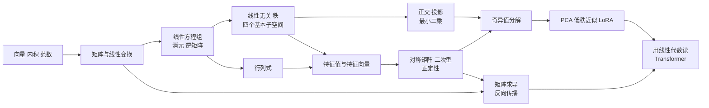

# 线性代数

面向 AI 方向的线性代数笔记。每一章都按同一个顺序写：这个概念**是什么意思**（几何图像）、**怎么算**（手算步骤和 NumPy 写法）、**例题**（点开折叠框看完整解答）、**在 AI 里出现在哪**（给出能算出数的具体例子，而不只是提一句）。例题里的每个数都用 SymPy 或 NumPy 验算过，代码可以直接复制运行（Python ≥ 3.10，NumPy 2.x；个别代码块用到 SymPy）。验算脚本和画图脚本在仓库的 `scripts/linalg/` 下，`python scripts/linalg/make_all.py verify` 可以一次跑完全部验算。

!!! note "记号约定"
    - 向量默认是**列向量**，用小写字母 $x,\,v,\,w$；矩阵用大写字母 $A,\,W$；标量用 $a,\,c,\,\lambda$。$x\in\R^n$，$A\in\R^{m\times n}$（$m$ 行 $n$ 列）。
    - 行内书写时，列向量写成 $[1\ \ 2\ \ 3]\tp$ 或 $(1,2,3)\tp$；有的章节为了简洁直接写 $(1,2,3)$，表示的仍是列向量。
    - 转置写 $A\tp$。内积 $x\tp y=\sum_i x_iy_i$；范数不加下标时指 2-范数 $\lVert x\rVert=\sqrt{x\tp x}$。
    - 标准基 $e_1,\dots,e_n$；单位阵 $I$；全 1 向量 $\mathbf 1$。
    - 四个基本子空间：列空间 $C(A)$、零空间 $N(A)$、行空间 $C(A\tp)$、左零空间 $N(A\tp)$。
    - 特征值 $\lambda_i$，特征分解 $A=P\Lambda P^{-1}$，对称矩阵 $A=Q\Lambda Q\tp$；奇异值 $\sigma_1\ge\sigma_2\ge\cdots\ge0$，奇异值分解 $A=U\Sigma V\tp$。
    - 数据矩阵 $X\in\R^{n\times d}$：**一行是一个样本**，$n$ 个样本、$d$ 个特征（与 NumPy / PyTorch 的习惯一致）。
    - 全连接层对单个样本写 $y=Wx+b$，$W\in\R^{d_\text{out}\times d_\text{in}}$；对一个 batch 写 $Y=XW\tp+b$（PyTorch `nn.Linear` 的约定）。

## 学习路线

可以分成三段来读：**线性方程组与子空间**（第 1–6 章，回答"$Ax=b$ 有没有解、解是什么、没有解时怎么办"）、**矩阵分解**（第 7–10 章，特征分解和奇异值分解，回答"一个矩阵到底在做什么"）、**在深度学习里的用法**（第 11–12 章，求导和 Transformer）。已经学过线性代数、只想看它和 AI 的关系，可以直接读每章标题里带具体 AI 名词的小节，以及第 10、12 两章。

## 概念与 AI 的对照

| 线性代数里的概念 | 在 AI 里出现的地方 | 章节 |
| --- | --- | --- |
| 内积、范数、夹角 | 词向量与余弦相似度检索、注意力分数、梯度裁剪 | [向量、内积与范数](vectors.md) |
| 矩阵乘法、线性变换 | 全连接层、batch 前向计算、embedding 查表 | [矩阵与线性变换](matrices.md) |
| 消元、LU 分解、逆矩阵 | 正规方程、岭回归、牛顿步 | [线性方程组、消元与逆矩阵](linear-systems.md) |
| 秩、零空间、四个基本子空间 | LoRA 的低秩假设、softmax 瓶颈、过参数化模型的最小范数解 | [线性无关、秩与四个基本子空间](subspaces.md) |
| 行列式 | 归一化流的变量替换公式、高斯分布的对数似然 | [行列式](determinant.md) |
| 正交、投影、QR 分解 | 线性回归、线性探针、正交初始化、从表征里去掉一个方向 | [正交、投影与最小二乘](orthogonality.md) |
| 特征值、对角化 | 学习率的稳定上限、RNN 的梯度消失与爆炸、马尔可夫链稳态 | [特征值与特征向量](eigen.md) |
| 正定性、二次型、Hessian | 损失曲面的曲率、条件数与收敛速度、预条件与 Adam | [对称矩阵、二次型与正定性](quadratic-forms.md) |
| 奇异值分解、矩阵范数、伪逆 | 谱归一化、有效秩、逐层 Jacobian 的奇异值 | [奇异值分解](svd.md) |
| 低秩近似 | PCA 降维、权重压缩、LoRA 微调 | [PCA、低秩近似与 LoRA](pca-lowrank.md) |
| 梯度、Jacobian、链式法则 | 反向传播、自动求导、softmax 交叉熵的梯度 | [矩阵求导与反向传播](matrix-calculus.md) |
| 以上全部 | 注意力、残差流、归一化层、旋转位置编码、参数量核算 | [用线性代数读 Transformer](transformer-linalg.md) |

相关内容：数组和张量的操作见 [NumPy](../../python/numpy.md) 与 [PyTorch 基础](../../python/pytorch.md)；相似变换、约当型在控制里的用法见 [状态空间的线性变换](../../control/modern/notes/linear-transform.md)；模型结构本身见 [Transformer 架构](../../../ai/llm/transformer.md)。

## 全部章节

<!-- articles -->
