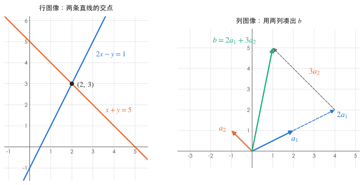
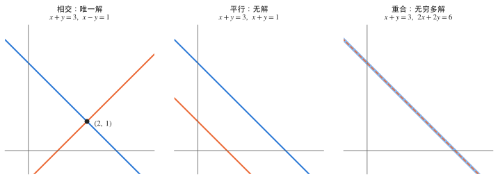

# 线性方程组、消元与逆矩阵

线性代数最初要解决的问题是 $Ax=b$：已知矩阵 $A$ 和向量 $b$，求 $x$。这一章讲怎么解（消元）、解有几种可能（唯一、无穷多、无解）、怎么把解法整理成可以重复使用的形式（逆矩阵和 LU 分解），以及在计算机上应该调用哪个函数。线性回归、岭回归、牛顿法归根结底都在解线性方程组；而深度学习不这么做的原因，从消元的计算量就能算出来。

```python
import numpy as np
```

## 1. $Ax=b$ 的两种图像

以两个方程、两个未知数为例：

$$
\begin{cases}2x-y=1\\x+y=5\end{cases}\qquad\Longleftrightarrow\qquad\bmat{2&-1\\1&1}\bmat{x\\y}=\bmat{1\\5}
$$

**行图像**：每个方程是平面上的一条直线，解是两条直线的交点 $(2,3)$。三个未知数时每个方程是一个平面，解是平面的公共点。

**列图像**：把方程组按列写，

$$
x\bmat{2\\1}+y\bmat{-1\\1}=\bmat{1\\5}
$$

问题变成：用 $A$ 的两列 $a_1$、$a_2$ 做线性组合，系数取多少才能凑出 $b$。答案同样是 $x=2,\ y=3$：$2a_1+3a_2=b$。

{ .diagram }

两种图像对应[矩阵与线性变换](matrices.md)里矩阵乘向量的两种看法。维数高了以后行图像很难想象，列图像仍然清楚：**$Ax=b$ 有解，当且仅当 $b$ 能写成 $A$ 的列的线性组合**。

## 2. 高斯消元

### 思路

三种**初等行变换**不改变方程组的解：交换两行；一行乘以非零常数；一行加上另一行的若干倍。高斯消元用第三种变换，自上而下把对角线以下的元素逐列消成 0，得到上三角形的方程组，再自下而上逐个求出未知数（回代）。

把系数和右端写在一起，得到**增广矩阵** $[A\mid b]$，对它做行变换。每一步用来消去下方元素的那个对角位置上的非零数称为**主元**（pivot）。

!!! tip "方法：高斯消元"
    1. 写出增广矩阵 $[A\mid b]$。
    2. 第 1 列：以 $(1,1)$ 元为主元，把下面每一行减去第 1 行的适当倍数，使第 1 列在主元以下全为 0。主元位置为 0 时，先和下面某个该列非零的行交换。
    3. 对第 2 列、第 3 列……重复，每次只处理主元右下方的子矩阵，直到化为上三角。
    4. 回代：从最后一个方程解出最后一个未知数，逐个向上代入。
    5. 把解代回原方程检验。

??? example "例：三元方程组的消元与回代"
    解方程组

    $$
    \begin{cases}x+2y-z=3\\2x+5y+z=14\\-x+y+3z=7\end{cases}
    $$

    **解** 对增广矩阵消元。第 2 行减去第 1 行的 2 倍，第 3 行加上第 1 行；再把第 3 行减去第 2 行的 3 倍：

    $$
    \left[\begin{array}{rrr|r}1&2&-1&3\\2&5&1&14\\-1&1&3&7\end{array}\right]\to\left[\begin{array}{rrr|r}1&2&-1&3\\0&1&3&8\\0&3&2&10\end{array}\right]\to\left[\begin{array}{rrr|r}1&2&-1&3\\0&1&3&8\\0&0&-7&-14\end{array}\right]
    $$

    三个主元为 $1,\ 1,\ -7$。回代：

    $$
    -7z=-14\Rightarrow z=2,\qquad y+3z=8\Rightarrow y=2,\qquad x+2y-z=3\Rightarrow x=1
    $$

    检验：$1+4-2=3$，$2+10+2=14$，$-1+2+6=7$。

### 行最简形

消到上三角之后继续做两件事：把每个主元所在的行除以主元，使主元变成 1；再自下而上把主元上方的元素也消成 0。得到的矩阵称为**行最简形**（reduced row echelon form，RREF），每个主元为 1，且是所在列唯一的非零元。上例继续消元：

$$
\left[\begin{array}{rrr|r}1&2&-1&3\\0&1&3&8\\0&0&-7&-14\end{array}\right]\to\left[\begin{array}{rrr|r}1&2&-1&3\\0&1&3&8\\0&0&1&2\end{array}\right]\to\left[\begin{array}{rrr|r}1&2&0&5\\0&1&0&2\\0&0&1&2\end{array}\right]\to\left[\begin{array}{rrr|r}1&0&0&1\\0&1&0&2\\0&0&1&2\end{array}\right]
$$

左边化成了单位阵，右边一列就是解。NumPy 没有求行最简形的函数，手算题可以用 SymPy 核对：

```python
from sympy import Matrix

M = Matrix([[1, 2, -1, 3], [2, 5, 1, 14], [-1, 1, 3, 7]])
R, pivots = M.rref()
print(R)        # Matrix([[1, 0, 0, 1], [0, 1, 0, 2], [0, 0, 1, 2]])
print(pivots)   # (0, 1, 2)，主元所在的列
```

## 3. 解的三种情形

### 从图像看

两条直线的位置关系只有三种：相交、平行、重合，分别对应唯一解、无解、无穷多解。任意规模的线性方程组也只有这三种可能，不会出现"恰好两个解"。

{ .diagram }

### 从主元看

把增广矩阵消元之后，按下面的顺序判断（设未知数有 $n$ 个）：

1. 出现形如 $[0\ \ \cdots\ \ 0\mid c]$（$c\ne0$）的行，即方程 $0=c$：**无解**。
2. 否则，主元个数等于 $n$：每个未知数都被一个主元确定，**唯一解**。
3. 否则，主元个数小于 $n$：没有主元的列对应的未知数可以任意取值，称为**自由变量**，**无穷多解**。

主元的个数就是矩阵的秩。方程个数少于未知数个数（$m<n$）时，主元最多 $m$ 个，不可能有唯一解。

??? example "例：含参数的方程组"
    讨论 $a$、$b$ 取何值时，下面的方程组有唯一解、无解、无穷多解，并在无穷多解时求出全部解。

    $$
    \begin{cases}x+2y+z=1\\2x+5y+3z=3\\3x+7y+az=b\end{cases}
    $$

    **解** 第 2 行减去第 1 行的 2 倍，第 3 行减去第 1 行的 3 倍；再把第 3 行减去第 2 行：

    $$
    \left[\begin{array}{rrr|r}1&2&1&1\\2&5&3&3\\3&7&a&b\end{array}\right]\to\left[\begin{array}{rrc|c}1&2&1&1\\0&1&1&1\\0&1&a-3&b-3\end{array}\right]\to\left[\begin{array}{rrc|c}1&2&1&1\\0&1&1&1\\0&0&a-4&b-4\end{array}\right]
    $$

    - $a\ne4$：三个主元，**唯一解**。回代得 $z=\dfrac{b-4}{a-4}$，$y=1-z$，$x=-1+z$。
    - $a=4$，$b\ne4$：最后一行是 $0=b-4\ne0$，**无解**。
    - $a=4$，$b=4$：最后一行全为 0，只有两个主元，$z$ 是自由变量，**无穷多解**。令 $z=t$，由第 2 行 $y=1-t$，由第 1 行 $x=1-2y-z=-1+t$：

    $$
    \bmat{x\\y\\z}=\bmat{-1\\1\\0}+t\bmat{1\\-1\\1},\qquad t\in\R
    $$

    检验第三个方程：$3(-1+t)+7(1-t)+4t=4$。解集是空间中的一条直线。

无穷多解时，解的形式总是"一个特解加上若干个方向的任意倍数"。这个结构的含义（特解加零空间）见[线性无关、秩与四个基本子空间](subspaces.md)。

## 4. 逆矩阵

### 意义

方阵 $A$ 把 $x$ 变成 $Ax$。如果存在矩阵把这个变换原样撤销，它就是 $A$ 的**逆矩阵** $A^{-1}$：

$$
A^{-1}A=AA^{-1}=I
$$

有逆矩阵时，$Ax=b$ 两边左乘 $A^{-1}$ 得 $x=A^{-1}b$，对任意 $b$ 都有唯一解。没有逆矩阵的方阵称为**奇异**的：它把某个非零向量 $x$ 映到 0，也就把 $x$ 和 $0$ 这两个不同的输入映到同一个输出，信息丢失，无法撤销。

对 $n\times n$ 的方阵 $A$，下面的说法等价：

- $A$ 可逆；
- 消元得到 $n$ 个非零主元；
- $Ax=0$ 只有零解；
- 对任意 $b$，$Ax=b$ 有唯一解；
- $A$ 的各列线性无关，秩为 $n$（见[线性无关、秩与四个基本子空间](subspaces.md)）；
- $\det A\ne0$（见[行列式](determinant.md)）。

### 计算

二阶矩阵有现成的公式（$ad-bc\ne0$）：

$$
\bmat{a&b\\c&d}^{-1}=\frac1{ad-bc}\bmat{d&-b\\-c&a}
$$

例如 $\bmat{2&1\\5&3}^{-1}=\bmat{3&-1\\-5&2}$（$ad-bc=1$）。

更高阶用 **Gauss–Jordan 消元**：把 $[A\mid I]$ 化成行最简形，左边变成 $I$ 时右边就是 $A^{-1}$。原理是 $A^{-1}$ 的第 $j$ 列是方程 $Ax=e_j$ 的解，Gauss–Jordan 消元同时解这 $n$ 个方程。

常用性质（假设各矩阵可逆）：

$$
(AB)^{-1}=B^{-1}A^{-1},\qquad(A\tp)^{-1}=(A^{-1})\tp,\qquad(A^{-1})^{-1}=A,\qquad\diag(d_1,\dots,d_n)^{-1}=\diag(1/d_1,\dots,1/d_n)
$$

乘积的逆要倒序，道理和脱鞋袜一样：后穿的先脱。验证：$(AB)(B^{-1}A^{-1})=A(BB^{-1})A^{-1}=AA^{-1}=I$。

??? example "例：Gauss–Jordan 消元求逆"
    求 $A=\bmat{1&1&0\\1&2&1\\0&1&2}$ 的逆。

    **解** 对 $[A\mid I]$ 消元。先向下：第 2 行减第 1 行，然后第 3 行减第 2 行。

    $$
    \left[\begin{array}{rrr|rrr}1&1&0&1&0&0\\1&2&1&0&1&0\\0&1&2&0&0&1\end{array}\right]\to\left[\begin{array}{rrr|rrr}1&1&0&1&0&0\\0&1&1&-1&1&0\\0&0&1&1&-1&1\end{array}\right]
    $$

    三个主元都是 1，$A$ 可逆。再向上：第 2 行减第 3 行，然后第 1 行减第 2 行。

    $$
    \to\left[\begin{array}{rrr|rrr}1&1&0&1&0&0\\0&1&0&-2&2&-1\\0&0&1&1&-1&1\end{array}\right]\to\left[\begin{array}{rrr|rrr}1&0&0&3&-2&1\\0&1&0&-2&2&-1\\0&0&1&1&-1&1\end{array}\right]
    $$

    $$
    A^{-1}=\bmat{3&-2&1\\-2&2&-1\\1&-1&1}
    $$

    检验 $AA^{-1}$ 的第一行：$[1\ \ 1\ \ 0]$ 分别与 $A^{-1}$ 的三列做内积，得 $3-2=1$，$-2+2=0$，$1-1=0$。

!!! warning "易错点"
    - 只有方阵才谈逆矩阵；长方形矩阵的替代物是伪逆，见[奇异值分解](svd.md)。
    - $(A+B)^{-1}\ne A^{-1}+B^{-1}$，和的逆没有简单公式。
    - $(AB)^{-1}=B^{-1}A^{-1}$ 要求 $A$、$B$ 都是可逆方阵。$A$、$B$ 是长方形矩阵时，即使 $AB$ 是可逆方阵，这个公式也没有意义。

## 5. LU 分解

### 消元就是左乘初等矩阵

"第 2 行减去第 1 行的 $\ell_{21}$ 倍"等于左乘一个初等矩阵 $E_{21}$，它是把单位阵的 $(2,1)$ 元换成 $-\ell_{21}$。整个消元过程把 $A$ 变成上三角阵 $U$：

$$
E_{32}E_{31}E_{21}A=U\quad\Longrightarrow\quad A=E_{21}^{-1}E_{31}^{-1}E_{32}^{-1}\,U=LU
$$

$E_{ij}^{-1}$ 只是把 $-\ell_{ij}$ 改回 $+\ell_{ij}$（减去的再加回来），三个逆相乘恰好把各个乘数放在对应的位置上：

$$
L=\bmat{1&0&0\\ \ell_{21}&1&0\\ \ell_{31}&\ell_{32}&1}
$$

所以 **LU 分解**不需要额外的计算：$U$ 是消元的结果，$L$ 是对角线为 1 的下三角阵，对角线以下记录消元时用的乘数。

### 用途：分解一次，求解多次

有了 $A=LU$，解 $Ax=b$ 分两步，每步都只是代入：

$$
Ly=b\ \ (\text{自上而下，前代}),\qquad Ux=y\ \ (\text{自下而上，回代})
$$

消元（分解）的运算量是 $O(n^3)$（约 $n^3/3$ 次乘法），两次代入各是 $O(n^2)$。同一个 $A$ 配多个右端 $b$ 时，分解只做一次，之后每个右端只花 $O(n^2)$。

??? example "例：LU 分解并解两个右端"
    对 $A=\bmat{1&2&-1\\2&5&1\\-1&1&3}$ 做 LU 分解，并解 $Ax=b$，其中 $b$ 分别取 $[3\ \ 14\ \ 7]\tp$ 和 $[-1\ \ 0\ \ 0]\tp$。

    **解** 这就是第 2 节例题的系数矩阵。消元时用的乘数为 $\ell_{21}=2$（第 2 行减第 1 行的 2 倍），$\ell_{31}=-1$（第 3 行加第 1 行），$\ell_{32}=3$：

    $$
    L=\bmat{1&0&0\\2&1&0\\-1&3&1},\qquad U=\bmat{1&2&-1\\0&1&3\\0&0&-7}
    $$

    检验 $LU$ 的第 3 行：$-[1\ \ 2\ \ {-1}]+3[0\ \ 1\ \ 3]+[0\ \ 0\ \ {-7}]=[-1\ \ 1\ \ 3]$。

    第一个右端。前代 $Ly=b$：$y_1=3$，$y_2=14-2y_1=8$，$y_3=7+y_1-3y_2=-14$。回代 $Ux=y$：$x_3=2$，$x_2=8-3x_3=2$，$x_1=3-2x_2+x_3=1$。即 $x=[1\ \ 2\ \ 2]\tp$。

    第二个右端。前代：$y_1=-1$，$y_2=0-2y_1=2$，$y_3=0+y_1-3y_2=-7$。回代：$x_3=1$，$x_2=2-3x_3=-1$，$x_1=-1-2x_2+x_3=2$。即 $x=[2\ \ {-1}\ \ 1]\tp$。

    第二次求解没有重新消元。

### 选主元

主元位置是 0 时必须换行，例如 $\smat{0&1\\1&1}$。主元不为 0 但很小时，浮点计算里也应该换行，否则乘数很大，舍入误差被放大。实际算法在每一列都把绝对值最大的元素换到主元位置（部分选主元），得到的是

$$
PA=LU
$$

$P$ 是记录行交换的置换阵。下面是不选主元的教学实现，以及小主元造成的错误：

```python
def lu_nopivot(A):
    """不选主元的 LU 分解（教学用）：返回单位下三角 L 和上三角 U，A = L @ U"""
    n = len(A)
    L, U = np.eye(n), A.astype(float).copy()
    for j in range(n):                 # 第 j 个主元
        for i in range(j + 1, n):      # 消去主元下方的每一行
            L[i, j] = U[i, j] / U[j, j]        # 乘数
            U[i] -= L[i, j] * U[j]
    return L, U

def solve_lu(L, U, b):
    n = len(b)
    y = np.zeros(n)
    for i in range(n):                 # 前代：解 Ly = b
        y[i] = b[i] - L[i, :i] @ y[:i]
    x = np.zeros(n)
    for i in reversed(range(n)):       # 回代：解 Ux = y
        x[i] = (y[i] - U[i, i + 1:] @ x[i + 1:]) / U[i, i]
    return x

A = np.array([[1., 2., -1.], [2., 5., 1.], [-1., 1., 3.]])
L, U = lu_nopivot(A)
print(L)    # [[ 1.  0.  0.] [ 2.  1.  0.] [-1.  3.  1.]]
print(U)    # [[ 1.  2. -1.] [ 0.  1.  3.] [ 0.  0. -7.]]
print(solve_lu(L, U, np.array([3., 14., 7.])))    # [1. 2. 2.]
print(solve_lu(L, U, np.array([-1., 0., 0.])))    # [ 2. -1.  1.]

# 小主元：方程 1e-20 x + y = 1, x + y = 2 的解约为 x = 1, y = 1
A_bad, b_bad = np.array([[1e-20, 1.], [1., 1.]]), np.array([1., 2.])
print(solve_lu(*lu_nopivot(A_bad), b_bad))        # [0. 1.]，不选主元，x 完全算错
print(np.linalg.solve(A_bad, b_bad))              # [1. 1.]，带部分选主元
```

实际使用时调库：`np.linalg.solve` 内部就是带部分选主元的 LU 分解；需要保留分解结果反复使用时，用 SciPy 的 `scipy.linalg.lu_factor` 和 `lu_solve`。行列式等于主元之积（有行交换时差一个符号），见[行列式](determinant.md)。

## 6. 数值计算：用 solve，不用 inv

公式里写 $x=A^{-1}b$，代码里应该写 `np.linalg.solve(A, b)`，而不是 `np.linalg.inv(A) @ b`。原因有两个。

**更快。** 求逆相当于解 $n$ 个右端 $e_1,\dots,e_n$，运算量约为一次 LU 分解的 3 倍，之后还要做一次矩阵乘向量。

**更准。** `solve` 得到的解，残差 $\lVert Ax-b\rVert$ 通常在机器精度的量级；先求逆再相乘，逆矩阵本身的舍入误差会带进结果。$A$ 接近奇异时差别很明显。

```python
import time

rng = np.random.default_rng(0)
n = 2000
A = rng.standard_normal((n, n))
b = rng.standard_normal(n)
t0 = time.perf_counter(); x1 = np.linalg.solve(A, b)
t1 = time.perf_counter(); x2 = np.linalg.inv(A) @ b
t2 = time.perf_counter()
print(f"solve {t1 - t0:.3f}s  inv {t2 - t1:.3f}s")   # solve 0.052s  inv 0.119s（随机器而变）

n = 10
H = 1.0 / (np.arange(n)[:, None] + np.arange(n)[None, :] + 1)   # 希尔伯特矩阵，H[i, j] = 1/(i+j+1)
x_true = np.ones(n)
b = H @ x_true
x1 = np.linalg.solve(H, b)
x2 = np.linalg.inv(H) @ b
print(f"{np.linalg.norm(H @ x1 - b):.1e} {np.linalg.norm(x1 - x_true):.1e}")   # 6.2e-16 1.2e-03（残差、解的误差；数字随平台略有不同）
print(f"{np.linalg.norm(H @ x2 - b):.1e} {np.linalg.norm(x2 - x_true):.1e}")   # 2.1e-04 1.3e-02
```

后一个实验用的希尔伯特矩阵是典型的**病态**（ill-conditioned）矩阵：`solve` 的残差是 $10^{-16}$ 量级，`inv` 的残差大了十多个数量级，解的误差也大一个数量级。注意即使用 `solve`，解的误差也有 $10^{-3}$，远大于残差：病态方程组里，右端或系数的微小扰动会让解发生很大变化，这是问题本身的性质，换算法也消除不了。衡量病态程度的量是条件数，见[奇异值分解](svd.md)和[对称矩阵、二次型与正定性](quadratic-forms.md)。

!!! tip "方法：解线性方程组时调用什么"
    - 一个或多个右端：`np.linalg.solve(A, B)`，`B` 可以是矩阵，每一列是一个右端。
    - 方程个数多于未知数、求最小二乘解：`np.linalg.lstsq(A, b, rcond=None)`。
    - 只有确实需要逆矩阵本身的每个元素时才用 `np.linalg.inv`。
    - PyTorch 里对应 `torch.linalg.solve` 和 `torch.linalg.lstsq`。

## 7. 正规方程：把线性回归当线性方程组来解

线性回归用 $\hat y=Xw$ 拟合数据，$X\in\R^{n\times d}$ 一行一个样本，$w\in\R^d$ 是待求的权重。使平方误差 $\lVert Xw-y\rVert^2$ 最小的 $w$ 满足**正规方程**（normal equation）

$$
X\tp X\,w=X\tp y
$$

推导和几何解释见[正交、投影与最小二乘](orthogonality.md)。这里只关心怎么解：它是一个 $d\times d$ 的线性方程组，系数矩阵 $X\tp X$ 对称，右端是 $X\tp y$，用本章的消元法就能解。

??? example "例：解正规方程拟合直线"
    用直线 $\hat y=w_0+w_1x$ 拟合四个点 $(0,1),\ (1,2),\ (2,2),\ (3,4)$。

    **解** 第一列全 1 对应截距 $w_0$，第二列是 $x$：

    $$
    X=\bmat{1&0\\1&1\\1&2\\1&3},\quad y=\bmat{1\\2\\2\\4},\qquad X\tp X=\bmat{4&6\\6&14},\quad X\tp y=\bmat{9\\18}
    $$

    其中 $X\tp X$ 的四个元素依次是样本数 4、$\sum x_i=6$、$\sum x_i^2=14$；$X\tp y$ 是 $\sum y_i=9$ 和 $\sum x_iy_i=18$。对正规方程消元，第 2 行减去第 1 行的 $1.5$ 倍：

    $$
    \left[\begin{array}{rr|r}4&6&9\\6&14&18\end{array}\right]\to\left[\begin{array}{rr|r}4&6&9\\0&5&4.5\end{array}\right]\quad\Rightarrow\quad w_1=0.9,\quad w_0=\frac{9-6\times0.9}{4}=0.9
    $$

    拟合直线为 $\hat y=0.9+0.9x$。四个点的预测值为 $0.9,\ 1.8,\ 2.7,\ 3.6$，残差 $y-\hat y$ 为 $0.1,\ 0.2,\ -0.7,\ 0.4$，和为 0。

```python
xs = np.array([0., 1., 2., 3.])
y = np.array([1., 2., 2., 4.])
X = np.column_stack([np.ones_like(xs), xs])
print(X.T @ X, X.T @ y)                          # [[ 4.  6.] [ 6. 14.]] [ 9. 18.]
print(np.linalg.solve(X.T @ X, X.T @ y))         # [0.9 0.9]
print(np.linalg.lstsq(X, y, rcond=None)[0])      # [0.9 0.9]
```

`lstsq` 不构造 $X\tp X$，直接对 $X$ 做分解，数值上更稳，是实际使用时的首选；原因见[正交、投影与最小二乘](orthogonality.md)。

## 8. 岭回归：加上 $\lambda I$ 之后总有唯一解

### 正规方程什么时候解不出来

$X\tp X$ 奇异时，正规方程有无穷多个解。两种常见的情形：特征之间线性相关（例如两列完全相同）；特征数多于样本数（$d>n$）。后一种正是过参数化模型的处境。

**岭回归**（ridge regression）在损失里加上 $\ell_2$ 正则项 $\lambda\lVert w\rVert^2$（$\lambda>0$），正规方程变成

$$
(X\tp X+\lambda I)\,w=X\tp y
$$

这个方程组对任何 $X$ 都有唯一解。证明：若 $(X\tp X+\lambda I)v=0$，左乘 $v\tp$ 得

$$
v\tp X\tp Xv+\lambda v\tp v=\lVert Xv\rVert^2+\lambda\lVert v\rVert^2=0
$$

两项都非负，只能 $\lVert v\rVert=0$，即 $v=0$。齐次方程只有零解，由第 4 节的等价条件，系数矩阵可逆。

??? example "例：两个完全相同的特征"
    $X=\bmat{1&1\\2&2}$，$y=\bmat{2\\4}$。(1) 说明不加正则时解不唯一；(2) 求 $\lambda=1$ 时的岭回归解；(3) $\lambda\to0$ 时解趋于什么？

    **解** (1) $X\tp X=\bmat{5&5\\5&5}$，$X\tp y=\bmat{10\\10}$。消元后第二行全为 0，只剩一个方程 $5w_1+5w_2=10$，即 $w_1+w_2=2$。两列相同，模型只能确定两个权重之和，无穷多解。

    (2) $\lambda=1$：

    $$
    \bmat{6&5\\5&6}\bmat{w_1\\w_2}=\bmat{10\\10}
    $$

    两式相减得 $w_1=w_2$，代入得 $11w_1=10$，所以 $w_1=w_2=\dfrac{10}{11}\approx0.909$。

    (3) 对一般的 $\lambda$，同样的步骤给出 $w_1=w_2=\dfrac{10}{10+\lambda}$。$\lambda\to0$ 时趋于 $[1\ \ 1]\tp$：在所有满足 $w_1+w_2=2$ 的解里，它的范数最小。

```python
X = np.array([[1., 1.], [2., 2.]])
y = np.array([2., 4.])
try:
    np.linalg.solve(X.T @ X, X.T @ y)
except np.linalg.LinAlgError as e:
    print("LinAlgError:", e)                     # LinAlgError: Singular matrix
for lam in (1.0, 0.1, 1e-3):
    print(lam, np.linalg.solve(X.T @ X + lam * np.eye(2), X.T @ y).round(6))
# 1.0 [0.909091 0.909091]
# 0.1 [0.990099 0.990099]
# 0.001 [0.9999 0.9999]
```

正则项在无穷多个同样拟合数据的解里挑出范数小的那个，并把权重在相关的特征之间均摊。最小范数解的几何意义见[线性无关、秩与四个基本子空间](subspaces.md)，岭回归与权重衰减的关系见[正交、投影与最小二乘](orthogonality.md)。

## 9. 牛顿步与迭代法：为什么深度学习不直接解方程

### 牛顿步是解线性方程组

要最小化 $f(w)$，在当前点用二阶泰勒展开近似它：$f(w+\Delta)\approx f(w)+g\tp\Delta+\frac12\Delta\tp H\Delta$，其中 $g$ 是梯度，$H$ 是 Hessian 矩阵（二阶导数组成的对称矩阵）。令这个二次函数对 $\Delta$ 的梯度为零，得到**牛顿步**满足的方程：

$$
H\Delta=-g
$$

这是以 $H$ 为系数矩阵的线性方程组。$f$ 本身是二次函数时，近似是精确的，一步就到达极小点。

??? example "例：一步牛顿法"
    $f(w)=w_1^2+w_1w_2+2w_2^2-4w_1-9w_2$，从 $w=[0\ \ 0]\tp$ 出发做一步牛顿法。

    **解** 梯度和 Hessian：

    $$
    g(w)=\bmat{2w_1+w_2-4\\w_1+4w_2-9},\qquad H=\bmat{2&1\\1&4}
    $$

    在原点 $g=[-4\ \ {-9}]\tp$，解 $H\Delta=-g$：

    $$
    \left[\begin{array}{rr|r}2&1&4\\1&4&9\end{array}\right]\to\left[\begin{array}{rr|r}2&1&4\\0&3.5&7\end{array}\right]\quad\Rightarrow\quad\Delta_2=2,\quad\Delta_1=\frac{4-2}{2}=1
    $$

    新的点 $w=[1\ \ 2]\tp$，此处梯度为 $[2+2-4\ \ \ 1+8-9]\tp=0$，已经是极小点。作为对比，学习率 $0.2$ 的梯度下降第 1 步到 $[0.8\ \ 1.8]\tp$，第 10 步到 $[0.9968\ \ 2.0013]\tp$。

```python
H = np.array([[2., 1.], [1., 4.]])
grad = lambda w: np.array([2 * w[0] + w[1] - 4, w[0] + 4 * w[1] - 9])
w = np.zeros(2)
step = np.linalg.solve(H, -grad(w))       # 解方程组，而不是求 H 的逆
print(step, grad(w + step))               # [1. 2.] [0. 0.]

w = np.zeros(2)
for k in range(1, 11):
    w = w - 0.2 * grad(w)                 # 梯度下降
    if k in (1, 10):
        print(k, w.round(4))
# 1 [0.8 1.8]
# 10 [0.9968 2.0013]
```

### 规模上的障碍

牛顿法收敛快，但对有 $N$ 个参数的模型，Hessian 是 $N\times N$ 的矩阵，有 $N^2$ 个元素；用消元解一次方程组约需 $N^3/3$ 次乘法。按每个元素 4 字节（float32）估算：

| 参数量 $N$ | Hessian 元素数 $N^2$ | 存储 | 一次消元的运算量 $N^3/3$ |
| --- | --- | --- | --- |
| $10^3$ | $10^6$ | 4 MB | $3.3\times10^{8}$ |
| $10^6$ | $10^{12}$ | 4 TB | $3.3\times10^{17}$ |
| $7\times10^9$ | $4.9\times10^{19}$ | 约 $2\times10^{20}$ 字节（196 EB） | $1.1\times10^{29}$ |

一百万参数只算很小的模型，Hessian 就要 4 TB；以每秒 $10^{13}$ 次浮点运算计，一次消元约需 $3.3\times10^4$ 秒，即 9 个多小时。七十亿参数的模型，即使每秒能做 $10^{18}$ 次运算，一次消元也要 $1.1\times10^{11}$ 秒，约 3600 年。而且神经网络的损失不是二次函数，一步牛顿法到不了极小点，这样的方程组要解很多次。

相比之下，反向传播算一次梯度的代价与一次前向计算同一量级，存下梯度只需要和参数一样多的空间，两者都随 $N$ 线性增长。所以深度学习只用得起**一阶方法**：每步只算梯度，沿负梯度方向走一小步，重复很多步。这类逐步逼近解的方法统称迭代法。介于两者之间的做法只使用曲率的部分信息：只给每个参数估计一个各自的尺度（Adam 这类自适应方法可以这样理解），或者只计算 Hessian 与向量的乘积而不构造 Hessian 本身（共轭梯度法）。见[对称矩阵、二次型与正定性](quadratic-forms.md)。

!!! info "AI 联系"
    规模小的时候直接解方程仍然是首选：线性探针、岭回归、高斯过程回归里的线性方程组，维数是几百到几万，一次 `solve` 就能得到精确解，不需要调学习率。

## 小结

| 问题 | 做法 | 要点 |
| --- | --- | --- |
| 解 $Ax=b$ | 高斯消元加回代 | 增广矩阵化上三角，主元不能为 0 |
| 判断解的情形 | 看消元后的主元 | 出现 $0=c\ne0$ 无解；主元数等于未知数个数唯一解；否则无穷多解 |
| 求逆 | 二阶用公式，高阶用 Gauss–Jordan | $[A\mid I]\to[I\mid A^{-1}]$；$(AB)^{-1}=B^{-1}A^{-1}$ |
| 同一个 $A$、多个右端 | LU 分解 | 分解 $O(n^3)$ 做一次，每个右端 $O(n^2)$；实际算法是 $PA=LU$ |
| 写代码 | `np.linalg.solve` | 不要用 `inv(A) @ b` |
| 线性回归 | 解 $X\tp Xw=X\tp y$ | $d\times d$ 的对称方程组 |
| 岭回归 | 解 $(X\tp X+\lambda I)w=X\tp y$ | $\lambda>0$ 时总有唯一解 |
| 牛顿法 | 解 $H\Delta=-g$ | 存储 $O(N^2)$、时间 $O(N^3)$，大模型用不起 |

可逆的几种等价说法（$n$ 阶方阵）：有 $n$ 个非零主元；$Ax=0$ 只有零解；$Ax=b$ 对任意 $b$ 有唯一解；各列线性无关；$\det A\ne0$。
