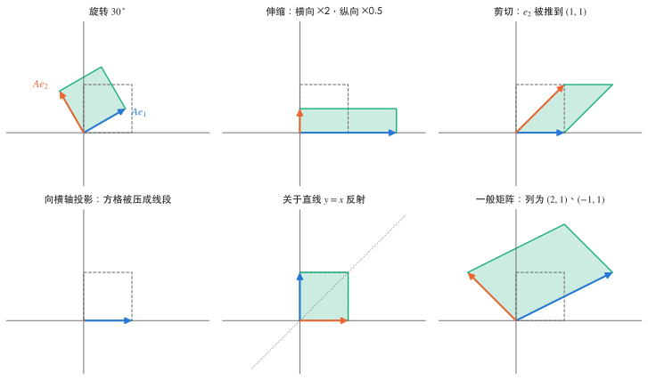
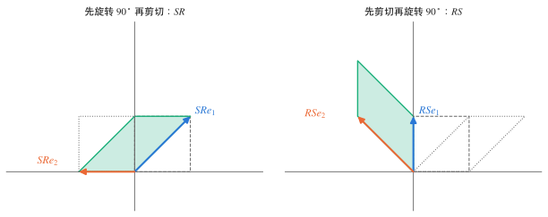

# 矩阵与线性变换

矩阵有两种读法：一张 $m\times n$ 的数表，或者一个把 $n$ 维向量变成 $m$ 维向量的映射。前一种读法方便存储和计算，后一种读法才能解释矩阵乘法为什么要那样定义。神经网络的每一层都以矩阵乘法为主体，读模型代码时大部分精力花在追踪 shape 上，也就是在追踪一连串线性映射的定义域和值域。

```python
import numpy as np
```

## 1. 矩阵是线性映射

### 线性映射

映射 $f:\R^n\to\R^m$ 称为**线性映射**（也叫线性变换），如果它保持加法和数乘：

$$
f(x+y)=f(x)+f(y),\qquad f(cx)=cf(x)
$$

合起来就是保持线性组合：$f(c_1x_1+c_2x_2)=c_1f(x_1)+c_2f(x_2)$。直接的推论是 $f(0)=0$。几何上，线性映射把直线变成直线（或压成一点），原点不动，平行且等距的网格线变换后仍然平行且等距。

### 每一列是一个基向量的像

任何 $x\in\R^n$ 都能写成标准基的线性组合 $x=x_1e_1+\cdots+x_ne_n$。由线性，

$$
f(x)=x_1f(e_1)+x_2f(e_2)+\cdots+x_nf(e_n)
$$

所以只要知道 $n$ 个基向量被送到哪里，整个映射就确定了。把这 $n$ 个像按列摆成矩阵

$$
A=\bmat{f(e_1)&f(e_2)&\cdots&f(e_n)}\in\R^{m\times n}
$$

并把上式右端记作 $Ax$。这就是矩阵和线性映射的对应：**矩阵的第 $j$ 列是第 $j$ 个基向量的像**，$m\times n$ 的矩阵把 $\R^n$ 映到 $\R^m$。

### 二维的五种基本变换

| 变换 | 矩阵 | $e_1$ 的像 | $e_2$ 的像 |
| --- | --- | --- | --- |
| 逆时针旋转 $\theta$ | $\smat{\cos\theta&-\sin\theta\\ \sin\theta&\cos\theta}$ | $(\cos\theta,\ \sin\theta)$ | $(-\sin\theta,\ \cos\theta)$ |
| 伸缩 | $\smat{a&0\\0&b}$ | $(a,\ 0)$ | $(0,\ b)$ |
| 剪切 | $\smat{1&k\\0&1}$ | $(1,\ 0)$ | $(k,\ 1)$ |
| 向横轴投影 | $\smat{1&0\\0&0}$ | $(1,\ 0)$ | $(0,\ 0)$ |
| 关于直线 $y=x$ 反射 | $\smat{0&1\\1&0}$ | $(0,\ 1)$ | $(1,\ 0)$ |

{ .diagram }

图中虚线是原来的单位方格，填色区域是它的像。旋转和反射不改变形状；伸缩和剪切改变形状但方格仍是平行四边形；投影把方格压成线段，不同的点被送到同一处，这种变换不可逆（见[线性方程组、消元与逆矩阵](linear-systems.md)）。像的面积与原面积之比是行列式的绝对值（见[行列式](determinant.md)）。

!!! tip "方法：写出一个线性变换的矩阵"
    1. 确认变换是线性的（原点不动、保持线性组合）。
    2. 求每个标准基向量 $e_j$ 的像。
    3. 把这些像依次作为列。

??? example "例：由两个向量的像求矩阵"
    线性变换 $f:\R^2\to\R^2$ 满足 $f([1\ \ 1]\tp)=[3\ \ 1]\tp$，$f([1\ \ {-1}]\tp)=[1\ \ 3]\tp$。求它的矩阵 $A$，以及 $[3\ \ 2]\tp$ 的像。

    **解** 先把标准基用已知的两个向量表示：$e_1=\frac12\bigl([1\ \ 1]\tp+[1\ \ {-1}]\tp\bigr)$，$e_2=\frac12\bigl([1\ \ 1]\tp-[1\ \ {-1}]\tp\bigr)$。由线性，

    $$
    f(e_1)=\tfrac12\left(\bmat{3\\1}+\bmat{1\\3}\right)=\bmat{2\\2},\qquad f(e_2)=\tfrac12\left(\bmat{3\\1}-\bmat{1\\3}\right)=\bmat{1\\-1}
    $$

    按列摆放：

    $$
    A=\bmat{2&1\\2&-1},\qquad A\bmat{3\\2}=3\bmat{2\\2}+2\bmat{1\\-1}=\bmat{8\\4}
    $$

    自检：$A[1\ \ 1]\tp=[3\ \ 1]\tp$，$A[1\ \ {-1}]\tp=[1\ \ 3]\tp$。

!!! warning "易错点"
    平移 $x\mapsto x+b$（$b\ne0$）不是线性映射，因为它把原点移走了。$y=Wx+b$ 严格地说是**仿射**映射；深度学习里习惯把它叫"线性层"。

## 2. 矩阵乘向量的两种看法

设 $A\in\R^{m\times n}$，行为 $a_1\tp,\dots,a_m\tp$，列为 $A_{:,1},\dots,A_{:,n}$。$Ax$ 可以按行算，也可以按列算：

$$
Ax=\bmat{a_1\tp x\\ \vdots\\ a_m\tp x}\ \ (\text{按行：}m\text{ 个内积}),\qquad Ax=x_1A_{:,1}+\cdots+x_nA_{:,n}\ \ (\text{按列：列的线性组合})
$$

以 $A=\smat{1&2\\3&4\\5&6}$、$x=[2\ \ {-1}]\tp$ 为例：

$$
\text{按行：}\bmat{1\cdot2+2\cdot(-1)\\3\cdot2+4\cdot(-1)\\5\cdot2+6\cdot(-1)}=\bmat{0\\2\\4},\qquad\text{按列：}2\bmat{1\\3\\5}-\bmat{2\\4\\6}=\bmat{0\\2\\4}
$$

```python
A = np.array([[1, 2], [3, 4], [5, 6]])
x = np.array([2, -1])
print(A @ x)                                      # [0 2 4]
print(np.array([A[i] @ x for i in range(3)]))     # [0 2 4]，按行：每行与 x 做内积
print(x[0] * A[:, 0] + x[1] * A[:, 1])            # [0 2 4]，按列：列的线性组合
```

两种看法各有用处。按行看，$Ax$ 的每个分量衡量 $x$ 与某一行的对齐程度，这是"每个神经元是一个特征检测器"的由来。按列看，$Ax$ 永远落在各列张成的空间里，$x$ 只是组合系数，这是讨论方程 $Ax=b$ 有没有解的出发点（见[线性无关、秩与四个基本子空间](subspaces.md)）。

## 3. 矩阵乘法

### 乘法是映射的复合

先做 $B$ 再做 $A$，得到的仍是线性映射，它的矩阵定义为乘积 $AB$：

$$
(AB)x=A(Bx)
$$

**右边的矩阵先作用。** $B\in\R^{n\times p}$ 把 $\R^p$ 映到 $\R^n$，$A\in\R^{m\times n}$ 再把 $\R^n$ 映到 $\R^m$，中间的维数必须对上：

$$
\underbrace{A}_{m\times n}\ \underbrace{B}_{n\times p}=\underbrace{AB}_{m\times p}
$$

### 四种看法

同一个乘积 $C=AB$ 有四种等价的算法：

- **逐元素**：$C_{ij}$ 是 $A$ 的第 $i$ 行与 $B$ 的第 $j$ 列的内积，$C_{ij}=\sum_kA_{ik}B_{kj}$。
- **按列**：$C$ 的第 $j$ 列是 $A$ 乘 $B$ 的第 $j$ 列。$C$ 的每一列都是 $A$ 的列的线性组合。
- **按行**：$C$ 的第 $i$ 行是 $A$ 的第 $i$ 行乘 $B$。$C$ 的每一行都是 $B$ 的行的线性组合。
- **列乘行之和**：$C=\sum_kA_{:,k}\,B_{k,:}$，即 $A$ 的第 $k$ 列与 $B$ 的第 $k$ 行的外积（见第 4 节）对 $k$ 求和。

??? example "例：用四种看法算同一个乘积"
    $A=\bmat{1&2\\3&4}$，$B=\bmat{0&1\\2&3}$，求 $AB$。

    **解** 逐元素：

    $$
    AB=\bmat{1\cdot0+2\cdot2&1\cdot1+2\cdot3\\3\cdot0+4\cdot2&3\cdot1+4\cdot3}=\bmat{4&7\\8&15}
    $$

    按列：$A\bmat{0\\2}=\bmat{4\\8}$，$A\bmat{1\\3}=\bmat{7\\15}$，拼成两列。

    按行：$[1\ \ 2]B=[4\ \ 7]$，$[3\ \ 4]B=[8\ \ 15]$，拼成两行。

    列乘行之和：

    $$
    \bmat{1\\3}\bmat{0&1}+\bmat{2\\4}\bmat{2&3}=\bmat{0&1\\0&3}+\bmat{4&6\\8&12}=\bmat{4&7\\8&15}
    $$

```python
A = np.array([[1, 2], [3, 4]])
B = np.array([[0, 1], [2, 3]])
print(A @ B)                                                  # [[ 4  7] [ 8 15]]
print(np.column_stack([A @ B[:, j] for j in range(2)]))      # 按列，结果相同
print(np.vstack([A[i] @ B for i in range(2)]))               # 按行，结果相同
print(sum(np.outer(A[:, k], B[k]) for k in range(2)))        # 列乘行之和，结果相同
print(B @ A)                                                  # [[ 3  4] [11 16]]，与 A @ B 不同
```

### 运算律

- 结合律：$(AB)C=A(BC)$；分配律：$A(B+C)=AB+AC$。
- **一般不可交换**：$AB\ne BA$。两个变换先后顺序不同，结果一般不同。
- 单位阵 $I$ 是乘法的单位元：$AI=IA=A$。

{ .diagram }

??? example "例：复合变换的顺序"
    $R=\bmat{0&-1\\1&0}$ 是逆时针旋转 $90^\circ$，$S=\bmat{1&1\\0&1}$ 是剪切。分别求"先旋转再剪切"和"先剪切再旋转"的矩阵，以及 $e_1$ 在两种顺序下的像。

    **解** 先作用的写在右边。先旋转再剪切是 $SR$：

    $$
    SR=\bmat{1&1\\0&1}\bmat{0&-1\\1&0}=\bmat{1&-1\\1&0},\qquad SRe_1=\bmat{1\\1}
    $$

    先剪切再旋转是 $RS$：

    $$
    RS=\bmat{0&-1\\1&0}\bmat{1&1\\0&1}=\bmat{0&-1\\1&1},\qquad RSe_1=\bmat{0\\1}
    $$

    $SR\ne RS$。逐步验证第一种：$e_1$ 旋转后是 $[0\ \ 1]\tp$，再剪切得 $[1\ \ 1]\tp$，就是 $SR$ 的第一列。

结合律意味着连乘的结果与加括号的方式无关，但**计算量有关**。对 $n\times n$ 的 $A$、$B$ 和向量 $x$，$(AB)x$ 要先做一次 $O(n^3)$ 的矩阵乘法，$A(Bx)$ 只做两次 $O(n^2)$ 的矩阵乘向量。链上有向量时，从向量那一端开始乘。

!!! warning "易错点"
    - $AB=0$ 推不出 $A=0$ 或 $B=0$。例如 $A=\smat{1&0\\0&0}$，$B=\smat{0&0\\0&1}$。
    - 不能随意约去：$AB=AC$ 且 $A\ne0$ 推不出 $B=C$，只有 $A$ 可逆时才行。
    - $(A+B)^2=A^2+AB+BA+B^2$，中间两项不能合并成 $2AB$。
    - NumPy 里 `A * B` 是逐元素相乘，矩阵乘法是 `A @ B`。

## 4. 转置、特殊矩阵与外积

### 转置

$A\tp$ 把行和列互换：$(A\tp)_{ij}=A_{ji}$，$m\times n$ 变成 $n\times m$。常用性质：

$$
(A\tp)\tp=A,\qquad(A+B)\tp=A\tp+B\tp,\qquad(AB)\tp=B\tp A\tp
$$

乘积的转置要**倒序**。逐元素验证：$((AB)\tp)_{ij}=(AB)_{ji}=\sum_kA_{jk}B_{ki}=\sum_k(B\tp)_{ik}(A\tp)_{kj}=(B\tp A\tp)_{ij}$。从 shape 也能看出只能倒序：$A$ 为 $m\times n$、$B$ 为 $n\times p$ 时，$B\tp A\tp$ 是 $(p\times n)(n\times m)$，而 $A\tp B\tp$ 的维数一般对不上。

内积可以写成矩阵乘法 $x\tp y$（$1\times n$ 乘 $n\times1$）。由此得到一个常用的恒等式，把矩阵从内积的一边挪到另一边要加转置：

$$
(Ax)\tp y=x\tp(A\tp y)
$$

!!! info "AI 联系"
    前向传播乘 $W$，反向传播乘 $W\tp$，来源就是这个恒等式，推导见[矩阵求导与反向传播](matrix-calculus.md)。

### 常见的特殊矩阵

| 名称 | 定义 | 作为变换 | 出现的地方 |
| --- | --- | --- | --- |
| 单位阵 $I$ | 对角元为 1，其余为 0 | 不变，$Ix=x$ | 残差连接 $x+f(x)$ 中的恒等项 |
| 对角阵 $\diag(d)$ | 只有对角元非零 | 各坐标分别伸缩；左乘缩放行，右乘缩放列 | 归一化层的缩放系数 |
| 置换阵 $P$ | 每行每列恰有一个 1 | 重排分量，$P\tp P=I$ | 选主元时的行交换 |
| 三角阵 | 对角线一侧全为 0 | 上三角阵之积仍是上三角阵 | 消元的结果；因果掩码允许的位置构成下三角 |
| 对称阵 | $A\tp=A$ | 见[对称矩阵、二次型与正定性](quadratic-forms.md) | $A\tp A$、协方差矩阵、Hessian |

对任意矩阵 $A$，$A\tp A$ 都是对称的：$(A\tp A)\tp=A\tp(A\tp)\tp=A\tp A$。

### 外积与秩一矩阵

列向量乘行向量得到矩阵，称为**外积**（outer product）：

$$
uv\tp=\bmat{u_1v_1&\cdots&u_1v_n\\ \vdots&&\vdots\\u_mv_1&\cdots&u_mv_n}\in\R^{m\times n},\qquad(uv\tp)_{ij}=u_iv_j
$$

它的每一列都是 $u$ 的倍数，每一行都是 $v\tp$ 的倍数，所有的列只张成一条直线，这样的矩阵称为**秩一矩阵**。把它作用在 $x$ 上：

$$
(uv\tp)x=u(v\tp x)=(v\tp x)\,u
$$

先用 $v$ 和 $x$ 做内积读出一个数，再把这个数乘到 $u$ 上。不管输入是什么，输出总沿着 $u$ 的方向。第 3 节的第四种看法说明任何矩阵都是若干个秩一矩阵之和；最少需要几个，就是矩阵的秩（见[线性无关、秩与四个基本子空间](subspaces.md)）。

??? example "例：内积与外积"
    $u=[1\ \ 2\ \ 3]\tp$，$v=[4\ \ 5]\tp$。求 $uv\tp$、$(uv\tp)[1\ \ 1]\tp$，并比较 $u\tp u$ 与 $uu\tp$ 的 shape。

    **解**

    $$
    uv\tp=\bmat{1\\2\\3}\bmat{4&5}=\bmat{4&5\\8&10\\12&15}
    $$

    三行之比为 $1:2:3$，两列之比为 $4:5$。作用在 $x=[1\ \ 1]\tp$ 上：$v\tp x=9$，所以 $(uv\tp)x=9u=[9\ \ 18\ \ 27]\tp$，与直接计算各行之和一致。

    $u\tp u=1+4+9=14$ 是 $1\times1$ 的数；$uu\tp$ 是 $3\times3$ 的对称矩阵。$u\tp v$ 因为维数不同（3 和 2）没有定义。

## 5. 全连接层：$y=Wx+b$ 与 batch 形式

### 单个样本

全连接层（PyTorch 的 `nn.Linear`）对输入 $x\in\R^{d_\text{in}}$ 计算

$$
y=Wx+b,\qquad W\in\R^{d_\text{out}\times d_\text{in}},\quad b\in\R^{d_\text{out}}
$$

按行看，$W$ 的第 $i$ 行 $w_i\tp$ 是第 $i$ 个神经元的权重，$y_i=w_i\tp x+b_i$ 是它与输入的内积加偏置。参数量为 $d_\text{out}d_\text{in}+d_\text{out}$。

### 一个 batch

把 $n$ 个样本作为行摆成 $X\in\R^{n\times d_\text{in}}$。第 $i$ 个样本的输出写成行向量是 $y_i\tp=(Wx_i+b)\tp=x_i\tp W\tp+b\tp$，所有样本摞起来：

$$
Y=XW\tp+b,\qquad Y\in\R^{n\times d_\text{out}}
$$

其中 $b$ 通过广播加到每一行上。$W\tp$ 上的转置来自"样本是行向量"这个约定，`nn.Linear` 的 `weight` 的 shape 是 `(out_features, in_features)`，与这里的 $W$ 一致。

追踪 shape 的方法是只看相邻两个维数：$(n\times d_\text{in})(d_\text{in}\times d_\text{out})\to(n\times d_\text{out})$。batch 维 $n$ 从头到尾不变，变的只是最后一维。

??? example "例：手算一层全连接层"
    $W=\bmat{1&0&-1\\2&1&0}$，$b=\bmat{1\\-1}$，输入两个样本 $X=\bmat{1&2&3\\0&1&0}$。求 $Y=XW\tp+b$ 以及经过 ReLU 之后的结果。

    **解** 逐个样本算 $Wx_i+b$：

    $$
    W\bmat{1\\2\\3}+b=\bmat{1-3\\2+2}+\bmat{1\\-1}=\bmat{-1\\3},\qquad W\bmat{0\\1\\0}+b=\bmat{0\\1}+\bmat{1\\-1}=\bmat{1\\0}
    $$

    按行摞起来，再逐元素取 $\max(\cdot,0)$：

    $$
    Y=\bmat{-1&3\\1&0},\qquad\mathrm{ReLU}(Y)=\bmat{0&3\\1&0}
    $$

    shape：$X$ 为 $2\times3$，$W\tp$ 为 $3\times2$，$Y$ 为 $2\times2$。

??? example "例：追踪 shape 并计算参数量"
    (1) 两层感知机 $784\to256\to10$（带偏置），batch 大小 32，写出每一步的 shape 和总参数量。(2) 一个输入输出维度 $d=4096$、中间维度 $4d=16384$ 的两层前馈网络（带偏置）有多少参数？

    **解** (1) $X$ 为 $32\times784$；$W_1$ 为 $256\times784$，$XW_1\tp+b_1$ 为 $32\times256$；$W_2$ 为 $10\times256$，输出为 $32\times10$。参数量：

    $$
    (784\times256+256)+(256\times10+10)=200960+2570=203530
    $$

    (2) 两个权重矩阵各有 $4096\times16384=67108864$ 个元素：

    $$
    2\times67108864+16384+4096=134238208\approx1.34\times10^8
    $$

    参数几乎全在权重矩阵里，偏置只占约 $0.015\%$。

```python
W = np.array([[1., 0., -1.], [2., 1., 0.]])
b = np.array([1., -1.])
X = np.array([[1., 2., 3.], [0., 1., 0.]])
Y = X @ W.T + b
print(Y)                    # [[-1.  3.] [ 1.  0.]]
print(np.maximum(Y, 0))     # [[0. 3.] [1. 0.]]
print(np.allclose(Y, np.stack([W @ x + b for x in X])))   # True，和逐样本计算一致

rng = np.random.default_rng(0)
X = rng.standard_normal((32, 784))
W1, b1 = rng.standard_normal((256, 784)) * 0.01, np.zeros(256)
W2, b2 = rng.standard_normal((10, 256)) * 0.01, np.zeros(10)
H = np.maximum(X @ W1.T + b1, 0)
out = H @ W2.T + b2
print(X.shape, H.shape, out.shape)                    # (32, 784) (32, 256) (32, 10)
print(W1.size + b1.size + W2.size + b2.size)          # 203530
```

`nn.Module` 的写法见 [PyTorch 基础](../../python/pytorch.md)。

## 6. 线性层叠加仍是线性层

### 推导

两个全连接层直接相连、中间不加激活函数：

$$
W_2(W_1x+b_1)+b_2=(W_2W_1)\,x+(W_2b_1+b_2)
$$

结果仍然是一个全连接层，权重为 $W_2W_1$，偏置为 $W_2b_1+b_2$。矩阵乘法就是映射的复合，线性映射复合之后还是线性映射，所以无论叠多少层，能表示的函数和一层完全一样。**深度要起作用，层与层之间必须有非线性的激活函数。**

??? example "例：把两层合并成一层"
    $W_1=\bmat{1&2\\0&1}$，$b_1=\bmat{1\\0}$，$W_2=\bmat{1&-1}$，$b_2=2$。求等价的单层，并用 $x=[1\ \ 1]\tp$ 验证。

    **解**

    $$
    W_2W_1=\bmat{1&-1}\bmat{1&2\\0&1}=\bmat{1&1},\qquad W_2b_1+b_2=1+2=3
    $$

    等价的单层是 $y=x_1+x_2+3$。验证：两层依次计算，$W_1x+b_1=[3\ \ 1]\tp+[1\ \ 0]\tp=[4\ \ 1]\tp$，$W_2[4\ \ 1]\tp+b_2=3+2=5$；单层计算，$1+1+3=5$。

加上 ReLU 之后就不再是线性的。最简单的反例是一维的情形：$\mathrm{ReLU}(1)+\mathrm{ReLU}(-1)=1$，而 $\mathrm{ReLU}(1+(-1))=0$，不满足 $f(x+y)=f(x)+f(y)$。

```python
rng = np.random.default_rng(0)
W1, b1 = rng.standard_normal((64, 16)), rng.standard_normal(64)
W2, b2 = rng.standard_normal((64, 64)), rng.standard_normal(64)
W3, b3 = rng.standard_normal((4, 64)), rng.standard_normal(4)
X = rng.standard_normal((5, 16))

deep = ((X @ W1.T + b1) @ W2.T + b2) @ W3.T + b3      # 三层，没有激活函数
W = W3 @ W2 @ W1                                       # 合并成一层
b = W3 @ (W2 @ b1 + b2) + b3
print(W.shape, b.shape, np.allclose(deep, X @ W.T + b))    # (4, 16) (4,) True

relu = lambda z: np.maximum(z, 0)
f = lambda X: relu(relu(X @ W1.T + b1) @ W2.T + b2) @ W3.T + b3   # 中间加上 ReLU
# 仿射函数满足 f(x1 + x2) - f(0) = (f(x1) - f(0)) + (f(x2) - f(0))
x1, x2, zero = X[0], X[1], np.zeros(16)
print(np.allclose(f(x1 + x2) - f(zero), f(x1) - f(zero) + f(x2) - f(zero)))   # False
```

这三层共有 $(64\times16+64)+(64\times64+64)+(4\times64+4)=5508$ 个参数，没有激活函数时，表达能力和只有 $4\times16+4=68$ 个参数的一层相同。

!!! info "AI 联系"
    两个线性层相乘也不是全无用处。如果中间维度 $r$ 远小于两端的维度，$W_2W_1$ 的秩不超过 $r$，相当于用很少的参数表示一个受限制的大矩阵。LoRA 正是这样构造权重的更新量，见 [PCA、低秩近似与 LoRA](pca-lowrank.md)。

## 7. embedding 查表是 one-hot 向量乘矩阵

### 查表

嵌入层保存一个矩阵 $E\in\R^{V\times d}$，$V$ 是词表大小，第 $i$ 行是第 $i$ 个 token 的词向量。输入 token 的编号 $i$，输出 $E$ 的第 $i$ 行。

把编号 $i$ 写成 one-hot 向量 $e_i\in\R^V$（第 $i$ 个分量为 1，其余为 0），按第 3 节"按行"的看法，$e_i\tp E$ 是 $E$ 各行以 $e_i$ 的分量为系数的线性组合，系数只有一个 1，结果正好是第 $i$ 行：

$$
e_i\tp E=E_{i,:}
$$

一个长度为 $T$ 的序列对应 one-hot 矩阵 $O\in\R^{T\times V}$，$OE\in\R^{T\times d}$ 是 $T$ 个词向量摞成的矩阵。所以嵌入层在数学上是一个没有偏置的线性层，输入是 one-hot 向量。

??? example "例：三个 token 的查表"
    词表大小 $V=4$，维度 $d=2$，$E=\bmat{1&0\\0&1\\2&2\\-1&3}$（编号从 0 开始）。输入序列的编号为 $[2,\ 0,\ 2]$，求输出。

    **解** one-hot 矩阵每行只在对应编号的位置为 1：

    $$
    O=\bmat{0&0&1&0\\1&0&0&0\\0&0&1&0},\qquad OE=\bmat{2&2\\1&0\\2&2}
    $$

    第 1、3 行相同，因为它们是同一个 token。shape：$(3\times4)(4\times2)\to3\times2$。

```python
E = np.array([[1., 0.], [0., 1.], [2., 2.], [-1., 3.]])
ids = np.array([2, 0, 2])
O = np.eye(4)[ids]                       # one-hot 矩阵，shape (3, 4)
print(O @ E)                             # [[2. 2.] [1. 0.] [2. 2.]]
print(np.array_equal(O @ E, E[ids]))     # True
```

实现上不会真的构造 one-hot 矩阵再相乘。乘法要 $O(TVd)$ 次运算，其中绝大多数是乘 0；直接按下标取行 `E[ids]` 只要 $O(Td)$。`nn.Embedding` 做的就是按下标取行。反向传播时，查表这一步传回的梯度也只落在被取到的那些行上。

模型的输出端是反过来的过程：最后一层的表征与每个 token 的向量做内积，得到词表上的 logits，见[用线性代数读 Transformer](transformer-linalg.md)。

## 8. $QK\tp$ 是所有 query 和 key 的成对内积

### 一次矩阵乘法算出全部分数

注意力里有 $n$ 个查询向量和 $m$ 个键向量，都是 $d_k$ 维，按行摆成 $Q\in\R^{n\times d_k}$、$K\in\R^{m\times d_k}$。按"逐元素"的看法，$QK\tp$ 的 $(i,j)$ 元是 $Q$ 的第 $i$ 行与 $K\tp$ 的第 $j$ 列（即 $K$ 的第 $j$ 行）的内积：

$$
(QK\tp)_{ij}=q_i\tp k_j,\qquad QK\tp\in\R^{n\times m}
$$

一次矩阵乘法算出全部 $nm$ 个内积。第 $i$ 行是第 $i$ 个查询对所有键的分数，之后的 softmax 就沿着行做。

??? example "例：3 个 token 的注意力分数矩阵"
    $d_k=2$，$Q=\bmat{1&0\\1&1\\0&2}$，$K=\bmat{1&2\\0&1\\2&0}$。求 $S=QK\tp$，并指出每个查询分数最高的键。

    **解** 逐行计算，第 $i$ 行是 $q_i$ 分别与 $k_1,k_2,k_3$ 的内积：

    $$
    S=\bmat{1\cdot1+0\cdot2&1\cdot0+0\cdot1&1\cdot2+0\cdot0\\1\cdot1+1\cdot2&1\cdot0+1\cdot1&1\cdot2+1\cdot0\\0\cdot1+2\cdot2&0\cdot0+2\cdot1&0\cdot2+2\cdot0}=\bmat{1&0&2\\3&1&2\\4&2&0}
    $$

    第 1 个查询分数最高的是第 3 个键（分数 2），第 2、3 个查询分数最高的都是第 1 个键（分数 3 和 4）。$q_1=[1\ \ 0]\tp$ 只看键的第一个分量，所以选中了第一个分量最大的 $k_3$。

```python
Q = np.array([[1., 0.], [1., 1.], [0., 2.]])
K = np.array([[1., 2.], [0., 1.], [2., 0.]])
S = Q @ K.T
print(S)                                    # [[1. 0. 2.] [3. 1. 2.] [4. 2. 0.]]
print(S[1, 0], Q[1] @ K[0])                 # 3.0 3.0
print(np.array_equal(S, np.einsum("id,jd->ij", Q, K)))   # True
print(S.argmax(axis=1))                     # [2 0 0]，每个查询分数最高的键（下标从 0 开始）
```

`einsum` 的写法见 [NumPy](../../python/numpy.md)。

### Gram 矩阵

$Q$ 和 $K$ 取同一个矩阵 $X$ 时，$G=XX\tp$ 称为 **Gram 矩阵**，$G_{ij}=x_i\tp x_j$ 是样本两两之间的内积。它是对称的，对角元是各行的范数平方 $\lVert x_i\rVert^2$。各行归一化之后，$XX\tp$ 就是余弦相似度矩阵（见[向量、内积与范数](vectors.md)）。

分数为什么要除以 $\sqrt{d_k}$ 见[向量、内积与范数](vectors.md)；加上 softmax、掩码和值向量之后的完整注意力见[用线性代数读 Transformer](transformer-linalg.md)。

## 小结

| 对象 | 记法与 shape | 含义 |
| --- | --- | --- |
| 矩阵 | $A\in\R^{m\times n}$ | 把 $\R^n$ 映到 $\R^m$ 的线性映射；第 $j$ 列是 $e_j$ 的像 |
| 矩阵乘向量 | $Ax$ | 按行：$m$ 个内积；按列：列的线性组合 |
| 矩阵乘法 | $(m\times n)(n\times p)\to m\times p$ | 映射的复合，右边的先作用；可结合，不可交换 |
| 转置 | $(AB)\tp=B\tp A\tp$ | 行列互换；$(Ax)\tp y=x\tp(A\tp y)$ |
| 外积 | $uv\tp\in\R^{m\times n}$ | 秩一矩阵；$(uv\tp)x=(v\tp x)u$ |
| 全连接层 | $Y=XW\tp+b$ | $W$ 为 $d_\text{out}\times d_\text{in}$，参数量 $d_\text{out}d_\text{in}+d_\text{out}$ |
| 线性层叠加 | $W_2W_1$ | 没有激活函数时等于一层 |
| 嵌入层 | $OE$，实现为 `E[ids]` | one-hot 向量乘矩阵等于取一行 |
| 注意力分数 | $QK\tp\in\R^{n\times m}$ | $(i,j)$ 元是 $q_i\tp k_j$ |

读含矩阵乘法的代码时，按三步走：先写出每个张量的 shape；相乘时检查相邻的两个维数是否相等；再想清楚每一行、每一列分别代表什么（样本、token、特征还是神经元）。
