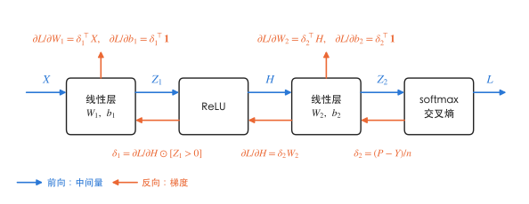
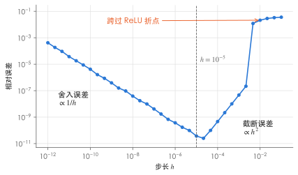

# 矩阵求导与反向传播

训练神经网络的每一步都要算损失对所有参数的梯度。参数是矩阵，中间量也是矩阵，逐个元素求偏导既繁琐又容易错。本章给出一套按矩阵整体求导的办法：先约定梯度的形状，再用微分法推导公式，最后把链式法则写成一连串"向量乘 Jacobian"，这就是反向传播（backpropagation）。读完本章，应当能手推线性层、softmax 交叉熵和一个两层 MLP 的全部梯度，并用数值方法检查推导是否正确。

## 1. 梯度、Jacobian 与 Hessian

三种导数对应三种"输入 → 输出"的形状：

| 函数 | 导数 | 定义 | 形状 |
| --- | --- | --- | --- |
| 标量对向量 $f:\R^n\to\R$ | 梯度 $\nabla_xf$ | 第 $i$ 个分量为 $\partial f/\partial x_i$ | $n$ 维列向量，与 $x$ 同形 |
| 标量对矩阵 $L:\R^{m\times n}\to\R$ | 梯度 $\partial L/\partial W$ | $(i,j)$ 元为 $\partial L/\partial W_{ij}$ | $m\times n$，与 $W$ 同形 |
| 向量对向量 $f:\R^n\to\R^m$ | Jacobian 矩阵 $J$ | $J_{ij}=\partial f_i/\partial x_j$ | $m\times n$（输出维数 × 输入维数） |
| 标量对向量的二阶导 | Hessian 矩阵 $\nabla^2f$ | $(i,j)$ 元为 $\partial^2f/\partial x_i\partial x_j$ | $n\times n$，对称 |

本章约定：**标量对谁求导，梯度就和谁同形**。这与 PyTorch 一致，`W.grad.shape == W.shape`，梯度下降可以直接写成 $W\leftarrow W-\eta\,\partial L/\partial W$。

三者的含义都来自一阶（或二阶）近似：

$$
f(x+\Delta x)\approx f(x)+\nabla f\tp\Delta x+\tfrac12\Delta x\tp(\nabla^2f)\,\Delta x,\qquad f(x+\Delta x)\approx f(x)+J\,\Delta x\ \ (\text{向量值函数})
$$

梯度指向函数值上升最快的方向；Jacobian 是函数在该点附近的最佳线性近似，是一个 $\R^n\to\R^m$ 的线性映射；Hessian 描述曲率（见[对称矩阵、二次型与正定性](quadratic-forms.md)）。标量函数的 Jacobian 是 $1\times n$ 的行向量，等于梯度的转置；梯度的 Jacobian 就是 Hessian。

??? example "例：按定义求梯度、Hessian 和 Jacobian"
    (1) $f(x)=x_1^2x_2+2x_2^2$，求 $x=(1,2)\tp$ 处的梯度和 Hessian。(2) $g(x)=(x_1x_2,\ x_1^2+x_2,\ 3x_2)\tp$，求同一点处的 Jacobian。

    **解** (1) 逐个求偏导：

    $$
    \nabla f=\bmat{2x_1x_2\\x_1^2+4x_2}=\bmat{4\\9},\qquad \nabla^2f=\bmat{2x_2&2x_1\\2x_1&4}=\bmat{4&2\\2&4}
    $$

    (2) $g:\R^2\to\R^3$，Jacobian 是 $3\times2$ 的矩阵，第 $i$ 行是 $g_i$ 的梯度的转置：

    $$
    J=\bmat{x_2&x_1\\2x_1&1\\0&3}=\bmat{2&1\\2&1\\0&3}
    $$

## 2. 常用公式与微分法

### 公式表

| 函数 | 梯度 | 备注 |
| --- | --- | --- |
| $a\tp x$ | $a$ | |
| $x\tp x=\lVert x\rVert^2$ | $2x$ | |
| $x\tp Ax$ | $(A+A\tp)x$ | $A$ 对称时为 $2Ax$ |
| $\lVert Ax-b\rVert^2$ | $2A\tp(Ax-b)$ | 最小二乘 |
| $a\tp Wb$ | $ab\tp$ | 对矩阵 $W$ 求导，结果是外积 |
| $\tr(W\tp A)=\sum_{ij}W_{ij}A_{ij}$ | $A$ | 矩阵的内积 |
| $\lVert W\rVert_F^2$ | $2W$ | weight decay 的梯度 |
| $\lVert XW\tp-T\rVert_F^2$ | $2(XW\tp-T)\tp X$ | 线性层接平方损失 |

常见映射的 Jacobian：$y=Ax$ 的 Jacobian 是 $A$；逐元素函数 $y=\phi(x)$ 的 Jacobian 是对角阵 $\diag(\phi'(x))$；softmax 的 Jacobian 是 $\diag(p)-pp\tp$（第 6 节）。

### 微分法

表里的公式不必背，可以用同一个办法推出来。对标量 $L$ 和矩阵变量 $W$，全微分为

$$
\dd L=\sum_{i,j}\frac{\partial L}{\partial W_{ij}}\dd W_{ij}=\tr\!\Bigl(\Bigl(\frac{\partial L}{\partial W}\Bigr)\tp\dd W\Bigr)
$$

所以只要把 $\dd L$ 整理成 $\tr(G\tp\dd W)$ 的形式，$G$ 就是梯度。变量是向量时就是 $\dd L=g\tp\dd x$。

!!! tip "方法：用微分法求梯度"
    1. 对 $L$ 的表达式求微分，用到的规则：$\dd(XY)=(\dd X)Y+X\dd Y$，$\dd(X\tp)=(\dd X)\tp$，常数矩阵的微分为 0；逐元素函数 $\dd\phi(X)=\phi'(X)\odot\dd X$。
    2. 标量等于它自己的迹，给整个式子套上 $\tr$。
    3. 用 $\tr(AB)=\tr(BA)$ 和 $\tr(A\tp)=\tr(A)$ 把 $\dd W$ 挪到最右边，得到 $\tr(G\tp\dd W)$。
    4. 读出 $G$，并检查它与 $W$ 同形。

??? example "例：用微分法推 x'Ax 的梯度并代入数值"
    $f(x)=x\tp Ax$，$A=\bmat{1&2\\0&3}$（不对称）。求梯度公式，并计算 $x=(1,2)\tp$ 处的梯度。

    **解** $\dd f=(\dd x)\tp Ax+x\tp A\dd x$。第一项是标量，等于它的转置 $x\tp A\tp\dd x$，所以

    $$
    \dd f=x\tp(A\tp+A)\dd x=\bigl((A+A\tp)x\bigr)\tp\dd x\qquad\Longrightarrow\qquad \nabla f=(A+A\tp)x
    $$

    代入：$A+A\tp=\bmat{2&2\\2&6}$，$\nabla f=\bmat{2&2\\2&6}\bmat{1\\2}=\bmat{6\\14}$。

    直接展开核对：$f=x_1^2+2x_1x_2+3x_2^2$，$\partial f/\partial x_1=2x_1+2x_2=6$，$\partial f/\partial x_2=2x_1+6x_2=14$。

??? example "例：对矩阵求导——a'Wb 与平方损失"
    (1) 求 $L=a\tp Wb$ 对 $W$ 的梯度，并对 $a=(1,2)\tp$、$b=(3,0,-1)\tp$ 算出结果。(2) 求 $L=\frac12\lVert XW\tp-T\rVert_F^2$ 对 $W$ 的梯度。

    **解** (1) $\dd L=a\tp(\dd W)b=\tr(a\tp\,\dd W\,b)=\tr(b\,a\tp\,\dd W)=\tr\bigl((ab\tp)\tp\dd W\bigr)$，所以 $\partial L/\partial W=ab\tp$：

    $$
    ab\tp=\bmat{1\\2}\bmat{3&0&-1}=\bmat{3&0&-1\\6&0&-2}
    $$

    形状为 $2\times3$，与 $W$ 相同。$W_{ij}$ 在 $L$ 里的系数正是 $a_ib_j$。

    (2) 记 $R=XW\tp-T$，$L=\frac12\tr(R\tp R)$，则 $\dd L=\tr(R\tp\dd R)$，而 $\dd R=X(\dd W)\tp$：

    $$
    \dd L=\tr\bigl(R\tp X(\dd W)\tp\bigr)=\tr\bigl(\dd W\,X\tp R\bigr)=\tr\bigl(X\tp R\,\dd W\bigr)=\tr\bigl((R\tp X)\tp\dd W\bigr)
    $$

    第二个等号对迹里的矩阵取了转置。所以 $\partial L/\partial W=R\tp X=(XW\tp-T)\tp X$。这就是第 5 节线性层公式 $\delta\tp X$ 在平方损失下的特例。

公式是否推对，可以用有限差分核对：$\partial f/\partial x_i\approx\bigl(f(x+he_i)-f(x-he_i)\bigr)/2h$。下面的 `num_grad` 在本章后面还会用到。

```python
import numpy as np
np.set_printoptions(precision=4, suppress=True)

def num_grad(f, x, h=1e-5):
    """中心差分：逐个分量扰动 x，返回与 x 同形的数值梯度。f 是以 x 为参数的标量函数。"""
    g = np.zeros_like(x)
    for i in np.ndindex(x.shape):
        old = x[i]
        x[i] = old + h; fp = f(x)
        x[i] = old - h; fm = f(x)
        x[i] = old
        g[i] = (fp - fm) / (2 * h)
    return g

rng = np.random.default_rng(0)
A = rng.standard_normal((3, 3)); a = rng.standard_normal(3); b = rng.standard_normal(4)
x = rng.standard_normal(3);      W = rng.standard_normal((3, 4))
M = rng.standard_normal((5, 3)); c = rng.standard_normal(5)
checks = {
    "a'x":        (lambda x: a @ x,                    x, a),
    "x'Ax":       (lambda x: x @ A @ x,                x, (A + A.T) @ x),
    "|Mx-c|^2":   (lambda x: ((M @ x - c)**2).sum(),   x, 2 * M.T @ (M @ x - c)),
    "a'Wb":       (lambda W: a @ W @ b,                W, np.outer(a, b)),
    "|W|_F^2":    (lambda W: (W**2).sum(),             W, 2 * W),
}
for name, (f, var, formula) in checks.items():
    print(name, np.abs(num_grad(f, var) - formula).max() < 1e-7)
# a'x True
# x'Ax True
# |Mx-c|^2 True
# a'Wb True
# |W|_F^2 True
```

## 3. 最小二乘的梯度与 Hessian

$f(x)=\lVert Ax-b\rVert^2$ 的梯度是 $2A\tp(Ax-b)$。令梯度为零就得到正规方程 $A\tp Ax=A\tp b$，它的几何推导见[正交、投影与最小二乘](orthogonality.md)。再对梯度求一次导，Hessian 为 $2A\tp A$，与 $x$ 无关，并且半正定，所以 $f$ 是凸的二次函数，梯度为零的点就是全局最小点。

??? example "例：最小二乘的梯度、Hessian 与牛顿步"
    $A=\bmat{1&1\\1&2\\1&3}$，$b=(1,2,2)\tp$。求 $f(x)=\lVert Ax-b\rVert^2$ 在 $x=0$ 处的梯度和 Hessian，以及最小点。

    **解** $A\tp A=\bmat{3&6\\6&14}$，$A\tp b=\bmat{5\\11}$。

    $$
    \nabla f(0)=2A\tp(0-b)=\bmat{-10\\-22},\qquad \nabla^2f=2A\tp A=\bmat{6&12\\12&28}
    $$

    最小点满足 $A\tp A\hat x=A\tp b$，$\det(A\tp A)=6$：

    $$
    \hat x=\frac16\bmat{14&-6\\-6&3}\bmat{5\\11}=\bmat{2/3\\1/2}
    $$

    核对：残差 $A\hat x-b=(\frac16,\,-\frac13,\,\frac16)\tp$，$A\tp(A\hat x-b)=0$。

    从 $x=0$ 出发做一步牛顿法 $x-(\nabla^2f)^{-1}\nabla f$，结果是 $0-(2A\tp A)^{-1}(-2A\tp b)=\hat x$：对二次函数，牛顿法一步到达最小点（解这个线性方程组的代价见[线性方程组、消元与逆矩阵](linear-systems.md)）。

## 4. 链式法则、反向模式与自动求导（autograd）

### 链式法则是 Jacobian 相乘

设 $x\in\R^{n_0}$ 依次经过三步运算得到标量损失：

$$
x\ \xrightarrow{\ f_1\ }\ u\in\R^{n_1}\ \xrightarrow{\ f_2\ }\ v\in\R^{n_2}\ \xrightarrow{\ f_3\ }\ L\in\R
$$

每一步有自己的 Jacobian：$J_1\in\R^{n_1\times n_0}$，$J_2\in\R^{n_2\times n_1}$，$J_3\in\R^{1\times n_2}$。复合函数的 Jacobian 是它们的乘积 $J_3J_2J_1$，是一个 $1\times n_0$ 的行向量。转置成梯度：

$$
\nabla_xL=J_1\tp J_2\tp J_3\tp
$$

### 从哪一头开始乘

矩阵乘法满足结合律，乘的顺序不影响结果，但影响计算量。

- **从输出端开始**（反向模式）：先有向量 $g_v=J_3\tp=\nabla_vL$，再算 $g_u=J_2\tp g_v$，最后 $g_x=J_1\tp g_u$。每一步都是"矩阵乘向量"，中间结果始终是向量。这一步称为**向量–Jacobian 积**（vector-Jacobian product, VJP），因为 $g_u\tp=g_v\tp J_2$。
- **从输入端开始**（前向模式）：先算 $J_2J_1$，是"矩阵乘矩阵"，中间结果是 $n_2\times n_0$ 的矩阵。

若有 $N$ 层、每层宽度都是 $n$，反向模式的代价是 $N$ 次矩阵乘向量，$O(Nn^2)$；前向模式是 $N$ 次矩阵乘矩阵，$O(Nn^3)$。换一种说法：前向模式跑一遍，得到所有输出对**一个**输入方向的导数；反向模式跑一遍，得到**一个**输出对所有输入的导数。训练时输出只有一个标量损失，输入（参数）有上亿个，所以用反向模式，一次反向传播就得到全部参数的梯度。

??? example "例：用 VJP 逐步回传"
    $x\in\R^2$，$y=Ax$，$A=\bmat{1&2\\0&1\\1&0}$，$z=y\odot y$（逐元素平方），$L=\mathbf 1\tp z$。求 $x=(1,1)\tp$ 处的 $\nabla_xL$。

    **解** 前向：$y=(3,1,1)\tp$，$z=(9,1,1)\tp$，$L=11$。

    三个 Jacobian：$J_1=A$（$3\times2$），$J_2=\diag(2y)=\diag(6,2,2)$，$J_3=\mathbf 1\tp$。从输出端往回：

    $$
    g_z=\bmat{1\\1\\1},\qquad g_y=J_2\tp g_z=2y\odot g_z=\bmat{6\\2\\2},\qquad g_x=A\tp g_y=\bmat{1&0&1\\2&1&0}\bmat{6\\2\\2}=\bmat{8\\14}
    $$

    核对：$L=\lVert Ax\rVert^2$，由公式表 $\nabla_xL=2A\tp Ax=2\bmat{2&2\\2&5}\bmat{1\\1}=\bmat{8\\14}$。

    第二步没有构造对角阵 $J_2$，直接做了逐元素相乘。实现 VJP 时一般都不需要把 Jacobian 写出来。

### 自动求导

PyTorch 的自动求导（autograd）就是反向模式：

- 前向计算时记录每个张量由哪个算子、哪些输入得到，形成计算图。
- 每个算子都实现了自己的 VJP：给定损失对输出的梯度，返回损失对各输入的梯度。
- `loss.backward()` 从 $\partial L/\partial L=1$ 出发，按计算图的逆序依次调用各算子的 VJP。
- 一个张量被多处使用时，各处传回的梯度相加（多元函数的链式法则）。

两个直接的推论。第一，算 VJP 要用到前向的中间结果（上例中算 $g_y$ 要用 $y$），所以训练时这些中间结果必须保留到反向传播结束，训练的显存占用远高于推理；`torch.no_grad()` 的作用就是不保留它们。第二，梯度从输出传到第 $\ell$ 层要连乘之后各层 Jacobian 的转置，这些 Jacobian 的奇异值普遍小于 1 时梯度逐层衰减，普遍大于 1 时逐层放大，即梯度消失与梯度爆炸（见[特征值与特征向量](eigen.md)和[奇异值分解](svd.md)）。

## 5. 线性层的反向传播

线性层对一个 batch 的计算是 $Y=XW\tp+b$，其中 $X\in\R^{n\times d_\text{in}}$，$W\in\R^{d_\text{out}\times d_\text{in}}$，$Y\in\R^{n\times d_\text{out}}$，$b$ 加到每一行上。设后面的计算已经传回 $\delta=\partial L/\partial Y\in\R^{n\times d_\text{out}}$，要求 $L$ 对 $W$、$b$、$X$ 的梯度。

写成元素形式：$Y_{ij}=\sum_kX_{ik}W_{jk}+b_j$。

- $W_{jk}$ 出现在第 $j$ 列的所有 $Y_{ij}$（$i=1,\dots,n$）里，系数是 $X_{ik}$：$\dfrac{\partial L}{\partial W_{jk}}=\sum_i\delta_{ij}X_{ik}=(\delta\tp X)_{jk}$
- $X_{ik}$ 出现在第 $i$ 行的所有 $Y_{ij}$（$j=1,\dots,d_\text{out}$）里，系数是 $W_{jk}$：$\dfrac{\partial L}{\partial X_{ik}}=\sum_j\delta_{ij}W_{jk}=(\delta W)_{ik}$
- $b_j$ 出现在第 $j$ 列的所有 $Y_{ij}$ 里，系数是 1：$\dfrac{\partial L}{\partial b_j}=\sum_i\delta_{ij}$

$$
\boxed{\frac{\partial L}{\partial W}=\delta\tp X,\qquad \frac{\partial L}{\partial b}=\delta\tp\mathbf 1,\qquad \frac{\partial L}{\partial X}=\delta W}
$$

!!! tip "方法：按形状配对检查"
    梯度必须和变量同形，手头能用的只有 $\delta$（$n\times d_\text{out}$）、$X$（$n\times d_\text{in}$）、$W$（$d_\text{out}\times d_\text{in}$）。

    - $\partial L/\partial W$ 要 $d_\text{out}\times d_\text{in}$：只有 $\delta\tp X$ 的形状对。
    - $\partial L/\partial X$ 要 $n\times d_\text{in}$：只有 $\delta W$ 的形状对。
    - $\partial L/\partial b$ 要 $d_\text{out}$ 维：$\delta$ 沿 batch 维求和。

    这个方法用来检查和回忆公式。维数恰好相等时（如 $d_\text{in}=d_\text{out}$）它分辨不出转置放错的情况，这时要靠推导或梯度检查。

只看一个样本（列向量 $y=Wx+b$，$\delta$ 也是列向量）时，三个公式是 $\partial L/\partial W=\delta x\tp$、$\partial L/\partial b=\delta$、$\partial L/\partial x=W\tp\delta$。权重的梯度是一个外积，秩为 1；batch 的梯度 $\delta\tp X=\sum_i\delta_ix_i\tp$ 是 $n$ 个外积之和，秩不超过 $n$。

??? example "例：手算一个线性层的反向传播"
    $X=\bmat{1&2&0\\0&1&-1}$，$W=\bmat{1&0&2\\-1&1&0}$，$b=(0,1)\tp$，目标 $T=\bmat{0&2\\-1&0}$，损失 $L=\frac12\lVert Y-T\rVert_F^2$。求 $L$ 及其对 $W$、$b$、$X$ 的梯度。

    **解** 前向：

    $$
    Y=XW\tp+b=\bmat{1&1\\-2&1}+\bmat{0&1\\0&1}=\bmat{1&2\\-2&2},\qquad \delta=\frac{\partial L}{\partial Y}=Y-T=\bmat{1&0\\-1&2}
    $$

    $L=\frac12(1+0+1+4)=3$。反向：

    $$
    \frac{\partial L}{\partial W}=\delta\tp X=\bmat{1&-1\\0&2}\bmat{1&2&0\\0&1&-1}=\bmat{1&1&1\\0&2&-2}
    $$

    $$
    \frac{\partial L}{\partial b}=\delta\tp\mathbf 1=\bmat{0\\2},\qquad \frac{\partial L}{\partial X}=\delta W=\bmat{1&0\\-1&2}\bmat{1&0&2\\-1&1&0}=\bmat{1&0&2\\-3&2&-2}
    $$

    三个梯度的形状分别是 $2\times3$、$2$、$2\times3$，与 $W$、$b$、$X$ 相同。按样本拆开核对：$\delta_1x_1\tp=\bmat{1&2&0\\0&0&0}$，$\delta_2x_2\tp=\bmat{0&-1&1\\0&2&-2}$，两者之和就是 $\partial L/\partial W$。

## 6. softmax 与交叉熵

### softmax 的 Jacobian

$p=\mathrm{softmax}(z)$，$p_i=\e^{z_i}/\sum_k\e^{z_k}$。对 $z_j$ 求导：

$$
\frac{\partial p_i}{\partial z_j}=p_i(\mathbb I[i=j]-p_j)\qquad\Longrightarrow\qquad J=\diag(p)-pp\tp
$$

$J$ 是对称矩阵，并且 $J\mathbf 1=p-p\,(p\tp\mathbf 1)=0$：给所有 logits 加同一个常数，概率不变。所以 $J$ 是奇异的，$\mathbf 1$ 在它的零空间里。

### 交叉熵对 logits 的梯度

标签 $y$ 是 one-hot 向量（或任意和为 1 的概率向量），交叉熵 $L=-\sum_iy_i\log p_i$。先对 $p$ 求导，$\partial L/\partial p_i=-y_i/p_i$，再乘 softmax 的 Jacobian：

$$
\frac{\partial L}{\partial z}=J\tp\Bigl(-\frac yp\Bigr)=-(\diag(p)-pp\tp)\frac yp=-y+p\,(\mathbf 1\tp y)=p-y
$$

其中 $y/p$ 表示逐元素相除。结果是"预测概率减去标签"，中间的 $1/p_i$ 被消掉了。这是 softmax 与交叉熵总是合在一起实现的原因之一：合并后的梯度不含除法，$p_i$ 很小时也不会出现数值问题。对 batch 取平均损失时，$\partial L/\partial Z=(P-Y)/n$。

??? example "例：手算 softmax 交叉熵的梯度"
    logits $z=(0,\ \ln2,\ \ln5)\tp$，正确类别是第 3 类。求概率、损失、softmax 的 Jacobian 和损失对 $z$ 的梯度。

    **解** $\e^{z}=(1,2,5)$，和为 8，所以 $p=(\frac18,\frac14,\frac58)\tp$。损失 $L=-\ln\frac58\approx0.470$。

    $$
    J=\diag(p)-pp\tp=\frac1{64}\bmat{7&-2&-5\\-2&12&-10\\-5&-10&15}
    $$

    每行之和为 0。梯度按公式：$p-y=(\frac18,\ \frac14,\ -\frac38)\tp$。

    按链式法则核对：$\partial L/\partial p=(0,0,-\frac85)\tp$，$J\tp$ 乘它等于 $-\frac85$ 乘 $J$ 的第 3 列，即 $-\frac85\cdot\frac1{64}(-5,-10,15)\tp=(\frac18,\frac14,-\frac38)\tp$。

    梯度的含义：沿负梯度方向更新，正确类别的 logit 增大，其余类别的 logit 按各自的概率减小；$p=y$ 时梯度为零。

## 7. 两层 MLP 的完整反向传播与梯度检查

### 逐元素激活

$H=\phi(Z)$ 逐元素作用，Jacobian 是对角阵，VJP 就是逐元素相乘：$\partial L/\partial Z=\partial L/\partial H\odot\phi'(Z)$。对 ReLU，$\phi'(z)=\mathbb I[z>0]$，反传就是用前向时的掩码把梯度过一遍。例如 $z=(1.5,\,-2,\,0.3)$、传回的梯度为 $(4,5,6)$ 时，结果是 $(4,0,6)$。

### 公式

网络为"线性层 → ReLU → 线性层 → softmax 交叉熵"，$n$ 个样本取平均损失：

$$
Z_1=XW_1\tp+b_1,\quad H=\mathrm{ReLU}(Z_1),\quad Z_2=HW_2\tp+b_2,\quad P=\mathrm{softmax}(Z_2),\quad L=-\frac1n\sum_{i,j}Y_{ij}\log P_{ij}
$$

从后往前逐个套用前面的三条规则：

$$
\begin{aligned}
\delta_2&=\frac{\partial L}{\partial Z_2}=\frac1n(P-Y) &&\text{softmax 交叉熵}\\
\frac{\partial L}{\partial W_2}&=\delta_2\tp H,\quad \frac{\partial L}{\partial b_2}=\delta_2\tp\mathbf 1,\quad \frac{\partial L}{\partial H}=\delta_2W_2 &&\text{线性层}\\
\delta_1&=\frac{\partial L}{\partial Z_1}=\frac{\partial L}{\partial H}\odot\mathbb I[Z_1>0] &&\text{ReLU}\\
\frac{\partial L}{\partial W_1}&=\delta_1\tp X,\quad \frac{\partial L}{\partial b_1}=\delta_1\tp\mathbf 1 &&\text{线性层}
\end{aligned}
$$

{ .diagram }

### 实现与梯度检查

```python
def forward(params, X, Y):
    W1, b1, W2, b2 = params
    Z1 = X @ W1.T + b1
    H = np.maximum(Z1, 0)
    Z2 = H @ W2.T + b2
    Z2 = Z2 - Z2.max(axis=1, keepdims=True)                 # 减去每行最大值，避免 exp 溢出
    logP = Z2 - np.log(np.exp(Z2).sum(axis=1, keepdims=True))
    loss = -(Y * logP).sum() / len(X)
    return loss, (Z1, H, np.exp(logP))

def backward(params, X, Y, cache):
    W1, b1, W2, b2 = params
    Z1, H, P = cache
    d2 = (P - Y) / len(X)              # ∂L/∂Z2，(n, c)
    gW2, gb2 = d2.T @ H, d2.sum(axis=0)
    dH = d2 @ W2                       # ∂L/∂H，(n, h)
    d1 = dH * (Z1 > 0)                 # ∂L/∂Z1，(n, h)
    gW1, gb1 = d1.T @ X, d1.sum(axis=0)
    return gW1, gb1, gW2, gb2

rng = np.random.default_rng(0)
n, d, h, c = 8, 5, 16, 3
X = rng.standard_normal((n, d))
Y = np.eye(c)[rng.integers(0, c, size=n)]                   # one-hot 标签
params = [rng.standard_normal((h, d)) * 0.5, np.zeros(h), rng.standard_normal((c, h)) * 0.5, np.zeros(c)]

loss, cache = forward(params, X, Y)
grads = backward(params, X, Y, cache)
print(f"loss = {loss:.4f}")                                 # loss = 1.4417
for name, p, g in zip(["W1", "b1", "W2", "b2"], params, grads):
    g_num = num_grad(lambda _: forward(params, X, Y)[0], p)
    rel = np.linalg.norm(g - g_num) / (np.linalg.norm(g) + np.linalg.norm(g_num))
    print(name, g.shape, f"{rel:.1e}")
# W1 (16, 5) 3.7e-11
# b1 (16,) 3.5e-11
# W2 (3, 16) 3.5e-11
# b2 (3,) 1.7e-11
```

**梯度检查**（gradient check）把手推的梯度与有限差分的结果比较，指标是相对误差 $\lVert g-g_\text{num}\rVert/(\lVert g\rVert+\lVert g_\text{num}\rVert)$。用双精度和中心差分时，推导正确的梯度相对误差通常在 $10^{-7}$ 以下；误差在 $10^{-2}$ 以上基本可以断定公式或实现有错。

!!! warning "易错点"
    - **步长 $h$ 的取法**。中心差分的截断误差正比于 $h^2$，舍入误差正比于 $1/h$，两者之和在 $h\approx10^{-5}$ 附近最小（下图）。$h$ 取得过小，误差反而变大。
    - **用单精度做梯度检查**。float32 只有约 7 位有效数字，差分结果的误差很大。梯度检查要用 float64。
    - **不可导点**。$h$ 大到让某个 ReLU 的输入变号时，差分跨过了折点，结果与解析梯度不符。下图中 $h$ 增大到 $5\times10^{-3}$ 左右时误差突然增大，就是这个原因。
    - **batch 平均**。损失对 batch 取平均时，$\delta_2$ 里有 $1/n$；漏掉它，所有梯度都差 $n$ 倍。

{ .diagram }

## 8. LoRA 的梯度

LoRA 把权重写成 $W'=W+sBA$，其中 $s=\alpha/r$，$W$ 冻结，只训练 $B\in\R^{d_\text{out}\times r}$ 和 $A\in\R^{r\times d_\text{in}}$（见 [PCA、低秩近似与 LoRA](pca-lowrank.md)）。设反向传播已经给出 $G=\partial L/\partial W'$（例如由第 5 节的 $\delta\tp X$ 得到），用微分法求 $A$、$B$ 的梯度：

$$
\dd W'=s\,(\dd B)A+sB\,\dd A
$$

$$
\dd L=\tr(G\tp\dd W')=s\tr\bigl(AG\tp\dd B\bigr)+s\tr\bigl(G\tp B\,\dd A\bigr)=\tr\bigl((sGA\tp)\tp\dd B\bigr)+\tr\bigl((sB\tp G)\tp\dd A\bigr)
$$

$$
\boxed{\frac{\partial L}{\partial B}=s\,GA\tp,\qquad \frac{\partial L}{\partial A}=s\,B\tp G}
$$

形状核对：$GA\tp$ 是 $d_\text{out}\times r$，$B\tp G$ 是 $r\times d_\text{in}$。

由此可以解释 LoRA 的初始化方式：

- $B=0$、$A$ 随机时，$\partial L/\partial A=sB\tp G=0$，$\partial L/\partial B=sGA\tp\ne0$。第一步只有 $B$ 被更新；$B$ 不为零之后，$A$ 才开始有梯度。
- 如果 $A$、$B$ 都初始化为零，两个梯度都是零，参数停在原地。
- 如果两者都随机初始化，$BA\ne0$，训练的起点就不是预训练模型了。

??? example "例：B=0 时 LoRA 的第一步梯度"
    $G=\bmat{1&2&0\\0&1&-1}$，$A=\bmat{1&0&-1}$，$B=\bmat{0\\0}$，$s=2$。求 $A$、$B$ 的梯度；用学习率 $0.1$ 更新一步后，若 $G$ 不变，$A$ 的梯度变为多少？

    **解**

    $$
    \frac{\partial L}{\partial B}=2\,GA\tp=2\bmat{1&2&0\\0&1&-1}\bmat{1\\0\\-1}=\bmat{2\\2},\qquad \frac{\partial L}{\partial A}=2\,B\tp G=\bmat{0&0&0}
    $$

    更新一步：$B\leftarrow B-0.1\bmat{2\\2}=\bmat{-0.2\\-0.2}$，$A$ 不变。此时

    $$
    \frac{\partial L}{\partial A}=2\bmat{-0.2&-0.2}\bmat{1&2&0\\0&1&-1}=\bmat{-0.4&-1.2&0.4}
    $$

    不再为零。

用有限差分验证这两个公式，损失取线性层接平方损失：

```python
rng = np.random.default_rng(0)
d_out, d_in, r, s = 4, 5, 2, 2.0            # s = alpha / r
W = rng.standard_normal((d_out, d_in))
A = rng.standard_normal((r, d_in))
B = np.zeros((d_out, r))
X = rng.standard_normal((6, d_in)); T = rng.standard_normal((6, d_out))

def loss_fn(A, B):
    Y = X @ (W + s * B @ A).T
    return 0.5 * ((Y - T)**2).sum()

G = (X @ (W + s * B @ A).T - T).T @ X       # ∂L/∂W' = δᵀX
gB, gA = s * G @ A.T, s * B.T @ G
print(np.allclose(gB, num_grad(lambda B: loss_fn(A, B), B)))   # True
print(np.allclose(gA, num_grad(lambda A: loss_fn(A, B), A)))   # True
print(np.abs(gA).max(), np.abs(gB).max() > 0)                  # 0.0 True

B = B - 0.01 * gB                           # 更新一步之后
G = (X @ (W + s * B @ A).T - T).T @ X
print(np.abs(s * B.T @ G).max() > 0)                           # True：A 的梯度不再为零
```

## 小结

反向传播的规则表。$\delta$ 表示已经传回来的、损失对该算子输出的梯度。

| 前向 | 反向 |
| --- | --- |
| 线性层 $Y=XW\tp+b$ | $\partial L/\partial W=\delta\tp X$，$\partial L/\partial b=\delta\tp\mathbf 1$，$\partial L/\partial X=\delta W$ |
| 逐元素激活 $H=\phi(Z)$ | $\partial L/\partial Z=\delta\odot\phi'(Z)$；ReLU 是乘掩码 $\mathbb I[Z>0]$ |
| softmax 接交叉熵（batch 平均） | $\partial L/\partial Z=(P-Y)/n$ |
| 相加 $Y=U+V$（如残差连接） | $\delta$ 原样传给 $U$ 和 $V$ |
| 一个变量用在多处 | 各处传回的梯度相加 |
| LoRA $W'=W+sBA$，$G=\partial L/\partial W'$ | $\partial L/\partial B=sGA\tp$，$\partial L/\partial A=sB\tp G$ |

- 梯度与变量同形；推导用微分法，把 $\dd L$ 写成 $\tr(G\tp\dd W)$ 后读出 $G$。
- 链式法则是 Jacobian 相乘；标量损失从输出端往回乘，每一步都是向量–Jacobian 积，这就是反向传播，也是 autograd 的工作方式。
- 实现 VJP 不需要构造 Jacobian 矩阵。
- 手推的梯度用有限差分核对，双精度、中心差分、$h\approx10^{-5}$。
