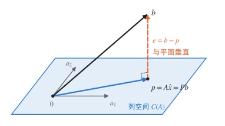
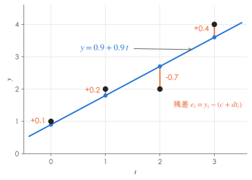
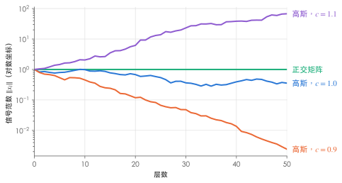

# 正交、投影与最小二乘

方程比未知数多时，$Ax=b$ 一般没有解（[线性无关、秩与四个基本子空间](subspaces.md)中列满秩、$b\notin C(A)$ 的情形）。数据拟合正是这种情况：几千个样本，几十个参数。这时退而求其次，找一个让 $Ax$ 离 $b$ 最近的 $x$，这就是最小二乘。它的几何含义是把 $b$ 垂直投影到列空间上，所以本章先讲正交，再讲投影，最后讲最小二乘和 QR 分解。线性回归、线性探针、weight decay、正交初始化，都是这几个概念的直接应用。

本章的列向量在行内写成 $(1,2,3)$ 的形式。

## 1. 正交向量组与标准正交基

两个向量**正交**指内积为零，$x\tp y=0$。一组向量 $q_1,\dots,q_k$ 两两正交并且都是单位长度，叫**标准正交**（orthonormal）：

$$
q_i\tp q_j=\begin{cases}1,&i=j\\0,&i\ne j\end{cases}
$$

一组非零的正交向量一定线性无关。

### 意义：坐标就是内积

在一般的基下求坐标要解方程组（见[线性无关、秩与四个基本子空间](subspaces.md)）。在标准正交基下不用解：设 $x=c_1q_1+\cdots+c_nq_n$，两边与 $q_i$ 做内积，其余各项都是零，只剩 $c_i$：

$$
c_i=q_i\tp x,\qquad x=\sum_{i=1}^n(q_i\tp x)\,q_i,\qquad \lVert x\rVert^2=\sum_{i=1}^nc_i^2
$$

每个坐标可以单独算，互不影响。长度的平方等于坐标的平方和，和在标准基下一样。

??? example "例：标准正交基下的坐标"
    $q_1=\frac{1}{\sqrt2}(1,1)$，$q_2=\frac{1}{\sqrt2}(1,-1)$。求 $x=(3,1)$ 在这组基下的坐标。

    **解** $q_1\tp q_2=\frac12(1-1)=0$，两个向量长度都是 1，是标准正交基。

    $$
    c_1=q_1\tp x=\frac{3+1}{\sqrt2}=2\sqrt2,\qquad c_2=q_2\tp x=\frac{3-1}{\sqrt2}=\sqrt2
    $$

    验证：$c_1q_1+c_2q_2=(2,2)+(1,-1)=(3,1)$；$c_1^2+c_2^2=8+2=10=\lVert x\rVert^2$。

## 2. 正交矩阵

列向量标准正交的**方阵** $Q$ 叫**正交矩阵**。把 $q_i\tp q_j$ 排成矩阵就是

$$
Q\tp Q=I\quad\Longrightarrow\quad Q^{-1}=Q\tp,\qquad QQ\tp=I
$$

求逆只需要转置。$QQ\tp=I$ 说明各行也标准正交。

### 意义：保持长度和夹角

$$
(Qx)\tp(Qy)=x\tp Q\tp Qy=x\tp y
$$

内积不变，所以长度 $\lVert Qx\rVert=\lVert x\rVert$ 和夹角都不变。正交矩阵对应的变换不拉伸、不压缩，只有两类：$\det Q=1$ 是**旋转**，$\det Q=-1$ 是带**反射**的变换。常见的例子：

- 平面旋转 $\smat{\cos\theta&-\sin\theta\\\sin\theta&\cos\theta}$；
- 置换矩阵（把各分量重新排序）；
- 反射 $I-2uu\tp$（$\lVert u\rVert=1$），把垂直于 $u$ 的平面当作镜子。

正交矩阵的乘积仍是正交矩阵。

??? example "例：验证正交矩阵"
    $Q=\frac13\bmat{1&2&2\\2&1&-2\\2&-2&1}$。验证它是正交矩阵，判断是旋转还是反射，并对 $x=(1,2,2)$、$y=(2,0,1)$ 验证长度和内积不变。

    **解** 三列的长度都是 $\frac13\sqrt{1+4+4}=1$。两两内积：第 1、2 列 $\frac19(2+2-4)=0$，第 1、3 列 $\frac19(2-4+2)=0$，第 2、3 列 $\frac19(4-2-2)=0$。所以 $Q\tp Q=I$。

    $\det Q=-1$，是反射。可以验证 $Q=I-2uu\tp$，$u=\frac{1}{\sqrt3}(1,-1,-1)$。

    $Qx=\frac13(1+4+4,\ 2+2-4,\ 2-4+2)=(3,0,0)$，长度 $3=\lVert x\rVert$。$Qy=\frac13(4,2,5)$，$(Qx)\tp(Qy)=3\cdot\frac43=4=x\tp y$。

!!! warning "易错点"
    $Q\in\R^{m\times n}$（$m>n$）的各列标准正交时，仍有 $Q\tp Q=I_n$，但 $QQ\tp\ne I_m$：$QQ\tp$ 是向 $C(Q)$ 的投影矩阵（第 3 节）。只有方阵才同时有 $Q\tp Q=I$ 和 $QQ\tp=I$。

## 3. 向子空间的投影

### 问题

给定 $A\in\R^{m\times n}$（各列线性无关）和 $b\in\R^m$。在列空间 $C(A)$ 里找离 $b$ 最近的点 $p$，叫 $b$ 在 $C(A)$ 上的**投影**。向单个向量的投影见[向量、内积与范数](vectors.md)，这里是它在子空间上的推广。

{ .diagram }

### 推导

$p$ 在列空间里，所以 $p=A\hat x$。最近的点满足：误差 $e=b-A\hat x$ 与列空间垂直，即与 $A$ 的每一列垂直：

$$
A\tp(b-A\hat x)=0\quad\Longrightarrow\quad \boxed{A\tp A\,\hat x=A\tp b}
$$

这组方程叫**正规方程**（normal equations）。$A$ 列满秩时 $A\tp A$ 可逆（$\rank A\tp A=\rank A=n$），解唯一。

垂直为什么意味着最近：对列空间里任何别的点 $Ax$，$b-Ax=e+A(\hat x-x)$，两项互相垂直，由勾股定理

$$
\lVert b-Ax\rVert^2=\lVert e\rVert^2+\lVert A(\hat x-x)\rVert^2\ge\lVert e\rVert^2
$$

### 投影矩阵

$$
\hat x=(A\tp A)^{-1}A\tp b,\qquad p=A\hat x=Pb,\qquad P=A(A\tp A)^{-1}A\tp
$$

$P$ 有两条性质，也只有投影矩阵同时具有这两条：

- $P^2=P$：投影两次和投影一次一样；
- $P\tp=P$：这是**垂直**投影的标志。

$I-P$ 也是投影矩阵，投影到 $C(A)$ 的正交补 $N(A\tp)$ 上，$e=(I-P)b$。于是 $b=Pb+(I-P)b$ 把 $b$ 分成列空间里的部分和垂直于列空间的部分。

各列标准正交时（把 $A$ 记作 $Q$），$Q\tp Q=I$，公式简化为

$$
\hat x=Q\tp b,\qquad P=QQ\tp
$$

不需要解方程。这是第 5 节先把列正交化的原因。

!!! warning "易错点"
    $A$ 不是方阵，$A^{-1}$ 不存在，不能把 $(A\tp A)^{-1}$ 拆成 $A^{-1}(A\tp)^{-1}$。如果 $A$ 是可逆方阵，拆开后 $P=I$：列空间是全空间，投影什么都不改变。

??? example "例：向平面投影"
    $A=\bmat{1&0\\0&1\\1&1}$，$b=(1,1,0)$。求 $b$ 在 $C(A)$ 上的投影 $p$、误差 $e$ 和投影矩阵 $P$。

    **解** $A\tp A=\smat{2&1\\1&2}$，$A\tp b=(1,1)$。解正规方程 $2\hat x_1+\hat x_2=1$，$\hat x_1+2\hat x_2=1$，得 $\hat x=(\frac13,\frac13)$。

    $$
    p=A\hat x=\tfrac13(1,1,2),\qquad e=b-p=\tfrac13(2,2,-2)
    $$

    检查垂直：$e$ 与第 1 列 $(1,0,1)$ 的内积为 $\frac13(2-2)=0$，与第 2 列 $(0,1,1)$ 的内积为 $\frac13(2-2)=0$。勾股定理：$\lVert p\rVert^2+\lVert e\rVert^2=\frac69+\frac{12}{9}=2=\lVert b\rVert^2$。

    $$
    P=A(A\tp A)^{-1}A\tp=\bmat{1&0\\0&1\\1&1}\cdot\frac13\bmat{2&-1\\-1&2}\cdot\bmat{1&0&1\\0&1&1}=\frac13\bmat{2&-1&1\\-1&2&1\\1&1&2}
    $$

    另一种算法：这个平面的法向量是 $v=(1,1,-1)$（它满足 $A\tp v=0$），向法向量的投影矩阵是 $\frac{vv\tp}{v\tp v}$，所以 $P=I-\frac13vv\tp$，结果相同。

## 4. 最小二乘

$Ax=b$ 无解时，改为让残差的平方和最小：

$$
\min_x\ \lVert Ax-b\rVert^2
$$

$Ax$ 取遍列空间，问题就是在列空间里找离 $b$ 最近的点，答案是上一节的投影：**最小二乘解 $\hat x$ 满足正规方程 $A\tp A\hat x=A\tp b$**。无解的方程 $Ax=b$ 两边左乘 $A\tp$，就变成了有解的方程。同一个结论也可以通过对 $x$ 求导得到，见[矩阵求导与反向传播](matrix-calculus.md)。

!!! tip "方法：最小二乘拟合"
    1. 把模型写成对参数线性的形式。拟合直线 $y=c+dt$ 时，参数是 $x=(c,d)$，第 $i$ 个数据点给出一个方程 $c+dt_i=y_i$。
    2. 排成 $Ax=b$：$A$ 的每一行是 $(1,\ t_i)$，$b$ 的各分量是 $y_i$。
    3. 算 $A\tp A$ 和 $A\tp b$，解正规方程。
    4. 检查：残差 $e=b-A\hat x$ 与 $A$ 的每一列垂直。

??? example "例：拟合直线"
    用直线 $y=c+dt$ 拟合四个点 $(0,1)$、$(1,2)$、$(2,2)$、$(3,4)$（与[线性方程组、消元与逆矩阵](linear-systems.md)里解正规方程的例题是同一组数据，这里补上它的几何解释）。

    **解** 四个方程、两个未知数：

    $$
    A=\bmat{1&0\\1&1\\1&2\\1&3},\quad b=\bmat{1\\2\\2\\4},\qquad A\tp A=\bmat{4&6\\6&14},\quad A\tp b=\bmat{9\\18}
    $$

    解 $4c+6d=9$，$6c+14d=18$：第二式减去 $1.5$ 倍第一式得 $5d=4.5$，$d=0.9$，代回得 $c=0.9$。拟合直线为 $y=0.9+0.9t$。

    拟合值 $(0.9,\ 1.8,\ 2.7,\ 3.6)$，残差 $e=(0.1,\ 0.2,\ -0.7,\ 0.4)$，平方和为 $0.70$。

    检查：$e$ 与第 1 列 $(1,1,1,1)$ 的内积是 $0.1+0.2-0.7+0.4=0$（残差之和为零）；与第 2 列 $(0,1,2,3)$ 的内积是 $0.2-1.4+1.2=0$。

{ .diagram }

NumPy 用 `np.linalg.lstsq`：

```python
import numpy as np

A = np.array([[1., 0.], [1., 1.], [1., 2.], [1., 3.]])
b = np.array([1., 2., 2., 4.])
x_hat, *_ = np.linalg.lstsq(A, b, rcond=None)
e = b - A @ x_hat
print(x_hat.round(4), e.round(4))            # [0.9 0.9] [ 0.1  0.2 -0.7  0.4]
print(np.allclose(A.T @ e, 0))               # True，残差与每一列垂直
```

## 5. Gram–Schmidt 正交化与 QR 分解

### Gram–Schmidt

列标准正交时投影不用解方程。**Gram–Schmidt 正交化**把一组线性无关的向量 $a_1,\dots,a_n$ 换成张成同一个子空间的标准正交向量 $q_1,\dots,q_n$。做法是逐个处理：从 $a_j$ 中减去它在前面已有方向上的投影，剩下的部分与前面都垂直，再归一化。

$$
v_j=a_j-\sum_{i<j}(q_i\tp a_j)\,q_i,\qquad q_j=\frac{v_j}{\lVert v_j\rVert}
$$

### QR 分解

把上式反过来写，$a_j=\sum_{i<j}(q_i\tp a_j)q_i+\lVert v_j\rVert q_j$：每个 $a_j$ 只用到 $q_1,\dots,q_j$。排成矩阵就是

$$
A=QR,\qquad Q=[q_1\ \cdots\ q_n],\qquad R=Q\tp A=\bmat{q_1\tp a_1&q_1\tp a_2&\cdots\\0&q_2\tp a_2&\cdots\\ \vdots&&\ddots}
$$

$Q$ 的各列标准正交，$R$ 是上三角阵，对角元 $r_{jj}=\lVert v_j\rVert>0$。

??? example "例：Gram–Schmidt 与 QR 分解"
    对 $a_1=(1,1,0)$，$a_2=(1,0,1)$，$a_3=(0,1,1)$ 做正交化，写出 $A=QR$。

    **解** 第一步：$\lVert a_1\rVert=\sqrt2$，$q_1=\frac{1}{\sqrt2}(1,1,0)$。

    第二步：$q_1\tp a_2=\frac{1}{\sqrt2}$，

    $$
    v_2=a_2-\tfrac{1}{\sqrt2}q_1=(1,0,1)-\tfrac12(1,1,0)=\bigl(\tfrac12,-\tfrac12,1\bigr),\qquad \lVert v_2\rVert=\sqrt{\tfrac32},\qquad q_2=\tfrac{1}{\sqrt6}(1,-1,2)
    $$

    第三步：$q_1\tp a_3=\frac{1}{\sqrt2}$，$q_2\tp a_3=\frac{-1+2}{\sqrt6}=\frac{1}{\sqrt6}$，

    $$
    v_3=(0,1,1)-\tfrac12(1,1,0)-\tfrac16(1,-1,2)=\bigl(-\tfrac23,\tfrac23,\tfrac23\bigr),\qquad \lVert v_3\rVert=\tfrac{2}{\sqrt3},\qquad q_3=\tfrac{1}{\sqrt3}(-1,1,1)
    $$

    $R$ 的元素就是上面算过的内积和长度：

    $$
    Q=\bmat{\frac{1}{\sqrt2}&\frac{1}{\sqrt6}&-\frac{1}{\sqrt3}\\[1mm]\frac{1}{\sqrt2}&-\frac{1}{\sqrt6}&\frac{1}{\sqrt3}\\[1mm]0&\frac{2}{\sqrt6}&\frac{1}{\sqrt3}},\qquad R=\bmat{\sqrt2&\frac{1}{\sqrt2}&\frac{1}{\sqrt2}\\[1mm]0&\sqrt{\frac32}&\frac{1}{\sqrt6}\\[1mm]0&0&\frac{2}{\sqrt3}}
    $$

    检查 $q_1\tp q_3=\frac{-1+1}{\sqrt6}=0$，$q_2\tp q_3=\frac{-1-1+2}{\sqrt{18}}=0$。

### 用 QR 解最小二乘

把 $A=QR$ 代入正规方程，$R\tp Q\tp QR\,\hat x=R\tp Q\tp b$，利用 $Q\tp Q=I$ 并消去可逆的 $R\tp$：

$$
R\,\hat x=Q\tp b
$$

$R$ 是上三角阵，回代即可。

??? example "例：用 QR 解拟合直线的问题"
    对第 4 节的 $A=\smat{1&0\\1&1\\1&2\\1&3}$，$b=(1,2,2,4)$，用 QR 分解求最小二乘解。

    **解** $q_1=\frac12(1,1,1,1)$。$q_1\tp a_2=\frac{0+1+2+3}{2}=3$，

    $$
    v_2=(0,1,2,3)-3q_1=\bigl(-\tfrac32,-\tfrac12,\tfrac12,\tfrac32\bigr),\qquad \lVert v_2\rVert=\sqrt5,\qquad q_2=\tfrac{1}{2\sqrt5}(-3,-1,1,3)
    $$

    $$
    R=\bmat{2&3\\0&\sqrt5},\qquad Q\tp b=\bmat{\frac{1+2+2+4}{2}\\[1mm]\frac{-3-2+2+12}{2\sqrt5}}=\bmat{\frac92\\[1mm]\frac{9}{2\sqrt5}}
    $$

    回代：$\sqrt5\,d=\frac{9}{2\sqrt5}$ 得 $d=\frac{9}{10}$；$2c+3d=\frac92$ 得 $c=\frac{9}{10}$。与正规方程的结果相同。

### 数值上为什么用 QR

正规方程要先算 $A\tp A$，这一步会把矩阵的条件数平方（条件数见[奇异值分解](svd.md)），原本只是接近线性相关的列，在 $A\tp A$ 里可能变得无法区分。QR 直接对 $A$ 操作，没有这个问题。下面的 $A$ 两列几乎相同：

```python
for eps in (1e-4, 1e-8):
    A2 = np.array([[1., 1.], [eps, 0.], [0., eps]])
    w_true = np.array([1., 2.])
    b2 = A2 @ w_true                                   # 精确解就是 w_true
    Q2, R2 = np.linalg.qr(A2)
    err_qr = abs(np.linalg.solve(R2, Q2.T @ b2) - w_true).max()
    try:
        err_ne = abs(np.linalg.solve(A2.T @ A2, A2.T @ b2) - w_true).max()
    except np.linalg.LinAlgError:
        err_ne = float("nan")                          # A^T A 在浮点数下奇异，解不出
    print(f"eps={eps:g}  正规方程误差 {err_ne:.1e}  QR 误差 {err_qr:.1e}")
# eps=0.0001  正规方程误差 1.1e-08  QR 误差 4.4e-16
# eps=1e-08  正规方程误差 nan  QR 误差 0.0e+00
```

$A\tp A=\smat{1+\varepsilon^2&1\\1&1+\varepsilon^2}$。$\varepsilon=10^{-8}$ 时 $\varepsilon^2=10^{-16}$ 小于双精度的相对精度，$1+\varepsilon^2$ 被舍入成 1，$A\tp A$ 成了奇异矩阵。

`np.linalg.qr` 内部用的是 Householder 反射（一串第 2 节那样的反射矩阵），不是 Gram–Schmidt，因为后者在浮点运算下会逐渐丢失正交性；它给出的 $Q,\,R$ 可能与手算结果差若干个正负号。`np.linalg.lstsq` 用奇异值分解，同样不构造 $A\tp A$。

## 6. 线性回归与线性探针

### 线性回归是投影

线性回归的数据矩阵 $X\in\R^{n\times d}$ 一行一个样本、一列一个特征，标签 $y\in\R^n$，参数 $w\in\R^d$。最小二乘解满足 $X\tp X\hat w=X\tp y$，预测值

$$
\hat y=X\hat w=X(X\tp X)^{-1}X\tp y=Py
$$

是 $y$ 在**特征的列空间**上的投影。模型能表示的预测只有各个特征列的线性组合，回归所做的是在其中找离标签最近的一个。残差与每个特征列垂直；$X$ 含全 1 列（偏置项）时，残差之和为零。

### 线性探针

**线性探针**（linear probe）是分析神经网络表征的常用办法：冻结模型，取某一层的表征 $h\in\R^d$，只训练一个线性映射去预测某个属性（词性、情感、句法深度等）。如果线性探针的准确率高，说明这个属性可以从该层表征中**线性地读出**，几何上就是表征空间里存在一个方向（或一个低维子空间），表征在其上的分量决定了这个属性。在冻结的特征上只训练一个线性分类器，也是评价自监督预训练表征质量的标准做法。

下面用合成数据演示。假设属性由表征在某个未知方向 $u$ 上的分量决定，再加上噪声：

```python
rng = np.random.default_rng(0)
n, d = 2000, 64
u = rng.standard_normal(d)
u /= np.linalg.norm(u)                           # 表征里编码这个属性的方向（探针事先不知道）
H = rng.standard_normal((n, d))                  # 冻结的表征，一行一个样本
y = np.sign(H @ u + 0.5 * rng.standard_normal(n))    # 属性标签 ±1

Htr, ytr, Hte, yte = H[:1500], y[:1500], H[1500:], y[1500:]
w, *_ = np.linalg.lstsq(Htr, ytr, rcond=None)    # 最小二乘探针
print(np.mean(np.sign(Hte @ w) == yte))          # 0.854，测试集准确率
print((w @ u / np.linalg.norm(w)).round(4))      # 0.9759，探针方向与真实方向的余弦

w2, *_ = np.linalg.lstsq(Htr, ytr[rng.permutation(1500)], rcond=None)   # 对照：打乱标签
print(np.mean(np.sign(Hte @ w2) == yte))         # 0.496，回到随机水平
```

探针在 64 维空间里找回了方向 $u$（余弦 0.98）。这组数据的标签带噪声，最优分类器的准确率约为 0.852，探针的 0.854 已经到头。打乱标签的对照实验用来确认探针学到的是表征里的信息，而不是靠自身的参数记住了训练集。实际工作中分类属性更常用逻辑回归做探针，思路相同。

!!! warning "易错点"
    探针准确率高，说明信息**可以**被线性读出，不说明模型在后续计算中**用了**这个方向。要检验后者，需要干预表征，例如第 9 节把这个方向去掉，再看模型的行为是否改变。

## 7. 岭回归与 weight decay

在最小二乘的目标上加参数范数的惩罚，叫**岭回归**（ridge regression）：

$$
\min_w\ \lVert Xw-y\rVert^2+\lambda\lVert w\rVert^2\quad\Longrightarrow\quad(X\tp X+\lambda I)\,\hat w=X\tp y
$$

$\lambda>0$ 时 $X\tp X+\lambda I$ 总是可逆的（见[线性方程组、消元与逆矩阵](linear-systems.md)）。它仍然是一个投影问题：在 $X$ 下面拼上 $\sqrt\lambda\,I$，在 $y$ 下面拼上零向量，对拼出来的方程组做普通最小二乘，正规方程正好是上式。多出来的 $d$ 个方程 $\sqrt\lambda\,w_i=0$ 把每个参数往零的方向拉。

??? example "例：岭回归的解随 $\lambda$ 的变化"
    $X=\smat{1&0\\0&1\\1&1}$，$y=(2,0,1)$。分别求 $\lambda=0,1,3$ 时的 $\hat w$ 及其范数。

    **解** $X\tp X=\smat{2&1\\1&2}$，$X\tp y=(3,1)$。

    - $\lambda=0$：$\hat w=\frac13\smat{2&-1\\-1&2}\smat{3\\1}=\bigl(\frac53,-\frac13\bigr)$，$\lVert\hat w\rVert=\frac{\sqrt{26}}{3}\approx1.700$。
    - $\lambda=1$：$\hat w=\smat{3&1\\1&3}^{-1}\smat{3\\1}=\frac18\smat{3&-1\\-1&3}\smat{3\\1}=(1,0)$，$\lVert\hat w\rVert=1$。
    - $\lambda=3$：$\hat w=\smat{5&1\\1&5}^{-1}\smat{3\\1}=\frac{1}{24}\smat{5&-1\\-1&5}\smat{3\\1}=\bigl(\frac{7}{12},\frac{1}{12}\bigr)$，$\lVert\hat w\rVert=\frac{5\sqrt2}{12}\approx0.589$。

    $\lambda$ 越大，解的范数越小，拟合误差相应变大。

**与 weight decay 的对应。** 岭回归目标的梯度是 $2X\tp(Xw-y)+2\lambda w$，梯度下降的一步可以写成

$$
w\leftarrow(1-2\eta\lambda)\,w-\eta\cdot2X\tp(Xw-y)
$$

先把 $w$ 按比例缩小一点，再沿数据项的梯度走一步。前一个操作就是 **weight decay**。对普通的（随机）梯度下降，L2 惩罚和 weight decay 是同一件事。

```python
X = np.array([[1., 0.], [0., 1.], [1., 1.]])
y = np.array([2., 0., 1.])
lam, lr = 1.0, 0.05
w = np.zeros(2)
for _ in range(500):
    grad = 2 * X.T @ (X @ w - y)                 # 只算数据项的梯度
    w = (1 - 2 * lr * lam) * w - lr * grad       # 先衰减，再走梯度步
print(w.round(4))                                # [1. 0.]，与 λ=1 的闭式解相同
```

!!! info "AI 联系"
    对 Adam 这类自适应优化器，把 $\lambda w$ 加进梯度（L2 惩罚）和直接衰减权重不再等价：前者会被自适应的步长重新缩放。AdamW 把衰减从梯度里拿出来单独做（decoupled weight decay），是现在训练 Transformer 的默认选择。

## 8. 正交初始化

深层网络的前向计算要连乘很多个权重矩阵。只看线性部分，$L$ 层之后的信号是 $x_L=W_L\cdots W_1x_0$。

- 每个 $W_l$ 都是正交矩阵时，乘积仍是正交矩阵，$\lVert x_L\rVert=\lVert x_0\rVert$ 严格成立，与深度无关。反向传播时梯度乘的是 $W_l\tp$，同样保持范数。
- 元素独立取自 $\mathcal N(0,\frac1d)$ 的高斯矩阵只在**期望意义**下保持范数（$\mathbb E\lVert Wx\rVert^2=\lVert x\rVert^2$）。每一层有随机涨落，连乘之后不同方向被拉伸的倍数相差极大；方差稍有偏差，范数就随深度指数地增长或衰减。

```python
rng = np.random.default_rng(0)
d, depth = 64, 50
x0 = rng.standard_normal(d)
x0 /= np.linalg.norm(x0)                         # 单位长度的输入

def run(make):                                   # 连乘 depth 个矩阵
    x, M = x0.copy(), np.eye(d)
    for _ in range(depth):
        W = make()
        x, M = W @ x, W @ M
    s = np.linalg.svd(M, compute_uv=False)       # 乘积矩阵对单位向量的最大、最小拉伸倍数
    return np.linalg.norm(x), s[0], s[-1]

orth = lambda: np.linalg.qr(rng.standard_normal((d, d)))[0]                # 随机正交矩阵
gauss = lambda c: (lambda: c * rng.standard_normal((d, d)) / np.sqrt(d))   # 元素方差 c^2/d

for name, make in [("正交", orth), ("高斯 c=1.0", gauss(1.0)), ("高斯 c=0.9", gauss(0.9)), ("高斯 c=1.1", gauss(1.1))]:
    print(name, " %.3g  %.3g  %.3g" % run(make))   # 输出范数、最大拉伸、最小拉伸
# 正交  1  1  1
# 高斯 c=1.0  0.356  4.29  5.25e-18
# 高斯 c=0.9  0.00241  0.0332  1.43e-20
# 高斯 c=1.1  67.5  989  1.22e-15
```

{ .diagram }

50 层之后，正交矩阵的乘积对所有方向的拉伸倍数都是 1。方差恰好的高斯矩阵（$c=1$），这个输入的范数变成了 0.356，而不同方向的拉伸倍数从 $4.29$ 到 $10^{-18}$ 量级。$c$ 偏离 1 只有 10%，范数就变成 $0.0024$ 或 $67.5$。

这是**正交初始化**（orthogonal initialization）的依据，PyTorch 中是 `nn.init.orthogonal_`，实现方式就是对高斯矩阵做 QR 分解取 $Q$。上面的分析只对线性网络严格成立；有非线性激活时还要乘一个与激活函数有关的增益系数。最大、最小拉伸倍数就是最大、最小奇异值，见[奇异值分解](svd.md)。

## 9. 从表征中去掉一个方向

设单位向量 $u$ 是表征空间里代表某个概念的方向（例如第 6 节的探针找到的方向）。把表征 $x$ 在 $u$ 上的分量减掉：

$$
x'=x-(u\tp x)\,u=(I-uu\tp)\,x
$$

$I-uu\tp$ 是向 $u$ 的正交补的投影矩阵（第 3 节的 $I-P$，其中 $P=uu\tp$）。处理后 $u\tp x'=0$：任何只沿 $u$ 读取的线性映射，从 $x'$ 上读到的都是零，而与 $u$ 垂直的分量完全不变。

??? example "例：去掉一个方向"
    $x=(3,1,2)$，$u=\frac13(1,2,2)$。求去掉 $u$ 方向后的 $x'$，并写出投影矩阵。

    **解** $\lVert u\rVert=\frac13\sqrt{1+4+4}=1$。$u\tp x=\frac13(3+2+4)=3$，

    $$
    x'=x-3u=(3,1,2)-(1,2,2)=(2,-1,0),\qquad u\tp x'=\tfrac13(2-2+0)=0
    $$

    $$
    I-uu\tp=I-\frac19\bmat{1&2&2\\2&4&4\\2&4&4}=\frac19\bmat{8&-2&-2\\-2&5&-4\\-2&-4&5}
    $$

    勾股定理：$\lVert x'\rVert^2+(u\tp x)^2=5+9=14=\lVert x\rVert^2$。去掉的只是 $u$ 方向上长度为 3 的那一段。

对一批表征（一行一个样本）同时处理，不必构造 $d\times d$ 的投影矩阵：

```python
rng = np.random.default_rng(0)
X = rng.standard_normal((5, 3))                  # 5 个样本的 3 维表征
u = np.array([1., 2., 2.]) / 3
X_clean = X - np.outer(X @ u, u)                 # 每一行减去它在 u 上的分量
print(np.allclose(X_clean @ u, 0))               # True
```

要去掉多个方向时，先把它们正交化成 $Q$（Gram–Schmidt），再算 $X-XQQ\tp$。

这个操作在几类工作里出现：从词向量中投影掉性别方向以减轻偏见（Bolukbasi et al., 2016）；概念擦除，反复训练线性探针并把它找到的方向投影掉，直到线性探针读不出该属性（INLP，Ravfogel et al., 2020）；在大语言模型的残差流中去掉某个方向来改变特定行为，例如与拒绝回答相关的方向（Arditi et al., 2024）。

## 小结

| 内容 | 公式 | 说明 |
| --- | --- | --- |
| 标准正交基下的坐标 | $c_i=q_i\tp x$ | 不用解方程 |
| 正交矩阵 | $Q\tp Q=I$，$Q^{-1}=Q\tp$ | 保持长度和夹角；旋转或反射 |
| 正规方程 | $A\tp A\hat x=A\tp b$ | 来自误差与列空间垂直 |
| 投影矩阵 | $P=A(A\tp A)^{-1}A\tp$ | $P^2=P$，$P\tp=P$ |
| 列标准正交时 | $\hat x=Q\tp b$，$P=QQ\tp$ | |
| 最小二乘 | $\min\lVert Ax-b\rVert^2$ | 解就是投影对应的 $\hat x$ |
| Gram–Schmidt | $v_j=a_j-\sum_{i<j}(q_i\tp a_j)q_i$ | 减去在已有方向上的投影，再归一化 |
| QR 分解 | $A=QR$，$R\hat x=Q\tp b$ | 数值上比正规方程稳 |
| 岭回归 | $(X\tp X+\lambda I)\hat w=X\tp y$ | 对应梯度下降中的 weight decay |
| 去掉方向 $u$ | $x'=(I-uu\tp)x$ | 向 $u$ 的正交补投影 |

- 线性回归的预测值是标签在特征列空间上的投影；线性探针是在冻结的表征上做同样的事。
- 正交矩阵连乘不改变范数，这是正交初始化的依据。
- 实际计算用 `np.linalg.lstsq` 或 QR，不要显式构造 $A\tp A$ 再求逆。
