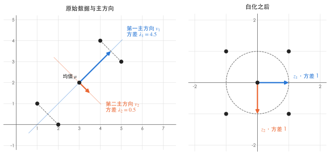
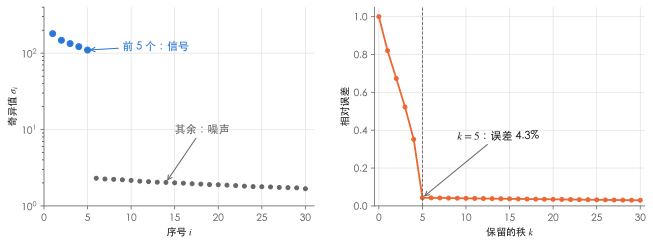
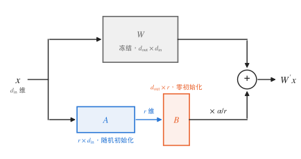
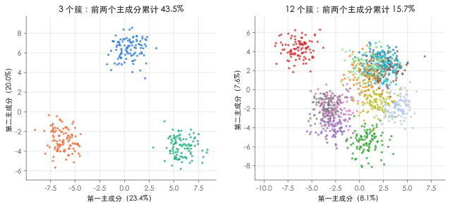

# PCA、低秩近似与 LoRA

[奇异值分解](svd.md)给出了一个结论：保留最大的 $k$ 个奇异值，得到的是所有秩不超过 $k$ 的矩阵里离原矩阵最近的一个（Eckart–Young 定理）。本章讲这个结论的三种用法：对数据矩阵用，是主成分分析（principal component analysis, PCA）；对权重矩阵用，是模型压缩；对微调时权重的**改变量**加上低秩约束，是 LoRA。三者用的是同一套线性代数，区别只在于"低秩"这个假设加在哪个矩阵上。

## 1. 主成分分析要解决的问题

### 方差最大的方向

数据矩阵 $X\in\R^{n\times d}$ 一行一个样本。先减去各列的均值得到 $X_c$（中心化），样本协方差矩阵为

$$
S=\frac1{n-1}X_c\tp X_c\in\R^{d\times d}
$$

取一个单位向量 $w$，把每个样本投影到 $w$ 上得到 $n$ 个数 $X_cw$，它们的方差是

$$
\frac1{n-1}\lVert X_cw\rVert^2=w\tp Sw
$$

PCA 的第一步是找让这个方差最大的方向：$\max_{\lVert w\rVert=1}w\tp Sw$。这是对称矩阵的 Rayleigh 商，最大值等于 $S$ 的最大特征值 $\lambda_1$，在对应的单位特征向量 $v_1$ 处取到（见[对称矩阵、二次型与正定性](quadratic-forms.md)）。在与 $v_1$ 正交的方向里再找方差最大的，得到 $v_2$，依此类推。$v_1,v_2,\dots$ 称为**主方向**（主轴），样本在主方向上的坐标 $X_cv_i$ 称为**主成分得分**，第 $i$ 个主成分的方差就是 $\lambda_i$。

把 $X_c$ 做奇异值分解 $X_c=U\Sigma V\tp$，代入得

$$
S=\frac1{n-1}V\Sigma\tp\Sigma V\tp\qquad\Longrightarrow\qquad \text{主方向是 }V\text{ 的各列},\quad \lambda_i=\frac{\sigma_i^2}{n-1}
$$

所以求 PCA 不需要构造 $S$ 再做特征分解，直接对 $X_c$ 做 SVD 即可。

### 等价的说法：重构误差最小

只保留前 $k$ 个主方向，记 $V_k=[v_1\ \cdots\ v_k]$。把样本投影到这 $k$ 个方向张成的子空间上，再放回原空间：

$$
\hat X_c=X_cV_kV_k\tp=U_k\Sigma_kV_k\tp
$$

右端正是 $X_c$ 的截断 SVD。由 Eckart–Young 定理，它是秩不超过 $k$ 的矩阵中使 $\lVert X_c-\hat X_c\rVert_F$ 最小的一个，最小值满足

$$
\lVert X_c-\hat X_c\rVert_F^2=\sum_{i>k}\sigma_i^2
$$

因此"投影后方差最大"和"投影造成的重构误差最小"是同一个解。两者的关系来自勾股定理：每个样本到均值的距离平方，等于它在子空间内的分量平方加上垂直于子空间的分量平方，总和 $\lVert X_c\rVert_F^2=\sum_i\sigma_i^2$ 是定值，保留的多，丢掉的就少。

## 2. PCA 的计算

!!! tip "方法：用 SVD 做 PCA"
    1. **中心化**：$\mu=\frac1n X\tp\mathbf 1$，$X_c=X-\mathbf 1\mu\tp$（每列减去该列均值）。
    2. **SVD**：$X_c=U\Sigma V\tp$（精简形式）。
    3. **主方向**：$V$ 的前 $k$ 列。
    4. **得分**（降维后的坐标）：$T=X_cV_k=U_k\Sigma_k\in\R^{n\times k}$。
    5. **解释方差比**：第 $i$ 个主成分占 $\sigma_i^2/\sum_j\sigma_j^2$。
    6. **重构**：$\hat X=TV_k\tp+\mathbf 1\mu\tp$。新样本 $x$ 的降维：$V_k\tp(x-\mu)$，用训练数据的 $\mu$ 和 $V_k$。

??? example "例：手算 5 个二维点的 PCA"
    样本为 $(5,3),\ (4,4),\ (1,1),\ (2,0),\ (3,2)$。求主方向、得分、解释方差比，以及只保留第一主成分时的重构误差。

    **解** (1) 均值 $\mu=(3,2)$，中心化后

    $$
    X_c=\bmat{2&1\\1&2\\-2&-1\\-1&-2\\0&0},\qquad X_c\tp X_c=\bmat{10&8\\8&10},\qquad S=\frac14X_c\tp X_c=\bmat{2.5&2\\2&2.5}
    $$

    (2) $S$ 的特征方程 $(2.5-\lambda)^2-4=0$，得 $\lambda_1=4.5$，$\lambda_2=0.5$；对应的单位特征向量

    $$
    v_1=\frac1{\sqrt2}\bmat{1\\1},\qquad v_2=\frac1{\sqrt2}\bmat{1\\-1}
    $$

    奇异值 $\sigma_i=\sqrt{(n-1)\lambda_i}$：$\sigma_1=\sqrt{18}=3\sqrt2$，$\sigma_2=\sqrt2$。

    (3) 得分 $T=X_c[v_1\ v_2]$：

    $$
    T=\frac1{\sqrt2}\bmat{3&1\\3&-1\\-3&-1\\-3&1\\0&0}
    $$

    第一列的方差为 $\frac14\cdot4\cdot\frac92=4.5=\lambda_1$，第二列的方差为 $\frac14\cdot4\cdot\frac12=0.5=\lambda_2$，两列的内积为 0（得分互不相关）。

    (4) 解释方差比：$\dfrac{4.5}{4.5+0.5}=90\%$ 和 $10\%$。

    (5) 只保留 $v_1$：第一个点重构为 $\frac{3}{\sqrt2}v_1=(1.5,\,1.5)$（加回均值是 $(4.5,\,3.5)$），误差向量 $(0.5,\,-0.5)$，误差平方 $0.5$。前四个点的误差平方都是 $0.5$，第五个点为 0，总和 $2=\sigma_2^2$，与公式一致。

{ .diagram }

NumPy 实现，并用上面的例子核对：

```python
import numpy as np
np.set_printoptions(precision=4, suppress=True)

def pca(X, k):
    """X: (n, d)，一行一个样本。返回均值、前 k 个主方向（每行一个）、得分、全部解释方差比。"""
    mu = X.mean(axis=0)
    Xc = X - mu                                          # 中心化
    U, s, Vt = np.linalg.svd(Xc, full_matrices=False)    # 不构造协方差阵
    var = s**2 / (len(X) - 1)                            # 各主成分的方差，即协方差阵的特征值
    return mu, Vt[:k], Xc @ Vt[:k].T, var / var.sum()

X = np.array([[5., 3], [4, 4], [1, 1], [2, 0], [3, 2]])
mu, comps, scores, ratio = pca(X, 2)
print(mu)        # [3. 2.]
print(comps)
# [[-0.7071 -0.7071]
#  [ 0.7071 -0.7071]]
print(scores[:2])
# [[-2.1213  0.7071]
#  [-2.1213 -0.7071]]
print(ratio)     # [0.9 0.1]

lam, Q = np.linalg.eigh(np.cov(X, rowvar=False))        # 对照：协方差阵的特征分解（特征值升序）
print(lam)                                               # [0.5 4.5]
print(np.allclose(np.abs(Q[:, ::-1].T), np.abs(comps)))  # True
```

程序给出的 $v_1$ 是 $-\frac1{\sqrt2}(1,1)$，与手算差一个符号。特征向量和奇异向量的符号本来就不唯一，$v_i$ 与 $-v_i$ 表示同一条轴，得分相应地整体变号。

!!! warning "易错点"
    - **忘记中心化**。不减均值时，第一个奇异向量主要指向均值的方向，而不是数据散布最大的方向。
    - **量纲不同的特征直接做 PCA**。方差大的特征（例如以米和以毫米为单位的两列）会主导主方向；特征量纲不同时先把每列除以标准差。
    - **显式计算 $X_c\tp X_c$**。它的条件数是 $X_c$ 的平方，小的奇异值会被舍入误差淹没；$d\gg n$ 时它还是一个很大的 $d\times d$ 矩阵。对 $X_c$ 直接做 SVD 没有这两个问题。
    - **除以 $n$ 还是 $n-1$**。两种约定下特征值差一个常数因子，主方向和解释方差比都不变。`np.cov` 默认除以 $n-1$。

## 3. 保留多少个主成分

解释方差比的前 $k$ 项之和，表示降到 $k$ 维后保留了总方差的多少：

$$
\frac{\sum_{i\le k}\sigma_i^2}{\sum_i\sigma_i^2}=1-\frac{\lVert X_c-\hat X_c\rVert_F^2}{\lVert X_c\rVert_F^2}
$$

常用的做法是取累计比例首次超过某个阈值（如 90% 或 95%）的最小 $k$；或者把 $\sigma_i^2$ 按序号画出来（碎石图），在曲线从陡变平的拐点处截断。

??? example "例：按累计解释方差选 k"
    某个中心化数据矩阵的奇异值为 $10,\ 6,\ 3,\ 2,\ 1$。分别要求保留 90%、95%、99% 的方差，$k$ 至少取多少？

    **解** $\sigma_i^2=100,\ 36,\ 9,\ 4,\ 1$，总和 150。

    | $k$ | 1 | 2 | 3 | 4 | 5 |
    | --- | --- | --- | --- | --- | --- |
    | 第 $k$ 个的解释方差比 | 66.7% | 24.0% | 6.0% | 2.7% | 0.7% |
    | 累计 | 66.7% | 90.7% | 96.7% | 99.3% | 100% |

    保留 90% 取 $k=2$，95% 取 $k=3$，99% 取 $k=4$。

## 4. 白化

PCA 得分的各列互不相关，但方差各不相同（分别为 $\lambda_i$）。再把每一列除以它的标准差 $\sqrt{\lambda_i}=\sigma_i/\sqrt{n-1}$，就得到协方差为单位阵的数据，这一步称为**白化**（whitening）：

$$
Z=X_cV\Sigma^{-1}\sqrt{n-1}=\sqrt{n-1}\,U,\qquad \frac1{n-1}Z\tp Z=U\tp U=I
$$

几何上，PCA 把数据的椭圆形散布旋转到与坐标轴对齐，白化再沿各轴缩放成圆形。

??? example "例：对上面的 5 个点做白化"
    **解** 把手算例中得分的两列分别除以 $\sqrt{4.5}=\frac3{\sqrt2}$ 和 $\sqrt{0.5}=\frac1{\sqrt2}$：

    $$
    Z=\bmat{1&1\\1&-1\\-1&-1\\-1&1\\0&0},\qquad \frac14Z\tp Z=\frac14\bmat{4&0\\0&4}=I
    $$

    白化后的前四个点是正方形的四个顶点（见上图右）。

```python
Xc = X - mu
U, s, Vt = np.linalg.svd(Xc, full_matrices=False)
Z = Xc @ Vt.T / s * np.sqrt(len(X) - 1)
print(np.cov(Z, rowvar=False))
# [[1. 0.]
#  [0. 1.]]
print(np.allclose(Z, U * np.sqrt(len(X) - 1)))    # True
```

很小的 $\sigma_i$ 对应的方向几乎只有噪声，除以它会把噪声放大。实际使用时在分母上加一个小常数，或者只对前 $k$ 个主成分做白化。

## 5. 截断 SVD 做压缩

### 存储量与误差

$m\times n$ 的矩阵 $M$ 有 $mn$ 个数。截断到秩 $k$ 后只需要存 $U_k$（$m\times k$）、$k$ 个奇异值和 $V_k$（$n\times k$）：

$$
\text{存储量}=k(m+n+1),\qquad \text{相对误差}=\frac{\lVert M-M_k\rVert_F}{\lVert M\rVert_F}=\sqrt{\frac{\sum_{i>k}\sigma_i^2}{\sum_i\sigma_i^2}}
$$

当 $k(m+n+1)<mn$ 时才有压缩效果。误差能否接受取决于奇异值衰减得多快，所以压缩之前要先看奇异值谱。

??? example "例：截断的压缩率与误差"
    一个 $60\times40$ 的矩阵，非零奇异值为 $10,\ 6,\ 3,\ 2,\ 1$。截断到秩 2 和秩 3 时，存储量和相对误差各是多少？

    **解** 原矩阵 2400 个数。

    - $k=2$：存储 $2\times(60+40+1)=202$ 个数，是原来的 8.4%；相对误差 $\sqrt{(9+4+1)/150}=\sqrt{14/150}\approx0.306$。
    - $k=3$：存储 $303$ 个数，是原来的 12.6%；相对误差 $\sqrt{5/150}\approx0.183$。

    与上一节的表对照：相对误差的平方等于 1 减去累计解释方差比，$1-0.907=0.093=14/150$。另外，按谱范数度量的误差是第一个被丢掉的奇异值，$k=2$ 时 $\lVert M-M_2\rVert_2=\sigma_3=3$。

构造一个"秩 5 加小噪声"的 $200\times100$ 矩阵，观察误差随 $k$ 的变化：

```python
rng = np.random.default_rng(0)
m, n = 200, 100
M = rng.standard_normal((m, 5)) @ rng.standard_normal((5, n)) + 0.1 * rng.standard_normal((m, n))
U, s, Vt = np.linalg.svd(M, full_matrices=False)
print(s[:8].round(1))      # [180.  147.5 133.5 121.8 109.9   2.3   2.3   2.2]
for k in (1, 3, 5, 10, 20):
    Mk = (U[:, :k] * s[:k]) @ Vt[:k]
    rel = np.linalg.norm(M - Mk) / np.linalg.norm(M)
    print(k, k * (m + n + 1), f"{k * (m + n + 1) / (m * n):.1%}", f"{rel:.4f}")
# 1 301 1.5% 0.8203
# 3 903 4.5% 0.5229
# 5 1505 7.5% 0.0431
# 10 3010 15.0% 0.0401
# 20 6020 30.1% 0.0347
```

前 5 个奇异值在 100 以上，第 6 个起只有 2 左右。$k$ 取到 5 时误差从 52% 降到 4.3%，再增大 $k$ 只是在拟合噪声，误差几乎不再下降。

{ .diagram }

### 把一个全连接层拆成两层

对全连接层的权重 $W\in\R^{d_\text{out}\times d_\text{in}}$ 做截断 SVD，$W\approx U_k\Sigma_kV_k\tp$，则

$$
Wx\approx U_k\,(\Sigma_kV_k\tp x)
$$

相当于把原来的一层换成两层、中间没有激活函数的线性层：第一层 $W_1=\Sigma_kV_k\tp\in\R^{k\times d_\text{in}}$ 把输入降到 $k$ 维，第二层 $W_2=U_k\in\R^{d_\text{out}\times k}$ 再升回去。参数量和每个样本的乘加次数都从 $d_\text{out}d_\text{in}$ 变为 $k(d_\text{in}+d_\text{out})$。

??? example "例：拆分一个 4096×4096 的线性层"
    $W\in\R^{4096\times4096}$，截断到 $k=256$。参数量变为原来的多少？$k$ 小于多少才有压缩效果？

    **解** 原参数量 $4096^2=16\,777\,216$。拆分后 $256\times(4096+4096)=2\,097\,152$，是原来的 $1/8$，前向计算的乘加次数也降到 $1/8$。有压缩效果的条件是 $k(d_\text{in}+d_\text{out})<d_\text{in}d_\text{out}$，即 $k<2048$。

```python
rng = np.random.default_rng(0)
d_out, d_in, k = 512, 1024, 32
W = rng.standard_normal((d_out, k)) @ rng.standard_normal((k, d_in)) / k \
    + 0.01 * rng.standard_normal((d_out, d_in))      # 构造一个近似秩 32 的权重
U, s, Vt = np.linalg.svd(W, full_matrices=False)
W1 = s[:k, None] * Vt[:k]        # (k, d_in)    第一层
W2 = U[:, :k]                    # (d_out, k)   第二层
x = rng.standard_normal((4, d_in))
y, y2 = x @ W.T, x @ W1.T @ W2.T
print(W.size, W1.size + W2.size)                              # 524288 49152
print(f"{np.linalg.norm(y - y2) / np.linalg.norm(y):.4f}")    # 0.0525
```

这个例子里的 $W$ 是按低秩构造的，所以用不到 10% 的参数，输出的相对误差只有 5%。训练好的权重是否有这样的结构要实际算奇异值才知道；权重上的误差小也不等于任务指标不变，截断之后要在任务上重新评测，通常还需要再微调。

## 6. LoRA：低秩的是更新量

### 公式与初始化

LoRA（Low-Rank Adaptation，Hu 等，2021）是一种参数高效的微调方法。设某一层预训练好的权重为 $W\in\R^{d_\text{out}\times d_\text{in}}$。全量微调学的是一个同样大小的改变量 $\Delta W$。LoRA 把 $\Delta W$ 限制成两个小矩阵的乘积：

$$
W'=W+\frac{\alpha}{r}BA,\qquad B\in\R^{d_\text{out}\times r},\quad A\in\R^{r\times d_\text{in}},\quad r\ll\min(d_\text{in},d_\text{out})
$$

- 训练时**冻结 $W$**，只更新 $A$ 和 $B$。前向计算为 $W'x=Wx+\frac\alpha rB(Ax)$：在原来的层旁边加一条旁路，先把输入降到 $r$ 维，再升回 $d_\text{out}$ 维。
- **初始化**：$A$ 取随机值，$B=0$。于是 $BA=0$，训练的起点与预训练模型完全相同。
- $\alpha$ 是常数超参数。乘以 $\alpha/r$ 是为了在改变 $r$ 时减少重新调整其他超参数的需要。
- $\rank(BA)\le r$：更新量的秩不超过 $r$（见[线性无关、秩与四个基本子空间](subspaces.md)）。

{ .diagram }

### 参数量

一个 $d_\text{out}\times d_\text{in}$ 的矩阵配一对 $A,B$，新增可训练参数 $r(d_\text{in}+d_\text{out})$ 个。

??? example "例：LoRA 的可训练参数量"
    设模型有 32 层，隐藏维度 $d=4096$，对每层注意力的 $W_Q$ 和 $W_V$（都是 $4096\times4096$）加 $r=8$ 的 LoRA。可训练参数有多少？占这些矩阵本身参数量的多少？

    **解** 每个矩阵新增 $8\times(4096+4096)=65\,536$ 个参数；每层两个矩阵，共 32 层：

    $$
    65\,536\times2\times32=4\,194\,304\approx4.2\times10^6
    $$

    这 64 个矩阵本身共有 $64\times4096^2=1\,073\,741\,824\approx1.07\times10^9$ 个参数，比例为

    $$
    \frac{r(d+d)}{d^2}=\frac{2r}{d}=\frac{16}{4096}\approx0.39\%
    $$

    如果整个模型有 $7\times10^9$ 个参数，可训练部分只占 0.06%。按每个参数 2 字节（fp16）存储，这组 LoRA 权重是 8 MB。

### 合并权重

训练结束后可以把旁路并回原权重：直接计算 $W'=W+\frac\alpha rBA$，用 $W'$ 替换 $W$。合并后的层与原来形状相同，推理时没有额外的计算。

??? example "例：手算一次 LoRA 合并"
    $W=\bmat{1&2&3\\0&1&0}$，$B=\bmat{1\\2}$，$A=\bmat{1&0&-1}$，$\alpha=2$，$r=1$。求合并后的 $W'$，并对 $x=(1,0,0)\tp$ 和 $x=(1,1,1)\tp$ 验证两种算法结果相同。

    **解** $\dfrac\alpha rBA=2\bmat{1\\2}\bmat{1&0&-1}=\bmat{2&0&-2\\4&0&-4}$，秩为 1。

    $$
    W'=\bmat{3&2&1\\4&1&-4}
    $$

    - $x=(1,0,0)\tp$：旁路 $Ax=1$，$B(Ax)=(1,2)\tp$，乘 2 得 $(2,4)\tp$；主路 $Wx=(1,0)\tp$；相加为 $(3,4)\tp$。直接算 $W'x=(3,4)\tp$。
    - $x=(1,1,1)\tp$：$Ax=0$，旁路没有输出，结果就是 $Wx=(6,1)\tp$。直接算 $W'x=(3+2+1,\ 4+1-4)\tp=(6,1)\tp$。

    第二个输入落在 $A$ 的零空间里。秩为 $r$ 的更新只能改变模型对 $r$ 维子空间（$A$ 的行空间）内输入分量的响应。

```python
rng = np.random.default_rng(0)
d_out, d_in, r, alpha = 6, 4, 2, 4
W = rng.standard_normal((d_out, d_in))            # 冻结的预训练权重
A = rng.standard_normal((r, d_in)) * 0.1          # 随机初始化
B = np.zeros((d_out, r))                          # 零初始化

def lora_forward(x, W, A, B):
    return x @ W.T + (alpha / r) * (x @ A.T) @ B.T    # batch 形式：主路 + 旁路

x = rng.standard_normal((3, d_in))
print(np.allclose(lora_forward(x, W, A, B), x @ W.T))          # True：B=0 时输出与原模型相同

B = rng.standard_normal((d_out, r))               # 假设训练后 B 已不为零
dW = (alpha / r) * B @ A
W_merged = W + dW
print(np.allclose(lora_forward(x, W, A, B), x @ W_merged.T))   # True：合并前后输出相同
print(np.linalg.matrix_rank(dW), np.linalg.matrix_rank(W_merged))   # 2 4
```

### 与截断 SVD 的区别

第 5 节的压缩假设 **$W$ 本身**近似低秩，用低秩矩阵**替换** $W$。LoRA 假设的是**微调带来的改变量 $\Delta W$** 近似低秩，$W$ 原样保留，合并后的 $W'=W+\Delta W$ 一般仍是满秩的。这是两个不同的假设：

```python
rng = np.random.default_rng(0)
d, r = 256, 8
W = rng.standard_normal((d, d)) / np.sqrt(d)              # 一个满秩的权重，奇异值没有明显的衰减
s = np.linalg.svd(W, compute_uv=False)
print(f"{np.sqrt((s[r:]**2).sum() / (s**2).sum()):.3f}")  # 0.942：把 W 截断到秩 8，相对误差 94%
dW = rng.standard_normal((d, r)) @ rng.standard_normal((r, d)) * 0.01
print(np.linalg.matrix_rank(dW), np.linalg.matrix_rank(W + dW))   # 8 256
```

这里的 $W$ 完全不能用秩 8 的矩阵近似，但它的一个秩 8 的改变量可以用 $2rd$ 个数精确表示。所以 LoRA 不减少模型本身的参数量，推理开销也不变；它减少的是每个微调任务需要训练和保存的参数量。同一个基座模型可以配多组 LoRA 权重，按任务切换。

"更新量近似低秩"是经验性的假设，$r$ 取多大合适要靠实验确定。$r$ 太小时，$\Delta W$ 的表达能力不够，效果会低于全量微调。

!!! info "AI 联系"
    $A$、$B$ 的梯度可以由 $W'$ 的梯度 $G$ 写出来：$\partial L/\partial B=\frac\alpha rGA\tp$，$\partial L/\partial A=\frac\alpha rB\tp G$。$B=0$ 时 $A$ 的梯度为零，第一步只有 $B$ 在更新；如果 $A$、$B$ 都初始化为零，两者的梯度都是零，训练无法开始。推导见[矩阵求导与反向传播](matrix-calculus.md)。

## 7. 用 PCA 看 embedding

把高维向量（词向量、句向量、某一层的隐状态）投影到前两个主成分上画散点图，是观察表征结构的常用办法。下面用合成数据说明它什么时候可靠。在 64 维空间里生成若干个簇，簇内是方差为 1 的各向同性噪声；用"最近质心分类的准确率"衡量各簇在某个空间里分得多开。

```python
def clusters(n_cls, d=64, per=100, spread=8.0, seed=0):
    rng = np.random.default_rng(seed)
    centers = rng.standard_normal((n_cls, d)) * spread / np.sqrt(d)    # 簇中心，范数约为 spread
    labels = np.repeat(np.arange(n_cls), per)
    return centers[labels] + rng.standard_normal((n_cls * per, d)), labels

def centroid_acc(P, labels):
    C = np.stack([P[labels == c].mean(0) for c in np.unique(labels)])
    d2 = ((P[:, None, :] - C[None]) ** 2).sum(-1)
    return (d2.argmin(1) == labels).mean()

for n_cls in (3, 12):
    X, labels = clusters(n_cls)
    _, _, Z, ratio = pca(X, 2)
    print(n_cls, f"{ratio[:2].sum():.3f}", f"{centroid_acc(X, labels):.3f}", f"{centroid_acc(Z, labels):.3f}")
# 3 0.435 1.000 1.000
# 12 0.157 1.000 0.630
```

三列数字依次是：前两个主成分的累计解释方差比、在原 64 维空间里的准确率、在二维投影里的准确率。

{ .diagram }

- **3 个簇**：3 个簇中心总在同一个二维平面内，前两个主方向正好张成这个平面，所以二维图完整地保留了簇的结构。其余 56.5% 的方差是分散在另外 62 个方向上的簇内噪声。
- **12 个簇**：12 个中心减去它们的均值后张成 11 维的子空间，两个主成分只能保留其中方差最大的两个方向（累计 15.7%）。这些簇在 64 维空间里完全可分，但在二维图上大部分重叠在一起，按图分类的准确率只有 63%。

所以看二维 PCA 图要注意两点。第一，同时报告前两个主成分的解释方差比；这个比例低时，图上的距离不能代表原空间里的距离。第二，图上分得开可以说明原空间里分得开（投影不会把重合的点拉开），反过来不成立：图上重叠不能说明原空间里不可分。

## 小结

| 对象 | 低秩假设加在哪里 | 做法 | 关键数字 |
| --- | --- | --- | --- |
| PCA | 中心化的数据矩阵 $X_c$ | $X_c=U\Sigma V\tp$，取 $V_k$ 为主方向，得分 $X_cV_k$ | 方差 $\lambda_i=\sigma_i^2/(n-1)$；解释方差比 $\sigma_i^2/\sum_j\sigma_j^2$ |
| 白化 | 同上 | $Z=\sqrt{n-1}\,U$ | 协方差为 $I$ |
| 截断 SVD 压缩 | 权重 $W$ 本身 | $W\approx U_k\Sigma_kV_k\tp$，一层拆成两层 | 参数量 $k(d_\text{in}+d_\text{out})$；相对误差 $\sqrt{\sum_{i>k}\sigma_i^2/\sum_i\sigma_i^2}$ |
| LoRA | 微调的更新量 $\Delta W$ | $W'=W+\frac\alpha rBA$，冻结 $W$，$B=0$ 初始化 | 可训练参数 $r(d_\text{in}+d_\text{out})$；合并后无推理开销 |

- PCA 的两种表述（投影方差最大、重构误差最小）是同一个解，都由 $X_c$ 的 SVD 给出。
- 做 PCA 先中心化；直接对 $X_c$ 做 SVD，不要构造协方差矩阵。
- 低秩近似好不好用，看奇异值衰减得快不快。
- LoRA 不要求 $W$ 低秩，只要求更新量低秩；合并后的权重仍是满秩的。
- 二维 PCA 图要和解释方差比一起看。
