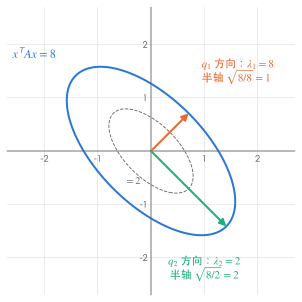
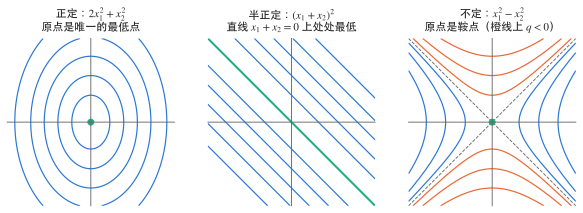
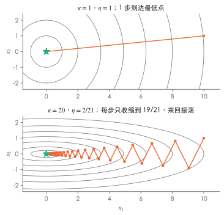

# 对称矩阵、二次型与正定性

一次函数 $a\tp x$ 由一个向量决定，二次函数 $x\tp Ax$ 由一个对称矩阵决定。多元函数在一点附近怎样弯曲，由它的二阶导数矩阵（Hessian）给出的二次型描述；一组数据在各个方向上的方差，由协方差矩阵给出的二次型描述。二次型"恒为正"的性质称为正定，它对应碗形的函数图像、唯一的最小点和能够收敛的梯度下降。本章讲二次型的几何图像、正定性的判别和计算，以及它们在优化和概率模型里的用法。前置知识是[特征值与特征向量](eigen.md)里的谱定理。

## 1. 二次型与对称矩阵

$n$ 个变量的二次齐次多项式称为**二次型**（quadratic form）。它总可以写成

$$
q(x)=x\tp Ax=\sum_{i=1}^n\sum_{j=1}^na_{ij}x_ix_j,\qquad\text{二元时}\quad x\tp\bmat{a&b\\b&d}x=ax_1^2+2bx_1x_2+dx_2^2
$$

多项式和矩阵的对应规则：**平方项 $x_i^2$ 的系数放在对角元 $a_{ii}$；交叉项 $x_ix_j$ 的系数平分给 $a_{ij}$ 和 $a_{ji}$**。

只考虑对称矩阵就够了：对任意方阵 $M$，$x\tp Mx=x\tp\bigl(\frac{M+M\tp}2\bigr)x$，反对称的部分贡献为 0。例如 $\smat{1&4\\0&2}$ 与 $\smat{1&2\\2&2}$ 给出同一个二次型 $x_1^2+4x_1x_2+2x_2^2$。取对称矩阵之后，就可以使用谱定理。

??? example "例：二次型与矩阵互相转换"
    (1) 写出 $q(x)=x_1^2+2x_2^2+3x_3^2+4x_1x_2-2x_2x_3$ 的矩阵。(2) 写出 $A=\smat{5&3\\3&5}$ 对应的二次型。

    **解** (1) 平方项系数 $1,2,3$ 放在对角线上；$x_1x_2$ 的系数 4 平分为 $a_{12}=a_{21}=2$；$x_2x_3$ 的系数 $-2$ 平分为 $a_{23}=a_{32}=-1$；没有 $x_1x_3$ 项，$a_{13}=a_{31}=0$：

    $$
    A=\bmat{1&2&0\\2&2&-1\\0&-1&3}
    $$

    (2) $q(x)=5x_1^2+6x_1x_2+5x_2^2$。

### 几何图像：等高线是椭圆

由谱定理，$A=Q\Lambda Q\tp$，$Q$ 的列是两两正交的单位特征向量 $q_1,\dots,q_n$。令 $y=Q\tp x$，即改用特征向量作坐标轴（相当于把坐标轴旋转一下），则

$$
x\tp Ax=y\tp\Lambda y=\lambda_1y_1^2+\lambda_2y_2^2+\cdots+\lambda_ny_n^2
$$

交叉项全部消失。如果特征值全为正，等高线 $x\tp Ax=c$（$c>0$）在新坐标下是 $\sum_i\lambda_iy_i^2=c$，这是一个椭圆（高维时是椭球）：

- **主轴方向**是特征向量 $q_i$；
- **半轴长**是 $\sqrt{c/\lambda_i}$。特征值越大，函数沿这个方向增长越快，等高线在这个方向上越窄。

{ .diagram }

??? example "例：求椭圆的主轴方向和半轴长"
    求椭圆 $5x_1^2+6x_1x_2+5x_2^2=8$ 的主轴方向和半轴长。

    **解** $A=\smat{5&3\\3&5}$，$\tr A=10$，$\det A=16$，特征值 $\lambda_1=8$，$\lambda_2=2$，对应 $q_1=\frac1{\sqrt2}[1\ \ 1]\tp$，$q_2=\frac1{\sqrt2}[1\ \ -1]\tp$。

    在坐标 $y=Q\tp x$ 下方程变为 $8y_1^2+2y_2^2=8$，即 $y_1^2+\dfrac{y_2^2}{4}=1$。所以沿 $q_1$ 方向的半轴长为 $\sqrt{8/8}=1$（短轴），沿 $q_2$ 方向的半轴长为 $\sqrt{8/2}=2$（长轴），如上图。

## 2. 正定、半正定与不定

设 $A$ 是对称矩阵。

- **正定**（positive definite）：对所有 $x\ne0$ 有 $x\tp Ax>0$，记作 $A\succ0$；
- **半正定**（positive semidefinite）：对所有 $x$ 有 $x\tp Ax\ge0$，记作 $A\succeq0$；
- **负定、半负定**：$-A$ 正定、半正定；
- **不定**（indefinite）：$x\tp Ax$ 既能取正值也能取负值。

由 $x\tp Ax=\sum_i\lambda_iy_i^2$ 立刻得到用特征值的判别方法，以及函数图像 $z=x\tp Ax$ 的形状：

| 类型 | 特征值 | 图像形状 | 例 |
| --- | --- | --- | --- |
| 正定 | 全部大于 0 | 碗形，原点是唯一的最低点 | $2x_1^2+x_2^2$ |
| 半正定（非正定） | 全部非负，至少一个为 0 | 槽形，沿零特征值的方向是平的 | $(x_1+x_2)^2$ |
| 不定 | 有正有负 | 马鞍形，原点是鞍点 | $x_1^2-x_2^2$ |
| 负定 | 全部小于 0 | 倒扣的碗，原点是唯一的最高点 | $-x_1^2-x_2^2$ |

{ .diagram }

### 正定的等价判据

对称矩阵 $A$ 正定，等价于下面任何一条：

1. **特征值**全为正；
2. 不换行的消元得到的 $n$ 个**主元**全为正；
3. $n$ 个**顺序主子式** $\Delta_1,\dots,\Delta_n$ 全为正（$\Delta_k$ 是左上角 $k\times k$ 子矩阵的行列式）。它与第 2 条的关系是：第 $k$ 个主元等于 $\Delta_k/\Delta_{k-1}$；
4. 存在列线性无关的矩阵 $B$，使 $A=B\tp B$。这时 $x\tp Ax=\lVert Bx\rVert^2$，只有 $x=0$ 时才为 0；
5. 存在 Cholesky 分解 $A=LL\tp$（第 3 节）。

各条的适用场合：手算数值矩阵用顺序主子式或主元；含参数的矩阵用顺序主子式；程序里用 Cholesky 分解，计算量最小；要说明某一类矩阵（如协方差矩阵）总是半正定，用第 4 条；想知道"有多正定"，看特征值。

其余类型的判别：

- **半正定**等价于特征值全非负，也等价于存在某个 $B$（不要求列无关）使 $A=B\tp B$；
- **负定**等价于顺序主子式的符号交替：$\Delta_1<0,\ \Delta_2>0,\ \Delta_3<0,\dots$，即 $(-1)^k\Delta_k>0$。

正定矩阵的几个推论：对角元全为正；行列式为正，因而可逆；$A^{-1}$ 也正定（特征值是 $1/\lambda_i$）；两个正定矩阵的和正定；半正定矩阵加上 $\epsilon I$（$\epsilon>0$）是正定的。

!!! warning "易错点"
    - 正定性只对对称矩阵讨论。元素全为正的矩阵不一定正定：$\smat{1&2\\2&1}$ 的特征值是 $3$ 和 $-1$，它是不定的。
    - 判断半正定不能只看顺序主子式非负：$\smat{0&0\\0&-1}$ 的两个顺序主子式都是 0，但它是半负定的。半正定要用特征值判断。
    - 负定的判据不是"顺序主子式全为负"，而是奇数阶为负、偶数阶为正。

??? example "例：用几种方法判断正定"
    判断 $A=\bmat{2&-1&0\\-1&2&-1\\0&-1&2}$ 是否正定。

    **解** 方法一（顺序主子式）：$\Delta_1=2$，$\Delta_2=\begin{vmatrix}2&-1\\-1&2\end{vmatrix}=3$，$\Delta_3=\det A=2\cdot3-(-1)\cdot(-2)=4$，全为正，$A$ 正定。

    方法二（主元）：第 2 行加上第 1 行的 $\frac12$ 倍，得 $[0\ \ \frac32\ \ -1]$；第 3 行加上新第 2 行的 $\frac23$ 倍，得 $[0\ \ 0\ \ \frac43]$。主元 $2,\ \frac32,\ \frac43$ 全为正，并且正好等于 $\Delta_1,\ \Delta_2/\Delta_1,\ \Delta_3/\Delta_2$。

    方法三（特征值）：$\lvert\lambda I-A\rvert=(\lambda-2)\bigl[(\lambda-2)^2-2\bigr]$，特征值 $2-\sqrt2,\ 2,\ 2+\sqrt2$ 全为正。

    方法四（配成平方和）：

    $$
    x\tp Ax=2x_1^2-2x_1x_2+2x_2^2-2x_2x_3+2x_3^2=x_1^2+(x_1-x_2)^2+(x_2-x_3)^2+x_3^2
    $$

    四个平方项同时为 0 只能是 $x=0$。这相当于 $A=B\tp B$，其中 $B=\smat{1&0&0\\-1&1&0\\0&-1&1\\0&0&1}$ 的三列线性无关。

??? example "例：含参数的正定条件"
    $t$ 取何值时 $A=\bmat{1&t&0\\t&2&1\\0&1&1}$ 正定？

    **解** $\Delta_1=1>0$；$\Delta_2=2-t^2$；按第一行展开，$\Delta_3=1\cdot(2-1)-t\cdot(t-0)=1-t^2$。

    要求 $2-t^2>0$ 且 $1-t^2>0$，即 $\lvert t\rvert<1$。当 $t=\pm1$ 时 $\det A=0$，$A$ 半正定但不正定；$\lvert t\rvert>1$ 时 $A$ 不定。

## 3. Cholesky 分解

对称正定矩阵可以唯一地分解为

$$
A=LL\tp
$$

其中 $L$ 是对角元为正的下三角矩阵。这称为 **Cholesky 分解**，它是上一节第 4 条判据的一个具体实现（取 $B=L\tp$）。

逐列比较 $A=LL\tp$ 两边的元素，就得到计算公式。对 $j=1,\dots,n$：

$$
l_{jj}=\sqrt{a_{jj}-\sum_{k<j}l_{jk}^2},\qquad l_{ij}=\frac{1}{l_{jj}}\Bigl(a_{ij}-\sum_{k<j}l_{ik}l_{jk}\Bigr)\quad(i>j)
$$

!!! tip "方法：手算 Cholesky 分解"
    1. 第 1 列：$l_{11}=\sqrt{a_{11}}$，其余 $l_{i1}=a_{i1}/l_{11}$。
    2. 第 $j$ 列：先算对角元，从 $a_{jj}$ 中减去 $L$ 第 $j$ 行已算出的元素的平方和，再开方；然后算它下方的元素，从 $a_{ij}$ 中减去 $L$ 的第 $i$ 行与第 $j$ 行已算出部分的内积，再除以 $l_{jj}$。
    3. 如果某一步根号下的数不是正数，说明 $A$ 不是正定矩阵。
    4. 检验：乘出 $LL\tp$ 与 $A$ 对照。

??? example "例：Cholesky 分解并解方程"
    对 $A=\bmat{4&2&2\\2&5&3\\2&3&6}$ 做 Cholesky 分解，并解 $Ax=b$，$b=[2\ \ 5\ \ 7]\tp$。

    **解** 第 1 列：$l_{11}=\sqrt4=2$，$l_{21}=2/2=1$，$l_{31}=2/2=1$。

    第 2 列：$l_{22}=\sqrt{5-1^2}=2$，$l_{32}=(3-1\cdot1)/2=1$。

    第 3 列：$l_{33}=\sqrt{6-1^2-1^2}=2$。

    $$
    L=\bmat{2&0&0\\1&2&0\\1&1&2}
    $$

    解方程分两步，都是三角方程组。前代解 $Ly=b$：$y_1=1$，$y_2=(5-1)/2=2$，$y_3=(7-1-2)/2=2$。回代解 $L\tp x=y$：$x_3=1$，$x_2=(2-1)/2=\frac12$，$x_1=(1-\frac12-1)/2=-\frac14$。

    顺带得到 $\det A=(\det L)^2=(2\cdot2\cdot2)^2=64$。

Cholesky 分解的用途：

- **解方程**：$A$ 对称正定时，用它代替 LU 分解（见[线性方程组、消元与逆矩阵](linear-systems.md)），计算量约为一半。
- **判断正定**：分解成功就是正定，失败就不是。这是程序里判断正定性的标准做法。
- **算对数行列式**：$\log\det A=2\sum_i\log l_{ii}$，多元高斯分布的对数似然要用到（见[行列式](determinant.md)）。
- **采样**：见第 8 节。

```python
import numpy as np

A = np.array([[4., 2., 2.], [2., 5., 3.], [2., 3., 6.]])
L = np.linalg.cholesky(A)
print(L)
# [[2. 0. 0.]
#  [1. 2. 0.]
#  [1. 1. 2.]]
b = np.array([2., 5., 7.])
y = np.linalg.solve(L, b)        # Ly = b
x = np.linalg.solve(L.T, y)      # L^T x = y
print(y, x)                      # [1. 2. 2.] [-0.25  0.5   1.  ]
print(2 * np.log(np.diag(L)).sum(), np.linalg.slogdet(A)[1])   # 4.1588830833596715 4.1588830833596715

def is_pd(A):
    try:
        np.linalg.cholesky(A)
        return True
    except np.linalg.LinAlgError:
        return False

print(is_pd(A), is_pd(np.array([[1., 2.], [2., 1.]])), is_pd(np.array([[1., 1.], [1., 1.]])))   # True False False
```

`np.linalg.solve` 不会利用三角结构，这里只是为了演示两步求解；实际使用 `scipy.linalg.cho_factor` / `cho_solve`，PyTorch 中是 `torch.linalg.cholesky` 和 `torch.cholesky_solve`。

## 4. 化标准形与 Rayleigh 商

第 1 节的坐标变换 $x=Qy$ 把二次型化成只含平方项的**标准形** $\sum_i\lambda_iy_i^2$。$Q$ 是正交矩阵，这个变换不改变向量的长度和夹角。

??? example "例：用正交变换化二次型为标准形"
    把 $q(x)=2x_1^2+2x_2^2+2x_3^2+2x_1x_2+2x_1x_3+2x_2x_3$ 化为标准形，并判断是否正定。

    **解** 矩阵 $A=\bmat{2&1&1\\1&2&1\\1&1&2}$。它的正交对角化在[特征值与特征向量](eigen.md)的例题里已经求出：特征值 $4,1,1$，

    $$
    Q=\bmat{\frac1{\sqrt3}&\frac1{\sqrt2}&\frac1{\sqrt6}\\\frac1{\sqrt3}&-\frac1{\sqrt2}&\frac1{\sqrt6}\\\frac1{\sqrt3}&0&-\frac2{\sqrt6}}
    $$

    令 $x=Qy$，则 $q=4y_1^2+y_2^2+y_3^2$。特征值全为正，二次型正定。也可以直接配方看出：$q=(x_1+x_2+x_3)^2+x_1^2+x_2^2+x_3^2$。

### Rayleigh 商

对非零向量 $x$，称

$$
R(x)=\frac{x\tp Ax}{x\tp x}
$$

为 **Rayleigh 商**。它只与 $x$ 的方向有关，表示二次型沿这个方向的"单位长度上的取值"。用 $y=Q\tp x$ 改写，

$$
R(x)=\frac{\sum_i\lambda_iy_i^2}{\sum_iy_i^2}
$$

是各特征值的加权平均（权重 $y_i^2/\sum_jy_j^2$ 非负、和为 1），所以

$$
\lambda_{\min}\le\frac{x\tp Ax}{x\tp x}\le\lambda_{\max}
$$

右边的等号在 $x$ 取 $\lambda_{\max}$ 的特征向量时成立，左边同理。换一种说法：在单位球面 $\lVert x\rVert=1$ 上，$x\tp Ax$ 的最大值是 $\lambda_{\max}$，最小值是 $\lambda_{\min}$。

??? example "例：Rayleigh 商的取值范围"
    $A=\smat{5&3\\3&5}$。计算 $x=[1\ \ 0]\tp,\ [2\ \ 1]\tp,\ [1\ \ 1]\tp,\ [1\ \ -1]\tp$ 处的 Rayleigh 商，并求 $5x_1^2+6x_1x_2+5x_2^2$ 在单位圆上的最大值和最小值。

    **解** $R([1\ \ 0]\tp)=5$；$R([2\ \ 1]\tp)=\dfrac{20+12+5}{5}=7.4$；$R([1\ \ 1]\tp)=\dfrac{16}{2}=8$；$R([1\ \ -1]\tp)=\dfrac{4}{2}=2$。

    $A$ 的特征值是 8 和 2，所以所有取值都在 $[2,8]$ 内。单位圆上的最大值为 8，在 $\pm\frac1{\sqrt2}[1\ \ 1]\tp$ 处取到；最小值为 2，在 $\pm\frac1{\sqrt2}[1\ \ -1]\tp$ 处取到。

!!! info "AI 联系"
    主成分分析要找一个单位方向 $v$，使数据投影到它上面的方差 $v\tp\Sigma v$ 最大。这就是协方差矩阵 $\Sigma$ 的 Rayleigh 商的最大化问题，答案是 $\Sigma$ 最大特征值对应的特征向量，见 [PCA、低秩近似与 LoRA](pca-lowrank.md)。

## 5. Hessian 矩阵与极值判别

多元函数 $f:\R^n\to\R$ 在点 $x$ 附近的二阶泰勒展开是

$$
f(x+\Delta)\approx f(x)+\nabla f(x)\tp\Delta+\frac12\Delta\tp H(x)\,\Delta,\qquad H_{ij}=\frac{\partial^2f}{\partial x_i\partial x_j}
$$

$H$ 称为 **Hessian 矩阵**，二阶偏导数连续时它是对称矩阵。梯度的计算规则见[矩阵求导与反向传播](matrix-calculus.md)。

在**驻点**（$\nabla f=0$ 的点）处，一次项消失，$f(x+\Delta)-f(x)\approx\frac12\Delta\tp H\Delta$，函数在驻点附近的形状由二次型 $\Delta\tp H\Delta$ 决定：

| 驻点处的 $H$ | 结论 |
| --- | --- |
| 正定 | 严格局部极小点 |
| 负定 | 严格局部极大点 |
| 不定 | 鞍点：沿某些方向上升，沿另一些方向下降 |
| 半正定或半负定，且有零特征值 | 二阶信息不足以判断 |

$H$ 的特征值就是函数沿各特征方向的曲率。如果 $H$ 在整个定义域上处处半正定，$f$ 是凸函数，局部极小点就是全局极小点。

??? example "例：用 Hessian 判断驻点类型"
    求 $f(x_1,x_2)=x_1^3+x_2^3-3x_1x_2$ 的驻点并判断类型。

    **解** $\nabla f=\bmat{3x_1^2-3x_2\\3x_2^2-3x_1}=0$ 给出 $x_2=x_1^2$，$x_1=x_2^2$，于是 $x_1=x_1^4$，$x_1=0$ 或 $1$。驻点为 $(0,0)$ 和 $(1,1)$。

    $$
    H=\bmat{6x_1&-3\\-3&6x_2}
    $$

    在 $(0,0)$：$H=\smat{0&-3\\-3&0}$，特征值 $\pm3$，不定，是鞍点。沿 $[1\ \ -1]\tp$ 方向函数上升，沿 $[1\ \ 1]\tp$ 方向函数下降。

    在 $(1,1)$：$H=\smat{6&-3\\-3&6}$，$\Delta_1=6>0$，$\Delta_2=27>0$，正定，是局部极小点，$f(1,1)=-1$。两个方向的曲率是特征值 $3$ 和 $9$。

## 6. 条件数与梯度下降的收敛速度

对称正定矩阵的**条件数**（condition number）定义为

$$
\kappa(H)=\frac{\lambda_{\max}}{\lambda_{\min}}\ge1
$$

几何上，等高线椭圆的长短轴之比是 $\sqrt\kappa$。$\kappa$ 接近 1 时等高线接近圆；$\kappa$ 很大时是狭长的椭圆，称为**病态**（ill-conditioned）。一般矩阵的条件数用奇异值定义，见[奇异值分解](svd.md)。

考虑用梯度下降求 $f(x)=\frac12x\tp Hx-b\tp x$ 的最小点 $x^*=H^{-1}b$。梯度是 $Hx-b=H(x-x^*)$，所以误差 $e_k=x_k-x^*$ 满足

$$
e_{k+1}=(I-\eta H)\,e_k
$$

[特征值与特征向量](eigen.md)里已经说明：沿 $H$ 的第 $i$ 个特征方向，误差每步乘 $1-\eta\lambda_i$，稳定条件是 $\eta<2/\lambda_{\max}$。这里进一步问收敛有多快。最慢的方向决定整体速度，每步的收缩因子是

$$
\max_i\lvert1-\eta\lambda_i\rvert=\max\bigl(\lvert1-\eta\lambda_{\min}\rvert,\ \lvert1-\eta\lambda_{\max}\rvert\bigr)
$$

$\eta$ 太小，曲率小的方向（$\lambda_{\min}$）收敛慢；$\eta$ 太大，曲率大的方向（$\lambda_{\max}$）振荡得厉害。让两者相等，$1-\eta\lambda_{\min}=\eta\lambda_{\max}-1$，得到最优的固定步长和对应的收缩因子：

$$
\boxed{\eta^*=\frac{2}{\lambda_{\max}+\lambda_{\min}},\qquad \lVert e_{k+1}\rVert\le\frac{\kappa-1}{\kappa+1}\,\lVert e_k\rVert}
$$

- $\kappa=1$ 时收缩因子为 0，一步到达最小点。
- $\kappa$ 很大时 $\frac{\kappa-1}{\kappa+1}\approx1-\frac2\kappa$，要把误差缩小到原来的 $\varepsilon$ 倍大约需要 $\frac\kappa2\ln\frac1\varepsilon$ 步。**迭代步数与条件数成正比**。

{ .diagram }

用 NumPy 数一下把误差降到 $10^{-3}$ 需要的步数：

```python
def gd_steps(H, x0, eta, tol=1e-3):
    x, k = x0.copy(), 0
    while np.linalg.norm(x) > tol * np.linalg.norm(x0):
        x = x - eta * (H @ x)
        k += 1
    return k

for lam_max in (1., 20., 100., 1000.):
    H = np.diag([lam_max, 1.])              # 条件数等于 lam_max
    eta = 2 / (lam_max + 1)                 # 最优固定步长
    print(lam_max, gd_steps(H, np.array([1., 1.]), eta))
# 1.0 1
# 20.0 70
# 100.0 346
# 1000.0 3454
```

步数与 $\frac\kappa2\ln10^3\approx3.45\kappa$ 吻合。

??? example "例：由条件数估计迭代步数"
    某个二次损失函数的 Hessian 的最小、最大特征值分别是 1 和 20。(1) 学习率的稳定范围是多少？(2) 最优固定学习率是多少，每步误差收缩到多少？(3) 用最优学习率把误差降到初始的 $10^{-3}$ 需要多少步？(4) 若保守地取 $\eta=0.05$ 呢？

    **解** (1) $\eta<2/\lambda_{\max}=0.1$。

    (2) $\kappa=20$，$\eta^*=2/21\approx0.095$，收缩因子 $\frac{19}{21}\approx0.905$。最优学习率离发散的边界 0.1 很近。

    (3) $(19/21)^k\le10^{-3}$，$k\ge\dfrac{\ln10^{-3}}{\ln(19/21)}\approx69.02$，需要 70 步，与上面程序的输出一致。

    (4) 两个方向的因子是 $\lvert1-0.05\times20\rvert=0$ 和 $1-0.05\times1=0.95$，收缩因子 0.95，$k\ge\dfrac{\ln10^{-3}}{\ln0.95}\approx134.7$，需要约 135 步，是最优学习率的将近两倍。

## 7. 协方差矩阵与 Gram 矩阵为什么半正定

对任意矩阵 $B\in\R^{m\times n}$，$B\tp B$ 是对称矩阵，并且

$$
v\tp(B\tp B)\,v=(Bv)\tp(Bv)=\lVert Bv\rVert^2\ge0
$$

所以 **$B\tp B$ 一定半正定**。等号只在 $Bv=0$ 时成立，因此 $B\tp B$ 正定当且仅当 $B$ 的各列线性无关（零空间只有零向量，见[线性无关、秩与四个基本子空间](subspaces.md)）。机器学习里两类最常见的对称矩阵都是这种形式。

**协方差矩阵**。设数据矩阵 $X\in\R^{n\times d}$ 已经中心化（每一列减去了该列的均值），协方差矩阵是 $\Sigma=\frac1nX\tp X$（或除以 $n-1$）。对单位向量 $v$，$Xv$ 是所有样本在方向 $v$ 上的投影，于是

$$
v\tp\Sigma v=\frac1n\lVert Xv\rVert^2=\text{数据沿方向 }v\text{ 的方差}\ \ge0
$$

半正定的含义就是"任何方向上的方差都不为负"。$\Sigma$ 有零特征值，说明数据在某个方向上完全没有变化。样本数不超过特征数（$n\le d$）时一定如此：中心化之后 $X$ 的秩至多为 $n-1$。

**Gram 矩阵**。$K=XX\tp\in\R^{n\times n}$ 的 $(i,j)$ 元是第 $i$、$j$ 个样本的内积 $x_i\tp x_j$。同理它也半正定。核方法要求核矩阵半正定，原因就在这里：核函数的值被解释为某个特征空间里的内积。$X\tp X$ 与 $XX\tp$ 的非零特征值相同，见[奇异值分解](svd.md)。

??? example "例：手算协方差矩阵并判断正定性"
    (1) 三个样本、两个特征的数据 $X=\bmat{2&0\\0&1\\-2&-1}$（各列均值已为 0）。求协方差矩阵 $\Sigma=\frac13X\tp X$，判断是否正定，并求数据沿 $v=\frac1{\sqrt2}[1\ \ -1]\tp$ 方向的方差。(2) 把数据换成 $X'=\bmat{1&2\\0&0\\-1&-2}$，结论有什么变化？

    **解** (1) $X\tp X=\bmat{8&2\\2&2}$，$\Sigma=\dfrac13\bmat{8&2\\2&2}$。$\Delta_1=\frac83>0$，$\Delta_2=\frac{16-4}{9}=\frac43>0$，正定。沿 $v$ 的方差为 $v\tp\Sigma v=\frac13\cdot\frac12(8-2-2+2)=1$。也可以先算投影 $Xv=\frac1{\sqrt2}[2\ \ -1\ \ -1]\tp$，再算 $\frac13\lVert Xv\rVert^2=\frac13\cdot\frac{6}{2}=1$。

    (2) $X'\tp X'=\bmat{2&4\\4&8}$，行列式为 0，特征值是 $10$ 和 $0$，半正定但不正定。第二个特征恒等于第一个特征的 2 倍，两列线性相关；沿 $v=[2\ \ -1]\tp$ 方向 $X'v=0$，数据在这个方向上的方差为 0。

样本数少于特征数时的情形：

```python
rng = np.random.default_rng(0)
X = rng.standard_normal((3, 5))          # 3 个样本，5 个特征
X = X - X.mean(axis=0)                   # 中心化
S = X.T @ X / len(X)                     # 5x5 协方差矩阵
print(np.linalg.eigvalsh(S).round(4))    # [0.     0.     0.     0.5068 2.482 ]
print(np.linalg.matrix_rank(S))          # 2，中心化后秩至多为 n-1
print(is_pd(S), is_pd(S + 1e-6 * np.eye(5)))    # False True（is_pd 见第 3 节）
print(np.linalg.eigvalsh(X @ X.T).round(4))     # [0.     1.5204 7.4461]，Gram 矩阵
```

奇异或接近奇异的协方差矩阵不能做 Cholesky 分解，求逆也不可靠。通常的处理是加上一个小的 $\epsilon I$，特征值全部增加 $\epsilon$，矩阵变成正定的。岭回归中的 $X\tp X+\lambda I$ 是同样的做法，见[线性方程组、消元与逆矩阵](linear-systems.md)。输出的最后一行还显示，Gram 矩阵的非零特征值 $1.5204,\ 7.4461$ 正好是协方差矩阵非零特征值的 $n=3$ 倍。

## 8. 用 Cholesky 分解从多元高斯分布采样

要从 $\mathcal N(\mu,\Sigma)$ 采样，先对协方差矩阵做 Cholesky 分解 $\Sigma=LL\tp$，再取标准正态样本 $z\sim\mathcal N(0,I)$，令

$$
x=\mu+Lz
$$

高斯变量的线性变换仍是高斯变量；均值是 $\mu$，协方差是 $\mathrm E[(Lz)(Lz)\tp]=L\,\mathrm E[zz\tp]\,L\tp=LL\tp=\Sigma$。

??? example "例：二维高斯分布的采样公式"
    写出从 $\mathcal N(\mu,\Sigma)$ 采样的公式，其中 $\mu=[1\ \ -1]\tp$，$\Sigma=\bmat{4&2\\2&3}$。

    **解** $l_{11}=\sqrt4=2$，$l_{21}=2/2=1$，$l_{22}=\sqrt{3-1^2}=\sqrt2$，$L=\bmat{2&0\\1&\sqrt2}$。取独立的标准正态变量 $z_1,z_2$，

    $$
    x_1=1+2z_1,\qquad x_2=-1+z_1+\sqrt2\,z_2
    $$

    验证：$\operatorname{Var}(x_1)=4$，$\operatorname{Var}(x_2)=1+2=3$，$\operatorname{Cov}(x_1,x_2)=2\cdot1=2$。两个分量共用 $z_1$，相关性由此产生。

```python
rng = np.random.default_rng(0)
mu = np.array([1., -1.])
Sigma = np.array([[4., 2.], [2., 3.]])
L = np.linalg.cholesky(Sigma)
z = rng.standard_normal((100_000, 2))    # 每行一个标准正态样本
x = mu + z @ L.T                         # 每行是 mu + L z
print(x.mean(axis=0).round(2))           # [ 1. -1.]
print(np.cov(x, rowvar=False).round(2))
# [[4.02 1.99]
#  [1.99 2.99]]
```

这个写法把"采样"变成了 $\mu$ 和 $L$ 的可微函数，随机性全部放在与参数无关的 $z$ 里。变分自编码器（VAE）的重参数化 $x=\mu+\sigma\odot\epsilon$ 是协方差为对角阵时的特例（$L=\diag(\sigma)$）。PyTorch 的 `torch.distributions.MultivariateNormal` 可以直接用 `scale_tril` 参数传入 $L$。

高斯密度的等高线 $(x-\mu)\tp\Sigma^{-1}(x-\mu)=c$ 是第 1 节讲的椭圆：主轴沿 $\Sigma$ 的特征向量，半轴长正比于 $\sqrt{\lambda_i}$（$\Sigma^{-1}$ 的特征值是 $1/\lambda_i$）。左边的二次型等于 $\lVert L^{-1}(x-\mu)\rVert^2$，称为马氏距离的平方。

## 9. 损失曲面：鞍点、预条件与 sharpness

神经网络的损失 $L(\theta)$ 在参数 $\theta_0$ 附近的二阶近似是 $L(\theta_0+\Delta)\approx L(\theta_0)+g\tp\Delta+\frac12\Delta\tp H\Delta$。前面几节的结论可以直接用来描述训练中的现象，只是要记住它们只在局部成立。

### 病态条件数

第 6 节的图就是病态损失曲面上梯度下降的样子：梯度主要指向曲率大的方向（横跨"山谷"），而不是指向最低点；学习率受曲率大的方向限制，沿谷底方向前进得很慢。输入特征的尺度相差很大时就会出现这种情况：线性回归的损失的 Hessian 是 $\frac1nX\tp X$，各列尺度悬殊时它的特征值也相差悬殊。对输入特征做标准化，直接的作用就是改善条件数。

### 鞍点

驻点是局部极小点，要求 Hessian 的 $n$ 个特征值全部非负；只要有正有负就是鞍点。维数高的时候，"全部同号"是很强的要求。用随机对称矩阵做一个实验，统计特征值全为正的比例：

```python
rng = np.random.default_rng(0)
for n in (1, 2, 3, 4, 6):
    hits = 0
    for _ in range(20000):
        G = rng.standard_normal((n, n))
        hits += np.linalg.eigvalsh((G + G.T) / 2).min() > 0
    print(n, hits / 20000)
# 1 0.498
# 2 0.145
# 3 0.02715
# 4 0.0024
# 6 0.0
```

比例随维数下降得非常快。真实网络的 Hessian 不是这样的随机矩阵，这个实验只说明一个直观：在高维的非凸问题里，鞍点远比局部极小点常见。在鞍点附近，沿负曲率方向（$\lambda_i<0$）梯度下降的因子 $1-\eta\lambda_i>1$，迭代点会离开鞍点；但 $\lvert\lambda_i\rvert$ 很小时离开得很慢，表现为损失长时间停滞。

### 预条件、牛顿法与 Adam

**预条件**（preconditioning）是在梯度前面乘一个矩阵来改善条件数：

$$
x_{k+1}=x_k-\eta\,P^{-1}\nabla f(x_k)
$$

其中 $P$ 对称正定。这时决定收敛速度的不再是 $H$，而是 $P^{-1}H$ 的特征值。

- 取 $P=H$ 是**牛顿法**。对二次函数，取 $\eta=1$：$x_1=x_0-H^{-1}(Hx_0-b)=H^{-1}b$，一步到达最小点，相当于把条件数变成了 1。代价是要构造 $n\times n$ 的 Hessian 并解一个线性方程组，参数量上亿时做不到。
- 取 $P=\diag(H)$ 是对角预条件，只需要 $n$ 个数。它能消除各坐标之间尺度的差异，但消除不了坐标之间的耦合。

??? example "例：对角预条件把条件数从 134 降到 3"
    $f(x)=\frac12x\tp Hx-b\tp x$，$H=\bmat{100&5\\5&1}$，$b=[1\ \ 1]\tp$。(1) 求 $H$ 的条件数；(2) 求对角预条件之后的条件数；(3) 写出牛顿法从 $x_0=0$ 出发的一步。

    **解** (1) $\tr H=101$，$\det H=75$，$\lambda=\dfrac{101\pm\sqrt{101^2-300}}{2}=\dfrac{101\pm\sqrt{9901}}{2}$，即 $\lambda_{\max}\approx100.25$，$\lambda_{\min}\approx0.748$，$\kappa\approx134$。

    (2) 取 $P=\diag(H)=\diag(100,1)$。$P^{-1}H$ 与对称矩阵 $P^{-1/2}HP^{-1/2}$ 相似，后者是

    $$
    \bmat{\frac1{10}&0\\0&1}\bmat{100&5\\5&1}\bmat{\frac1{10}&0\\0&1}=\bmat{1&0.5\\0.5&1}
    $$

    特征值 $1.5$ 和 $0.5$，条件数为 3。两个坐标的尺度被拉平了，剩下的 0.5 来自两个坐标之间的耦合。

    (3) $x_1=x_0-H^{-1}(Hx_0-b)=H^{-1}b=\dfrac1{75}\bmat{1&-5\\-5&100}\bmat{1\\1}=\bmat{-4/75\\95/75}\approx\bmat{-0.053\\1.267}$，就是最小点。

三种做法各用最优固定步长，迭代到相对误差 $10^{-6}$ 所需的步数：

```python
H = np.array([[100., 5.], [5., 1.]])
b = np.array([1., 1.])
x_star = np.linalg.solve(H, b)

def run(P_inv, tol=1e-6):
    w = np.linalg.eigvals(P_inv @ H).real          # 预条件后的特征值
    eta = 2 / (w.max() + w.min())                  # 最优固定步长
    x, k = np.zeros(2), 0
    while np.linalg.norm(x - x_star) > tol * np.linalg.norm(x_star):
        x = x - eta * P_inv @ (H @ x - b)
        k += 1
    return f"kappa={w.max() / w.min():.1f}, steps={k}"

print(run(np.eye(2)))                    # kappa=134.0, steps=926   不做预条件
print(run(np.diag(1 / np.diag(H))))      # kappa=3.0, steps=19      对角预条件
print(run(np.linalg.inv(H)))             # kappa=1.0, steps=1       牛顿法
```

**Adam** 的更新是 $\theta\leftarrow\theta-\eta\,\hat m/(\sqrt{\hat v}+\epsilon)$，其中 $\hat m$、$\hat v$ 分别是梯度和梯度平方的指数滑动平均，除法逐坐标进行。形式上这是一个对角预条件，$P=\diag(\sqrt{\hat v}+\epsilon)$：梯度一贯较大的坐标步长被缩小，梯度一贯较小的坐标步长被放大。这只是一个近似的类比，$\sqrt{\hat v}$ 衡量的是梯度的大小，不是曲率，它不等于 Hessian 的对角元。

### sharpness

文献里常把损失 Hessian 的最大特征值 $\lambda_{\max}(H)$ 称为 **sharpness**。它可以用幂迭代配合"Hessian 乘向量"来估计（见[特征值与特征向量](eigen.md)）。

- 由稳定条件 $\eta<2/\lambda_{\max}$ 反过来看，学习率为 $\eta$ 的梯度下降只能稳定地停留在 $\lambda_{\max}(H)<2/\eta$ 的区域。有实验观察到，在全批量梯度下降训练神经网络时，sharpness 会逐渐上升到 $2/\eta$ 附近并在那里徘徊。这是在特定设置下的经验观察，小批量随机梯度和自适应优化器的情形更复杂。
- sharpness 较小的极小点（"平坦"的极小点）常被和较好的泛化联系起来，也有据此设计的优化方法。但 sharpness 的数值依赖于参数化方式，对同一个函数换一种参数写法就可能改变它，所以这种联系不是定论。

## 小结

| 概念 | 要点 |
| --- | --- |
| 二次型 | $x\tp Ax$，$A$ 取对称矩阵；平方项系数放对角元，交叉项系数平分 |
| 几何 | 等高线 $x\tp Ax=c$ 的主轴沿特征向量，半轴长 $\sqrt{c/\lambda_i}$ |
| 正定判据 | 特征值全正；主元全正；顺序主子式全正；$A=B\tp B$ 且 $B$ 列无关；Cholesky 分解存在 |
| 半正定 | 特征值全非负；$A=B\tp B$；不能只看顺序主子式 |
| Cholesky | $A=LL\tp$；解方程、判断正定、算 $\log\det$、采样 $x=\mu+Lz$ |
| 标准形 | $x=Qy$ 后 $x\tp Ax=\sum_i\lambda_iy_i^2$ |
| Rayleigh 商 | $\lambda_{\min}\le\dfrac{x\tp Ax}{x\tp x}\le\lambda_{\max}$，在特征向量处取等号 |
| 极值判别 | 驻点处 Hessian 正定是极小点，负定是极大点，不定是鞍点 |
| 条件数 | $\kappa=\lambda_{\max}/\lambda_{\min}$；最优步长 $\dfrac{2}{\lambda_{\max}+\lambda_{\min}}$，每步收缩 $\dfrac{\kappa-1}{\kappa+1}$，步数正比于 $\kappa$ |
| 协方差与 Gram 矩阵 | $v\tp B\tp Bv=\lVert Bv\rVert^2\ge0$，所以半正定；奇异时加 $\epsilon I$ |
| 预条件 | 用 $P^{-1}\nabla f$ 代替梯度；$P=H$ 是牛顿法，$P$ 取对角阵计算量小；Adam 形式上是对角预条件 |
| sharpness | $\lambda_{\max}(H)$；梯度下降稳定要求它小于 $2/\eta$ |
