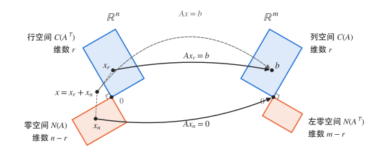
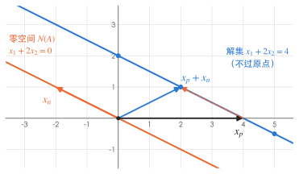
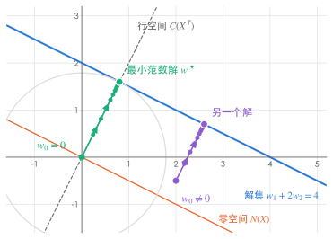

# 线性无关、秩与四个基本子空间

[线性方程组、消元与逆矩阵](linear-systems.md) 讲的是怎么算：消元、回代。本章讲消元结果背后的结构：$Ax=b$ 什么时候有解，有多少个解，全部解合在一起是什么形状。答案由一个数（秩 $r$）和四个子空间给出。AI 里"低秩""瓶颈""过参数化"这几个词说的都是秩：LoRA 把更新量限制在秩 $r$ 以内，语言模型的 logits 矩阵秩不超过隐藏维度，参数比样本多的模型有无穷多个解。

本章的列向量在行内写成 $(1,2,3)$ 的形式。

## 1. 线性空间与子空间

### 意义

$\R^n$ 里做的运算只有两种：向量相加、向量乘以数。一个集合如果做完这两种运算还留在集合里，就可以在它内部做线性代数，不用关心外面的空间。这样的集合叫**子空间**（subspace）。

$\R^n$ 的非空子集 $S$ 是子空间，当且仅当它对加法和数乘封闭：

$$
u,\,v\in S\ \Rightarrow\ u+v\in S,\qquad v\in S,\ c\in\R\ \Rightarrow\ cv\in S
$$

两条合起来就是"对线性组合封闭"。取 $c=0$ 可知**子空间一定包含零向量**，这是最快的排除办法。

几何上，$\R^3$ 的子空间只有四种：原点 $\{0\}$、过原点的直线、过原点的平面、$\R^3$ 本身。不过原点的直线和平面不是子空间。

### 两种给出子空间的方式

- **张成**：一组向量的全部线性组合。矩阵 $A$ 各列的全部线性组合 $\{Ax\}$ 是**列空间** $C(A)$。
- **齐次方程的解集**：$\{x: Ax=0\}$ 是**零空间** $N(A)$。验证：$Ax=0,\ Ay=0\Rightarrow A(x+y)=0,\ A(cx)=0$。

非齐次方程 $Ax=b$（$b\ne0$）的解集不含零向量，不是子空间，它是零空间平移后的结果（第 5 节）。

??? example "例：判断是否为子空间"
    判断下列集合是否为子空间：(a) $\{x\in\R^3: x_1+x_2+x_3=0\}$；(b) $\{x\in\R^3: x_1+x_2+x_3=1\}$；(c) $\{x\in\R^2: x_1x_2=0\}$；(d) $\{x\in\R^2: x_1\ge0,\ x_2\ge0\}$。

    **解** (a) 是。它是 $A=[1\ \ 1\ \ 1]$ 的零空间，一个过原点的平面。

    (b) 不是。零向量不满足 $0+0+0=1$。

    (c) 不是。这个集合是两条坐标轴的并集，对数乘封闭，但 $(1,0)+(0,1)=(1,1)$ 不在集合里，对加法不封闭。

    (d) 不是。第一象限对加法封闭，但 $(-1)\cdot(1,2)=(-1,-2)$ 不在集合里，对数乘不封闭。ReLU 的输出恰好落在这样的集合里，所以 ReLU 层的输出集合不是子空间，这是非线性的一个直接表现。

## 2. 张成、线性无关、基与维数

### 线性无关

一组向量 $v_1,\dots,v_k$ **线性无关**，指的是只有全零系数能把它们组合成零向量：

$$
c_1v_1+\cdots+c_kv_k=0\ \Rightarrow\ c_1=\cdots=c_k=0
$$

意义是这组向量里**没有多余的**：任何一个都不能由其余的组合出来。反过来，线性相关就是存在一个向量能被其余向量表示，去掉它不改变张成的子空间。

把向量排成矩阵的列 $A=[v_1\ \cdots\ v_k]$，上式就是 $Ac=0$ 只有零解，即 $N(A)=\{0\}$。于是判断线性无关变成一次消元。

!!! tip "方法：判断一组向量是否线性无关"
    1. 把向量作为列排成矩阵 $A$，消元化成行最简形 $R$。
    2. 每一列都有主元（主元个数等于向量个数）则线性无关；有自由列则线性相关。
    3. 相关时，$R$ 的自由列直接给出关系：自由列上的数就是用主元列表示它的系数。行变换不改变列之间的线性关系，所以这个关系对 $A$ 的列同样成立。

    $\R^n$ 中多于 $n$ 个向量一定线性相关：$n$ 行的矩阵最多 $n$ 个主元。

### 基、维数、坐标

子空间 $S$ 的一组**基**（basis）是 $S$ 中线性无关并且张成 $S$ 的向量组。"张成"保证每个向量都能表示出来，"无关"保证表示方式唯一。一个子空间有无穷多组基，但每组基的向量个数相同，这个个数叫**维数** $\dim S$。

取定基 $v_1,\dots,v_k$ 后，$S$ 中每个向量 $x$ 唯一地写成 $x=c_1v_1+\cdots+c_kv_k$，系数 $(c_1,\dots,c_k)$ 叫 $x$ 在这组基下的**坐标**。求坐标就是解方程组 $[v_1\ \cdots\ v_k]\,c=x$。

??? example "例：线性相关、基与坐标"
    (1) 判断 $v_1=(1,1,0)$，$v_2=(0,1,1)$，$v_3=(1,2,1)$ 是否线性无关。(2) 把 $v_3$ 换成 $w_3=(1,0,1)$，说明 $v_1,v_2,w_3$ 是 $\R^3$ 的一组基，并求 $x=(2,3,3)$ 在这组基下的坐标。

    **解** (1) 排成列后消元：

    $$
    \bmat{1&0&1\\1&1&2\\0&1&1}\ \to\ \bmat{1&0&1\\0&1&1\\0&1&1}\ \to\ \bmat{1&0&1\\0&1&1\\0&0&0}
    $$

    只有两个主元，第 3 列是自由列，三个向量线性相关。自由列的数是 $(1,1)$，所以 $v_3=1\cdot v_1+1\cdot v_2$。三个向量张成的只是一个平面，维数为 2。

    (2) $\det[v_1\ v_2\ w_3]=\det\smat{1&0&1\\1&1&0\\0&1&1}=1\cdot1-0+1\cdot1=2\ne0$，三列线性无关。$\R^3$ 中三个线性无关的向量就是一组基。设 $x=c_1v_1+c_2v_2+c_3w_3$，按分量写出：

    $$
    c_1+c_3=2,\qquad c_1+c_2=3,\qquad c_2+c_3=3
    $$

    三式相加得 $c_1+c_2+c_3=4$，分别减去三个方程得 $c_2=2,\ c_3=1,\ c_1=1$。坐标为 $(1,2,1)$，验证：$v_1+2v_2+w_3=(1,1,0)+(0,2,2)+(1,0,1)=(2,3,3)$。

### 换基

设新基向量在旧坐标下排成矩阵 $P=[p_1\ \cdots\ p_n]$，则旧坐标 $x$ 和新坐标 $\bar x$ 的关系是 $x=P\bar x$。同一个线性变换在旧基下的矩阵是 $A$，在新基下就是 $P^{-1}AP$（相似变换）。这在控制理论中用得很多，见[状态空间的线性变换](../../control/modern/notes/linear-transform.md)；选哪一组基能让矩阵最简单，是[特征值与特征向量](eigen.md)要回答的问题。

!!! info "AI 联系"
    两个线性映射相乘时，在中间插入任意可逆矩阵 $P$ 不改变结果：$W_2W_1=(W_2P^{-1})(PW_1)$。所以中间表示的单个坐标没有固定含义，有含义的是方向和子空间。中间隔着逐元素的非线性（如 ReLU）时不能这样任意换基，因为逐元素运算依赖具体的坐标轴。

## 3. 秩

### 意义

矩阵 $A\in\R^{m\times n}$ 的**秩**（rank）$r$ 是它的线性无关的列的最大个数，也就是列空间的维数。把 $A$ 看成映射 $x\mapsto Ax$，秩就是**输出实际占据的维数**：不管输入有多少维，输出只能落在一个 $r$ 维子空间里。

三个数是相等的：

$$
r=\text{主元个数}=\dim C(A)\ (\text{列秩})=\dim C(A\tp)\ (\text{行秩})
$$

行秩等于列秩的理由：行变换不改变行空间，也不改变列之间的线性关系；化到行最简形 $R$ 后，非零行的个数和主元列的个数都等于主元个数。

显然 $r\le\min(m,n)$。$r=n$ 叫**列满秩**（各列线性无关），$r=m$ 叫**行满秩**；方阵满秩等价于可逆。

### 计算

手算：消元，数主元。NumPy 用 `np.linalg.matrix_rank`，它通过奇异值判断，能容忍浮点误差（原理见[奇异值分解](svd.md)）。

```python
import numpy as np

A = np.array([[1, 2, 0, 1],
              [2, 4, 1, 4],
              [3, 6, 1, 5]])
print(np.linalg.matrix_rank(A))            # 2
print(np.linalg.matrix_rank(A.T @ A))      # 2，与 A 的秩相同
```

### 性质

| 性质 | 理由 |
| --- | --- |
| $\rank(AB)\le\min(\rank A,\ \rank B)$ | $AB$ 的列是 $A$ 的列的组合，$C(AB)\subseteq C(A)$；$AB$ 的行是 $B$ 的行的组合 |
| $\rank(A+B)\le\rank A+\rank B$ | $C(A+B)\subseteq C(A)+C(B)$ |
| $\rank(A\tp A)=\rank(AA\tp)=\rank A$ | $A\tp Ax=0\Rightarrow x\tp A\tp Ax=\lVert Ax\rVert^2=0\Rightarrow Ax=0$，所以 $N(A\tp A)=N(A)$ |
| $P,\,Q$ 可逆时 $\rank(PAQ)=\rank A$ | 可逆变换不改变维数 |
| $\rank(uv\tp)=1$（$u,v\ne0$） | 每一列都是 $u$ 的倍数 |

第一条最常用：**乘法不会让秩变大**。信息一旦在某一步被压到 $r$ 维，后面再乘什么矩阵都恢复不了。

秩为 1 的矩阵都能写成 $uv\tp$；秩为 $r$ 的矩阵都能写成 $r$ 个秩一矩阵之和，其中最好的一种写法由[奇异值分解](svd.md)给出。

??? example "例：秩一矩阵"
    把 $A=\smat{2&4&6\\1&2&3\\3&6&9}$ 写成 $uv\tp$，并说明 $x\mapsto Ax$ 做了什么。

    **解** 各行都是 $(1,2,3)$ 的倍数，倍数依次为 $2,1,3$，所以

    $$
    A=\bmat{2\\1\\3}\bmat{1&2&3}=uv\tp,\qquad u=(2,1,3),\ v=(1,2,3)
    $$

    于是 $Ax=u\,(v\tp x)$：先算输入与 $v$ 的内积，得到一个数，再把这个数乘到 $u$ 上。例如 $x=(1,1,1)$ 时 $v\tp x=6$，$Ax=6u=(12,6,18)$。

    输出永远在直线 $\operatorname{span}\{u\}$ 上，$C(A)$ 是一维的。满足 $v\tp x=0$ 的输入全部被映到零，$N(A)$ 是与 $v$ 垂直的平面，一组基是 $(-2,1,0)$ 和 $(-3,0,1)$。三维的输入只有"在 $v$ 方向上的分量"这一个数被保留下来。

??? example "例：$AB$ 与 $BA$ 能否可逆"
    $A\in\R^{3\times5}$，$B\in\R^{5\times3}$。$AB$（$3\times3$）和 $BA$（$5\times5$）可能可逆吗？

    **解** $\rank(AB)\le\min(\rank A,\rank B)\le3$，$3\times3$ 的矩阵秩为 3 就可逆，所以 $AB$ 可能可逆（$A$、$B$ 都取随机矩阵时几乎总是可逆）。

    $\rank(BA)\le3<5$，$BA$ 一定不可逆。从映射的角度看：$BA$ 先用 $A$ 把 5 维压到 3 维，再用 $B$ 送回 5 维，中间丢掉的两个维度回不来。第 6 节的 LoRA 用的就是这个结构。

## 4. 四个基本子空间

### 定义与维数

$A\in\R^{m\times n}$、秩为 $r$ 时，有四个与它相关的子空间：

| 子空间 | 定义 | 所在空间 | 维数 | 从消元结果读出一组基 |
| --- | --- | --- | --- | --- |
| 列空间 $C(A)$ | $\{Ax\}$ | $\R^m$ | $r$ | $A$ 的主元列（原矩阵的列） |
| 零空间 $N(A)$ | $\{x: Ax=0\}$ | $\R^n$ | $n-r$ | 每个自由变量对应一个特解 |
| 行空间 $C(A\tp)$ | $\{A\tp y\}$ | $\R^n$ | $r$ | $R$ 的非零行 |
| 左零空间 $N(A\tp)$ | $\{y: A\tp y=0\}$ | $\R^m$ | $m-r$ | 使各行组合为零的系数 |

$\dim N(A)=n-r$ 叫**秩–零化度定理**：$n$ 个未知数里，$r$ 个主元变量由方程确定，剩下 $n-r$ 个自由变量可以任取。

### 正交关系

$Ax=0$ 逐行写出来，就是 $A$ 的每一行与 $x$ 的内积为零。所以零空间里的向量与每一行垂直，从而与行的任意线性组合垂直：

$$
N(A)\perp C(A\tp)\ \ (\text{在}\ \R^n\ \text{中}),\qquad N(A\tp)\perp C(A)\ \ (\text{在}\ \R^m\ \text{中})
$$

维数相加正好是全空间的维数（$r+(n-r)=n$），所以它们互为**正交补**：$\R^n$ 中每个向量可以唯一地分解成

$$
x=x_r+x_n,\qquad x_r\in C(A\tp),\quad x_n\in N(A),\quad x_r\perp x_n
$$

于是 $Ax=Ax_r+Ax_n=Ax_r$。矩阵只对行空间分量起作用，零空间分量被映到零。

{ .diagram }

限制在行空间上，$A$ 是从 $C(A\tp)$ 到 $C(A)$ 的一一对应（两边都是 $r$ 维）。这就是秩的完整含义：$A$ 真正做的事，是把一个 $r$ 维子空间可逆地映到另一个 $r$ 维子空间，其余方向全部丢掉。

!!! tip "方法：求四个基本子空间的基"
    1. 消元把 $A$ 化成行最简形 $R$，记下主元列和自由列，$r$ 等于主元个数。
    2. $C(A)$：取 **$A$ 中**主元列位置上的那些列。
    3. $C(A\tp)$：取 $R$ 的非零行。
    4. $N(A)$：依次令一个自由变量为 1、其余自由变量为 0，由 $Rx=0$ 解出主元变量，得到 $n-r$ 个特解。
    5. $N(A\tp)$：消元时哪些行的组合变成了零行，组合系数就是 $y$；或者对 $A\tp$ 重复第 4 步。
    6. 检查维数 $r,\ n-r,\ r,\ m-r$，并检查两对正交关系。

??? example "例：求秩与四个基本子空间"
    求 $A=\bmat{1&2&0&1\\2&4&1&4\\3&6&1&5}$ 的秩和四个基本子空间的基。

    **解** 消元（第 2 行减 2 倍第 1 行，第 3 行减 3 倍第 1 行，再第 3 行减第 2 行）：

    $$
    A\ \to\ \bmat{1&2&0&1\\0&0&1&2\\0&0&1&2}\ \to\ \bmat{1&2&0&1\\0&0&1&2\\0&0&0&0}=R
    $$

    主元在第 1、3 列，$r=2$；第 2、4 列是自由列。$m=3,\ n=4$。

    - $C(A)$（$\R^3$ 中，2 维）：$A$ 的第 1、3 列 $(1,2,3)$ 和 $(0,1,1)$。
    - $C(A\tp)$（$\R^4$ 中，2 维）：$R$ 的非零行 $(1,2,0,1)$ 和 $(0,0,1,2)$。
    - $N(A)$（$\R^4$ 中，$4-2=2$ 维）：$Rx=0$ 即 $x_1=-2x_2-x_4$，$x_3=-2x_4$。令 $(x_2,x_4)=(1,0)$ 得 $s_1=(-2,1,0,0)$；令 $(x_2,x_4)=(0,1)$ 得 $s_2=(-1,0,-2,1)$。
    - $N(A\tp)$（$\R^3$ 中，$3-2=1$ 维）：消元过程表明第 3 行等于第 1 行加第 2 行，即 $1\cdot\text{行}_1+1\cdot\text{行}_2-1\cdot\text{行}_3=0$，所以 $y=(1,1,-1)$。

    检查正交：$(1,2,0,1)\cdot s_1=-2+2=0$，$(0,0,1,2)\cdot s_2=-2+2=0$，另两个内积同样为 0；$y\cdot(1,2,3)=1+2-3=0$，$y\cdot(0,1,1)=0$。

    用 NumPy 核对（沿用第 3 节代码里的 `A`）：

    ```python
    N = np.array([[-2, -1], [1, 0], [0, -2], [0, 1]])    # 零空间的两个特解排成列
    y = np.array([1, 1, -1])                             # 左零空间的基
    print((A @ N).tolist(), (y @ A).tolist())            # [[0, 0], [0, 0], [0, 0]] [0, 0, 0, 0]
    print(np.linalg.matrix_rank(N))                      # 2，两个特解线性无关
    ```

!!! warning "易错点"
    - 列空间的基要取**原矩阵 $A$** 的主元列，不能取 $R$ 的主元列。行变换会改变列空间：上例中 $R$ 的主元列是 $(1,0,0)$ 和 $(0,1,0)$，而 $(1,0,0)$ 不在 $C(A)$ 里。行空间则不受行变换影响，可以直接取 $R$ 的非零行。
    - 注意向量的长度：$N(A)$ 和 $C(A\tp)$ 的向量有 $n$ 个分量，$C(A)$ 和 $N(A\tp)$ 的向量有 $m$ 个分量。

## 5. $Ax=b$ 的解的结构

### 可解条件

$Ax$ 是 $A$ 的列的线性组合，所以

$$
Ax=b\ \text{有解}\iff b\in C(A)\iff\rank[A\ \ b]=\rank A\iff b\perp N(A\tp)
$$

最后一个条件来自 $C(A)$ 与 $N(A\tp)$ 互为正交补：$b$ 在列空间里，等价于它与左零空间的每个向量垂直。消元时它表现为"零行对应的右端也必须是零"。

### 通解 = 特解 + 零空间

设 $x_p$ 是一个特解。$x$ 是解当且仅当 $A(x-x_p)=0$，即 $x-x_p\in N(A)$：

$$
x=x_p+x_n,\qquad x_n\in N(A)\ \text{任取}
$$

几何上，解集是把零空间平移 $x_p$ 得到的。它和零空间平行、维数相同，但不过原点。下图是 $A=[1\ \ 2]$、$b=4$ 的情形：零空间是直线 $x_1+2x_2=0$，解集是与它平行的直线 $x_1+2x_2=4$。

{ .diagram }

!!! tip "方法：求 $Ax=b$ 的通解"
    1. 对增广矩阵 $[A\ \ b]$ 消元到行最简形 $[R\ \ d]$。
    2. 若出现"零行，右端非零"，无解。
    3. 特解 $x_p$：令所有自由变量为 0，主元变量直接取 $d$ 中对应的数。
    4. 零空间的特解 $s_1,\dots,s_{n-r}$ 按第 4 节的办法求。
    5. 通解 $x=x_p+c_1s_1+\cdots+c_{n-r}s_{n-r}$。

??? example "例：通解与无解"
    对上例的 $A$，分别求 $b=(1,4,5)$ 和 $b=(1,4,6)$ 时 $Ax=b$ 的全部解。

    **解** 先用可解条件：$b$ 要与 $y=(1,1,-1)$ 垂直，即 $b_1+b_2-b_3=0$。$b=(1,4,5)$ 满足，$b=(1,4,6)$ 不满足（$1+4-6=-1$），后者无解。

    对 $b=(1,4,5)$ 消元：

    $$
    \left[\begin{array}{cccc|c}1&2&0&1&1\\2&4&1&4&4\\3&6&1&5&5\end{array}\right]\ \to\ \left[\begin{array}{cccc|c}1&2&0&1&1\\0&0&1&2&2\\0&0&0&0&0\end{array}\right]
    $$

    令自由变量 $x_2=x_4=0$，得 $x_1=1,\ x_3=2$，特解 $x_p=(1,0,2,0)$。通解为

    $$
    x=\bmat{1\\0\\2\\0}+c_1\bmat{-2\\1\\0\\0}+c_2\bmat{-1\\0\\-2\\1}
    $$

    解集是 $\R^4$ 中一个不过原点的二维平面。对 $b=(1,4,6)$，同样的消元在第 3 行得到 $0=-1$，无解。

### 四种情形

| 秩 | 矩阵形状 | $Ax=b$ 的解 | 对应的问题 |
| --- | --- | --- | --- |
| $r=m=n$ | 方阵，可逆 | 唯一解 | 解方程组 |
| $r=n<m$ | 列满秩，方程多于未知数 | 0 个或 1 个 | 数据多于参数，一般无解，改求最小二乘解，见[正交、投影与最小二乘](orthogonality.md) |
| $r=m<n$ | 行满秩，未知数多于方程 | 无穷多个 | 参数多于数据，过参数化，见第 9 节 |
| $r<m,\ r<n$ | 秩亏 | 0 个或无穷多个 | 既可能无解，有解时也不唯一 |

列满秩保证解的唯一性（$N(A)=\{0\}$），行满秩保证解的存在性（$C(A)=\R^m$）。

## 6. LoRA：更新量的秩与参数量

LoRA（Low-Rank Adaptation）微调时冻结原权重 $W\in\R^{d_\text{out}\times d_\text{in}}$，只训练两个小矩阵，把更新量写成它们的乘积：

$$
W'=W+\Delta W,\qquad \Delta W=BA,\qquad B\in\R^{d_\text{out}\times r},\quad A\in\R^{r\times d_\text{in}},\quad r\ll\min(d_\text{in},d_\text{out})
$$

**秩的上界。** 由 $\rank(BA)\le\min(\rank B,\rank A)$，而 $B$ 只有 $r$ 列、$A$ 只有 $r$ 行，所以 $\rank\Delta W\le r$。这与第 3 节例题中 $BA$ 不可逆是同一件事。

**这个结构在做什么。** $\Delta W\,x=B(Ax)$：$A$ 先把输入压成 $r$ 个数（输入在 $A$ 的 $r$ 个行向量上的内积），$B$ 再用这 $r$ 个数组合自己的 $r$ 个列。用四个子空间的话说：

- 更新量只能**读取**输入的 $r$ 维子空间 $C(A\tp)$。$N(A)$ 至少有 $d_\text{in}-r$ 维，落在其中的输入方向，微调前后这一层的输出完全相同。
- 更新量只能**写入**输出的 $r$ 维子空间 $C(B)$。

??? example "例：LoRA 的参数量"
    某一层 $W\in\R^{4096\times4096}$，取 $r=8$。全量微调和 LoRA 各训练多少参数？$\Delta W$ 的零空间至少多少维？

    **解** 全量微调：$4096^2=16{,}777{,}216$ 个。LoRA：$B$ 有 $4096\times8$ 个，$A$ 有 $8\times4096$ 个，共 $2\times4096\times8=65{,}536$ 个，是全量的 $\dfrac{2r}{d}=\dfrac{16}{4096}=\dfrac1{256}\approx0.39\%$。

    $\rank\Delta W\le8$，所以 $\dim N(\Delta W)\ge4096-8=4088$：在 4096 维的输入空间里，至少有 4088 维方向上这一层的行为没有变。

小尺寸下验证（$d=64$，$r=4$）：

```python
rng = np.random.default_rng(0)
d, r = 64, 4
B = rng.standard_normal((d, r))
A = rng.standard_normal((r, d))
dW = B @ A
print(dW.shape, np.linalg.matrix_rank(dW))     # (64, 64) 4
print(dW.size, B.size + A.size)                # 4096 512

x = rng.standard_normal(d)
print(np.allclose(dW @ x, B @ (A @ x)))        # True，不必显式构造 dW
```

这里只用到了秩的性质。$B$ 的零初始化、缩放系数 $\alpha/r$、推理前把 $BA$ 合并进 $W$、以及低秩假设为什么成立，见 [PCA、低秩近似与 LoRA](pca-lowrank.md)。

## 7. softmax 瓶颈：logits 矩阵的秩

语言模型在最后一层得到隐藏状态 $h\in\R^d$，乘以输出嵌入矩阵 $W\in\R^{V\times d}$（$V$ 是词表大小）得到 logits $z=Wh\in\R^V$，再过 softmax 得到下一个 token 的分布。

把 $n$ 个不同上下文的隐藏状态排成 $H\in\R^{n\times d}$（一行一个上下文），它们的 logits 排成

$$
Z=HW\tp\in\R^{n\times V},\qquad \rank Z\le\min(\rank H,\rank W)\le d
$$

不论取多少个上下文、词表多大，logits 矩阵的秩都不超过隐藏维度 $d$。等价的说法：每个 logits 向量都落在 $\R^V$ 的同一个 $d$ 维子空间 $C(W)$ 里。实际模型中 $d$ 是几千，$V$ 是几万到十几万，$C(W)$ 只占 $\R^V$ 的很小一部分。

softmax 之后的对数概率是 $\log p=z-c\,\mathbf 1$，其中 $c=\log\sum_j\e^{z_j}$ 是每个上下文各自的一个数。排成矩阵就是 $Z$ 减去一个秩一矩阵，由 $\rank(A+B)\le\rank A+\rank B$，对数概率矩阵的秩不超过 $d+1$。如果真实语言的"上下文 × 词"对数概率矩阵的秩比 $d+1$ 高，模型就不可能在所有上下文上同时精确表示它。这个限制叫 **softmax 瓶颈**（softmax bottleneck，Yang et al., 2018）。

```python
rng = np.random.default_rng(0)
n, V, d = 200, 1000, 16                  # 200 个上下文，词表 1000，隐藏维度 16
H = rng.standard_normal((n, d))          # 每行是一个上下文的最后一层隐藏状态
W = rng.standard_normal((V, d))          # 输出嵌入矩阵
Z = H @ W.T                              # logits，形状 (n, V)
print(Z.shape, np.linalg.matrix_rank(Z))            # (200, 1000) 16

zmax = Z.max(axis=1, keepdims=True)
logp = Z - (zmax + np.log(np.exp(Z - zmax).sum(axis=1, keepdims=True)))   # log softmax
print(np.linalg.matrix_rank(logp))                  # 17，即 d+1
```

!!! info "AI 联系"
    这个结论反过来也能用：对一个只开放接口的模型，收集足够多的 logits 向量排成矩阵，求它的秩，就得到隐藏维度 $d$（Carlini et al., 2024）。

## 8. 零空间：模型看不见的方向

一个把 $n$ 维降到 $m$ 维的线性层 $W\in\R^{m\times n}$（$m<n$）必有非零的零空间，$\dim N(W)\ge n-m$。对任意 $x_n\in N(W)$，

$$
W(x+x_n)=Wx
$$

沿零空间方向怎样改动输入，这一层的输出都不变，后面的所有计算也就不变。按第 4 节的分解 $x=x_r+x_n$，这一层能读到的只有行空间分量 $x_r$。

??? example "例：行空间分量与零空间分量"
    $W=\smat{1&0&1\\0&1&1}$，$x=(2,1,0)$。(1) 求 $N(W)$；(2) 验证 $x$ 加上零空间向量后输出不变；(3) 把 $x$ 分解成 $x_r+x_n$。

    **解** (1) $W$ 已经是行最简形，$x_3$ 是自由变量。令 $x_3=1$ 得 $x_1=-1,\ x_2=-1$，$N(W)$ 由 $(-1,-1,1)$ 张成；下面取它的相反向量 $q=(1,1,-1)$ 作为基。

    (2) $Wx=(2+0,\ 1+0)=(2,1)$。$x+2q=(4,3,-2)$，$W(x+2q)=(4-2,\ 3-2)=(2,1)$，输出相同。

    (3) 零空间是一维的，$x_n$ 是 $x$ 在 $q$ 上的投影：

    $$
    x_n=\frac{q\tp x}{q\tp q}\,q=\frac{3}{3}\,q=(1,1,-1),\qquad x_r=x-x_n=(1,0,1)
    $$

    $x_r$ 正好是 $W$ 的第 1 行，确实在行空间里；$x_r\tp x_n=1+0-1=0$；$Wx_r=(2,1)=Wx$。这一层从 $x$ 中读到的全部信息就是 $x_r$。

!!! info "AI 联系"
    Transformer 的每个注意力头用 $W_Q,\,W_K\in\R^{d_k\times d}$（$d_k<d$）读取 $d$ 维的残差流，每个头只能看到一个至多 $d_k$ 维的子空间，其余方向对它不可见。不同的头读不同的子空间，见[用线性代数读 Transformer](transformer-linalg.md)。

## 9. 过参数化线性回归：梯度下降与最小范数解

线性回归 $Xw=y$ 中，$X\in\R^{n\times d}$ 一行一个样本。参数比样本多（$d>n$）并且 $X$ 行满秩时，属于第 5 节表中的第三种情形：训练误差为零的 $w$ 有无穷多个，它们构成 $w_p+N(X)$。问题是梯度下降会停在其中哪一个。

### 推导

损失 $L(w)=\frac12\lVert Xw-y\rVert^2$ 的梯度是 $X\tp(Xw-y)$（求导见[矩阵求导与反向传播](matrix-calculus.md)），梯度下降的迭代为

$$
w_{k+1}=w_k-\eta\,X\tp(Xw_k-y)
$$

每一步的改变量都是 $X\tp$ 乘一个向量，即 $X$ 的各行的线性组合，属于行空间 $C(X\tp)$。所以：

1. **从 $w_0=0$ 出发，所有 $w_k$ 都留在行空间里。** 学习率足够小时迭代收敛到某个满足 $Xw=y$ 的点 $w^\star$，它也在行空间里。
2. **行空间里的解只有一个。** 若 $w,\,w'$ 都在行空间且 $Xw=Xw'=y$，则 $w-w'\in C(X\tp)\cap N(X)=\{0\}$。
3. **它是范数最小的解。** 其他解是 $w^\star+q$，$q\in N(X)$，而 $q\perp w^\star$，所以 $\lVert w^\star+q\rVert^2=\lVert w^\star\rVert^2+\lVert q\rVert^2\ge\lVert w^\star\rVert^2$。

行空间里的向量可以写成 $w^\star=X\tp\alpha$，代入 $Xw^\star=y$ 得 $XX\tp\alpha=y$，于是

$$
w^\star=X\tp(XX\tp)^{-1}y
$$

（$X$ 行满秩时 $XX\tp$ 可逆；这个矩阵 $X\tp(XX\tp)^{-1}$ 是 $X$ 的伪逆，见[奇异值分解](svd.md)。）

若 $w_0\ne0$，$w_0$ 的零空间分量在迭代中始终不变，极限是 $w^\star$ 加上 $w_0$ 的零空间分量。

{ .diagram }

没有加任何正则项，梯度下降自己从无穷多个解里选出了范数最小的一个，这种现象叫**隐式正则化**（implicit regularization）。上面的推导只对线性模型加平方损失成立。

??? example "例：手算最小范数解"
    $X=\smat{1&0&1\\0&1&1}$，$y=(2,3)$。求最小范数解，并与另一个解 $(2,3,0)$ 比较范数。

    **解** $XX\tp=\smat{2&1\\1&2}$，$(XX\tp)^{-1}=\frac13\smat{2&-1\\-1&2}$，

    $$
    \alpha=(XX\tp)^{-1}y=\frac13\bmat{4-3\\-2+6}=\bmat{1/3\\4/3},\qquad w^\star=X\tp\alpha=\bmat{1/3\\4/3\\5/3}
    $$

    验证：$Xw^\star=(\frac13+\frac53,\ \frac43+\frac53)=(2,3)$；$\lVert w^\star\rVert^2=\frac{1+16+25}{9}=\frac{14}{3}\approx4.67$。

    $(2,3,0)$ 也是解，但 $\lVert(2,3,0)\rVert^2=13$。全部解是 $(2,3,0)+t\,(1,1,-1)$，范数平方 $(2+t)^2+(3+t)^2+t^2$ 对 $t$ 求导为零得 $t=-\frac53$，对应的正是 $w^\star$。$w^\star$ 与零空间的基 $(1,1,-1)$ 的内积为 $\frac13+\frac43-\frac53=0$，它没有零空间分量。

数值验证：

```python
X = np.array([[1., 0., 1.],
              [0., 1., 1.]])
y = np.array([2., 3.])
q = np.array([1., 1., -1.])              # N(X) 的基

def gd(w, lr=0.1, steps=500):
    for _ in range(steps):
        w = w - lr * X.T @ (X @ w - y)
    return w

w_a = gd(np.zeros(3))
print(w_a.round(4), (w_a @ w_a).round(4))        # [0.3333 1.3333 1.6667] 4.6667
print((np.linalg.pinv(X) @ y).round(4))          # [0.3333 1.3333 1.6667]，伪逆给出同一个解
print(abs(q @ w_a) < 1e-12)                      # True，没有零空间分量

w_b = gd(np.array([1., 1., -1.]))                # 初始点本身就在零空间里
print(w_b.round(4), X @ w_b, (w_b @ w_b).round(4))   # [1.3333 2.3333 0.6667] [2. 3.] 7.6667
print((q @ w_b).round(4))                        # 3.0，初始点的零空间分量原样保留
```

第二次的结果 $(\frac43,\frac73,\frac23)=w^\star+(1,1,-1)$ 同样使训练误差为零，但范数更大：初始点的零空间分量不会被训练改掉，原样留在了最终的解里。

## 小结

| 概念 | 意义 | 怎么算 |
| --- | --- | --- |
| 子空间 | 对加法、数乘封闭的集合，必过原点 | 检查零向量、加法、数乘 |
| 线性无关 | 没有多余的向量 | 排成列消元，每列都有主元 |
| 基与维数 | 恰好够用的一组向量；个数是维数 | 主元列构成列空间的基 |
| 秩 $r$ | 输出实际占据的维数 | 主元个数；`np.linalg.matrix_rank` |
| $C(A)$，$r$ 维 | 所有可能的输出 | $A$ 的主元列 |
| $N(A)$，$n-r$ 维 | 被映到零的输入 | 自由变量对应的特解 |
| $C(A\tp)$，$r$ 维 | 矩阵实际读取的输入方向 | $R$ 的非零行 |
| $N(A\tp)$，$m-r$ 维 | 输出达不到的方向 | 使各行组合为零的系数 |
| 可解条件 | $b\in C(A)$ | 消元后零行的右端为零 |
| 通解 | 特解 + 零空间 | 自由变量取零得特解 |

- 乘法不增加秩：$\rank(AB)\le\min(\rank A,\rank B)$。LoRA 的 $\Delta W=BA$ 秩不超过 $r$，logits 矩阵 $HW\tp$ 秩不超过 $d$，都由这一条得出。
- $\R^n=C(A\tp)\oplus N(A)$：输入分成"矩阵读得到的"和"矩阵看不见的"两部分。
- 未知数多于方程时解不唯一，从零出发的梯度下降选出行空间里的那一个，也就是范数最小的那一个。
