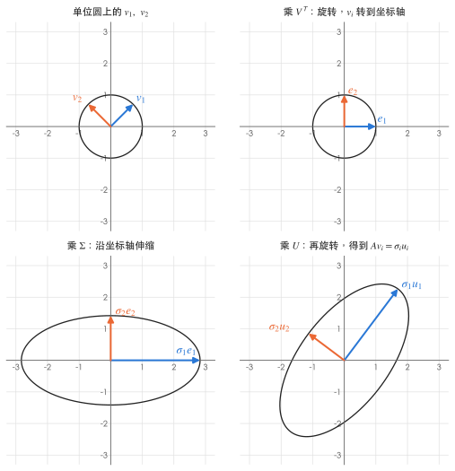
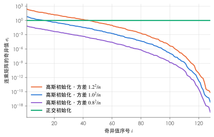

# 奇异值分解

特征分解只适用于方阵，而且要求矩阵可对角化。奇异值分解（singular value decomposition，SVD）没有这些限制：任何形状、任何秩的实矩阵都有奇异值分解。它把矩阵的作用拆成"旋转、沿坐标轴伸缩、再旋转"三步，从中可以直接读出矩阵的秩、四个基本子空间、最大放大倍数和最佳低秩近似。本章用到[特征值与特征向量](eigen.md)里的谱定理和[对称矩阵、二次型与正定性](quadratic-forms.md)里的半正定矩阵。

## 1. 意义：旋转、伸缩、再旋转

任意矩阵 $A\in\R^{m\times n}$ 都可以分解为

$$
A=U\Sigma V\tp
$$

- $V\in\R^{n\times n}$ 是正交矩阵，它的列 $v_1,\dots,v_n$ 称为**右奇异向量**，是输入空间 $\R^n$ 的一组标准正交基；
- $U\in\R^{m\times m}$ 是正交矩阵，它的列 $u_1,\dots,u_m$ 称为**左奇异向量**，是输出空间 $\R^m$ 的一组标准正交基；
- $\Sigma\in\R^{m\times n}$ 只在对角线上有非零元 $\sigma_1\ge\sigma_2\ge\cdots\ge\sigma_r>0$，称为**奇异值**，$r=\rank A$。其余对角元为 0，需要时也记作 $\sigma_{r+1}=\cdots=\sigma_{\min(m,n)}=0$（例如后面的 $\sigma_n$、$\sigma_{\min}$）。

把分解式右乘 $V$ 得到 $AV=U\Sigma$，逐列看就是

$$
Av_i=\sigma_iu_i\quad(i\le r),\qquad Av_i=0\quad(i>r)
$$

也就是说：$A$ 把输入空间里一组互相垂直的单位向量 $v_i$，映成输出空间里一组互相垂直的向量，长度分别是 $\sigma_i$。

计算 $Ax=U\Sigma V\tp x$ 时从右往左分三步：$V\tp x$ 求出 $x$ 在基 $v_1,\dots,v_n$ 下的坐标，相当于一次旋转（或反射）；$\Sigma$ 把第 $i$ 个坐标乘以 $\sigma_i$（$m\ne n$ 时还要补零或丢掉多余的坐标）；$U$ 再做一次旋转（或反射），把结果放到输出空间里。正交矩阵见[正交、投影与最小二乘](orthogonality.md)。

{ .diagram }

图中 $A=\smat{2&0.4\\1&2.2}$。单位圆被映成椭圆，**半轴长是奇异值，半轴方向是左奇异向量**。$\sigma_1$ 是 $A$ 能把单位向量拉到的最大长度，$\sigma_2$ 是最小长度。

和特征分解的区别：

| | 特征分解 $A=P\Lambda P^{-1}$ | 奇异值分解 $A=U\Sigma V\tp$ |
| --- | --- | --- |
| 适用范围 | 可对角化的方阵 | 任意形状的矩阵 |
| 基 | 输入、输出用同一组基 $P$，一般不正交 | 输入用 $V$、输出用 $U$，两组标准正交基 |
| 对角元 | 特征值，可以为负数或复数 | 奇异值，非负实数 |
| 擅长回答的问题 | 反复作用（$A^k$）的长期行为 | 作用一次时各方向的放大倍数 |

对称半正定矩阵的两种分解相同。一般的对称矩阵有 $\sigma_i=\lvert\lambda_i\rvert$。非对称方阵的奇异值和特征值之间没有简单的逐个对应关系，只有乘积相等：$\lvert\det A\rvert=\prod_i\sigma_i=\prod_i\lvert\lambda_i\rvert$。

## 2. 存在性与手算

SVD 的存在性来自对 $A\tp A$ 使用谱定理。$A\tp A$ 是 $n\times n$ 的对称半正定矩阵，所以有标准正交的特征向量 $v_1,\dots,v_n$，对应的特征值 $\lambda_1\ge\cdots\ge\lambda_n\ge0$。令

$$
\sigma_i=\sqrt{\lambda_i(A\tp A)},\qquad u_i=\frac{Av_i}{\sigma_i}\quad(\sigma_i>0)
$$

这样定义的 $u_i$ 是两两正交的单位向量：

$$
u_i\tp u_j=\frac{v_i\tp A\tp Av_j}{\sigma_i\sigma_j}=\frac{\lambda_j\,v_i\tp v_j}{\sigma_i\sigma_j}=\begin{cases}1,&i=j\\0,&i\ne j\end{cases}
$$

正奇异值的个数 $r$ 等于 $\rank(A\tp A)=\rank A$。$r<m$ 时再补上 $m-r$ 个单位向量，把 $u_1,\dots,u_r$ 扩充成 $\R^m$ 的标准正交基，就得到 $AV=U\Sigma$，即 $A=U\Sigma V\tp$。

对称地，$AA\tp=U(\Sigma\Sigma\tp)U\tp$，所以 $u_i$ 是 $AA\tp$ 的特征向量，$AA\tp$ 与 $A\tp A$ 的非零特征值相同，都是 $\sigma_i^2$。

!!! tip "方法：手算奇异值分解"
    1. 计算 $A\tp A$（$n\times n$）或 $AA\tp$（$m\times m$），选阶数小的那个。
    2. 求它的特征值，从大到小排列，开方得到奇异值。
    3. 求对应的单位特征向量。用的是 $A\tp A$ 时得到 $v_i$，再由 $u_i=Av_i/\sigma_i$ 得到 $u_i$；用的是 $AA\tp$ 时得到 $u_i$，再由 $v_i=A\tp u_i/\sigma_i$ 得到 $v_i$。
    4. 需要完整的方阵 $U$、$V$ 时，补上零空间的标准正交基（解 $Ax=0$ 或 $A\tp y=0$）。
    5. 检验：$U\Sigma V\tp=A$。

!!! warning "易错点"
    - 不能分别求 $A\tp A$ 和 $AA\tp$ 的特征向量再拼起来。特征向量可以差一个正负号，分开求时 $u_i$ 和 $v_i$ 的符号可能不匹配。必须用 $Av_i=\sigma_iu_i$ 把它们配成对。
    - 奇异值是唯一的（约定从大到小排列），奇异向量不唯一：$u_i$、$v_i$ 同时变号仍然成立，奇异值相等时对应的基还可以在子空间内任意旋转。手算结果和程序输出差一个符号是正常的。
    - `np.linalg.svd` 返回的第三个量是 $V\tp$ 而不是 $V$，奇异值是一维数组而不是矩阵。

??? example "例：二阶矩阵的奇异值分解"
    求 $A=\bmat{2&0.4\\1&2.2}$ 的奇异值分解。

    **解** (1) $A\tp A=\bmat{5&3\\3&5}$，特征值 $8$ 和 $2$，所以 $\sigma_1=2\sqrt2$，$\sigma_2=\sqrt2$。

    (2) 对应的单位特征向量取 $v_1=\frac1{\sqrt2}[1\ \ 1]\tp$，$v_2=\frac1{\sqrt2}[-1\ \ 1]\tp$。

    (3) $u_1=\dfrac{Av_1}{\sigma_1}=\dfrac{1}{2\sqrt2}\cdot\dfrac{1}{\sqrt2}\bmat{2.4\\3.2}=\bmat{0.6\\0.8}$，$u_2=\dfrac{Av_2}{\sigma_2}=\dfrac{1}{\sqrt2}\cdot\dfrac{1}{\sqrt2}\bmat{-1.6\\1.2}=\bmat{-0.8\\0.6}$。

    $$
    A=\underbrace{\bmat{0.6&-0.8\\0.8&0.6}}_{U}\ \underbrace{\bmat{2\sqrt2&0\\0&\sqrt2}}_{\Sigma}\ \underbrace{\bmat{\frac1{\sqrt2}&\frac1{\sqrt2}\\-\frac1{\sqrt2}&\frac1{\sqrt2}}}_{V\tp}
    $$

    $V\tp$ 是顺时针转 $45^\circ$，$U$ 是逆时针转约 $53.1^\circ$，这就是上一节图中的三步。检验：$\Sigma V\tp=\smat{2&2\\-1&1}$，再左乘 $U$ 得 $\smat{2&0.4\\1&2.2}$。

    $A$ 的特征值是 $\frac{4.2\pm\sqrt{1.64}}{2}\approx2.74,\ 1.46$，与奇异值 $2.83,\ 1.41$ 不同；但乘积相同，$\sigma_1\sigma_2=4=\det A$。

??? example "例：2×3 矩阵的奇异值分解"
    求 $A=\bmat{3&2&2\\2&3&-2}$ 的奇异值分解。

    **解** (1) $AA\tp$ 是二阶的，比三阶的 $A\tp A$ 好算：$AA\tp=\bmat{17&8\\8&17}$，特征值 $25$ 和 $9$，$\sigma_1=5$，$\sigma_2=3$。

    (2) $u_1=\frac1{\sqrt2}[1\ \ 1]\tp$，$u_2=\frac1{\sqrt2}[1\ \ -1]\tp$。

    (3) $v_1=\dfrac{A\tp u_1}{\sigma_1}=\dfrac1{5\sqrt2}\bmat{5\\5\\0}=\dfrac1{\sqrt2}\bmat{1\\1\\0}$，$v_2=\dfrac{A\tp u_2}{\sigma_2}=\dfrac1{3\sqrt2}\bmat{1\\-1\\4}$。

    (4) 补 $v_3$：解 $Ax=0$ 得 $[2\ \ -2\ \ -1]\tp$，单位化为 $v_3=\frac13[2\ \ -2\ \ -1]\tp$。

    $$
    A=\bmat{\frac1{\sqrt2}&\frac1{\sqrt2}\\\frac1{\sqrt2}&-\frac1{\sqrt2}}\bmat{5&0&0\\0&3&0}\bmat{\frac1{\sqrt2}&\frac1{\sqrt2}&0\\\frac1{3\sqrt2}&-\frac1{3\sqrt2}&\frac4{3\sqrt2}\\\frac23&-\frac23&-\frac13}
    $$

## 3. 精简 SVD、外积展开与四个基本子空间

$\Sigma$ 里只有前 $r$ 个对角元非零，所以 $U$ 的后 $m-r$ 列和 $V$ 的后 $n-r$ 列在乘积里不起作用。只保留前 $r$ 列，得到**精简 SVD**：

$$
A=U_r\Sigma_rV_r\tp=\sum_{i=1}^r\sigma_i\,u_iv_i\tp
$$

右边是**外积展开**：$A$ 是 $r$ 个秩一矩阵的和，按 $\sigma_i$ 从大到小排列，前面的项贡献大。由此可以读出：

- **秩等于非零奇异值的个数**；
- 四个基本子空间的标准正交基（子空间的定义见[线性无关、秩与四个基本子空间](subspaces.md)）：

| 子空间 | 标准正交基 | 维数 |
| --- | --- | --- |
| 列空间 $C(A)$ | $u_1,\dots,u_r$ | $r$ |
| 左零空间 $N(A\tp)$ | $u_{r+1},\dots,u_m$ | $m-r$ |
| 行空间 $C(A\tp)$ | $v_1,\dots,v_r$ | $r$ |
| 零空间 $N(A)$ | $v_{r+1},\dots,v_n$ | $n-r$ |

$A$ 把行空间一一对应地映到列空间（$v_i\mapsto\sigma_iu_i$），把零空间映成 0。

??? example "例：从 SVD 读出秩、子空间和外积展开"
    对上一个例题的 $A=\bmat{3&2&2\\2&3&-2}$，写出外积展开，并指出秩和零空间。

    **解** 两个奇异值 $5,3$ 都非零，$\rank A=2$，列空间是整个 $\R^2$。行空间的标准正交基是 $v_1,v_2$；零空间是一维的，基为 $v_3=\frac13[2\ \ -2\ \ -1]\tp$。外积展开：

    $$
    A=5u_1v_1\tp+3u_2v_2\tp=\frac52\bmat{1&1&0\\1&1&0}+\frac12\bmat{1&-1&4\\-1&1&-4}
    $$

    两项相加确实是 $\smat{3&2&2\\2&3&-2}$。

NumPy 的用法：

```python
import numpy as np

A = np.array([[3., 2., 2.], [2., 3., -2.]])
U, s, Vt = np.linalg.svd(A)                 # 完整 SVD
print(U.shape, s.shape, Vt.shape)           # (2, 2) (2,) (3, 3)
print(s)                                    # [5. 3.]
print(Vt.round(4))                          # 返回的是 V^T，每一行是一个 v_i
# [[-0.7071 -0.7071 -0.    ]
#  [-0.2357  0.2357 -0.9428]
#  [-0.6667  0.6667  0.3333]]
U, s, Vt = np.linalg.svd(A, full_matrices=False)    # 精简 SVD
print(U.shape, s.shape, Vt.shape)           # (2, 2) (2,) (2, 3)
print(np.allclose(U * s @ Vt, A))           # True，U * s 把 U 的第 i 列乘以 sigma_i
```

程序给出的 $v_1,v_2,v_3$ 与手算结果差一个负号，这是前面说的符号不唯一。`full_matrices=False` 时返回 $\min(m,n)$ 列，矩阵很"扁"或很"瘦"时能省下大量内存，实际使用几乎总是用它。PyTorch 中是 `torch.linalg.svd`，参数相同。

### 数值秩

浮点运算下"恰好为 0"没有意义，秩要按"奇异值大于某个阈值的个数"来数：

```python
rng = np.random.default_rng(0)
B = rng.standard_normal((6, 2)) @ rng.standard_normal((2, 5))    # 秩为 2 的 6x5 矩阵
B_noisy = B + 1e-6 * rng.standard_normal(B.shape)                # 加一点噪声
print(np.linalg.svd(B, compute_uv=False).round(4))
# [4.9601 2.1812 0.     0.     0.    ]
print(np.linalg.svd(B_noisy, compute_uv=False))
# [4.96005421e+00 2.18118080e+00 2.35571410e-06 1.54865298e-06
#  4.90474675e-07]
print(np.linalg.matrix_rank(B), np.linalg.matrix_rank(B_noisy), np.linalg.matrix_rank(B_noisy, tol=1e-4))   # 2 5 2
```

加上 $10^{-6}$ 量级的噪声后，严格意义上的秩变成了 5，但奇异值在第 2 个和第 3 个之间有 6 个数量级的落差，取阈值 $10^{-4}$ 仍然得到 2。奇异值的分布比"秩"这一个整数包含的信息多得多。

## 4. 矩阵范数与条件数

矩阵的"大小"有几种常用的度量，都可以用奇异值表示。

**谱范数**（spectral norm，也叫 2-范数）是 $A$ 对向量的最大放大倍数：

$$
\lVert A\rVert_2=\max_{x\ne0}\frac{\lVert Ax\rVert}{\lVert x\rVert}=\sigma_1
$$

这是因为 $\frac{\lVert Ax\rVert^2}{\lVert x\rVert^2}=\frac{x\tp A\tp Ax}{x\tp x}$ 是 $A\tp A$ 的 Rayleigh 商（见[对称矩阵、二次型与正定性](quadratic-forms.md)），最大值是 $\lambda_{\max}(A\tp A)=\sigma_1^2$，在 $x=v_1$ 处取到。同理最小放大倍数是最小的奇异值，所以对 $m\ge n$ 的矩阵有 $\sigma_n\lVert x\rVert\le\lVert Ax\rVert\le\sigma_1\lVert x\rVert$。

**Frobenius 范数**是把矩阵当作一个长向量时的 2-范数：

$$
\lVert A\rVert_F=\sqrt{\sum_{i,j}a_{ij}^2}=\sqrt{\tr(A\tp A)}=\sqrt{\sigma_1^2+\cdots+\sigma_r^2}
$$

**核范数**（nuclear norm）是奇异值之和 $\lVert A\rVert_*=\sigma_1+\cdots+\sigma_r$，在低秩矩阵恢复问题里常用它代替秩作为惩罚项。

三者的关系：$\lVert A\rVert_2\le\lVert A\rVert_F\le\lVert A\rVert_*$。它们都满足 $\lVert AB\rVert\le\lVert A\rVert\,\lVert B\rVert$，并且左乘或右乘正交矩阵不改变范数。

??? example "例：三种范数"
    求 $A=\bmat{3&2&2\\2&3&-2}$ 的谱范数、Frobenius 范数和核范数。

    **解** 奇异值是 $5$ 和 $3$。$\lVert A\rVert_2=5$；$\lVert A\rVert_F=\sqrt{25+9}=\sqrt{34}\approx5.83$，也可以直接算元素平方和 $9+4+4+4+9+4=34$；$\lVert A\rVert_*=5+3=8$。

!!! info "AI 联系"
    L2 正则（权重衰减，weight decay）惩罚的是 $\lVert W\rVert_F^2$，即所有权重的平方和，也等于奇异值的平方和。谱范数只管最大的那个奇异值，第 7 节的谱归一化用的是它。

### 条件数

可逆方阵的**条件数**定义为最大、最小奇异值之比：

$$
\kappa(A)=\frac{\sigma_1}{\sigma_n}=\lVert A\rVert_2\,\lVert A^{-1}\rVert_2\ge1
$$

（$A^{-1}$ 的奇异值是 $1/\sigma_i$。）对称正定矩阵的奇异值就是特征值，这个定义与[对称矩阵、二次型与正定性](quadratic-forms.md)里的 $\lambda_{\max}/\lambda_{\min}$ 一致。

条件数衡量解方程 $Ax=b$ 时误差被放大的程度。设右端有扰动 $\delta b$，解的变化是 $\delta x=A^{-1}\delta b$。由 $\lVert\delta x\rVert\le\lVert\delta b\rVert/\sigma_n$ 和 $\lVert b\rVert\le\sigma_1\lVert x\rVert$ 得

$$
\frac{\lVert\delta x\rVert}{\lVert x\rVert}\le\kappa(A)\,\frac{\lVert\delta b\rVert}{\lVert b\rVert}
$$

右端的相对误差最多被放大 $\kappa$ 倍。$\kappa$ 很大的矩阵称为病态矩阵，几何上它把单位球压成非常扁的椭球，接近不可逆。

??? example "例：病态方程组的误差放大"
    $A=\bmat{1&1\\1&1.0001}$。分别对 $b=[2\ \ 2.0001]\tp$ 和 $b'=[2\ \ 2.0002]\tp$ 解 $Ax=b$，比较右端和解的相对变化。

    **解** 第二个方程减第一个方程。对 $b$：$0.0001x_2=0.0001$，$x=[1\ \ 1]\tp$。对 $b'$：$0.0001x_2=0.0002$，$x'=[0\ \ 2]\tp$。

    右端的相对变化是 $\dfrac{10^{-4}}{\lVert b\rVert}\approx3.5\times10^{-5}$，解的相对变化是 $\dfrac{\lVert[-1\ \ 1]\tp\rVert}{\lVert[1\ \ 1]\tp\rVert}=1$，放大了约 $2.8\times10^4$ 倍。

    $A$ 的奇异值约为 $2.00005$ 和 $5.0\times10^{-5}$（乘积等于 $\det A=10^{-4}$），$\kappa(A)\approx4.0\times10^4$，实际的放大倍数没有超过它。

## 5. 伪逆与最小二乘

不是方阵或不可逆的矩阵没有逆，但可以定义**伪逆**（Moore–Penrose pseudoinverse）：把非零奇异值取倒数，其余保持为 0，再把分解式"反过来"：

$$
A^+=V\Sigma^+U\tp=\sum_{i=1}^r\frac{1}{\sigma_i}\,v_iu_i\tp\in\R^{n\times m}
$$

$A$ 把 $v_i$ 映为 $\sigma_iu_i$，$A^+$ 把 $u_i$ 映回 $\frac1{\sigma_i}v_i$；被 $A$ 映成 0 的方向已经无法还原，$A^+$ 对它们不做处理。

伪逆给出线性方程组在各种情形下"最合理"的解：$x^+=A^+b$ 是所有使 $\lVert Ax-b\rVert$ 最小的 $x$ 当中范数最小的那一个，它总是存在而且唯一。

| 情形 | $A^+$ 的表达式 | $x^+=A^+b$ 的含义 |
| --- | --- | --- |
| 可逆方阵 | $A^{-1}$ | 唯一解 |
| 列满秩（方程多于未知数，超定） | $(A\tp A)^{-1}A\tp$ | 最小二乘解，见[正交、投影与最小二乘](orthogonality.md) |
| 行满秩（未知数多于方程，欠定） | $A\tp(AA\tp)^{-1}$ | 无穷多解中范数最小的，见[线性无关、秩与四个基本子空间](subspaces.md) |
| 秩亏 | 只能用 SVD 的定义 | 最小二乘解中范数最小的 |

??? example "例：超定方程组的最小二乘解"
    $A=\bmat{1&1\\0&1\\1&0}$，$b=[3\ \ 0\ \ 0]\tp$。用伪逆求最小二乘解。

    **解** $A\tp A=\smat{2&1\\1&2}$，特征值 $3,1$，$\sigma_1=\sqrt3$，$\sigma_2=1$；$v_1=\frac1{\sqrt2}[1\ \ 1]\tp$，$v_2=\frac1{\sqrt2}[1\ \ -1]\tp$；$u_1=\frac{Av_1}{\sqrt3}=\frac1{\sqrt6}[2\ \ 1\ \ 1]\tp$，$u_2=Av_2=\frac1{\sqrt2}[0\ \ -1\ \ 1]\tp$。

    $$
    A^+=\frac1{\sqrt3}v_1u_1\tp+v_2u_2\tp=\frac16\bmat{2&1&1\\2&1&1}+\frac12\bmat{0&-1&1\\0&1&-1}=\frac13\bmat{1&-1&2\\1&2&-1}
    $$

    $x^+=A^+b=[1\ \ 1]\tp$。残差 $b-Ax^+=[1\ \ -1\ \ -1]\tp$，范数 $\sqrt3$，它与 $A$ 的两列都正交，符合最小二乘解的特征。

??? example "例：欠定方程组的最小范数解"
    $A=\bmat{3&2&2\\2&3&-2}$，$b=[5\ \ 5]\tp$。求 $Ax=b$ 的范数最小的解。

    **解** 用第 2 节求出的奇异值分解，

    $$
    A^+=\frac15v_1u_1\tp+\frac13v_2u_2\tp=\frac1{10}\bmat{1&1\\1&1\\0&0}+\frac1{18}\bmat{1&-1\\-1&1\\4&-4}=\frac1{45}\bmat{7&2\\2&7\\10&-10}
    $$

    $x^+=A^+b=[1\ \ 1\ \ 0]\tp$。全部解是 $x^+ + t\,[2\ \ -2\ \ -1]\tp$（加上零空间里的任意向量），范数的平方为 $2+9t^2$，$t=0$ 时最小。例如 $t=1$ 给出另一个解 $[3\ \ -1\ \ -1]\tp$，范数 $\sqrt{11}$，比 $\sqrt2$ 大。$x^+$ 落在行空间里，不含零空间的分量。

```python
A3 = np.array([[1., 1.], [0., 1.], [1., 0.]])
b3 = np.array([3., 0., 0.])
print(np.linalg.pinv(A3) @ b3)                        # [1. 1.]
print(np.linalg.lstsq(A3, b3, rcond=None)[0])         # [1. 1.]，同一个解，不显式构造伪逆
print((np.linalg.pinv(A) @ np.array([5., 5.])).round(6))    # [1. 1. 0.]
```

!!! warning "易错点"
    伪逆里出现 $1/\sigma_i$。很小的奇异值取倒数后变得很大，会把 $b$ 中的噪声放大。`np.linalg.pinv` 和 `lstsq` 的 `rcond` 参数把相对大小低于阈值的奇异值当作 0 处理，这是一种截断。岭回归是另一种处理方式：它把 $\frac1{\sigma_i}$ 换成 $\frac{\sigma_i}{\sigma_i^2+\lambda}$，小奇异值对应的方向被平滑地压低（岭回归见[线性方程组、消元与逆矩阵](linear-systems.md)）。

## 6. Eckart–Young 定理：最佳低秩近似

外积展开只保留前 $k$ 项，得到**截断 SVD**

$$
A_k=\sum_{i=1}^k\sigma_i\,u_iv_i\tp
$$

它的秩是 $k$。**Eckart–Young 定理**说它是所有秩不超过 $k$ 的矩阵里离 $A$ 最近的：对任意 $\rank B\le k$，

$$
\lVert A-B\rVert_2\ge\lVert A-A_k\rVert_2=\sigma_{k+1},\qquad
\lVert A-B\rVert_F\ge\lVert A-A_k\rVert_F=\sqrt{\sigma_{k+1}^2+\cdots+\sigma_r^2}
$$

所以奇异值衰减得越快，矩阵越容易用低秩矩阵近似。常用 $\sum_{i\le k}\sigma_i^2\big/\sum_i\sigma_i^2$ 表示前 $k$ 项保留的"能量"比例。存储 $A_k$ 只需要 $k(m+n+1)$ 个数，而不是 $mn$ 个。这个定理是 PCA、权重压缩和 LoRA 的出发点，见 [PCA、低秩近似与 LoRA](pca-lowrank.md)。

??? example "例：最佳秩一近似"
    求 $A=\bmat{3&2&2\\2&3&-2}$ 的最佳秩一近似及其误差。

    **解** 取外积展开的第一项：

    $$
    A_1=5u_1v_1\tp=\frac52\bmat{1&1&0\\1&1&0},\qquad A-A_1=3u_2v_2\tp=\frac12\bmat{1&-1&4\\-1&1&-4}
    $$

    误差矩阵的秩为 1，只有一个非零奇异值 $3$，所以谱范数误差和 Frobenius 范数误差都是 $3=\sigma_2$。保留的能量比例是 $\frac{25}{25+9}\approx73.5\%$。

    作为对照，另取一个秩一矩阵 $B=\smat{3&2&2\\0&0&0}$（只保留第一行），误差 $\lVert A-B\rVert_F=\lVert[2\ \ 3\ \ -2]\rVert=\sqrt{17}\approx4.12$，比 3 大。

对随机矩阵验证误差公式：

```python
rng = np.random.default_rng(0)
M = rng.standard_normal((50, 40))
U, s, Vt = np.linalg.svd(M, full_matrices=False)
k = 10
M_k = U[:, :k] * s[:k] @ Vt[:k]                   # 截断 SVD
print(np.linalg.norm(M - M_k, 2), s[k])           # 8.54235787818567 8.542357878185664
print(np.linalg.norm(M - M_k, 'fro'), np.sqrt((s[k:] ** 2).sum()))   # 27.9716237951984 27.9716237951984
```

`s[k]` 是第 $k+1$ 个奇异值（下标从 0 开始）。

## 7. 谱归一化与幂迭代估计 $\sigma_1$

线性层 $x\mapsto Wx$ 满足

$$
\lVert Wx-Wy\rVert\le\sigma_1(W)\,\lVert x-y\rVert
$$

即它的 Lipschitz 常数是谱范数 $\sigma_1(W)$：两个输入之间的距离经过这一层最多被放大 $\sigma_1$ 倍。ReLU、tanh 等激活函数的 Lipschitz 常数是 1，所以整个网络的 Lipschitz 常数不超过各层 $\sigma_1(W_l)$ 的乘积。

**谱归一化**（spectral normalization）把每层的权重除以它的谱范数，

$$
\bar W=\frac{W}{\sigma_1(W)}
$$

使每个线性层的 Lipschitz 常数恰好为 1。它最初是为了稳定 GAN 判别器的训练提出的。

每个训练步都做一次完整的 SVD 太贵。只需要 $\sigma_1$ 时，可以对 $W\tp W$ 做幂迭代（见[特征值与特征向量](eigen.md)），写成交替乘 $W\tp$ 和 $W$ 的形式：

```python
def spectral_norm(W, iters=1, seed=0):
    rng = np.random.default_rng(seed)
    u = rng.standard_normal(W.shape[0])
    for _ in range(iters):
        v = W.T @ u
        v /= np.linalg.norm(v)
        u = W @ v
        u /= np.linalg.norm(u)
    return u @ W @ v                    # u、v 收敛到 u_1、v_1，u^T W v 收敛到 sigma_1

rng = np.random.default_rng(0)
W = rng.standard_normal((256, 128)) / np.sqrt(128)
print([round(float(spectral_norm(W, it)), 4) for it in (1, 5, 20, 100, 500)])
# [1.7384, 2.2694, 2.3638, 2.4046, 2.4047]
print(np.linalg.svd(W, compute_uv=False)[:3].round(4))      # [2.4047 2.3603 2.2993]

W_sn = W / spectral_norm(W, 500)        # 谱归一化后的权重
x, y = rng.standard_normal(128), rng.standard_normal(128)
print(round(float(np.linalg.norm(W_sn @ x - W_sn @ y) / np.linalg.norm(x - y)), 4))   # 0.5711，不超过 1
print(round(float(np.linalg.norm(W_sn, 2)), 4))             # 1.0
```

幂迭代每步的误差按 $(\sigma_2/\sigma_1)^2$ 衰减。随机矩阵的前几个奇异值靠得很近（这里 $(\sigma_2/\sigma_1)^2\approx0.96$），所以收敛较慢。实际训练时不需要每步都迭代到收敛：权重每步只变化一点，把上一步的 $u$ 保存下来接着用，每个训练步只做一次迭代就够了。PyTorch 的 `torch.nn.utils.parametrizations.spectral_norm` 就是这样实现的。

??? example "例：两层线性网络的 Lipschitz 上界"
    $W_1=\bmat{2&0.4\\1&2.2}$，$W_2=\bmat{1&2\\0&1}$。(1) 用各层谱范数给出 $x\mapsto W_2W_1x$ 的 Lipschitz 常数的上界；(2) 求真实值；(3) 对两层都做谱归一化后上界是多少？

    **解** (1) $\sigma_1(W_1)=2\sqrt2\approx2.828$（第 2 节）。$W_2\tp W_2=\smat{1&2\\2&5}$，特征值 $3\pm2\sqrt2$，$\sigma_1(W_2)=\sqrt{3+2\sqrt2}=1+\sqrt2\approx2.414$。上界为 $2.828\times2.414\approx6.83$。

    (2) $W_2W_1=\bmat{4&4.8\\1&2.2}$，$(W_2W_1)\tp(W_2W_1)=\bmat{17&21.4\\21.4&27.88}$，迹为 $44.88$，行列式为 $16$，较大的特征值是 $\frac{44.88+\sqrt{44.88^2-64}}{2}\approx44.52$，$\sigma_1(W_2W_1)\approx6.67$。真实值略小于上界，因为 $W_1$ 放大得最多的输出方向 $u_1$ 并不恰好是 $W_2$ 放大得最多的输入方向。

    (3) 归一化后两层的谱范数都是 1，上界为 $1\times1=1$：任意两个输入之间的距离经过网络后不会变大。

## 8. 深层网络的信号传播：Jacobian 的奇异值

深度为 $L$ 的线性网络 $h_L=W_L\cdots W_1h_0$ 的输入输出 Jacobian 是 $J=W_L\cdots W_1$。前向传播时信号的范数、反向传播时梯度的范数（$\partial\mathcal L/\partial h_0=J\tp\,\partial\mathcal L/\partial h_L$）都由 $J$ 的奇异值控制：

$$
\sigma_{\min}(J)\,\lVert x\rVert\le\lVert Jx\rVert\le\sigma_{\max}(J)\,\lVert x\rVert
$$

带激活函数时每层的 Jacobian 多一个对角因子，分析方法相同。[特征值与特征向量](eigen.md)里 RNN 的情形是同一个矩阵连乘，用特征值分析；这里各层矩阵不同，要用奇异值。

**初始化的方差**。设 $W$ 的元素独立地取自 $\mathcal N(0,g^2/n)$，$n$ 是输入维数，则 $\mathrm E\lVert Wx\rVert^2=g^2\lVert x\rVert^2$。经过 $L$ 层后范数的量级是 $g^L$：$g<1$ 时信号和梯度逐层消失，$g>1$ 时逐层爆炸，只有 $g=1$（方差 $1/n$）时在平均意义下保持不变。常用的初始化方法就是按这个原则选方差；ReLU 会把大约一半的分量置零，所以配合 ReLU 时方差取 $2/n$。

**奇异值的分布**。即使 $g=1$，随机矩阵连乘之后奇异值也会散得很开：

```python
rng = np.random.default_rng(0)
n, depth = 128, 20

def product_singular_values(make_layer):
    J = np.eye(n)
    for _ in range(depth):
        J = make_layer() @ J
    s = np.linalg.svd(J, compute_uv=False)
    return f"max {s[0]:.3g}, median {np.median(s):.3g}, min {s[-1]:.3g}"

for gain in (0.8, 1.0, 1.2):
    print(gain, product_singular_values(lambda: gain * rng.standard_normal((n, n)) / np.sqrt(n)))
print("orthogonal", product_singular_values(lambda: np.linalg.qr(rng.standard_normal((n, n)))[0]))
# 0.8 max 0.0779, median 1.11e-05, min 2.5e-19
# 1.0 max 6.34, median 0.000761, min 6.53e-18
# 1.2 max 224, median 0.0333, min 6.11e-16
# orthogonal max 1, median 1, min 1
```

{ .diagram }

$g=1$ 时奇异值平方的平均值的期望仍然是 1，但绝大部分奇异值远小于 1，少数大于 1：$J$ 把输入空间的大多数方向压得很扁，只沿少数方向放大。改变 $g$ 相当于把所有奇异值乘以 $g^L$，在对数坐标下是把整条曲线上下平移。正交矩阵的乘积仍是正交矩阵，奇异值全部等于 1，所有方向的范数都被保持，这是正交初始化的依据（见[正交、投影与最小二乘](orthogonality.md)）。残差连接 $h_{l+1}=h_l+F(h_l)$ 的 Jacobian 是 $I+\partial F/\partial h_l$，$F$ 的 Jacobian 较小时它的奇异值集中在 1 附近，作用类似。

## 9. 稳定秩与有效秩

训练出来的权重矩阵或一批样本的表征矩阵，数值上几乎总是满秩的，秩这个整数不能说明"实际用了多少维"。有两个由奇异值定义的连续指标。

**稳定秩**（stable rank）：

$$
\operatorname{srank}(A)=\frac{\lVert A\rVert_F^2}{\lVert A\rVert_2^2}=\frac{\sum_i\sigma_i^2}{\sigma_1^2}
$$

**有效秩**（effective rank，Roy 与 Vetterli 于 2007 年提出）：先把奇异值归一化成一个概率分布 $p_i=\sigma_i/\sum_j\sigma_j$，再取它的熵的指数：

$$
\operatorname{erank}(A)=\exp\Bigl(-\sum_ip_i\ln p_i\Bigr)
$$

两者都在 $1$ 和 $\rank A$ 之间；$k$ 个非零奇异值全相等时都等于 $k$；奇异值越集中在前几个上，数值越小。它们对微小的扰动不敏感，不需要像数值秩那样选阈值。稳定秩只看平方和与最大值之比，受 $\sigma_1$ 的影响最大；有效秩考虑整个分布的形状。

??? example "例：稳定秩与有效秩"
    某个矩阵的奇异值为 $10,1,1,1$。求它的秩、稳定秩和有效秩。

    **解** 四个奇异值都非零，秩为 4。

    稳定秩：$\dfrac{100+1+1+1}{100}=1.03$。

    有效秩：$p=\bigl[\frac{10}{13}\ \ \frac1{13}\ \ \frac1{13}\ \ \frac1{13}\bigr]$，熵 $-\frac{10}{13}\ln\frac{10}{13}-\frac3{13}\ln\frac1{13}\approx0.202+0.592=0.794$，有效秩 $\e^{0.794}\approx2.21$。

    秩说这个矩阵是 4 维的，两个指标则反映出它由一个方向主导。

```python
def stable_rank(s):
    return (s ** 2).sum() / s[0] ** 2

def effective_rank(s):
    p = s[s > 0] / s.sum()
    return np.exp(-(p * np.log(p)).sum())

rng = np.random.default_rng(0)
low = rng.standard_normal((64, 4)) @ rng.standard_normal((4, 64))     # 秩为 4
mats = {"low-rank": low, "low-rank + noise": low + 0.01 * rng.standard_normal((64, 64)),
        "gaussian": rng.standard_normal((64, 64))}
for name, M in mats.items():
    s = np.linalg.svd(M, compute_uv=False)
    print(name, np.linalg.matrix_rank(M), round(float(stable_rank(s)), 2), round(float(effective_rank(s)), 2))
# low-rank 4 2.14 3.89
# low-rank + noise 64 2.14 4.37
# gaussian 64 16.42 51.31
```

给秩为 4 的矩阵加上很小的噪声，`matrix_rank` 从 4 跳到 64，稳定秩和有效秩几乎不变。这类指标常用来观察表征矩阵是否只占用了少数几个方向（自监督学习中称为维度坍缩，dimensional collapse），或者描述微调前后权重变化量的奇异值有多集中，后者是 LoRA 的低秩假设所关心的，见 [PCA、低秩近似与 LoRA](pca-lowrank.md)。

## 小结

| 概念 | 要点 |
| --- | --- |
| 分解式 | $A=U\Sigma V\tp$，$U,V$ 正交，$\sigma_1\ge\cdots\ge\sigma_r>0$；任意矩阵都有 |
| 几何 | $Av_i=\sigma_iu_i$；单位球被映成椭球，半轴长 $\sigma_i$，半轴方向 $u_i$ |
| 手算 | 求 $A\tp A$ 的特征值和特征向量得 $\sigma_i^2$、$v_i$，再 $u_i=Av_i/\sigma_i$ |
| 外积展开 | $A=\sum_{i\le r}\sigma_iu_iv_i\tp$；秩等于非零奇异值的个数 |
| 四个子空间 | $u_1..u_r$ 张成列空间，$v_1..v_r$ 张成行空间，其余的 $v_i$ 张成零空间，其余的 $u_i$ 张成左零空间 |
| 范数 | $\lVert A\rVert_2=\sigma_1$，$\lVert A\rVert_F=\sqrt{\sum\sigma_i^2}$，$\lVert A\rVert_*=\sum\sigma_i$ |
| 条件数 | $\kappa=\sigma_1/\sigma_n$，解方程时相对误差放大倍数的上界 |
| 伪逆 | $A^+=V\Sigma^+U\tp$；$A^+b$ 是范数最小的最小二乘解 |
| Eckart–Young | 截断 SVD 是最佳秩 $k$ 近似，谱范数误差 $\sigma_{k+1}$ |
| NumPy | `np.linalg.svd(A, full_matrices=False)` 返回 `U, s, Vt`；`pinv`、`lstsq`、`matrix_rank` |
| 谱归一化 | $W/\sigma_1(W)$ 使线性层的 Lipschitz 常数为 1；$\sigma_1$ 用幂迭代估计 |
| 信号传播 | 逐层 Jacobian 乘积的奇异值决定信号和梯度的范数；正交矩阵的奇异值全为 1 |
| 稳定秩、有效秩 | $\sum\sigma_i^2/\sigma_1^2$ 与归一化奇异值的熵的指数，描述实际占用的维数 |
