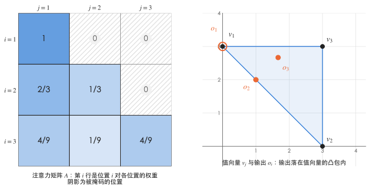
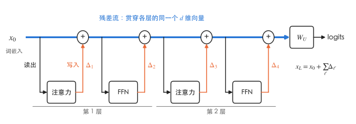
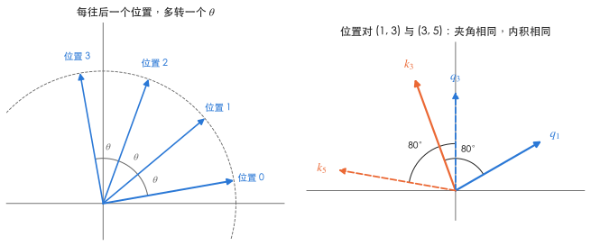

# 用线性代数读 Transformer

本章不引入新的数学，只把前面各章的内容用一遍：按一次前向计算的顺序，逐个说明 decoder-only Transformer 的每个部件是什么线性代数对象，并指回对应的章节。模型结构上的各种选择（MHA 与 GQA、Pre-Norm 等）见 [Transformer 架构](../../../ai/llm/transformer.md)，这里不重复。

本章沿用那篇笔记的写法：每个 token 的表示是一个**行向量**，$X\in\R^{n\times d}$ 一行一个 token，权重矩阵右乘，例如 $Q=XW_Q$。这样写的权重是 PyTorch `nn.Linear` 里所存权重的转置。

## 1. 一次前向计算里的形状

取一个小配置：词表大小 $V=1000$，隐藏维度 $d=64$，头数 $h=4$（每个头 $d_k=d/h=16$），FFN 中间维度 $d_\text{ff}=256$，层数 $L=2$；不用 bias，归一化用 RMSNorm，位置信息用 RoPE（没有参数）。输入 $n$ 个 token，一次前向依次经过：

| 步骤 | 运算 | 结果的形状 | 用到的参数 |
| --- | --- | --- | --- |
| 输入 | token id | $n$ 个整数 | |
| 词嵌入 | $X=E[\text{ids}]$ | $n\times64$ | $E$：$1000\times64$ |
| 归一化 | RMSNorm | $n\times64$ | 增益：64 |
| 投影 | $Q=XW_Q,\ K=XW_K,\ V=XW_V$ | 各 $n\times64$，按列分成 4 个头，每头 $n\times16$ | 各 $64\times64$ |
| 注意力分数 | $QK\tp/\sqrt{d_k}$，加掩码，逐行 softmax | 每头 $n\times n$ | |
| 加权求和 | $AV$，各头拼接后乘 $W_O$ | $n\times64$ | $W_O$：$64\times64$ |
| 残差 | $X\leftarrow X+{}$注意力输出 | $n\times64$ | |
| 归一化 | RMSNorm | $n\times64$ | 增益：64 |
| FFN | $\phi(XW_1)W_2$ | $n\times256$，再回到 $n\times64$ | $W_1$：$64\times256$，$W_2$：$256\times64$ |
| 残差 | $X\leftarrow X+{}$FFN 输出 | $n\times64$ | |
| | 以上 8 行重复 $L$ 次 | | |
| 最终归一化 | RMSNorm | $n\times64$ | 增益：64 |
| 输出 | $Z=XW_U$ | $n\times1000$ | $W_U$：$64\times1000$ |

从这张表可以直接读出三件事：

- **主干上的形状始终是 $n\times d$**。只有注意力内部出现 $n\times n$，FFN 内部出现 $n\times d_\text{ff}$，最后一步出现 $n\times V$。
- **所有参数矩阵都右乘在特征维上**，形状里没有 $n$。同一组权重可以处理任意长度的序列。
- **只有注意力矩阵 $A$ 左乘在 token 维上**。右乘 $W$ 是对每一行（每个 token）独立做同一个线性变换；左乘 $A$ 是把不同的行混合起来。token 之间的信息交换只发生在注意力里。

## 2. embedding 与 unembedding：查表和内积

**输入端**：词嵌入矩阵 $E\in\R^{V\times d}$ 的第 $v$ 行是 token $v$ 的向量。查表 $E[\text{ids}]$ 等于 one-hot 矩阵乘 $E$（见[矩阵与线性变换](matrices.md)）。

**输出端**：最后一层的隐状态 $h\in\R^{1\times d}$ 乘 unembedding 矩阵 $W_U\in\R^{d\times V}$ 得到 logits。记 $W_U$ 的第 $v$ 列为 $u_v$，则

$$
z_v=h\,u_v=\lVert h\rVert\,\lVert u_v\rVert\cos\theta_v
$$

每个 token 的 logit 是隐状态与该 token 的输出向量的内积，既取决于夹角，也取决于 $u_v$ 的范数（见[向量、内积与范数](vectors.md)）。

**权重绑定**（weight tying）：令 $W_U=E\tp$，输入和输出共用一个矩阵。这时 $z_v=h\,e_v\tp$，模型预测下一个 token 的方式是拿隐状态和每个词向量做内积。

**秩**：$n$ 个位置的 logits 排成矩阵 $Z=HW_U\in\R^{n\times V}$，其中 $H\in\R^{n\times d}$。它是两个矩阵的乘积，$\rank Z\le d$，尽管 $V$ 远大于 $d$。这就是 softmax 瓶颈（见[线性无关、秩与四个基本子空间](subspaces.md)）。

??? example "例：权重绑定下的 logits"
    词表有 4 个 token，$d=2$，$E=\bmat{1&0\\0&1\\1&1\\-1&0}$，权重绑定。最后的隐状态为 $h=(2,\ 1)$。求 logits 和预测的 token。

    **解** $z=hE\tp=(2,\ 1,\ 3,\ -2)$。最大的是第 3 个，预测 token 3。softmax 之后的概率约为 $(0.244,\ 0.090,\ 0.662,\ 0.004)$。

    - $h$ 与 $e_1=(1,0)$ 的夹角余弦是 $2/\sqrt5\approx0.894$，与 $e_3=(1,1)$ 的是 $3/\sqrt{10}\approx0.949$。$e_3$ 的方向与 $h$ 更接近，范数也更大（$\sqrt2$ 比 1），两个因素都使 $z_3$ 更大。
    - $e_4=-e_1$，方向相反，所以 $z_4=-z_1$。

```python
import numpy as np
np.set_printoptions(precision=4, suppress=True)

E = np.array([[1., 0], [0, 1], [1, 1], [-1, 0]])      # V=4, d=2
ids = np.array([2, 0, 3])
print(np.array_equal(np.eye(4)[ids] @ E, E[ids]))     # True：查表等于 one-hot 乘矩阵
h = np.array([2., 1])
logits = h @ E.T                                      # 权重绑定
print(logits, (np.exp(logits) / np.exp(logits).sum()).round(3))
# [ 2.  1.  3. -2.] [0.244 0.09  0.662 0.004]

rng = np.random.default_rng(0)
H, E_big = rng.standard_normal((200, 64)), rng.standard_normal((1000, 64))
print((H @ E_big.T).shape, np.linalg.matrix_rank(H @ E_big.T))   # (200, 1000) 64
```

## 3. 注意力：双线性型与凸组合

### 分数是一个双线性型

第 $i$ 个 token 对第 $j$ 个 token 的注意力分数是 $q_i$ 与 $k_j$ 的内积。把 $q_i=x_iW_Q$、$k_j=x_jW_K$ 代入：

$$
s_{ij}=\frac{q_i\,k_j\tp}{\sqrt{d_k}}=\frac{1}{\sqrt{d_k}}\,x_i\,(W_QW_K\tp)\,x_j\tp
$$

这是 $x_i$ 和 $x_j$ 的双线性型，由矩阵 $W_QW_K\tp\in\R^{d\times d}$ 决定。$W_Q$ 和 $W_K$ 只通过这个乘积起作用。两点性质：

- $W_Q,W_K\in\R^{d\times d_k}$，所以 $\rank(W_QW_K\tp)\le d_k$。一个头只在 $d_k$ 维的子空间里比较 query 和 key。
- $W_QW_K\tp$ 一般不对称，$s_{ij}\ne s_{ji}$：$i$ 关注 $j$ 的程度与 $j$ 关注 $i$ 的程度不同。

除以 $\sqrt{d_k}$ 的原因见[向量、内积与范数](vectors.md)。

### 掩码与 softmax 之后是什么矩阵

因果掩码把 $j>i$ 的分数置为 $-\infty$，再对每一行做 softmax，得到注意力矩阵 $A\in\R^{n\times n}$：

- $A$ 是**下三角**矩阵：位置 $i$ 的输出只依赖位置 $1,\dots,i$ 的输入。
- 每一行非负、和为 1。

输出 $O=AV$ 的第 $i$ 行是 $o_i=\sum_ja_{ij}v_j$，系数非负且和为 1，是值向量的**凸组合**（加权平均）。几何上，$o_i$ 落在 $v_1,\dots,v_i$ 的凸包里。这一步只是在已有的值向量之间取加权平均，输出不会落到它们的凸包之外。

??? example "例：手算 3 个 token 的因果注意力"
    三个 token 的表示为 $X=\bmat{1&0\\0&1\\1&1}$（$d=2$）。只算一个头，取 $d_k=1$：$W_Q=\ln2\bmat{1\\1}$，$W_K=\bmat{1\\0}$；值向量取 2 维，$W_V=\bmat{0&3\\3&0}$。求注意力矩阵和输出。

    **解** (1) 投影：$Q=XW_Q=\ln2\,(1,1,2)\tp$，$K=XW_K=(1,0,1)\tp$，$V=XW_V=\bmat{0&3\\3&0\\3&3}$。

    (2) 分数（$\sqrt{d_k}=1$）：

    $$
    S=QK\tp=\ln2\bmat{1&0&1\\1&0&1\\2&0&2}
    $$

    对应的双线性型矩阵是 $W_QW_K\tp=\ln2\bmat{1&0\\1&0}$，秩为 1。key 一侧只读 $x_j$ 的第一个分量，所以 $x_2=(0,1)$ 在每一行的分数都是 0。

    (3) 加掩码后取指数（$\e^{\ln2}=2$，$\e^{2\ln2}=4$，$\e^{-\infty}=0$），再把每行除以行和：

    $$
    \bmat{2&0&0\\2&1&0\\4&1&4}\quad\longrightarrow\quad A=\bmat{1&0&0\\ \frac23&\frac13&0\\ \frac49&\frac19&\frac49}
    $$

    (4) 输出 $O=AV$：

    $$
    o_1=v_1=(0,3),\qquad o_2=\tfrac23(0,3)+\tfrac13(3,0)=(1,2),\qquad o_3=\tfrac49(0,3)+\tfrac19(3,0)+\tfrac49(3,3)=\bigl(\tfrac53,\tfrac83\bigr)
    $$

    第一个位置只能看到自己，输出就是 $v_1$；$o_2$ 在线段 $v_1v_2$ 上；$o_3$ 在三角形 $v_1v_2v_3$ 内部（下图右）。

{ .diagram }

```python
def softmax(S):
    S = S - S.max(axis=-1, keepdims=True)
    P = np.exp(S)
    return P / P.sum(axis=-1, keepdims=True)

def attention(X, WQ, WK, WV, causal=True):
    """单头注意力。X: (n, d)；WQ, WK: (d, d_k)；WV: (d, d_v)。返回输出和注意力矩阵。"""
    n, dk = len(X), WQ.shape[1]
    S = (X @ WQ) @ (X @ WK).T / np.sqrt(dk)
    if causal:
        S = np.where(np.tril(np.ones((n, n), dtype=bool)), S, -np.inf)
    A = softmax(S)
    return A @ (X @ WV), A

X = np.array([[1., 0], [0, 1], [1, 1]])
WQ, WK = np.log(2) * np.array([[1.], [1]]), np.array([[1.], [0]])
WV = np.array([[0., 3], [3, 0]])
O, A = attention(X, WQ, WK, WV)
print(A)
# [[1.     0.     0.    ]
#  [0.6667 0.3333 0.    ]
#  [0.4444 0.1111 0.4444]]
print(O)
# [[0.     3.    ]
#  [1.     2.    ]
#  [1.6667 2.6667]]
print(np.linalg.matrix_rank(WQ @ WK.T), A.sum(axis=1))   # 1 [1. 1. 1.]
```

## 4. 多头注意力：分块相乘，各头之和

把 $W_Q,W_K,W_V\in\R^{d\times d}$ 按列分成 $h$ 块，每块 $d\times d_k$，记作 $W_Q^{(t)},W_K^{(t)},W_V^{(t)}$；把 $W_O\in\R^{d\times d}$ 按行分成 $h$ 块，每块 $d_k\times d$，记作 $W_O^{(t)}$。第 $t$ 个头用自己的那一块算出注意力矩阵 $A^{(t)}$ 和输出 $A^{(t)}XW_V^{(t)}$。各头的输出横向拼接后乘 $W_O$，按分块矩阵乘法展开：

$$
\bigl[\,A^{(1)}XW_V^{(1)}\ \ \cdots\ \ A^{(h)}XW_V^{(h)}\,\bigr]\bmat{W_O^{(1)}\\\vdots\\W_O^{(h)}}=\sum_{t=1}^hA^{(t)}\,X\,W_V^{(t)}W_O^{(t)}
$$

"拼接再投影"等价于"各头输出之和"。每一项里，$A^{(t)}$ 左乘，决定从哪些位置取信息；$W_V^{(t)}W_O^{(t)}\in\R^{d\times d}$ 右乘，决定取出什么、写到哪里，它的秩不超过 $d_k$。机制可解释性的文献把 $W_QW_K\tp$ 和 $W_VW_O$ 这两个低秩矩阵分别称为一个头的 QK 电路和 OV 电路。

```python
def multihead(X, WQ, WK, WV, WO, h):
    dk = X.shape[1] // h
    heads = [attention(X, WQ[:, t*dk:(t+1)*dk], WK[:, t*dk:(t+1)*dk], WV[:, t*dk:(t+1)*dk])[0]
             for t in range(h)]
    return np.concatenate(heads, axis=1) @ WO           # 拼接后乘 W_O

rng = np.random.default_rng(0)
n, d, h = 5, 8, 2; dk = d // h
X5 = rng.standard_normal((n, d))
WQ8, WK8, WV8, WO8 = (rng.standard_normal((d, d)) for _ in range(4))
total = np.zeros((n, d))
for t in range(h):
    sl = slice(t * dk, (t + 1) * dk)
    _, At = attention(X5, WQ8[:, sl], WK8[:, sl], WV8[:, sl])
    OV = WV8[:, sl] @ WO8[sl, :]                        # (d, d)
    total += At @ X5 @ OV
    print(np.linalg.matrix_rank(OV), np.linalg.matrix_rank(WQ8[:, sl] @ WK8[:, sl].T))   # 4 4（两次）
print(np.allclose(multihead(X5, WQ8, WK8, WV8, WO8, h), total))   # True
```

## 5. 残差流

每个子层（注意力或 FFN）的输出都**加**回输入：$x\leftarrow x+\Delta$。把所有层展开，某个位置最终的表示是

$$
x_L=x_0+\sum_{\ell}\Delta_\ell
$$

$x_0$ 是词嵌入，$\Delta_\ell$ 是第 $\ell$ 个子层写入的增量。所有子层读写的是同一个 $d$ 维向量，这个贯穿各层的向量称为**残差流**（residual stream）。这是机制可解释性研究里的常用视角，从它可以得到几个线性代数上的结论：

- 每个子层都通过线性映射从残差流里**读**（$W_Q$、$W_K$、$W_V$、$W_1$ 右乘在归一化之后的 $x$ 上），再通过线性映射往里**写**（$W_O$、$W_2$）。读只取决于 $x$ 在某个子空间里的分量，写只改变 $x$ 在某个子空间里的分量。
- 最终的 logits 是 $x_L$ 经归一化后乘 $W_U$。把最后的归一化近似看成固定的缩放时，logits 是各子层增量经同一个线性映射后的和，$x_LW_U=x_0W_U+\sum_\ell\Delta_\ell W_U$，可以按子层拆开来看各自的贡献。
- 反向传播时，加法把梯度原样传给两个分支（见[矩阵求导与反向传播](matrix-calculus.md)），所以梯度可以沿残差流直接传到很靠前的层。

{ .diagram }

## 6. 归一化层的几何

忽略 $\epsilon$ 和可学习的增益、偏置，LayerNorm 对每个 token 的向量 $x\in\R^d$ 做两步：

$$
\text{去均值：}\ \tilde x=x-\bar x\,\mathbf 1=\Bigl(I-\frac1d\mathbf 1\mathbf 1\tp\Bigr)x,\qquad \text{除以标准差：}\ \mathrm{LN}(x)=\frac{\tilde x}{\lVert\tilde x\rVert/\sqrt d}=\sqrt d\,\frac{\tilde x}{\lVert\tilde x\rVert}
$$

- 第一步是**正交投影**。$P=I-\frac1d\mathbf 1\mathbf 1\tp$ 满足 $P^2=P$、$P\tp=P$，把 $x$ 投影到与 $\mathbf 1$ 正交的 $d-1$ 维超平面上（见[正交、投影与最小二乘](orthogonality.md)）。
- 第二步把长度缩放成 $\sqrt d$，即落到半径为 $\sqrt d$ 的球面上。

RMSNorm 没有第一步，只做缩放：$\mathrm{RMSNorm}(x)=x\big/\sqrt{\tfrac1d\sum_ix_i^2}=\sqrt d\,x/\lVert x\rVert$。两者的关系是 $\mathrm{LN}(x)=\mathrm{RMSNorm}(Px)$。

归一化之后只剩下方向信息：对任意 $a>0$，$\mathrm{RMSNorm}(ax)=\mathrm{RMSNorm}(x)$，$\mathrm{LN}(ax+c\mathbf 1)=\mathrm{LN}(x)$。在 Pre-Norm 结构里，每个子层读到的都是归一化后的向量，所以残差流的范数大小不直接影响子层的输入。

??? example "例：LayerNorm 与 RMSNorm 的几何"
    $x=(4,\ 2,\ 0,\ -2)$。分别求 LayerNorm 和 RMSNorm 的输出（不含增益和偏置），并验证输出的范数。

    **解** LayerNorm：均值 $\bar x=1$，$\tilde x=Px=(3,\ 1,\ -1,\ -3)$，分量之和为 0，即与 $\mathbf 1$ 正交。$\lVert\tilde x\rVert=\sqrt{20}$，标准差 $\sqrt{20/4}=\sqrt5$。

    $$
    \mathrm{LN}(x)=\frac1{\sqrt5}(3,\ 1,\ -1,\ -3)\approx(1.342,\ 0.447,\ -0.447,\ -1.342),\qquad \lVert\mathrm{LN}(x)\rVert=\frac{\sqrt{20}}{\sqrt5}=2=\sqrt d
    $$

    RMSNorm：$\sqrt{\frac14(16+4+0+4)}=\sqrt6$，

    $$
    \mathrm{RMSNorm}(x)=\frac1{\sqrt6}(4,\ 2,\ 0,\ -2)\approx(1.633,\ 0.816,\ 0,\ -0.816),\qquad \lVert\mathrm{RMSNorm}(x)\rVert=\frac{\sqrt{24}}{\sqrt6}=2
    $$

    两个输出的范数都是 $\sqrt d=2$。RMSNorm 的输出与 $x$ 同方向；LayerNorm 的输出与 $x$ 方向不同，因为沿 $\mathbf 1$ 的分量被投影掉了。

## 7. 旋转位置编码 RoPE

### 旋转矩阵

二维平面上逆时针转 $\varphi$ 角的矩阵是

$$
R(\varphi)=\bmat{\cos\varphi&-\sin\varphi\\\sin\varphi&\cos\varphi},\qquad R(\varphi)\tp R(\varphi)=I,\qquad R(\alpha)R(\beta)=R(\alpha+\beta),\qquad R(\varphi)\tp=R(-\varphi)
$$

它是正交矩阵，不改变向量的长度。

RoPE（rotary position embedding）不把位置向量加到输入上，而是在每一层的注意力里，按位置旋转 query 和 key。先看 $d_k=2$ 的情形，把 $q$、$k$ 看成列向量，位置 $m$ 的 query 和位置 $n$ 的 key 分别变为

$$
q_m=R(m\theta)\,q,\qquad k_n=R(n\theta)\,k
$$

它们的内积是

$$
q_m\tp k_n=q\tp R(m\theta)\tp R(n\theta)\,k=q\tp R\bigl((n-m)\theta\bigr)\,k
$$

结果只依赖位置差 $n-m$，与绝对位置无关。把整段文本平移，注意力分数不变。

$d_k>2$ 时，把分量两两分组，第 $i$ 组用自己的角频率 $\theta_i=10000^{-2i/d_k}$（$i=0,1,\dots,d_k/2-1$），整个变换是由 $d_k/2$ 个 $2\times2$ 旋转块组成的分块对角矩阵，仍然是正交矩阵，上面的推导对每一组分别成立。值向量不旋转。

??? example "例：验证 RoPE 的内积只依赖相对位置"
    $d_k=2$，$\theta=\pi/2$，$q=(1,0)\tp$，$k=(2,1)\tp$。计算位置对 $(m,n)=(1,2)$ 和 $(2,3)$ 的分数 $q_m\tp k_n$。

    **解** $R(\pi/2)=\bmat{0&-1\\1&0}$，每转一次把 $(a,b)\tp$ 变成 $(-b,a)\tp$。

    - $(m,n)=(1,2)$：$q_1=(0,1)\tp$；$k$ 转两次，$k_2=(-2,-1)\tp$；内积 $=-1$。
    - $(m,n)=(2,3)$：$q_2=(-1,0)\tp$；$k$ 转三次，$k_3=(1,-2)\tp$；内积 $=-1$。

    两对位置的差都是 1，分数相同。用公式直接算：$q\tp R(\pi/2)k=(1,0)\cdot(-1,2)=-1$。位置差为 0、2、3 时，分数分别是 $q\tp k=2$、$-2$、$1$。

    旋转前后 $\lVert k\rVert=\sqrt5$ 不变。

{ .diagram }

```python
def rope(x, pos, base=10000.0):
    """x: (n, d)，d 为偶数；pos: (n,)。第 i 对分量 (x[2i], x[2i+1]) 旋转 pos * theta_i。"""
    d = x.shape[-1]
    theta = base ** (-np.arange(0, d, 2) / d)          # (d/2,)，各组的角频率
    ang = pos[:, None] * theta                         # (n, d/2)
    cos, sin = np.cos(ang), np.sin(ang)
    out = np.empty_like(x)
    out[:, 0::2] = x[:, 0::2] * cos - x[:, 1::2] * sin
    out[:, 1::2] = x[:, 0::2] * sin + x[:, 1::2] * cos
    return out

rng = np.random.default_rng(0)
q, k = rng.standard_normal((1, 8)), rng.standard_normal((1, 8))
score = lambda m, n: (rope(q, np.array([m])) @ rope(k, np.array([n])).T).item()
print(f"{score(3, 7):.6f} {score(103, 107):.6f} {score(3, 8):.6f}")
# -1.833596 -1.833596 -1.812200    位置差同为 4 时分数相同，差为 5 时不同
print(np.isclose(np.linalg.norm(rope(q, np.array([50]))), np.linalg.norm(q)))   # True：范数不变
```

实现时不需要构造旋转矩阵，按组做两次乘加即可。

## 8. FFN：升维、非线性、降维

FFN 对每个 token 的向量独立地计算 $\phi(xW_1)W_2$：先用 $W_1\in\R^{d\times d_\text{ff}}$ 升到 $d_\text{ff}$ 维，逐元素过非线性 $\phi$，再用 $W_2\in\R^{d_\text{ff}\times d}$ 降回 $d$ 维。

- 如果去掉 $\phi$，两层合并成一个矩阵 $W_1W_2\in\R^{d\times d}$，升维没有任何作用（见[矩阵与线性变换](matrices.md)）。非线性是 FFN 能表达线性映射之外的函数的原因。
- $W_1,W_2$ 右乘在特征维上，每个 token 独立计算，FFN 不在 token 之间传递信息。
- SwiGLU 形式的 FFN 是 $\bigl(\mathrm{SiLU}(xW_1)\odot xW_3\bigr)W_2$，有三个矩阵，其中 $W_1,W_3\in\R^{d\times d_\text{ff}}$。

## 9. 参数量核算与完整的前向计算

!!! tip "方法：数参数"
    不带 bias、每个归一化层有 $d$ 个增益时：

    - 词嵌入 $Vd$；不做权重绑定时 unembedding 另算 $Vd$。
    - 每层注意力 $4d^2$（$W_Q,W_K,W_V,W_O$）。头数不影响参数量。
    - 每层 FFN：两个矩阵时 $2d\,d_\text{ff}$，SwiGLU 时 $3d\,d_\text{ff}$。
    - 归一化：每层 2 个，最后 1 个，共 $(2L+1)d$。

??? example "例：小配置的参数量"
    按第 1 节的配置（$V=1000$，$d=64$，$d_\text{ff}=256$，$L=2$，两个矩阵的 FFN，权重绑定）逐项计算。

    **解**

    | 部分 | 算式 | 参数量 | 占比 |
    | --- | --- | --- | --- |
    | 词嵌入（与输出共用） | $1000\times64$ | 64 000 | 39.4% |
    | 注意力 | $2\times4\times64^2$ | 32 768 | 20.1% |
    | FFN | $2\times2\times64\times256$ | 65 536 | 40.3% |
    | 归一化 | $(2\times2+1)\times64$ | 320 | 0.2% |
    | 合计 | | 162 624 | |

    不做权重绑定时再加 64 000，共 226 624。

??? example "例：7B 量级配置的参数量"
    $V=32000$，$d=4096$，$L=32$，$d_\text{ff}=11008$，SwiGLU（三个矩阵），不绑定权重，无 bias。这组超参数取自公开的 Llama 2 7B 配置。

    **解**

    | 部分 | 算式 | 参数量 | 占比 |
    | --- | --- | --- | --- |
    | 词嵌入 | $32000\times4096$ | 131 072 000 | 1.9% |
    | 注意力 | $32\times4\times4096^2$ | 2 147 483 648 | 31.9% |
    | FFN | $32\times3\times4096\times11008$ | 4 328 521 728 | 64.2% |
    | 归一化 | $65\times4096$ | 266 240 | 0.0% |
    | unembedding | $32000\times4096$ | 131 072 000 | 1.9% |
    | 合计 | | 6 738 415 616 | |

    约 $6.74\times10^9$，即名字里的 7B。模型变大以后，词表的占比从小配置的 39% 降到不足 4%，FFN 占了将近三分之二，注意力占三分之一。

```python
def count_params(V, d, L, d_ff, ffn_mats=2, tie=True):
    parts = {
        "embedding": V * d,
        "attention": L * 4 * d * d,
        "ffn": L * ffn_mats * d * d_ff,
        "norm": (2 * L + 1) * d,
        "unembedding": 0 if tie else V * d,
    }
    return sum(parts.values()), parts

print(count_params(V=1000, d=64, L=2, d_ff=256)[0])                                   # 162624
print(count_params(V=32000, d=4096, L=32, d_ff=11008, ffn_mats=3, tie=False)[0])      # 6738415616
```

最后把各个部件拼成一个完整的前向计算，用第 1 节的小配置随机初始化，核对前面的几个结论：

```python
def rmsnorm(X, g):
    return X / np.sqrt((X**2).mean(axis=-1, keepdims=True)) * g

def block(X, p, h, pos):
    """一层 Pre-Norm 的 Transformer 块，返回新的 X 和两个子层写入残差流的增量。"""
    n, d = X.shape; dk = d // h
    Xn = rmsnorm(X, p["g1"])
    d_attn = np.zeros_like(X)
    mask = np.tril(np.ones((n, n), dtype=bool))
    for t in range(h):                                   # 各头的输出相加
        sl = slice(t * dk, (t + 1) * dk)
        Q, K, V = rope(Xn @ p["WQ"][:, sl], pos), rope(Xn @ p["WK"][:, sl], pos), Xn @ p["WV"][:, sl]
        A = softmax(np.where(mask, Q @ K.T / np.sqrt(dk), -np.inf))
        d_attn += A @ V @ p["WO"][sl, :]
    X = X + d_attn
    d_ffn = np.maximum(rmsnorm(X, p["g2"]) @ p["W1"], 0) @ p["W2"]
    return X + d_ffn, [d_attn, d_ffn]

V, d, h, d_ff, L = 1000, 64, 4, 256, 2
rng = np.random.default_rng(0)
init = lambda *shape: rng.standard_normal(shape) * 0.1
E = init(V, d)
layers = [dict(WQ=init(d, d), WK=init(d, d), WV=init(d, d), WO=init(d, d),
               W1=init(d, d_ff), W2=init(d_ff, d), g1=np.ones(d), g2=np.ones(d)) for _ in range(L)]
g_final = np.ones(d)

def forward(ids):
    X0 = E[ids]                                          # (n, d)
    X, deltas = X0, []
    for p in layers:
        X, ds = block(X, p, h, np.arange(len(ids)))
        deltas += ds
    return rmsnorm(X, g_final) @ E.T, X0, X, deltas      # 权重绑定：W_U = Eᵀ

ids = rng.integers(0, V, size=100)
logits, X0, XL, deltas = forward(ids)
print(X0.shape, logits.shape)                            # (100, 64) (100, 1000)
print(np.allclose(XL, X0 + sum(deltas)))                 # True：残差流 = 词嵌入 + 各子层增量之和
print(np.linalg.matrix_rank(logits))                     # 64：logits 的秩不超过 d

ids2 = ids.copy(); ids2[-1] = (ids2[-1] + 1) % V         # 只改最后一个 token
print(np.allclose(forward(ids2)[0][:-1], logits[:-1]))   # True：前面各位置的输出不变（因果掩码）

n_params = E.size + g_final.size + sum(v.size for p in layers for v in p.values())
print(n_params, n_params == count_params(V, d, L, d_ff)[0])   # 162624 True
```

## 小结

| Transformer 里的部件 | 线性代数里的对象 | 对应章节 |
| --- | --- | --- |
| 词嵌入查表 | one-hot 乘矩阵，取出矩阵的一行 | [矩阵与线性变换](matrices.md) |
| 输出 logits、权重绑定 | 隐状态与词向量的内积；$n\times V$ 的 logits 矩阵秩不超过 $d$ | [向量、内积与范数](vectors.md)、[线性无关、秩与四个基本子空间](subspaces.md) |
| 注意力分数 | 双线性型 $x_i(W_QW_K\tp)x_j\tp$，矩阵的秩不超过 $d_k$ | [向量、内积与范数](vectors.md)、[线性无关、秩与四个基本子空间](subspaces.md) |
| 注意力权重与输出 | 下三角、行和为 1 的非负矩阵；值向量的凸组合 | [矩阵与线性变换](matrices.md) |
| 多头 | 分块矩阵乘法；$h$ 个低秩项之和 | [矩阵与线性变换](matrices.md)、[奇异值分解](svd.md) |
| 残差连接 | 向量加法；各子层对同一个 $d$ 维空间做线性读写 | [线性无关、秩与四个基本子空间](subspaces.md) |
| LayerNorm、RMSNorm | 正交投影，再缩放到半径 $\sqrt d$ 的球面 | [正交、投影与最小二乘](orthogonality.md) |
| RoPE | 分块对角的旋转矩阵（正交矩阵） | [正交、投影与最小二乘](orthogonality.md) |
| FFN | 两个线性映射夹一个逐元素非线性 | [矩阵与线性变换](matrices.md) |
| 训练 | 反向传播，逐层做向量–Jacobian 积 | [矩阵求导与反向传播](matrix-calculus.md) |
| LoRA 微调 | 给 $W_Q$、$W_V$ 等加低秩更新量 $BA$ | [PCA、低秩近似与 LoRA](pca-lowrank.md) |
| 梯度消失与爆炸 | 各层 Jacobian 的奇异值连乘 | [特征值与特征向量](eigen.md)、[奇异值分解](svd.md) |

- 右乘权重矩阵作用在特征维上，对每个 token 独立；左乘注意力矩阵作用在 token 维上，混合不同位置。
- 一个注意力头由两个低秩矩阵决定：$W_QW_K\tp$ 决定看哪里，$W_VW_O$ 决定取什么。
- 注意力的输出是值向量的加权平均，非线性来自 softmax 和 FFN。
- 归一化只保留方向，RoPE 只做旋转，两者都可以用正交、投影的语言精确描述。
