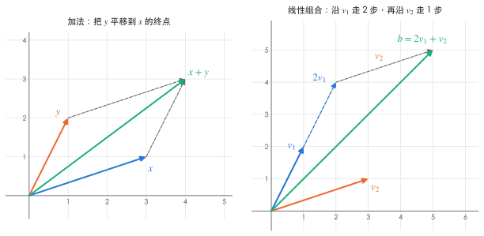
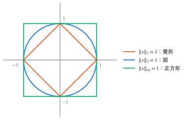
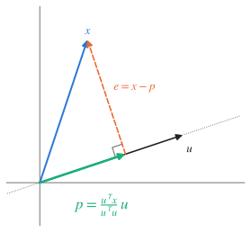

# 向量、内积与范数

神经网络里流动的数据几乎都是向量：一个 token 的表征是向量，一层的输出是向量，一次反向传播得到的梯度也是向量。对向量能做的基本运算只有三种：线性组合（加法和数乘）、内积（衡量两个向量有多"对齐"）、范数（衡量一个向量有多"大"）。本章讲这三种运算的含义和算法，以及它们在向量检索、注意力和梯度裁剪里的用法。

```python
import numpy as np
```

## 1. 向量与线性组合

### 三种看法

$\R^n$ 中的向量 $x$ 是 $n$ 个实数排成的一列，$x=[x_1\ \cdots\ x_n]\tp$。同一个对象有三种看法，用哪种取决于场合：

- **有序数组**：$n$ 个数，写代码时就是 shape 为 `(n,)` 的数组。
- **箭头**：从原点指向坐标 $(x_1,\dots,x_n)$ 的有向线段，有长度和方向。讨论夹角、投影时用这种看法。
- **空间中的点**：箭头的终点。讨论距离、聚类、最近邻时用这种看法。

$n=2,3$ 时可以直接画图；$n$ 更大时画不出来，但加法、内积、长度的公式完全相同，二维图像里得到的结论大多可以照搬。

### 加法、数乘与线性组合

加法和数乘都逐分量进行：

$$
x+y=\bmat{x_1+y_1\\ \vdots\\ x_n+y_n},\qquad cx=\bmat{cx_1\\ \vdots\\ cx_n}
$$

几何上，$x+y$ 是把 $y$ 的起点平移到 $x$ 的终点后得到的箭头（平行四边形法则）；$cx$ 把 $x$ 拉长 $\lvert c\rvert$ 倍，$c<0$ 时反向。

把两种运算合起来，就是**线性组合**（linear combination）：

$$
c_1v_1+c_2v_2+\cdots+c_kv_k
$$

$v_1,\dots,v_k$ 的全体线性组合构成的集合称为它们**张成**（span）的空间。两个不共线的二维向量可以组合出平面上的任何一点；两个共线的向量只能组合出一条直线。"一组向量能张成多大的空间"是[线性无关、秩与四个基本子空间](subspaces.md)一章的主题。

{ .diagram }

??? example "例：把一个向量写成线性组合"
    设 $v_1=[1\ \ 2]\tp$，$v_2=[3\ \ 1]\tp$，把 $b=[5\ \ 5]\tp$ 写成 $c_1v_1+c_2v_2$。

    **解** 逐分量写出来是两个方程：

    $$
    c_1+3c_2=5,\qquad 2c_1+c_2=5
    $$

    第二式减去第一式的 2 倍，得 $-5c_2=-5$，所以 $c_2=1$，代回得 $c_1=2$：

    $$
    b=2v_1+v_2=\bmat{2\\4}+\bmat{3\\1}=\bmat{5\\5}
    $$

    求线性组合的系数就是解线性方程组，系统的解法见[线性方程组、消元与逆矩阵](linear-systems.md)。

## 2. 内积与夹角

### 定义与计算

两个同维向量的**内积**（inner product，也叫点积）是对应分量乘积之和，结果是一个数：

$$
x\tp y=\sum_{i=1}^n x_iy_i
$$

它满足对称性 $x\tp y=y\tp x$、对每个变量的线性 $(ax+bz)\tp y=a\,x\tp y+b\,z\tp y$，以及正定性：$x\tp x\ge0$，等号只在 $x=0$ 时成立。向量的长度（2-范数）由内积定义：$\lVert x\rVert=\sqrt{x\tp x}$。

### 几何意义

对以 $x$、$y$、$x-y$ 为三边的三角形用余弦定理，$\lVert x-y\rVert^2=\lVert x\rVert^2+\lVert y\rVert^2-2\lVert x\rVert\lVert y\rVert\cos\theta$；另一方面直接展开，$\lVert x-y\rVert^2=\lVert x\rVert^2+\lVert y\rVert^2-2x\tp y$。两式对比得到

$$
x\tp y=\lVert x\rVert\,\lVert y\rVert\cos\theta
$$

所以内积同时包含两个信息：两个向量的长度，以及它们方向的一致程度。

- $x\tp y>0$：夹角小于 $90^\circ$，方向大体一致；
- $x\tp y=0$：**正交**（orthogonal），记作 $x\perp y$；
- $x\tp y<0$：夹角大于 $90^\circ$，方向大体相反。

把长度的影响除掉，剩下的就是夹角余弦：

$$
\cos\theta=\frac{x\tp y}{\lVert x\rVert\,\lVert y\rVert}
$$

### 两个不等式

因为 $\lvert\cos\theta\rvert\le1$，有 **Cauchy–Schwarz 不等式**：

$$
\lvert x\tp y\rvert\le\lVert x\rVert\,\lVert y\rVert
$$

等号成立当且仅当 $x$ 与 $y$ 共线。（严格地说应当先证这个不等式，再用它保证 $\cos\theta$ 的定义合法。证明：$\lVert x-ty\rVert^2=\lVert x\rVert^2-2t\,x\tp y+t^2\lVert y\rVert^2\ge0$ 对所有 $t$ 成立，这个关于 $t$ 的二次式判别式非正，即 $(x\tp y)^2\le\lVert x\rVert^2\lVert y\rVert^2$。）

由它可以推出**三角不等式** $\lVert x+y\rVert\le\lVert x\rVert+\lVert y\rVert$：

$$
\lVert x+y\rVert^2=\lVert x\rVert^2+2x\tp y+\lVert y\rVert^2\le\lVert x\rVert^2+2\lVert x\rVert\lVert y\rVert+\lVert y\rVert^2=(\lVert x\rVert+\lVert y\rVert)^2
$$

```python
x = np.array([1., 2., 2.])
y = np.array([3., 0., 4.])
print(x + y, 2 * x)                            # [4. 2. 6.] [2. 4. 4.]
print(x @ y, np.dot(x, y))                     # 11.0 11.0
print(np.linalg.norm(x), np.linalg.norm(y))    # 3.0 5.0
cos = x @ y / (np.linalg.norm(x) * np.linalg.norm(y))
print(round(cos, 4), round(np.degrees(np.arccos(cos)), 2))   # 0.7333 42.83
```

??? example "例：求两个向量的夹角"
    求 $x=[1\ \ 2\ \ 2]\tp$ 与 $y=[3\ \ 0\ \ 4]\tp$ 的夹角。

    **解** $x\tp y=1\cdot3+2\cdot0+2\cdot4=11$，$\lVert x\rVert=\sqrt{1+4+4}=3$，$\lVert y\rVert=\sqrt{9+0+16}=5$，

    $$
    \cos\theta=\frac{11}{3\times5}=\frac{11}{15}\approx0.733,\qquad\theta\approx42.8^\circ
    $$

    自检：$\lvert x\tp y\rvert=11\le15=\lVert x\rVert\lVert y\rVert$，满足 Cauchy–Schwarz 不等式。

??? example "例：用 Cauchy–Schwarz 不等式求最大值"
    在 $x_1^2+x_2^2+x_3^2=1$ 的条件下，求 $x_1+2x_2+3x_3$ 的最大值。

    **解** 记 $a=[1\ \ 2\ \ 3]\tp$，目标函数是内积 $a\tp x$，约束是 $\lVert x\rVert=1$。由 Cauchy–Schwarz 不等式，

    $$
    a\tp x\le\lVert a\rVert\,\lVert x\rVert=\sqrt{14}\approx3.742
    $$

    等号在 $x$ 与 $a$ 同向时取到，即 $x=a/\lVert a\rVert=\frac1{\sqrt{14}}[1\ \ 2\ \ 3]\tp$。

    这个结论以后会反复用到：**在长度固定的向量里，与 $a$ 内积最大的是和 $a$ 同方向的那个**。梯度是函数值上升最快的方向，就是这个结论用在方向导数 $\nabla f\tp d$ 上。

## 3. 范数与距离

### 三种常用范数

**范数**（norm）衡量向量的大小。最常用的三种是

$$
\lVert x\rVert_2=\sqrt{\sum_i x_i^2},\qquad \lVert x\rVert_1=\sum_i\lvert x_i\rvert,\qquad \lVert x\rVert_\infty=\max_i\lvert x_i\rvert
$$

2-范数是通常意义下的长度（欧氏长度），不写下标时默认指它；1-范数是各分量绝对值之和；$\infty$-范数是绝对值最大的分量。三者都是 $p$-范数 $\lVert x\rVert_p=(\sum_i\lvert x_i\rvert^p)^{1/p}$ 的特例，都满足范数的三条性质：

- 正定：$\lVert x\rVert\ge0$，且只有 $x=0$ 时为 0；
- 齐次：$\lVert cx\rVert=\lvert c\rvert\,\lVert x\rVert$；
- 三角不等式：$\lVert x+y\rVert\le\lVert x\rVert+\lVert y\rVert$。

不同范数的差别可以从**单位球**（范数等于 1 的点的集合）的形状看出来：2-范数的单位球是圆，1-范数的是顶点在坐标轴上的菱形，$\infty$-范数的是正方形。

{ .diagram }

图中菱形在圆内、圆在正方形内，对应同一个向量的三种范数的大小关系：

$$
\lVert x\rVert_\infty\le\lVert x\rVert_2\le\lVert x\rVert_1\le\sqrt n\,\lVert x\rVert_2\le n\,\lVert x\rVert_\infty
$$

（其中 $\lVert x\rVert_1\le\sqrt n\,\lVert x\rVert_2$ 是把 Cauchy–Schwarz 不等式用在 $[\lvert x_1\rvert\ \cdots\ \lvert x_n\rvert]\tp$ 和全 1 向量 $\mathbf 1$ 上。）

### 归一化与距离

把非零向量除以自己的长度，得到同方向的**单位向量**，这一步叫归一化（normalization）：

$$
\hat x=\frac{x}{\lVert x\rVert},\qquad\lVert\hat x\rVert=1
$$

两个点之间的**距离**是差向量的范数 $\lVert x-y\rVert$。

```python
x = np.array([3., -4., 0., 12.])
print(np.linalg.norm(x, 1), np.linalg.norm(x), np.linalg.norm(x, np.inf))   # 19.0 13.0 12.0
u = x / np.linalg.norm(x)
print(u.round(4), np.linalg.norm(u))    # [ 0.2308 -0.3077  0.      0.9231] 1.0
```

??? example "例：三种范数与归一化"
    对 $x=[3\ \ {-4}\ \ 0\ \ 12]\tp$，求 $\lVert x\rVert_1$、$\lVert x\rVert_2$、$\lVert x\rVert_\infty$ 和同方向的单位向量。

    **解**

    $$
    \lVert x\rVert_1=3+4+0+12=19,\qquad\lVert x\rVert_2=\sqrt{9+16+0+144}=13,\qquad\lVert x\rVert_\infty=12
    $$

    单位向量 $\hat x=\frac1{13}[3\ \ {-4}\ \ 0\ \ 12]\tp$。自检大小关系：$12\le13\le19\le\sqrt4\times13=26$。

!!! info "AI 联系"
    在损失函数上加 $\lambda\lVert w\rVert_2^2$ 是 $\ell_2$ 正则，它把所有权重一起往 0 拉，梯度下降下等价于权重衰减（weight decay），见[正交、投影与最小二乘](orthogonality.md)；加 $\lambda\lVert w\rVert_1$ 是 $\ell_1$ 正则，倾向于让一部分权重恰好为 0，得到稀疏的解。

## 4. 向一个向量投影

### 意义

给定非零向量 $u$，把 $x$ 拆成两部分：沿 $u$ 方向的分量 $p$，和与 $u$ 垂直的分量 $e$。$p$ 称为 $x$ 在 $u$ 上的**投影**（projection），它是 $u$ 所在直线上离 $x$ 最近的点。

{ .diagram }

### 计算

设 $p=cu$。要求残差 $e=x-cu$ 与 $u$ 正交：$u\tp(x-cu)=0$，解得 $c=\dfrac{u\tp x}{u\tp u}$，于是

$$
p=\frac{u\tp x}{u\tp u}\,u,\qquad e=x-p,\qquad u\tp e=0
$$

$u$ 是单位向量时公式简化为 $p=(u\tp x)\,u$：**内积 $u\tp x$ 就是 $x$ 沿 $u$ 方向的坐标**。因为 $p\perp e$，勾股定理成立：$\lVert x\rVert^2=\lVert p\rVert^2+\lVert e\rVert^2$。

"离 $x$ 最近"可以直接验证：对直线上任意一点 $tu$，$x-tu=e+(c-t)u$，两项正交，所以 $\lVert x-tu\rVert^2=\lVert e\rVert^2+(c-t)^2\lVert u\rVert^2\ge\lVert e\rVert^2$。

!!! tip "方法：求 $x$ 在 $u$ 上的投影"
    1. 算两个内积 $u\tp x$ 和 $u\tp u$，得系数 $c=u\tp x/u\tp u$。
    2. 投影 $p=cu$，残差 $e=x-p$。
    3. 自检 $u\tp e=0$。

??? example "例：向全 1 向量投影"
    求 $x=[1\ \ 2\ \ 3]\tp$ 在 $\mathbf 1=[1\ \ 1\ \ 1]\tp$ 上的投影和残差。

    **解** $\mathbf 1\tp x=6$，$\mathbf 1\tp\mathbf 1=3$，$c=2$：

    $$
    p=2\cdot\mathbf 1=\bmat{2\\2\\2},\qquad e=x-p=\bmat{-1\\0\\1},\qquad\mathbf 1\tp e=-1+0+1=0
    $$

    系数 $c=\frac1n\sum_ix_i$ 正是各分量的**均值**。所以"每个分量减去均值"这个操作，在几何上是去掉向量在 $\mathbf 1$ 方向上的投影，只留下与 $\mathbf 1$ 正交的部分。LayerNorm 的第一步就是这个操作，见[用线性代数读 Transformer](transformer-linalg.md)。

向一个向量投影是最简单的情形。向多个向量张成的子空间投影，以及由它导出的最小二乘，见[正交、投影与最小二乘](orthogonality.md)。

## 5. 词向量与余弦相似度检索

### embedding 是向量

语言模型处理文本的第一步，是把每个 token 映射成一个 $d$ 维向量，称为词向量或嵌入（embedding）；句子、段落、图片也可以经过模型编码成一个向量。训练的结果是：含义相近的对象，向量的方向也相近。于是"两段文字的意思有多接近"这个问题，就变成了"两个向量的夹角有多小"。

### 余弦相似度

**余弦相似度**（cosine similarity）就是第 2 节的夹角余弦：

$$
\cos(a,b)=\frac{a\tp b}{\lVert a\rVert\,\lVert b\rVert}\in[-1,1]
$$

它只看方向，不受向量长度影响。实际系统里通常先把所有向量归一化成单位向量，这样有两个好处：

- 余弦相似度等于点积，$\cos(a,b)=a\tp b$，一次矩阵乘法就能算出查询和所有文档的相似度；
- 欧氏距离和余弦相似度给出相同的排序，因为对单位向量

$$
\lVert a-b\rVert^2=\lVert a\rVert^2-2a\tp b+\lVert b\rVert^2=2-2\cos(a,b)
$$

没有归一化时，点积、余弦、欧氏距离是三个不同的标准，排序可能完全不同。

??? example "例：三种标准下的检索排序"
    查询向量 $q=[2\ \ 1\ \ 2]\tp$，四条文档的向量为

    $$
    d_1=\bmat{2\\2\\1},\quad d_2=\bmat{4\\0\\3},\quad d_3=\bmat{0\\3\\4},\quad d_4=\bmat{6\\6\\3}
    $$

    分别按点积、余弦相似度、欧氏距离排序。

    **解** $\lVert q\rVert=3$，四条文档的长度依次为 $3,\,5,\,5,\,9$。

    | 文档 | 点积 $q\tp d_i$ | 余弦 | 距离 $\lVert q-d_i\rVert$ |
    | --- | --- | --- | --- |
    | $d_1$ | $8$ | $8/9\approx0.889$ | $\sqrt2\approx1.41$ |
    | $d_2$ | $14$ | $14/15\approx0.933$ | $\sqrt6\approx2.45$ |
    | $d_3$ | $11$ | $11/15\approx0.733$ | $\sqrt{12}\approx3.46$ |
    | $d_4$ | $24$ | $24/27\approx0.889$ | $\sqrt{42}\approx6.48$ |

    - 按点积：$d_4>d_2>d_3>d_1$；
    - 按余弦：$d_2>d_1=d_4>d_3$；
    - 按距离（越小越近）：$d_1,\ d_2,\ d_3,\ d_4$。

    $d_4=3d_1$，两者方向完全相同，余弦相似度相等；但点积把 $d_4$ 排在第一、$d_1$ 排在最后，欧氏距离正好反过来。点积偏向长向量，欧氏距离偏向长度和查询接近的向量，只有余弦不受长度影响。归一化之后三种排序一致，都是余弦的排序。

```python
q = np.array([2., 1., 2.])
D = np.array([[2., 2., 1.], [4., 0., 3.], [0., 3., 4.], [6., 6., 3.]])   # 一行是一条文档
print(D @ q)                                   # [ 8. 14. 11. 24.]，点积
print(np.linalg.norm(D - q, axis=1).round(3))  # [1.414 2.449 3.464 6.481]，欧氏距离

Dn = D / np.linalg.norm(D, axis=1, keepdims=True)   # 每行归一化
qn = q / np.linalg.norm(q)
cos = Dn @ qn
print(cos.round(3))                            # [0.889 0.933 0.733 0.889]
print(np.argsort(-cos, kind="stable"))         # [1 0 3 2]，相似度从高到低的文档下标
print(np.allclose(np.sum((Dn - qn) ** 2, axis=1), 2 - 2 * cos))   # True
```

`D @ q` 这一步把查询与每一行做内积，是[矩阵与线性变换](matrices.md)里"按行看矩阵乘向量"的直接应用。检索增强生成（RAG）里的向量检索做的就是这件事，只是文档数量很大，需要用近似最近邻索引代替逐条计算。

## 6. 注意力分数里的点积与 $\sqrt{d_k}$

### 注意力分数是点积

Transformer 的注意力用查询向量 $q$ 和键向量 $k$ 的点积 $q\tp k$ 作为"$q$ 应该关注 $k$ 多少"的分数，再对同一个 $q$ 的所有分数做 softmax 得到权重。公式里分数要先除以 $\sqrt{d_k}$（$d_k$ 是 $q$、$k$ 的维数），原因在于点积的大小随维数增长。

### 点积的方差

假设 $q$、$k$ 的各分量相互独立，均值为 0、方差为 1。则

$$
\mathrm E[q\tp k]=\sum_{i=1}^{d_k}\mathrm E[q_i]\,\mathrm E[k_i]=0
$$

$$
\mathrm{Var}(q\tp k)=\sum_{i=1}^{d_k}\mathrm{Var}(q_ik_i)=\sum_{i=1}^{d_k}\mathrm E[q_i^2]\,\mathrm E[k_i^2]=d_k
$$

（各项 $q_ik_i$ 相互独立，所以和的方差等于方差的和；每一项均值为 0，方差等于 $\mathrm E[q_i^2k_i^2]=1$。）点积的标准差是 $\sqrt{d_k}$：维数越高，分数的绝对值越大。除以 $\sqrt{d_k}$ 之后，方差回到 1，与维数无关。

```python
rng = np.random.default_rng(0)
for d in (16, 64, 256, 1024):
    q = rng.standard_normal((10000, d))
    k = rng.standard_normal((10000, d))
    s = np.sum(q * k, axis=1)                  # 10000 对向量的点积
    print(d, round(s.std(), 2), round((s / np.sqrt(d)).std(), 3))
# 16 4.04 1.011
# 64 8.03 1.004
# 256 15.99 1.0
# 1024 32.05 1.002
```

### 分数过大的后果

softmax 对输入的尺度很敏感：输入整体放大，输出就向 one-hot 靠拢。

??? example "例：缩放前后的 softmax"
    $d_k=64$ 时，点积的典型大小是 $\sqrt{64}=8$。设某个查询对三个键的分数为 $s=[8\ \ 0\ \ {-8}]$，比较 $\mathrm{softmax}(s)$ 与 $\mathrm{softmax}(s/\sqrt{d_k})$。

    **解** 不缩放时：

    $$
    \mathrm{softmax}(s)=\frac{[\e^{8}\ \ \e^{0}\ \ \e^{-8}]}{\e^{8}+1+\e^{-8}}\approx[0.99966\ \ \ 0.00034\ \ \ 0.0000001]
    $$

    几乎全部权重都给了第一个键。除以 $\sqrt{64}=8$ 后 $s/8=[1\ \ 0\ \ {-1}]$：

    $$
    \mathrm{softmax}(s/8)=\frac{[\e\ \ 1\ \ \e^{-1}]}{\e+1+\e^{-1}}\approx[0.665\ \ \ 0.245\ \ \ 0.090]
    $$

    三个键都有可观的权重。

softmax 输出接近 one-hot 时处于饱和区，对输入的导数接近 0（softmax 的 Jacobian 是 $\diag(p)-pp\tp$，$p$ 为 one-hot 时它是零矩阵，推导见[矩阵求导与反向传播](matrix-calculus.md)），梯度传不回去，训练初期尤其不利。下面的实验对每个查询随机生成 8 个键，统计 softmax 输出里最大那个权重的平均值：

```python
def softmax(z):
    z = z - z.max(axis=-1, keepdims=True)
    e = np.exp(z)
    return e / e.sum(axis=-1, keepdims=True)

rng = np.random.default_rng(0)
for d in (16, 64, 256, 1024):
    q = rng.standard_normal((2000, 1, d))
    k = rng.standard_normal((2000, 8, d))
    s = (q * k).sum(axis=-1)                   # (2000, 8)：每个查询对 8 个键的分数
    print(d, round(softmax(s).max(axis=-1).mean(), 3),
          round(softmax(s / np.sqrt(d)).max(axis=-1).mean(), 3))
# 16 0.738 0.352
# 64 0.881 0.364
# 256 0.943 0.363
# 1024 0.969 0.362
```

不缩放时，最大权重随维数升高趋近 1；缩放后稳定在 0.36 左右，与维数无关。注意力的完整计算见[用线性代数读 Transformer](transformer-linalg.md)。

## 7. 高维空间里随机向量近似正交

### 结论

在二维平面上随机取两个方向，夹角是多少都有可能。维数升高以后情况不同：**随机取的两个高维向量几乎总是接近正交**。

设 $u$ 是固定的单位向量，$x$ 在 $\R^d$ 的单位球面上均匀分布。由对称性，$x$ 的各分量同分布，而 $\sum_ix_i^2=1$，所以 $\mathrm E[x_i^2]=1/d$。取 $u=e_1$（由对称性不失一般性），$\cos\theta=u\tp x=x_1$，因此

$$
\mathrm E[\cos\theta]=0,\qquad\mathrm{Var}(\cos\theta)=\frac1d
$$

夹角余弦的标准差是 $1/\sqrt d$，维数越高越集中在 0 附近。

```python
rng = np.random.default_rng(0)
for d in (2, 10, 100, 1000, 10000):
    a = rng.standard_normal((2000, d))
    b = rng.standard_normal((2000, d))
    cos = np.sum(a * b, axis=1) / (np.linalg.norm(a, axis=1) * np.linalg.norm(b, axis=1))
    print(d, round(cos.std(), 4), round(1 / np.sqrt(d), 4), round(np.abs(cos).max(), 3))
# 2 0.7132 0.7071 1.0
# 10 0.3189 0.3162 0.887
# 100 0.0975 0.1 0.384
# 1000 0.0321 0.0316 0.114
# 10000 0.01 0.01 0.044
```

三列分别是余弦的实测标准差、理论值 $1/\sqrt d$、2000 对向量里绝对值最大的余弦。$d=1000$ 时，2000 对随机向量里最不正交的一对，余弦也只有 0.114。

### 两点含义

**相似度要对照维数来读。** 随机向量的余弦落在 $\pm1/\sqrt d$ 的量级，所以同一个数值在不同维数下的含义不同。

??? example "例：余弦 0.3 算不算相似"
    两个 768 维的句向量余弦相似度为 0.3。如果它们是互不相关的随机方向，出现这么大的余弦有多罕见？

    **解** 随机方向的余弦标准差为 $1/\sqrt{768}\approx0.036$，$0.3$ 相当于

    $$
    \frac{0.3}{1/\sqrt{768}}=0.3\times\sqrt{768}\approx8.3
    $$

    个标准差，随机情形下几乎不可能出现。所以在高维空间里，0.3 的余弦已经说明两个向量明显相关；而在二维平面上，0.3 的余弦对应约 $72.5^\circ$ 的夹角，随手画两个箭头就很容易遇到。

    这个估计假设向量的方向在球面上均匀分布。实际模型输出的句向量往往集中在某些方向附近，随机两句话的余弦本身就偏高，判断时应以同一个模型下不相关文本的余弦分布为基准。

**$d$ 维空间放得下远多于 $d$ 个近似正交的方向。** 严格两两正交的非零向量在 $\R^d$ 中最多 $d$ 个；但如果只要求两两余弦的绝对值不超过某个小的阈值，能放下的向量个数随 $d$ 指数增长。这是几百到几千维的表征能够区分几万个 token 的几何前提：不同 token 的向量可以做到彼此的内积都很小。可解释性研究里把"用 $d$ 维表征同时表示多于 $d$ 个特征"的现象称为叠加（superposition）。

## 8. 按范数做梯度裁剪

### 做法

训练中偶尔会出现范数特别大的梯度，一步更新就把参数带到很远的地方。**梯度裁剪**（gradient clipping）给梯度的范数设一个上限 $c$：

$$
g\leftarrow g\cdot\min\!\left(1,\ \frac{c}{\lVert g\rVert}\right)
$$

$\lVert g\rVert\le c$ 时不变；$\lVert g\rVert>c$ 时整体缩小到范数恰好为 $c$。这是数乘，**只改变长度，不改变方向**。这里的 $g$ 是把模型所有参数的梯度拼成一个长向量，范数是全局的：$\lVert g\rVert=\sqrt{\sum_j\lVert g_j\rVert^2}$，$g_j$ 为第 $j$ 个参数张量的梯度。PyTorch 里对应 `torch.nn.utils.clip_grad_norm_(model.parameters(), max_norm)`。

??? example "例：按全局范数裁剪"
    模型有两个参数张量，梯度分别为 $g_1=[3\ \ 4]\tp$、$g_2=[12]$，上限 $c=1$。求裁剪后的梯度。

    **解** 全局范数

    $$
    \lVert g\rVert=\sqrt{3^2+4^2+12^2}=\sqrt{169}=13>1
    $$

    缩放系数为 $c/\lVert g\rVert=1/13$，裁剪后

    $$
    g_1'=\tfrac1{13}\bmat{3\\4}\approx\bmat{0.231\\0.308},\qquad g_2'=\tfrac{12}{13}\approx0.923
    $$

    新的全局范数为 1，三个分量的比例仍是 $3:4:12$。

    对比按值裁剪（`clip_grad_value_`，把每个分量限制在 $[-c,c]$ 内）：取 $c=5$，结果是 $[3\ \ 4\ \ 5]$，比例变成 $3:4:5$，更新方向改变了。

```python
def clip_by_global_norm(grads, max_norm):
    total = np.sqrt(sum(np.sum(g ** 2) for g in grads))   # 所有梯度拼成一个向量的 2-范数
    scale = min(1.0, max_norm / total)
    return [g * scale for g in grads], total

grads = [np.array([3., 4.]), np.array([12.])]
clipped, total = clip_by_global_norm(grads, 1.0)
print(total, [g.round(4) for g in clipped])   # 13.0 [array([0.2308, 0.3077]), array([0.9231])]
print(clip_by_global_norm(grads, 20.0)[0])    # [array([3., 4.]), array([12.])]，没超过上限，不变
```

!!! warning "易错点"
    - 内积要求两个向量维数相同，结果是标量；$x\tp y$ 和 $xy\tp$ 不是一回事，后者是矩阵（外积，见[矩阵与线性变换](matrices.md)）。
    - 余弦相似度不满足三角不等式，不是距离；$1-\cos$ 也不是。需要真正的距离时，对归一化后的向量用欧氏距离。
    - 零向量没有方向，不能归一化；代码里除以范数前通常加一个很小的 $\varepsilon$，或者先检查范数。
    - 梯度裁剪的范数是所有参数合在一起算的，不是每个张量各自裁剪到 $c$；后者会改变不同张量之间的比例，也就改变了更新方向。

## 小结

| 概念 | 公式 | 含义 | 在 AI 里 |
| --- | --- | --- | --- |
| 线性组合 | $\sum_ic_iv_i$ | 沿各个方向分别走若干步 | 层的输出是权重列向量的线性组合 |
| 内积 | $x\tp y=\lVert x\rVert\lVert y\rVert\cos\theta$ | 长度与方向一致程度的乘积 | 注意力分数、logits |
| 夹角余弦 | $\dfrac{x\tp y}{\lVert x\rVert\lVert y\rVert}$ | 只看方向的相似度 | 余弦相似度检索 |
| 正交 | $x\tp y=0$ | 互不包含对方的成分 | 高维随机向量近似正交 |
| 2-范数 | $\sqrt{\sum_ix_i^2}$ | 欧氏长度 | 梯度裁剪、$\ell_2$ 正则 |
| 1-范数 | $\sum_i\lvert x_i\rvert$ | 绝对值之和 | $\ell_1$ 正则与稀疏 |
| 投影 | $\dfrac{u\tp x}{u\tp u}u$ | $u$ 方向上离 $x$ 最近的点 | 减均值是去掉 $\mathbf 1$ 方向的分量 |
| Cauchy–Schwarz | $\lvert x\tp y\rvert\le\lVert x\rVert\lVert y\rVert$ | 同向时内积最大 | 梯度方向是上升最快的方向 |

几个值得记住的数量级：各分量方差为 1 的两个 $d$ 维随机向量，点积的标准差是 $\sqrt d$；两个随机方向夹角余弦的标准差是 $1/\sqrt d$；单位向量之间 $\lVert a-b\rVert^2=2-2\cos\theta$。
