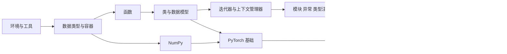

# Python 编程

面向大模型算法方向的 Python 教程。内容只覆盖做训练、评测、数据处理时真正会用到的部分：语言本身的核心机制、文本与数据文件处理、NumPy、并发调用接口、PyTorch 的基本写法。每章的代码都可以直接复制运行（Python ≥ 3.10，NumPy 2.x，PyTorch 2.x）。

## 阅读顺序

已经会写 Python 的读者，可以直接看第 4、5 章（类的特殊方法、生成器）和第 8～10 章，这几部分和读模型代码、写训练脚本的关系最直接。

准备笔试和面试手撕代码，见 [算法刷题](../algo/index.md)。

## 全部章节

<!-- articles -->
