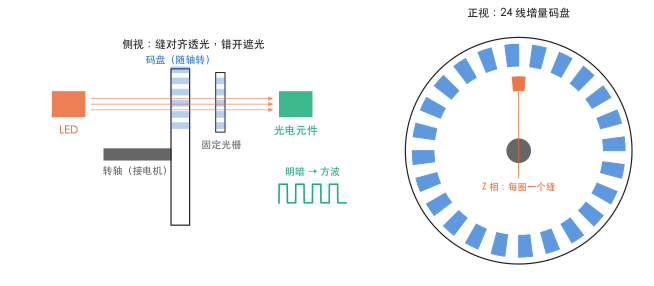
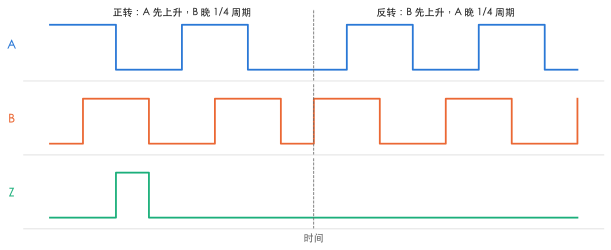
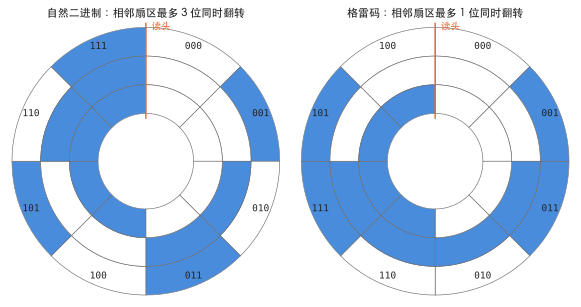

# 编码器全景：传感器、逻辑电路、编解码与表示学习

!!! abstract "TL;DR"
    编码器（Encoder）就是把一种形式的信息转换成标准化的编码、脉冲或特征表示的装置或算法。同一个词在四个领域里解决的问题完全不同：

    | 领域 | 输入 → 输出 | 解决的问题 | 代表 |
    | --- | --- | --- | --- |
    | 工业与机电 | 机械角度 / 位移 → 脉冲或数字码 | 控制器要知道电机转到哪、转多快 | 增量式、绝对式编码器 |
    | 数字电路 | $2^n$ 根输入线 → $n$ 位二进制 | 少用信号线，并且多路同时请求时只认一个 | 74LS148 优先编码器 |
    | 多媒体与通信 | 原始比特 → 更短或更可靠的比特 | 数据太大（信源编码），传输会出错（信道编码） | H.264、AAC；汉明码、LDPC、Polar |
    | 人工智能 | 文字 / 图像 / 类别 → 向量 | 让模型能计算原始数据 | One-Hot、VAE、BERT、ViT |

    共同点是“编码”这一步本身不改变信息的含义，只换一种更适合下游处理的表示；对应的反向过程叫解码 / 译码（Decoder）。

文中的数字和例子（四倍频分辨率、格雷码性质、74LS148 真值表、视频原始码率、汉明码纠错、One-Hot 距离）都由 [`scripts/encoder/verify_encoder.py`](https://github.com/zsyverse/knowledge/blob/main/scripts/encoder/verify_encoder.py) 核对过，插图由 [`fig_encoder.py`](https://github.com/zsyverse/knowledge/blob/main/scripts/encoder/fig_encoder.py) 生成。

---

## 一、工业与机电控制：位置与速度编码器

日常工程里说“编码器”，多半指这一类硬件。它把机械运动（角度、位移、转速）转换成电脉冲或数字信号，让控制器（PLC、单片机、伺服驱动器）知道电机转了多少圈、现在停在哪个角度。

以最常见的光电编码器为例：LED 发出的光穿过随轴转动的码盘和一片固定光栅，两者的缝对齐时透光、错开时遮光，后面的光电元件把明暗变化转成电信号。

{ .diagram }

### 1. 按输出原理分类（最核心的选型维度）

| 类型 | 核心机制 | 作用与优缺点 | 典型场景 |
| --- | --- | --- | --- |
| **增量式**（Incremental） | 输出连续的 A/B 两相脉冲（相位差 90°，用来判断正反转）和每圈一个的 Z 相零点脉冲 | **测速与相对位移**。结构简单、成本低；但**断电后位置丢失**，上电要先回零（Homing） | 传送带测速、直流 / 步进电机闭环、音量旋钮 |
| **绝对式**（Absolute） | 码盘每个角度对应唯一的二进制码（常用格雷码），分单圈和多圈 | **精确定位**。抗干扰强，**断电重启后仍知道确切位置**；结构复杂、价格较高 | 工业机器人关节、CNC 数控机床、雷达天线云台 |

**增量式怎么判断方向。** A、B 两路缝错开 1/4 个栅距，所以两路方波相差 90°。正转时 A 先上升，反转时 B 先上升，控制器看“谁先变”就知道方向：

{ .diagram }

把 A、B 的四个状态 00 → 10 → 11 → 01 看成一个循环，每走一格计 +1，倒着走计 −1，A、B 的上升沿和下降沿都被利用起来，这叫**四倍频**。1000 线编码器四倍频后每圈 4000 个计数，角分辨率 $360°/4000 = 0.09°$。若两次采样之间状态跳了两格（00 → 11），就说明采样太慢丢了步，计数已经不可信。

**绝对式为什么用格雷码。** 绝对式码盘有好几圈码道，读头同时读出所有位。如果用自然二进制，从 011 到 100 要三位同时翻转，而光电元件不可能严格同时切换，读头在边界上可能短暂读出 000、111 这类完全错误的位置。格雷码（$g = k \oplus (k \gg 1)$）保证相邻位置只差 1 位，边界上最坏只会读成相邻两个位置之一：

{ .diagram }

伺服电机上常见的 17 位、23 位单圈绝对式编码器，17 位对应 $2^{17} = 131072$ 个位置，约 9.9 角秒一个。多圈绝对式再用齿轮组或带电池的计圈电路记录圈数。

### 2. 按传感介质分类

- **光电式（Optical）**：用光栅透光检测。**精度和分辨率极高**，但怕粉尘、油污、结露和剧烈振动。
- **磁电式（Magnetic）**：检测磁铁旋转引起的磁场变化（霍尔效应或磁阻效应）。**耐油污、抗振动、寿命长、体积小**，适合恶劣工业环境，极限精度略逊于顶级光电式。
- **电容式 / 电感式（Capacitive / Inductive）**：兼顾抗污能力和精度，用于高端数控机床（如海德汉的电感式编码器）和精密无刷电机。

!!! note "按运动形态"
    测量转轴的叫**旋转编码器**；测量直线导轨位移的叫**直线编码器**，光栅型的直线编码器常称**光栅尺**。

---

## 二、数字逻辑电路：二进制编码器

在数字电子技术里，编码器是一种基础组合逻辑电路，与译码器（Decoder）互为逆过程。它把多根独立的输入线压缩成紧凑的二进制代码，例如 $2^n$ 个输入压成 $n$ 位输出。

- **普通编码器（Simple Encoder）**：如 8 线-3 线编码器。任何时刻**只允许一个输入有效**。用或门实现时 $Y_2 = I_4 + I_5 + I_6 + I_7$，其余两位同理；若 $I_3$ 和 $I_5$ 同时为 1，输出是 $011 \lor 101 = 111$，即 7，两个都不是。
- **优先编码器（Priority Encoder）**：工程里真正用的是这种，经典芯片是 74LS148。允许多个输入同时有效，**只对优先级最高的那个编码**。74LS148 的输入和输出都是低电平有效，$\overline{I_7}$ 优先级最高；$\overline{I_3}$ 和 $\overline{I_5}$ 同时拉低时，输出 5 的反码 010。它还有使能输入 EI、使能输出 EO 和“有输入有效”标志 GS，两片级联可以扩展成 16 线-4 线。
- **典型用途**：CPU 的**中断控制**（键盘、网卡、定时器同时请求时，先响应优先级最高的）、键盘扫描时识别按下了哪个键。

---

## 三、多媒体与通信：信源编码与信道编码

在通信系统里，香农把编码分成两件事，方向正好相反：

1. **信源编码**去掉冗余，让数据变小；
2. **信道编码**加入受控的冗余，让数据经得起噪声。

### 1. 音视频编码器（Codec 中的 Encoder）

- **分类**：视频有 H.264/AVC、H.265/HEVC、AV1；音频有 AAC、MP3、Opus。按实现方式分为**软编码**（CPU 运算，画质可调空间大）和**硬编码**（GPU 或专用电路，如 NVIDIA 的 NVENC，速度快、功耗低）。
- **作用**：利用帧内与帧间预测去掉画面之间的重复，再用变换和量化丢掉人眼、人耳不敏感的细节。1080p60、8 位、4:2:0 的原始视频约 1.49 Gbit/s（187 MB/s），4K60、10 位、4:4:4 则接近 15 Gbit/s（约 1.9 GB/s）；编码后流媒体常用几到十几 Mbit/s，1080p60 压到 6 Mbit/s 相当于约 250:1。直播、点播和存储都靠这一步。

### 2. 信道编码器（Channel Encoder）

- **分类**：奇偶校验、汉明码、卷积码、Turbo 码、LDPC 码、Polar 码。
- **作用**：在数据里故意加入校验位，用于**检错和纠错**，让信号微弱或存储介质局部老化时数据仍能完整还原。最小的例子是汉明 (7,4) 码：4 位数据加 3 位校验，任意 1 位出错都能定位并纠正，代价是码率降到 $4/7$。
- **5G 中的分工**：5G NR 的数据信道用 LDPC 码，控制信道用 Polar 码；4G LTE 的数据信道用的是 Turbo 码。

---

## 四、人工智能与机器学习：特征与表示编码器

在数据科学和深度学习里，编码器把原始数据（文字、图像、类别）转成模型能计算的向量，稠密的那种常叫嵌入（Embedding）或潜在表示（Latent Representation）。

### 1. 数据预处理编码器（特征工程）

- **One-Hot Encoder（独热编码）**：把无序类别（如“红、黄、蓝”）转成互不重叠的二进制向量，如红 = `[1,0,0]`。任意两个类别之间的距离都相同（都是 $\sqrt{2}$），模型不会误以为类别有大小顺序。代价是类别多时维度很高、非常稀疏。
- **Label / Ordinal Encoder（标签 / 序数编码）**：把有序类别（如“低、中、高”）映射为整数 `0, 1, 2`。只适合真的有顺序的类别；如果拿它编码“红、黄、蓝”，模型会认为红和蓝的差距是红和黄的两倍。

### 2. 神经网络编码器

- **自编码器（Autoencoder / VAE）**：编码器把高维输入压到低维潜空间（Latent Space），解码器再还原，训练目标是重建误差。用于降噪、异常检测（重建误差大的样本可能异常）。Stable Diffusion 先用 VAE 编码器把 512×512×3 的图像压成 64×64×4 的潜变量（元素数少 48 倍），扩散过程在潜空间里进行，最后再由解码器还原，这是它比像素空间扩散省算力的关键。
- **Transformer 编码器（如 BERT、ViT）**：用双向自注意力，让每个位置都能看到整段文本或整张图像的所有部分，提取上下文语义。适合“理解输入”类任务：情感分析、语义搜索、图像分类。与之对应，GPT 这类只有解码器的模型用因果注意力，只看前文，擅长生成；T5 和原始 Transformer 则是编码器-解码器结构，常用于翻译、摘要。

---

## 小结：怎么判断别人说的是哪种编码器

| 听到的上下文 | 大概率指 |
| --- | --- |
| 伺服、电机、PLC、线数、ABZ、回零 | 位置 / 速度编码器 |
| 真值表、74 系列、中断、组合逻辑 | 二进制（优先）编码器 |
| 码率、H.264、NVENC、推流 | 音视频编码器 |
| 误码率、LDPC、Polar、纠错 | 信道编码器 |
| 特征、Embedding、潜空间、BERT | 表示编码器 |
